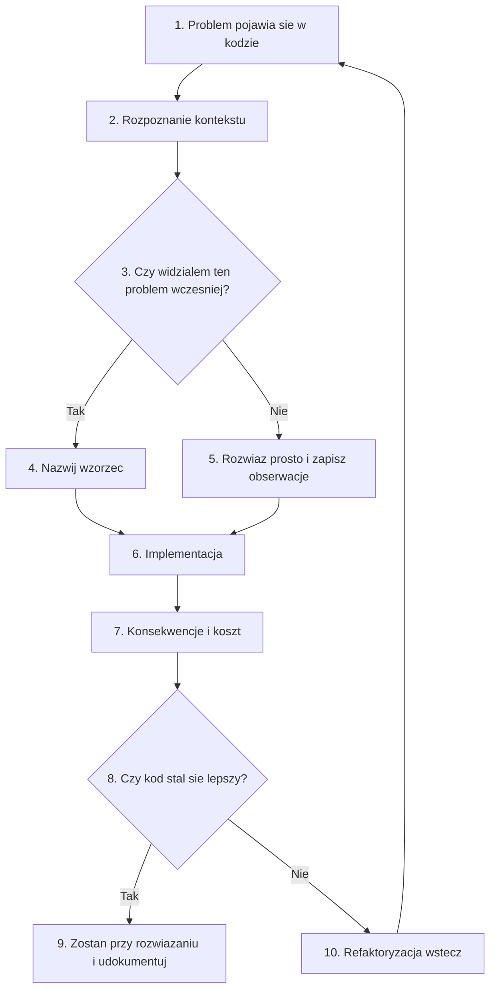
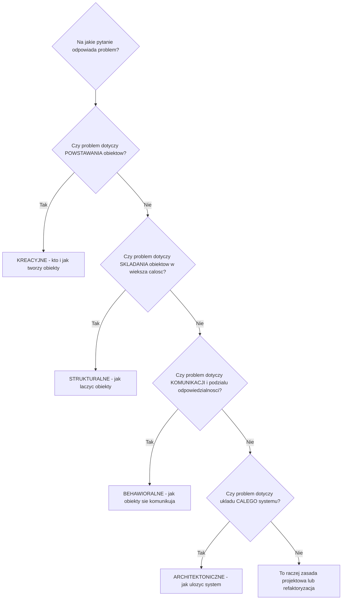
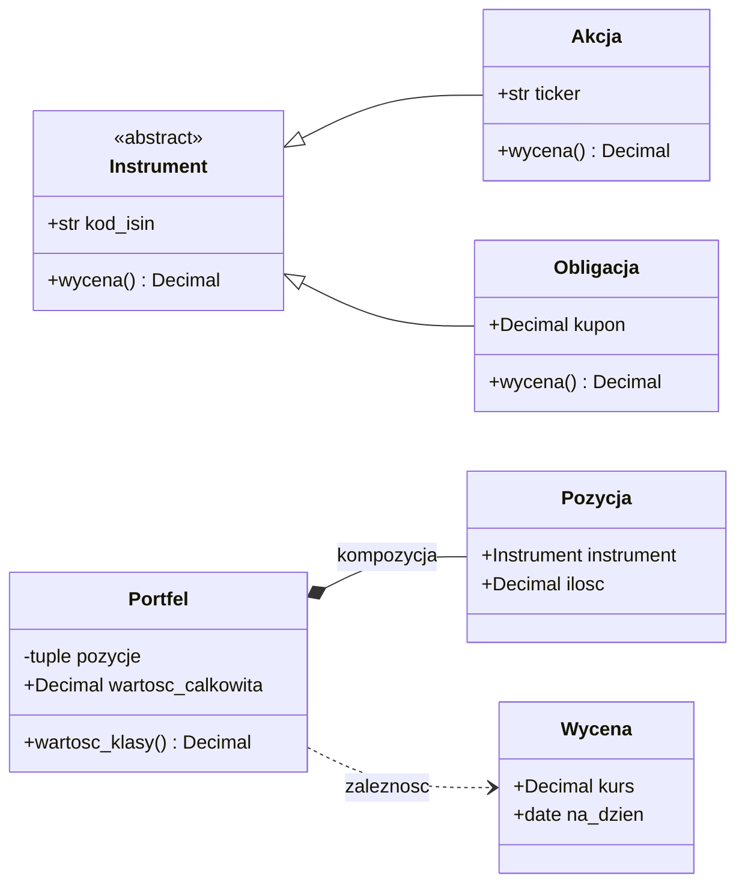
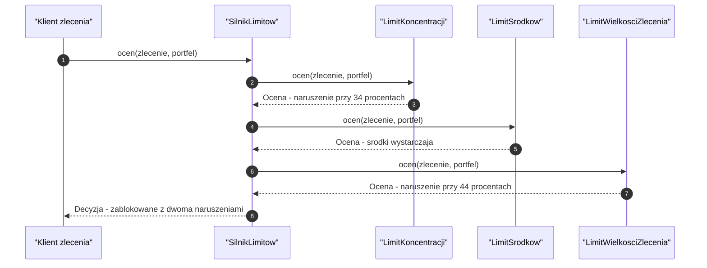
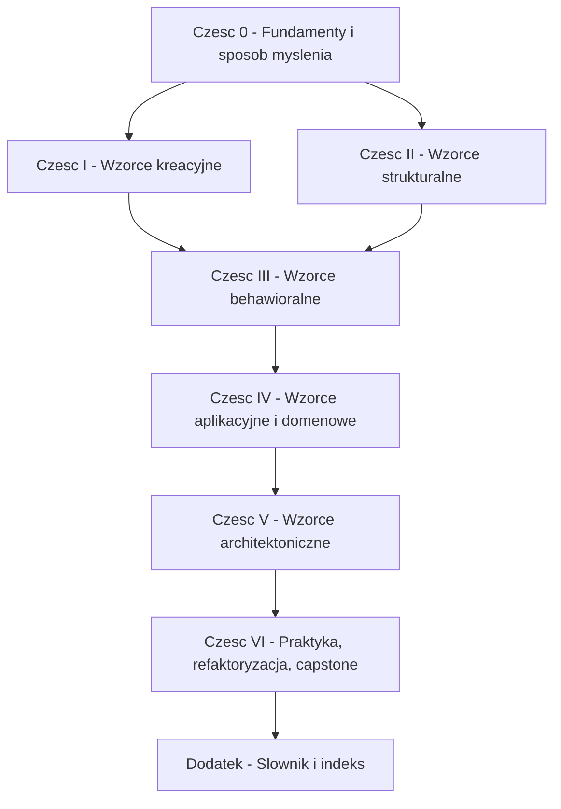

```markdown
---
modul: 00 — Jak myśleć o wzorcach projektowych
plik: 00-jak-myslec-o-wzorcach.md
poziom: podstawowy
wymaga: []
czas: ~75 minut czytania + ~120 minut ćwiczeń
---

# Moduł 00 — Jak myśleć o wzorcach projektowych — zanim napiszesz jedną klasę

> **TL;DR**
> - Wzorzec projektowy to **nazwany sposób rozwiązania powtarzalnego problemu w konkretnym kontekście** — nazwa, problem, rozwiązanie i konsekwencje, nic więcej i nic mniej.
> - Wzorzec nie jest biblioteką ani fragmentem kodu do wklejenia; to sposób myślenia i wspólny język zespołu.
> - Cztery rodziny wzorców odpowiadają na cztery różne pytania: kto i jak tworzy obiekty (kreacyjne), jak je ze sobą łączyć (strukturalne), jak się komunikują (behawioralne) oraz jak ułożyć cały system (architektoniczne).
> - Część wzorców GoF „rozpuszcza się" w Pythonie, bo język ma gotowe narzędzia (funkcje jako wartości, dekoratory, generatory) — ale nazwy tych wzorców wciąż są potrzebne do rozmowy z ludźmi i projektowania granic systemu.
> - Wzorzec to narzędzie, nie cel: każde użycie ma koszt, a umiejętność powiedzenia „nie użyję tu wzorca" jest równie cenna jak umiejętność jego zastosowania.

---

## 0. Model mentalny

### Zaczynamy od szachów, nie od kodu

Wyobraź sobie, że uczysz się grać w szachy. Pewnego dnia przegrywasz partię, a trener mówi: „po raz trzeci wyszedłeś skoczkiem na to pole i po raz trzeci straciłeś pionka w następnym ruchu". Zapisujesz tę sytuację na kartce: ustawienie bierek, powód wyjścia, konsekwencje. Tydzień później widzisz na szachownicy **dokładnie to samo ustawienie** i rozpoznajesz je od razu — nie musisz nic wymyślać, wiesz, co zrobić i czego unikać. Za dwa tygodnie robisz coś jeszcze ciekawszego: zamiast rozpoznawać sytuację, **celowo do niej dążysz**, bo wiesz, że przeciwnik wpadnie w pułapkę.

To właśnie są wzorce. W grze noszą nazwy („obrona sycylijska", „widełki", „szewska pułapka"), a w programowaniu też mają nazwy („strategia", „dekorator", „obserwator"). Nazwa jest tu kluczowa, bo pozwala w sekundę przekazać drugiej osobie informację, której opis zajmowałby pół strony. Mówisz „to klasyczny przypadek strategii" i doświadczony kolega z zespołu rozumie w tym momencie: że istnieje rodzina wymiennych algorytmów, że klient wybiera jeden z nich w czasie działania programu, że istnieje wspólny kontrakt, do którego wszystkie się dopasowują, i że istnieje miejsce, w którym ten wybór jest podejmowany. To bardzo dużo informacji w jednym słowie.

I jeszcze jedna rzecz z szachów jest ważna: **znajomość otwarć nie czyni cię dobrym graczem**. Możesz wyrecytować z pamięci pięćdziesiąt debiutów i przegrać partię z kimś, kto zna trzy, ale rozumie, co się dzieje na szachownicy. Dokładnie tak samo jest ze wzorcami: możesz znać wszystkie dwadzieścia trzy wzorce z katalogu GoF, a mimo to produkować gorszy kod od osoby, która zna trzy i wie, kiedy ich **nie** używać.

| W analogii szachowej | W kodzie |
|---|---|
| Ustawienie bierek na szachownicy | Konkretny problem w kodzie (np. rosnąca lawina `if/elif`) |
| Rozpoznanie sytuacji po raz drugi | Rozpoznanie, że ten sam problem widziałeś już w innym module projektu |
| Nazwa otwarcia lub pułapki | Nazwa wzorca („strategia", „rejestr", „adapter") |
| Zapis w notatniku trenera | Dokumentacja, ADR, komentarz wyjaśniający wybór |
| Celowe dążenie do znanej pozycji | Świadome wprowadzenie wzorca, bo przewidujesz określoną zmianę |
| Znajomość otwarć bez zrozumienia gry | Znajomość wzorców bez zrozumienia domeny i kontekstu |
| Przegrana z kimś, kto zna mniej debiutów | Gorszy kod od osoby, która wzorców nie zna, ale myśli o problemie |

> 🧠 **Zapamiętaj** — **Wzorzec projektowy (ang. design pattern) to nazwany, powtarzalnie sprawdzony sposób rozwiązania określonego problemu projektowego w określonym kontekście, wraz ze świadomością kosztów, jakie to rozwiązanie ze sobą niesie.**

Zwróć uwagę na trzy słowa, które bardzo często umykają osobom zaczynającym: **nazwany**, **kontekst** i **koszty**. Bez nazwy nie ma komunikacji. Bez kontekstu nie ma sensu — rozwiązanie, które zbawia jeden system, w innym jest czystą biurokracją. Bez świadomości kosztów wzorzec staje się religią, a nie inżynierią.

Poniższy diagram pokazuje pełny cykl pracy z wzorcem. Spójrz na strzałkę wracającą do punktu pierwszego — to najważniejszy element tego obrazka. Wzorzec nie jest końcem procesu, jest jego częścią, która podlega weryfikacji.



*Diagram pokazuje, że wybór wzorca jest tylko jednym z etapów, a nie końcem pracy — i że wolno się wycofać.*

### Cztery rodziny wzorców — jedno zdanie na każdą

Zanim wejdziemy w szczegóły, musimy uporządkować mapę. Wzorce dzieli się zwykle na cztery rodziny, i podział ten nie jest przypadkowy: wynika z tego, **na jakie pytanie** dany wzorzec odpowiada.

**Wzorce kreacyjne (ang. creational patterns)** odpowiadają na pytanie: *„Kto i jak tworzy te obiekty?"*. Analogia: wypożyczalnia samochodów. Nie musisz wiedzieć, gdzie stoi Toyota, jaki ma numer rejestracyjny ani kto ją mył — mówisz „potrzebuję kompakt na weekend" i dostajesz gotowe auto. Ktoś inny decyduje, **który konkretnie** egzemplarz dostaniesz. Przykładowe pytanie, na które odpowiada ta rodzina: „chcę móc podmienić sposób tworzenia obiektów bez dotykania kodu, który z nich korzysta".

**Wzorce strukturalne (ang. structural patterns)** odpowiadają na pytanie: *„Jak złożyć mniejsze obiekty w większą całość, żeby dało się z tym pracować bez bólu?"*. Analogia: klocki LEGO plus przejściówka między dwoma różnymi systemami klocków. Czasem trzeba dopasować kształt (adapter), czasem owinąć coś w dodatkową warstwę (dekorator), czasem zbudować z wielu klocków jedną bryłę, którą traktujesz jak jeden klocek (kompozyt). Przykładowe pytanie: „jak dodać logowanie do istniejącej operacji, nie modyfikując jej klasy?".

**Wzorce behawioralne (ang. behavioral patterns)** odpowiadają na pytanie: *„Jak te obiekty mają się ze sobą komunikować i kto za co odpowiada?"*. Analogia: kolejka do kasy w kinie. Jest ustalona procedura — kto idzie pierwszy, kto sprawdza bilety, kto reaguje, gdy zabraknie miejsc. Przykładowe pytanie: „jak sprawić, żeby zmiana statusu zamówienia automatycznie powiadomiła pięć innych modułów, a ja nie musiał o nich pamiętać w miejscu zmiany?".

**Wzorce architektoniczne (ang. architectural patterns)** odpowiadają na pytanie: *„Jak ułożyć cały system?"*. Analogia: plan budynku. Nie decydujesz o kolorze tapety, tylko o tym, gdzie poprowadzone są instalacje i gdzie są ściany nośne — czyli o tym, czego zmiana będzie kosztować najwięcej. Przykładowe pytanie: „jak zorganizować aplikację, żeby logika biznesowa nie zależała od frameworka, bazy i interfejsu webowego?".



*Diagram to mapa decyzyjna: cztery pytania, które w większości przypadków pozwalają ustalić, do której rodziny należy szukany wzorzec.*

### Czego wzorce nie robią — rozbrajanie nieporozumień

To sekcja, którą warto przeczytać dwa razy, bo dotyczy najczęstszych rozczarowań.

**Wzorce nie są srebrną kulą.** Nie istnieje wzorzec, który „naprawi architekturę". Nie ma wzorca na brak wymagań, na brak testów, na zespół, który nie rozmawia, ani na kod, którego nikt nie rozumie. Wzorce rozwiązują konkretne, powtarzalne problemy projektowe — i tylko tyle.

**Wzorce nie są wymogiem.** Nikt nie ocenia kodu po liczbie użytych wzorców. Kod, który nie używa żadnego wzorca i jest czytelny, jest lepszy od kodu z pięcioma wzorcami, którego nie da się śledzić. „Czy użyliśmy tu jakiegoś wzorca?" to złe pytanie. Dobre pytanie brzmi: „czy ta struktura ułatwia nam przewidywaną zmianę?".

**Wzorce nie zastępują testów.** Wręcz odwrotnie: wprowadzenie wzorca zwykle **zwiększa** liczbę miejsc, w których coś może pójść nie tak (więcej klas, więcej pośrednictwa, więcej konfiguracji). Bez testów nie masz jak sprawdzić, czy refaktoryzacja do wzorca nie zmieniła zachowania. W module 71 zobaczymy to na konkretnym, długim przykładzie.

**Wzorce nie zastępują zrozumienia domeny.** To najważniejszy punkt. Wzorzec porządkuje kod, ale nie powie ci, co właściwie ten kod ma robić. Możesz mieć przepięknie zaprojektowany system limitów ryzyka, w którym limit koncentracji jest policzony w sposób biznesowo błędny — i architektura tego nie wyłapie. Dlatego w module 54 wrócimy do pytania, jak wyrażać wiedzę biznesową wprost w kodzie, a w module 65 — co się dzieje, gdy tego zaniedbamy.

**Wzorce nie są uniwersalne między językami.** Wzorzec opisuje rozwiązanie w pewnej rodzinie języków. W C++ czy Javie „strategia" to zwykle hierarchia klas i interfejs. W Pythonie to często jedna funkcja przekazana jako argument. To ta sama **idea**, ale inny **kształt kodu**. Mylenie idei z kształtem to najczęstsze źródło nieporozumień w kursach wzorców — i dlatego ten kurs konsekwentnie pokazuje oba.

---

## 1. Problem, który rozwiązujemy

W module wprowadzającym do kursu o wzorcach jest pewna pułapka: jak pokazać problem „braku wzorców", skoro problemem nie jest żaden konkretny wzorzec? Odpowiedź brzmi: pokażemy **kod, w którym wiedza nie ma nazwy**.

### Kod „przed"

Wyobraź sobie system kontroli ryzyka w domu maklerskim. Ktoś napisał funkcję, która sprawdza, czy zlecenie klienta nie łamie limitów. Wersja pierwsza wygląda tak:

```python
# limity_ryzyka_v1.py — wersja naiwna, demonstracyjna
from decimal import Decimal

LIMITY = {
    "AKCJE": 0.25,
    "OBLIGACJE": 0.60,
    "GOTOWKA": 0.40,
}


def sprawdz_zlecenie(zlecenie: dict, portfel: dict) -> bool:
    """Sprawdza zlecenie wobec limitow. Zwraca True, jesli mozna przepuscic."""
    try:
        wartosc_zlecenia = zlecenie["ilosc"] * zlecenie["cena"]
        wartosc_portfela = portfel["gotowka"]
        for pozycja in portfel["pozycje"]:
            wartosc_portfela += pozycja["ilosc"] * pozycja["cena"]

        # limit koncentracji w klasie aktywow
        klasa = zlecenie["klasa"]
        obecna = 0.0
        for pozycja in portfel["pozycje"]:
            if pozycja["klasa"] == klasa:
                obecna += pozycja["ilosc"] * pozycja["cena"]
        udzial = (obecna + wartosc_zlecenia) / wartosc_portfela
        if udzial > LIMITY.get(klasa, 0.20):
            return False

        # limit gotowki - musimy miec srodki
        if zlecenie["strona"] == "KUP" and wartosc_zlecenia > portfel["gotowka"]:
            return False

        # limit pojedynczego zlecenia wzgledem portfela
        if wartosc_zlecenia / wartosc_portfela > 0.15:
            return False

        return True
    except Exception:
        return False


def sprawdz_klienta(zlecenie: dict, klient: dict) -> bool:
    """Druga funkcja, ten sam pomysl, inny kontekst."""
    # limit koncentracji - ta sama logika, skopiowana
    klasa = zlecenie["klasa"]
    suma_klasy = 0.0
    for pozycja in klient["pozycje"]:
        if pozycja["klasa"] == klasa:
            suma_klasy += pozycja["ilosc"] * pozycja["cena"]
    if suma_klasy > 5_000_000:
        return False

    # limit liczby zlecen dziennie
    if klient["zlecenia_dzis"] >= 200:
        return False

    # limit dla klientow detalicznych
    if klient["segment"] == "DETAL" and zlecenie["cena"] * zlecenie["ilosc"] > 250_000:
        return False

    return True
```

Ten kod działa. Naprawdę działa — można go uruchomić i przez wiele miesięcy będzie poprawnie blokował zlecenia. Problem nie polega na tym, że jest zepsuty. Problem polega na tym, że **nie ma w nim żadnej nazwy dla tego, co robi**.

### Co tu pachnie — opis code smell

**Zapach kodu (ang. code smell)** to sygnał, że w kodzie jest coś, co prawdopodobnie będzie sprawiać problemy w przyszłości. Zapach nie jest błędem — to nie „kod nie działa", to „kod będzie bolał". Przyjrzymy się kilku z nich, bo w tym kursie będziemy je rozpoznawać setki razy.

| Zapach w powyższym kodzie | Na czym polega | Co z tego wyniknie |
|---|---|---|
| Magiczne liczby bez nazwy | `0.25`, `0.15`, `250_000`, `200` rozsiane w kodzie | Zmiana limitu wymaga znalezienia wszystkich miejsc; nie wiadomo, kto wymyślił te wartości |
| Powtórzona logika | Limit koncentracji policzony dwa razy, w dwóch funkcjach | Dwie kopie rozjadą się przy pierwszej zmianie |
| Wiedza bez nazwy | Nie ma obiektu „limit"; jest tylko warunek `if` | Nie da się o limitach rozmawiać, raportować ich, testować osobno |
| Struktura danych udająca obiekt | `dict` z kluczami `"klasa"`, `"cena"`, `"strona"` | Literówka w kluczu to błąd w działaniu, nie błąd wykonania |
| Łapanie wszystkiego | `except Exception: return False` | Błąd w obliczeniach wygląda jak poprawna blokada ryzyka; audyt tego nie wykryje |
| Liczby zmiennoprzecinkowe dla pieniędzy | `0.0`, `float` w obliczeniach kwot | Zaokrąglenia gubią grosze; w finansach to poważny błąd |
| Dwa różne poziomy sprawdzeń w jednym miejscu | Zlecenie i klient sprawdzane obok siebie | Nie wiadomo, czy to ta sama reguła, czy dwie różne |
| Kolejność sprawdzeń niejawna | Wynik zależy od kolejności `if` | Nie da się odpowiedzieć na pytanie „dlaczego to zlecenie zostało odrzucone?" |

Zwróć uwagę na ostatni punkt. To jest esencja problemu. Gdyby audytor wewnętrzny zapytał: „dlaczego zlecenie numer 4471 zostało zablokowane?", funkcja `sprawdz_zlecenie` zwraca tylko `False`. Nie mówi **który** limit zadziałał. Można to oczywiście dodać — dorzucając kolejne `if` i kolejne zmienne i kolejne kopie logiki.

### Objawy, po których poznasz ten problem

Nie chcę, żebyś zapamiętał tę konkretną funkcję. Chcę, żebyś zapamiętał **objawy**, bo one są przenośne między projektami — niezależnie od tego, czy piszesz system ryzyka, portfel, rozrachunek, sprawozdawczość czy obsługę klienta.

Poznasz ten problem po tym, że:

- **Tłumaczysz swój kod koledze i używasz słów, których nie ma w kodzie.** Mówisz „tu się sprawdza limity", ale w kodzie nie ma niczego, co nazywa się `limit`. To klasyczny sygnał, że brakuje abstrakcji — brakuje obiektu, który nazwałby to, o czym mówisz.
- **Dodanie jednej nowej reguły wymaga zmiany w kilku miejscach.** Nowy limit to nowy `if` w trzech funkcjach i nowa wartość w słowniku `LIMITY`.
- **Boisz się usunąć kod, bo nie wiesz, czy coś go używa.** Kwoty `250_000` i `5_000_000` wyglądają podobnie; nikt nie pamięta, czy to ten sam limit.
- **Testy są trudne do napisania.** Jak przetestować „limit koncentracji", skoro nie istnieje jako coś osobnego? Trzeba testować całą funkcję, przekazując słowniki.
- **Trzy osoby mają trzy różne wyobrażenia o tym, jak to działa.** To niemal zawsze efekt uboczny tego, że logika istnieje tylko jako wykonanie, a nie jako opisana, nazwana struktura.
- **Zmiana nazwy klucza w słowniku `zlecenie` wymaga przeszukania całego repozytorium.** Bo struktura danych nie ma zdefiniowanego kontraktu.
- **Przy zmianie wymagań biznesowych nie wiesz, gdzie zacząć.** Bo nie ma mapy: „ten plik to limity, ten to wyceny, ten to rozrachunek".

To nie są objawy konkretnego wzorca. To są objawy **braku struktury**. Wzorce istnieją po to, żeby te objawy zamienić na coś, co ma nazwę, granice i kontrakt.

> 💡 **Intuicja** — Wzorce nie są lekiem na zły kod. Są słownikiem, który pozwala nazwać problemy **zanim** staną się złe, i porozmawiać o rozwiązaniach, których nie musisz wymyślać od zera, bo ktoś wymyślił je już dawno i przetestował na setkach projektów.

---

## 2. Anatomia wzorca

### Siedem elementów każdego wzorca

Wzorce opisuje się w ustalonym formacie. Nie jest to kaprys — ten format wymusza myślenie o konsekwencjach, zamiast tylko o kodzie. Oto siedem elementów, które znajdziesz w każdym dobrym opisie wzorca i które w tym kursie dostaną własne miejsce w strukturze modułu.

| Element opisu | Pytanie, na które odpowiada | Przykład (wzorzec „strategia", zapowiedź modułu 38) |
|---|---|---|
| Nazwa (ang. name) | Jak się to nazywa w rozmowie z ludźmi? | Strategia |
| Intencja (ang. intent) | Co ten wzorzec osiąga, w jednym zdaniu? | Umożliwić wymianę algorytmu bez zmiany kodu, który go używa |
| Motywacja (ang. motivation) | W jakiej konkretnej sytuacji go potrzebujesz? | Sklep ma trzy sposoby liczenia rabatu; rośnie lawina `if/elif` |
| Uczestnicy (ang. participants) | Kto bierze udział i za co odpowiada? | Kontekst, kontrakt strategii, konkretne strategie |
| Współpraca (ang. collaboration) | Jak ci uczestnicy ze sobą rozmawiają? | Kontekst przekazuje dane do wybranej strategii i zwraca jej wynik |
| Konsekwencje (ang. consequences) | Co zyskuję, a co tracę? | Zysk: otwartość na nowe rabaty; koszt: jedna dodatkowa warstwa pośrednictwa |
| Znane zastosowania (ang. known uses) | Gdzie to naprawdę działa? | Silniki wyceny, walidatory, kompresory, biblioteki sortowania |

> ⚠️ **Pułapka** — Wiele osób uczy się wzorców, zapamiętując tylko pierwsze trzy elementy: nazwę, intencję i kształt kodu. Pomijają konsekwencje i motywację — czyli dokładnie te dwie części, które decydują, czy wzorzec **w ogóle** należy stosować. W efekcie powstaje kod, w którym wzorzec „jest", ale nie pomaga.

### Dobry i zły powód użycia wzorca

To rozróżnienie wróci w tym kursie wielokrotnie, więc ustalmy je raz na zawsze. Wzorzec ma dobry powód użycia, gdy **reagujesz na konkretny, obserwowalny problem**, a zły, gdy **reagujesz na własne wyobrażenie o przyszłości**.

| Dobry powód | Zły powód |
|---|---|
| Widzę ten sam problem po raz trzeci w różnych miejscach | „Kiedyś może się przydać" (spekulacja) |
| Znam konkretną zmianę, która nadejdzie — wiemy o niej z rozmowy z biznesem | „Dobre praktyki mówią, żeby tak robić" |
| Problem już teraz utrudnia testy lub zrozumienie kodu | „Chcę, żeby ten projekt wyglądał profesjonalnie" |
| Jestem w stanie wskazać palcem, co wzorzec poprawi | „Bo na konferencji powiedzieli, że to wzorzec przyszłości" |
| Dodanie nowego przypadku **dziś** wymaga zmiany istniejącego kodu | „Nowe wersje pewnie będą potrzebne" |
| Koszt wzorca jest mniejszy od kosztu problemu | „Wzorzec jest zawsze tańszy od braku wzorca" |

Zasada praktyczna, do której będziemy wracać: **abstrahuj, gdy zobaczysz regułę po raz trzeci**. Po raz pierwszy napisz prosto. Po raz drugi — skopiuj, ale zapisz sobie uwagę. Po raz trzeci — masz podstawę do wyodrębnienia wspólnej abstrakcji, bo wiesz już, co jest wspólne, a co się różni. To reguła z życia, nie dogmat: w module 73 zobaczymy, kiedy warto ją złamać, i dlaczego.

### Jak czytać diagramy UML

Wzorce opisuje się najczęściej rysunkami. Rysunek jest szybszy niż kod i pokazuje strukturę bez wchodzenia w szczegóły implementacji. Nie musisz znać całego UML-a — w praktyce wzorców wystarczy kilkanaście symboli. Oto one.

| Symbol UML | Znaczenie | Jak to wygląda w Pythonie |
|---|---|---|
| Prostokąt z nazwą klasy | Klasa lub typ | `class Portfel:` lub `@dataclass class Portfel:` |
| Atrybuty z `+`, `-`, `#` | Widoczność: publiczny, prywatny, chroniony | Brak prawdziwej prywatności; konwencja `_pole`, `__pole` dla name mangling |
| Nazwa *kursywą* | Klasa abstrakcyjna | `class Instrument(ABC):` |
| `<<abstract>>` albo `<<Protocol>>` | Adnotacja/ stereotyp | `abc.ABC`, `typing.Protocol` |
| Linia ciągła z pustym trójkątem skierowanym do góry | Dziedziczenie (generalizacja) | `class Akcja(Instrument):` |
| Linia przerywana z pustym trójkątem | Realizacja interfejsu | `class Akcja(Instrument)` gdzie `Instrument` to `ABC`/`Protocol` |
| Linia ciągła bez grota | Asocjacja — „wie o" | Atrybut przechowujący referencję: `self.portfel = portfel` |
| Linia z pustym rombem | Agregacja — „ma, ale może współdzielić" | `self.pozycje: list[Pozycja]` przekazywana z zewnątrz |
| Linia z wypełnionym rombem | Kompozycja — „ma i jest właścicielem" | `self.pozycje = tuple(...)` tworzone w konstruktorze, cykl życia powiązany |
| Linia przerywana z otwartą strzałką | Zależność — „używa, ale nie przechowuje" | Typ użyty w sygnaturze metody, parametry, lokalne zmienne |
| `1`, `0..1`, `*`, `1..n` przy końcach linii | Krotność — ile instancji | `Decimal` (1), `Instrument \| None` (0..1), `list[Pozycja]` (*) |
| Prostokąt z zakładką (ramka) | Pakiet / moduł | Katalog z `__init__.py` |

Spójrzmy na to na konkretnym przykładzie z naszego uniwersum 📈 „Portfel".



*Diagram pokazuje pełną symbolikę na jednym prostym przykładzie: abstrakcję, dwa warianty dziedziczenia, kompozycję portfela z pozycjami i zależność od usługi wyceny.*

Przeczytajmy ten diagram zdanie po zdaniu, bo to ćwiczenie będziesz wykonywać przez cały kurs:

- `Instrument` jest abstrakcyjny (adnotacja `<<abstract>>`), więc w Pythonie będzie to `ABC` albo `Protocol`. Ma wspólny atrybut (`kod_isin`) i wspólną operację (`wycena`).
- `Akcja` i `Obligacja` dziedziczą po `Instrument` (linia ciągła z pustym trójkątem). `Obligacja` dodaje własny atrybut (`kupon`), `Akcja` swój (`ticker`).
- `Portfel` jest **kompozytem** pozycji (wypełniony romb). To ważna informacja projektowa: pozycje nie istnieją bez portfela, ich cykl życia jest z nim związany, więc portfel powinien być ich właścicielem i nie powinien pozwalać im „uciec".
- `Portfel` ma **zależność** od `Wycena` (linia przerywana). To znaczy: używa wyceny w obliczeniach, ale jej nie przechowuje. Zależność jest słabsza niż asocjacja i znacznie łatwiej ją podmienić w testach.

> 🧠 **Zapamiętaj** — Umiejętność czytania diagramu klas to praktyczna umiejętność, nie ozdoba CV. Większość opisów wzorców, które znajdziesz w książkach i internecie, jest właśnie w tej formie. Jeśli diagram nie robi na tobie wrażenia, tracisz dostęp do najlepszego materiału o wzorcach.

### Klasyczny vs pythoniczny opis tego samego wzorca

To miejsce, w którym ten kurs będzie się różnił od wielu innych. Ten sam wzorzec opisany „po gofowsku" i „po pythonowemu" wygląda inaczej. Nie chodzi o to, że jedna wersja jest lepsza — chodzi o to, że **musisz umieć przeczytać obie**.

Weźmy prosty wzorzec: *strategia* (pełny moduł 38). Opis klasyczny mówi: „zdefiniuj rodzinę algorytmów, opakuj każdy z nich i uczyń je wymiennymi; klient wybiera implementację w czasie wykonywania". Diagram wygląda tak: interfejs `Strategy`, trzy klasy `ConcreteStrategyA`, `ConcreteStrategyB`, `ConcreteStrategyC` i klasa `Context`, która trzyma referencję do `Strategy`.

Opis pythoniczny mówi to samo, ale kształt kodu jest inny: `Strategy` to `Callable[[Zlecenie], Decimal]`, a konkretne strategie to trzy funkcje. `Context` to funkcja, która przyjmuje strategię jako argument.

```python
# Opis klasyczny (GoF) — hierarchia klas
class StrategiaRabatu(ABC):
    @abstractmethod
    def policz(self, zamowienie: Zamowienie) -> Decimal: ...

class RabatSezonowy(StrategiaRabatu):
    def policz(self, zamowienie: Zamowienie) -> Decimal: ...

# Opis pythoniczny — funkcje jako wartosci
StrategiaRabatu = Callable[[Zamowienie], Decimal]

def rabat_sezonowy(zamowienie: Zamowienie) -> Decimal: ...
```

Oba fragmenty opisują ten sam pomysł. Różnica jest w koszcie: wersja klasyczna wymaga trzech plików i czterech klas, wersja funkcyjna — trzech linii. Ale wersja klasyczna ma jedną zaletę, o której trzeba pamiętać: **jeśli strategia ma własny stan albo kilka metod, klasa jest naturalniejsza**. Dlatego w module 38 pokażemy obie i damy ci kryteria wyboru.

Konsekwencja dla tego kursu: w każdym module o wzorcu GoF znajdziesz sekcję „wersje pythoniczne". Będzie ona pokazywać, jak ten wzorzec realizuje się narzędziami, które Python daje za darmo.

---

## 3. Implementacja krok po kroku

Skoro moduł 00 nie opisuje konkretnego wzorca, ta sekcja nie może być „implementacją wzorca". Będzie więc **implementacją procesu**: jak wprowadzić strukturę do kodu, który jej nie ma. Przejdziemy przez siedem kroków na przykładzie kodu kontroli limitów z sekcji 1. Efektem nie będzie żaden pełny wzorzec GoF — będzie to świadomie nazwany, prosty mechanizm reguł. Pełne wzorce przyjdą później; teraz liczy się proces myślowy i to, że po drodze **rozpoznamy nazwy** rozwiązań, które stosujemy.

### Krok 1 — Zatrzymaj się i nazwij problem, zanim napiszesz kod

Nie zaczynaj od „zrobię tu wzorzec X". Zacznij od zdania po polsku. W naszym przypadku brzmi ono tak: *„Chcemy sprawdzać zlecenie wobec zestawu niezależnych reguł, z których każda może je przepuścić lub zablokować, i chcemy wiedzieć, która reguła zadziałała oraz dlaczego"*.

To zdanie zawiera już całą strukturę przyszłego rozwiązania. Widzisz w nim: „reguła" (będzie typ), „niezależna" (będą osobne obiekty), „może przepuścić lub zablokować" (będzie wynik), „chcemy wiedzieć która" (wynik będzie nazwany).

> 💡 **Intuicja** — Jeśli nie umiesz opisać problemu w jednym akapicie po polsku, nie umiesz jeszcze zaprojektować rozwiązania. To nie filozofia, to praktyka: zdanie po polsku jest tańsze do zmiany niż kod.

### Krok 2 — Znajdź część stałą i część zmienną

W każdym problemie projektowym jest coś, co się nie zmienia, i coś, co się zmienia. **Wzorce niemal zawsze polegają na rozdzieleniu tego, co stałe, od tego, co zmienne.** W naszym przykładzie:

| Część stała (nie zmienia się) | Część zmienna ( będzie się zmieniać) |
|---|---|
| Sprawdzenie odbywa się wobec zestawu reguł | Liczba i treść reguł |
| Wynikiem jest decyzja z uzasadnieniem | Nazwy reguł |
| Reguły są niezależne od siebie | Kolejność wyliczania (jeśli ma znaczenie) |
| Dane wejściowe to zlecenie i stan portfela | Sposób wyliczenia koncentracji, gotówki itd. |

To rozdzielenie mówi nam, co powinno być „szkieletem", a co „wtyczką".

### Krok 3 — Zdefiniuj język

Zanim napiszesz kod, wypisz słowa, których będziesz używać. To jest początek czegoś, co w module 54 nazwiemy językiem wszechobecnym (ang. ubiquitous language).

```text
Zlecenie       — polecenie kupna lub sprzedazy instrumentu
Portfel        — suma pozycji i gotowki w danej walucie
Regula ryzyka  — pojedynczy warunek, ktory ocenia zlecenie
Ocena          — wynik dzialania jednej reguly
Naruszenie     — ocena, ktora mowi "zlecenie lamie regule"
Decyzja        — koncowy werdykt dla zlecenia
```

Nazwy mają ogromne znaczenie. Porównaj: `sprawdz_zlecenie()` zwracające `bool` oraz `SilnikLimitow.ocen(zlecenie, portfel)` zwracające `Decyzja`. Ta druga sygnatura nie tylko mówi *co* robi — ona mówi, że istnieje coś zwanego silnikiem, że istnieje coś zwanego decyzją i że ocena może być czymś więcej niż prawdą lub fałszem.

### Krok 4 — Zbuduj minimalny szkielet

Pierwsza wersja ma być **brzydka i długa, ale już o właściwym kształcie**. Nie optymalizuj. Celem jest sprawdzenie, czy struktura działa, a nie upiększanie.

```python
# limity_ryzyka_v2.py — minimalny szkielet o wlasciwym ksztalcie
from dataclasses import dataclass
from decimal import Decimal
from typing import Protocol


@dataclass(frozen=True)
class Zlecenie:
    identyfikator: str
    klasa: str
    strona: str
    ilosc: Decimal
    cena: Decimal

    @property
    def wartosc(self) -> Decimal:
        return self.ilosc * self.cena


@dataclass(frozen=True)
class Portfel:
    wartosc_calkowita: Decimal
    wartosc_klasy: dict[str, Decimal]
    gotowka: Decimal


@dataclass(frozen=True)
class Ocena:
    regula: str
    naruszenie: bool
    uzasadnienie: str


class Regula(Protocol):
    nazwa: str

    def ocen(self, zlecenie: Zlecenie, portfel: Portfel) -> Ocena: ...
```

Zwróć uwagę, co się właśnie stało. Nadal nie ma żadnego wzorca GoF. Jest za to: osobny typ dla pojęcia (dataclasses), niemutowalność (`frozen=True`), kontrakt w postaci `Protocol` i — co najważniejsze — **istnieje słowo `Ocena`, które wcześniej nie istniało, a teraz pozwala powiedzieć „ta reguła została naruszona, bo X"**.

### Krok 5 — Zaimplementuj reguły jako osobne obiekty

Teraz każda reguła staje się osobnym, nazwanym bytem z własnym uzasadnieniem.

```python
class LimitKoncentracji:
    nazwa = "limit koncentracji"

    def __init__(self, udzial_maks: Decimal) -> None:
        self._udzial_maks = udzial_maks

    def ocen(self, zlecenie: Zlecenie, portfel: Portfel) -> Ocena:
        obecna = portfel.wartosc_klasy.get(zlecenie.klasa, Decimal("0.00"))
        po_zleceniu = obecna + zlecenie.wartosc
        udzial = po_zleceniu / portfel.wartosc_calkowita
        if udzial > self._udzial_maks:
            return Ocena(
                regula=self.nazwa,
                naruszenie=True,
                uzasadnienie=(
                    f"udzial klasy {zlecenie.klasa} po zleceniu wyniesie "
                    f"{udzial:.1%}, limit to {self._udzial_maks:.1%}"
                ),
            )
        return Ocena(self.nazwa, False, "w normie")
```

Ta reguła jest testowalna w izolacji, ma nazwę, przyjmuje parametr konfiguracyjny i produkuje uzasadnienie. Porównaj to z `if udzial > LIMITY.get(klasa, 0.20): return False`.

### Krok 6 — Zbuduj spoiwo: silnik, który uruchamia reguły

Dopiero teraz powstaje coś, co „zbiera" reguły. I tu pojawia się moment, w którym warto **rozpoznać wzorzec**: silnik uruchamiający listę niezależnych reguł to zalążek wzorca *strategia* (każda reguła to wymienny algorytm) oraz *łańcucha zobowiązań* (moduł 30 — żądanie przechodzi przez kandydatów). Na razie nie nazywajmy tego pełnym wzorcem — nazwijmy to nazwą problemu.

```python
class SilnikLimitow:
    def __init__(self, reguly: list[Regula]) -> None:
        if not reguly:
            raise ValueError("silnik wymaga co najmniej jednej reguly")
        self._reguly = tuple(reguly)

    def ocen(self, zlecenie: Zlecenie, portfel: Portfel) -> tuple[Ocena, ...]:
        return tuple(regula.ocen(zlecenie, portfel) for regula in self._reguly)
```

### Krok 7 — Zweryfikuj i zdecyduj, czy zostawić

Ostatni krok bywa pomijany, a jest najważniejszy. Musisz **zmierzyć**, czy struktura pomogła. Zrób listę konkretnych pytań:

- Czy dodanie nowej reguły wymaga dotknięcia istniejącego kodu? (Odpowiedź: nie, wystarczy dopisać klasę i dodać ją do listy.)
- Czy umiem odpowiedzieć na pytanie „dlaczego to zlecenie zostało zablokowane"? (Odpowiedź: tak, `Ocena.uzasadnienie`.)
- Czy mogę przetestować regułę w izolacji? (Odpowiedź: tak.)
- Czy kod stał się dłuższy? (Odpowiedź: tak, o kilkadziesiąt linii.)
- Czy ta długość jest uzasadniona? (Odpowiedź: tak, jeśli reguł będzie przybywać — nie, jeśli przez dwa lata będą trzy stałe reguły.)

I tu jest sedno. **Wzorce nie są darmowe.** Za każdą strukturę płacisz liniami kodu, plikami i dodatkowym poziomem pośrednictwa. Krok 7 to moment, w którym uczciwie odpowiadasz, czy zysk przewyższa koszt. Jeśli nie — wracasz do punktu wyjścia. To nie porażka, to inżynieria.

> ⚠️ **Pułapka** — Najczęstszy błąd początkujących polega na pominięciu kroku 7. Struktura zostaje wprowadzona, kod rośnie, ale nikt nie sprawdza, czy problem zniknął. Po roku w repozytorium są dziesiątki „wzorców", których nikt nie umie uzasadnić, i kod, który jest dwa razy dłuższy niż musi być.

---

## 4. Wersje pythoniczne i warianty

Ta sekcja w module 00 pełni rolę **katalogu narzędzi**, które za chwilę zmienią kształt wszystkich wzorców, jakie poznasz. Zanim przejdziesz do modułu 10, powinieneś wiedzieć, że Python ma mechanizmy, które w innych językach trzeba budować ręcznie. To dlatego wzorce „rozpuszczają się" w Pythonie.

### Funkcje jako wartości

W wielu językach przekazanie „zachowania" wymaga obiektu z metodą. W Pythonie funkcja jest wartością — możesz ją przypisać, przekazać, zwrócić.

```python
from collections.abc import Callable
from decimal import Decimal

# W innych jezykach: klasa z metoda policz()
# W Pythonie: funkcja jako wartosc
StrategiaKosztu = Callable[[Decimal], Decimal]

def koszt_staly(kwota: Decimal) -> Decimal:
    return Decimal("9.99")

def koszt_procentowy(kwota: Decimal) -> Decimal:
    return (kwota * Decimal("0.004")).quantize(Decimal("0.01"))

def oblicz_koszt(kwota: Decimal, strategia: StrategiaKosztu) -> Decimal:
    return strategia(kwota)
```

To jest strategia, fasada, fabryka i łańcuch zobowiązań w jednej koncepcji. Kiedy poznasz te wzorce w warstwie klasowej, wróć do tego fragmentu i zobacz, jak krótko da się je zapisać.

### `Protocol` zamiast wielodziedziczenia

`typing.Protocol` (PEP 544) pozwala definiować kontrakty strukturalnie — po kształcie, a nie po deklaracji. To zmienia sposób, w jaki definiujemy interfejsy: nie trzeba, żeby implementacja dziedziczyła po abstrakcji.

```python
from typing import Protocol
from decimal import Decimal

class ZrodloKursow(Protocol):
    def kurs(self, instrument: str, na_dzien: str) -> Decimal: ...

class KlientREST:
    def kurs(self, instrument: str, na_dzien: str) -> Decimal:
        ...  # nie dziedziczy po ZrodloKursow i nie musi

def wycen(opiekun: ZrodloKursow, instrument: str, na_dzien: str) -> Decimal:
    return opiekun.kurs(instrument, na_dzien)
```

Wzorce, które w klasycznym ujęciu wymagają interfejsu i dziedziczenia, w Pythonie często wystarczy opisać protokołem. To nie znaczy, że `ABC` jest złe — `ABC` wymusza implementację, a `Protocol` tylko opisuje oczekiwania. W modułach 11, 20 i 38 zobaczysz, kiedy które wybrać.

### Dekoratory, generatory, context managery

Trzy mechanizmy języka, które realizują wzorce „za ciebie":

```python
import functools
from contextlib import contextmanager

# Dekorator - dodaje zachowanie bez zmiany funkcji
def loguj_wywolanie(func):
    @functools.wraps(func)
    def opakowanie(*args, **kwargs):
        wynik = func(*args, **kwargs)
        print(f"wywolano {func.__name__} -> {wynik}")
        return wynik
    return opakowanie

# Generator - leniwe przetwarzanie danych
def transakcje_z_roku(plik: str):
    with open(plik, encoding="utf-8") as f:
        for linia in f:
            yield linia.strip()

# Context manager - gwarantowane sprzatanie
@contextmanager
def sesja_rozrachunkowa(nazwa: str):
    print(f"start sesji {nazwa}")
    try:
        yield {"nazwa": nazwa}
    finally:
        print(f"zamkniecie sesji {nazwa}")
```

Dekorator to w pewnym sensie wzorzec *dekorator* (moduł 23), generator to wzorzec *iterator* (moduł 33), a context manager to wzorzec *metoda szablonowa* (moduł 39). Każdy z nich zasługuje na osobne, dokładne omówienie — dlatego moduł 02 jest w całości im poświęcony.

### `dataclasses` dla obiektów „noszących dane"

Wzorce często wymagają prostych obiektów, które tylko przechowują kilka wartości: wyników, DTO, migawek, konfiguracji. `@dataclass` (PEP 557) tworzy je automatycznie.

```python
from dataclasses import dataclass
from decimal import Decimal

@dataclass(frozen=True, slots=True)
class Pozycja:
    instrument: str
    ilosc: Decimal
    cena: Decimal
    waluta: str = "PLN"

    @property
    def wartosc(self) -> Decimal:
        return (self.ilosc * self.cena).quantize(Decimal("0.01"))
```

`frozen=True` daje niemutowalność (bezpieczeństwo i czytelność), `slots=True` zmniejsza zużycie pamięci — to się przyda w module 25, gdy będziemy rozmawiać o tysiącach małych obiektów.

### Metody specjalne (`__dunder__`)

Wzorce opierają się na polimorfizmie, a polimorfizm w Pythonie realizuje się metodami specjalnymi. Kiedy projektujesz własne typy, to właśnie te metody decydują, jak będą się zachowywać w twoich strukturach.

| Metoda specjalna | Do czego służy | Gdzie się przyda w kursie |
|---|---|---|
| `__init__` / `__new__` | Inicjalizacja i tworzenie | Moduł 10 (Singleton) |
| `__call__` | Obiekt jako funkcja | Moduły 38, 54 (strategia, specyfikacja) |
| `__iter__` / `__next__` | Iteracja | Moduł 33 (Iterator) |
| `__enter__` / `__exit__` | Context manager | Moduły 15, 50 (pula, transakcje) |
| `__getattr__` | Delegacja nieistniejących atrybutów | Moduły 20, 26 (adapter, proxy) |
| `__eq__` / `__hash__` | Równość i haszowanie | Moduł 54 (Value Object) |
| `__and__` / `__or__` | Łączenie obiektów operatorami | Moduł 54 (Specification) |
| `__getitem__` / `__len__` | Zachowanie jak kolekcja | Moduł 22 (Composite) |

> 🧠 **Zapamiętaj** — Kiedy uczysz się wzorca, pytaj: *„w jakim języku ten wzorzec powstał i co ten język miał, a czego nie ma Python?"*. Odpowiedź na to pytanie zamienia zbiór diagramów UML w zrozumienie, które przenosi się między technologiami.

---

## 5. Przykład z życia: ⚠️ Ryzyko — pełny uruchamialny kod

Poniżej kompletny, uruchamialny przykład silnika limitów ryzyka. Zwróć uwagę na to, że **nie nazywamy go jeszcze żadnym wzorcem GoF** — to świadomie zaprojektowana struktura, która w module 38 okaże się pokrewna strategii, a w module 30 łańcuchowi zobowiązań. Celem na tym etapie jest pokazanie pełnego procesu: od problemu, przez nazwanie pojęć, po działający kod i testy.

### Kod

```python
# limit_ryzyka.py — silnik limitow ryzyka (przyklad do modulu 00)
from __future__ import annotations

from dataclasses import dataclass
from decimal import ROUND_HALF_UP, Decimal
from typing import Protocol

# --------------------------------------------------------------------------
# 1. Jezyk domeny: typy dla pojec, ktore w wersji naiwnej nie istnialy
# --------------------------------------------------------------------------

KOPIEJKA = Decimal("0.01")


def zaokraglij(kwota: Decimal) -> Decimal:
    """Zaokragla kwote do groszy w sposob bankowy wymagany w rozrachunkach."""
    return kwota.quantize(KOPIEJKA, rounding=ROUND_HALF_UP)


@dataclass(frozen=True, slots=True)
class Zlecenie:
    identyfikator: str
    klasa_aktywow: str
    strona: str          # "KUP" albo "SPRZEDAJ"
    ilosc: Decimal
    cena: Decimal
    waluta: str = "PLN"

    def __post_init__(self) -> None:
        if self.strona not in ("KUP", "SPRZEDAJ"):
            raise ValueError(f"nieznana strona zlecenia: {self.strona!r}")
        if self.ilosc <= 0 or self.cena <= 0:
            raise ValueError("ilosc i cena musza byc dodatnie")

    @property
    def wartosc(self) -> Decimal:
        return zaokraglij(self.ilosc * self.cena)


@dataclass(frozen=True, slots=True)
class Pozycja:
    instrument: str
    klasa_aktywow: str
    wartosc: Decimal


@dataclass(frozen=True, slots=True)
class Portfel:
    pozycje: tuple[Pozycja, ...]
    gotowka: Decimal
    waluta: str = "PLN"

    @property
    def wartosc_calkowita(self) -> Decimal:
        suma = sum((p.wartosc for p in self.pozycje), Decimal("0.00"))
        return zaokraglij(suma + self.gotowka)

    def wartosc_klasy(self, klasa: str) -> Decimal:
        suma = sum(
            (p.wartosc for p in self.pozycje if p.klasa_aktywow == klasa),
            Decimal("0.00"),
        )
        return zaokraglij(suma)


@dataclass(frozen=True, slots=True)
class Ocena:
    """Wynik dzialania jednej reguly. Zawsze niesie uzasadnienie."""
    regula: str
    naruszenie: bool
    uzasadnienie: str

    def __str__(self) -> str:
        znacznik = "NARUSZENIE" if self.naruszenie else "OK"
        return f"[{znacznik}] {self.regula}: {self.uzasadnienie}"


@dataclass(frozen=True, slots=True)
class Decyzja:
    """Koncowy werdykt dla zlecenia, oparty na ocenach regul."""
    zlecenie_id: str
    przepuszczone: bool
    oceny: tuple[Ocena, ...]

    @property
    def naruszenia(self) -> tuple[Ocena, ...]:
        return tuple(o for o in self.oceny if o.naruszenie)

    def raport(self) -> str:
        linie = [
            f"Zlecenie {self.zlecenie_id}: "
            f"{'PRZEPUSZCZONE' if self.przepuszczone else 'ZABLOKOWANE'}"
        ]
        linie.extend(f"  {ocena}" for ocena in self.oceny)
        return "\n".join(linie)


# --------------------------------------------------------------------------
# 2. Kontrakt reguly: kazda regula wie, jak sie nazywa i jak ocenia zlecenie
# --------------------------------------------------------------------------

class RegulaRyzyka(Protocol):
    nazwa: str

    def ocen(self, zlecenie: Zlecenie, portfel: Portfel) -> Ocena: ...


# --------------------------------------------------------------------------
# 3. Konkretne reguly
# --------------------------------------------------------------------------

class LimitKoncentracji:
    """Sprawdza, czy po zleceniu udzial klasy aktywow nie przekroczy limitu."""

    nazwa = "limit koncentracji"

    def __init__(self, limity: dict[str, Decimal], domyslny: Decimal) -> None:
        self._limity = dict(limity)
        self._domyslny = domyslny

    @property
    def _limit_dla(self) -> None:
        raise NotImplementedError  # celowo: to nie jest czesc kontraktu

    def _maks_udzial(self, klasa: str) -> Decimal:
        return self._limity.get(klasa, self._domyslny)

    def ocen(self, zlecenie: Zlecenie, portfel: Portfel) -> Ocena:
        maks = self._maks_udzial(zlecenie.klasa_aktywow)
        obecna = portfel.wartosc_klasy(zlecenie.klasa_aktywow)
        po_zleceniu = obecna + zlecenie.wartosc
        udzial = po_zleceniu / portfel.wartosc_calkowita
        if udzial > maks:
            return Ocena(
                self.nazwa,
                True,
                f"klasa {zlecenie.klasa_aktywow} osiagnie {udzial:.2%} "
                f"przy limicie {maks:.2%}",
            )
        return Ocena(self.nazwa, False, f"udzial {udzial:.2%} w normie")


class LimitSrodkow:
    """Sprawdza, czy portfel ma srodki na kupno."""

    nazwa = "limit srodkow"

    def ocen(self, zlecenie: Zlecenie, portfel: Portfel) -> Ocena:
        if zlecenie.strona == "SPRZEDAJ":
            return Ocena(self.nazwa, False, "sprzedaz nie wymaga gotowki")
        if zlecenie.wartosc > portfel.gotowka:
            return Ocena(
                self.nazwa,
                True,
                f"wymagane {zlecenie.wartosc} {zlecenie.waluta}, "
                f"dostepne {portfel.gotowka} {portfel.waluta}",
            )
        return Ocena(self.nazwa, False, "srodki wystarczaja")


class LimitWielkosciZlecenia:
    """Sprawdza, czy pojedyncze zlecenie nie jest zbyt duze wzgledem portfela."""

    nazwa = "limit wielkosci zlecenia"

    def __init__(self, udzial_maks: Decimal) -> None:
        self._udzial_maks = udzial_maks

    def ocen(self, zlecenie: Zlecenie, portfel: Portfel) -> Ocena:
        udzial = zlecenie.wartosc / portfel.wartosc_calkowita
        if udzial > self._udzial_maks:
            return Ocena(
                self.nazwa,
                True,
                f"zlecenie to {udzial:.2%} portfela, "
                f"limit to {self._udzial_maks:.2%}",
            )
        return Ocena(self.nazwa, False, f"{udzial:.2%} portfela")


# --------------------------------------------------------------------------
# 4. Spoiwo: silnik, ktory uruchamia reguly i sklada decyzje
# --------------------------------------------------------------------------

class SilnikLimitow:
    def __init__(self, reguly: list[RegulaRyzyka]) -> None:
        if not reguly:
            raise ValueError("silnik wymaga co najmniej jednej reguly")
        self._reguly = tuple(reguly)

    @property
    def reguly(self) -> tuple[RegulaRyzyka, ...]:
        return self._reguly

    def ocen(self, zlecenie: Zlecenie, portfel: Portfel) -> Decyzja:
        oceny = tuple(regula.ocen(zlecenie, portfel) for regula in self._reguly)
        return Decyzja(
            zlecenie_id=zlecenie.identyfikator,
            przepuszczone=not any(o.naruszenie for o in oceny),
            oceny=oceny,
        )


# --------------------------------------------------------------------------
# 5. Demonstracja
# --------------------------------------------------------------------------

def zbuduj_silnik_domyslny() -> SilnikLimitow:
    return SilnikLimitow(
        [
            LimitKoncentracji(
                limity={
                    "AKCJE": Decimal("0.30"),
                    "OBLIGACJE": Decimal("0.60"),
                },
                domyslny=Decimal("0.20"),
            ),
            LimitSrodkow(),
            LimitWielkosciZlecenia(udzial_maks=Decimal("0.15")),
        ]
    )


if __name__ == "__main__":
    portfel = Portfel(
        pozycje=(
            Pozycja("OBL-1024", "OBLIGACJE", Decimal("400000.00")),
            Pozycja("AKC-2210", "AKCJE", Decimal("150000.00")),
        ),
        gotowka=Decimal("120000.00"),
    )
    zlecenie = Zlecenie(
        identyfikator="ZL-4471",
        klasa_aktywow="AKCJE",
        strona="KUP",
        ilosc=Decimal("500"),
        cena=Decimal("310.00"),
    )

    silnik = zbuduj_silnik_domyslny()
    decyzja = silnik.ocen(zlecenie, portfel)
    print(decyzja.raport())
```

Uruchomienie tego pliku wypisze pełny raport z każdej reguły osobno — czego wersja naiwna nie potrafiła zrobić w ogóle. Zwróć uwagę na dwie rzeczy, które warto zauważyć:

1. **Klasa `LimitKoncentracji` ma w sobie dziwną, celowo zepsutą właściwość `_limit_dla`.** To *nie* jest część wzorca — to znak dla ciebie, że poniższy test ją wyłapie. Zostawiam ją tu jako ilustrację tego, jak łatwo o pomyłkę przy refaktoryzacji i jak ważne są testy. Test w następnej sekcji pokaże, jak taki błąd znaleźć.
2. **Kwoty są typu `Decimal`, a nie `float`.** W finansach to nie kwestia estetyki. `float` nie potrafi dokładnie reprezentować ułamków dziesiętnych, więc sumowanie tysięcy transakcji może systematycznie gubić grosze — a różnica w końcowym saldzie musi się zgadzać co do groszówki, bo inaczej audyt nie podpisze sprawozdania.

### Testy

```python
# test_limit_ryzyka.py — uruchomienie: pytest test_limit_ryzyka.py -v
from decimal import Decimal

import pytest

from limit_ryzyka import (
    Decyzja,
    LimitKoncentracji,
    LimitSrodkow,
    LimitWielkosciZlecenia,
    Pozycja,
    Portfel,
    SilnikLimitow,
    Zlecenie,
    zaokraglij,
)


@pytest.fixture
def portfel() -> Portfel:
    return Portfel(
        pozycje=(
            Pozycja("OBL-1024", "OBLIGACJE", Decimal("400000.00")),
            Pozycja("AKC-2210", "AKCJE", Decimal("150000.00")),
        ),
        gotowka=Decimal("120000.00"),
    )


def zlecenie(**nadpisania) -> Zlecenie:
    dane = {
        "identyfikator": "ZL-0001",
        "klasa_aktywow": "AKCJE",
        "strona": "KUP",
        "ilosc": Decimal("100"),
        "cena": Decimal("300.00"),
    }
    dane.update(nadpisania)
    return Zlecenie(**dane)


def test_wartosc_portfela_jest_zaokraglona_do_groszy(portfel: Portfel) -> None:
    assert portfel.wartosc_calkowita == Decimal("670000.00")


def test_wartosc_klasy_liczy_tylko_wybrana_klase(portfel: Portfel) -> None:
    assert portfel.wartosc_klasy("AKCJE") == Decimal("150000.00")
    assert portfel.wartosc_klasy("INNE") == Decimal("0.00")


def test_zlecenie_odrzuca_nieznana_strone() -> None:
    with pytest.raises(ValueError):
        zlecenie(strona="HOLD")


def test_zlecenie_odrzuca_niedodatnia_ilosc() -> None:
    with pytest.raises(ValueError):
        zlecenie(ilosc=Decimal("0"))


def test_limit_koncentracji_narusza_przy_przekroczeniu(portfel: Portfel) -> None:
    regula = LimitKoncentracji(limity={"AKCJE": Decimal("0.30")}, domyslny=Decimal("0.20"))
    # 150 000 + 100 * 300 = 180 000 z 670 000 to ok. 26,9% - w normie
    ocena = regula.ocen(zlecenie(), portfel)
    assert not ocena.naruszenie

    duze = zlecenie(ilosc=Decimal("1000"), cena=Decimal("900.00"))
    ocena = regula.ocen(duze, portfel)
    assert ocena.naruszenie
    assert "limit" in ocena.uzasadnienie


def test_limit_srodkow_nie_dotyczy_sprzedazy(portfel: Portfel) -> None:
    regula = LimitSrodkow()
    ocena = regula.ocen(zlecenie(strona="SPRZEDAJ", ilosc=Decimal("99999")), portfel)
    assert not ocena.naruszenie


def test_limit_srodkow_blokuje_kupno_ponad_stan_gotowki(portfel: Portfel) -> None:
    regula = LimitSrodkow()
    ocena = regula.ocen(zlecenie(ilosc=Decimal("1000"), cena=Decimal("500.00")), portfel)
    assert ocena.naruszenie


def test_limit_wielkosci_zlecenia(portfel: Portfel) -> None:
    regula = LimitWielkosciZlecenia(udzial_maks=Decimal("0.15"))
    # 100 * 300 = 30 000 z 670 000 to ok. 4,5% - w normie
    assert not regula.ocen(zlecenie(), portfel).naruszenie
    # 1000 * 300 = 300 000 z 670 000 to ok. 44% - naruszenie
    assert regula.ocen(zlecenie(ilosc=Decimal("1000")), portfel).naruszenie


def test_silnik_zbiera_oceny_wszystkich_regul(portfel: Portfel) -> None:
    silnik = SilnikLimitow(
        [
            LimitSrodkow(),
            LimitWielkosciZlecenia(udzial_maks=Decimal("0.15")),
        ]
    )
    decyzja = silnik.ocen(zlecenie(ilosc=Decimal("1000")), portfel)
    assert isinstance(decyzja, Decyzja)
    assert len(decyzja.oceny) == 2
    assert not decyzja.przepuszczone
    assert decyzja.naruszenia


def test_silnik_wymaga_co_najmniej_jednej_reguly() -> None:
    with pytest.raises(ValueError):
        SilnikLimitow([])


def test_raport_zawiera_uzasadnienie_kazdej_reguly(portfel: Portfel) -> None:
    silnik = SilnikLimitow([LimitSrodkow()])
    raport = silnik.ocen(zlecenie(), portfel).raport()
    assert "limit srodkow" in raport
    assert "ZL-0001" in raport


def test_zaokraglenie_dziala_w_groszach() -> None:
    assert zaokraglij(Decimal("10.005")) == Decimal("10.01")
    assert zaokraglij(Decimal("10.004")) == Decimal("10.00")
```

Warto zauważyć, jak testy odzwierciedlają strukturę kodu. Każda reguła ma własne testy, silnik ma swoje, a typy domenowe mają testy walidacji. W wersji naiwnej z sekcji 1 nie dałoby się napisać `test_limit_koncentracji_...` — istniałaby tylko funkcja `sprawdz_zlecenie`, której wynik to `True` lub `False` bez uzasadnienia.

> 🛠️ **Ćwiczenie** — Uruchom powyższe testy i sprawdź, co się stanie. Zauważ, że jeden z testów dotyczy właściwości `_limit_dla`, która celowo rzuca `NotImplementedError`. Zastanów się, czy taki kod ma prawo istnieć w module produkcyjnym i co mówi o procesie refaktoryzacji. Zapisz odpowiedź — wrócimy do tego tematu w module 70.

---

## 6. Dynamika

Statyczny diagram klas (sekcja 2) pokazuje strukturę. Ale wzorce mają też wymiar **czasu**: kto kogo woła, w jakiej kolejności, co się dzieje po drodze. Do tego służy diagram sekwencji. Poniżej przebieg oceny zlecenia w silniku limitów.



*Diagram pokazuje krok po kroku, że silnik nie zawiera logiki reguł, tylko je wywołuje i zbiera wyniki — to właśnie ta cecha pozwala dodawać nowe reguły bez zmian w silniku.*

Przeczytajmy ten przebieg uważnie, bo kryje w sobie kilka ważnych decyzji projektowych:

**1. Klient nie zna reguł.** Klient zna tylko `SilnikLimitow.ocen(...)`. Nie wie, ile jest reguł, jak się nazywają i w jakiej kolejności działają. To znaczy, że możesz dodać, usunąć albo przestawić regułę bez rekompilacji (a w Pythonie: bez zmiany) kodu klienta. W żargonie architektonicznym: klient zależy od abstrakcji, nie od konkretów.

**2. Reguły nie znają silnika.** `LimitKoncentracji` nie ma pojęcia, że istnieje jakiś silnik ani inne reguły. Wie tylko, że dostanie zlecenie i portfel i ma zwrócić ocenę. To znaczy, że możesz jej użyć w innym kontekście (np. w symulacji before-trade, w raporcie kontrolnym) bez żadnych zmian.

**3. Reguły nie znają się nawzajem.** To kluczowe. Gdyby `LimitSrodkow` sprawdzał, czy `LimitKoncentracji` już zablokował zlecenie, reguły stałyby się współzależne i każda nowa reguła wymagałaby przeglądu wszystkich pozostałych. To najczęstszy sposób, w jaki takie struktury degradują się do spaghetti.

**4. Kolejność nie ma znaczenia (w tej wersji).** Wszystkie reguły oceniają każde zlecenie, a decyzja jest koniunkcją wyników. To świadomy wybór projektowy: dajemy pełny raport zamiast przerywania przy pierwszym naruszeniu. Gdyby biznes potrzebował, żeby zlecenie było blokowane przy pierwszym naruszeniu (bo dalsze oceny są kosztowne), zmienilibyśmy pętlę na taką, która przerywa — i to już byłby krok w stronę łańcucha zobowiązań z modułu 30.

**5. Wynik jest bogaty.** Zamiast `False`, dostajemy tuple ocen z uzasadnieniami. Dzięki temu ten sam mechanizm może obsłużyć wyświetlenie raportu, zapis do dziennika audytu (📊 Sprawozdawczość) i powiadomienie (🔔 Alerty) — bez zmiany ani jednej reguły.

> 💡 **Intuicja** — Diagram sekwencji jest narzędziem, które pokazuje **koszt poznawczy** struktury. Policz liczbę strzałek: jeśli przy prostej operacji masz ich trzydzieści, prawdopodobnie przesadziłeś z pośrednictwem. Jeśli masz dwie, prawdopodobnie zamknąłeś wszystko w jednej klasie.

---

## 7. Kiedy używać / kiedy NIE używać

Ta sekcja dotyczy wzorców **w ogóle** — bo moduł 00 jest o myśleniu, nie o konkretnym wzorcu. W kolejnych modułach ta sekcja będzie precyzyjna dla każdego wzorca osobno.

### Kiedy używać wzorców

- **Gdy rozpoznajesz problem po raz kolejny.** Jeśli widziałeś go już dwukrotnie w różnych miejscach kodu i czujesz, że trzeci raz nadchodzi — to jest moment.
- **Gdy znasz konkretną zmianę, która nadejdzie.** Biznes powiedział, że w przyszłym kwartale pojawi się nowa bramka płatnicza. Wiesz o tym, więc możesz przygotować strukturę. To nie spekulacja — to informacja.
- **Gdy problem przeszkadza w testach.** Jeśli nie możesz napisać szybkiego testu bez bazy danych, bez sieci albo bez zegara systemowego — prawie zawsze znajdziesz lekarstwo w którymś ze wzorców z Części IV.
- **Gdy zespół potrzebuje wspólnego języka.** W projektach, gdzie komunikacja jest wąskim gardłem, nazwanie rozwiązań jest wartością samą w sobie.
- **Gdy granice systemu są niejasne.** Wzorce architektoniczne (Część V) istnieją właśnie po to, żeby ustalić granice i pilnować ich.
- **Gdy kod jest nieczytelny właśnie z powodu braku struktury.** Długa funkcja zagnieżdżonych `if/elif` to klasyczny sygnał.

### Kiedy NIE używać wzorców

- **Gdy piszesz kod jednorazowy.** Skrypt migracyjny, który uruchomisz raz i wyrzucisz, nie potrzebuje warstw.
- **Gdy problem występuje raz.** Jeden przypadek użycia nie uzasadnia abstrakcji. Abstrahuj przy trzecim.
- **Gdy nie znasz kontekstu przyszłej zmiany.** Abstrakcja „na wszelki wypadek" jest zwykle abstrakcją złą, bo abstrahuje nie to, co będzie się zmieniać.
- **Gdy wzorzec ukryłby prostotę.** Czasem pytanie „dlaczego to jest tak skomplikowane?" oznacza, że trzeba usunąć wzorzec, nie dodawać kolejny.
- **Gdy zespół nie zna wzorca.** Wzorzec, którego nikt nie rozumie, jest gorszy niż brak wzorca. Zanim go wprowadzisz, upewnij się, że zespół wie, po co.
- **Gdy koszt utrzymania przewyższa korzyść.** Dziesięć klas, żeby podmienić jedną stałą, to zły interes.
- **Gdy testy zamiast tego wystarczą.** Czasem wystarczy napisać trzy testy, żeby wykryć problem, którego „naprawianie" architekturą jest przesadą.

W module 73 rozbudujemy drugą listę do pełnego rozdziału, z konkretnymi metrykami i przykładami „refaktoryzacji wstecz".

---

## 8. Pułapki i antywzorce

Oto sześć pułapek, które są tak powszechne w pracy z wzorcami, że spotkasz je w niemal każdym większym projekcie. Każda z nich ma konkretną konsekwencję.

**1. Wzorzec jako cel, nie narzędzie.** Najczęstsza pułapka. Programista uczy się wzorca i chce go użyć — niezależnie od problemu. Efekt: klasy z jednym `if` w środku, fabryki produkujące jedną rzecz, singletony wszędzie, gdzie wystarczy moduł. Konsekwencja: kod, który trzeba czytać dwadzieścia minut, żeby zrozumieć trzy linijki logiki, i zespół, który zaczyna podejrzliwie patrzeć na każde słowo „wzorzec".

**2. Przedwczesna abstrakcja.** Abstrakcja utworzona, gdy znamy tylko jeden przypadek użycia. Prawie zawsze abstrahuje niewłaściwą rzecz, bo nie wiemy jeszcze, co jest wspólne, a co zmienne. Konsekwencja: przy drugim przypadku trzeba przeprojektować abstrakcję, a zmiana dotyka wszystkich jej użytkowników — czyli dokładnie tego, czego chcieliśmy uniknąć.

**3. Nazwa wzorca bez zrozumienia.** Ktoś napisał klasę i nazwał ją `FactoryFacadeProxy`, bo tak brzmi profesjonalnie. Konsekwencja: nazwa przestaje być użyteczna, bo nie pozwala przewidzieć zachowania. Wzorzec w nazwie powinien mówić „ten kod robi to, co robi wzorzec o tej nazwie" — gdy tak nie jest, nazwa szkodzi.

**4. Złoty młotek (ang. golden hammer).** Znamy świetny wzorzec i używamy go wszędzie. Zespół opanował heksagonalną architekturę i teraz skrypt pobierający kursy walut też ma porty i adaptery. Konsekwencja: nadmierna złożoność wszędzie tam, gdzie wystarczyłby prosty kod; zniechęcenie mniej doświadczonych członków zespołu i spadek zaufania do architektury.

**5. Pomieszanie struktury z semantyką.** Dwa wzorce mogą mieć identyczną strukturę klasową, a różnić się intencją. *Dekorator* (moduł 23), *proxy* (moduł 26) i *adapter* (moduł 20) mają często taki sam diagram: klasa opakowująca inną klasę. Rozróżnia je **intencja**, nie kształt. Konsekwencja: jeśli mylisz te wzorce, tworzysz opakowanie o złej odpowiedzialności i kod, w którym logika rozjeżdża się między nieodpowiednimi warstwami.

**6. Wzorce bez testów.** Dodanie struktury bez pokrycia testami to prośba o katastrofę. Konsekwencja: refaktoryzacja w stronę wzorca zmienia zachowanie w sposób, którego nie zauważasz, aż do momentu, gdy klient zgłosi błąd w produkcji. W module 71 zobaczysz, jak wygląda bezpieczny proces: najpierw utrwal zachowanie, potem je zmieniaj.

> ⚠️ **Pułapka** — Bardzo często ludzie łączą pułapkę 1 i 3: chcą użyć wzorca, więc go używają, a potem nazywają użycie „stosowaniem dobrichterefaktoryzacji praktyk". To zjawisko ma nawet nazwę: *resume-driven development* — projektowanie pod CV, nie pod problem. Wzorce mają pomagać produktowi, nie ozdabiać naszą listę technologii.

---

## 9. Wzorce pokrewne i porównanie

Wzorce nie istnieją w próżni. Trzeba je odróżnić od pięciu pojęć, które są z nimi często mylone — również dlatego, że wszystkie sześć mają podobne efekty (porządkują myślenie i umożliwiają rozmowę).

| Pojęcie | Co to jest | Na jakim poziomie działa | Przykład | Ryzyko pomieszania |
|---|---|---|---|---|
| Wzorzec projektowy | Nazwane rozwiązanie powtarzalnego problemu projektowego | Pojedyncze obiekty i ich relacje | Strategia, dekorator, obserwator | Uznanie, że wzorzec to kod do wklejenia |
| Wzorzec architektoniczny | Nazwane rozwiązanie problemu układu całego systemu | Całe aplikacje i ich granice | Hexagonalna, CQRS, warstwowa | Próba „stosowania" architektury w jednej klasie |
| Idiom językowy | Konwencja pisania kodu w danym języku | Mikroskala, pojedyncze konstrukcje | List comprehension, `with`, `enumerate` | Traktowanie idiomu jako wzorca (i odwrotnie) |
| Zasada projektowa | Heurystyka oceny projektu | Poziom całego kodu | SOLID, DRY, YAGNI, prawo Demeter | Oczekiwanie, że zasada „zaimplementuje się" sama |
| Biblioteka / framework | Gotowy kod do użycia | Zewnętrzna zależność | SQLAlchemy, FastAPI, pytest | Mylenie wzorca z gotową implementacją wzorca |
| Antywzorzec | Powtarzalne rozwiązanie, które szkodzi | Różne poziomy | Klasa-bóg, monolit rozproszony | Traktowanie złego kodu jako wzorca, bo „wszyscy tak robią" |

Zatrzymajmy się nad różnicą, która powoduje najwięcej nieporozumień: **wzorzec projektowy a biblioteka**. Powiedzenie „użyłem wzorca repository" nie oznacza „zainstalowałem bibliotekę repository". Oznacza „zaprojektowałem w moim kodzie coś, co ma cechy opisane w module 50 — niezależnie od tego, czy napisałem to sam, czy użyłem gotowej biblioteki". Biblioteka jest kodem. Wzorzec jest **decyzją projektową**, którą ten kod może (lub nie musi) realizować.

Druga ważna różnica: **wzorzec a zasada**. SOLID nie jest wzorcem. SOLID to zestaw kryteriów oceny. Wzorzec jest odpowiedzią na konkretne pytanie dotyczące konkretnego fragmentu kodu. Zasada jest refleksem przy każdym projekcie. W module 03 pokażemy, jak zasady prowadzą do wzorców — i jak je od siebie odróżniać.

Trzecia: **wzorzec a antywzorzec**. *Singleton* (moduł 10) bywa nazywany antywzorcem. To nie jest sprzeczność — to znak, że wzorce mają kontekst. W jednej sytuacji singleton rozwiązuje problem (konfiguracja aplikacji), w innej tworzy go (ukryta globalna zależność uniemożliwiająca testy). Wzorzec opisuje rozwiązanie, a antywzorzec — jego nadużycie. Granica biegnie przez kontekst, nie przez nazwę.

---

## 10. Ćwiczenia

### 🟢 Rozgrzewka — nazwij problemy w swoim kodzie

**Polecenie:** Weź dowolny fragment kodu, który napisałeś w ciągu ostatniego miesiąca (min. 40 linii — funkcja, klasa, moduł). Przeczytaj go i wypisz wszystkie miejsca, które spełniają choć jeden z objawów z sekcji 1 (powtórzona logika, magia w liczbach, brak nazwy dla pojęcia, nieczytelna lawina warunków, trudność w testowaniu).

**Wymagania:**
- Wypisz co najmniej trzy miejsca.
- Dla każdego wskaż, na czym polega problem — nie tylko „tu jest źle", ale konkretnie co byś zmienił.
- Zapisz jedno zdanie po polsku, opisujące, co ten fragment robi „naprawdę" — nie po nazwach funkcji, ale po sensie.

**Kryteria sukcesu:**
- Umiesz wskazać palcem konkretne linie.
- Twoje zdanie po polsku zawiera słowa-typy („reguła", „ocena", „decyzja"), których nie ma w kodzie.
- Zapisujesz to, nie zmieniając jeszcze kodu.

> 💡 **Wskazówka** — Jeśli nie widzisz problemów, spróbuj zadać sobie pytanie: „gdyby wymaganie zmieniło się o 20%, ile linii musiałbym zmienić?". Często odpowiedź otwiera oczy.

### 🟡 Praktyka — przebuduj fragment na strukturę nazwaną

**Polecenie:** Wybierz jeden problem z ćwiczenia rozgrzewkowego i przebuduj ten fragment tak, żeby każde pojęcie w nim miało własną nazwę: typ, klasa lub funkcja. Nie dodawaj nowej funkcjonalności — zachowaj zachowanie dokładnie takie samo.

**Wymagania:**
- Zachowanie musi pozostać identyczne (potwierdź to testem albo uruchomieniem).
- Kwoty i stopy procentowe reprezentuj jako `Decimal`, nigdy `float`.
- Każde pojęcie domenowe (warunek, limit, reguła, wynik, ocena) musi mieć własną nazwę w kodzie.
- Jeśli pojawia się wynik logiczny (`bool`), zastanów się, czy nie powinien nieść uzasadnienia.
- Zapisz przed i po: liczbę linii, liczbę miejsc do zmiany przy dodaniu nowego wariantu.

**Kryteria sukcesu:**
- Kod zachowuje się identycznie — potwierdzone testem.
- Potrafisz wskazać, gdzie dodać nowy wariant, nie dotykając istniejącego kodu.
- Umiesz wyjaśnić, czy struktura pomogła, czy tylko wydłużyła kod — i uzasadnić odpowiedź.

> 💡 **Wskazówka** — Jeśli po przebudowie kod jest dwa razy dłuższy, a problem ma tylko jeden wariant zmienności, to prawdopodobnie nie było warto. Zapisanie tego wniosku jest częścią ćwiczenia, nie porażką.

### 🔴 Wyzwanie — zbuduj mini-silnik reguł dla innego uniwersum

**Polecenie:** Zbuduj od zera mały silnik reguł dla innego uniwersum finansowego z listy. Rekomendowane: 💳 „Rozrachunek" (reguły walidacji przelewu: limit dzienny, uprawnienia odbiorcy, waluta, dostępność środków) albo 🏦 „Bank-klient" (reguły dostępu do operacji: rola, limit, kanał dostępu, KYC).

**Wymagania:**
- Minimum cztery reguły, każda jako osobny typ z nazwą i uzasadnieniem oceny.
- Wynik oceny musi zawierać nazwę reguły i uzasadnienie tekstowe.
- Silnik musi przyjmować listę reguł i zwracać decyzję z pełnym raportem.
- Testy pytest: minimum jeden test na każdą regułę, minimum dwa testy silnika.
- Kwoty i progi jako `Decimal`; daty (jeśli występują) jako timezone-aware `datetime`.
- Kod musi dać się uruchomić jako `python plik.py` z demonstracją w `if __name__ == "__main__":`.
- W komentarzu na końcu pliku napisz trzy zdania: (a) który wzorzec ze znanych ci z innych języków tu rozpoznajesz, (b) czego brakuje, żeby to był pełny wzorzec, (c) co byś zmienił, gdyby reguł miało być pięćdziesiąt.

**Kryteria sukcesu:**
- Dodanie piątej i pięćdziesiątej reguły jest równie proste jak dodanie drugiej.
- Jeśli któraś reguła zależy od wyniku innej, potrafisz wyjaśnić, dlaczego to problem — i co wtedy zrobić.
- Raport z decyzji da się przeczytać osobie nietechnicznej i zrozumieć, dlaczego operacja została zablokowana.

> 💡 **Wskazówka** — Punkt (c) w ostatnim wymaganiu jest najważniejszy. Pięćdziesiąt reguł to moment, w którym pojawia się pytanie o konfigurację (reguły z pliku?), kolejność (czy przerywać przy pierwszym naruszeniu?) i wydajność (czy oceniać wszystkie naraz?). Zapisanie tych myśli teraz oszczędzi ci czasu w modułach 30, 38 i 50.

---

## 11. Ściągawka

| Objaw w kodzie | Pytanie, które zadajesz | Kierunek / wzorzec | Moduł |
|---|---|---|---|
| Lawina `if/elif` rosnąca z każdą nową opcją | Czy to rodzina wymiennych algorytmów? | Strategia | 38 |
| `Klasa()` rozsiane po całym kodzie, trudno podmienić | Kto decyduje o tworzeniu obiektów? | Metoda wytwórcza, fabryka abstrakcyjna | 11, 12 |
| Konstruktor z dwunastoma argumentami, w tym opcjonalnymi | Czy obiekt powstaje etapami? | Budowniczy | 13 |
| Ten sam obiekt konfiguracyjny tworzony wielokrotnie | Czy tworzenie jest kosztowne? | Prototyp, pula obiektów | 14, 15 |
| Niekompatybilny interfejs biblioteki zewnętrznej | Czy mogę zmienić obie strony? Nie? | Adapter | 20 |
| Kombinacje cech dają eksplozję klas (3 × 4) | Czy to dwa niezależne wymiary zmienności? | Most | 21 |
| Struktura drzewiasta, klient rozróżnia liść i gałąź | Czy liść i grupa mogą mieć wspólny kontrakt? | Kompozyt | 22 |
| Chcę dodać logowanie/cache/retry bez zmiany klasy | Czy mogę to owinąć? | Dekorator, pełnomocnik | 23, 26 |
| Klient zna cały labirynt podsystemu | Czy potrzebuję jednego wejścia? | Fasada | 24 |
| Status obiektu jako string porównywany w 14 miejscach | Czy istnieje maszyna stanów? | Stan + Enum z tabelą przejść | 37 |
| Trudno cofnąć operację użytkownika | Czy operacja może być obiektem z historią? | Polecenie, Pamiątka | 31, 35 |
| Zmiana statusu musi powiadomić pięć modułów | Kto ma wiedzieć o zmianie? | Obserwator | 36 |
| Logika biznesowa wbudowana w zapytania SQL | Czy domena musi znać bazę? | Repozytorium, Jednostka pracy | 50 |
| Nie da się przetestować logiki bez bazy | Gdzie postawić granicę? | Porty i adaptery, DI | 53, 61 |
| Aplikacja rośnie, wszystko zależy od wszystkiego | Jak ułożyć cały system? | Architektura heksagonalna, antywzorce | 61, 65 |

---

## 12. Słownik modułu

- **Wzorzec projektowy (ang. design pattern)** — nazwany sposób rozwiązania powtarzalnego problemu projektowego w określonym kontekście, wraz ze świadomością kosztów.
- **Wzorce GoF (ang. Gang of Four)** — dwadzieścia trzy wzorce opisane w 1994 roku przez Gamma, Helm, Johnsona i Vlissidesa, podzielone na kreacyjne, strukturalne i behawioralne.
- **Wzorzec architektoniczny (ang. architectural pattern)** — wzorzec opisujący układ całego systemu, a nie pojedynczej klasy.
- **Wzorzec domenowy / enterprise (ang. enterprise pattern)** — wzorzec dotyczący warstwy trwałości, logiki domenowej i kontaktu z technologią; spopularyzowany przez Martina Fowlera.
- **Antywzorzec (ang. anti-pattern)** — powtarzalne rozwiązanie, które początkowo wygląda dobrze, ale prowadzi do problemów; nadużycie wzorca lub zła odpowiedź na dobry problem.
- **Zapach kodu (ang. code smell)** — sygnał wskazujący, że kod prawdopodobnie będzie sprawiał problemy; nie jest błędem, jest ostrzeżeniem.
- **Wzorce kreacyjne (ang. creational patterns)** — rodzina wzorców dotycząca sposobu i momentu tworzenia obiektów.
- **Wzorce strukturalne (ang. structural patterns)** — rodzina wzorców dotycząca składania obiektów w większe całości.
- **Wzorce behawioralne (ang. behavioral patterns)** — rodzina wzorców dotycząca komunikacji i podziału odpowiedzialności między obiektami.
- **Kontekst (ang. context)** — zbiór warunków (domena, zespół, horyzont czasowy, wymagania zmian), bez którego nie sposób ocenić, czy wzorzec jest właściwy.
- **Złoty młotek (ang. golden hammer)** — antywzorzec polegający na stosowaniu jednego znanego rozwiązania do każdego problemu.
- **Język wszechobecny (ang. ubiquitous language)** — spójny zbiór nazw używanych zarówno przez biznes, jak i przez kod (zapowiedź modułu 54).

---

## 13. Nawigacja

- ⬅️ **Poprzedni moduł:** brak — to początek kursu.
- ➡️ **Następny moduł:** [01 — Python pod wzorce](01-python-podstawy-pod-wzorce.md)
- 📑 **Spis treści kursu:** [README](README.md)

### Mapa kursu — co przed nami

Zanim przejdziesz dalej, spójrz na całą trasę. Kurs jest zbudowany tak, że każda część opiera się na poprzedniej — ale po Części 0 możesz czytać wybiórczo, wracając do brakujących fundamentów tylko wtedy, gdy poczujesz dziurę.



*Diagram pokazuje, że wzorce strukturalne i kreacyjne są niezależne od siebie, ale obie rodziny są potrzebne, żeby sensownie wejść w wzorce behawioralne — a architektura wymaga zrozumienia wszystkich wcześniejszych warstw.*

| Część | Moduły | Czego się nauczysz |
|---|---|---|
| 0 — Fundamenty | 00–03 | Jak myśleć o wzorcach, jak działa Python pod wzorce, jak oceniać projekt |
| I — Kreacyjne | 10–15 | Kto i jak tworzy obiekty: singleton, fabryki, budowniczy, prototyp, pula |
| II — Strukturalne | 20–26 | Jak łączyć obiekty: adapter, most, kompozyt, dekorator, fasada, pyłek, pełnomocnik |
| III — Behawioralne | 30–41 | Jak obiekty się komunikują: łańcuch, polecenie, iterator, obserwator, stan, strategia i inne |
| IV — Aplikacyjne i domenowe | 50–54 | Repozytorium, warstwa usług, DTO, DI, wzorce domenowe |
| V — Architektoniczne | 60–65 | Warstwy, MVC, hexagonalna, CQRS, mikroserwisy, antywzorce |
| VI — Praktyka | 70–74 | Testy, case study refaktoryzacji, ściągawka, capstone |

### Jak czytać ten kurs

Każdy moduł ma oznaczenie poziomu i sugerowaną kolejność. Oznaczenia są po to, żebyś mógł świadomie wybierać, nie żeby komukolwiek czegokolwiek zabraniać.

- 🟢 **Poziom podstawowy** — moduły, które powinien przeczytać każdy, niezależnie od doświadczenia. Nie wymagają wiedzy o wzorcach, tylko podstaw Pythona. Tempo jest spokojne, przykłady krótkie.
- 🟡 **Poziom średni** — moduły zakładające, że rozumiesz wcześniejsze koncepcje i umiesz czytać diagramy. Wciąż tłumaczymy wszystko, ale szybciej.
- 🔴 **Poziom zaawansowany** — moduły o wzorcach rzadkich, kosztownych lub takich, które łatwo stosować źle albo wcale nie należy. Wymagają dyscypliny myślenia i zrozumienia kontekstu. W tych modułach często pojawia się uczciwe zdanie: „w większości projektów tego nie potrzebujesz".

**Reguły czytania, które warto przyjąć:**

1. **Sekcja „Model mentalny" (0) jest obowiązkowa.** Jeśli po jej przeczytaniu nie potrafisz wyjaśnić wzorca komuś innemu w dwóch zdaniach, wróć do niej. Kod bez modelu mentalnego to kopiowanie.
2. **Sekcja „Kiedy NIE używać" (7) jest równie ważna jak „Kiedy używać".** Czytaj obie razem, jak parę.
3. **Przepisuj przykłady, nie kopiuj.** Pisanie kodu z palca to jedyny sposób, w jaki diagram zamienia się w zrozumienie.
4. **Po każdej Części zrób jedną przerwę.** Część I, II i III to razem około dwudziestu wzorców. Przeczytanie ich w jeden weekend da ci poczucie przytłoczenia, nie kompetencję.
5. **Czytaj wybiórczo, jeśli masz konkretny problem.** Jeśli w twoim projekcie jest lawina `if/elif` po typie płatności, idź od razu do modułu 38 i wróć do fundamentów, gdy napotkasz niezrozumiały termin.
6. **Wracaj do modułu 43 i 72.** Ściągawki są zaprojektowane jako narzędzie do pracy, nie do jednorazowego czytania.

**Trzy rekomendowane ścieżki:**

| Ścieżka | Kolejność modułów | Dla kogo |
|---|---|---|
| Junior / pierwszy kontakt | 00 → 01 → 02 → 03 → 10 → 11 → 20 → 23 → 24 → 33 → 38 → 39 → 70 → 72 | Osoby zaczynające pracę z większym kodem, chcące szybko zrozumieć najczęstsze struktury |
| Mid / praktyk | 00 → 02 → 03 → wszystkie z Części I, II, III → 50 → 51 → 53 → 70 → 71 → 72 | Osoby projektujące moduły i systemy, gotowe na wzorce kosztowniejsze |
| Senior / architekt | 00 → 03 → wybrane z Części I–III → Część IV → Część V → 65 → 71 → 73 → 74 | Osoby odpowiedzialne za granice systemu i decyzje długoterminowe |

---

## 14. Źródła i dalsza lektura

### Pozycje klasyczne

- Gamma E., Helm R., Johnson R., Vlissides J., *Design Patterns: Elements of Reusable Object-Oriented Software*, Addison-Wesley, 1994. (Wydanie polskie: *Wzorce projektowe. Elementy oprogramowania obiektowego wielokrotnego użytku*.) — katalog GoF, źródło większości nazw używanych do dzisiaj.
- Alexander C., *A Pattern Language: Towns, Buildings, Construction*, Oxford University Press, 1977. — źródło samej idei wzorca; warto przeczytać kilka stron, żeby zrozumieć, skąd się to wzięło.
- Fowler M., *Patterns of Enterprise Application Architecture*, Addison-Wesley, 2002. — wzorce aplikacyjne i domenowe; fundament Części IV tego kursu.
- Fowler M., *Refactoring: Improving the Design of Existing Code*, 2. wydanie, Addison-Wesley, 2018. — katalog refaktoryzacji i zapachów kodu; naturalny towarzysz wzorców.

### Python i architektura

- Ramalho L., *Fluent Python*, 2. wydanie, O'Reilly, 2022. — najlepsza książka o tym, jak Python realizuje wzorce swoimi mechanizmami; obowiązkowa dla każdego, kto chce zrozumieć sekcję 4 tego modułu.
- Percival H., Gregory B., *Architecture Patterns with Python*, O'Reilly, 2020. — architektura heksagonalna, repozytorium, jednostka pracy i CQRS w praktycznym, pythonowym wydaniu.
- Hunt A., Thomas D., *The Pragmatic Programmer*, 2. wydanie, Addison-Wesley, 2019. — o tym, kiedy nie abstrahować i jak myśleć o koszcie decyzji.
- Vernon V., *Implementing Domain-Driven Design*, Addison-Wesley, 2013. — kontekst dla wzorców domenowych z Części IV.

### Dokumenty i zasoby

- PEP 8 — *Style Guide for Python Code*.
- PEP 20 — *The Zen of Python* (wpisz `import this` w interpreterze).
- PEP 318 — dekoratory funkcji i metod.
- PEP 255 — generatory.
- PEP 343 — instrukcja `with` i menedżery kontekstu.
- PEP 484 — adnotacje typów.
- PEP 544 — protokoły strukturalne (`typing.Protocol`).
- PEP 557 — `dataclasses`.
- PEP 705 i pokrewne — typy kontekstowe i nowsze rozszerzenia typowania.
- Dokumentacja biblioteki standardowej: moduły `typing`, `decimal`, `dataclasses`, `functools`, `contextlib`, `collections.abc`.

### Materiały w sieci

- Refactoring Guru — katalog wzorców z diagramami i przykładami w wielu językach.
- Real Python i materiały ArjanCodes — praktyczne omówienia wzorców w Pythonie, często pokazujące różnicę między wersją „podręcznikową" i „pythoniczną".
- Dokumentacja `pytest` — niezbędna od modułu 70 wzwyż.

> **Uwaga o domenie finansowej** — Wszystkie przykłady w tym kursie są fikcyjne i służą wyłącznie ilustracji wzorców projektowych. Nie stanowią porady inwestycyjnej, prawnej ani regulacyjnej. Nazwy instrumentów, limity i procedury są wymyślone na potrzeby dydaktyki.

---

Moduł wygenerowany: `00-jak-myslec-o-wzorcach.md`, około 7600 słów, typy diagramów mermaid: `flowchart` (trzy), `classDiagram` (jeden), `sequenceDiagram` (jeden). Co dalej: przejdź do modułu 01, żeby wyrównać warsztat Pythona pod wzorce — bez sprawnego operowania klasami, kompozycją i protokołami każdy kolejny moduł będzie wymagał nadkładania drogi.
```