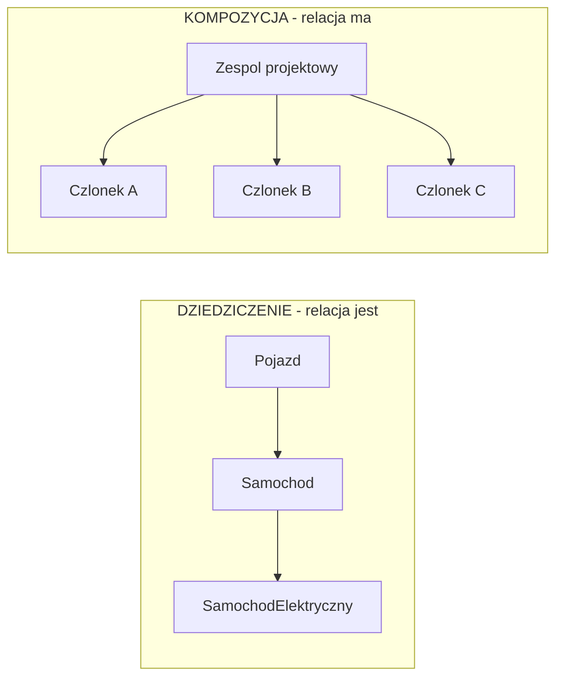
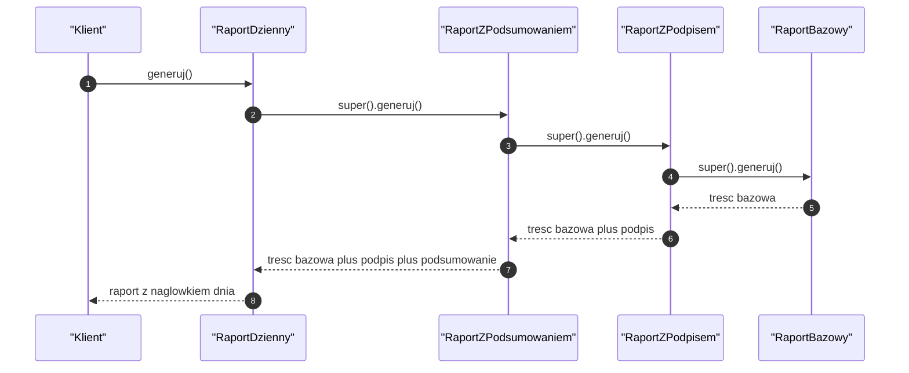
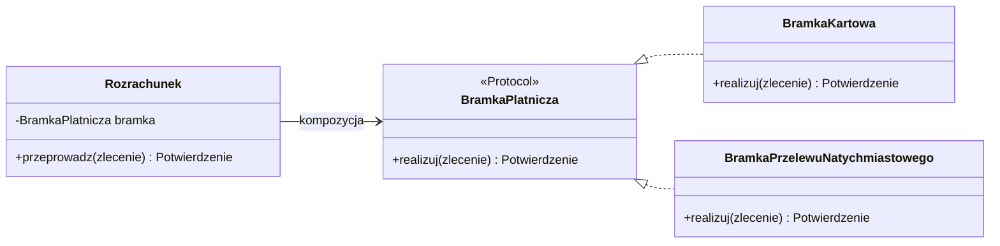
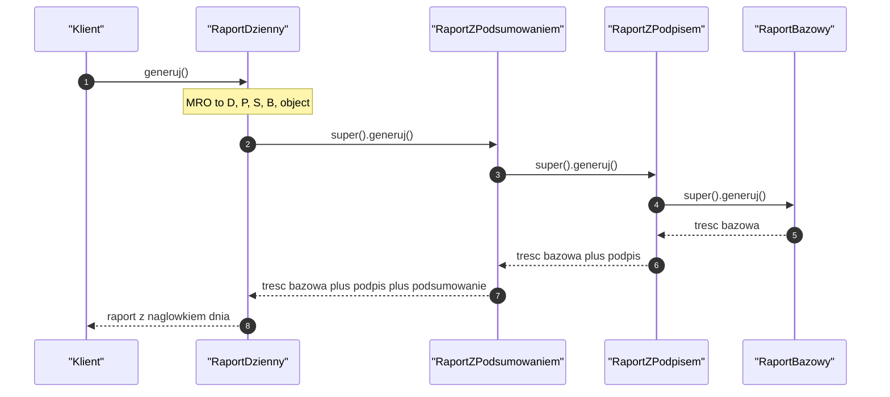
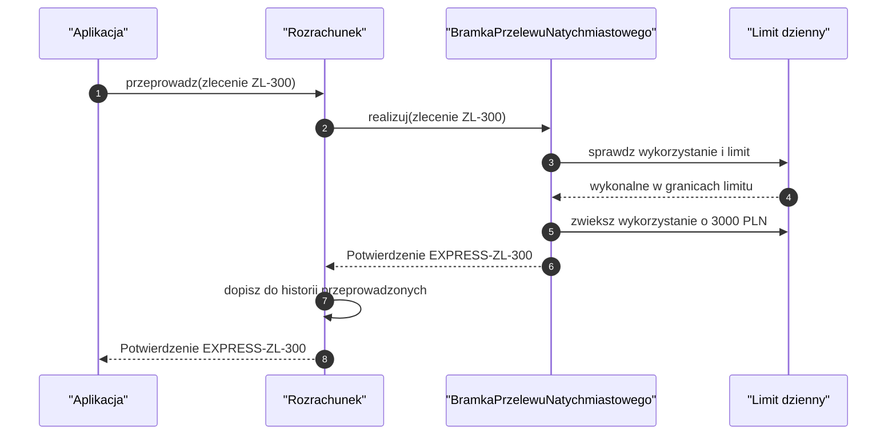
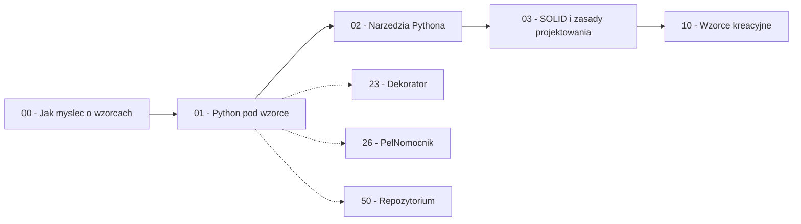

```markdown
---
modul: 01 — Python pod wzorce
plik: 01-python-podstawy-pod-wzorce.md
poziom: podstawowy
wymaga: [00]
czas: ~95 minut czytania + ~180 minut ćwiczeń
---

# Moduł 01 — Python pod wzorce — fundamenty obiektowości, których naprawdę będziesz potrzebować

> **TL;DR**
> - Ten moduł nie uczy Pythona od zera — wyrównuje warsztat w tych kilku obszarach, od których zależy zrozumienie **każdego** wzorca: klasy, kompozycja, protokoły, metody specjalne.
> - Klasa to formularz, instancja to wypełniony formularz; zrozumienie tej różnicy (i tego, co jest wspólne, a co osobne) oszczędza połowę błędów początkujących.
> - Dziedziczenie mówi „jest", kompozycja mówi „ma" — a niemal wszystkie wzorce projektowe to warianty kompozycji, dlatego wybór między nimi jest decyzją fundamentalną.
> - `abc.ABC` wymusza kontrakt nominalnie, `typing.Protocol` opisuje go strukturalnie — w Pythonie oba są potrzebne, ale do różnych zadań.
> - Metody specjalne (`__init__`, `__call__`, `__iter__`, `__enter__`, `__getattr__`) są surowcem, z którego w kolejnych modułach zbudujemy większość wzorców — ten moduł to ich katalog.

---

## 0. Model mentalny

### Formularz i zespół — dwa obrazy, które uniosą cały kurs

Wyobraź sobie urząd. Na ścianie wisi **pusty formularz** wniosku o kredyt: ma nagłówek, wypisane pola („imię", „kwota", „okres"), miejsca na podpisy i rubrykę „decyzja". Ten formularz nie jest jeszcze niczyim wnioskiem — jest tylko **opisem tego, jakie informacje i jakie operacje są potrzebne**, żeby cokolwiek załatwić. Kiedy pani Kowalska wypełnia go swoimi danymi i składa, powstaje **konkretny wniosek**: jedna kartka, z konkretnymi wartościami, która może zostać przyjęta, odrzucona, poprawiona, zarchiwizowana. Najważniejsze: pusty formularz może obsłużyć tysiące wniosków, a każdy wniosek jest niezależny od pozostałych.

To jest dokładnie różnica między **klasą (ang. class)** a **instancją (ang. instance)**. Klasa to opis: jakie dane obiekt będzie trzymał i co będzie umiał zrobić. Instancja to konkretny obiekt z tymi danymi w środku. Kiedy w module 10 będziemy rozmawiać o singletonie, wrócimy do tego obrazu pytaniem: „co się stanie, jeśli wszyscy będą korzystać z tego samego, jednego wniosku, zamiast wypełniać własne?".

A teraz drugi obraz, równie ważny. Wyobraź sobie **zespół projektowy**: Ania, Bartek i Celina. Zespół nie jest Anią ani Bartkiem — zespół **ma członków**. Ania może odejść, na jej miejsce przyjdzie Damian, a zespół nadal istnieje i nadal robi to, co robił. Zespół nie dziedziczy umiejętności po Ani — po prostu deleguje jej zadania. Porównaj to z **drzewem genealogicznym**: syn dziedziczy po ojcu nazwisko, ale też wszystko, co z nazwiskiem się wiąże, i nie może w trakcie życia „przestać być synem". Zespół jest elastyczny, drzewo genealogiczne jest sztywne.

To jest różnica między **kompozycją (ang. composition)** a **dziedziczeniem (ang. inheritance)**. Prawie każdy wzorzec projektowy z tego kursu opiera się na kompozycji — dlatego musimy oba mechanizmy rozumieć na tyle dobrze, żeby świadomie wybierać.

| W analogii formularza i zespołu | W kodzie |
|---|---|
| Pusty formularz, wzór do wypełniania | Klasa (`class Rozrachunek:`) |
| Wypełniony wniosek pani Kowalskiej | Instancja (`rozrachunek = Rozrachunek(...)`) |
| Rubryki formularza („imię", „kwota") | Atrybuty klasy i instancji |
| Instrukcja „jak wypełnić pole 7" | Metody (`def oblicz_prowizje(self)`) |
| Formularz może obsłużyć tysiące wniosków | Klasa może mieć tysiące instancji |
| Zespół i jego członkowie | Kompozycja (`self.bramka = bramka`) |
| Drzewo genealogiczne | Dziedziczenie (`class BramkaKartowa(BramkaBazowa)`) |
| Ania odchodzi, Damian wchodzi, zespół działa | Podmiana implementacji bez zmiany klasy |

> 🧠 **Zapamiętaj** — **Klasa opisuje, jak zbudowany jest obiekt i co potrafi; instancja to konkretny obiekt z własnymi danymi. Kompozycja mówi „mam coś, co robi część pracy"; dziedziczenie mówi „jestem szczególnym przypadkiem czegoś".**

Poniższy diagram pokazuje oba mechanizmy obok siebie. Patrz nie na nazwy, tylko na kierunek strzałek i na to, co one oznaczają: w dziedziczeniu obiekt „spływa" z góry na dół i jest mocno przywiązany. W kompozycji obiekt trzyma referencję do innego obiektu — i tę referencję można wymienić.



*Diagram pokazuje dwie różne relacje: w dziedziczeniu każdy poziom jest szczególnym przypadkiem poziomu wyżej, w kompozycji „góra" tylko korzysta z „dołu" i może go wymienić.*

### Czego te fundamenty NIE robią

Zanim pójdziemy dalej, rozbrójmy kilka nieporozumień. Ten moduł **nie** jest kursem programowania obiektowego od zera i nie zastąpi dokumentacji. Ale ważniejsze są trzy mity, które zbierają żniwo w praktyce.

**Znajomość klas nie czyni cię projektantem.** Można świetnie pisać klasy i metody, a mimo to produkować kod, którego nikt nie potrafi zmienić po pół roku. Projektowanie to umiejętność decydowania, **gdzie postawić granice** — a nie umiejętność pisania `def`.

**Dziedziczenie nie jest „bardziej obiektowe" od kompozycji.** To bardzo częste przekonanie osób uczących się z materiałów, w których dziedziczenie pojawia się pierwsze i najczęściej. W rzeczywistości dziedziczenie jest mechanizmem **rzadszym i droższym** — trudniejszym do zmiany, silniej wiążącym kod. Kompozycja jest domyślnym wyborem w nowoczesnym Pythonie i w niemal każdym wzorcu z Części I–III tego kursu.

**Protokoły nie są „interfejsami w wersji light".** `typing.Protocol` to odrębny mechanizm typu strukturalnego, który zachowuje się inaczej niż `abc.ABC`. Nie jest ani lepszy, ani gorszy — jest **do czego innego**. W sekcji 4 damy ci kryteria wyboru.

**Metody specjalne nie są „magią".** `__init__`, `__call__`, `__iter__` to zwykłe metody o specjalnych nazwach, które interpreter wywołuje w określonych sytuacjach. Bez zrozumienia tej listy wzorce zostaną dla ciebie albo zbiorem klas z jedna metodą `execute()`, albo — w wersji złej — łańcuchem magicznych sztuczek, których nie umiesz wytłumaczyć.

---

## 1. Problem, który rozwiązujemy

Zacznijmy od kodu, który wygląda rozsądnie, a w istocie jest zlepkiem czterech niezależnych błędów. Pochodzi z domeny 💳 „Rozrachunek": system przyjmuje zlecenia płatności i przekazuje je do bramki płatniczej.

### Kod „przed"

```python
# rozrachunek_v0.py — wersja naiwna, demonstracyjna
# UWAGA: ten kod celowo zawiera typowe bledy. Nie kopiuj go do produkcji.

class ZlecenieRozrachunku:
    stawka_prowizji = 0.004          # BLAD 1: atrybut klasowy wspoldzielony
    historia = []                     # BLAD 2: mutowalny atrybut klasowy

    def __init__(self, identyfikator, kwota, waluta, kanal, opcje=None):
        # BLAD 3: float dla pieniedzy
        self.identyfikator = identyfikator
        self.kwota = kwota
        self.waluta = waluta
        self.kanal = kanal
        self.status = "NOWE"          # BLAD 4: status jako goły string
        self.opcje = opcje or {}
        ZlecenieRozrachunku.historia.append(self.identyfikator)

    def realizuj(self):
        if self.kanal == "KARTA":
            if self.kwota > 100000.0:
                print("karta: za duzo")
                return False
            # ... 40 linii kodu obslugi karty
            self.status = "ZREALIZOWANE"
            return True
        elif self.kanal == "PRZELEW":
            if self.waluta not in ("PLN", "EUR"):
                print("przelew: zla waluta")
                return False
            # ... 40 linii kodu obslugi przelewu
            self.status = "ZREALIZOWANE"
            return True
        elif self.kanal == "BLIK":
            # ... kolejne 40 linii
            self.status = "ZREALIZOWANE"
            return True
        else:
            print("nieznany kanal")
            return False

    def prowizja(self):
        return self.kwota * self.stawka_prowizji


if __name__ == "__main__":
    z1 = ZlecenieRozrachunku("ZL-1", 1500.50, "PLN", "KARTA")
    z2 = ZlecenieRozrachunku("ZL-2", 250.00, "PLN", "PRZELEW")
    z1.realizuj()
    print(z1.prowizja(), z1.status)
    print(ZlecenieRozrachunku.historia)   # zobacz, co tu naprawde jest
```

Ten kod się uruchomi. Zwróci sensowne wyniki. I przez kilka miesięcy będzie działał — dopóki nie wydarzy się którakolwiek z rzeczy, które w finansach wydarzają się zawsze: pojawi się nowy kanał płatności, zmieni się stawka prowizji dla jednego klienta, audyt zapyta o historię, a dział sprawozdawczości poprosi o dokładne kwoty.

### Cztery błędy, które tu siedzą — i dlaczego są ważne dla wzorców

**Błąd 1 i 2: atrybuty klasowe.** `stawka_prowizji` i `historia` są zdefiniowane na poziomie **klasy**, nie instancji. Pierwszy przypadek to drobiazg semantyczny (choć zmiana `ZlecenieRozrachunku.stawka_prowizji = 0.002` zmieni ją dla wszystkich instancji naraz — czasem pożądane, częściej katastrofa). Drugi to błąd poważny: `historia` jest jedną, współdzieloną listą. Każde nowe zlecenie dopisuje się do tej samej listy, która istnieje od momentu wczytania modułu. To nie jest „historia zleceń" — to globalny rejestr, który nigdy nie jest czyszczony i rośnie w nieskończoność.

**Błąd 3: `float` dla pieniędzy.** `1500.50` w typie `float` nie istnieje dokładnie. To liczba zmiennoprzecinkowa w systemie dwójkowym, więc dokładnie reprezentowalne są tylko wartości o określonej strukturze. `0.1 + 0.2` w Pythonie daje `0.30000000000000004`. Przy pojedynczym zleceniu różnica jest nieistotna, ale przy sumowaniu miliona transakcji błąd systematycznie narasta — a w rozrachunku saldo musi się zgadzać co do groszówki.

**Błąd 4: status jako goły string.** `"NOWE"`, `"ZREALIZOWANE"` to napisy. Nic nie stoi na przeszkodzie, żeby ktoś napisał `self.status = "zrealizowane"` (małymi literami), `"ZREALIZOWANY"` albo `"ZKREALIZOWANE"`. Interpreter tego nie wykryje, a porównania `if status == "ZREALIZOWANE"` zaczną po cichu zwracać `False`. W module 37 zobaczysz, jak z tego wyrasta cały wzorzec Stan.

### Code smell — co tu pachnie

| Zapach | Gdzie | Konsekwencja |
|---|---|---|
| Magiczne stringi | `"KARTA"`, `"PRZELEW"`, `"NOWE"` | Literówka to cicha awaria, nie błąd |
| Warunkowa lawina po typie | `if self.kanal == ...` w metodzie `realizuj` | Każdy nowy kanał modyfikuje istniejącą klasę |
| Klasa łącząca dane i całą logikę biznesową | Cała klasa `ZlecenieRozrachunku` | Nie da się jej przetestować w izolacji ani użyć w innym kontekście |
| Mutowalny stan współdzielony | `historia = []` | Wyciek danych między instancjami, wyciek pamięci |
| Niejawny kontrakt | Parametry bez adnotacji typów | Nikt nie wie, co można tu przekazać |
| Brak rozdzielenia walut i zaokrągleń | `self.kwota`, `self.waluta` osobno, bez reguł | Dodanie zlecenia w EUR do kwoty w PLN „się uda" i policzy bzdurę |
| Rozpoznawanie zachowania po typie parametru | `if kanal == ...` | Realizacja posypie się przy nowym kanale |
| Brak niemutowalności | Wszystkie pola publiczne i zapisywalne | Nie można bezpiecznie dzielić obiektu między wątki |

> ⚠️ **Pułapka** — Zapamiętaj to raz na zawsze: klasa, która **jednocześnie** niesie dane domenowe i wykonuje operacje na infrastrukturze (tu: wysyła zapytanie do bramki płatniczej), to najczęstszy wzorzec złego projektu w kodzie początkujących. W module 61 zobaczysz, jak taki kod przeprojektować w architekturę portów i adapterów.

### Objawy — poznasz ten problem po tym, że...

Te objawy nie dotyczą tylko tego konkretnego pliku. Są przenośne między projektami, językami i domenami.

- **Dodanie nowego wariantu („nowy kanał płatności") wymaga wejścia w istniejącą metodę i dopisania kolejnego `if/elif`.** Kod, który rośnie na długość przy każdym nowym wymaganiu, to znak, że brakuje podziału na role.
- **Nie da się przetestować jednego zachowania bez uruchamiania wszystkich pozostałych.** Test dla rozrachunku kartowego wymaga albo uruchomienia gałęzi karty, albo sztucznego konstruowania obiektu z `kanal="PRZELEW"`.
- **Nie umiesz odpowiedzieć na pytanie „ile zleceń było dzisiaj?"** bez sięgania do atrybutu klasowego, którego zachowanie zaskakuje.
- **Zmiana nazwy pola (np. `kanal` na `kanal_wejsciowy`) jest operacją na całe repozytorium.** Nie ma kontraktu, więc nie ma bezpieczeństwa.
- **Do jednego celu istnieje kilka dróg**, np. prowizję da się policzyć metodą `prowizja()` albo ręcznie mnożąc `kwota * stawka_prowizji`. Dwie drogi rozjadą się przy pierwszej zmianie reguły.
- **Masz wrażenie, że ten plik „wie zbyt dużo".** Klasa `ZlecenieRozrachunku` zna limity kart, dozwolone waluty przelewu, stawkę prowizji i historię operacji. To odpowiedzialność czterech różnych bytów.
- **Kiedy coś idzie nie tak, nie wiesz, czy to błąd danych, czy błąd przepływu.** `return False` nie mówi nic.

Zauważ, że żaden z tych objawów nie mówi „użyj wzorca X". Mówią „brakuje ci narzędzi: rozdzielenia danych od operacji, jawnego kontraktu, nazwanego statusu". Tymi narzędziami właśnie się teraz zajmiemy — a w kolejnych modułach zamienimy je na konkretne wzorce.

---

## 2. Anatomia

Ten moduł nie opisuje jednego wzorca, więc zamiast „uczestników wzorca" prześledzimy **mechanizmy języka**, które są uczestnikami każdego wzorca. Format tabeli zostaje ten sam, bo w kolejnych modułach zobaczysz dokładnie tę samą strukturę.

### Uczestnicy: mechanizmy obiektowości w Pythonie

| Mechanizm | Odpowiedzialność | Co NIE jest jego zadaniem |
|---|---|---|
| Klasa | Opisuje zbiór atrybutów i metod; tworzy instancje | Nie przechowuje danych konkretnego obiektu |
| Instancja | Trzyma konkretne dane i ma tożsamość | Nie definiuje reguł wspólnych dla wszystkich obiektów |
| Atrybut instancji | Należy do jednego obiektu, zapisany w `instance.__dict__` | Nie jest współdzielony między instancjami |
| Atrybut klasowy | Należy do klasy, widoczny przez wszystkie instancje | Nie jest miejscem na wartości specyficzne dla obiektu |
| Metoda instancji | Funkcja przyjmująca `self`, operująca na danych obiektu | Nie powinna zależeć od globalnego stanu modułu |
| `@classmethod` | Operuje na klasie, nie na instancji; przydatny jako fabryka | Nie zna stanu konkretnej instancji |
| `@staticmethod` | Funkcja powiązana tematycznie z klasą, bez `self` i `cls` | Nie jest „prawie metodą" — nie ma dostępu do niczego |
| `@property` | Ukrywa wyliczanie za składnią dostępu do atrybutu | Nie służy do ciężkich obliczeń powtarzanych w pętli |
| MRO | Kolejność, w jakiej Python szuka metod przy wielodziedziczeniu | Nie jest sposobem na „magiczne" łączenie zachowań |
| `ABC` | Kontrakt nominalny: wymusza implementację metod abstrakcyjnych | Nie gwarantuje zgodności zachowania, tylko istnienie metod |
| `Protocol` | Kontrakt strukturalny: opisuje kształt, nie wymaga dziedziczenia | Nie sprawdza niczego w czasie wykonania, jeśli nie użyjesz `isinstance` |
| `Enum` | Zbiór nazwanych, niezmiennych wartości | Nie zastępuje walidacji danych wejściowych z zewnątrz |

> 💡 **Intuicja** — Pomyśl o tej tabeli jak o skrzynce z narzędziami. Każde narzędzie ma swoje zastosowanie i każde można użyć nieprawidłowo. Wzorce projektowe to **przepisy**, które mówią, jakimi narzędziami i w jakiej kolejności zbudować konkretną rzecz.

### Dziedziczenie i MRO

**MRO (ang. Method Resolution Order — kolejność rozwiązywania metod)** to lista klas, po których Python przechodzi, szukając metody lub atrybutu. Znajomość MRO jest potrzebna, bo prawie każdy wzorzec używa co najmniej jednego poziomu dziedziczenia — choćby po to, żeby dziedziczyć po protokole albo po klasie bazowej frameworka.

Reguły, które wystarczy znać:

1. Szukanie idzie od instancji do klasy, potem po klasach bazowych, aż do `object`.
2. Przy wielodziedziczeniu Python używa algorytmu **C3 linearization**, który gwarantuje dwie rzeczy: klasa zawsze występuje przed swoimi rodzicami, a kolejność zadeklarowanych rodziców jest zachowana.
3. `super()` **nie** oznacza „klasa bazowa" — oznacza „następny element w MRO bieżącej instancji". To subtelna, ale bardzo istotna różnica.
4. `object` jest ostatnia na liście MRO każdej klasy.

```python
# mro_demo.py — zobacz MRO na wlasne oczy
class RaportBazowy:
    def generuj(self) -> str:
        return "tresc bazowa"


class RaportZPodpisem(RaportBazowy):
    def generuj(self) -> str:
        return super().generuj() + " + podpis"


class RaportZPodsumowaniem(RaportBazowy):
    def generuj(self) -> str:
        return super().generuj() + " + podsumowanie"


class RaportDzienny(RaportZPodsumowaniem, RaportZPodpisem):
    def generuj(self) -> str:
        return super().generuj() + " + naglowek dnia"


if __name__ == "__main__":
    print([k.__name__ for k in RaportDzienny.__mro__])
    print(RaportDzienny().generuj())
```

Wynik listy MRO to `RaportDzienny, RaportZPodsumowaniem, RaportZPodpisem, RaportBazowy, object`. Zwróć uwagę na dwie rzeczy. Po pierwsze, `RaportZPodsumowaniem` występuje przed `RaportZPodpisem`, mimo że obie dziedziczą po `RaportBazowym` i obie są zadeklarowane jako bazy `RaportDzienny` — kolejność deklaracji w nagłówku klasy jest zachowana. Po drugie, mimo że w hierarchii są **cztery** klasy, treść bazowa powstaje **raz**. Gdyby każda metoda wołała `RaportBazowy.generuj(self)` jawnie, zamiast `super().generuj()`, treść bazowa zostałaby dodana dwa razy.

To jest właśnie cała moc `super()`: **współpraca**, a nie „wołanie rodzica". Ta własność jest fundamentem wzorca *metoda szablonowa* (moduł 39) i techniki, którą w Django i wielu frameworkach nazywa się mieszaniem (ang. mixin).

Poniżej pełna droga wywołania — i to jest sedno tego, o czym mówimy:



*Diagram pokazuje, że `super()` prowadzi do następnego elementu MRO, a nie „do rodzica" — dlatego łańcuch przechodzi przez wszystkie trzy klasy i dopiero na końcu dociera do bazy.*

> ⚠️ **Pułapka** — Jeśli w hierarchii z tą samą bazą użyjesz jawnego wywołania `RaportBazowy.generuj(self)` zamiast `super().generuj()`, metoda bazowa wykona się **kilka razy**, a wynik będzie podwójnie złożony. Ten błąd jest trudny do wykrycia, gdy metody mają efekty uboczne (zapis do bazy, wysyłka powiadomienia). Wniosek praktyczny: w hierarchiach, które mają się łączyć, zawsze używaj `super()` i przyjmuj `*args, **kwargs` w sygnaturze, żeby nie blokować dalszego łańcucha.

### Kompozycja — struktura, na której stoi cały kurs

Kompozycja to najbardziej podstawowa relacja w projektowaniu: obiekt **trzyma referencję** do innego obiektu i **deleguje** mu część pracy. Spójrz na dwie wersje tego samego wymagania: rozrachunek ma się zrealizować przez bramkę płatniczą.

Wersja zła — przez dziedziczenie po konkretnej klasie:

```python
# BLEDNA wersja: dziedziczenie po konkretnej implementacji
class RozrachunekKartowy(RozrachunekStripe):
    ...
```

Dlaczego to jest złe? Bo `RozrachunekKartowy` **jest** `RozrachunkiemStripe`. Kiedy pojawi się druga bramka, ta klasa nie może być jednocześnie dwiema rzeczami. Kiedy `RozrachunekStripe` zmieni nazwę metody albo logikę wewnętrzną, twoja klasa też się zmieni — nie dlatego, że chciałeś, ale dlatego, że jesteś z nią spleciony. Kiedy chcesz przetestować rozrachunek bez internetu, musisz podstawić prawdziwą klasę Stripe. To nie jest abstrakcja — to kopia z przypisaniem.

Wersja dobra — przez kompozycję i protokół:

```python
from typing import Protocol

class BramkaPlatnicza(Protocol):
    """Kontrakt: cokolwiek potrafi zrealizowac zlecenie i zwrocic potwierdzenie."""
    def realizuj(self, zlecenie: "ZlecenieRozrachunku") -> "Potwierdzenie": ...

class Rozrachunek:
    def __init__(self, bramka: BramkaPlatnicza) -> None:
        self._bramka = bramka            # kompozycja: rozrachunek MA bramke

    def przeprowadz(self, zlecenie: "ZlecenieRozrachunku") -> "Potwierdzenie":
        return self._bramka.realizuj(zlecenie)
```

Ta wersja ma trzy właściwości, które docenisz w każdym kolejnym module kursu:

1. **Bramka jest wymienna w czasie działania programu** — wystarczy przekazać inną implementację przy konstrukcji (`Rozrachunek(bramka_kartowa)`, `Rozrachunek(bramka_testowa)`, `Rozrachunek(bramka_rejestrujaca_wywolania)`).
2. **`Rozrachunek` nie zna żadnej konkretnej bramki.** Zna tylko to, że cokolwiek dostanie, umie `realizuj(zlecenie)` i zwraca `Potwierdzenie`.
3. **Test jest trywialny** — wystarczy klasa o jednej metodzie.

To jest dokładnie **programowanie do interfejsu, nie do implementacji** (ang. program to an interface, not an implementation). W tym jednym zdaniu mieści się istota strategii (38), adaptera (20), mostu (21), pełnomocnika (26), repozytorium (50) i portów architektury heksagonalnej (61).

Spójrz na obrazek — to znaczy na relacje, nie na kratki:



*Diagram pokazuje, że `Rozrachunek` zna wyłącznie kontrakt `BramkaPlatnicza`, a jego zależność do konkretnych implementacji jest zerowa — mogą ich powstać dziesiątki bez zmiany choćby linii w `Rozrachunek`.*

> 🧠 **Zapamiętaj** — Reguła kciuka, która w praktyce rozwiązuje 80% dylematów: **jeśli potrafisz opisać relację słowami „ma" lub „używa" — wybierz kompozycję. Dziedziczenie zostaw na przypadki, gdy naprawdę potrafisz powiedzieć „jest szczególnym przypadkiem", a kontrakt klasy bazowej pozostaje nienaruszony.**

### Warianty: klasyczny vs pythoniczny

Ten sam projekt da się zapisać na dwa sposoby — i musisz umieć czytać oba, bo w materiałach internetowych spotkasz oba.

| Aspekt | Wariant „klasyczny" (podręcznikowy) | Wariant pythoniczny |
|---|---|---|
| Kontrakt | `class Bramka(ABC)` + `@abstractmethod` | `class Bramka(Protocol)` |
| Wymuszenie implementacji | Tak, w momencie tworzenia instancji | Nie, tylko statyczna analiza typu |
| Kontener danych | Klasa z `__init__` i ręcznym `__repr__` | `@dataclass(frozen=True, slots=True)` |
| Status / typ | Stałe klasowe (`STATUS_NOWE = "NOWE"`) | `class Status(Enum)` |
| Zachowanie wymienne | Hierarchia klas | `Callable`, funkcja, `functools.partial` |
| Rozszerzanie zachowania | Podklasa | Dekorator, opakowanie funkcyjne |

Oba warianty są poprawne. Kryterium wyboru jest praktyczne: **jeśli kontrakt jest prosty i jednorazowy, idź w kierunku pythonicznym; jeśli kontrakt ma być twardym zobowiązaniem dla wielu implementacji w dużej bazie kodu, `ABC` bywa lepszy, bo wyłapuje błąd natychmiast.**

---

## 3. Implementacja krok po kroku

Przebudujemy teraz nasze zlecenie rozrachunku z sekcji 1 na coś, co ma nazwane role i jawne kontrakty. Celowo **nie** nazywamy tego jeszcze żadnym wzorcem — budujemy fundament, na którym wzorce wyrosną same. Każdy krok dodaje coś, czego wcześniej brakowało.

### Krok 1 — Rozdziel dane od operacji

Pierwsza decyzja jest fundamentalna. `ZlecenieRozrachunku` nie powinno wiedzieć, **jak** realizować płatność. Ma wiedzieć tylko, co sobą reprezentuje.

```python
from __future__ import annotations

from dataclasses import dataclass, field
from decimal import Decimal

@dataclass(frozen=True, slots=True)
class Kwota:
    """Kwota pieniezna z waluta. Dwie waluty nie moga byc dodane bez konwersji."""
    wartosc: Decimal
    waluta: str = "PLN"

    def __post_init__(self) -> None:
        if not isinstance(self.wartosc, Decimal):
            raise TypeError("wartosc musi byc typu Decimal, nie float")
        if self.wartosc < Decimal("0"):
            raise ValueError("kwota nie moze byc ujemna")
        if self.waluta not in ("PLN", "EUR", "USD"):
            raise ValueError(f"nieobslugiwana waluta: {self.waluta!r}")

    def __add__(self, inna: Kwota) -> Kwota:
        if self.waluta != inna.waluta:
            raise ValueError(
                f"nie mozna dodac {self.waluta} do {inna.waluta}"
            )
        return Kwota(self.wartosc + inna.wartosc, self.waluta)
```

Zwróć uwagę, co się właśnie stało. Pieniądze przestały być „liczbą z walutą obok". Stały się **jednym bytem**, który wie o sobie dwie rzeczy: ile i w czym. I który **odmawia wykonania bezsensownej operacji**. W module 54 nazwiemy to obiektem wartości (ang. Value Object) i pokażemy pełną wersję.

### Krok 2 — Nazwij stany

Zamiast `"NOWE"` i `"ZREALIZOWANE"` użyj `Enum`. Od tego momentu literówka jest błędem natychmiastowym, a nie cichą awarią.

```python
from enum import Enum

class StatusRozrachunku(Enum):
    NOWE = "nowe"
    W_TOKU = "w toku"
    ZREALIZOWANE = "zrealizowane"
    ODRZUCONE = "odrzucone"
    ANULOWANE = "anulowane"

    def __str__(self) -> str:
        return self.value
```

Enum daje jeszcze jedną rzecz: **wyczerpujący zbiór przypadków**. Kiedy w kodzie piszesz `match status: case StatusRozrachunku.NOWE: ...`, narzędzia statyczne mogą ci powiedzieć, że pominąłeś przypadek. Ze stringiem nie da się tego zrobić.

### Krok 3 — Zdefiniuj kontrakt dla bramki

Teraz przychodzi ten moment, o którym mówiliśmy w sekcji 2: **programowanie do interfejsu**. Definiujemy, co musi umieć bramka, nie mówiąc, jak to robi.

```python
from typing import Protocol, runtime_checkable

@dataclass(frozen=True, slots=True)
class Potwierdzenie:
    numer_operacji: str
    zaakceptowane: bool
    opis: str = ""

@runtime_checkable
class BramkaPlatnicza(Protocol):
    """Cokolwiek, co potrafi zrealizowac zlecenie rozrachunku."""

    nazwa: str

    def realizuj(self, zlecenie: ZlecenieRozrachunku) -> Potwierdzenie: ...
```

`runtime_checkable` sprawia, że możesz napisać `isinstance(x, BramkaPlatnicza)` — ale sprawdzane będą tylko **istnienie** metod i atrybutów, nie ich sygnatury. To ważne rozróżnienie: `Protocol` daje ci pewność w analizie statycznej i wygodę sprawdzenia w czasie wykonania, ale nie zastępuje testów kontraktu.

### Krok 4 — Zbuduj obiekty realizujące kontrakt

Teraz piszemy konkretne bramki. Każda jest samodzielna, ma swoją nazwę i można ją przetestować osobno.

```python
class BramkaPrzelewuNatychmiastowego:
    nazwa = "przelew natychmiastowy"

    def __init__(self, limit_dzienny: Decimal) -> None:
        self._limit_dzienny = limit_dzienny
        self._wykorzystano = Decimal("0.00")

    def realizuj(self, zlecenie: ZlecenieRozrachunku) -> Potwierdzenie:
        if zlecenie.kwota.waluta != "PLN":
            return Potwierdzenie("", False, "przelew natychmiastowy tylko w PLN")
        if self._wykorzystano + zlecenie.kwota.wartosc > self._limit_dzienny:
            return Potwierdzenie("", False, "przekroczony limit dzienny")
        self._wykorzystano += zlecenie.kwota.wartosc
        numer = f"EXPRESS-{zlecenie.identyfikator}"
        return Potwierdzenie(numer, True, "zrealizowano")


class BramkaKartowa:
    nazwa = "karta"

    def __init__(self, maks_jednorazowo: Decimal) -> None:
        self._maks_jednorazowo = maks_jednorazowo

    def realizuj(self, zlecenie: ZlecenieRozrachunku) -> Potwierdzenie:
        if zlecenie.kwota.wartosc > self._maks_jednorazowo:
            return Potwierdzenie(
                "", False,
                f"kwota przekracza limit karty {self._maks_jednorazowo}",
            )
        return Potwierdzenie(f"CARD-{zlecenie.identyfikator}", True, "autoryzowano")
```

Zauważ: **żadna z tych klas nie dziedziczy po `BramkaPlatnicza`.** Nie muszą — spełniają kontrakt strukturalnie, czyli mają atrybut `nazwa` i metodę `realizuj`. To esencja typowania strukturalnego (ang. structural typing), które w Pythonie nazywamy kaczym typowaniem (ang. duck typing).

### Krok 5 — Połącz dane z zachowaniem przez kompozycję

Dopiero teraz zlecenie dostaje możliwość realizacji — ale nie wie, jak ona działa.

```python
@dataclass(frozen=True, slots=True)
class ZlecenieRozrachunku:
    identyfikator: str
    kwota: Kwota
    kanal: str
    status: StatusRozrachunku = StatusRozrachunku.NOWE

    @property
    def prowizja(self) -> Kwota:
        """Prowizja 0,4 procent, zaokraglona do groszy."""
        stawka = Decimal("0.004")
        return Kwota(
            (self.kwota.wartosc * stawka).quantize(Decimal("0.01")),
            self.kwota.waluta,
        )


class Rozrachunek:
    """Orkiestruje realizacje zlecenia przez podana bramke."""

    def __init__(self, bramka: BramkaPlatnicza) -> None:
        self._bramka = bramka

    @property
    def nazwa_bramki(self) -> str:
        return self._bramka.nazwa

    def przeprowadz(self, zlecenie: ZlecenieRozrachunku) -> Potwierdzenie:
        return self._bramka.realizuj(zlecenie)
```

### Krok 6 — Dodaj kontrolę typu bez dziedziczenia

Skoro `Protocol` nie wymusza implementacji, warto zabezpieczyć się w miejscu, w którym przyjmujemy zależność. To nie paranoja — to praktyka: błąd wyłapany przy starcie aplikacji kosztuje minuty, błąd wyłapany przy realizacji przelewu kosztuje klienta.

```python
class Rozrachunek:
    def __init__(self, bramka: BramkaPlatnicza) -> None:
        if not isinstance(bramka, BramkaPlatnicza):
            raise TypeError(
                f"{type(bramka).__name__} nie spelnia kontraktu BramkaPlatnicza"
            )
        self._bramka = bramka
```

### Krok 7 — Zweryfikuj decyzję

Jak w module 00: zmierz, czy struktura pomogła.

| Pytanie kontrolne | Wersja „przed" | Wersja „po" |
|---|---|---|
| Dodanie nowej bramki | Modyfikacja `realizuj` w klasie zlecenia | Nowa klasa, zero zmian w istniejącym kodzie |
| Test bez internetu | Trzeba podstawić prawdziwą bramkę | Klasa testowa z jedną metodą |
| Waluty i zaokrąglenia | Trzy miejsca, brak reguł | Jedna klasa `Kwota` z walidacją |
| Literówka w statusie | Cicha awaria | `AttributeError` przy tworzeniu |
| Pytanie „dlaczego odrzucono?" | Nie da się odpowiedzieć | `Potwierdzenie.opis` |
| Liczba linii | ~60 | ~120 |
| Liczba plików | 1 | 1 (do refaktoryzacji na pakiety) |

Kod podwoił się na długość. Czy to dobry interes? Odpowiedź brzmi: **tak, jeśli spodziewasz się drugiej bramki** — a w rozrachunku zawsze się jej spodziewasz. Jeśli miałbyś dokładnie jedną bramkę i żadnych planów, to podwojenie byłoby kosztem bez korzyści. To jest dokładnie ta decyzja, o której mówił moduł 00 w sekcji „kiedy NIE używać wzorców".

---

## 4. Wersje pythoniczne i warianty

Ta sekcja to katalog narzędzi. Każde z nich pojawi się w kolejnych modułach — tutaj dowiesz się, do czego służy i jak je rozpoznać.

### 4.1 Wszystko jest obiektem

To zdanie nie jest filozoficznym ozdobnikiem, tylko technicznym faktem z konsekwencjami projektowymi.

```python
import typing

def prowizja(kwota: Decimal) -> Decimal:
    return kwota * Decimal("0.004")

class BramkaTestowa:
    nazwa = "testowa"
    def realizuj(self, zlecenie):
        return Potwierdzenie("TEST", True)

# Funkcja ma atrybuty i tozsamosc
prowizja.kategoria = "rozrachunek"
print(prowizja.__name__, prowizja.kategoria, id(prowizja))

# Klasa tez jest obiektem
print(BramkaTestowa.__name__, isinstance(BramkaTestowa, type))

# Modul tez jest obiektem
import decimal
print(decimal.Decimal.__module__)

# Wyjatek tez jest obiektem
try:
    raise ValueError("test")
except ValueError as blad:
    print(type(blad).__name__, blad.args)
```

Konsekwencje są ogromne i praktyczne:

- **Możesz przekazywać funkcje tam, gdzie spodziewasz się obiektu**, i odwrotnie — obiekt z metodą `__call__` zachowuje się jak funkcja. Cała rodzina wzorców *strategia* (38), *polecenie* (31), *łańcuch zobowiązań* (30) opiera się na tym.
- **Klasy są obiektami**, więc można je trzymać w słownikach, rejestrach i przekazywać dalej — to podstawa *fabryki* (11) i rejestracji wtyczek (64).
- **Moduły są obiektami**, więc import można wykonać dynamicznie — to realizacja *singletona* (10) i architektury wtyczkowej (64).
- **Wyjątki są obiektami**, więc można im nadać własne atrybuty i hierarchię — to podstawa obsługi błędów domenowych (51).

### 4.2 Metody specjalne — pełny katalog pod kątem wzorców

Poniższa tabela to mapa drogowa dla całego kursu. Wróć do niej, kiedy w module o wzorcu zobaczysz dunder, którego nie pamiętasz.

| Metoda specjalna | Do czego służy | W jakim wzorcu się przydaje | Moduł |
|---|---|---|---|
| `__init__` | Inicjalizacja po utworzeniu obiektu | Wszystkie — to konstruktor instancji | — |
| `__new__` | Sterowanie samym tworzeniem obiektu | Singleton, prototyp, pula obiektów | 10, 14, 15 |
| `__call__` | Obiekt zachowuje się jak funkcja | Strategia, polecenie, specyfikacja | 31, 38, 54 |
| `__iter__` / `__next__` | Iteracja po obiekcie | Iterator, kompozyt, repozytorium | 22, 33, 50 |
| `__enter__` / `__exit__` | Kontekst `with` | Pula obiektów, jednostka pracy, transakcje | 15, 50 |
| `__getattr__` / `__getattribute__` | Przechwycenie dostępu do atrybutu | Pełnomocnik, adapter delegujący, lazy loading | 20, 26 |
| `__setattr__` | Przechwycenie przypisania | Pełnomocnik ochronny, walidacja | 26 |
| `__eq__` / `__hash__` | Równość i użycie w zbiorach | Value Object, repozytorium w pamięci | 50, 54 |
| `__repr__` / `__str__` | Czytelny opis obiektu | Diagnostyka, raporty, logi audytowe | 51, 70 |
| `__add__` / `__sub__` | Operatory arytmetyczne | Value Object, kwoty i waluty | 54 |
| `__and__` / `__or__` / `__invert__` | Operatory logiczne | Specyfikacja z kompozycją reguł | 54 |
| `__len__` / `__getitem__` | Zachowanie jak kolekcja | Kompozyt, repozytorium, fasada kolekcji | 22, 24, 50 |
| `__contains__` | Operator `in` | Zbiory reguł i uprawnień | 41, 50 |
| `__bool__` | Konwersja na prawda/fałsz | Null Object | 41 |
| `__copy__` / `__deepcopy__` | Kontrola kopiowania | Prototyp, memento | 14, 35 |

Krótki pokaz trzech najważniejszych dla tego kursu:

```python
from decimal import Decimal

class Specyfikacja:
    """Predykat, ktory mozna laczyc operatorami and, or, not."""
    def __init__(self, warunek, opis: str = "") -> None:
        self._warunek = warunek
        self.opis = opis

    def __call__(self, dane: dict) -> bool:
        return bool(self._warunek(dane))

    def __and__(self, inna: "Specyfikacja") -> "Specyfikacja":
        return Specyfikacja(
            lambda d: self(d) and inna(d),
            f"({self.opis} and {inna.opis})",
        )

    def __or__(self, inna: "Specyfikacja") -> "Specyfikacja":
        return Specyfikacja(
            lambda d: self(d) or inna(d),
            f"({self.opis} or {inna.opis})",
        )

    def __invert__(self) -> "Specyfikacja":
        return Specyfikacja(lambda d: not self(d), f"not ({self.opis})")


if __name__ == "__main__":
    duza = Specyfikacja(lambda d: d["kwota"] > 10_000, "kwota > 10k")
    walutowa = Specyfikacja(lambda d: d["waluta"] == "PLN", "waluta PLN")
    regula = duza & walutowa
    print(regula({"kwota": 20_000, "waluta": "PLN"}))
    print(regula.opis)
```

Dwadzieścia linii i mamy mechanizm, który w innych językach wymagałby czterech klas i fabryki. To jest właśnie „rozpuszczanie się" wzorców w Pythonie, o którym mówił moduł 00. Pełne omówienie znajdziesz w module 54.

### 4.3 `abc.ABC` kontra `typing.Protocol`

To najważniejsze rozróżnienie w tej sekcji. Trzy sposoby na kontrakt — i wszystkie są potrzebne.

```python
from abc import ABC, abstractmethod
from typing import Protocol, runtime_checkable

# --- Sposob 1: dziedziczenie po klasie bazowej (najprostszy)
class BramkaBazowa:
    def realizuj(self, zlecenie):
        raise NotImplementedError("podklasa musi zaimplementowac realizuj()")

# --- Sposob 2: ABC - twardy kontrakt nominalny
class BramkaABC(ABC):
    @property
    @abstractmethod
    def nazwa(self) -> str: ...

    @abstractmethod
    def realizuj(self, zlecenie) -> Potwierdzenie: ...

# --- Sposob 3: Protocol - kontrakt strukturalny
@runtime_checkable
class BramkaProtocol(Protocol):
    nazwa: str
    def realizuj(self, zlecenie) -> Potwierdzenie: ...
```

| Kryterium | Klasa bazowa z `NotImplementedError` | `abc.ABC` | `typing.Protocol` |
|---|---|---|---|
| Kiedy wykryty błąd braku metody | W czasie wywołania | W czasie tworzenia instancji | W analizie statycznej (`mypy`) |
| Wymaga dziedziczenia | Nie | **Tak** | **Nie** |
| Można objąć typ obcy (np. z biblioteki) | Tak | Nie | **Tak** |
| Działa z `isinstance` | `isinstance` zwykłe | Tak | Tak, ale tylko z `runtime_checkable` |
| Sprawdza sygnatury | Nie | Częściowo | Nie (tylko `mypy`) |
| Ryzyko zbyt silnego sprzężenia | Niskie | **Wysokie** | Niskie |
| Typowe zastosowanie | Proste rozszerzenia wewnętrzne | Ramy frameworka, twarde kontrakty własne | Zależności zewnętrzne, test doubles |

Reguła praktyczna, która działa w 90% przypadków:

> 💡 **Intuicja** — Używaj `ABC`, gdy **ty i twoja implementacja jesteście po tej samej stronie** i chcesz wymusić dyscyplinę. Używaj `Protocol`, gdy chcesz **opisać coś, czego nie kontrolujesz** — bibliotekę, usługę zewnętrzną, klasę testową. `Protocol` nie wymaga współpracy ze strony drugiego obiektu, bo działa strukturalnie.

Jest jeszcze jeden ważny niuans: `ABC` może zawierać implementacje, więc nadaje się na klasę bazową z *metodą szablonową* (moduł 39). `Protocol` nie powinien zawierać implementacji — i to jest jego zaleta: opisuje wyłącznie umowę.

### 4.4 Duck typing i protokoły nieformalne

„Jeśli coś chodzi jak kaczka i kwacze jak kaczka, to jest kaczką". W Pythonie oznacza to, że sprawdzamy **zachowanie**, nie deklarację typu.

```python
def policz_wartosc(portfel) -> Decimal:
    """Dziala z kazdym obiektem, ktory umie wartosc_calkowita()."""
    return portfel.wartosc_calkowita()
```

Ta funkcja zadziała z każdą klasą, która ma właściwość `wartosc_calkowita` zwracającą `Decimal`. To ogromna elastyczność — i jednocześnie ogromna pułapka, bo funkcja nie powie ci, że przekazałeś coś nieodpowiedniego, dopóki nie spróbuje.

Dlatego mamy dwa narzędzia równoważące: **adnotacje typów** (które czytają narzędzia statyczne) i **`runtime_checkable` Protocol** (które czyta interpreter). Duck typing nie znaczy „bez typów" — znaczy „typy na podstawie zachowania, a nie na podstawie rodowodu".

### 4.5 `Enum` i `dataclass` — dwie najczęstsze struktury w kursie

`Enum` już widziałeś. Zwróć uwagę na dwie odmiany, które przydadzą się później:

```python
from enum import Enum, IntEnum, StrEnum

class Czestotliwosc(Enum):
    DZIENNIE = "D"
    TYGODNIOWO = "T"
    MIESIECZNIE = "M"

    @classmethod
    def z_kodu(cls, kod: str) -> "Czestotliwosc":
        for pozycja in cls:
            if pozycja.value == kod:
                return pozycja
        raise ValueError(f"nieznana czestotliwosc: {kod!r}")
```

`dataclass` natomiast ma parametry, które zmieniają semantykę klasy w istotny sposób:

| Parametr | Efekt | Kiedy używać |
|---|---|---|
| `frozen=True` | Obiekt niemutowalny; tworzy `__hash__` | Value Object, klucze w słownikach, migawki |
| `slots=True` | Brak `__dict__`, mniejsze zużycie pamięci | Tysiące drobnych obiektów (moduł 25) |
| `order=True` | Generuje porównania `<`, `>` | Sortowanie pozycji, kwot, dat |
| `kw_only=True` | Wszystkie pola tylko nazwane | Klasy z wieloma polami opcjonalnymi (moduł 13) |
| `eq=True` (domyślnie) | Porównuje po wartościach pól | Prawie zawsze, gdy dane opisują tożsamość |
| `repr=True` (domyślnie) | Czytelny wydruk diagnostyczny | Prawie zawsze |

> ⚠️ **Pułapka** — `frozen=True` i `slots=True` **nie** robią obiektu niemutowalnym głęboko. Jeśli trzymasz wewnątrz listę albo słownik, ten kontener nadal można zmienić. Jeżeli chcesz prawdziwej niemutowalności, używaj krotek zamiast list i `MappingProxyType` zamiast słowników.

### 4.6 Kohezja i sprzężenie — dwie miary, które poczujesz w palcach

**Kohezja (ang. cohesion)** mówi, jak bardzo elementy jednej klasy (albo jednego modułu) trzymają się razem. Wysoka kohezja oznacza: wszystko w tym miejscu odnosi się do jednego zadania. **Sprzężenie (ang. coupling)** mówi, jak bardzo zmiana w jednym miejscu wymusza zmiany w innym. Niskie sprzężenie jest dobre.

Oto sprzężenie przed i po. Wersja pierwsza: klasa obliczeniowa trzyma referencję do konkretnego klienta bazy.

```python
# SPRZĘŻENIE WYSOKIE: serwis wie o PostgreSQL, o schemacie tabeli i o SQL
class SerwisPortfela:
    def __init__(self):
        import psycopg2
        self._polaczenie = psycopg2.connect("dbname=portfel")

    def wartosc(self, portfel_id: str) -> Decimal:
        kursor = self._polaczenie.cursor()
        kursor.execute(
            "SELECT wartosc FROM pozycje WHERE portfel_id = %s",
            (portfel_id,),
        )
        return sum((Decimal(str(w[0])) for w in kursor.fetchall()), Decimal("0"))
```

```python
# SPRZĘŻENIE NISKIE: serwis wie o kontrakcie, nie o technologii
class ZrodloPozycji(Protocol):
    def pozycje(self, portfel_id: str) -> Iterable["Pozycja"]: ...

class SerwisPortfela:
    def __init__(self, zrodlo: ZrodloPozycji) -> None:
        self._zrodlo = zrodlo

    def wartosc(self, portfel_id: str) -> Decimal:
        return sum((p.wartosc for p in self._zrodlo.pozycje(portfel_id)), Decimal("0"))
```

W pierwszej wersji zmiana bazy, zmiana nazwy kolumny albo dodanie cache wymaga wejścia w logikę biznesową. W drugiej — logika biznesowa jest nieruchoma, a zmiany dzieją się w warstwie infrastruktury. W module 50 zobaczysz, że ta druga wersja ma nazwę: **repozytorium**.

### 4.7 Struktura projektu: pakiet, moduł, klasa

Kiedy skończysz z jednym plikiem, pojawi się pytanie: jak to podzielić? Zasady, które sprawdzają się w praktyce:

| Pytanie | Odpowiedź | Uzasadnienie |
|---|---|---|
| Kiedy klasa, a kiedy funkcja? | Funkcja, gdy operacja nie ma stanu i nie potrzebuje kontraktu; klasa, gdy obiekt niesie stan albo ma być wymienny | Mniej kodu, mniej miejsc do zmiany |
| Kiedy nowy moduł? | Gdy grupa kodu ma spójny temat i inny rytm zmian niż reszta pliku | Zmiana jednego obszaru nie powinna dotykać drugiego |
| Kiedy pakiet (`__init__.py`)? | Gdy chcesz ustalić publiczne API katalogu | Kontrolujesz, co „wychodzi" na zewnątrz |
| Co eksportować w `__init__.py`? | Tylko to, co użytkownicy pakietu mogą importować | Reszta to szczegół implementacyjny |
| Jaki podział katalogów? | Według domeny (rozrachunek, ryzyko), nie według techniki (models, views) | Zmiana reguły dotyka jednego katalogu |

Przykładowa struktura, do której będziemy wracać w Części IV:

```text
rozrachunek/
├── __init__.py            # publiczne API pakietu
├── domena/
│   ├── __init__.py
│   ├── kwota.py           # Kwota, Waluta
│   ├── zlecenie.py        # ZlecenieRozrachunku, StatusRozrachunku
│   └── bramka.py          # BramkaPlatnicza (Protocol), Potwierdzenie
├── aplikacja/
│   ├── __init__.py
│   └── przeprowadz.py     # przypadek uzycia: przeprowadzenie rozrachunku
└── infrastruktura/
    ├── __init__.py
    ├── bramka_kartowa.py
    └── bramka_przelewu.py
```

Zwróć uwagę na `__init__.py` — nieużywane jako „pusty plik, bo Python wymaga". To miejsce, w którym deklarujesz, co jest API.

```python
# rozrachunek/__init__.py
from .domena.bramka import BramkaPlatnicza, Potwierdzenie
from .domena.kwota import Kwota
from .domena.zlecenie import StatusRozrachunku, ZlecenieRozrachunku

__all__ = [
    "BramkaPlatnicza",
    "Potwierdzenie",
    "Kwota",
    "StatusRozrachunku",
    "ZlecenieRozrachunku",
]
```

Dzięki temu użytkownik pisze `from rozrachunek import Kwota`, a nie `from rozrachunek.domena.kwota import Kwota`. Pierwsza wersja jest **umową**: możesz przestawić pliki w środku bez psucia kodu, który cię używa. To bardzo mocny, choć niedoceniany mechanizm — i fundament *fasady* (moduł 24) w wersji pakietowej.

> 🧠 **Zapamiętaj** — Struktura katalogów jest architekturą. Kiedy przez rok nikt nie zajrzy do środka, foldery nadal komunikują intencję. Jeśli w projekcie są foldery `utils/`, `helpers/` i `misc/`, to znak, że nikt nie podjął decyzji o granicach.

---

## 5. Przykład z życia: 💳 Rozrachunek — pełny uruchamialny kod

Składamy wszystko razem. Poniżej pełny moduł: zlecenie, kwota, status, kontrakt bramki, dwie implementacje i testowa, orkiestrujący rozrachunek i demonstracja.

### Kod

```python
# rozrachunek_v1.py — rozrachunek z jawnymi kontraktami
from __future__ import annotations

from dataclasses import dataclass, field
from decimal import ROUND_HALF_UP, Decimal
from enum import Enum
from typing import Iterable, Iterator, Protocol, runtime_checkable

GROSZ = Decimal("0.01")


def zaokraglij(kwota: Decimal) -> Decimal:
    """Zaokragla do groszy w sposob wymagany w rozrachunkach."""
    return kwota.quantize(GROSZ, rounding=ROUND_HALF_UP)


# ---------------------------------------------------------------------------
# 1. Warstwa danych domenowych
# ---------------------------------------------------------------------------

@dataclass(frozen=True, slots=True)
class Kwota:
    """Kwota pieniezna z waluta. Nie da sie dodac roznych walut."""
    wartosc: Decimal
    waluta: str = "PLN"

    def __post_init__(self) -> None:
        if not isinstance(self.wartosc, Decimal):
            raise TypeError("wartosc musi byc Decimal, nie float")
        if self.wartosc < Decimal("0"):
            raise ValueError("kwota nie moze byc ujemna")
        if len(self.waluta) != 3 or not self.waluta.isupper():
            raise ValueError(f"niepoprawny kod waluty: {self.waluta!r}")

    def __add__(self, inna: Kwota) -> Kwota:
        if not isinstance(inna, Kwota):
            return NotImplemented
        if self.waluta != inna.waluta:
            raise ValueError(f"nie mozna dodac {inna.waluta} do {self.waluta}")
        return Kwota(zaokraglij(self.wartosc + inna.wartosc), self.waluta)

    def __mul__(self, wspolczynnik: Decimal) -> Kwota:
        if not isinstance(wspolczynnik, Decimal):
            return NotImplemented
        return Kwota(zaokraglij(self.wartosc * wspolczynnik), self.waluta)

    def __str__(self) -> str:
        sformatowana = f"{self.wartosc:,.2f}".replace(",", " ")
        return f"{sformatowana} {self.waluta}"


class StatusRozrachunku(Enum):
    NOWE = "nowe"
    W_TOKU = "w toku"
    ZREALIZOWANE = "zrealizowane"
    ODRZUCONE = "odrzucone"
    ANULOWANE = "anulowane"

    def __str__(self) -> str:
        return self.value


class Kanal(Enum):
    KARTA = "karta"
    PRZELEW_NATYCHMIASTOWY = "przelew natychmiastowy"
    PRZELEW_ELIXIR = "przelew elixir"

    def __str__(self) -> str:
        return self.value


# ---------------------------------------------------------------------------
# 2. Potwierdzenie i kontrakt bramki
# ---------------------------------------------------------------------------

@dataclass(frozen=True, slots=True)
class Potwierdzenie:
    numer_operacji: str
    zaakceptowane: bool
    opis: str = ""

    def __bool__(self) -> bool:
        return self.zaakceptowane


@runtime_checkable
class BramkaPlatnicza(Protocol):
    """Kontrakt: cokolwiek, co potrafi zrealizowac zlecenie rozrachunku."""

    nazwa: str

    def realizuj(self, zlecenie: "ZlecenieRozrachunku") -> Potwierdzenie: ...


# ---------------------------------------------------------------------------
# 3. Zlecenie rozrachunku
# ---------------------------------------------------------------------------

@dataclass(frozen=True, slots=True)
class ZlecenieRozrachunku:
    identyfikator: str
    kwota: Kwota
    kanal: Kanal
    status: StatusRozrachunku = StatusRozrachunku.NOWE

    def z_statusem(self, nowy: StatusRozrachunku) -> ZlecenieRozrachunku:
        """Zwraca nowe zlecenie z innym statusem (niemutowalnosc)."""
        return ZlecenieRozrachunku(
            self.identyfikator, self.kwota, self.kanal, nowy
        )

    def prowizja(self, stawka: Decimal = Decimal("0.004")) -> Kwota:
        return self.kwota * stawka


# ---------------------------------------------------------------------------
# 4. Implementacje bramek
# ---------------------------------------------------------------------------

class BramkaKartowa:
    nazwa = "karta"

    def __init__(self, maks_jednorazowo: Decimal = Decimal("100000.00")) -> None:
        self._maks_jednorazowo = maks_jednorazowo

    def realizuj(self, zlecenie: ZlecenieRozrachunku) -> Potwierdzenie:
        if zlecenie.kanal is not Kanal.KARTA:
            return Potwierdzenie("", False, f"{self.nazwa} nie obsluguje {zlecenie.kanal}")
        if zlecenie.kwota.wartosc > self._maks_jednorazowo:
            return Potwierdzenie(
                "", False,
                f"kwota {zlecenie.kwota} przekracza limit {self._maks_jednorazowo}",
            )
        return Potwierdzenie(f"CARD-{zlecenie.identyfikator}", True, "autoryzowano")


class BramkaPrzelewuNatychmiastowego:
    nazwa = "przelew natychmiastowy"

    def __init__(self, limit_dzienny: Decimal = Decimal("500000.00")) -> None:
        self._limit_dzienny = limit_dzienny
        self._wykorzystano = Decimal("0.00")
        self._zrealizowane: list[str] = []

    def realizuj(self, zlecenie: ZlecenieRozrachunku) -> Potwierdzenie:
        if zlecenie.kanal is not Kanal.PRZELEW_NATYCHMIASTOWY:
            return Potwierdzenie("", False, f"{self.nazwa} nie obsluguje {zlecenie.kanal}")
        if zlecenie.kwota.waluta != "PLN":
            return Potwierdzenie("", False, "przelew natychmiastowy tylko w PLN")
        if self._wykorzystano + zlecenie.kwota.wartosc > self._limit_dzienny:
            return Potwierdzenie(
                "", False,
                f"limit dzienny {self._limit_dzienny} zostalby przekroczony",
            )
        self._wykorzystano += zlecenie.kwota.wartosc
        self._zrealizowane.append(zlecenie.identyfikator)
        return Potwierdzenie(f"EXPRESS-{zlecenie.identyfikator}", True, "zrealizowano")

    @property
    def wykorzystanie_limitu(self) -> Kwota:
        return Kwota(self._wykorzystano)


class BramkaWTestach:
    """Bramka dla testow: rejestruje wywolania, nie wykonuje niczego na zewnatrz."""

    nazwa = "bramka testowa"

    def __init__(self, akceptuj: bool = True) -> None:
        self._akceptuj = akceptuj
        self.wywolania: list[ZlecenieRozrachunku] = []

    def realizuj(self, zlecenie: ZlecenieRozrachunku) -> Potwierdzenie:
        self.wywolania.append(zlecenie)
        return Potwierdzenie("TEST", self._akceptuj, "wynik testowy")


# ---------------------------------------------------------------------------
# 5. Orkiestracja: rozrachunek przez kompozycje
# ---------------------------------------------------------------------------

class Rozrachunek:
    """Przeprowadza zlecenia przez bramke. Nie wie, jaka to bramka."""

    def __init__(self, bramka: BramkaPlatnicza) -> None:
        if not isinstance(bramka, BramkaPlatnicza):
            raise TypeError(
                f"{type(bramka).__name__} nie spelnia kontraktu BramkaPlatnicza"
            )
        self._bramka = bramka
        self._przeprowadzone: list[tuple[str, bool]] = []

    @property
    def nazwa_bramki(self) -> str:
        return self._bramka.nazwa

    @property
    def liczba_przeprowadzonych(self) -> int:
        return len(self._przeprowadzone)

    def __iter__(self) -> Iterator[tuple[str, bool]]:
        return iter(self._przeprowadzone)

    def __len__(self) -> int:
        return len(self._przeprowadzone)

    def przeprowadz(self, zlecenie: ZlecenieRozrachunku) -> Potwierdzenie:
        wynik = self._bramka.realizuj(zlecenie)
        self._przeprowadzone.append((zlecenie.identyfikator, wynik.zaakceptowane))
        return wynik


def przeprowadz_wiele(
    rozrachunek: Rozrachunek,
    zlecenia: Iterable[ZlecenieRozrachunku],
) -> list[Potwierdzenie]:
    """Przetwarza wiele zlecen. Iterable - dziala z lista, generatorem, krotka."""
    return [rozrachunek.przeprowadz(z) for z in zlecenia]


# ---------------------------------------------------------------------------
# 6. Demonstracja
# ---------------------------------------------------------------------------

if __name__ == "__main__":
    kartowa = BramkaKartowa(maks_jednorazowo=Decimal("50000.00"))
    ekspresowa = BramkaPrzelewuNatychmiastowego(limit_dzienny=Decimal("100000.00"))

    zlecenia = [
        ZlecenieRozrachunku("ZL-1", Kwota(Decimal("1500.50")), Kanal.KARTA),
        ZlecenieRozrachunku("ZL-2", Kwota(Decimal("75000.00")), Kanal.KARTA),
        ZlecenieRozrachunku("ZL-3", Kwota(Decimal("3000.00")), Kanal.PRZELEW_NATYCHMIASTOWY),
        ZlecenieRozrachunku("ZL-4", Kwota(Decimal("500.00"), "EUR"), Kanal.PRZELEW_NATYCHMIASTOWY),
    ]

    for bramka in (kartowa, ekspresowa):
        print(f"\n=== Bramka: {bramka.nazwa} ===")
        rozrachunek = Rozrachunek(bramka)
        for zlecenie in zlecenia:
            wynik = rozrachunek.przeprowadz(zlecenie)
            status = "OK " if wynik else "BLAD"
            print(
                f"  [{status}] {zlecenie.identyfikator} "
                f"{zlecenie.kwota} prowizja {zlecenie.prowizja()} - {wynik.opis}"
            )
        print(f"  przeprowadzono zlecen: {len(rozrachunek)}")
        print(f"  czy bramka spelnia kontrakt: {isinstance(bramka, BramkaPlatnicza)}")

    print(f"\nWykorzystanie limitu: {ekspresowa.wykorzystanie_limitu}")

    # --- Sprawdzenie pulapki z atrybutami klasowymi
    print("\n=== Test pulapki: lista w atrybutach instancji ===")
    testowa = BramkaWTestach()
    r1 = Rozrachunek(testowa)
    r2 = Rozrachunek(testowa)
    r1.przeprowadz(zlecenia[0])
    print(f"r1 ma {len(r1)} zlecen, r2 ma {len(r2)} zlecen (kazdy ma wlasna liste)")
```

Uruchomienie tego pliku pokaże, jak każda bramka odrzuca zlecenia, których nie obsługuje, i jak odmiennie działa kontrola limitów. Warto zauważyć **cztery rzeczy**, które odróżniają ten kod od wersji z sekcji 1:

1. **Niemutowalność zamiast mutacji.** Zlecenie nie „zmienia statusu" — metoda `z_statusem()` zwraca **nowe** zlecenie. To pozornie niewygodne, ale w systemach finansowych niezwykle wartościowe: obiekt, który nie może się zmienić pod twoimi palcami, jest bezpieczny w wielowątkowości i jednoznaczny w audycie.
2. **Brak `if/elif` po kanale w klasie zlecenia.** Wybór bramki nie jest zaszyty w logice zlecenia — jest decyzją składającą się w miejscu uruchomienia. To pierwszy krok do *fabryki* (11) i *strategii* (38).
3. **`Iterable` zamiast `list` w sygnaturze.** Funkcja `przeprowadz_wiele` przyjmie listę, krotkę, generator i zbiór. Dzięki temu zadziała z dwoma zleceniami i z dwoma milionami, bez zmiany kodu. To zapowiedź *iteratora* (33).
4. **`__len__` i `__iter__` na `Rozrachunek`.** Klasa nie jest kolekcją, ale potrafi zachować się jak kolekcja, kiedy trzeba. To ta sama technika, którą w module 22 wykorzystamy do budowy *kompozytu*.

### Testy

```python
# test_rozrachunek_v1.py — uruchomienie: pytest test_rozrachunek_v1.py -v
from decimal import Decimal

import pytest

from rozrachunek_v1 import (
    BramkaKartowa,
    BramkaPlatnicza,
    BramkaPrzelewuNatychmiastowego,
    BramkaWTestach,
    Kanal,
    Kwota,
    Potwierdzenie,
    Rozrachunek,
    StatusRozrachunku,
    ZlecenieRozrachunku,
    zaokraglij,
)


# --- Kwota -----------------------------------------------------------------

def test_kwota_odrzuca_float() -> None:
    with pytest.raises(TypeError):
        Kwota(1500.50)  # type: ignore[arg-type]


def test_kwota_odrzuca_ujemna_wartosc() -> None:
    with pytest.raises(ValueError):
        Kwota(Decimal("-1.00"))


def test_kwota_odrzuca_zly_kod_waluty() -> None:
    with pytest.raises(ValueError):
        Kwota(Decimal("10.00"), "zł")


def test_kwota_dodaje_ta_sama_walute() -> None:
    suma = Kwota(Decimal("10.10")) + Kwota(Decimal("20.20"))
    assert suma == Kwota(Decimal("30.30"))


def test_kwota_odmawia_dodania_roznych_walut() -> None:
    with pytest.raises(ValueError, match="EUR"):
        Kwota(Decimal("10.00")) + Kwota(Decimal("10.00"), "EUR")


def test_kwota_mnozy_i_zaokragla_do_groszy() -> None:
    wynik = Kwota(Decimal("1234.56")) * Decimal("0.004")
    assert wynik == Kwota(Decimal("4.94"))


def test_kwota_jest_niemutowalna() -> None:
    kwota = Kwota(Decimal("100.00"))
    with pytest.raises(Exception):
        kwota.wartosc = Decimal("999.00")  # type: ignore[misc]


def test_zaokraglenie_w_groszach() -> None:
    assert zaokraglij(Decimal("10.005")) == Decimal("10.01")
    assert zaokraglij(Decimal("10.004")) == Decimal("10.00")


# --- Zlecenie --------------------------------------------------------------

@pytest.fixture
def zlecenie_kartowe() -> ZlecenieRozrachunku:
    return ZlecenieRozrachunku(
        "ZL-100", Kwota(Decimal("1500.00")), Kanal.KARTA
    )


def test_nowe_zlecenie_ma_status_nowe(zlecenie_kartowe: ZlecenieRozrachunku) -> None:
    assert zlecenie_kartowe.status is StatusRozrachunku.NOWE


def test_z_statusem_zwraca_nowy_obiekt(zlecenie_kartowe: ZlecenieRozrachunku) -> None:
    zmienione = zlecenie_kartowe.z_statusem(StatusRozrachunku.ZREALIZOWANE)
    assert zmienione is not zlecenie_kartowe
    assert zmienione.status is StatusRozrachunku.ZREALIZOWANE
    assert zlecenie_kartowe.status is StatusRozrachunku.NOWE


def test_prowizja_domyslna(zlecenie_kartowe: ZlecenieRozrachunku) -> None:
    assert zlecenie_kartowe.prowizja() == Kwota(Decimal("6.00"))


def test_prowizja_z_parametrem(zlecenie_kartowe: ZlecenieRozrachunku) -> None:
    assert zlecenie_kartowe.prowizja(Decimal("0.01")) == Kwota(Decimal("15.00"))


# --- Bramki ----------------------------------------------------------------

def test_bramka_kartowa_autoryzuje_w_limicie(zlecenie_kartowe: ZlecenieRozrachunku) -> None:
    bramka = BramkaKartowa(maks_jednorazowo=Decimal("5000.00"))
    wynik = bramka.realizuj(zlecenie_kartowe)
    assert wynik
    assert wynik.numer_operacji.startswith("CARD-")


def test_bramka_kartowa_odrzuca_ponad_limit(zlecenie_kartowe: ZlecenieRozrachunku) -> None:
    bramka = BramkaKartowa(maks_jednorazowo=Decimal("100.00"))
    wynik = bramka.realizuj(zlecenie_kartowe)
    assert not wynik
    assert "limit" in wynik.opis


def test_bramka_kartowa_odrzuca_inny_kanal() -> None:
    bramka = BramkaKartowa()
    zlecenie = ZlecenieRozrachunku(
        "ZL-200", Kwota(Decimal("10.00")), Kanal.PRZELEW_ELIXIR
    )
    assert not bramka.realizuj(zlecenie)


def test_przelew_natychmiastowy_odrzuca_obca_walute() -> None:
    bramka = BramkaPrzelewuNatychmiastowego()
    zlecenie = ZlecenieRozrachunku(
        "ZL-300",
        Kwota(Decimal("100.00"), "EUR"),
        Kanal.PRZELEW_NATYCHMIASTOWY,
    )
    wynik = bramka.realizuj(zlecenie)
    assert not wynik
    assert "PLN" in wynik.opis


def test_przelew_natychmiastowy_respektuje_limit_dzienny() -> None:
    bramka = BramkaPrzelewuNatychmiastowego(limit_dzienny=Decimal("5000.00"))
    zlecenie = ZlecenieRozrachunku(
        "ZL-400", Kwota(Decimal("4000.00")), Kanal.PRZELEW_NATYCHMIASTOWY
    )
    assert bramka.realizuj(zlecenie)
    drugie = ZlecenieRozrachunku(
        "ZL-401", Kwota(Decimal("2000.00")), Kanal.PRZELEW_NATYCHMIASTOWY
    )
    assert not bramka.realizuj(drugie)
    assert bramka.wykorzystanie_limitu == Kwota(Decimal("4000.00"))


# --- Kontrakt i kompozycja -------------------------------------------------

def test_wszystkie_bramki_spelniaja_kontrakt() -> None:
    for bramka in (
        BramkaKartowa(),
        BramkaPrzelewuNatychmiastowego(),
        BramkaWTestach(),
    ):
        assert isinstance(bramka, BramkaPlatnicza)


def test_rozrachunek_odrzuca_obiekt_bez_kontraktu() -> None:
    class CosZupełnieInnego:
        pass

    with pytest.raises(TypeError):
        Rozrachunek(CosZupełnieInnego())  # type: ignore[arg-type]


def test_rozrachunek_deleguje_do_bramki() -> None:
    bramka = BramkaWTestach()
    rozrachunek = Rozrachunek(bramka)
    zlecenie = ZlecenieRozrachunku(
        "ZL-500", Kwota(Decimal("10.00")), Kanal.KARTA
    )
    rozrachunek.przeprowadz(zlecenie)
    assert bramka.wywolania == [zlecenie]
    assert rozrachunek.nazwa_bramki == "bramka testowa"


def test_rozrachunek_pamieta_historie_i_dziala_z_len_i_iter() -> None:
    rozrachunek = Rozrachunek(BramkaWTestach())
    zlecenia = [
        ZlecenieRozrachunku(f"ZL-6{i:02d}", Kwota(Decimal("1.00")), Kanal.KARTA)
        for i in range(3)
    ]
    for z in zlecenia:
        rozrachunek.przeprowadz(z)

    assert len(rozrachunek) == 3
    assert [identyfikator for identyfikator, _ in rozrachunek] == [
        "ZL-600", "ZL-601", "ZL-602"
    ]


def test_dwie_instancje_rozrachunku_maja_osobne_historie() -> None:
    bramka = BramkaWTestach()
    r1 = Rozrachunek(bramka)
    r2 = Rozrachunek(bramka)
    zlecenie = ZlecenieRozrachunku("ZL-700", Kwota(Decimal("1.00")), Kanal.KARTA)
    r1.przeprowadz(zlecenie)
    assert len(r1) == 1
    assert len(r2) == 0


def test_nowa_bramka_przelamuje_limity_bez_zmian_w_rozrachunku() -> None:
    """Ten test dowodzi, ze wymiana bramki nie wymaga zmian w Rozrachunek."""
    zlecenie = ZlecenieRozrachunku(
        "ZL-800", Kwota(Decimal("999999.00")), Kanal.KARTA
    )
    rygorystyczny = Rozrachunek(BramkaKartowa(maks_jednorazowo=Decimal("1000.00")))
    pobłazliwy = Rozrachunek(BramkaKartowa(maks_jednorazowo=Decimal("9999999.00")))

    assert not rygorystyczny.przeprowadz(zlecenie)
    assert pobłazliwy.przeprowadz(zlecenie)
```

Ostatni test jest najważniejszy w całym pliku — i to nie z powodu asercji, ale tego, czego **nie** zawiera. Nie ma w nim żadnej gałęzi `if`, żadnego warunku wybierającego bramkę. Ten sam obiekt `Rozrachunek` obsługuje dwie zupełnie różne konfiguracje, bo zależy od kontraktu, a nie od implementacji. To właściwość, którą w module 38 nazwiemy strategią, a w module 53 — wstrzykiwaniem zależności.

---

## 6. Dynamika

Sekcja 2 pokazała strukturę (kto z kim). Sekcja 5 pokazała kod (co robi). Teraz pokażemy **czas**: w jakiej kolejności dzieją się wywołania. Dwa diagramy, bo mamy dwa różne zjawiska: dziedziczenie z `super()` oraz kompozycję w rozrachunku.

### 6.1 MRO i super() — krok po kroku

Wróćmy do hierarchii raportów z sekcji 2, bo to najlepszy sposób, żeby zobaczyć, jak `super()` faktycznie działa.



*Diagram pokazuje, jak `super()` przechodzi przez kolejne elementy MRO, a nie „do klasy bazowej" — dlatego łańcuch dociera do wszystkich klas pośrednich, mimo że wywołanie wygląda na pojedyncze.*

Omówmy to zdanie po zdaniu, bo tu jest najwięcej nieporozumień.

**Krok 1.** Klient wywołuje `generuj()` na instancji `RaportDzienny`. Python szuka metody w klasie `RaportDzienny` i znajduje ją. MRO nie ma jeszcze nic do zrobienia — metoda istnieje w klasie obiektu.

**Krok 2.** Metoda z `RaportDzienny` woła `super().generuj()`. I tu dzieje się rzecz kluczowa: `super()` **nie odwołuje się do `RaportZPodsumowaniem` dlatego, że to klasa bazowa**, ale dlatego, że `RaportZPodsumowaniem` jest **następna w MRO instancji**, na której pracujemy. Gdybyś utworzył instancję innej klasy z tą samą metodą, `super()` poprowadziłoby zupełnie gdzie indziej. To dlatego `super()` jest mechanizmem **współpracy**, nie **hierarchii**.

**Kroki 3–5.** Każda kolejna metoda dokłada swój fragment i woła dalej. Łańcuch przechodzi przez `P`, `S`, dociera do `B` i tam się kończy, bo `RaportBazowy` nie woła już `super()`.

**Kroki 6–7.** Wyniki wracają i są składane w odwrotnej kolejności. Dlatego finalny napis to `tresc bazowa + podpis + podsumowanie + naglowek dnia` — mimo że w kodzie fragmenty są dopisywane w innej kolejności. To bardzo ważne: **`super()` zmienia kolejność wykonania, ale nie odwraca kolejności składania wyników**.

Zwróć uwagę na dodatkowy szczegół: gdyby `RaportZPodsumowaniem` nie wołał `super()` i po prostu zwrócił własny napis, łańcuch zatrzymałby się w punkcie 2 — a `RaportZPodpisem` i `RaportBazowy` nigdy nie zostałyby wywołane, mimo że są w hierarchii. **To najczęstszy błąd przy pracy z MRO: zapomnisz o `super()` i cicho tracisz część zachowania.** W testach objawi się to brakującym elementem w wyniku, a nie wyjątkiem.

> ⚠️ **Pułapka** — Przy projektowaniu hierarchii zdolnych do współpracy (ang. cooperative inheritance) zawsze przyjmuj `*args, **kwargs` i przekazuj je dalej: `def generuj(self, *args, **kwargs)`. Jeśli którakolwiek klasa pośrednia zdefiniuje sztywną sygnaturę, zablokuje przekazywanie argumentów do klas dalszych w MRO i łańcuch pęknie.

### 6.2 Kompozycja w rozrachunku — krok po kroku

Drugi diagram pokazuje pełny przebieg rozrachunku. Tym razem nie ma dziedziczenia — jest delegacja.



*Diagram pokazuje, że `Rozrachunek` nie zawiera żadnej logiki limitów — tylko wywołuje bramkę i notuje wynik; cała wiedza o limitach żyje w bramce.*

Omówienie tego przebiegu — pięć wniosków projektowych:

**1. Kierunek delegacji jest jednostronny.** `Rozrachunek` nie dowiaduje się, czy bramka sprawdzała limit, czy nie. Nie wie, czy bramka sięga do bazy, do pliku, czy tylko liczy w pamięci. Ten brak wiedzy to **zaleta**, nie wada. W module 61 nazwiemy `Rozrachunek` warstwą aplikacji, a `Bramkę` adapterem.

**2. Cała wiedza o limite jest w jednym miejscu.** Gdyby limit dzienny zmienił się na limit tygodniowy, zmieniasz jedną klasę. W wersji z sekcji 1 limit dzienny nie istniał w ogóle — a jego dodanie wymagałoby wejścia w `ZlecenieRozrachunku.realizuj`, która jest wypełniona warunkami.

**3. Bramka ma własny stan — i to jest w porządku.** `BramkaPrzelewuNatychmiastowego` pamięta, ile już wypłaciła. Ten stan ma sens: istnieje jeden limit na dobę, więc obiekt trzymający ten limit jest naturalnym miejscem na jego zapamiętanie. Nie oznacza to jednak, że każdy obiekt powinien mieć stan — wręcz przeciwnie, w module 10 (Singleton) ostrzegamy przed współdzielonym stanem.

**4. Rozrachunek notuje historię, ale jej nie interpretuje.** `self._przeprowadzone` to lista par (identyfikator, wynik). Klasa nie sprawdza, ile było porażek, bo to nie jej zadanie. Gdyby sprawozdawczość potrzebowała danych, dostarczamy je przez `__iter__` — i wtedy odbiorca sam decyduje, co z nimi zrobić. To wzorzec, który w module 50 nazwiemy repozytorium.

**5. Testowanie staje się opcjonalne w warstwie infrastruktury.** Zwróć uwagę, że na diagramie w ogóle nie ma prawdziwego systemu bankowego. Cały scenariusz z sekcji 5 da się przetestować z `BramkaWTestach`, bez sieci. Ten fakt — możliwość testowania bez infrastruktury — jest jedną z najważniejszych korzyści w całym kursie.

> 💡 **Intuicja** — Diagram sekwencji jest dla projektanta tym, czym dla mechanika jest rysunek przekroju: nie pokazuje, jak coś wygląda z zewnątrz, ale co dokładnie się dzieje w środku, kiedy to pracuje. Jeśli nie umiesz narysować przebiegu swojej operacji, prawdopodobnie sam nie wiesz, jak ona działa.

---

## 7. Kiedy używać / kiedy NIE używać

Ten moduł nie opisuje wzorca, więc ta sekcja jest zbiorem kryteriów wyboru między fundamentalnymi mechanizmami.

### Kiedy używać

**Dziedziczenia:**
- Gdy relacja naprawdę jest typu „jest szczególnym przypadkiem" i kontrakt klasy bazowej nie jest łamany.
- Gdy chcesz współdzielić implementację między klasami, które mają taką samą sygnaturę zachowania (ramy frameworka, klasy abstrakcyjne z metodą szablonową).
- Gdy klasa bazowa pochodzi z frameworka i wymaga podklasy (np. klasy widoków w Django, `Exception`, `Enum`).
- Gdy potrzebujesz współdzielenia zachowania przez `super()` i hierarchia ma być łącząca (miksiny).

**Kompozycji:**
- Gdy relacja jest „ma" albo „używa" — a to jest zdecydowana większość przypadków.
- Gdy chcesz wymienić zachowanie bez dziedziczenia (bramka płatnicza, repozytorium, logger, strategia).
- Gdy klasa ma zależeć od kontraktu, a nie od konkretnej implementacji.
- Gdy chcesz móc testować bez infrastruktury.
- Gdy klasa rośnie i zaczyna robić zbyt wiele — rozbij ją i deleguj części pracy.

**`Protocol`:**
- Gdy opisujesz kontrakt, którego nie kontrolujesz (biblioteka, usługa zewnętrzna).
- Gdy chcesz, żeby klasa testowa spełniała kontrakt bez dziedziczenia.
- Gdy nie chcesz wymuszać hierarchii dziedziczenia na współpracownikach.

**`ABC`:**
- Gdy tworzysz ramy dla własnego kodu i chcesz natychmiastowego błędu przy niepełnej implementacji.
- Gdy chcesz, żeby klasa bazowa miała implementację częściową (metoda szablonowa).
- Gdy zespół jest duży i chcesz jednolitości.

### Kiedy NIE używać

**Dziedziczenia:**
- Gdy dziedziczysz po klasie konkretnej tylko po to, żeby użyć jej metod — to nie dziedziczenie, to kompozycja w przebraniu.
- Gdy klasa bazowa zmienia się często. Każda zmiana w klasie bazowej uderza we wszystkie podklasy (problem kruchej klasy bazowej).
- Gdy potrzebujesz kilku niezależnych „cech" w dowolnej kombinacji — dziedziczenie daje jedną ścieżkę, kompozycja daje dowolną.
- Gdy dziedziczysz tylko po to, żeby uzyskać dostęp do chronionych pól. To sygnał złych granic.
- Gdy hierarchia ma więcej niż dwa–trzy poziomy i nie jest to framework. Głębokie hierarchie są trudne do zrozumienia i jeszcze trudniejsze do zmiany.

**Kompozycji:**
- Gdy obiekt dekoruje jeden, konkretny obiekt i ma istnieć w jednym egzemplarzu — czasem prosta funkcja wystarczy.
- Gdy kompozycja to tylko pośrednik, który nic nie wnosi. Jeśli metoda `przeprowadz` w `Rozrachunek` jedyne, co robi, to `return self._bramka.realizuj(zlecenie)` i nic więcej, to w małym projekcie być może jest to warstwa bez wartości. W dużym — jest, bo daje miejsce na walidację, logi, transakcję i podmianę.

**`Protocol`:**
- Gdy chcesz zagwarantować, że współpracownik czegoś nie zapomni — użyj `ABC` albo metody abstrakcyjnej.
- Gdy potrzebujesz sprawdzić nie tylko istnienie metod, ale też ich sygnatury — `Protocol` tego nie robi.
- Gdy `runtime_checkable` ma udawać walidację. To nie walidacja: `isinstance` nie sprawdzi typów argumentów ani zwracanych wartości.

**`ABC`:**
- Gdy chcesz opisać coś, co już istnieje po drugiej stronie granicy (biblioteka zewnętrzna, kod innego zespołu). Nie zmusisz ich, żeby dziedziczyli po twojej klasie.
- Gdy abstrakcja ma tylko jedną implementację i żadnej nie planujesz. Wtedy `ABC` to biurokracja.

---

## 8. Pułapki i antywzorce

Sześć pułapek. Cztery z nich pochodzą wprost z doświadczenia w projektach — i wszystkie spotkasz w ciągu pierwszego roku pracy.

**1. Mutowalne domyślne argumenty.** Klasyka, którą trzeba znać na pamięć.

```python
# BLAD: ta sama lista we wszystkich wywolaniach
def dodaj_pozycje(pozycja, lista=[]):
    lista.append(pozycja)
    return lista

print(dodaj_pozycje("A"))   # ['A']
print(dodaj_pozycje("B"))   # ['A', 'B']  <-- nieoczekiwane!

# POPRAWNIE
def dodaj_pozycje(pozycja, lista=None):
    if lista is None:
        lista = []
    lista.append(pozycja)
    return lista
```

Wartości domyślne są obliczane **raz**, w momencie definicji funkcji, i zapamiętane w obiekcie funkcji (`funkcja.__defaults__`). Lista `[]` jest jednym obiektem, współdzielonym przez wszystkie wywołania bez argumentu. **Konsekwencja:** funkcja działa poprawnie przy pierwszym teście i zaczyna zwracać śmieci przy drugim, co czyni ten błąd szczególnie trudnym do znalezienia — szczególnie w testach, jeśli używasz tej samej funkcji wiele razy w jednej sesji. Dla bezpieczeństwa w finansach: jeśli domyślna wartość ma być kontenerem, użyj `None` albo `tuple`/`frozenset`.

**2. Współdzielone atrybuty klasowe.** Pokazaliśmy to w sekcji 1 na `historia = []`. Wersja „podstępna" wygląda tak:

```python
class Rozrachunek:
    OPIEKUN: object | None = None      # to JEST wspoldzielone miedzy instancjami
    def __init__(self, identyfikator: str) -> None:
        self.identyfikator = identyfikator
```

`OPIEKUN` istnieje na klasie i jest wspólny. Jeśli jakakolwiek instancja zrobi `self.OPIEKUN = x`, Python założy **instancyjny** atrybut o tej nazwie, przesłaniający klasowy — dla tej jednej instancji. Pozostałe nadal widzą wartość klasową. To zachowanie jest poprawne, ale wprowadza dwie prawdy o jednym atrybucie i jest źródłem nieporozumień. **Konsekwencja:** trudne w diagnozie różnice w działaniu instancji, które „przecież są tej samej klasy". Praktyczna zasada: atrybuty klasowe przeznaczaj na **stałe** (`nazwa`, `LIMIT_MAKS`) — nie na stan.

**3. Brak rozróżnienia typów przy `Protocol`.** Ponieważ `Protocol` sprawdza tylko strukturę, klasa, która **przypadkowo** ma metodę o tej samej nazwie, ale inną semantyką, przejdzie kontrolę `isinstance`.

```python
class ZlecenieRozrachunku:
    def realizuj(self) -> str:
        return "jestem zleceniem, nie bramka"

# isinstance przejdzie, jesli klasa ma metode realizuj i atrybut nazwa
# — mimo ze semantyka jest zupelnie inna
```

**Konsekwencja:** fałszywe poczucie bezpieczeństwa. `Protocol` opisuje kształt, a nie znaczenie. Jeśli zależy ci na znaczeniu, potrzebujesz testu kontraktu (moduł 70) albo mocniejszego kontraktu z `ABC`. Zaradczo: nazywaj metody bardzo konkretnie (`realizuj_zlecenie_rozrachunku`, nie `realizuj`), żeby przypadek był mało prawdopodobny.

**4. Nadużywanie dziedziczenia.** Objawia się prędzej czy później takim pytaniem: „chcę korzystać z metod tej klasy, ale nie chcę jej wszystkich zachowań — jak to zrobić?". Odpowiedź brzmi: skomponuj, nie dziedzicz. Poniżej trzy warianty tego samego problemu.

```python
# BLAD 1: dziedziczenie po konkretnej klasie tylko po to, by uzyc jej metod
class BramkaKartowaKlienta(BramkaKartowa):
    def realizuj(self, zlecenie):
        # ... 30 linii zupelnie innej logiki ...
        return super().realizuj(zlecenie)  # i tak wolamy rodzica na koniec
```

```python
# BLAD 2: hierarchia tylko po to, zeby uniknac powtorzenia dwoch linii
class BramkaKartowa(BramkaBazowa): ...
class BramkaPrzelewu(BramkaBazowa): ...
class BramkaBlik(BramkaBazowa): ...
# ... a jedyne, co sie rozni, to nazwa w Potwierdzeniu
```

```python
# POPRAWNIE: kompozycja + parametr
class BramkaZRodzajem:
    def __init__(self, nazwa: str, procedura) -> None:
        self.nazwa = nazwa
        self._procedura = procedura

    def realizuj(self, zlecenie):
        return self._procedura(zlecenie)
```

**Konsekwencja nadużycia dziedziczenia:** hierarchia rośnie szybciej niż wymagania, a każda zmiana klasy bazowej powoduje kaskadę zmian w podklasach. Zjawisko ma nazwę: **problem kruchej klasy bazowej (ang. fragile base class problem)**. W module 39 pokażemy, jak go ograniczyć, a w module 73 — jak hierarchię rozebrać.

**5. `float` w operacjach pieniężnych.** Powiedzieliśmy już to w sekcji 1, ale wróćmy do tego z konkretną liczbą.

```python
>>> 0.1 + 0.2
0.30000000000000004
>>> sum([0.1] * 10)
0.9999999999999999
```

Dziesięć razy 10 groszy to w teorii jeden złoty. W praktyce `float` daje 0.9999999999999999. **Konsekwencja:** niezerowe rozbieżności w saldach, problemy z dopasowaniem (reconciliation), konieczność ręcznych korekt. W rozrachunku używa się `Decimal`, a reguły zaokrąglenia są **jawne** i **udokumentowane** (bo różne jurysdykcje wymagają różnych trybów zaokrągleń). Kolejna praktyczna reguła: konwersja `str → Decimal`, nigdy `float → Decimal`, bo `Decimal(0.1)` da ci `0.1000000000000000055511151231257827021181583404541015625`.

**6. Rekurencja MRO zamiast zrozumienia.** Kiedy hierarchia ma cztery–pięć klas i każda woła `super()`, wynik bywa zaskakujący. Ludzie zaczynają „na wszelki wypadek" wołać jawnie klasy bazowe, co psuje współpracę.

```python
# BLAD: jawne wolanie klasy bazowej w hierarchii zdolnej do wspolpracy
class RaportZPodpisem(RaportBazowy):
    def generuj(self) -> str:
        return RaportBazowy.generuj(self) + " + podpis"
```

**Konsekwencja:** w prostej hierarchii zadziała, a po dodaniu drugiej podklasy i wspólnej bazy wywoła bazę wielokrotnie. Metody z efektami ubocznymi (zapis do dziennika audytowego, powiadomienie, rezerwacja limitu) wykonają się dwa razy — i to jest błąd, który może kosztować pieniądze. Zasada: jeśli hierarchy mają się łączyć, **zawsze** `super()`.

---

## 9. Wzorce pokrewne i porównanie

Ten moduł nie opisuje wzorca, więc porównamy **mechanizmy**, których wybór wpływa na wszystkie wzorce. Trzy zestawienia.

### 9.1 Kompozycja vs dziedziczenie

To najważniejsza tabela w tym module.

| Kryterium | Dziedziczenie | Kompozycja |
|---|---|---|
| Relacja | „jest szczególnym przypadkiem" | „ma" lub „używa" |
| Moment wiązania | W momencie definicji klasy | W momencie tworzenia instancji |
| Wymiana zachowania | Niemożliwa w czasie działania | Możliwa |
| Liczba kombinacji | Rośnie wykładniczo przy wielu wymiarach | Rośnie liniowo |
| Wpływ zmiany w bazie | Kaskadowy na wszystkie podklasy | Zerowy (jeśli kontrakt się nie zmienił) |
| Testowalność | Trudniejsza (trzeba konstruować hierarchię) | Łatwa (podstaw dowolny obiekt z kontraktem) |
| Czytelność przy 2 klasach | Wysoka | Wysoka |
| Czytelność przy 6 klasach | Niska | Wysoka |
| Przykład z kursu | Ramy frameworka, metoda szablonowa (39) | Strategia (38), most (21), pełnomocnik (26) |

W Pythonie dochodzi jeszcze jedna właściwość: kompozycję można zrealizować **funkcyjnie**, bez żadnej klasy. `def przeprowadz(zlecenie, bramka): return bramka.realizuj(zlecenie)` to kompozycja bez obiektu. To dlatego w tym kursie sekcja „wersje pythoniczne" jest zawsze obecna.

### 9.2 `ABC` vs `Protocol` vs klasa bazowa bez abstrakcji

| Kryterium | Klasa bazowa bez abstrakcji | `abc.ABC` | `typing.Protocol` |
|---|---|---|---|
| Błąd przy braku metody | W momencie wywołania | W momencie tworzenia | W analizie statycznej |
| Sprzężenie z bazą | Tak | Tak | Nie |
| Można objąć typ z biblioteki | Tylko przez dziedziczenie | Tylko przez dziedziczenie | Tak |
| Posiada implementacje | Tak | Tak | Nie (tylko opis) |
| Dojrzałość narzędzi | Wysoka | Bardzo wysoka | Wysoka, rośnie |
| Ryzyko nadużycia | Ciche `NotImplementedError` w produkcji | Zbyt sztywna hierarchia | Fałszywe poczucie sprawdzenia |

### 9.3 `dataclass` vs `NamedTuple` vs `pydantic.BaseModel`

W tym kursie będziemy tworzyć dużo klas przenoszących dane. Wybór narzędzia zmienia właściwości.

| Kryterium | `dataclass` | `NamedTuple` | `pydantic.BaseModel` |
|---|---|---|---|
| Niemutowalność | `frozen=True` | Zawsze | `frozen=True` (opcjonalnie) |
| Walidacja danych | Ręczna w `__post_init__` | Ręczna | Automatyczna z typów |
| Konwersja z JSON/dict | Ręczna | Ręczna | Wbudowana |
| Wydajność | Wysoka | Wysoka | Niższa (koszt walidacji) |
| Kiedy używać | Wnętrze domeny | Krótkie, lekkie rekordy | Granice systemu (API, pliki, kolejki) |
| Przyszły moduł | 51, 54 | 22, 33 | 51 |

Reguła: **wewnątrz systemu `dataclass`, na granicy systemu `pydantic`.** Walidacja danych z zewnątrz i wewnątrz domeny to dwa różne zadania i warto je rozdzielić.

---

## 10. Ćwiczenia

### 🟢 Rozgrzewka — napraw cztery błędy z sekcji 1

**Polecenie:** Weź kod `rozrachunek_v0.py` z sekcji 1 i popraw w nim cztery wskazane błędy: atrybuty klasowe, `float` dla pieniędzy, gołe stringi w statusie i `if/elif` po kanale. Nie zmieniaj jednak architektury — poprawki mają być **minimalne**.

**Wymagania:**
- Zamień atrybuty klasowe na atrybuty instancji (albo usuń je, jeśli nie są potrzebne).
- Zamień `float` na `Decimal` w kwotach i prowizjach, z jawnym zaokrągleniem do groszy.
- Zamień stringi statusu i kanału na `Enum`.
- `if/elif` po kanale zostaw — na tym etapie **nie** zamieniaj go na kompozycję. Celem jest poczucie, jakie błędy są niezależne od architektury.

**Kryteria sukcesu:**
- Kod nadal działa i daje sensowne wyniki.
- Uruchamiając go dwa razy w jednej sesji, nie widzisz narastającej wspólnej historii.
- `Kwota(Decimal("0.1")) + Kwota(Decimal("0.2"))` daje dokładnie `0.30`.
- Zapisanie `self.status = "zrealizowane"` (małymi literami) daje błąd, a nie cichą awarię.

> 💡 **Wskazówka** — Zauważ, że po tych poprawkach klasa `ZlecenieRozrachunku` nadal wie, jak realizować płatność i nadal ma `if/elif`. To pokazuje, że problemy są **warstwowe**: jedne da się naprawić lokalnie, inne wymagają zmiany projektu.

### 🟡 Praktyka — zaprojektuj port dla powiadomień

**Polecenie:** W domenie 📊 „Sprawozdawczości" raport dzienny musi być dostarczany do odbiorców. Zdefiniuj kontrakt (port) dla kanału dostarczania i zaimplementuj trzy warianty: plik na dysku, e-mail (atrapa) i webhook do systemu partnerskiego (atrapa). Następnie napisz funkcję, która przyjmuje listę kanałów i dostarcza raport do każdego.

**Wymagania:**
- Kontrakt zdefiniuj jako `typing.Protocol` z `@runtime_checkable`.
- Każdy kanał ma atrybut `nazwa` i metodę `dostarcz(raport) -> PotwierdzenieDostarczenia`.
- Wynik dostarczenia musi nieść informację o sukcesie i opis.
- Funkcja orkiestrująca ma przyjmować `Iterable` kanałów, nie `list`.
- Dodaj walidację kontraktu w konstruktorze orkiestratora (`isinstance`).
- Napisz testy pytest: 3 testy dla kanałów, 3 dla orkiestratora (w tym jeden dowodzący, że nowy kanał nie wymaga zmian w orkiestratorze).

**Kryteria sukcesu:**
- Dodanie czwartego kanału to nowy plik i zero zmian w istniejącym kodzie orkiestratora.
- Testy nie potrzebują dostępu do internetu ani do systemu plików.
- Potrafisz wskazać w kodzie dokładnie jedno miejsce, które decyduje, jakie kanały są używane.

> 💡 **Wskazówka** — Jeśli kusi cię, żeby orkiestrator sam tworzył kanały, powstrzymaj się. Kanały mają przychodzić z zewnątrz. To właśnie ta decyzja, którą w module 53 nazwiemy wstrzykiwaniem zależności, a w module 11 — fabryką w miejscu składania aplikacji.

### 🔴 Wyzwanie — wielowymiarowa hierarchia i jej rozbiór

**Polecenie:** Zaprojektuj hierarchię klas dla domeny 📈 „Portfel" z **dwoma niezależnymi wymiarami**: typ instrumentu (akcja, obligacja, ETF) i waluta rozliczenia (PLN, EUR, USD). Zrób to **najpierw przez dziedziczenie**, żeby zobaczyć, ile klas powstaje. Potem przebuduj rozwiązanie przez kompozycję i policz klasy ponownie.

**Wymagania:**
- Wersja przez dziedziczenie: nazwij wszystkie klasy i policz je (3 typy × 3 waluty = 9 klas, jeśli nie użyjesz pomysłowych skrótów).
- Wersja przez kompozycję: instrument opisany dwoma niezależnymi atrybutami (typ i waluta), plus zachowanie, które zależy od typu — jako wymienny obiekt lub funkcja.
- W obu wersjach policz: liczbę klas, liczbę linii, liczbę miejsc do zmiany przy dodaniu czwartej waluty, liczbę miejsc do zmiany przy dodaniu czwartego typu instrumentu.
- Napisz krótki test, który dodaje nowy typ instrumentu w wersji kompozycyjnej bez modyfikowania żadnej istniejącej klasy.
- Zademonstruj na konkretnej liczbie: przy 5 typach i 6 walutach, ile klas ma wersja dziedzicząca, a ile kompozycyjna.

**Kryteria sukcesu:**
- Umiesz w jednym zdaniu wyjaśnić, dlaczego liczba klas w wersji dziedziczącej rośnie jak iloczyn, a w kompozycyjnej jak suma.
- Rozumiesz, że to dokładnie ten problem, który w module 21 (Most) rozwiązuje się w sposób systematyczny.
- Potrafisz wskazać, w jakiej sytuacji dziedziczenie **mimo to** byłoby lepsze (podpowiedź: gdy jeden z wymiarów jest stały i nigdy się nie zmieni).

> 💡 **Wskazówka** — Przy dodaniu czwartej waluty do wersji dziedziczącej zauważysz, że trzeba dopisać trzy nowe klasy i zmodyfikować co najmniej jedno miejsce decyzyjne. Przy dodaniu czwartego typu — również trzy klasy. To zjawisko nazywa się **eksplozją kombinatoryczną klas** i jest jednym z najczęstszych powodów, dla których projekty utykają.

---

## 11. Ściągawka

| Problem w kodzie | Narzędzie Pythona | Dlaczego to działa | Moduł |
|---|---|---|---|
| Trzy klasy robiące to samo z innym detałem | Kompozycja + `Protocol` | Wymieniasz detale bez zmiany orkiestratora | 20, 38 |
| „Chcę dodać nowy wariant bez zmiany istniejącego kodu" | Kontrakt + implementacje obok siebie | Kod zależy od umowy, nie od listy przypadków | 11, 38 |
| Literówka w statusie powoduje cichą awarię | `enum.Enum` | Zbiór jest zamknięty, literówka rzuca błąd | 37 |
| Nie da się przetestować logiki bez bazy | `Protocol` + wstrzykiwanie | Podstawiasz obiekt testowy spełniający kontrakt | 50, 53 |
| Kwoty gubią grosze | `decimal.Decimal` + jawne zaokrąglenie | Reprezentacja dziesiętna dokładna do cyfry | 54 |
| Dodanie zlecenia w EUR do PLN się „udaje" | Value Object z `__post_init__` i `__add__` | Obiekt sam pilnuje niezmienników | 54 |
| Obiekt niemutowalny w kilku wątkach | `@dataclass(frozen=True, slots=True)` | Brak mutacji = brak wyścigu | 15, 35 |
| Klasa z jedenastoma polami, ręczny `__init__` | `@dataclass` | Generuje `__init__`, `__repr__`, `__eq__` | 13, 51 |
| `if/elif` po typie obiektu | `functools.singledispatch` | Wybór funkcji na podstawie typu | 40, 52 |
| Chcę dodać zachowanie do istniejącej funkcji | Dekorator | Opakowanie bez zmiany funkcji | 23 |
| Obiekt ma zachowywać się jak funkcja | `__call__` | Jednolity interfejs dla obiektów i funkcji | 31, 38 |
| Obiekt ma być iterowalny | `__iter__` + `__next__` | Zgodność z pętlą `for` i wbudowanymi | 33 |
| Operacja musi się „posprzątać" po błędzie | `__enter__` / `__exit__` | Kontekst `with` gwarantuje zwolnienie zasobu | 15, 50 |
| Obiekt ma udawać inny obiekt | `__getattr__` | Delegacja nieistniejących atrybutów | 20, 26 |
| Reguły biznesowe mają być łączalne | `__and__`, `__or__`, `__invert__` | Operatory jako kompozycja predykatów | 54 |
| Nie wiem, co „wychodzi" z pakietu | `__init__.py` + `__all__` | Jawne API i stabilny import | 24, 61 |

---

## 12. Słownik modułu

- **Klasa (ang. class)** — opis, jakie dane i zachowania będzie miał obiekt danego typu; wzór do tworzenia instancji.
- **Instancja (ang. instance)** — konkretny obiekt utworzony na podstawie klasy, z własnymi wartościami atrybutów.
- **Atrybut klasowy (ang. class attribute)** — wartość zdefiniowana na klasie, wspólna dla wszystkich instancji (o ile instancja jej nie przesłoni).
- **Atrybut instancji (ang. instance attribute)** — wartość zapisana w `instance.__dict__`, należąca wyłącznie do tej jednej instancji.
- **Dziedziczenie (ang. inheritance)** — relacja „jest szczególnym przypadkiem"; klasa pochodna otrzymuje interfejs i implementację klasy bazowej.
- **Kompozycja (ang. composition)** — relacja „ma"; obiekt przechowuje referencję do innego obiektu i deleguje mu część pracy.
- **Delegacja (ang. delegation)** — przekazanie wywołania innemu obiektowi; mechanizm, na którym opiera się większość wzorców.
- **MRO (ang. Method Resolution Order)** — kolejność, w jakiej Python przeszukuje klasy w poszukiwaniu metody; wyliczana algorytmem C3 linearization.
- **`super()`** — odwołanie do następnego elementu MRO bieżącej instancji; mechanizm współpracy w hierarchiach, nie „wołanie rodzica".
- **Kacze typowanie (ang. duck typing)** — sprawdzanie przydatności obiektu po jego zachowaniu, a nie po deklarowanym typie.
- **Typowanie strukturalne (ang. structural typing)** — zgodność typów ustalana po kształcie (obecność metod i atrybutów), realizowana w Pythonie przez `typing.Protocol`.
- **Kontrakt (ang. contract)** — zbiór oczekiwań wobec obiektu: jakie ma metody, jakie przyjmują argumenty i co zwracają.
- **Kohezja (ang. cohesion)** — stopień, w jakim elementy jednej klasy lub modułu odnoszą się do jednego zadania; wysoka kohezja jest pożądana.
- **Sprzężenie (ang. coupling)** — stopień, w jakim zmiana w jednym elemencie wymusza zmiany w innym; niskie sprzężenie jest pożądane.
- **Metoda specjalna (ang. dunder method)** — metoda o nazwie otoczonej podwójnym podkreśleniem, wywoływana przez interpreter w określonych sytuacjach.
- **Enum (ang. enumeration)** — typ reprezentujący zamknięty zbiór nazwanych wartości.
- **Niemutowalność (ang. immutability)** — własność obiektu polegająca na tym, że po utworzeniu jego stan nie może się zmienić.

---

## 13. Nawigacja

- ⬅️ **Poprzedni moduł:** [00 — Jak myśleć o wzorcach projektowych](00-jak-myslec-o-wzorcach.md)
- ➡️ **Następny moduł:** [02 — Narzędzia Pythona, które realizują wzorce za Ciebie](02-pythonowe-narzedzia-dekoratory-protocol.md)
- 📑 **Spis treści kursu:** [README](README.md)

### Gdzie jesteśmy na mapie kursu



*Diagram pokazuje, że moduły 00–03 są fundamentem dla wszystkich pozostałych — elementy wprowadzone tutaj wrócą w każdej części kursu, od wzorców GoF po architekturę.*

---

## 14. Źródła i dalsza lektura

### Książki

- Ramalho L., *Fluent Python*, 2. wydanie, O'Reilly, 2022. — rozdziały o modelu danych, protokołach, klasach i MRO; najlepsze źródło do sekcji 2 i 4 tego modułu.
- Lott S., *Object-Oriented Python*, No Starch Press, 2022. — przystępne omówienie klas, dziedziczenia i kompozycji z przykładami.
- Bader D., *Python Tricks*, Real Python, 2017. — rozdziały o `dataclass`, `Enum` i idiomach; dobry materiał uzupełniający.
- Phillips D., *Python 3 Object-Oriented Programming*, 3. wydanie, Packt, 2018. — systematyczne omówienie OOP w Pythonie.
- Percival H., Gregory B., *Architecture Patterns with Python*, O'Reilly, 2020. — pokazuje, jak kontrakty i `Protocol` przekładają się na architekturę portów i adapterów.

### Dokumentacja i PEP-y

- PEP 8 — *Style Guide for Python Code*.
- PEP 20 — *The Zen of Python* (wpisz `import this`).
- PEP 3119 — *Introducing Abstract Base Classes* (`abc`).
- PEP 484 — *Type Hints*.
- PEP 544 — *Protocols: Structural subtyping (static duck typing)*.
- PEP 557 — *Data Classes*.
- PEP 435 — *Adding an Enum type to the Python standard library*.
- PEP 570 — parametry wyłącznie pozycyjne (przydatne przy projektowaniu kontraktów).
- Dokumentacja biblioteki standardowej: `abc`, `dataclasses`, `decimal`, `enum`, `typing`, `collections.abc`.

### Materiały w sieci

- Dokumentacja `typing.Protocol` i przewodnik `mypy` o typowaniu strukturalnym.
- Dokumentacja `decimal` — sekcja o kontekstach i trybach zaokrągleń (obowiązkowa dla każdego, kto pracuje z pieniędzmi).
- Refactoring Guru — sekcje o kompozycji i dziedziczeniu, pokazujące różnicę na przykładach z wielu języków.

> **Uwaga o domenie finansowej** — Wszystkie przykłady w tym kursie są fikcyjne i służą wyłącznie ilustracji wzorców projektowych. Nie stanowią porady inwestycyjnej, prawnej ani regulacyjnej. Nazwy bramek płatniczych, limity i procedury są wymyślone na potrzeby dydaktyki.

---

Moduł wygenerowany: `01-python-podstawy-pod-wzorce.md`, około 8100 słów, typy diagramów mermaid: `flowchart` (dwa), `classDiagram` (jeden), `sequenceDiagram` (trzy). Co dalej: przejdź do modułu 02, żeby poznać narzędzia Pythona (dekoratory, generatory, context managery, deskryptory), które pozwalają realizować wzorce krócej i czytelniej niż klasyczna hierarchia klas.
```