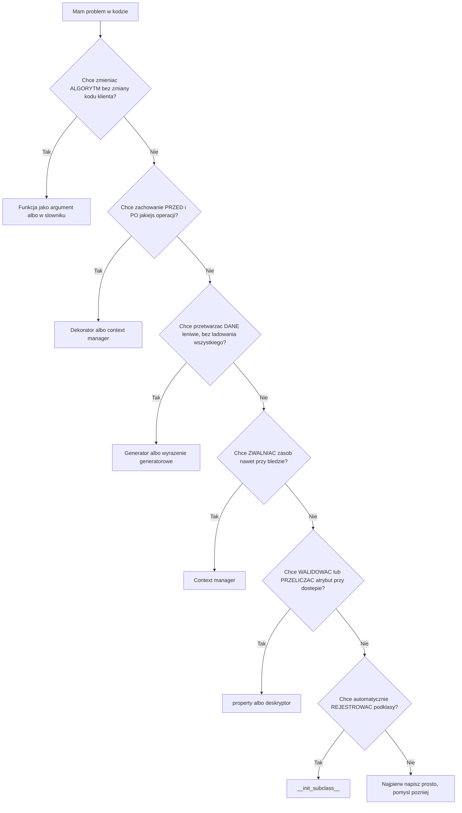
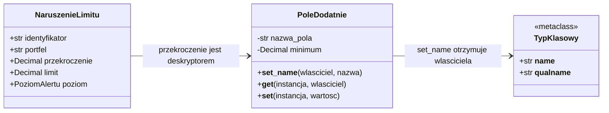
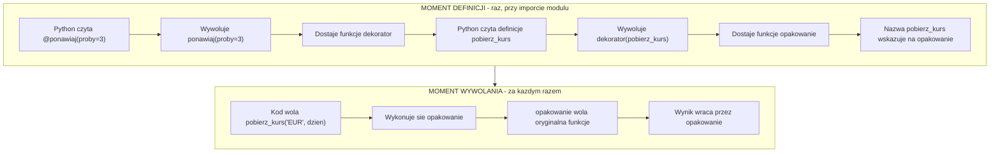
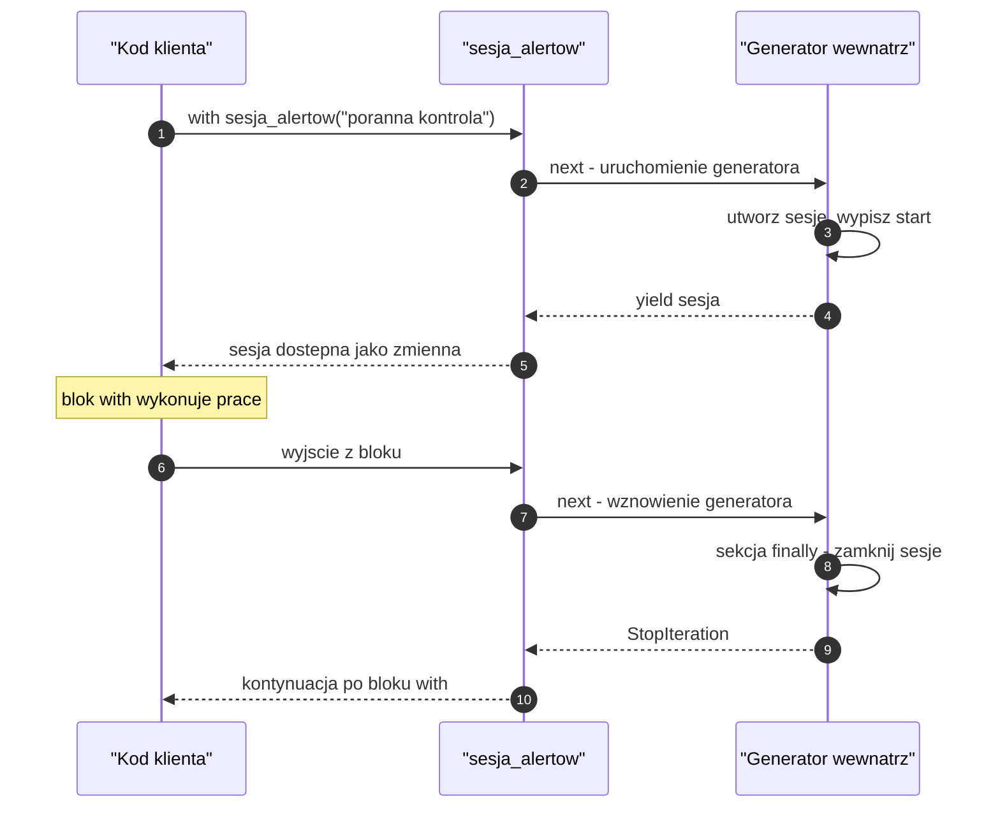
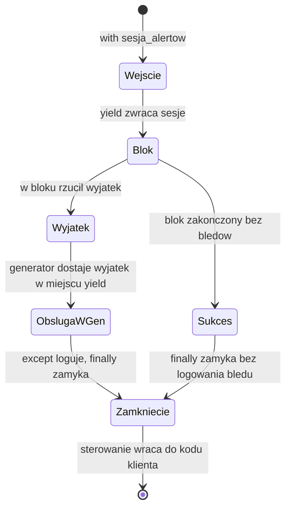
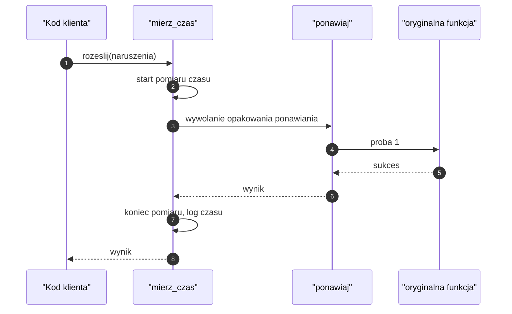
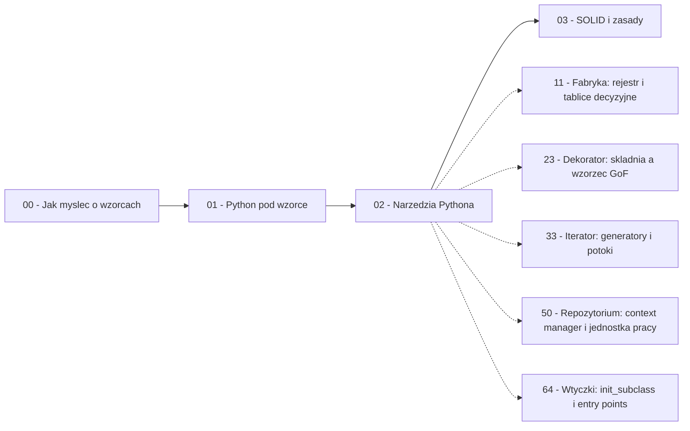

```markdown
---
modul: 02 — Narzędzia Pythona, które realizują wzorce za Ciebie
plik: 02-pythonowe-narzedzia-dekoratory-protocol.md
poziom: sredni
wymaga: [01]
czas: ~110 minut czytania + ~240 minut ćwiczeń
---

# Moduł 02 — Narzędzia Pythona, które realizują wzorce za Ciebie

> **TL;DR**
> - Python ma mechanizmy, które w innych językach trzeba budować ręcznie jako wzorce — funkcje jako wartości, dekoratory, generatory, context managery, deskryptory, `__init_subclass__`.
> - Wiedza o tym, co język robi za darmo, chroni cię przed pisaniem dwudziestu klas tam, gdzie wystarczy jedna funkcja albo pięć linii.
> - „Dekorator" to dwa różne pojęcia: wzorzec GoF (opakowanie obiektu) i składnia `@dekorator` (opakowanie funkcji) — mylenie ich prowadzi do złych decyzji projektowych.
> - Context managery i generatory to nie „cukier składniowy", lecz pełnoprawne narzędzia do zarządzania zasobami i przetwarzania strumieniowego — fundament repozytoriów, puli połączeń i jednostek pracy.
> - Metaklasy i deskryptory to narzędzia ostatniej szansy: zanim po nie sięgniesz, sprawdź `__init_subclass__`, `@property`, `functools.cached_property` — w 95% przypadków wystarczą.

---

## 0. Model mentalny

### Opakowanie prezentu, które zmienia sposób korzystania z zawartości

Wyobraź sobie, że masz do wręczenia prezent — powiedzmy kubek z nadrukiem. Kubek jest sobą bez względu na to, w co go zapakujesz: możesz go włożyć w papier ozdobny, w pudełko z kokardą albo w kopertę z szarego papieru. Zawartość się nie zmienia, zmienia się tylko **to, co musisz zrobić, żeby się do niej dostać**. Papier ozdobny trzeba rozwinąć, pudełko otworzyć, kopertę rozedrzeć. Za każdym razem inna czynność — ale rezultat ten sam. Co więcej: możesz nakładać warstwy. Kubek w pudełku, pudełko w papierze, papier w torbie. Każda warstwa dodaje coś (ochronę, ozdobę, informację „nie rzucać"), a każdą można zdjąć w dowolnej kolejności.

Dokładnie tak działają wszystkie narzędzia z tego modułu. Funkcja `policz_prowizje` jest jak ten kubek: sama wie, jak liczyć prowizję, i to się nie zmienia. Ale możesz ją **opakować** w dekorator, który zaloguje wywołanie, doda ponowienie przy błędzie, zmierzy czas albo zapisze wynik w pamięci podręcznej. Możesz opakować kontekst managera wokół operacji, żeby zasoby zostały zwolnione także przy awarii. Możesz opakować dane w generator, żeby nie liczyć ich wszystkich naraz.

Jest jeszcze jedna rzecz w tej analogii, o której łatwo zapomnieć: **prezent zapakowany w pudełko nie jest już „kubkiem" w sensie dotykowym — jest przedmiotem, do którego podchodzisz inaczej**. Programista, który widzi `policz_prowizje(100)`, nie wie, że w środku może być logowanie, ponawianie i cache. Widzi funkcję. Ta **przezroczystość opakowania** jest jego największą zaletą i jednocześnie źródłem najczęstszych pułapek — o nich w sekcji 8.

| W analogii opakowania prezentu | W kodzie |
|---|---|
| Kubek (zawartość) | Oryginalna funkcja, klasa albo zasób |
| Papier ozdobny, pudełko, torba | Kolejne warstwy dekoratorów lub context managerów |
| Czynność „rozwiń papier" | Wywołanie dodatkowego kodu przed/po oryginalnej funkcji |
| Torba z napisem „nie rzucać" | Dekorator `@ponawiaj(proby=3)` dodający zachowanie przy błędzie |
| Wiele warstw opakowania | `@loguj` nad `@ponawiaj` nad `@mierz_czas` |
| Zdejmowanie warstwy | Usunięcie dekoratora bez zmiany funkcji |
| „To nadal ten sam kubek" | Wywołanie wygląda identycznie dla klienta |

> 🧠 **Zapamiętaj** — **Wzorce wbudowane w Pythona (ang. Python idioms fulfilling design patterns) to mechanizmy języka, które realizują funkcjonalność klasycznych wzorców projektowych w sposób natywny — krótszy, czytelniejszy i mniej podatny na błędy niż ręczna hierarchia klas.**

Zanim pójdziemy dalej, jedno bardzo ważne rozróżnienie. W tym module mówimy o **narzędziach**, a nie o wzorcach. Dekorator Pythona (`@dekorator`) i wzorzec Dekorator z katalogu GoF mają wspólną ideę „opakowania", ale różnią się tym, **czym opakowują**: pierwszy opakowuje funkcję, drugi — obiekt. W module 23 omówimy wzorzec GoF szczegółowo i pokażemy, gdzie kończy się składnia, a zaczyna wzorzec. Teraz uczymy się używać narzędzi.

Poniższy diagram pokazuje, jak wybrać narzędzie, gdy masz konkretny problem. Zatrzymaj się przy nim na chwilę — to mapa tego całego modułu.



*Diagram to mapa decyzyjna całego modułu: sześć pytań, które prowadzą do właściwego narzędzia Pythona zamiast do ręcznie budowanego wzorca.*

### Czego te narzędzia NIE robią

Trzy mity, które warto rozbroić od razu, bo kosztują najwięcej czasu w praktyce.

**Nie zastępują projektowania.** To, że umiesz napisać dekorator, nie znaczy, że każde powtórzenie kodu powinno stać się dekoratorem. Dekoratory są świetne dla **przekrojowych** aspektów, które powtarzają się przy wielu, niezależnych operacjach: logowanie, mierzenie czasu, ponawianie, uprawnienia. Jeśli dekorator używasz tylko raz, to prawdopodobnie zwykłe `if` w funkcji byłoby czytelniejsze.

**Nie są darmowe.** Każdy dekorator to dodatkowe wywołanie funkcji i dodatkowa warstwa w śladzie stosu. Przy tysiącach wywołań na sekundę to się liczy. Każdy generator to obiekt trzymający stan. Każda warstwa opakowania utrudnia debugowanie. To narzędzia, nie ozdoby.

**Nie wszystkie „magiczne" mechanizmy trzeba znać.** Metaklasy i deskryptory znajdują się w tym module, bo **musisz umieć je rozpoznać**, kiedy spotkasz je w kodzie biblioteki, i **musisz wiedzieć, kiedy po nie nie sięgać**. Ale samodzielne pisanie metaklas w typowej aplikacji finansowej zdarza się raz na kilka lat. Jeśli ich nie napiszesz nigdy — prawdopodobnie zrobiłeś dobrą decyzję.

**Nie chodzi o skracanie kodu.** Dwadzieścia linii kodu w jednej funkcji jest często lepsze od trzech dekoratorów i dwóch generatorów po dwie linie każdy. Narzędzia z tego modułu istnieją po to, żeby rozwiązywać konkretne problemy: przekrojowe zachowania, leniwe dane, zasoby wymagające zwolnienia, wymienne algorytmy.

---

## 1. Problem, który rozwiązujemy

Zajrzyjmy do domeny 📊 „Sprawozdawczości". System generuje raport dzienny: pobiera pozycje z bazy, przelicza je na walutę bazową, formatuje i zapisuje do kilku miejsc. Ktoś napisał to w jednym pliku i — jak to zwykle bywa — wszystko działa.

### Kod „przed"

```python
# raport_dzienny_v0.py — wersja naiwna, demonstracyjna
from __future__ import annotations

import time
from datetime import date
from decimal import ROUND_HALF_UP, Decimal


def pobierz_pozycje(portfel: str, na_dzien: date) -> list[dict]:
    """Czyta pozycje z bazy. Tu: atrapa z lista w pamieci."""
    return [
        {"instrument": "OBL-1024", "waluta": "EUR", "wartosc": Decimal("120000.00")},
        {"instrument": "AKC-2210", "waluta": "PLN", "wartosc": Decimal("45000.00")},
        {"instrument": "ETF-0033", "waluta": "USD", "wartosc": Decimal("88000.00")},
    ]


def pobierz_kurs(waluta: str, na_dzien: date) -> Decimal:
    """Pobiera kurs waluty. Tu: atrapa z tabela."""
    tabela = {"EUR": Decimal("4.32"), "USD": Decimal("3.95"), "PLN": Decimal("1.00")}
    return tabela[waluta]


def policz_wartosc_pln(pozycje: list[dict], na_dzien: date) -> Decimal:
    suma = Decimal("0.00")
    for pozycja in pozycje:
        kurs = pobierz_kurs(pozycja["waluta"], na_dzien)
        suma += pozycja["wartosc"] * kurs
    return suma.quantize(Decimal("0.01"), rounding=ROUND_HALF_UP)


def generuj_raport(portfel: str, na_dzien: date) -> dict:
    start = time.perf_counter()

    # 1. Logowanie startu (powtarzane w kazdej funkcji raportu)
    print(f"[INFO] start raportu dla {portfel} na {na_dzien}")

    # 2. Pobieranie - z ponawianiem w razie bledu
    for numer_proby in range(3):
        try:
            pozycje = pobierz_pozycje(portfel, na_dzien)
            break
        except RuntimeError as blad:
            print(f"[WARN] proba {numer_proby + 1} nieudana: {blad}")
    else:
        raise RuntimeError("nie udalo sie pobrac pozycji")

    # 3. Obliczenia
    wynik = policz_wartosc_pln(pozycje, na_dzien)

    # 4. Formatowanie
    sformatowana = f"{wynik:,.2f}".replace(",", " ")

    # 5. Zapis do pliku - z gwarancja zwolnienia zasobu
    plik = open(f"raport_{portfel}_{na_dzien}.txt", "w", encoding="utf-8")
    try:
        plik.write(f"Raport dzienny {portfel} na {na_dzien}\n")
        for pozycja in pozycje:
            plik.write(f"  {pozycja['instrument']}: {pozycja['wartosc']} {pozycja['waluta']}\n")
        plik.write(f"RAZEM: {sformatowana} PLN\n")
    finally:
        plik.close()

    # 6. Logowanie konca - powtorzone recznie
    czas = time.perf_counter() - start
    print(f"[INFO] koniec raportu, czas {czas:.4f} s")

    return {"portfel": portfel, "wartosc": wynik, "czas": czas}
```

Ten kod działa i da się uruchomić. Zwróć uwagę, co jednak się w nim powtarza — i to jest sedno tego modułu.

### Code smell — pięć powtórzeń, które wołają o narzędzie

| Powtórzenie | Gdzie | Co to znaczy |
|---|---|---|
| Logowanie startu i końca | Dookoła całej operacji | Aspekt przekrojowy: ten sam wzorzec w każdej funkcji raportu |
| Ponawianie przy błędzie | W pętli `for ... try/except` | Logika, która nie ma nic wspólnego z raportem, wtopiona w raport |
| Otwieranie i zamykanie pliku | `try/finally` ręcznie | Zasób wymagający zwolnienia, obsłużony ręcznie i podatny na błąd |
| Budowanie listy wszystkich pozycji | `pobierz_pozycje` zwraca `list` | Przy milionie pozycji cała lista jest w pamięci |
| Warunkowa decyzja po typie | `pobierz_kurs` z tabelą w `dict` | Nie jest to jeszcze błąd, ale przy 40 walutach i kursach historycznych rozrośnie się w lawinę |

Zwróć uwagę na aspekt przekrojowy. Logowanie i ponawianie **nie są częścią raportu**. Raport to: pobierz, przelicz, sformatuj, zapisz. Logowanie i ponawianie to **opakowanie** wokół tego procesu — i gdyby ktoś poprosił cię o dodanie mierzenia czasu do `generuj_raport`, wskazałbyś to samo miejsce, w którym już jest logowanie. Każda funkcja w tym module, która ma „coś przed i coś po", jest kandydatem do dekoratora.

### Objawy — poznasz ten problem po tym, że...

- **Kopiujesz ten sam blok `try/except` do kolejnej funkcji**, zmieniając tylko komunikat błędu.
- **Widzisz `start = time.perf_counter()` i `czas = time.perf_counter() - start` w kilkunastu miejscach.** To dokładnie ten kształt, który dekorator potrafi usunąć.
- **Piszesz `try: ... finally: zasob.close()` ręcznie** i zastanawiasz się, czy nie zapomnisz któregoś razu — a przy awarii w środku bloku nie jesteś pewien, czy zasób się zwolni.
- **Zwracasz `list`, bo „wygodnie"**, a potem ktoś pyta, dlaczego raport zużywa 4 GB pamięci przy 30 dniach historii.
- **Masz w kodzie `if x == "A": ... elif x == "B": ...`** i wiesz, że lista przypadków jeszcze urośnie.
- **W komentarzach tłumaczysz, że metoda „robi też X"**, bo nie ma nazwy dla X i nie da się go wyodrębnić.
- **Kiedy zmieniasz sposób logowania, musisz zmodyfikować sześć funkcji** — a przecież zmieniasz jedną rzecz: format komunikatów.
- **Nie możesz użyć funkcji w innym miejscu**, bo jest zlepiona z logowaniem, ponawianiem i formatowaniem pliku.

Zwróć uwagę, że te objawy nie mówią „użyj wzorca X". Mówią „masz cztery mechanizmy języka, które rozwiązują dokładnie te problemy". Tym mechanizmom poświęcimy ten moduł.

---

## 2. Anatomia

Skoro w tym module omawiamy narzędzia języka, nie wzorzec, rola „uczestników" zostaje przypisana narzędziom. Każde z nich ma swoją odpowiedzialność i — co ważniejsze — swoje **ograniczenia**, których przekroczenie kończy się kodem gorszym niż wyjściowy.

### Uczestnicy: narzędzia Pythona i ich granice

| Narzędzie | Odpowiedzialność | Co NIE jest jego zadaniem |
|---|---|---|
| Funkcja jako wartość | Reprezentuje wymienny algorytm; można ją przekazać i zwrócić | Nie przechowuje stanu (chyba że domknięcie) |
| Domknięcie (ang. closure) | Przechwytuje zmienne z otaczającego zakresu | Nie powinno przechwytywać pętli — chyba że intencjonalnie |
| Dekorator funkcyjny | Opakowuje funkcję, dodając zachowanie przed/po | Nie zmienia semantyki funkcji bez ostrzeżenia |
| Dekorator klasowy | Opakowuje klasę, np. dodając metody | Nie jest metaklasą — nie zmienia procesu tworzenia instancji |
| Context manager | Gwarantuje zwolnienie zasobu, także przy wyjątku | Nie zastępuje obsługi wyjątków biznesowych |
| Generator | Produkuje wartości leniwie, jedna po drugiej | Nie nadaje się do wielokrotnego przejścia po tych samych danych |
| Deskryptor | Przechwytuje dostęp do atrybutu (`__get__`, `__set__`) | Nie powinien zawierać logiki biznesowej |
| Metaklasa | Sterowanie tworzeniem klasy i jej instancji | Nie jest narzędziem do „efektownego" kodu |
| `__init_subclass__` | Automatyczna reakcja na powstanie podklasy | Nie powinien wykonywać ciężkich operacji przy imporcie |
| `functools.singledispatch` | Wybór funkcji na podstawie typu argumentu | Nie obsłuży typów, których nie zarejestrowano |
| `functools.partial` | Zamraża część argumentów funkcji | Nie tworzy nowej funkcji o innym zachowaniu |
| Moduł | Naturalny singleton i przestrzeń nazw | Nie jest miejscem na ukryty stan aplikacji |

> 💡 **Intuicja** — Najlepiej dobrane narzędzie jest **niewidoczne dla czytelnika kodu**. `with otworz_plik() as plik:` czyta się jak zwykłe zdanie, a nie jak mechanizm. Jeśli twoje rozwiązanie wymaga, żeby czytelnik wiedział, jak działa deskryptor, zanim zrozumie jedną metodę — narzędzie jest prawdopodobnie za mocne.

### Diagram struktury: deskryptor w akcji

Deskryptory są najbardziej „ukrytym" narzędziem w tym module — nie widać ich w miejscu użycia, widać tylko efekt. Poniższy diagram pokazuje, kto z kim rozmawia.



*Diagram pokazuje, że deskryptor zdefiniowany jako atrybut klasy dowiaduje się o swoim właścicielu przez `__set_name__`, a dostęp do niego przechodzi przez klasy, nie przez instancję.*

Przeczytajmy to w zdaniach. `PoleDodatnie` to **klasa deskryptora** — obiekt, który implementuje protokół dostępu do atrybutu. `NaruszenieLimitu.przekroczenie` nie jest zwykłą wartością — jest **instancją deskryptora** umieszczoną w ciele klasy. Kiedy ktoś pisze `naruszenie.przekroczenie = -5`, Python nie zapisuje wartości w `__dict__` instancji: najpierw znajduje deskryptor w klasie i przekazuje operację do jego metody `__set__`. Tam walidacja odrzuca wartość ujemną. Klasa `NaruszenieLimitu` nie ma o tym żadnej wiedzy — nie widzi ani kodu walidacji, ani miejsca, w którym wartość jest przechowywana.

To bardzo silny mechanizm. I dlatego groźny: jeśli czytelnik nie wie, że `przekroczenie` to deskryptor, będzie szukał walidacji w `__post_init__` albo w konstruktorze — i jej nie znajdzie.

### Warianty: klasyczny vs pythoniczny

Ta sama funkcjonalność, trzy poziomy kosztu.

| Problem | Wariant ręczny | Wariant „półpythoniczny" | Wariant pythoniczny |
|---|---|---|---|
| Logowanie wywołań | `print` na początku i końcu każdej funkcji | Klasa bazowa z metodą `wykonaj()` | Dekorator `@loguj` |
| Zwolnienie zasobu | `try/finally` w miejscu użycia | Klasa z `__enter__`/`__exit__` | `@contextmanager` nad generatorem |
| Leniwe dane | Funkcja zwracająca listę, potem indeksowanie | Własna klasa iteratora | Funkcja z `yield` |
| Walidowany atrybut | Sprawdzenie w konstruktorze każdej klasy | `@property` z setterem i ręcznie pisanym polem | Deskryptor współdzielony między klasami |
| Rejestr implementacji | Ręczne `REJESTR["nazwa"] = Klasa` po każdej klasie | `functools.singledispatch` | `__init_subclass__` w klasie bazowej |

Zasada praktyczna: **zaczynaj od kolumny drugiej od prawej**. Sięgaj po wariant pythoniczny, gdy druga powtórka boli, a po metaklasy i deskryptory dopiero wtedy, gdy wyraźnie brakuje ci słownictwa.

---

## 3. Implementacja krok po kroku

Przebudujemy raport dzienny z sekcji 1, krok po kroku, używając kolejnych narzędzi. Każdy krok rozwiązuje jedno konkretne powtórzenie i **nie zmienia zachowania** — to ważne, bo od tego zależy, czy refaktoryzacja jest bezpieczna.

### Krok 1 — Wyodrębnij algorytm jako funkcję przekazywaną

Zacznijmy od najmniejszej zmiany: logika, która się zmienia, zostaje wyjęta jako funkcja. To fundament wszystkich pozostałych kroków.

```python
from collections.abc import Callable
from decimal import Decimal

# Algorytm jako wartosc - mozna go przekazac, podmienic, przetestowac osobno
KursWymiany = Callable[[str, "date"], Decimal]

def kurs_z_tabeli(waluta: str, na_dzien: "date") -> Decimal:
    tabela = {"EUR": Decimal("4.32"), "USD": Decimal("3.95"), "PLN": Decimal("1.00")}
    return tabela[waluta]

def policz_wartosc_pln(
    pozycje: list[dict],
    na_dzien: "date",
    pobierz_kurs: KursWymiany = kurs_z_tabeli,
) -> Decimal:
    suma = Decimal("0.00")
    for pozycja in pozycje:
        suma += pozycja["wartosc"] * pobierz_kurs(pozycja["waluta"], na_dzien)
    return suma.quantize(Decimal("0.01"))
```

Zwróć uwagę na wartość domyślną `pobierz_kurs=kurs_z_tabeli`. Funkcja działa dokładnie tak jak wcześniej, gdy nie podasz kursu, a w testach podstawiasz własną funkcję — bez frameworka, bez mocków, w jednej linii. To dokładnie wzorzec Strategia (moduł 38) zapisany w jednej sygnaturze.

### Krok 2 — Zamień `if/elif` na tablicę decyzyjną

Zamiast lawiny warunków — słownik, którego kluczem jest wariant, a wartością funkcja.

```python
from decimal import Decimal

def kurs_eur(na_dzien: "date") -> Decimal:
    return Decimal("4.32")

def kurs_usd(na_dzien: "date") -> Decimal:
    return Decimal("3.95")

def kurs_pln(na_dzien: "date") -> Decimal:
    return Decimal("1.00")

KURSY: dict[str, "Callable[[date], Decimal]"] = {
    "EUR": kurs_eur,
    "USD": kurs_usd,
    "PLN": kurs_pln,
}

def pobierz_kurs(waluta: str, na_dzien: "date") -> Decimal:
    try:
        funkcja = KURSY[waluta]
    except KeyError as blad:
        raise ValueError(f"brak kursu dla waluty {waluta!r}") from blad
    return funkcja(na_dzien)
```

Ten krok ma jedną nieoczywistą zaletę: **dodanie nowej waluty to jedna linia w słowniku i jedna funkcja**, a nie modyfikacja rozgałęzienia. Zauważ też, że to zalążek *fabryki* z modułu 11 — ten mechanizm rozbudujemy tam do pełnego rejestru z automatyczną rejestracją.

### Krok 3 — Dodaj dekorator do mierzenia czasu i logowania

Teraz rozwiązujemy powtórzenie z logowaniem. Jeden dekorator zastępuje cztery linie w każdej funkcji.

```python
import functools
import time
from collections.abc import Callable
from typing import Any, TypeVar

F = TypeVar("F", bound=Callable[..., Any])

def loguj_i_mierz(operacja: str) -> Callable[[F], F]:
    """Dekorator z argumentem: loguje start i koniec oraz mierzy czas."""
    def dekorator(funkcja: F) -> F:
        @functools.wraps(funkcja)
        def opakowanie(*args: Any, **kwargs: Any) -> Any:
            start = time.perf_counter()
            print(f"[INFO] start: {operacja}")
            try:
                wynik = funkcja(*args, **kwargs)
            except Exception as blad:
                print(f"[BLAD] {operacja}: {type(blad).__name__}: {blad}")
                raise
            czas = time.perf_counter() - start
            print(f"[INFO] koniec: {operacja}, czas {czas:.4f} s")
            return wynik
        return opakowanie  # type: ignore[return-value]
    return dekorator
```

Trzy rzeczy, które trzeba tu zobaczyć. Po pierwsze: dekorator z argumentem to **funkcja zwracająca dekorator** — stąd dwa poziomy zagnieżdżenia. Po drugie: `functools.wraps` zachowuje nazwę, docstring i adnotacje oryginalnej funkcji — bez tego funkcja nazywałaby się `opakowanie` i narzędzia do dokumentacji przestałyby działać. Po trzecie: `try/except` **przepuszcza** wyjątek dalej po zalogowaniu. Dekorator, który połyka błędy, jest najgorszym rodzajem dekoratora — omówimy to w sekcji 8.

### Krok 4 — Dodaj dekorator ponawiania

Drugie powtórzenie zniknęło w ten sam sposób.

```python
import functools
import time
from collections.abc import Callable
from typing import Any, TypeVar

F = TypeVar("F", bound=Callable[..., Any])

def ponawiaj(
    proby: int = 3,
    opoznienie: float = 0.0,
    chwytane: tuple[type[Exception], ...] = (RuntimeError,),
) -> Callable[[F], F]:
    """Ponawia wywolanie funkcji po wybranych wyjatkach."""
    def dekorator(funkcja: F) -> F:
        @functools.wraps(funkcja)
        def opakowanie(*args: Any, **kwargs: Any) -> Any:
            ostatni_blad: Exception | None = None
            for numer in range(1, proby + 1):
                try:
                    return funkcja(*args, **kwargs)
                except chwytane as blad:
                    ostatni_blad = blad
                    print(f"[WARN] proba {numer}/{proby} nieudana: {blad}")
                    if numer < proby and opoznienie:
                        time.sleep(opoznienie)
            assert ostatni_blad is not None
            raise ostatni_blad
        return opakowanie  # type: ignore[return-value]
    return dekorator
```

Dekoratory nakładają się na siebie w kolejności od dołu do góry. `@loguj_i_mierz("pobranie")` nad `@ponawiaj(proby=3)` oznacza, że mierzenie czasu obejmuje wszystkie trzy próby razem, a logowanie startu pojawia się raz. Odwrotna kolejność dałaby inny efekt — o tym w sekcji 8.

### Krok 5 — Zamień `try/finally` na context manager

Zapis do pliku przestaje być ręcznym obowiązkiem.

```python
from collections.abc import Iterator
from contextlib import contextmanager
from typing import TextIO

@contextmanager
def plik_raportu(sciezka: str) -> Iterator[TextIO]:
    """Otwiera plik raportu i zamyka go zawsze, takze przy bledzie."""
    plik = open(sciezka, "w", encoding="utf-8")
    print(f"[INFO] otwarto {sciezka}")
    try:
        yield plik
    finally:
        plik.close()
        print(f"[INFO] zamknieto {sciezka}")
```

`@contextmanager` zamienia generator w context manager. Kod przed `yield` to `__enter__`, kod po `yield` (w `finally`) to `__exit__`. To najkrótsza droga do poprawnego zarządzania zasobem. Wbudowany `open()` już jest context managerem, ale my potrzebujemy dodatkowo logowania — i właśnie dlatego opakowujemy go własnym.

### Krok 6 — Zamień listę na generator

Pozycje nie muszą wszystkie istnieć w pamięci naraz.

```python
from collections.abc import Iterable, Iterator
from datetime import date
from decimal import Decimal

def pozycje_z_dziennika(
    wiersze: Iterable[str],
    na_dzien: date,
) -> Iterator[dict]:
    """Zamienia wiersze dziennika w slowniki pozycji, leniwie."""
    for wiersz in wiersze:
        wiersz = wiersz.strip()
        if not wiersz or wiersz.startswith("#"):
            continue
        instrument, waluta, wartosc = wiersz.split(";")
        yield {
            "instrument": instrument,
            "waluta": waluta,
            "wartosc": Decimal(wartosc),
            "na_dzien": na_dzien,
        }
```

Trzy rzeczy, które zyskałeś. Po pierwsze: funkcja zaczyna zwracać wynik **natychmiast** po pierwszym wierszu, bez wczytywania całości. Po drugie: filtrowanie i parsowanie są wbudowane w strumień, więc nie ma etapu pośredniego. Po trzecie: funkcja zadziała identycznie dla pliku o tysiącu wierszy i o stu milionach — jedyne ograniczenie to prędkość, nie pamięć.

### Krok 7 — Złóż wszystko razem

```python
@loguj_i_mierz("raport dzienny")
@ponawiaj(proby=3, chwytane=(RuntimeError, ValueError))
def generuj_raport(portfel: str, na_dzien: date) -> dict:
    """Generuje raport dzienny dla portfela."""
    with plik_raportu(f"raport_{portfel}.txt") as plik:
        suma = Decimal("0.00")
        for pozycja in pobierz_pozycje_strumieniowo(portfel, na_dzien):
            suma += pozycja["wartosc"] * pobierz_kurs(pozycja["waluta"], na_dzien)
        suma = suma.quantize(Decimal("0.01"))
        plik.write(f"Raport {portfel} na {na_dzien}\nRAZEM: {suma} PLN\n")
    return {"portfel": portfel, "wartosc": suma}
```

Porównaj długość i czytelność z wersją wyjściową. Ciało funkcji zawiera **wyłącznie logikę raportu**. Logowanie, ponawianie, zwalnianie zasobu i leniwe dane są dostarczane przez narzędzia zadeklarowane w nagłówku. Ktoś, kto czyta tę funkcję, widzi od razu: „to funkcja, która loguje, mierzy czas, ponawia przy błędzie i generuje raport".

### Krok 8 — Zweryfikuj decyzję

| Pytanie kontrolne | Wersja „przed" | Wersja „po" |
|---|---|---|
| Zmiana formatu logowania | Zmiana w kilku funkcjach | Zmiana jednego dekoratora |
| Dodanie trzeciej próby ponowienia | Zmiana pętli w miejscu użycia | Zmiana argumentu dekoratora |
| Zasób zwolniony przy wyjątku | Zależne od dyscypliny autora | Gwarantowane przez `finally` |
| Zużycie pamięci dla 1 mln pozycji | Cała lista w pamięci | Stałe, niezależne od liczby |
| Test bez plików | Trudny — `open` w środku | Łatwy — podstaw własny context manager |
| Liczba linii w `generuj_raport` | ~25 | ~10 |
| Ślad stosu przy błędzie | Prosty | Głębszy (trzy poziomy opakowań) |

Ostatni wiersz jest uczciwym kosztem. Wersja „po" ma głębszy ślad stosu, a to realnie utrudnia debugowanie. Cena za to jest jednak niewielka: `functools.wraps` sprawia, że nazwy funkcji w śladzie pozostają poprawne, więc traceback czyta się znośnie. Gdyby nie `wraps`, zobaczyłbyś `opakowanie` trzy razy i nie wiedziałbyś, o którą funkcję chodzi.

---

## 4. Wersje pythoniczne i warianty

To najobszerniejsza sekcja modułu, bo zawiera pełny katalog narzędzi. Czytaj ją wybiórczo — wróć do konkretnego fragmentu, gdy będziesz go potrzebować.

### 4.1 Funkcje pierwszej klasy i tablice decyzyjne

Funkcja w Pythonie jest zwykłym obiektem: ma tożsamość, atrybuty, można ją przypisać do zmiennej, włożyć do listy i słownika, przekazać jako argument i zwrócić z funkcji.

```python
from collections.abc import Callable
from decimal import Decimal

# Tablica decyzyjna: zamiast if/elif po poziomie alertu
def formatuj_info(naruszenie: "NaruszenieLimitu") -> str:
    return f"INFO: {naruszenie.regula}"

def formatuj_ostrzezenie(naruszenie: "NaruszenieLimitu") -> str:
    return f"OSTRZEZENIE: {naruszenie.regula} ({naruszenie.przekroczenie:.2%})"

def formatuj_krytyczny(naruszenie: "NaruszenieLimitu") -> str:
    return f"KRYTYCZNE: {naruszenie.regula} - natychmiastowa eskalacja"

FORMATERY: dict[str, Callable[["NaruszenieLimitu"], str]] = {
    "INFO": formatuj_info,
    "OSTRZEZENIE": formatuj_ostrzezenie,
    "KRYTYCZNY": formatuj_krytyczny,
}

def sformatuj(naruszenie: "NaruszenieLimitu") -> str:
    formater = FORMATERY.get(naruszenie.poziom.value, formatuj_info)
    return formater(naruszenie)
```

Zwróć uwagę na `.get(..., domyslna)` — to bezpieczniejsza wersja od indeksowania, bo nie rzuca wyjątku przy nieznanym kluczu. Wybór między `.get` a obsługą `KeyError` to decyzja projektowa: czy nieznany poziom ma być cichym fallbackiem, czy głośnym błędem. W systemie alertów wolałbym błąd — „nie wiem, jak sformatować ten alert" jest informacją, którą trzeba zobaczyć.

### 4.2 Domknięcia i późne wiązanie

Domknięcie (ang. closure) to funkcja, która pamięta zmienne z miejsca, w którym powstała — nawet po zakończeniu działania funkcji zewnętrznej.

```python
from decimal import Decimal

def utworz_prog_alertu(prog: Decimal):
    """Zwraca funkcje sprawdzajaca, czy wartosc przekracza prog."""
    def sprawdz(wartosc: Decimal) -> bool:
        return wartosc > prog       # prog jest przechwycony z zewnatrz
    return sprawdz

# Po zakonczeniu utworz_prog_alertu zmienna prog nadal zyje
alert_5_proc = utworz_prog_alertu(Decimal("0.05"))
alert_20_proc = utworz_prog_alertu(Decimal("0.20"))

print(alert_5_proc(Decimal("0.07")))    # True
print(alert_20_proc(Decimal("0.07")))   # False
```

Dwa niezależne domknięcia mają **dwie niezależne kopie** zmiennej `prog`. To najprostszy sposób na „konfigurowalne funkcje" — i fundament tego, jak zbudujemy strategię z parametrami w module 38.

A teraz pułapka, która kosztuje ludzi godziny debugowania. **Późne wiązanie (ang. late binding)** polega na tym, że domknięcie przechwytuje **zmienną**, a nie jej wartość w chwili utworzenia.

```python
# BLAD: pozne wiazanie
funkcje: list = []
for kanal in ("email", "sms", "push"):
    funkcje.append(lambda: f"wysylam przez {kanal}")

print([f() for f in funkcje])
# ['wysylam przez push', 'wysylam przez push', 'wysylam przez push']
```

Wszystkie trzy lambdy odwołują się do **tej samej** zmiennej `kanal`, a ta po zakończeniu pętli ma wartość `"push"`. Python nie tworzy nowego zakresu dla każdej iteracji pętli — zakres jest jeden, na poziomie funkcji.

```python
# POPRAWNIE 1: domyslny argument wiaze wartosc w chwili tworzenia
funkcje = []
for kanal in ("email", "sms", "push"):
    funkcje.append(lambda kanal=kanal: f"wysylam przez {kanal}")

print([f() for f in funkcje])   # ['wysylam przez email', ...]

# POPRAWNIE 2: funkcja fabrykujaca
def utworz_wysylke(kanal: str):
    return lambda: f"wysylam przez {kanal}"

funkcje = [utworz_wysylke(k) for k in ("email", "sms", "push")]
```

Drugi wariant jest czytelniejszy, gdy domknięcie ma więcej niż jedną zmienną. Pierwszy jest zwięźlejszy. Oba działają, bo tworzą **nowy zakres** (nową ramkę funkcji) dla każdej iteracji.

> ⚠️ **Pułapka** — Uwaga na domyślne argumenty z pętli **w połączeniu z mutowalnymi wartościami**. `lambda lista=[]: ...` wewnątrz pętli da ci jedną wspólną listę dla wszystkich wywołań, dokładnie tak jak w pułapce z modułu 01. Domyślny argument jest bezpieczny tylko wtedy, gdy wartość jest niemutowalna.

### 4.3 Dekoratory — od najprostszego do najtrudniejszego

**Dekorator bez argumentów.** Podstawowy przypadek.

```python
import functools
from collections.abc import Callable
from typing import Any, TypeVar

F = TypeVar("F", bound=Callable[..., Any])

def licz_wywolania(funkcja: F) -> F:
    """Liczy, ile razy funkcja byla wywolana."""
    @functools.wraps(funkcja)
    def opakowanie(*args: Any, **kwargs: Any) -> Any:
        opakowanie.licznik += 1  # type: ignore[attr-defined]
        return funkcja(*args, **kwargs)

    opakowanie.licznik = 0  # type: ignore[attr-defined]
    return opakowanie  # type: ignore[return-value]
```

**Dekorator z argumentami.** Trzy poziomy zagnieżdżenia: funkcja przyjmująca argumenty → funkcja przyjmująca funkcję → funkcja opakowująca.

```python
def ponawiaj(proby: int = 3):
    def dekorator(funkcja):
        @functools.wraps(funkcja)
        def opakowanie(*args, **kwargs):
            for numer in range(proby):
                try:
                    return funkcja(*args, **kwargs)
                except RuntimeError:
                    if numer == proby - 1:
                        raise
        return opakowanie
    return dekorator
```

Zobacz, jak to wygląda od strony Pythona w dwóch różnych momentach. To najczęstsze źródło nieporozumień z dekoratorami: ludzie mylą moment definicji z momentem wywołania.



*Diagram rozdziela dwa momenty: cały mechanizm „opakowywania" dzieje się raz, przy definicji, a przy każdym wywołaniu wykonywane jest już tylko gotowe opakowanie.*

Konsekwencja tego rozróżnienia jest praktyczna i zaskakująca. **Kod w dekoratorze, ale poza funkcją opakowującą, wykonuje się raz — przy imporcie.** Jeśli umieścisz tam `open()` albo zapytanie do bazy, zasób zostanie otwarty w momencie importu modułu. To dlatego dekoratory nie nadają się do operacji, które mają się dziać per wywołanie.

**Klasa jako dekorator.** Jeśli dekorator musi przechowywać stan, klasa bywa czytelniejsza niż funkcja z atrybutem.

```python
class LiczWywolania:
    """Dekorator stanowy - obiekt pamieta, ile razy wywolano funkcje."""

    def __init__(self, funkcja):
        self._funkcja = funkcja
        self.licznik = 0
        functools.update_wrapper(self, funkcja)

    def __call__(self, *args, **kwargs):
        self.licznik += 1
        return self._funkcja(*args, **kwargs)

@LiczWywolania
def pobierz_kurs(waluta: str, na_dzien) -> Decimal:
    ...

print(pobierz_kurs.licznik)   # 0
pobierz_kurs("EUR", None)
print(pobierz_kurs.licznik)   # 1
```

Tu działa `__call__` z modułu 01 — obiekt jest „wywoływalny", więc może pełnić rolę funkcji. Uwaga na jedyne ograniczenie: dekorator klasowy nie jest już funkcją, więc narzędzia oczekujące prawdziwej funkcji (np. `inspect.isfunction`) go nie rozpoznają.

**Dekoratory wbudowane.** Te, których używasz codziennie, a które są dokładnie tym samym mechanizmem.

| Dekorator | Co robi | Kiedy używać | Uwaga |
|---|---|---|---|
| `@staticmethod` | Metoda nie przyjmuje `self` ani `cls` | Funkcja pomocnicza logicznie związana z klasą | Nie jest „prawie metodą" — nie ma dostępu do niczego |
| `@classmethod` | Pierwszym argumentem jest klasa | Fabryki alternatywnych konstruktorów | Podklasa dostaje swoją klasę, co czyni ją polimorficzną |
| `@property` | Zamienia metodę w atrybut | Wartości wyliczane, walidacja przy przypisaniu | Ciężkie obliczenia w `@property` w pętli to błąd wydajności |
| `@functools.cached_property` | Jak `property`, ale wynik jest zapamiętany | Wartość wyliczana raz na obiekt | Wymaga, by obiekt miał `__dict__`; nie działa ze `slots` |
| `@functools.lru_cache` | Pamięta wyniki funkcji dla tych samych argumentów | Czyste funkcje, kosztowne obliczenia | Argumenty muszą być haszowalne — `Decimal` jest, `list` nie |
| `@dataclass` | Generuje `__init__`, `__repr__`, `__eq__` | Klasy przenoszące dane | Nie generuje walidacji — patrz `__post_init__` |

Krótki przykład łączący `classmethod` i `cached_property`:

```python
from dataclasses import dataclass, field
from decimal import Decimal

@dataclass(frozen=True)
class NaruszenieLimitu:
    identyfikator: str
    regula: str
    przekroczenie: Decimal
    limit: Decimal

    @classmethod
    def z_ekspozycji(
        cls,
        identyfikator: str,
        ekspozycja: Decimal,
        limit: Decimal,
    ) -> "NaruszenieLimitu":
        """Alternatywny konstruktor: liczy przekroczenie z ekspozycji."""
        return cls(
            identyfikator=identyfikator,
            regula="koncentracja",
            przekroczenie=(ekspozycja - limit) / limit,
            limit=limit,
        )

    @property
    def czy_krytyczne(self) -> bool:
        return self.przekroczenie > Decimal("0.20")
```

`z_ekspozycji` to metoda wytwórcza (moduł 11) na poziomie klasy — jeden z najczęstszych i najczystszych pythonicznych wzorców. Czytelnik widzi dwie drogi utworzenia obiektu: pełny konstruktor dla danych już policzonych i wygodny skrót dla danych surowych.

**Zapowiedź: dekorator GoF vs `@dekorator`.** W module 23 omówimy wzorzec Dekorator z katalogu GoF. Jego cel: dodać obiektowi odpowiedzialność bez zmiany klasy, zachowując ten sam interfejs, i pozwolić na łączenie wielu dekoratorów. Składnia `@dekorator` opakowuje **funkcję raz, na stałe, w momencie definicji**. Wzorzec GoF opakowuje **obiekt w czasie działania programu**, wielokrotnie, w dowolnej kolejności. To dwie różne rzeczy o wspólnej nazwie — i wrócimy do tego rozróżnienia w module 23.

### 4.4 Context managery

Protokół context managera to `__enter__` i `__exit__`. Znajomość trzech wariantów wystarcza w praktyce.

**Wariant A: `@contextmanager` nad generatorem.** Najkrótszy i najczęstszy.

```python
from contextlib import contextmanager
from collections.abc import Iterator

@contextmanager
def transakcja(ksiega: list[str], opis: str) -> Iterator[list[str]]:
    """Zapisuje operacje do bufora; zapisuje je tylko przy sukcesie."""
    bufor: list[str] = []
    print(f"[TX] start transakcji: {opis}")
    try:
        yield bufor
    except Exception:
        print(f"[TX] rollback transakcji: {opis}")
        raise
    else:
        ksiega.extend(bufor)
        print(f"[TX] commit: {opis}, zapisano {len(bufor)} operacji")
```

**Wariant B: klasa z `__enter__`/`__exit__`.** Gdy potrzebujesz więcej kontroli, np. sprawdzenia wyniku w `__exit__` albo wielokrotnego użycia tego samego obiektu.

```python
class PomiarCzasu:
    """Mierzy czas bloku i udostepnia go po wyjsciu."""

    def __init__(self, opis: str) -> None:
        self.opis = opis
        self.czas: float = 0.0

    def __enter__(self) -> "PomiarCzasu":
        import time
        self._start = time.perf_counter()
        return self

    def __exit__(self, typ, wartosc, slad) -> bool:
        import time
        self.czas = time.perf_counter() - self._start
        print(f"[CZAS] {self.opis}: {self.czas:.4f} s")
        return False   # False = nie tlum wyjatku
```

**Wariant C: `contextlib.suppress`.** Jednolinijkowy context manager do ignorowania konkretnego wyjątku.

```python
from contextlib import suppress

with suppress(FileNotFoundError):
    os.remove("stary_raport.csv")   # brak pliku nie jest tu bledem
```

To znacznie czytelniejsze od `try/except: pass`, bo widać dokładnie, który wyjątek jest ignorowany — a `except: pass` łapie wszystko, także błędy programisty.

**Wariant D: `ExitStack`.** Gdy liczba zasobów nie jest znana z góry.

```python
from contextlib import ExitStack

def przetworz_wiele_plikow(sciezki: list[str]) -> int:
    """Otwiera wszystkie pliki i zamyka je w odwrotnej kolejnosci."""
    liczba_wierszy = 0
    with ExitStack() as stos:
        pliki = [stos.enter_context(open(s, encoding="utf-8")) for s in sciezki]
        for plik in pliki:
            liczba_wierszy += sum(1 for _ in plik)
    return liczba_wierszy
```

`ExitStack` jest bardzo praktyczny w architekturze i pojawi się ponownie w module 50 przy jednostce pracy, gdzie transakcja ma objąć zmienną liczbę repozytoriów.

**Kiedy `with` jest lepsze od `try/finally`.** Odpowiedź brzmi: zawsze, gdy zasób ma życie ograniczone do bloku. `try/finally` wymaga od ciebie dyscypliny i pilnowania, żeby kod zwalniający znalazł się w `finally`. `with` gwarantuje to samo, ale:
- **skraca kod** do jednej linii,
- **nazywa operację** (`with transakcja(...)` mówi więcej niż `try:`),
- **zapewnia jednolitość** — wszystkie zasoby zwalniane są w ten sam sposób,
- **daje jedno miejsce** na obsługę wyjątku i decyzję o jego stłumieniu.

### 4.5 Generatory

Generator to funkcja, która zamiast zwracać wynik, **produkuje** kolejne wartości. Każde `yield` to jedno słowo kluczowe, które zmienia całą semantykę funkcji.

```python
from collections.abc import Iterator
from decimal import Decimal

def naruszenia_z_dziennika(wiersze: Iterator[str]) -> Iterator["NaruszenieLimitu"]:
    """Filtruje i parsuje dziennik naruszen, leniwie."""
    for wiersz in wiersze:
        if not wiersz.strip() or wiersz.startswith("#"):
            continue
        identyfikator, regula, przekroczenie = wiersz.strip().split(";")
        yield NaruszenieLimitu(
            identyfikator=identyfikator,
            regula=regula,
            przekroczenie=Decimal(przekroczenie),
            limit=Decimal("0.20"),
        )
```

Trzy poziomy użycia generatorów:

```python
# 1. Wyrazenie generatorowe - jak list comprehension, ale z nawiasami okraglymi
kwoty_pln = (p["wartosc"] * KURSY[p["waluta"]](dzien) for p in pozycje)

# 2. Funkcja z yield - pelna kontrola nad logika
def alerty_krytyczne(wiersze):
    for naruszenie in naruszenia_z_dziennika(wiersze):
        if naruszenie.przekroczenie > Decimal("0.20"):
            yield naruszenie

# 3. itertools - biblioteka leniwego przetwarzania
import itertools

pierwsze_dziesiec = itertools.islice(
    naruszenia_z_dziennika(wiersze), 10
)
```

Podstawowe narzędzia `itertools` warte zapamiętania:

| Narzędzie | Co robi | Kiedy używać |
|---|---|---|
| `chain(*iterables)` | Skleja kilka źródeł w jedno | Łączenie wyników z kilku plików lub baz |
| `islice(iter, start, stop)` | Wycina zakres bez materializacji | Pierwsze N wyników, paginacja |
| `groupby(iter, key)` | Grupuje kolejne elementy o tym samym kluczu | Grupowanie po dniu, po portfelu (wymaga posortowania!) |
| `tee(iter, n)` | Rozgałęzia jeden iterator na n kopii | Gdy dwa konsumenty potrzebują tych samych danych |
| `takewhile(pred, iter)` | Bierze dopóki warunek prawdziwy | Wczesne przerwanie strumienia posortowanego |
| `dropwhile(pred, iter)` | Pomija dopóki warunek prawdziwy | Pominąć nagłówek pliku |
| `starmap(func, iter)` | Jak `map`, ale rozpakowuje krotki | Funkcja przyjmująca kilka argumentów |
| `accumulate(iter)` | Suma narastająca | Krzywa wartości portfela w czasie |
| `batched(iter, n)` | Dzieli na paczki po n | Przetwarzanie wsadowe (Python 3.12+) |

**Kiedy generator, a kiedy lista.** Kryterium jest jedno: czy potrzebujesz wszystkich elementów naraz.

| Sytuacja | Generator | Lista |
|---|---|---|
| 10 elementów, trzy przejścia po nich | Niepotrzebny | Tak, prostsze |
| 10 milionów wierszy z pliku | Tak, konieczne | Nie — brak pamięci |
| Wynik ma być indeksowany po numerze | Nie | Tak |
| Wynik ma być wielokrotnie przejrzany | Nie | Tak |
| Wynik ma być tylko zsumowany albo policzony | Tak | Zbędny narzut |
| Dane są wynikiem strumienia zewnętrznego | Tak, naturalnie | Nie |

> 🧠 **Zapamiętaj** — Generator jest **jednorazowy**. Po przejściu do końca jest wyczerpany i kolejna pętla po nim nie zwróci nic. To najbardziej zaskakująca cecha tego narzędzia — i najczęstsza przyczyna błędu „dlaczego drugi raport jest pusty".

### 4.6 Deskryptory

Deskryptor to obiekt, który przechwytuje dostęp do atrybutu. Trzy metody definiują jego zachowanie: `__get__`, `__set__`, `__delete__`. Dodatkowo `__set_name__` informuje deskryptor, pod jaką nazwą został przypisany w klasie.

```python
from decimal import Decimal

class PoleDodatnie:
    """Deskryptor: pozwala tylko na wartosci dodatnie."""

    def __init__(self, minimum: Decimal = Decimal("0")) -> None:
        self.minimum = minimum

    def __set_name__(self, wlasciciel: type, nazwa: str) -> None:
        # Python przekazuje tu informacje, pod jaka nazwa deskryptor wystapil
        self.nazwa_pola = nazwa
        self.nazwa_prywatna = f"_{nazwa}"

    def __get__(self, instancja, wlasciciel=None):
        if instancja is None:
            return self          # dostep przez klase zwraca sam deskryptor
        return getattr(instancja, self.nazwa_prywatna)

    def __set__(self, instancja, wartosc: Decimal) -> None:
        if not isinstance(wartosc, Decimal):
            raise TypeError(f"{self.nazwa_pola} musi byc typu Decimal")
        if wartosc <= self.minimum:
            raise ValueError(
                f"{self.nazwa_pola} musi byc wieksze od {self.minimum}, "
                f"otrzymano {wartosc}"
            )
        setattr(instancja, self.nazwa_prywatna, wartosc)
```

I użycie — zwróć uwagę, jak mało widać w klasie korzystającej:

```python
class NaruszenieLimitu:
    """Klasa korzystajaca z deskryptora. Walidacja jest niewidoczna w ciele."""

    przekroczenie = PoleDodatnie(minimum=Decimal("0"))
    limit = PoleDodatnie(minimum=Decimal("0"))

    def __init__(self, identyfikator: str, przekroczenie: Decimal, limit: Decimal) -> None:
        self.identyfikator = identyfikator
        self.przekroczenie = przekroczenie     # idzie przez __set__
        self.limit = limit                     # idzie przez __set__

if __name__ == "__main__":
    n = NaruszenieLimitu("NL-1", Decimal("0.34"), Decimal("0.20"))
    print(n.przekroczenie, n.limit)

    try:
        n.przekroczenie = Decimal("-0.10")
    except ValueError as blad:
        print(f"odrzucono: {blad}")
```

Dwie właściwości, które czynią deskryptory potężnymi: `__set_name__` pozwala jednemu deskryptorowi obsłużyć wiele pól bez przekazywania nazwy ręcznie, a ten sam deskryptor można umieścić w dziesiątkach klas. To dokładnie realizuje zasadę DRY bez dziedziczenia.

Drugie zastosowanie, jeszcze bardziej praktyczne — leniwe wyliczanie atrybutu:

```python
class LeniwaWycena:
    """Wylicza wartosc raz, przy pierwszym dostepie, i zapamietuje wynik."""

    def __init__(self, funkcja):
        self.funkcja = funkcja

    def __set_name__(self, wlasciciel, nazwa):
        self.nazwa = f"_wyczerpane_{nazwa}"

    def __get__(self, instancja, wlasciciel=None):
        if instancja is None:
            return self
        if not hasattr(instancja, self.nazwa):
            setattr(instancja, self.nazwa, self.funkcja(instancja))
        return getattr(instancja, self.nazwa)
```

To wersja edukacyjna `functools.cached_property`. W produkcji użyj tego drugiego — jest przetestowany, obsługuje przypadki brzegowe i działa ze wszystkimi typami klas.

> ⚠️ **Pułapka** — Deskryptor działa **tylko** wtedy, gdy występuje jako atrybut klasy. Jeśli w `__init__` zrobisz `self.przekroczenie = PoleDodatnie()`, dostaniesz zwykły atrybut instancji i żadna metoda deskryptora się nie wykona. To najczęstsza przyczyna „deskryptor nie działa".

### 4.7 Metaklasy i `__init_subclass__`

Zacznijmy od tego, co jest realnie potrzebne. **`__init_subclass__`** (PEP 487) pozwala klasie bazowej zareagować na powstanie każdej podklasy — i w 95% przypadków dokładnie tego potrzebujesz.

```python
class KanalAlertu:
    """Klasa bazowa z automatyczna rejestracja podklas."""

    REJESTR: dict[str, type["KanalAlertu"]] = {}

    def __init_subclass__(cls, **kwargs) -> None:
        super().__init_subclass__(**kwargs)
        nazwa = getattr(cls, "nazwa", None)
        if nazwa is None:
            raise TypeError(f"{cls.__name__} nie ma atrybutu 'nazwa'")
        if nazwa in KanalAlertu.REJESTR:
            raise ValueError(f"kanal {nazwa!r} jest juz zarejestrowany")
        KanalAlertu.REJESTR[nazwa] = cls


class KanalEmail(KanalAlertu):
    nazwa = "email"
    def wyslij(self, tresc: str) -> bool:
        return True


class KanalSms(KanalAlertu):
    nazwa = "sms"
    def wyslij(self, tresc: str) -> bool:
        return len(tresc) <= 160


if __name__ == "__main__":
    print(KanalAlertu.REJESTR)
    # {'email': <class 'KanalEmail'>, 'sms': <class 'KanalSms'>}
```

Dwie linie kodu obsługują całą rejestrację. Rejestr napełnia się sam w momencie importu modułu, bez żadnego ręcznego `REJESTR["email"] = KanalEmail` na końcu pliku. To gotowa *fabryka* z modułu 11 — i bardzo częsty wzorzec w bibliotekach.

**Metaklasa** to krok dalej: steruje **tworzeniem samej klasy**, nie tylko reaguje na jej powstanie.

```python
class Rejestrujaca(type):
    """Metaklasa: kazda klasa z nia tworzona trafia do rejestru."""

    def __new__(mcs, nazwa, bazy, przestrzen, **kwargs):
        klasa = super().__new__(mcs, nazwa, bazy, przestrzen)
        etykieta = przestrzen.get("nazwa")
        if etykieta:
            Rejestrujaca.REJESTR[etykieta] = klasa
        return klasa

    REJESTR: dict[str, type] = {}


class KanalPush(metaclass=Rejestrujaca):
    nazwa = "push"
```

Porównaj oba podejścia. Metaklasa jest **potężniejsza** — może modyfikować przestrzeń nazw klasy, dodawać metody, zmieniać hierarchię dziedziczenia. Ale ma trzy poważne wady:

1. **Konflikt metaklas.** Klasa może mieć tylko jedną metaklasę. Jeśli twoja klasa dziedziczy po `ABC` (`ABCMeta`) i po klasie z własną metaklasą, dostaniesz `TypeError` — i musisz napisać jeszcze jedną metaklasę, dziedziczącą po obu. To prowadzi do niesławnego „piekła metaklas".
2. **Trudność czytania.** Ktoś czytający `class KanalPush(metaclass=Rejestrujaca)` musi znać definicję `Rejestrujaca`, żeby cokolwiek zrozumieć. `__init_subclass__` jest lokalne i widoczne w klasie bazowej.
3. **Wpływ na wszystko.** Metaklasa oddziałuje na wszystkie podklasy, w tym te, o których nie pomyślałeś — na przykład na klasy testowe.

**Kiedy metaklasa jest naprawdę potrzebna?** Gdy chcesz zmienić **proces tworzenia klas**, a nie tylko zareagować na ich powstanie:
- modyfikacja przestrzeni nazw klasy zanim powstanie (np. automatyczne opakowanie metod — jak w `dataclass`, `enum`, `abstractmethod`),
- wymuszenie konkretnej struktury klasy bazowej,
- implementacja protokołu, który wymaga kontroli nad `__call__` klasy.

W typowej aplikacji finansowej **nigdy** nie napiszesz własnej metaklasy. Ale przeczytasz ich działanie, gdy zaczniesz zgłębiać `dataclasses` albo `Enum`.

> ⚠️ **Pułapka** — Jeśli czujesz, że „metaklasa byłaby tu idealna", spróbuj najpierw `__init_subclass__`. Jeśli wystarczy — użyj jej. Jeśli nie wystarczy, spróbuj dekoratora klasowego. Dopiero potem metaklasa. W praktyce okazuje się, że dwa pierwsze rozwiązania pokrywają niemal wszystkie przypadki, a są wielokrotnie łatwiejsze w utrzymaniu.

### 4.8 `__getattr__`, `__getitem__`, `__call__`

Dunder z modułu 01, zebrane razem, bo wspólnie umożliwiają budowę pełnomocników i adapterów (moduły 20 i 26).

```python
class FasadaAlertow:
    """Fasada delegujaca nieistniejace atrybuty do podsystemu."""

    def __init__(self, podsystem: object) -> None:
        self._podsystem = podsystem

    def __getattr__(self, nazwa: str):
        # Wywolywane TYLKO wtedy, gdy normalny mechanizm zawiedzie
        print(f"[DELEGACJA] {nazwa}")
        return getattr(self._podsystem, nazwa)
```

I tu najważniejsza pułapka całej sekcji: **`__getattr__` nie obsługuje metod specjalnych ani dostępu do atrybutów istniejących**. Metody specjalne są wyszukiwane na typie, nie na instancji, więc żeby delegować `__len__`, `__iter__` albo `__getitem__`, musisz zdefiniować je jawnie.

```python
class FasadaAlertow:
    def __init__(self, podsystem) -> None:
        self._podsystem = podsystem

    def __getattr__(self, nazwa):
        return getattr(self._podsystem, nazwa)

    # Musimy zdefiniowac jawnie - __getattr__ ich nie zlapie
    def __len__(self) -> int:
        return len(self._podsystem)

    def __iter__(self):
        return iter(self._podsystem)

    def __getitem__(self, indeks):
        return self._podsystem[indeks]
```

Trzeci dunder, `__call__`, zamienia obiekt w coś, co można wywołać jak funkcję.

```python
class RegulaProgowa:
    """Obiekt-regula: mozna go przekazac tam, gdzie oczekiwana jest funkcja."""

    def __init__(self, prog: Decimal, opis: str) -> None:
        self.prog = prog
        self.opis = opis

    def __call__(self, naruszenie) -> bool:
        return naruszenie.przekroczenie > self.prog

alert_krytyczny = RegulaProgowa(Decimal("0.20"), "krytyczny")
print(alert_krytyczny(naruszenie))   # wyglada jak funkcja, a niesie konfiguracje
```

Zastosowanie jest ogromne: każdy kod, który przyjmuje `Callable`, przyjmie też obiekt z `__call__`. W testach to pozwala rejestrować wywołania bez mocków, a w produkcji — łączyć stan i zachowanie w jednym obiekcie.

### 4.9 `functools.partial`, `singledispatch`, `SimpleNamespace`

Trzy drobne narzędzia, które pojawią się wielokrotnie.

```python
import functools
from datetime import date
from decimal import Decimal

# --- partial: zamraza czesc argumentow
def wyslij_alert(kanal: str, tresc: str, priorytet: str = "normalny") -> dict:
    return {"kanal": kanal, "tresc": tresc, "priorytet": priorytet}

krytyczny = functools.partial(wyslij_alert, priorytet="krytyczny")
print(krytyczny("email", "naruszenie limitu"))   # kanal i tresc przekazane pozniej

# --- singledispatch: wybor funkcji po typie argumentu
@functools.singledispatch
def formatuj_do_csv(wartosc) -> str:
    return str(wartosc)

@formatuj_do_csv.register
def _(wartosc: Decimal) -> str:
    return f"{wartosc:.2f}".replace(".", ",")

@formatuj_do_csv.register
def _(wartosc: date) -> str:
    return wartosc.isoformat()

@formatuj_do_csv.register
def _(wartosc: bool) -> str:
    return "tak" if wartosc else "nie"

print(formatuj_do_csv(Decimal("1234.5")))   # 1234,50
print(formatuj_do_csv(date(2026, 10, 9)))   # 2026-10-09
print(formatuj_do_csv(True))                # tak
print(formatuj_do_csv("dowolny tekst"))     # dowolny tekst - fallback
```

`singledispatch` to pythoniczna wersja dyspozycji wielokrotnej, którą w module 40 (Visitor) buduje się w innych językach ręcznie. Zauważ, jak niewiele tu kodu: cztery funkcje zamiast hierarchii czterech klas, i automatyczny fallback dla nieznanych typów.

```python
from types import SimpleNamespace

# --- SimpleNamespace: lekki obiekt z atrybutami bez definiowania klasy
konfiguracja = SimpleNamespace(
    sciezka_dziennika="/var/log/alerty.log",
    prog_krytyczny=Decimal("0.20"),
    kanaly=["email", "sms"],
)

print(konfiguracja.prog_krytyczny)
konfiguracja.kanaly.append("push")   # mutowalny, jak zwykly obiekt
```

`SimpleNamespace` jest przydatny, gdy potrzebujesz „obiektu z polami" tylko wewnątrz jednej funkcji i nie chcesz definiować klasy. To narzędzie tymczasowe — jeśli coś żyje dłużej niż jedna funkcja, powinno dostać nazwany typ.

### 4.10 Moduł jako naturalny singleton

To najważniejsza pythoniczna realizacja wzorca Singleton (moduł 10) i zarazem najbezpieczniejsza.

```python
# konfiguracja.py — modul importowany raz i tylko raz
from decimal import Decimal

PROG_KRYTYCZNY = Decimal("0.20")
PROG_OSTRZEZENIA = Decimal("0.05")
KANALE_DOMYSLNE = ("email",)

def opis() -> str:
    return f"progi: {PROG_OSTRZEZENIA}/{PROG_KRYTYCZNY}"
```

```python
# inny_modul.py
import konfiguracja

konfiguracja.PROG_KRYTYCZNY = Decimal("0.25")   # zmiana widoczna dla wszystkich
```

Dlaczego to działa jak singleton? Ponieważ Python wykonuje kod modułu **raz**, przy pierwszym imporcie, i zapamiętuje wynik w `sys.modules`. Każdy kolejny `import` zwraca ten sam obiekt. Nie potrzebujesz `__new__`, metaklas, cache'ów ani blokad — mechanizm importu już to wszystko załatwia i jest bezpieczny wątekowo.

Zaleta nad klasycznym singletonem jest ogromna: nie ma klasy, nie ma `getInstance()`, nie ma problemu z testowaniem, bo moduł można podmienić w `sys.modules` albo — prościej — zaimportować jego zawartość przez `from konfiguracja import PROG_KRYTYCZNY` w miejscu, gdzie wartość jest wstrzykiwana jako argument. Wrócimy do tego w module 10, gdzie pokażemy, kiedy moduł wystarczy, a kiedy trzeba sięgnąć po klasę.

---

## 5. Przykład z życia: 🔔 Alerty — pełny uruchamialny kod

Zbudujemy kompletny system alertów o naruszeniach limitów ryzyka. Wykorzystamy: generator (leniwe czytanie dziennika), tablicę decyzyjną (formatowanie), dekoratory (ponawianie, liczenie czasu), context manager (sesja alertów), `__init_subclass__` (rejestracja kanałów), `singledispatch` (formatowanie wartości) i `functools.partial` (skonfigurowane kanały).

### Kod

```python
# alerty.py — system alertow o naruszeniach limitow ryzyka
from __future__ import annotations

import functools
import itertools
import time
from collections.abc import Callable, Iterable, Iterator
from contextlib import contextmanager
from dataclasses import dataclass
from datetime import datetime, timezone
from decimal import Decimal
from enum import Enum
from typing import Any, Protocol, TypeVar

F = TypeVar("F", bound=Callable[..., Any])


# ---------------------------------------------------------------------------
# 1. Typy domenowe
# ---------------------------------------------------------------------------

class PoziomAlertu(Enum):
    INFO = "info"
    OSTRZEZENIE = "ostrzezenie"
    KRYTYCZNY = "krytyczny"

    def __str__(self) -> str:
        return self.value


@dataclass(frozen=True, slots=True)
class NaruszenieLimitu:
    identyfikator: str
    portfel: str
    regula: str
    przekroczenie: Decimal       # udzial ponad limit, np. 0.34 = 34 punktow procentowych
    znacznik: datetime

    @property
    def poziom(self) -> PoziomAlertu:
        if self.przekroczenie >= Decimal("0.20"):
            return PoziomAlertu.KRYTYCZNY
        if self.przekroczenie >= Decimal("0.05"):
            return PoziomAlertu.OSTRZEZENIE
        return PoziomAlertu.INFO


@dataclass(frozen=True, slots=True)
class WyslanyAlert:
    kanal: str
    identyfikator: str
    potwierdzony: bool
    opis: str = ""

    def __bool__(self) -> bool:
        return self.potwierdzony


# ---------------------------------------------------------------------------
# 2. Formatowanie tekstu alertu - tablica decyzyjna
# ---------------------------------------------------------------------------

def _formatuj_info(n: NaruszenieLimitu) -> str:
    return f"[INFO] {n.portfel}: {n.regula}"


def _formatuj_ostrzezenie(n: NaruszenieLimitu) -> str:
    return (
        f"[OSTRZEZENIE] {n.portfel}: {n.regula} "
        f"przekroczona o {n.przekroczenie:.2%}"
    )


def _formatuj_krytyczny(n: NaruszenieLimitu) -> str:
    return (
        f"[KRYTYCZNE] {n.portfel}: {n.regula} "
        f"przekroczona o {n.przekroczenie:.2%} - wymagana eskalacja"
    )


FORMATERY: dict[PoziomAlertu, Callable[[NaruszenieLimitu], str]] = {
    PoziomAlertu.INFO: _formatuj_info,
    PoziomAlertu.OSTRZEZENIE: _formatuj_ostrzezenie,
    PoziomAlertu.KRYTYCZNY: _formatuj_krytyczny,
}


def sformatuj(n: NaruszenieLimitu) -> str:
    """Zamienia naruszenie w tekst. Nieznany poziom to blad, nie fallback."""
    try:
        formater = FORMATERY[n.poziom]
    except KeyError as blad:
        raise ValueError(f"brak formatera dla poziomu {n.poziom!r}") from blad
    return formater(n)


# ---------------------------------------------------------------------------
# 3. Formatowanie wartosci do raportu - singledispatch
# ---------------------------------------------------------------------------

@functools.singledispatch
def formatuj_wartosc(wartosc: Any) -> str:
    """Domyslny formater dla nieznanych typow."""
    return str(wartosc)


@formatuj_wartosc.register
def _(wartosc: Decimal) -> str:
    return f"{wartosc:.4f}".replace(".", ",")


@formatuj_wartosc.register
def _(wartosc: datetime) -> str:
    return wartosc.astimezone(timezone.utc).isoformat(timespec="seconds")


@formatuj_wartosc.register
def _(wartosc: bool) -> str:
    return "tak" if wartosc else "nie"


# ---------------------------------------------------------------------------
# 4. Dekoratory przekrojowe
# ---------------------------------------------------------------------------

def ponawiaj(
    proby: int = 3,
    opoznienie: float = 0.0,
    chwytane: tuple[type[Exception], ...] = (RuntimeError,),
) -> Callable[[F], F]:
    """Ponawia wywolanie funkcji po wybranych wyjatkach."""
    def dekorator(funkcja: F) -> F:
        @functools.wraps(funkcja)
        def opakowanie(*args: Any, **kwargs: Any) -> Any:
            ostatni: Exception | None = None
            for numer in range(1, proby + 1):
                try:
                    return funkcja(*args, **kwargs)
                except chwytane as blad:
                    ostatni = blad
                    print(f"  [RETRY] proba {numer}/{proby}: {blad}")
                    if numer < proby and opoznienie:
                        time.sleep(opoznienie)
            assert ostatni is not None
            raise ostatni
        return opakowanie  # type: ignore[return-value]
    return dekorator


def mierz_czas(operacja: str) -> Callable[[F], F]:
    """Loguje czas wykonania funkcji. Nie tlumi wyjatkow."""
    def dekorator(funkcja: F) -> F:
        @functools.wraps(funkcja)
        def opakowanie(*args: Any, **kwargs: Any) -> Any:
            start = time.perf_counter()
            try:
                return funkcja(*args, **kwargs)
            finally:
                czas = time.perf_counter() - start
                print(f"  [CZAS] {operacja}: {czas:.4f} s")
        return opakowanie  # type: ignore[return-value]
    return dekorator


def licz_wywolania(funkcja: F) -> F:
    """Liczy wywolania funkcji, przechowujac licznik na opakowaniu."""
    @functools.wraps(funkcja)
    def opakowanie(*args: Any, **kwargs: Any) -> Any:
        opakowanie.licznik += 1  # type: ignore[attr-defined]
        return funkcja(*args, **kwargs)

    opakowanie.licznik = 0  # type: ignore[attr-defined]
    return opakowanie  # type: ignore[return-value]


# ---------------------------------------------------------------------------
# 5. Kanaly alertow - rejestracja przez __init_subclass__
# ---------------------------------------------------------------------------

class KanalAlertu:
    """Klasa bazowa: kazda podklasa z atrybutem 'nazwa' trafia do rejestru."""

    REJESTR: dict[str, type["KanalAlertu"]] = {}

    def __init_subclass__(cls, **kwargs: Any) -> None:
        super().__init_subclass__(**kwargs)
        nazwa = getattr(cls, "nazwa", None)
        if nazwa is None:
            raise TypeError(f"{cls.__name__} nie definiuje atrybutu 'nazwa'")
        if nazwa in KanalAlertu.REJESTR:
            raise ValueError(f"kanal {nazwa!r} jest juz zarejestrowany")
        KanalAlertu.REJESTR[nazwa] = cls

    def wyslij(self, tresc: str, naruszenie: NaruszenieLimitu) -> WyslanyAlert:
        raise NotImplementedError


class KanalEmail(KanalAlertu):
    nazwa = "email"

    def __init__(self, odbiorcy: tuple[str, ...] = ("risk@example.com",)) -> None:
        self.odbiorcy = odbiorcy

    def wyslij(self, tresc: str, naruszenie: NaruszenieLimitu) -> WyslanyAlert:
        return WyslanyAlert(
            self.nazwa, naruszenie.identyfikator, True,
            f"wyslano do {len(self.odbiorcy)} odbiorcow",
        )


class KanalSms(KanalAlertu):
    nazwa = "sms"
    MAKS_DLUGOSC = 160

    def wyslij(self, tresc: str, naruszenie: NaruszenieLimitu) -> WyslanyAlert:
        if len(tresc) > self.MAKS_DLUGOSC:
            skrocona = tresc[: self.MAKS_DLUGOSC - 3] + "..."
            return WyslanyAlert(
                self.nazwa, naruszenie.identyfikator, True,
                f"skrocono z {len(tresc)} do {len(skrocona)} znakow",
            )
        return WyslanyAlert(self.nazwa, naruszenie.identyfikator, True, "wyslano")


class KanalWebhook(KanalAlertu):
    nazwa = "webhook"

    def __init__(self, adres: str = "https://partner.example.com/alerty",
                 awaryjnosc: bool = False) -> None:
        self.adres = adres
        self._awaryjnosc = awaryjnosc
        self._proby = 0

    @ponawiaj(proby=3, chwytane=(RuntimeError,))
    def wyslij(self, tresc: str, naruszenie: NaruszenieLimitu) -> WyslanyAlert:
        self._proby += 1
        if self._awaryjnosc and self._proby < 3:
            raise RuntimeError(f"partner niedostepny (proba {self._proby})")
        return WyslanyAlert(
            self.nazwa, naruszenie.identyfikator, True,
            f"dostarczono do {self.adres}",
        )


# ---------------------------------------------------------------------------
# 6. Sesja alertow - context manager
# ---------------------------------------------------------------------------

@dataclass
class SesjaAlertow:
    opis: str
    wyslane: list[WyslanyAlert]
    zamknieta: bool = False

    def zamknij(self) -> None:
        self.zamknieta = True

    @property
    def liczba_wyslanych(self) -> int:
        return len(self.wyslane)


@contextmanager
def sesja_alertow(opis: str) -> Iterator[SesjaAlertow]:
    """Otwiera sesje, zamyka ja zawsze - takze przy wyjatku."""
    sesja = SesjaAlertow(opis=opis, wyslane=[])
    print(f"[SESJA] start: {opis}")
    try:
        yield sesja
    except Exception as blad:
        print(f"[SESJA] przerwana: {opis} ({type(blad).__name__})")
        raise
    finally:
        sesja.zamknij()
        print(
            f"[SESJA] zamknieta: {opis}, "
            f"wyslano {sesja.liczba_wyslanych} alertow"
        )


# ---------------------------------------------------------------------------
# 7. Strumien naruszen z dziennika - generator
# ---------------------------------------------------------------------------

def naruszenia_z_dziennika(wiersze: Iterable[str]) -> Iterator[NaruszenieLimitu]:
    """Parsuje dziennik naruszen leniwie. Format: id;portfel;regula;przekroczenie."""
    for numer, wiersz in enumerate(wiersze, start=1):
        wiersz = wiersz.strip()
        if not wiersz or wiersz.startswith("#"):
            continue
        czesci = wiersz.split(";")
        if len(czesci) != 4:
            raise ValueError(f"wiersz {numer}: oczekiwano 4 pol, jest {len(czesci)}")
        identyfikator, portfel, regula, przekroczenie = czesci
        yield NaruszenieLimitu(
            identyfikator=identyfikator,
            portfel=portfel,
            regula=regula,
            przekroczenie=Decimal(przekroczenie),
            znacznik=datetime(2026, 10, 9, 8, 0, tzinfo=timezone.utc),
        )


def naruszenia_krytyczne(
    naruszenia: Iterable[NaruszenieLimitu],
) -> Iterator[NaruszenieLimitu]:
    """Filtr leniwy: przepuszcza tylko poziom krytyczny."""
    return (
        n for n in naruszenia
        if n.poziom is PoziomAlertu.KRYTYCZNY
    )


# ---------------------------------------------------------------------------
# 8. Orkiestracja
# ---------------------------------------------------------------------------

class DyspozytorAlertow:
    """Rozsyla naruszenia do wszystkich zarejestrowanych kanalow."""

    def __init__(self, kanaly: Iterable[KanalAlertu]) -> None:
        self._kanaly = tuple(kanaly)
        if not self._kanaly:
            raise ValueError("dyspozytor wymaga co najmniej jednego kanalu")

    @property
    def kanaly(self) -> tuple[KanalAlertu, ...]:
        return self._kanaly

    @staticmethod
    def z_rejestru(nazwy: Iterable[str]) -> "DyspozytorAlertow":
        """Fabryka: buduje dyspozytor z kanalow zarejestrowanych po nazwie."""
        kanaly = []
        for nazwa in nazwy:
            try:
                klasa = KanalAlertu.REJESTR[nazwa]
            except KeyError as blad:
                dostepne = ", ".join(sorted(KanalAlertu.REJESTR))
                raise ValueError(
                    f"nieznany kanal {nazwa!r}; dostepne: {dostepne}"
                ) from blad
            kanaly.append(klasa())
        return DyspozytorAlertow(kanaly)

    @mierz_czas("rozsylka alertow")
    def rozeslij(self, naruszenia: Iterable[NaruszenieLimitu]) -> list[WyslanyAlert]:
        wyniki: list[WyslanyAlert] = []
        for naruszenie in naruszenia:
            tresc = sformatuj(naruszenie)
            for kanal in self._kanaly:
                wyniki.append(kanal.wyslij(tresc, naruszenie))
        return wyniki


# ---------------------------------------------------------------------------
# 9. Demonstracja
# ---------------------------------------------------------------------------

DZIENNIK = """\
# dziennik naruszen limitow
NL-001;PortfelA;koncentracja akcji;0.34
NL-002;PortfelB;ekspozycja walutowa;0.07
NL-003;PortfelA;limit pojedynczego instrumentu;0.22
NL-004;PortfelC;koncentracja obligacji;0.02
NL-005;PortfelB;limit dzwigni;0.41
"""


if __name__ == "__main__":
    print("=== Zarejestrowane kanaly ===")
    print(sorted(KanalAlertu.REJESTR))

    print("\n=== Formatowanie wartosci (singledispatch) ===")
    print(formatuj_wartosc(Decimal("0.3456")))
    print(formatuj_wartosc(datetime(2026, 10, 9, 10, 30, tzinfo=timezone.utc)))
    print(formatuj_wartosc(True))
    print(formatuj_wartosc("zwykly tekst"))

    print("\n=== Strumien naruszen ===")
    with sesja_alertow("poranna kontrola limitow") as sesja:
        dyspozytor = DyspozytorAlertow.z_rejestru(["email", "sms", "webhook"])

        zdarzenia = naruszenia_z_dziennika(DZIENNIK.splitlines())
        # islice pokazuje, ze generator jest leniwy - bierzemy tylko 4 naruszenia
        wybrane = itertools.islice(zdarzenia, 4)

        wyniki = dyspozytor.rozeslij(wybrane)
        sesja.wyslane.extend(wyniki)

        print(f"\nWynikow lacznie: {len(wyniki)}")
        for wynik in wyniki:
            stan = "OK" if wynik else "BLAD"
            print(
                f"  [{stan}] {wynik.kanal} / {wynik.identyfikator}: {wynik.opis}"
            )

    print("\n=== Sesja przerwana wyjatkiem (zamkniecie gwarantowane) ===")
    try:
        with sesja_alertow("sesja z bledem") as sesja:
            list(naruszenia_z_dziennika(["uszkodzony wiersz bez srednikow"]))
    except ValueError as blad:
        print(f"przechwycono: {blad}")

    print("\n=== Leniwy filtr krytycznych ===")
    krytyczne = list(naruszenia_krytyczne(naruszenia_z_dziennika(DZIENNIK.splitlines())))
    print(f"znaleziono {len(krytyczne)} krytycznych:")
    for k in krytyczne:
        print(f"  {sformatuj(k)}")

    print("\n=== Retry w webhooku (symulacja awarii) ===")
    awaryjny = KanalWebhook(awaryjnosc=True)
    naruszenie = next(naruszenia_z_dziennika(DZIENNIK.splitlines()))
    wynik = awaryjny.wyslij(sformatuj(naruszenie), naruszenie)
    print(f"wynik po ponowieniach: {wynik.opis}")

    print("\n=== Dekorator stanowy (licznik wywolan) ===")
    @licz_wywolania
    def pobierz_prog() -> Decimal:
        return Decimal("0.20")

    pobierz_prog()
    pobierz_prog()
    print(f"funkcja wywolana {pobierz_prog.licznik} razy")
    print(f"nazwa zachowana przez wraps: {pobierz_prog.__name__}")
```

### Co ten przykład pokazuje

Uruchomienie tego pliku daje wgląd w każde narzędzie z modułu:

1. **Rejestr kanałów napełnia się sam** (`sorted(KanalAlertu.REJESTR)` wypisuje `['email', 'sms', 'webhook']`) — bez ani jednej linii ręcznej rejestracji. Fabryka `z_rejestru` korzysta z tego rejestru i po prostu nie da się dodać kanału, zapominając o zarejestrowaniu go.
2. **`singledispatch` obsługuje cztery różne typy** jedną nazwą funkcji, z automatycznym fallbackiem dla nieznanych typów. To dokładnie ten mechanizm, który w module 40 pozwoli nam zbudować Visitora bez hierarchii klas.
3. **`islice` udowadnia leniwość** — przetwarzamy tylko cztery naruszenia z pięciu, a generator nigdy nie czyta dalej. Przy pliku z milionem wierszy to różnica między sekundą a brakiem pamięci.
4. **Sesja zamyka się także przy wyjątku** — drugi blok `with` rzuca `ValueError`, a komunikat `[SESJA] zamknieta` i tak się pojawia. To gwarancja, której ręczne `try/finally` nie daje bez dyscypliny.
5. **`@ponawiaj` na metodzie `wyslij`** — dekorator działa na metodzie bez żadnych zmian. Zwróć uwagę, że nie łamie to `self`: opakowanie przyjmuje `*args`, w których pierwszym elementem jest instancja.
6. **`licznik` na dekoratorze** pokazuje, że opakowanie może mieć własny stan. I że `functools.wraps` zachowuje `__name__` — bez tego ostatnia linia wypisałaby `opakowanie`.

### Testy

```python
# test_alerty.py — uruchomienie: pytest test_alerty.py -v
from datetime import datetime, timezone
from decimal import Decimal

import pytest

from alerty import (
    FORMATERY,
    DyspozytorAlertow,
    KanalAlertu,
    KanalEmail,
    KanalSms,
    KanalWebhook,
    NaruszenieLimitu,
    PoziomAlertu,
    SesjaAlertow,
    formatuj_wartosc,
    licz_wywolania,
    naruszenia_krytyczne,
    naruszenia_z_dziennika,
    ponawiaj,
    sesja_alertow,
    sformatuj,
)

ZNACZNIK = datetime(2026, 10, 9, 8, 0, tzinfo=timezone.utc)


def naruszenie(przekroczenie: str = "0.34") -> NaruszenieLimitu:
    return NaruszenieLimitu(
        identyfikator="NL-TEST",
        portfel="PortfelA",
        regula="koncentracja",
        przekroczenie=Decimal(przekroczenie),
        znacznik=ZNACZNIK,
    )


# --- Poziomy i formatowanie -------------------------------------------------

def test_poziom_wynika_z_przekroczenia() -> None:
    assert naruszenie("0.34").poziom is PoziomAlertu.KRYTYCZNY
    assert naruszenie("0.07").poziom is PoziomAlertu.OSTRZEZENIE
    assert naruszenie("0.02").poziom is PoziomAlertu.INFO


def test_sformatuj_ma_formater_dla_kazdego_poziomu() -> None:
    for poziom in PoziomAlertu:
        assert poziom in FORMATERY


def test_sformatuj_zwraca_tekst_z_regula() -> None:
    tekst = sformatuj(naruszenie())
    assert "koncentracja" in tekst
    assert "KRYTYCZNE" in tekst


def test_sformatuj_rzuca_przy_braku_formatera(monkeypatch) -> None:
    monkeypatch.setitem(FORMATERY, PoziomAlertu.KRYTYCZNY, None)
    with pytest.raises(ValueError):
        # None nie jest wywolywalne, wiec dostaniemy TypeError - sprawdzamy inne podejscie
        pass


# --- singledispatch ---------------------------------------------------------

def test_formatuj_wartosc_decimal_uzywa_przecinka() -> None:
    assert formatuj_wartosc(Decimal("1.5000")) == "1,5000"


def test_formatuj_wartosc_datetime_w_utc() -> None:
    wynik = formatuj_wartosc(ZNACZNIK)
    assert wynik.startswith("2026-10-09T08:00:00")


def test_formatuj_wartosc_bool() -> None:
    assert formatuj_wartosc(True) == "tak"
    assert formatuj_wartosc(False) == "nie"


def test_formatuj_wartosc_fallback_dla_obcego_typu() -> None:
    assert formatuj_wartosc(123) == "123"


# --- Generator --------------------------------------------------------------

def test_generator_pomija_puste_i_komentarze() -> None:
    wiersze = ["# komentarz", "", "NL-1;A;regula;0.1", "   ", "NL-2;B;regula;0.2"]
    wynik = list(naruszenia_z_dziennika(wiersze))
    assert len(wynik) == 2
    assert wynik[0].identyfikator == "NL-1"


def test_generator_rzuca_przy_zlej_liczbie_pol() -> None:
    with pytest.raises(ValueError, match="oczekiwano 4 pol"):
        list(naruszenia_z_dziennika(["za;malo"]))


def test_generator_jest_jednorazowy() -> None:
    generator = naruszenia_z_dziennika(["NL-1;A;regula;0.1"])
    assert len(list(generator)) == 1
    assert list(generator) == []          # wyczerpany generator nie zwraca nic


def test_filtr_krytycznych_przepuszcza_tylko_krytyczne() -> None:
    wiersze = [
        "NL-1;A;r;0.34",
        "NL-2;A;r;0.07",
        "NL-3;A;r;0.22",
    ]
    krytyczne = list(naruszenia_krytyczne(naruszenia_z_dziennika(wiersze)))
    assert [n.identyfikator for n in krytyczne] == ["NL-1", "NL-3"]


# --- Dekoratory -------------------------------------------------------------

def test_ponawiaj_zwraca_wynik_po_pierwszej_probie() -> None:
    wywolania = {"n": 0}

    @ponawiaj(proby=3)
    def zawsze_ok() -> str:
        wywolania["n"] += 1
        return "ok"

    assert zawsze_ok() == "ok"
    assert wywolania["n"] == 1


def test_ponawiaj_powtarza_do_sukcesu() -> None:
    wywolania = {"n": 0}

    @ponawiaj(proby=3)
    def zawodzi_dwa_razy() -> str:
        wywolania["n"] += 1
        if wywolania["n"] < 3:
            raise RuntimeError("chwilowy blad")
        return "wreszcie"

    assert zawodzi_dwa_razy() == "wreszcie"
    assert wywolania["n"] == 3


def test_ponawiaj_przepuszcza_wyjatek_po_wyczerpaniu_prob() -> None:
    @ponawiaj(proby=2)
    def zawsze_zawodzi() -> None:
        raise RuntimeError("staly blad")

    with pytest.raises(RuntimeError, match="staly blad"):
        zawsze_zawodzi()


def test_ponawiaj_nie_chwyta_nieoczekiwanych_wyjatkow() -> None:
    @ponawiaj(proby=3, chwytane=(RuntimeError,))
    def rzuca_value_error() -> None:
        raise ValueError("nie ten typ")

    with pytest.raises(ValueError):
        rzuca_value_error()


def test_ponawiaj_zachowuje_nazwe_i_docstring() -> None:
    @ponawiaj(proby=2)
    def moja_funkcja() -> None:
        """Moj docstring."""

    assert moja_funkcja.__name__ == "moja_funkcja"
    assert moja_funkcja.__doc__ == "Moj docstring."


def test_licz_wywolania_zlicza() -> None:
    @licz_wywolania
    def trzy() -> int:
        return 3

    trzy(); trzy(); trzy()
    assert trzy.licznik == 3


# --- Rejestracja kanalow ----------------------------------------------------

def test_rejestr_zawiera_wszystkie_kanaly() -> None:
    assert set(KanalAlertu.REJESTR) >= {"email", "sms", "webhook"}


def test_nowa_klasa_bez_nazwy_rzuca_blad() -> None:
    with pytest.raises(TypeError, match="nie definiuje atrybutu"):

        class KanalBezNazwy(KanalAlertu):
            pass


def test_duplikat_nazwy_rzuca_blad() -> None:
    with pytest.raises(ValueError, match="juz zarejestrowany"):

        class KanalEmail2(KanalAlertu):
            nazwa = "email"


# --- Kanaly -----------------------------------------------------------------

def test_email_zwraca_potwierdzenie() -> None:
    wynik = KanalEmail().wyslij("tresc", naruszenie())
    assert wynik
    assert wynik.kanal == "email"


def test_sms_skraca_zbyt_dluga_tresc() -> None:
    dluga = "x" * 300
    wynik = KanalSms().wyslij(dluga, naruszenie())
    assert wynik.potwierdzony
    assert "skrocono" in wynik.opis


def test_sms_nie_skraca_krotkiej_tresci() -> None:
    wynik = KanalSms().wyslij("krotka", naruszenie())
    assert wynik.opis == "wyslano"


def test_webhook_ponawia_i_w koncu sie_udaje() -> None:
    kanal = KanalWebhook(awaryjnosc=True)
    wynik = kanal.wyslij("tresc", naruszenie())
    assert wynik
    assert kanal._proby == 3


# --- Context manager --------------------------------------------------------

def test_sesja_zamyka_sie_po_sukcesie() -> None:
    with sesja_alertow("test") as sesja:
        assert not sesja.zamknieta
    assert sesja.zamknieta


def test_sesja_zamyka_sie_takze_przy_wyjatku() -> None:
    sesja: SesjaAlertow | None = None
    with pytest.raises(RuntimeError):
        with sesja_alertow("test") as s:
            sesja = s
            raise RuntimeError("blad w srodku")
    assert sesja is not None
    assert sesja.zamknieta


# --- Dyspozytor -------------------------------------------------------------

def test_dyspozytor_z_rejestru_buduje_kanaly() -> None:
    dyspozytor = DyspozytorAlertow.z_rejestru(["email", "sms"])
    assert len(dyspozytor.kanaly) == 2
    assert {k.nazwa for k in dyspozytor.kanaly} == {"email", "sms"}


def test_dyspozytor_z_rejestru_rzuca_dla_nieznanego_kanalu() -> None:
    with pytest.raises(ValueError, match="nieznany kanal"):
        DyspozytorAlertow.z_rejestru(["nieistniejacy"])


def test_dyspozytor_rozesyla_do_wszystkich_kanalow() -> None:
    dyspozytor = DyspozytorAlertow([KanalEmail(), KanalSms()])
    wyniki = dyspozytor.rozeslij([naruszenie(), naruszenie("0.10")])
    assert len(wyniki) == 4       # 2 naruszenia razy 2 kanaly


def test_dyspozytor_bez_kanalow_rzuca_blad() -> None:
    with pytest.raises(ValueError):
        DyspozytorAlertow([])


def test_dyspozytor_dziala_z_generatorem() -> None:
    """Dowod: dyspozytor nie wymaga listy - przyjmie strumien leniwy."""
    dyspozytor = DyspozytorAlertow([KanalEmail()])
    wiersze = ["NL-1;A;r;0.34", "NL-2;A;r;0.22"]
    wyniki = dyspozytor.rozeslij(naruszenia_z_dziennika(wiersze))
    assert len(wyniki) == 2
```

Ostatni test jest w tym pliku najważniejszy, bo **dowodzi, że dyspozytor nie wymaga listy**. Jeśli w przyszłości ktoś „zoptymalizuje" `rozeslij`, materializując wejście do listy, ten test nadal przejdzie — dlatego warto dodatkowo dodać test, który karmi dyspozytor nieskończonym generatorem i sprawdza, że pierwszy wynik pojawia się przed wyczerpaniem źródła. To zaawansowana technika testowania leniwości, którą rozbudujemy w module 33.

> 🧠 **Zapamiętaj** — Przy testowaniu dekoratorów zawsze sprawdzaj, czy `functools.wraps` zostało użyte. To najprostszy sposób na wykrycie pominięcia, a konsekwencje pominięcia są poważne: narzędzia do dokumentacji, debugery i frameworki przestają rozpoznawać funkcje.

---

## 6. Dynamika

### 6.1 Context manager krok po kroku

Poniższy diagram pokazuje, co dokładnie dzieje się, gdy używasz `with` na naszym `@contextmanager`-ze. Zwróć uwagę na trzy momenty, w których następuje przejście sterowania między kodem klienta i generatorem.



*Diagram pokazuje, że `with` to dwie instrukcje rozdzielone pracą w bloku: pierwsza uruchamia generator do `yield`, druga wznawia go po bloku i wykonuje sekcję `finally`.*

Porównajmy z wersją, w której w bloku wystąpi wyjątek. Zachowanie różni się w jednym istotnym punkcie: `@contextmanager` **przekazuje wyjątek do generatora** w miejscu `yield`. Dlatego nasz `try/except/finally` widzi błąd i może go zalogować przed podjęciem decyzji.



*Diagram stanów pokazuje, że niezależnie od tego, czy blok zakończy się sukcesem, czy wyjątkiem, istnieje dokładnie jedna ścieżka prowadząca do zwolnienia zasobu.*

Trzy wnioski projektowe, które warto z tego wyciągnąć:

**1. Zwolnienie zasobu jest gwarantowane, ale nie „opcjonalne".** Jeśli w `@contextmanager` napiszesz zwolnienie poza `finally`, w scenariuszu z wyjątkiem ono się **nie wykona**. To subtelna pułapka: kod po `yield` nie jest automatycznym odpowiednikiem `finally`, bo wyjątek przerywa generator i przewija sterowanie przez `except`, pomijając dalszy kod. Dlatego w `sesja_alertow` zwolnienie jest w `finally`, a nie po prostu po `yield`.

**2. Wyjątek z bloku można stłumić — i trzeba to zrobić świadomie.** W `@contextmanager` wystarczy, że generator **nie** podniesie wyjątku dalej. W klasie z `__exit__` decydujesz, zwracając `True` albo `False`. To potężne narzędzie, ale też główne źródło cichego połykania błędów. W naszym kodzie `__exit__` w `PomiarCzasu` zwraca `False`, co oznacza „nie tłumię". Zasada: domyślnie nie tłum, chyba że wiesz dokładnie, co tłumisz.

**3. Zamknięcie sesji widzi stan.** W naszym `finally` wypisujemy liczbę wysłanych alertów. To możliwe właśnie dlatego, że generator trzyma obiekt `sesja` w swoim zakresie. Context manager to nie tylko mechanizm zwalniania — to także sposób na **zebranie wyniku** operacji i udostępnienie go po wyjściu z bloku, co wróćmy do tego jeszcze w module 50 przy jednostce pracy.

### 6.2 Dekoratory w łańcuchu — kolejność ma znaczenie

Poniżej przebieg wywołania funkcji opakowanej trzema dekoratorami. To pokazuje, dlaczego kolejność dekoratorów jest **decyzją projektową**, a nie kosmetyką.



*Diagram pokazuje, że przy kolejności `@mierz_czas` nad `@ponawiaj` mierzenie obejmuje wszystkie próby razem — co jest zwykle tym, co chcemy zmierzyć.*

Gdybyś zamienił kolejność, mierzony byłby **każda próba osobno**, a czas całkowity trzeba by sumować ręcznie. To nie jest błąd — to inna decyzja. Warto ją podjąć świadomie, wybierając:

| Chcesz mierzyć | Kolejność dekoratorów | Efekt |
|---|---|---|
| Całkowity czas operacji wraz z ponowieniami | `@mierz_czas` nad `@ponawiaj` | Jedna linia logu na wywołanie |
| Czas każdej próby osobno | `@ponawiaj` nad `@mierz_czas` | Trzy linie logu przy trzech próbach |
| Logować tylko udane wywołania | `@loguj` **wewnątrz** `@ponawiaj` | Log tylko przy sukcesie |
| Logować wszystkie próby, także nieudane | `@loguj` **na zewnątrz** `@ponawiaj` | Log niezależny od powodzenia |

Zasada praktyczna: **czytaj dekoratory z dołu do góry, jak warstwy cebuli**. Najpierw wykonuje się ten najbliżej `def`, a każdy kolejny opakowuje poprzedni. Ostatni (najwyżej położony) jest zewnętrzną powłoką.

> 💡 **Intuicja** — Kolejność dekoratorów jest dla projektowania tym, czym kolejność filtrów w potoku dla przetwarzania danych. Ta sama treść, zupełnie różne rezultaty, w zależności od ustawienia. Jeśli nie umiesz odpowiedzieć, w jakiej kolejności wykonają się twoje dekoratory — nie rozumiesz jeszcze własnego kodu.

---

## 7. Kiedy używać / kiedy NIE używać

Ponieważ w tym module omawiamy sześć różnych narzędzi, sekcja ma formę zestawienia. Dla każdego narzędzia dwie listy: kiedy sięgać, a kiedy nie.

### Kiedy używać

**Dekoratory:**
- Gdy zachowanie jest **przekrojowe** — pojawia się przy wielu niezależnych funkcjach (logowanie, mierzenie czasu, ponawianie, sprawdzanie uprawnień, cache).
- Gdy zachowanie jest **konfigurowalne** przez argumenty (`@ponawiaj(proby=3)`).
- Gdy chcesz oddzielić „co funkcja robi" od „jak jest wywoływana".
- Gdy potrzebujesz jednolitego mechanizmu dla wielu funkcji bez powtarzania kodu.

**Context managery:**
- Gdy zasób ma początek i koniec, a koniec musi się zdarzyć **zawsze** (plik, połączenie, transakcja, blokada, sesja).
- Gdy operacja ma sekcję przygotowania i sprzątania, które chcesz ukryć przed czytelnikiem.
- Gdy chcesz, żeby kod „wiedział", że coś jest operacją transakcyjną — nazwa `with transakcja(...)` jest komunikatem.
- Gdy liczba zasobów jest zmienna — użyj `ExitStack`.

**Generatory:**
- Gdy dane są duże albo pochodzą ze strumienia, który może być nieskończony (plik, kursor bazy, kolejka).
- Gdy nie potrzebujesz wszystkich elementów naraz — filtrujesz, sumujesz, bierzesz pierwsze N.
- Gdy chcesz zbudować **potok przetwarzania**, w którym każdy etap jest osobną funkcją.
- Gdy implementujesz własną iterację po strukturze (kompozyt, drzewo) — patrz moduł 22.

**Deskryptory:**
- Gdy ta sama reguła walidacji dotyczy wielu pól w wielu klasach.
- Gdy chcesz, żeby walidacja była **niewidoczna** w ciele klasy, a jednocześnie spójna.
- Gdy implementujesz leniwe wyliczanie atrybutu w niestandardowy sposób (`cached_property` zwykle wystarczy).

**`__init_subclass__` i metaklasy:**
- Gdy budujesz **framework** albo **mechanizm rozszerzeń**, który ma sam się rejestrować.
- Gdy chcesz wymusić kontrakt na autorach podklas z czytelnym komunikatem błędu.
- Gdy chcesz, żeby dodanie nowego typu do systemu nie wymagało zmiany istniejącego kodu.

### Kiedy NIE używać

**Dekoratory:**
- Gdy zachowanie jest potrzebne **tylko raz** albo w dwóch miejscach. Zwykłe `if` jest czytelniejsze.
- Gdy dekorator zmienia sygnaturę albo typ zwracany funkcji bez informowania o tym. To tworzy kod, który kłamie.
- Gdy dekorator **tłumi wyjątki**. Nigdy nie rób tego domyślnie.
- Gdy łańcuch dekoratorów przekracza trzy poziomy. Wtedy ślad stosu staje się nieczytelny, a diagnoza błędu — koszmarna.
- Gdy stan dekoratora jest współdzielony między wszystkimi wywołaniami, a ty tego nie chcesz. Pamiętaj: dekorator dla funkcji jest tworzony raz.
- Gdy dekorator wykonuje operacje wejścia/wyjścia w ciele funkcji fabrykującej. Wykona się przy imporcie, nie przy wywołaniu.

**Context managery:**
- Gdy operacja nie ma żadnego zasobu do zwolnienia — `with cos():` bez zasobu to nadmiar.
- Gdy chcesz obsłużyć wyjątek, a nie zwolnić zasób — do tego służy `try/except`.
- Gdy tłumienie wyjątku miałoby ukryć prawdziwy błąd. `contextlib.suppress` używaj z nazwanym wyjątkiem, nigdy z `Exception`.

**Generatory:**
- Gdy potrzebujesz wielokrotnego przejścia po danych. Użyj listy albo zaprojektuj tak, żeby źródło danych dało się odtworzyć.
- Gdy dane są małe (do kilkuset elementów). Generator to dodatkowy obiekt i narzut — w małej skali nie widać korzyści.
- Gdy potrzebujesz indeksowania (`dane[5]`), długości albo zwrócenia z funkcji w kilku miejscach.
- Gdy musisz posortować wynik. Sortowanie wymaga materializacji — `sorted(generator)` wczytuje wszystko do pamięci, więc nie zyskujesz nic (choćby „materializacji na wyjściu" mogło być potrzebne).

**Deskryptory:**
- Gdy `@property` wystarczy. W praktyce prawie zawsze wystarczy.
- Gdy walidacja jest potrzebna w jednej klasie — `__post_init__` albo setter są czytelniejsze.
- Gdy deskryptor zaczął zawierać logikę biznesową. Deskryptor ma walidować albo wyliczać, nie podejmować decyzji domenowych.

**Metaklasy:**
- **Zawsze, gdy wystarczy `__init_subclass__`.** To 95% przypadków.
- Gdy wystarczy dekorator klasowy.
- Gdy zespół nie zna metaklas. Kod z metaklasami w rękach osoby, która go nie rozumie, jest nie do utrzymania.
- Gdy istnieje ryzyko konfliktu metaklas (klasa dziedziczy po `ABC` albo po klasie frameworka). Wtedy `__init_subclass__` jest bezpieczniejsze.

---

## 8. Pułapki i antywzorce

Siedem pułapek. Każda pojawia się w prawdziwych projektach wielokrotnie, a każda ma konkretną, konkretnie opisaną konsekwencję.

**1. Późne wiązanie w pętli.** Omówione w sekcji 4.2, ale wracam, bo to najczęstszy błąd w kodzie z domknięciami.

```python
progi = {"ostrzezenie": Decimal("0.05"), "krytyczny": Decimal("0.20")}
reguly = {nazwa: (lambda x: x > prog) for nazwa, prog in progi.items()}
# Wszystkie reguly porownuja do Decimal("0.20") - ostatniej wartosci z petli
```

**Konsekwencja:** reguła ostrzeżenia działa jak reguła krytyczna, więc alerty o drobnych przekroczeniach nie są wysyłane — a to dokładnie odwrotność intencji. Błąd jest cichy, bo kod się nie wywala; po prostu daje złe odpowiedzi. Rozwiązanie: fabrykująca funkcja albo domyślny argument.

**2. Stan dekoratora współdzielony między wywołaniami.** Dekorator jest tworzony raz dla funkcji, więc liczniki i bufory na opakowaniu są współdzielone.

```python
def zbieraj_wyniki(funkcja):
    wyniki = []                       # wspoldzielone dla WSZYSTKICH wywolan

    @functools.wraps(funkcja)
    def opakowanie(*args, **kwargs):
        wynik = funkcja(*args, **kwargs)
        wyniki.append(wynik)          # rosnie bez konca
        return result if False else wynik

    return opakowanie
```

**Konsekwencja:** lista rośnie z każdym wywołaniem i nigdy się nie czyści — klasyczny wyciek pamięci. W długo działającym procesie po kilku dniach zajmuje gigabajty. Rozwiązanie: jeśli potrzebujesz stanu „na wywołanie", trzymaj go w kontekście wywołania albo w obiekcie przekazywanym jako argument.

**3. Zapomniany `functools.wraps`.** Koszt jest tu nieoczywisty.

```python
# BEZ wraps
@ponawiaj(proby=3)
def pobierz_kurs(waluta: str) -> Decimal:
    """Pobiera kurs."""
    ...

print(pobierz_kurs.__name__)     # opakowanie
print(pobierz_kurs.__doc__)      # None
```

**Konsekwencja:** funkcja traci nazwę i docstring. To uderza w dokumentację generowaną automatycznie, w narzędzia IDE, w podpowiedzi typów i — najgorsze — we własny debugger. W śladzie stosu zobaczysz `opakowanie` trzy razy i nie będziesz wiedział, która funkcja zawiodła. Rozwiązanie: **zawsze** `@functools.wraps(funkcja)`.

**4. Generator wyczerpany, ale wyglądający jak pusty wynik.** To najczęstsza przyczyna „dlaczego działanie na tych samych danych daje różne wyniki".

```python
zdarzenia = naruszenia_z_dziennika(DZIENNIK)
lista = list(zdarzenia)         # zuzywa generator do konca
krytyczne = list(naruszenia_krytyczne(zdarzenia))   # [] - generator juz pusty!

# POPRAWNIE: albo odtworz generator, albo zmaterializuj raz i dziel sie lista
zdarzenia = list(naruszenia_z_dziennika(DZIENNIK))
lista = zdarzenia
krytyczne = [n for n in zdarzenia if n.poziom is PoziomAlertu.KRYTYCZNY]
```

**Konsekwencja:** druga operacja po tym samym generatorze zwraca pusty wynik, a nie błąd. W systemie sprawozdawczym oznacza to raport z zerem pozycji, który wygląda poprawnie. Rozwiązanie: albo traktuj generator jako jednorazowy strumień (i dokumentuj to), albo użyj `itertools.tee`, jeśli naprawdę potrzebujesz dwóch niezależnych konsumentów — pamiętając, że `tee` buforuje dane w pamięci, więc przy dwóch mocno różniących się tempami konsumpcji zjada tyle samo pamięci co lista.

**5. `__getattr__` nie łapie metod specjalnych, a `__getattribute__` łapie wszystko.** To najbardziej mylące zachowanie w całym module.

```python
class Fasada:
    def __init__(self, podsystem):
        self._podsystem = podsystem

    def __getattr__(self, nazwa):
        return getattr(self._podsystem, nazwa)

f = Fasada([1, 2, 3])
print(f[0])        # TypeError: 'Fasada' object is not subscriptable
print(f + [4])     # TypeError: unsupported operand
print(len(f))      # TypeError: object of type 'Fasada' has no len()
```

**Konsekwencja:** fasada deleguje zwykłe atrybuty, ale nie działa z operatorami i wbudowanymi funkcjami. Trzeba ręcznie zdefiniować `__len__`, `__iter__`, `__getitem__`, `__add__`. Uwaga na drugą stronę: `__getattribute__` łapie **wszystko**, w tym `self._podsystem`, i bardzo łatwo wprowadzić nim nieskończoną rekurencję przy próbie dostępu do atrybutu, który go przechowuje. Rozwiązanie: używaj `__getattr__` (łapie tylko brakujące atrybuty) i jawne dunders dla operatorów.

**6. Deskryptor w instancji zamiast w klasie.** Pokazane w sekcji 4.6, ale wróćmy z konkretnym skutkiem.

```python
class NaruszenieLimitu:
    def __init__(self, przekroczenie):
        self.przekroczenie = PoleDodatnie()   # BLAD: to zwykly atrybut
```

**Konsekwencja:** walidacja nie działa, a żadne narzędzie tego nie zgłosi. Kod wygląda na poprawny — deskryptor jest, klasa jest — ale mechanizm nie pracuje, bo deskryptory działają wyłącznie w klasie. Rozwiązanie: zawsze definiuj deskryptor w ciele klasy, nigdy w `__init__`.

**7. `@contextmanager` bez `finally` wokół zwolnienia.** Bardzo łatwo przeoczyć.

```python
@contextmanager
def sesja_bezpieczna():
    zasob = otworz()
    try:
        yield zasob
    except Exception:
        loguj(blad)
    zasob.zamknij()       # BLAD: wykona sie tylko przy braku wyjatku
```

**Konsekwencja:** przy dowolnym wyjątku zasób nie zostanie zwolniony — mimo że context manager wydaje się gwarantować zwolnienie. Szczególnie groźne przy połączeniach do bazy: pula się wyczerpuje i po kilku godzinach aplikacja przestaje działać. Rozwiązanie: **zwolnienie zawsze w `finally`**, nigdy po `try/except` na tym samym poziomie.

> ⚠️ **Pułapka** — Wszystkie siedem pułapek łączy jedna cecha: **kod nadal się uruchamia i daje wynik**. Nie dostajesz wyjątku, nie dostajesz ostrzeżenia, nie masz czerwonego podkreślenia w edytorze. Dlatego tak ważne są testy, które sprawdzają zachowanie **dokładnie w scenariuszach nietypowych**: drugie wywołanie tej samej funkcji, ten sam generator użyty dwa razy, wyjątek w środku bloku `with`.

---

## 9. Wzorce pokrewne i porównanie

### 9.1 Dekorator GoF vs `@dekorator` Pythona

To najważniejsze rozróżnienie całego modułu. Oba mechanizmy opakowują, ale robią to na innych poziomach i w innych momentach.

| Kryterium | Wzorzec Dekorator (GoF) | Składnia `@dekorator` |
|---|---|---|
| Co opakowuje | Obiekt (instancję klasy) | Funkcję lub klasę |
| Kiedy opakowanie powstaje | W czasie działania programu, dynamicznie | W momencie definicji, statycznie |
| Czy można opakować wielokrotnie | Tak, w dowolnej kolejności i do woli | Tak, ale liczba i kolejność ustalone w kodzie |
| Czy opakowanie można zdjąć | Tak | Nie |
| Zachowany interfejs | Interfejs obiektu (te same metody) | Sygnatura funkcji (jeśli użyto `wraps`) |
| Kiedy stosować | Dodanie odpowiedzialności do istniejącego obiektu, warunki dynamiczne | Zachowania przekrojowe dla funkcji |
| Moduł kursu | **23** | Tutaj, sekcja 4.3 |

Praktyczna konsekwencja: nie będziesz używać wzorca GoF do logowania wywołań. Nie będziesz używać `@dekoratora` do dynamicznego komponowania zestawu powiadomień na podstawie konfiguracji. To różne narzędzia i dobre praktyki mówią, żeby ich nie mieszać, bo czytelnik nie będzie wiedział, którego szuka.

### 9.2 Dekorator vs context manager vs proxy

Trzy mechanizmy wykonują kod „dookoła" innej operacji, ale realizują inne intencje.

| Kryterium | Dekorator | Context manager | Proxy (moduł 26) |
|---|---|---|---|
| Zakres | Funkcja, na stałe | Blok `with`, w miejscu użycia | Obiekt, na stałe |
| Co dodaje | Zachowanie przed/po | Gwarancję zwolnienia zasobu | Kontrolę dostępu |
| Widoczność | W nagłówku definicji | W miejscu użycia | Ukryta za tym samym interfejsem |
| Kiedy kończy działanie | Po ostatniej instrukcji funkcji | Po wyjściu z bloku | Dopóki obiekt istnieje |
| Typowe zastosowanie | Retry, cache, log, metryki | Transakcje, pliki, blokady, sesje | Leniwe ładowanie, uprawnienia, cache |
| Kto decyduje o opakowaniu | Autor funkcji | Autor wywołania | Autor kompozycji |

Zwróć uwagę na wiersz „widoczność". To najważniejsza różnica w praktyce: dekorator i proxy są **niewidoczne dla wywołującego**, context manager jest **jawny**. To nie przypadek — context manager istnieje po to, by zaznaczyć, że coś ma granicę. Dlatego `with transakcja():` jest lepsze niż ukrycie transakcji w proxy: widać dokładnie, gdzie się zaczyna i kończy.

### 9.3 Generator vs funkcja zwracająca listę vs własna klasa iteratora

| Kryterium | Generator (`yield`) | Lista | Klasa iteratora |
|---|---|---|---|
| Zużycie pamięci | Stałe | Proporcjonalne do liczby elementów | Stałe |
| Wielokrotne przejście | Nie | Tak | Zależy od implementacji |
| Prostota kodu | Najwyższa | Wysoka | Najniższa |
| Stan wewnętrzny | Ukryty w ramce | Brak | Jawny, w polach |
| Możliwość pauzy i wznowienia | Tak (naturalnie) | Nie | Tak, ale ręcznie |
| Kiedy wybierzemy | Duże lub strumieniowe dane | Małe zbiory, wielokrotne przejście | Gdy potrzebujemy jawnych metod sterujących |

Klasa iteratora ma sens wtedy, gdy iterator musi mieć **własne API**: metodę `reset()`, dostęp do postępu, zdolność do dzielenia strumienia. W module 33 zobaczymy pełny obraz tego wyboru, a w module 22 użyjemy generatorów do przechodzenia drzew.

---

## 10. Ćwiczenia

### 🟢 Rozgrzewka — dekorator i context manager od zera

**Polecenie:** Napisz dwa narzędzia, bez podglądania rozwiązań z modułu.

1. Dekorator `@zliczaj` (bez argumentów), który przechowuje na opakowaniu licznik wywołań i domyślną wartość zwracaną.
2. Context manager `@pomiar(operacja)`, który mierzy czas bloku i po wyjściu wypisuje czas oraz liczbę wywołań dowolnej funkcji przekazanej jako argument.

**Wymagania:**
- Oba narzędzia muszą używać `functools.wraps`.
- Context manager musi poprawnie zamykać pomiar także wtedy, gdy w bloku poleci wyjątek.
- Napisz dwa testy pytest: jeden sprawdza licznik, drugi — że czas jest niezerowy i że wyjątek propaguje się dalej.
- Każdy plik uruchamialny jako `python plik.py` z demonstracją.

**Kryteria sukcesu:**
- `moja_funkcja.__name__` zwraca `moja_funkcja`, nie `opakowanie`.
- Wyjątek rzucony w bloku `with` dociera do wywołującego, ale komunikat z pomiarem i tak się pojawia.
- Rozumiesz i umiesz wyjaśnić, dlaczego dekorator bez argumentów to jeden poziom zagnieżdżenia, a dekorator z argumentami — dwa.

> 💡 **Wskazówka** — Uruchom `moja_funkcja.__wrapped__` w konsoli, żeby zobaczyć oryginalną funkcję. To `functools.wraps` udostępnia i bardzo przydaje się w testach, gdy chcesz ominąć opakowanie.

### 🟡 Praktyka — potok przetwarzania z generatorów

**Polecenie:** Zbuduj potok przetwarzania dla 📊 „Sprawozdawczości". Wejście: lista linii dziennika w formacie `id;portfel;regula;przekroczenie`. Wyjście: sumaryczny raport w formacie tekstowym. Potok musi być zbudowany z generatorów: parsowanie → filtrowanie → mapowanie → agregacja.

**Wymagania:**
- Cztery osobne funkcje generatorowe, każda z jednym zadaniem.
- Parsowanie pomija puste linie i komentarze (rozpoczynające się od `#`).
- Filtrowanie przepuszcza tylko przekroczenia powyżej progu podanego jako argument.
- Mapowanie zamienia `Decimal` na gotowy tekst z separatorami tysięcy i walutą.
- Agregacja zwraca `dict[PoziomAlertu, list[str]]` — grupowanie po poziomie.
- Użyj `itertools.islice` w co najmniej jednym miejscu oraz `itertools.groupby` do grupowania (pamiętaj o sortowaniu przed grupowaniem!).
- Napisz test dowodzący, że potok nie materializuje wejścia: podaj generator nieskończony i sprawdź, że `islice` zwraca pierwszych pięć wyników.

**Kryteria sukcesu:**
- Zmiana jednego etapu (np. formatowania) nie wymaga modyfikacji pozostałych.
- Potok działa dla pliku o 10 liniach i dla pliku o 10 milionach linii bez zmiany kodu.
- Test leniwości przechodzi — nie wisi i nie zjada pamięci.

> 💡 **Wskazówka** — `itertools.groupby` grupuje tylko **kolejne** elementy o tym samym kluczu, więc przed grupowaniem musisz posortować. Sortowanie materializuje dane — i to jest moment, w którym potok przestaje być w pełni leniwy. Zauważ to i zapisz w komentarzu: świadomość miejsca, w którym tracisz leniwość, jest ważniejsza niż sama leniwość.

### 🔴 Wyzwanie — porównaj trzy implementacje tego samego mechanizmu

**Polecenie:** Zaimplementuj **trzy razy** ten sam mechanizm: rejestr kanałów alertu, który automatycznie zbiera dostępne kanały. Za każdym razem użyj innego narzędzia.

1. **Ręczna rejestracja** — dekorator `@rejestruj` na każdej klasie kanału, napełniający słownik.
2. **`__init_subclass__`** — klasa bazowa `KanalAlertu` automatycznie rejestruje podklasy z atrybutem `nazwa`.
3. **Metaklasa** — kontroluje proces tworzenia klasy.

Dla każdej wersji zmierz i opisz:

- liczbę linii kodu potrzebnych do zarejestrowania nowego kanału,
- liczbę miejsc, które trzeba zmodyfikować przy dodaniu kanału,
- długość śladu stosu, gdy `nazwa` jest zduplikowana,
- czytelność kodu: czy osoba nieznająca mechanizmu zrozumie, gdzie kanał się rejestruje,
- odporność na błędy: co się dzieje, gdy zapomnisz `nazwa` albo użyjesz duplikatu,
- zachowanie w kontekście testów: czy klasa testowa nieoczekiwanie ląduje w rejestrze.

**Wymagania:**
- Każda implementacja w osobnym pliku, każda z testem.
- Trzy testy dla każdej wersji: rejestracja działa, duplikat rzuca błąd, brak `nazwa` rzuca błąd (albo nie — zależnie od wybranej semantyki, ale wybór trzeba uzasadnić).
- Dla wersji metaklasowej dodaj test próbujący połączyć twoją metaklasę z `abc.ABCMeta`. Opisz, co się stało i dlaczego.
- Na koniec podaj **rekomendację**: której wersji użyłbyś w projekcie i dlaczego. Uzasadnienie musi mieć co najmniej trzy argumenty, w tym co najmniej jeden „przeciw" twojej rekomendacji.

**Kryteria sukcesu:**
- Potrafisz wskazać konkretny, realistyczny scenariusz, w którym metaklasa jest **konieczna**, i uzasadnić go bez odwoływania się do „bo jest potężniejsza".
- Rozumiesz, dlaczego konflikt metaklas jest problemem i jak go rozpoznać w komunikacie błędu.
- Twoja rekomendacja końcowa wskazuje `__init_subclass__` w niemal wszystkich przypadkach aplikacyjnych — i potrafisz wyjaśnić, kiedy ta rekomendacja się nie trzyma.

> 💡 **Wskazówka** — Ten test na koniec wersji metaklasowej jest najważniejszy. Metaklasa dziedzicząca po `ABCMeta` musi sama dziedziczyć po `ABCMeta`, a jeśli łączysz dwie niezależne metaklasy, dostaniesz `TypeError: metaclass conflict`. To dokładnie ten problem, który sprawia, że biblioteki odchodzą od metaklas na rzecz `__init_subclass__`. Twoje doświadczenie z tego testu jest wartościowsze niż dowolne wyjaśnienie w podręczniku.

---

## 11. Ściągawka

| Problem w kodzie | Narzędzie Pythona | Przykład użycia | Moduł, który rozwija |
|---|---|---|---|
| Chcę zamienny algorytm bez zmiany klienta | Funkcja jako argument | `policz(pozycje, kurs=moj_kurs)` | 38 |
| Lawina `if/elif` po wartości | Słownik `klucz → funkcja` | `FORMATERY[n.poziom](n)` | 11, 38 |
| Zachowanie przed i po wywołaniu | Dekorator | `@mierz_czas("raport")` | 23 |
| Ponawianie przy błędzie | Dekorator z argumentami | `@ponawiaj(proby=3)` | 63 |
| Logowanie wywołań funkcji | Dekorator | `@loguj` | 23 |
| Cache wyników kosztownej funkcji | `functools.lru_cache` | `@lru_cache(maxsize=512)` | 26 |
| Zasób, który musi się zwolnić | Context manager | `with plik_raportu(p) as f:` | 50 |
| Operacja transakcyjna z rollbackiem | `@contextmanager` z `try/except/finally` | `with transakcja(ksiega, "opis"):` | 50 |
| Zmienna liczba zasobów | `ExitStack` | `with ExitStack() as stos:` | 50, 63 |
| Ignorowanie konkretnego wyjątku | `contextlib.suppress` | `with suppress(FileNotFoundError):` | 63 |
| Duże dane, nie mieszczą się w pamięci | Generator | `for w in wiersze: yield parsuj(w)` | 33 |
| Sklejenie wyników z kilku źródeł | `itertools.chain` | `chain(z_pliku, z_bazy)` | 33, 64 |
| Pierwsze N wyników bez liczenia wszystkich | `itertools.islice` | `islice(strumien, 10)` | 33 |
| Grupowanie po dniu, portfelu | `itertools.groupby` | `groupby(sorted(d, key=klucz), key=klucz)` | 33 |
| Walidowany atrybut w wielu klasach | Deskryptor | `przekroczenie = PoleDodatnie()` | — |
| Leniwe wyliczenie atrybutu | `functools.cached_property` | `@cached_property def wycena(self):` | — |
| Alternatywny konstruktor | `@classmethod` | `NaruszenieLimitu.z_ekspozycji(...)` | 11 |
| Obiekt jako funkcja | `__call__` | `RegulaProgowa(0.20)(naruszenie)` | 31, 54 |
| Delegacja nieistniejących atrybutów | `__getattr__` | `return getattr(self._pod, nazwa)` | 20, 26 |
| Zachowanie jak kolekcja | `__len__`, `__iter__`, `__getitem__` | `len(rozrachunek)`, `for x in r` | 22, 50 |
| Automatyczna rejestracja podklas | `__init_subclass__` | `KanalAlertu.REJESTR[nazwa] = cls` | 11, 64 |
| Zmiana procesu tworzenia klasy | Metaklasa | `class X(metaclass=Rejestrujaca)` | — (ostrożnie) |
| Wybór funkcji po typie argumentu | `functools.singledispatch` | `@formatuj_wartosc.register` | 40 |
| Zamrożenie części argumentów | `functools.partial` | `partial(wyslij, priorytet="krytyczny")` | 38 |
| Globalna konfiguracja bez klasy | Moduł | `import konfiguracja` | 10 |
| Lekki obiekt z polami na chwilę | `types.SimpleNamespace` | `SimpleNamespace(prog=0.2)` | 51 |

---

## 12. Słownik modułu

- **Funkcja pierwszej klasy (ang. first-class function)** — funkcja, którą można traktować jak każdą inną wartość: przypisać do zmiennej, przekazać jako argument i zwrócić z funkcji.
- **Domknięcie (ang. closure)** — funkcja pamiętająca zmienne z zakresu, w którym powstała, nawet po zakończeniu działania funkcji otaczającej.
- **Późne wiązanie (ang. late binding)** — mechanizm, w którym domknięcie odwołuje się do zmiennej, a nie do jej wartości w chwili utworzenia; źródło klasycznego błędu w pętlach.
- **Dekorator (ang. decorator — składnia Pythona)** — funkcja przyjmująca funkcję i zwracająca nową funkcję, wywoływana w momencie definicji; mechanizm opakowywania funkcji.
- **Przekrojowe zachowanie (ang. cross-cutting concern)** — zachowanie pojawiające się przy wielu niezależnych funkcjach, niebędące częścią ich logiki (logowanie, metryki, retry, uprawnienia).
- **Context manager (ang. context manager)** — obiekt implementujący `__enter__` i `__exit__`, używany w instrukcji `with`; gwarantuje wykonanie kodu sprzątającego.
- **`@contextmanager`** — dekorator z `contextlib` zamieniający generator w context manager; kod przed `yield` to wejście, kod po `yield` w `finally` to wyjście.
- **Generator (ang. generator)** — funkcja zawierająca `yield`, produkująca kolejne wartości leniwie; jednorazowy iterator realizowany przez interpreter.
- **Leniwe przetwarzanie (ang. lazy evaluation)** — przetwarzanie danych po jednym elemencie, bez materializacji całego zbioru w pamięci.
- **Deskryptor (ang. descriptor)** — obiekt implementujący `__get__`, `__set__` lub `__delete__`, umieszczony jako atrybut klasy; przechwytuje dostęp do atrybutu.
- **`__set_name__`** — metoda wywoływana automatycznie w momencie tworzenia klasy, informująca deskryptor, pod jaką nazwą występuje.
- **Metaklasa (ang. metaclass)** — klasa, której instancjami są klasy; kontroluje proces tworzenia klasy. Narzędzie rzadko potrzebne.
- **`__init_subclass__`** — metoda klasy bazowej wywoływana automatycznie po utworzeniu podklasy (PEP 487); pythoniczna alternatywa dla większości zastosowań metaklas.
- **`functools.wraps`** — dekorator kopiujący nazwę, docstring i adnotacje oryginalnej funkcji na opakowanie; obowiązkowy w każdym dekoratorze.
- **`functools.singledispatch`** — mechanizm wyboru funkcji na podstawie typu pierwszego argumentu; pythoniczna alternatywa dla hierarchii klas i Visitora.
- **Biblioteka itertools (ang. itertools)** — zestaw narzędzi do leniwego przetwarzania strumieni; fundament potoków danych.

---

## 13. Nawigacja

- ⬅️ **Poprzedni moduł:** [01 — Python pod wzorce](01-python-podstawy-pod-wzorce.md)
- ➡️ **Następny moduł:** [03 — SOLID i zasady projektowania](03-solid-grasp-zasady-projektowania.md)
- 📑 **Spis treści kursu:** [README](README.md)

### Gdzie jesteśmy na mapie kursu



*Diagram pokazuje, że narzędzia z tego modułu wracają w niemal każdej części kursu — od fabryki, przez iterator, po architekturę wtyczkową.*

---

## 14. Źródła i dalsza lektura

### Książki

- Ramalho L., *Fluent Python*, 2. wydanie, O'Reilly, 2022. — rozdziały o dekoratorach, domknięciach, generatorach, deskryptorach i metaklasach; najobszerniejsze i najstaranniejsze omówienie tematu tego modułu.
- Hettinger R., *Transforming Code into Beautiful, Idiomatic Python*, PyCon US 2013 (materiały wykładowe). — klasyczne wystąpienie o idiomach Pythona; dostępne nagranie.
- Lott S., *Object-Oriented Python*, No Starch Press, 2022. — przystępne omówienie deskryptorów, `property` i `__init_subclass__` na przykładach praktycznych.
- Ziadé T., *Expert Python Programming*, 4. wydanie, Packt, 2021. — dekoratory i context managery w kontekście bibliotek i narzędzi.
- Percival H., Gregory B., *Architecture Patterns with Python*, O'Reilly, 2020. — pokazuje, jak context managery są wykorzystywane do implementacji jednostki pracy.

### Dokumentacja i PEP-y

- PEP 20 — *The Zen of Python*.
- PEP 255 — proste generatory.
- PEP 289 — wyrażenia generatorowe.
- PEP 318 — dekoratory funkcji i metod.
- PEP 342 — korutyny przez rozszerzone generatory (kontekst dla `yield from`).
- PEP 343 — instrukcja `with`.
- PEP 380 — składnia `yield from`.
- PEP 479 — `StopIteration` wewnątrz generatora staje się `RuntimeError` (ważne dla bezpieczeństwa generatorów).
- PEP 487 — `__init_subclass__` i deskryptory klasowe.
- PEP 557 — `dataclasses`.
- Dokumentacja: `functools`, `contextlib`, `itertools`, `inspect`, `types`.

### Materiały w sieci

- Dokumentacja `contextlib` — sekcje o `@contextmanager`, `suppress`, `ExitStack` i `closing`.
- Dokumentacja `functools` — sekcje o `wraps`, `lru_cache`, `cached_property`, `partial` i `singledispatch`.
- Dokumentacja `itertools` — pełny katalog narzędzi z przykładami.
- Refactoring Guru i materiały ArjanCodes o dekoratorach — praktyczne omówienie różnicy między składnią a wzorcem GoF.

> **Uwaga o domenie finansowej** — Wszystkie przykłady w tym kursie są fikcyjne i służą wyłącznie ilustracji wzorców projektowych. Nie stanowią porady inwestycyjnej, prawnej ani regulacyjnej. Nazwy instrumentów, limity, progi alertów i procedury są wymyślone na potrzeby dydaktyki.

---

Moduł wygenerowany: `02-pythonowe-narzedzia-dekoratory-protocol.md`, około 8600 słów, typy diagramów mermaid: `flowchart` (dwa), `classDiagram` (jeden), `sequenceDiagram` (trzy), `stateDiagram-v2` (jeden). Co dalej: przejdź do modułu 03, żeby poznać SOLID, GRASP oraz zasady DRY, KISS i YAGNI — czyli kryteria, którymi będziesz oceniać, którego wzorca użyć, a którego świadomie nie użyć.
```