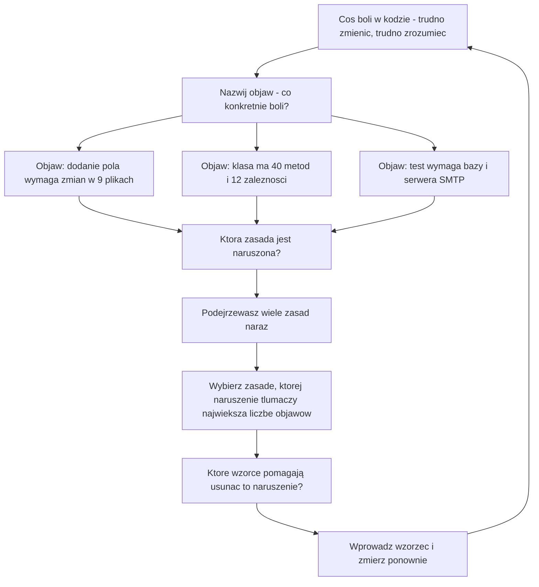
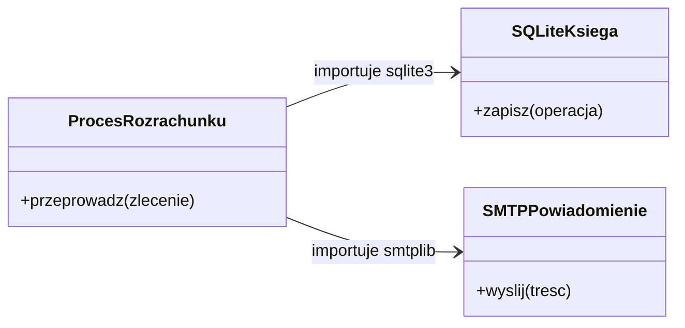
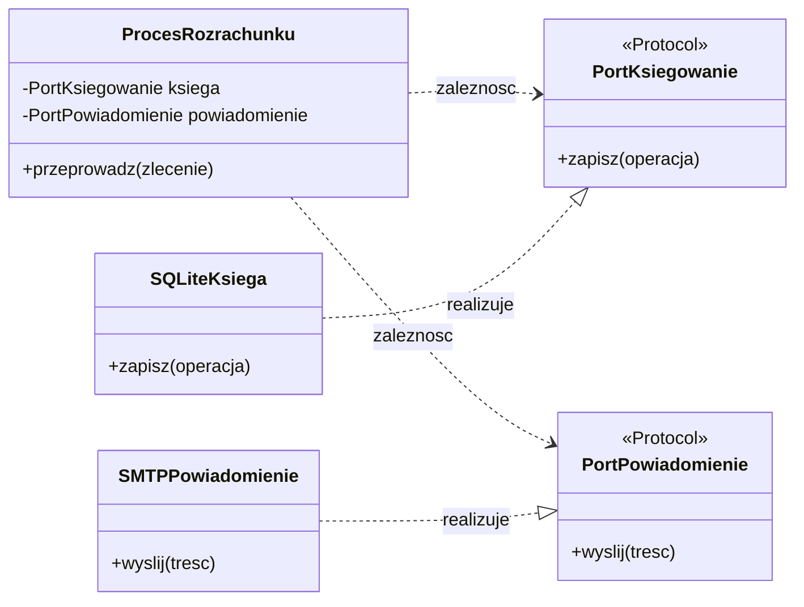
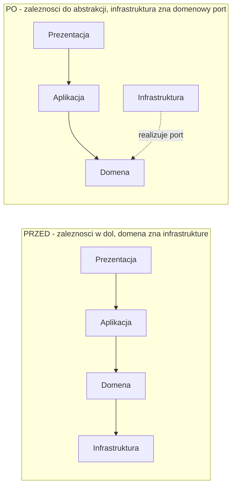
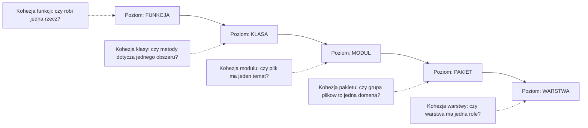
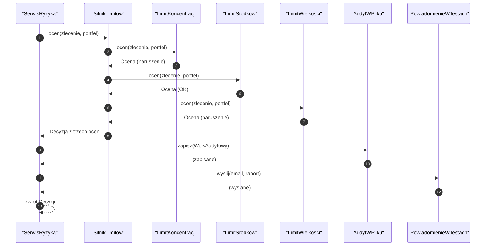
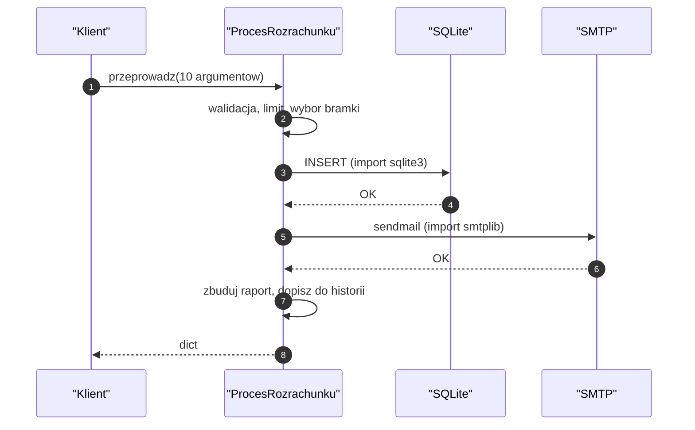
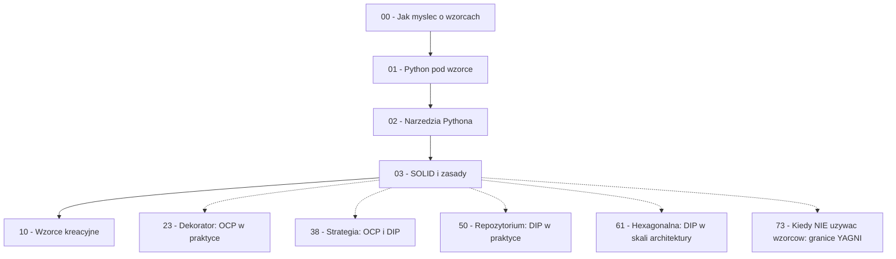

```markdown
---
modul: 03 — SOLID i zasady projektowania
plik: 03-solid-grasp-zasady-projektowania.md
poziom: sredni
wymaga: [02]
czas: ~150 minut czytania + ~350 minut ćwiczeń
---

# Moduł 03 — SOLID i zasady projektowania — kryteria, według których wybierasz wzorce

> **TL;DR**
> - Zasady projektowania to **heurystyki oceny kodu**, a nie przepisy, które trzeba spełnić — ich wspólnym celem jest obniżenie kosztu przyszłej zmiany.
> - SOLID to pięć kryteriów patrzenia na jedną klasę i jej granice: SRP (jedna odpowiedzialność), OCP (otwarte na rozszerzenia), LSP (podstawialność), ISP (segregacja interfejsów), DIP (odwrócenie zależności).
> - GRASP to zestaw pytań projektowych zadawanych przy rozdziale odpowiedzialności, a DRY, KISS, YAGNI mówią, kiedy **nie** budować abstrakcji — to równie ważne jak umiejętność jej budowania.
> - Code smell to sygnał, że gdzieś naruszasz którąś zasadę — a rozpoznanie, **jaką** naruszasz, prowadzi wprost do właściwego wzorca z dalszych modułów.
> - Zasady się ze sobą kłócą: SRP woła o podział, a GRASP „Information Expert" woła o trzymanie wiedzy razem. Nie ma tu jednej prawdy — jest ważenie kosztów.

---

## 0. Model mentalny

### Przepisy BHP w warsztacie, nie instrukcja budowy mebla

Wyobraź sobie warsztat stolarski. Na ścianie wisi karta z przepisami BHP: „noś okulary ochronne", „nie trzymaj rąk tam, gdzie tnie piła", „drewno układaj w stos o wysokości nie większej niż metr", „narzędzia elektryczne odłączaj od prądu na noc". Przeczytaj te przepisy uważnie. **Żaden z nich nie mówi, jaki mebel masz zbudować.** Nie znajdziesz tam zdania „zrób szafę z dwoma półkami". Przepisy mówią coś innego: jak pracować, żeby wszystko poszło dobrze i żeby nikt nie zrobił sobie krzywdy.

Ale zauważ drugą rzecz. Gdybyś postanowił „stosować przepisy BHP do perfekcji" i założył podwójne okulary, hełm, rękawice przeciwcięciowe do wkręcania śrubki w mały uchwyt, i odłączał piłę od prądu co pięć minut — nie zbudowałbyś nic. Przepisy chronią, ale **nie są celem samym w sobie**. Ich wartość materializuje się wtedy, gdy warsztat faktycznie produkuje meble, a nie wtedy, gdy wiszą na ścianie w idealnej formie.

Zasady projektowania kodu w rodzaju SOLID są dokładnie takie same. Mówią: „nie trzymaj w jednej klasie trzech różnych obowiązków", „nie zmuszaj klienta do zależności od metod, których nie używa", „nie pozwól, żeby warstwa logiki biznesowej znała PostgreSQL-a". Spełnienie ich nie jest celem; celem jest kod, który można **zmieniać tanio**. I tak jak w warsztacie: pojedynczy mebel zrobiony bez okularów ochronnych będzie prawdopodobnie doskonały, ale po dwóch latach i dwustu meblach różnica się zmaterializuje.

| W analogii warsztatu | W kodzie |
|---|---|
| Karta przepisów BHP na ścianie | Zasady SOLID, DRY, KISS, YAGNI |
| „Noś okulary" | „Pojedyncza odpowiedzialność" — chroni przed klasą-bogiem |
| „Nie trzymaj rąk przy pile" | „Nie zależeć od rzeczy, których nie używasz" (ISP) |
| „Odłączaj narzędzia na noc" | „Warstwa domeny nie zna bazy danych" (DIP) |
| „Drewno w stos do metra" | „Moduły o kontrolowanej wielkości" |
| Meble, które warsztat faktycznie produkuje | Działający system, który da się rozwijać |
| Perfekcyjne BHP, zero mebli | Nadmiar abstrakcji, zero wartości |
| Rzemieślnik sam wybiera, kiedy reguła dotyczy jego zadania | Zespół sam waży zasady wobec kontekstu |

> 🧠 **Zapamiętaj** — **Zasady projektowania (ang. design principles) to heurystyki — sprawdzone reguły kciuka — służące obniżaniu kosztu przyszłej zmiany. Oceniają projekt, nie zastępują go.**

Zauważ słowo „heurystyki". Heurystyka to reguła, która **zwykle** działa i **zwykle** jest dobrym wyborem, ale można ją świadomie złamać. Prawo fizyki można złamać tylko w science fiction. Heurystykę — gdy masz dobry powód i świadomość kosztu.

Właśnie dlatego w tym kursie, gdy pojawia się konkretny wzorzec, zawsze pojawia się razem z nim sekcja „kiedy NIE używać". To nie ozdoba. To konsekwencja tego, że wzorce i zasady są heurystykami. Każda z nich ma obszar, w którym pomaga, i obszar, w którym szkodzi.

Poniższy diagram pokazuje, jak zasady łączą się z rzeczywistą pracą. Zwróć uwagę na kierunek: zaczynamy od problemu w kodzie, nie od zasady. Zasada jest narzędziem rozpoznania, nie punktem wyjścia.



*Diagram pokazuje, że kolejność jest odwrotna do intuicji początkującego: nie zaczynasz od „chcę użyć SOLID", tylko od bolącego objawu, a zasada jest narzędziem jego rozpoznania.*

### Czym zasady nie są — rozbrajanie nieporozumień

Zanim wejdziemy w treść, rozbrójmy cztery mity, które kosztują najwięcej czasu w prawdziwych zespołach.

**Zasady nie są spełnialne w 100%.** „Czy ta klasa spełnia SRP?" — pytanie o odpowiedź binarną, ale nie ma na nie odpowiedzi tak/nie. SRP mówi: „klasa powinna mieć jeden powód do zmiany". Powód do zmiany jest **przewidywaniem biznesowym**, a nie faktem technicznym. Możesz powiedzieć „prawdopodobnie ten powód zmieni się z powodu regulacji AML", ale nie możesz tego udowodnić. Dlatego SRP ocenia się **stopniem** — mniej powiązane odpowiedzialności to lepiej, ale zero nie istnieje.

**Zasady między sobą się kłócą.** SRP mówi: „rozdzielaj odpowiedzialności". GRASP-owy „Information Expert" mówi: „trzymaj wiedzę razem z danymi, których dotyczy". Prawo Demeter mówi: „nie rozmawiaj z nieznajomymi". DRY mówi: „nie duplikuj wiedzy". A YAGNI mówi: „nie abstrahuj przed drugim przypadkiem użycia". Te zdania bywają sprzeczne. Twoja praca projektanta polega na **ważeniu**, nie na znalezieniu formuły.

**Zasady nie zastępują znajomości domeny.** Możesz mieć idealnie zaprojektowany kod, który liczy VaR w sposób biznesowo błędny. Zasady oceniają **strukturę**, nie **poprawność merytoryczną**. Nie ma zasady, która powie ci, czy limit koncentracji powinien dotyczyć pozycji netto czy brutto — to decyzja biznesowa, którą ktoś musi podjąć świadomie.

**Zasady nie są uniwersalne między kontekstami.** To, co jest naruszeniem SRP w systemie obsługującym dziesięć tysięcy transakcji na sekundę, może być zdrowym kompromisem w jednorazowym skrypcie migracyjnym. Kontekst zmienia wszystko: rozmiar zespołu, horyzont czasowy, tempo zmian, wymagania regulatora.

**Zasady nie zwalniają z testowania.** „Ten kod spełnia SOLID, więc jest dobry" — nie. Jest **prawdopodobnie** łatwiejszy do utrzymania. Jedynym dowodem, że da się go utrzymać, jest sytuacja, w której ktoś go zmodyfikował, uruchomił testy i wszystko przeszło. Zasady są prognozą, testy są weryfikacją.

---

## 1. Problem, który rozwiązujemy

Zajrzyjmy do systemu rozrachunkowego w instytucji finansowej. Ktoś napisał klasę, która obsługuje pełny proces rozrachunku zlecenia: waliduje, komunikuje się z bramkami, księguje, wysyła powiadomienia i zapisuje raport. Ma trzysta linii, ale działa i ma testy.

### Kod „przed"

```python
# rozrachunek_v0.py — wersja naiwna, demonstracyjna
# UWAGA: ten kod celowo zawiera typowe naruszenia zasad projektowania.

import smtplib
import sqlite3
from datetime import datetime
from decimal import Decimal, ROUND_HALF_UP


class ProcesRozrachunku:
    """Obsluga rozrachunku: walidacja, bramka, ksiega, powiadomienie, raport."""

    STAWKA_PROWIZJI = Decimal("0.004")
    LIMIT_DZIENNY = Decimal("500000.00")

    def __init__(self, sciezka_bazy: str, host_smtp: str, port_smtp: int) -> None:
        self._sciezka_bazy = sciezka_bazy
        self._host_smtp = host_smtp
        self._port_smtp = port_smtp
        self._wykorzystano = Decimal("0.00")
        self._historia: list[str] = []

    # ----------------------------------------------------------------------
    # Metoda-bog: robi szesc roznych rzeczy naraz
    # ----------------------------------------------------------------------
    def przeprowadz(
        self,
        identyfikator: str,
        kwota: Decimal,
        waluta: str,
        kanal: str,
        odbiorca: str,
        czy_ekspresowy: bool,
        czy_zagraniczny: bool,
        kod_bic: str | None,
        iban: str | None,
        email_klienta: str,
    ) -> dict:
        # --- 1. Walidacja danych wejsciowych
        if kwota <= 0:
            raise ValueError("kwota musi byc dodatnia")
        if waluta not in ("PLN", "EUR", "USD"):
            raise ValueError("nieznana waluta")
        if kwota > Decimal("1000000.00"):
            raise ValueError("kwota przekracza limit techniczny")
        if kanal == "KARTA" and not kod_bic:
            raise ValueError("karta wymaga kodu BIC")
        if kanal == "PRZELEW" and not iban:
            raise ValueError("przelew wymaga IBAN")
        if czy_zagraniczny and waluta == "PLN":
            raise ValueError("rozrachunek zagraniczny nie moze byc w PLN")

        # --- 2. Kontrola limitow
        if self._wykorzystano + kwota > self.LIMIT_DZIENNY:
            raise RuntimeError("przekroczony limit dzienny")

        # --- 3. Wybor bramki i realizacja (switch na typie!)
        match kanal:
            case "KARTA":
                if czy_ekspresowy:
                    numer = f"CARD-X-{identyfikator}"
                else:
                    numer = f"CARD-{identyfikator}"
            case "PRZELEW":
                if czy_zagraniczny:
                    numer = f"SWIFT-{identyfikator}"
                else:
                    numer = f"ELIXIR-{identyfikator}"
            case "BLIK":
                numer = f"BLIK-{identyfikator}"
            case _:
                raise ValueError(f"nieznany kanal: {kanal}")

        self._wykorzystano += kwota

        # --- 4. Ksiegowanie (SQL w logice biznesowej!)
        polaczenie = sqlite3.connect(self._sciezka_bazy)
        kursor = polaczenie.cursor()
        kursor.execute(
            "INSERT INTO ksiega (id, kwota, waluta, kanal, data) VALUES (?, ?, ?, ?, ?)",
            (identyfikator, str(kwota), waluta, kanal, datetime.now().isoformat()),
        )
        polaczenie.commit()
        polaczenie.close()

        # --- 5. Prowizja
        prowizja = (kwota * self.STAWKA_PROWIZJI).quantize(
            Decimal("0.01"), rounding=ROUND_HALF_UP
        )

        # --- 6. Powiadomienie (SMTP w logice biznesowej!)
        try:
            serwer = smtplib.SMTP(self._host_smtp, self._port_smtp)
            serwer.sendmail(
                "system@example.com",
                [email_klienta],
                f"Rozrachunek {identyfikator}: {kwota} {waluta}",
            )
            serwer.quit()
        except Exception:
            # cicho ignorujemy bledy powiadomien
            pass

        # --- 7. Historia i raport (formatowanie w logice)
        self._historia.append(f"{identyfikator}|{kwota}|{waluta}|{kanal}")
        raport = (
            f"ROZRACHUNEK {identyfikator}\n"
            f"  Kwota: {kwota} {waluta}\n"
            f"  Kanal: {kanal}\n"
            f"  Prowizja: {prowizja} {waluta}\n"
            f"  Numer operacji: {numer}\n"
        )

        return {
            "identyfikator": identyfikator,
            "numer_operacji": numer,
            "prowizja": prowizja,
            "raport": raport,
        }


if __name__ == "__main__":
    proces = ProcesRozrachunku("rozrachunek.db", "smtp.example.com", 25)
    wynik = proces.przeprowadz(
        identyfikator="ZL-1",
        kwota=Decimal("1500.00"),
        waluta="PLN",
        kanal="PRZELEW",
        odbiorca="Kowalski Jan",
        czy_ekspresowy=False,
        czy_zagraniczny=False,
        kod_bic=None,
        iban="PL61109010140000071219812874",
        email_klienta="jan@example.com",
    )
    print(wynik["raport"])
```

Ten kod działa. Wykonuje się i daje poprawne wyniki dla wszystkich poprawnych danych wejściowych. Ma nawet pewne zalety: jedno miejsce obsługuje cały proces, więc na pierwszy rzut oka łatwo go zrozumieć. I tu jest pułapka — **na drugi rzut oka również**.

### Ile zasad jest naruszonych — systematyczne liczenie

Nie chodzi o to, żeby wymienić „wszystko, co jest złe". Chodzi o to, żeby zobaczyć, jak jedna klasa narusza jednocześnie pięć różnych zasad, i jak te naruszenia się wzmacniają. To jest kluczowa lekcja tego modułu.

| Zasada | Jak została naruszona | Konsekwencja |
|---|---|---|
| **SRP** (Single Responsibility) | Klasa ma 5 odpowiedzialności: walidacja, limit, realizacja, księgowanie, powiadomienie, raportowanie | Każda zmiana — nawet w szablonie maila — dotyka tej samej klasy |
| **OCP** (Open/Closed) | Dodanie kanału „przelew SEPA" wymaga zmiany metody `przeprowadz` | Metoda rośnie, ryzyko regresji we wszystkich istniejących kanałach |
| **LSP** (Liskov) | Klasa udaje „proces", ale jej metody mają ogromne, niejawne kontrakty (musi mieć IBAN przy przelewie, BIC przy karcie) | Nie da się jej użyć zamiennie z żadnym innym procesem; nie ma podstawialności |
| **ISP** (Interface Segregation) | Jedna metoda z dziesięcioma parametrami, z których połowa dotyczy jednego kanału | Klient przelewu musi znać `kod_bic` i `czy_ekspresowy`, których wcale nie używa |
| **DIP** (Dependency Inversion) | Logika biznesowa bezpośrednio importuje `sqlite3` i `smtplib`, a klasa wie o pliku bazy i serwerze SMTP | Nie da się przetestować logiki bez bazy i bez sieci; nie da się zmienić bazy |
| **DRY** | W `main` są zahardkodowane wartości, które w innych miejscach systemu też się powtarzają | Nie tutaj, ale pojawi się przy drugim wywołaniu |
| **KISS** | Metoda ma 70 linii i 10 parametrów | Zrozumienie jej wymaga utrzymania w głowie dziesięciu kontekstów naraz |
| **Prawo Demeter** | `self._historia.append(...)` — klient sięga do wnętrza innego obiektu | Zmiana struktury wewnętrznej procesu psuje wszystkich klientów |
| **Spójność (cohesion)** | Metody w klasie dotyczą różnych tematów | Nowy programista nie wie, którego fragmentu szukać |
| **Sprzężenie (coupling)** | Klasa łączy się z bazą, SMTP, formatem raportu i dziesięcioma argumentami wejściowymi | Zmiana w którejkolwiek z tych rzeczy wymaga zmiany klasy |

Zwróć uwagę na wzmocnienie: **metoda-bog** (god method) prowadzi do **klasy-boga** (god class), a ta — do **niskiej spójności**. A wszystko razem powoduje, że klasa jest silnie sprzężona z infrastrukturą. To układ naczyń połączonych: naruszenie jednej zasady niemal zawsze pociąga za sobą naruszenie kolejnej.

> ⚠️ **Pułapka** — Zauważ, że kod powyżej **nie jest „zły"** w potocznym sensie. Jest poprawny, ma komentarze, ma sensowne nazwy, ma blok `if __name__ == "__main__"`. Właśnie dlatego naruszenia zasad są trudne do dostrzeżenia — nie wyglądają jak błędy. Błąd wygląda jak „nie działa". Naruszenie zasady wygląda jak „działa, ale...".

### Objawy — poznasz ten problem po tym, że...

- **Zmiana dowolnej rzeczy w procesie wymaga wejścia do metody `przeprowadz`.** Zmiana szablonu e-maila, zmiana prowizji, zmiana numeracji operacji, dodanie pola do raportu — wszystko tutaj.
- **Opiszesz klasę słowem „i" i nie potrafisz go usunąć.** „Ta klasa waliduje **i** realizuje **i** księguje **i** powiadamia **i** raportuje". Jeśli opis wymaga spójnika „i", mówisz o więcej niż jednej odpowiedzialności. To najprostszy test SRP.
- **Test logiki biznesowej wymaga fixtury bazy danych i mocka SMTP.** Ten objaw sygnalizuje naruszenie DIP; przy zdrowej architekturze logika biznesowa testuje się w milisekundach bez żadnej infrastruktury.
- **`match` na typie (`kanal`) rośnie z każdym nowym kanałem.** To klasyczne naruszenie OCP: dodajesz wariant, więc modyfikujesz istniejący kod.
- **Metoda przyjmuje argumenty, których nie używa w każdej ścieżce.** `kod_bic` jest potrzebny tylko dla karty, `iban` tylko dla przelewu — ale sygnatura wymaga obu zawsze.
- **Nie da się odpowiedzieć na pytanie „co robi ten proces?" bez mówienia „wiele rzeczy".**
- **Wszystkie testy tej klasy łamią się przy zmianie dowolnego z jej pięciu obszarów.** To konsekwencja niskiej spójności: klasa jest jednym, wielkim, wzajemnie powiązanym organizmem.
- **Nie możesz użyć walidacji ani księgowania osobno**, np. w narzędziu administracyjnym, w innym przepływie, w symulacji. Bo są wewnątrz metody, do której nie ma osobnego wejścia.
- **Zespół boi się refaktoryzacji.** Jeśli „wszystko działa" i nikt nie wie, co się stanie przy zmianie — to najsilniejszy objaw z całej listy.

---

## 2. Anatomia

Skoro w tym module omawiamy zasady, nie wzorzec, rola „uczestników" zostaje przypisana pojedynczym zasadom. Każda z nich ma swoją odpowiedzialność i — co ważniejsze — swoje ograniczenia, czyli obszary, w których nie ma zastosowania.

### Uczestnicy: SOLID i zasady pokrewne

| Zasada | Odpowiedzialność | Co NIE jest jej zadaniem |
|---|---|---|
| **SRP** — pojedyncza odpowiedzialność | Pilnować, by jedna klasa miała jeden powód do zmiany | Nie znaczy „jedna metoda"; nie liczy linii; nie mówi, że klasa nie może mieć 5 metod |
| **OCP** — otwarte/zamknięte | Umożliwić dodawanie nowych zachowań bez modyfikacji istniejącego kodu | Nie znaczy „nigdy nie zmieniaj kodu"; czasem zmiana jest właściwsza |
| **LSP** — podstawialność Liskov | Gwarantować, że podtyp można użyć wszędzie, gdzie oczekiwany jest nadtyp | Nie wymusza dziedziczenia; nie mówi „nie dziedzicz" |
| **ISP** — segregacja interfejsów | Nie zmuszać klienta do zależności od metod, których nie używa | Nie znaczy „jeden interfejs na metodę"; chodzi o spójne grupy |
| **DIP** — odwrócenie zależności | Sprawić, by warstwy wyższe zależały od abstrakcji, nie od konkretów | Nie jest tym samym co Dependency Injection (patrz moduł 53) |
| **DRY** — nie powtarzaj się | Nie duplikować wiedzy w wielu miejscach | Nie znaczy „każde powtórzenie kodu to błąd"; incydentalne powtórzenia są OK |
| **KISS** — trzymaj to prosto | Wybierać najprostsze rozwiązanie, które działa | Nie znaczy „unikaj abstrakcji"; znaczy „nie abstrahuj bez powodu" |
| **YAGNI** — nie potrzebujesz tego | Nie budować funkcjonalności na spekulację | Nie znaczy „nie planuj"; znaczy „nie buduj kodu na wróżenie z fusów" |
| **Law of Demeter** | Ograniczać wiedzę o strukturze innych obiektów | Wyjątki bywają rozsądne (fluent API, DSL) |
| **Cohesion** | Trzymać w jednym miejscu rzeczy, które należą do siebie | Za wysoka kohezja bywa problemem (klasa z 40 metodami) |
| **Coupling** | Minimalizować liczbę i siłę zależności między modułami | Zerowe sprzężenie nie istnieje; nie da się napisać programu bez zależności |

> 💡 **Intuicja** — Każdą zasadę można przeczytać jako odpowiedź na pytanie „co się stanie, gdy nastąpi zmiana wymagania?". SRP, OCP, DIP odpowiadają na to pytanie wprost. LSP i ISP odpowiadają na nie przez pytanie „kto jest od kogo zależny?". DRY, KISS, YAGNI odpowiadają na nie przez pytanie „ile zapłacę za nieistniejące wymaganie?".

### SOLID — pięć kryteriów patrzenia na jedną klasę

Przejdźmy przez każdą zasadę starannie. Dla każdej: definicja, kontrprzykład, wersja poprawna, konsekwencja.

#### SRP — pojedyncza odpowiedzialność

**Definicja.** Klasa powinna mieć **jeden powód do zmiany**. Innymi słowy: istnieje jedna grupa interesariuszy, która może zażądać zmiany tej klasy. Nie „jedna metoda", nie „jedna linia", nie „jedno pole" — jeden **powód**, jedna **grupa odbiorców**.

Zasada pochodzi od Roberta Martina i — uwaga — sam autor z czasem zmienił jej uzasadnienie. Pierwotnie mówiło się „klasa powinna mieć jedną odpowiedzialność". Okazało się to niejasne, bo „odpowiedzialność" można rozumieć dowolnie. Doprecyzowanie brzmi: „jeden powód do zmiany w oczach jednego interesariusza".

**Kontrprzykład — klasa `ProcesRozrachunku` z sekcji 1.** Ma pięciu różnych interesariuszy:
- dział compliance — chce zmian w walidacji,
- dział operacji — chce nowych kanałów,
- dział księgowości — chce zmian w księgowaniu,
- dział obsługi klienta — chce zmian w treści powiadomień,
- dział sprawozdawczości — chce zmian w formacie raportu.

Każdy z nich może przyjść i zażądać zmiany. Wszyscy oni trafiają do tej samej klasy. Konsekwencja jest oczywista: klasa zmienia się co tydzień, a każda zmiana niesie ryzyko dla pozostałych czterech obszarów.

**Wersja poprawna.** Pięć osobnych klas:
```python
class WalidatorZlecenia: ...      # compliance
class BramkaPlatnicza: ...        # operacje
class KsiegowanieRozrachunku: ... # ksiegowosc
class PowiadomienieKlienta: ...   # obsluga klienta
class RaportRozrachunku: ...      # sprawozdawczosc
```
I klasa orkiestrująca, która **nie zna szczegółów** żadnego z tych obszarów — tylko woła je po kolei.

**Konsekwencja.** Zmiana szablonu e-maila to zmiana jednej klasy i jednego zestawu testów. Ryzyko regresji ogranicza się do jednego obszaru.

**Granice zasady.** SRP nie mówi, że klasa ma mieć jedną metodę, ani że nie może mieć pięciu. Klasa **walidatora** może mieć pięć metod (walidacja kwoty, waluty, kanału, odbiorcy, limitu) i wciąż mieć jedną odpowiedzialność: sprawdzać poprawność. Nie myl poziomy: chodzi o **obszar zmiany**, nie o liczbę zachowań.

> ⚠️ **Pułapka** — Nadgorliwe SRP to antywzorzec zwany „klasa z jedną metodą" albo „rozstrzeleniem" (ang. shotgunning). Jeśli każda metoda jest w osobnej klasie, kod staje się nieczytelny, a jego śledzenie wymaga skakania między dwudziestoma plikami. SRP mówi: „rozłącz, gdzie zmiany są niezależne", nie „rozłącz wszystko na cząstki atomowe".

#### OCP — otwarte na rozszerzenia, zamknięte na modyfikacje

**Definicja.** Moduł powinien być **otwarty na rozszerzenia** (można dodać nowe zachowanie bez ruszania go) i **zamknięty na modyfikacje** (dodawanie nowego zachowania nie wymaga zmiany istniejącego kodu). Brzmi jak sprzeczność — i jest to produktywna sprzeczność, rozwiązywana przez **abstrakcję i polimorfizm**.

**Kontrprzykład — `match kanal:` w `przeprowadz`.** Dodanie przelewu SEPA wymaga zmiany tej metody. Wszystkie istniejące ścieżki (KARTA, PRZELEW, BLIK) są narażone na przypadkową regresję, bo leżą w tym samym bloku kodu, który właśnie modyfikujesz.

**Wersja poprawna.** Nowy kanał to nowy plik:
```python
class BramkaSepa:
    nazwa = "sepa"
    def realizuj(self, zlecenie): ...
```
I rejestracja w słowniku (moduł 11) albo przez `__init_subclass__` (moduł 02). Metoda `przeprowadz` **nie zmienia się ani o linię**.

**Konsekwencja.** Dodawanie nowych kanałów jest bezpieczne, a liczba miejsc, w których trzeba pamiętać o „wszystkich możliwych kanałach", spada do zera.

**Znany koszt.** OCP kosztuje abstrakcję — interfejs (albo `Protocol`), rejestr, jedno dodatkowe pośrednictwo. Jeśli wiem, że w kolejnych dwóch latach nie pojawi się nowy kanał, OCP jest przedwczesną optymalizacją (patrz YAGNI). Kryterium: **ile razy w ostatnim okresie zmieniałeś tę metodę z powodu nowego wariantu?** Jeśli trzy i więcej — czas na OCP.

**Zapowiedź.** Wzorce, które realizują OCP w praktyce: **strategia** (moduł 38), **metoda wytwórcza** (moduł 11), **dekorator** (moduł 23), **obserwator** (moduł 36), **odwiedzający** (moduł 40).

#### LSP — zasada podstawienia Liskov

**Definicja.** Jeśli `S` jest podtypem `T`, to obiekty typu `T` powinny być wymienialne na obiekty typu `S` bez zmiany poprawności programu. Współtwórczyni zasady, Barbara Liskov, sformułowała ją w 1987 roku w kontekście typów danych i programowania obiektowego.

Uproszczona wersja praktyczna: **podklasa nie może wzmacniać warunków wstępnych ani osłabiać warunków końcowych metody bazowej.** To znaczy:
- nie może wymagać więcej niż baza (nie może rzucać wyjątku, gdy baza nie rzucała),
- nie może zwracać mniej niż baza (nie może zawężać zakresu wyników, nie może zwracać `None`, gdy baza zawsze zwracała wartość),
- nie może łamać niezmienników bazy.

**Klasyczny kontrprzykład.** Prostokąt i kwadrat. Ma się ochotę kodować:
```python
class Prostokat:
    def __init__(self, szerokosc: float, wysokosc: float):
        self._a, self._b = szerokosc, wysokosc

    @property
    def pole(self):
        return self._a * self._b

    def ustaw_szerokosc(self, wartosc):
        self._a = wartosc

class Kwadrat(Prostokat):
    def ustaw_szerokosc(self, wartosc):
        self._a = self._b = wartosc   # i tak samo wysokosc!
```
`Kwadrat` **wygląda** jak prostokąt — ma taką samą sygnaturę. Ale nie zachowuje nieformalnego kontraktu: w `Prostokat` ustawienie szerokości nie zmienia wysokości. Kod, który zakładał:
```python
def pole_po_zmianie(p: Prostokat) -> float:
    p.ustaw_szerokosc(5)
    return p.pole
```
zachowa się inaczej dla `Kwadrat` (zwróci 25) i dla `Prostokat(3, 4)` (zwróci 20). **Podstawienie złamało program.**

**Kontrprzykład finansowy — dziedziczenie po `Rozrachunek`.**

```python
class RozrachunekBazowy:
    """Baza: kazde zlecenie ma numer i kwote; realizuj() zawsze cos zwraca."""
    def realizuj(self, zlecenie) -> Potwierdzenie:
        raise NotImplementedError

class RozrachunekZagraniczny(RozrachunekBazowy):
    def realizuj(self, zlecenie) -> Potwierdzenie:
        if zlecenie.waluta == "PLN":
            raise ValueError("zagraniczny nie obsluguje PLN")
        ...
```

Problem: baza „zawsze coś zwraca", a podklasa rzuca wyjątek dla danych, dla których baza nie rzucała. Wszędzie, gdzie klient napisał:
```python
wynik = rozrachunek.realizuj(z)
if wynik.zaakceptowane:
    ...
```
nie ma już gwarancji, że `wynik` istnieje. Fundament został złamany.

**Wersja poprawna.** Nie dziedzicz — komponuj. Albo: jeśli dane wejściowe różnią się w sposób istotny, to nie jest ten sam kontrakt. Wprowadź **osobny typ** albo wprost modeluj walutę jako warunek na poziomie kompozycji (np. bramka obsługuje konkretne waluty i odmawia czysto, nie rzucając wyjątku).

**Konsekwencja.** LSP chroni przed kodem, który wygląda jak dziedziczenie, a nim nie jest. W Pythonie — gdzie `Protocol` i duck typing są tak silne — LSP bywa podważana rzadziej **formalnie**, ale **semantycznie** bardzo często. Kontrakt jest tu umową nie tylko o nazwach, ale i o zachowaniu.

**Wskazówka praktyczna.** Test LSP: weź każdą podklasę i pytaj: „gdzie w kodzie wycieka wiedza, że to konkretnie ten podtyp?". Jeśli gdziekolwiek piszesz `isinstance(x, KonkretnyPodtyp)` — naruszyłeś kontrakt bazy. To test prosty i skuteczny.

#### ISP — segregacja interfejsów

**Definicja.** Klient nie powinien być zmuszany do zależności od metod, których nie używa. Zamiast jednego „grubego" interfejsu — wiele małych, spójnych.

**Kontrprzykład.** Jeden interfejs `BramkaPlatnicza` z metodami `realizuj_karte`, `realizuj_przelew`, `realizuj_blik`, `realizuj_czek`, `realizuj_przekaz_pocztowy`. Klasa obsługująca tylko karty musi zaimplementować wszystkie pięć — i wszystkie rzucać `NotImplementedError`.

**Konsekwencja.** Każda nowa metoda w „grubym" interfejsie wymusza zmianę wszystkich implementacji. To odwrotność OCP: rozszerzenie interfejsu staje się modyfikacją każdej implementacji.

**Wersja poprawna — viele kleine Protokoly.**
```python
class BramkaKartowa(Protocol):
    def realizuj_karte(self, zlecenie) -> Potwierdzenie: ...

class BramkaPrzelewowa(Protocol):
    def realizuj_przelew(self, zlecenie) -> Potwierdzenie: ...

class BramkaBlikowa(Protocol):
    def realizuj_blik(self, zlecenie) -> Potwierdzenie: ...
```
Klasa obsługująca tylko karty implementuje jeden protokół i nic jej nie przeszkadza. Klient zależny wyłącznie od `BramkaKartowa` nie widzi metod innych kanałów.

**Konsekwencja.** Zmiany w interfejsie przelewu nie dotykają implementacji karty. Zespół może pracować niezależnie nad różnymi kanałami.

**Wskazówka praktyczna dla Pythona.** W wielu językach ISP realizuje się, dzieląc dziedziczone interfejsy. W Pythonie można to zrobić **strukturalnie**: `Protocol` opisuje tylko te metody, które są potrzebne w danym kontekście. To często realizuje ISP niejako **automatycznie**, bez tworzenia hierarchii interfejsów. Wystarczy, że w sygnaturze funkcji napiszesz `def przetworz(bramka: BramkaKartowa)` i już — możesz przekazać dowolny obiekt z metodą `realizuj_karte`. Zobaczysz to w module 38 i 53.

**Granice.** ISP nie znaczy „jeden interfejs = jedna metoda". To byłoby przeniesienie atomowego SRP na interfejsy i równie szkodliwe. Chodzi o **spójne grupy metod**, używane razem przez tego samego klienta.

#### DIP — odwrócenie zależności

**Definicja.** Dwie reguły: (1) moduły wyższego poziomu nie powinny zależeć od modułów niższego poziomu — oba powinny zależeć od **abstrakcji**; (2) abstrakcje nie powinny zależeć od szczegółów — to szczegóły powinny zależeć od abstrakcji.

**Kluczowe rozróżnienie, które trzeba zapamiętać raz na zawsze:** DIP (Dependency Inversion Principle) to **nie to samo** co DI (Dependency Injection). DIP to zasada **projektowania zależności** — kierunek strzałek zależności w architekturze. DI to **technika** przekazywania zależności z zewnątrz. Możesz mieć DI bez DIP (wstrzykiwać konkretne klasy i wciąż być źle zależnym) i DIP bez DI (abstrakcja zdefiniowana lokalnie, ale implementacja tworzona przez import). W module 53 rozłożymy to na czynniki pierwsze.

**Kontrprzykład — `import sqlite3` w klasie `ProcesRozrachunku`.** Domena (logika rozrachunku) zna moduł infrastruktury. To znaczy, że:
- nie da się przetestować domeny bez bazy,
- nie da się zmienić bazy na Postgresa bez modyfikacji klasy,
- nie da się uruchomić logiki w innym kontekście (symulacja, narzędzie administracyjne),
- domena jest **sprzężona** z wyborem technologii.

**Wersja poprawna.** Domena definiuje **port** — abstrakcję, której potrzebuje:

```python
from typing import Protocol

class Ksiegowanie(Protocol):
    """Port: cokolwiek, co potrafi zapisac operacje rozrachunku."""
    def zapisz(self, operacja: "OperacjaRozrachunku") -> None: ...

class ProcesRozrachunku:
    def __init__(self, ksiega: Ksiegowanie) -> None:
        self._ksiega = ksiega

    def przeprowadz(self, zlecenie) -> Potwierdzenie:
        ...  # logika
        self._ksiega.zapisz(operacja)
        return potwierdzenie
```

Implementacja SQLite żyje **poza** domeną — w warstwie infrastruktury:

```python
class KsiegowanieSQLite:
    def __init__(self, sciezka: str) -> None:
        self._sciezka = sciezka

    def zapisz(self, operacja) -> None:
        ...  # SQL tutaj, nikt w domenie tego nie widzi
```

Kierunek zależności odwrócił się. Wcześniej: domena → SQLite. Teraz: warstwa infrastruktury → port (abstrakcja) ← domena. Kluczowa obserwacja: **abstrakcja (`Ksiegowanie`) należy do domeny**, nie do infrastruktury. To znaczenie „odwrócenia" — abstrakcja nie jest tworzona tam, gdzie implementacja, tylko tam, gdzie klient.

**Konsekwencje.** Trzy bardzo praktyczne:
1. Domena testuje się bez bazy (wstrzykujesz `KsiegowanieWTestach`).
2. Zmiana bazy to nowa klasa infrastruktury — zero zmian w domenie.
3. Domena nie zna żadnej technologii, więc jest przenośna.

**Zapowiedź.** Wzorce, które realizują DIP: **repozytorium** (moduł 50), **wstrzykiwanie zależności** (moduł 53), **porty i adaptery** (moduł 61), **fasada** (moduł 24, w wersji pakietowej). To najważniejsza zasada z SOLID dla architektury — dlatego wróci w Części IV i V wielokrotnie.

### Diagram — DIP przed i po

Spójrz na dwa diagramy obok siebie. To najważniejszy obrazek tego modułu, bo pokazuje **kierunek strzałek** — a kierunek zależności jest tu sednem.



*Diagram pokazuje wersję przed odwróceniem: domena zależy bezpośrednio od konkretnych technologii (`sqlite3`, `smtplib`), więc nie da się jej użyć bez nich.*



*Diagram pokazuje wersję po odwróceniu: domena zależy wyłącznie od portów, a konkretne technologie realizują porty — strzałki zależności skierowane są do abstrakcji, nie do implementacji.*

Porównaj oba diagramy i wypisz, co się zmieniło:
- **Kierunek.** Przed: domena → konkret. Po: domena → abstrakcja ← konkret. Abstrakcja jest w środku.
- **Kto zna kogo.** Przed: domena zna `sqlite3`. Po: domena zna tylko `Ksiegowanie` (swoją własną abstrakcję), a `SQLiteKsiega` zna — albo i nie — domenę.
- **Kto jest wymienny.** Przed: nic. Po: każda implementacja portu, bo domena nie wie, którą dostała.
- **Kto żyje gdzie.** Przed: wszystko w jednym pliku. Po: port w domenie, implementacja w infrastrukturze.

### Diagram — sprzężenie warstw przed i po

To samo zjawisko w skali architektury. Zobacz, jak kierunek strzałek zmienia się między warstwami.



*Diagram pokazuje dwie wersje: przed — domena zależy od infrastruktury i nie da się jej uruchomić bez bazy; po — infrastruktura realizuje port zdefiniowany w domenie, więc zależność na poziomie importu biegnie z zewnątrz do środka.*

Ten diagram jest tak ważny, że wraca w module 61 jako „reguła zależności" architektury heksagonalnej. Zapamiętaj metaforę: **strzałki zależności biegną do środka, ku domenie**, a domena nie wie, co jest na zewnątrz. To jest realizacja DIP w skali systemu.

### GRASP — dziewięć pytań o rozdział odpowiedzialności

SOLID odpowiada na pytania o **właściwości** klasy. GRASP (General Responsibility Assignment Software Patterns) odpowiada na inne pytanie: **komu dać tę odpowiedzialność?** To zestaw dziewięciu heurystyk — nie wzorców w sensie GoF, ale narzędzi myślowych. Pochodzą z książki Craiga Larmana *Applying UML and Patterns* (1997).

| Zasada GRASP | Pytanie, które zadajesz w kodzie | Przykład w naszym uniwersum |
|---|---|---|
| **Information Expert** | Kto ma dane potrzebne do wykonania tej operacji? | Prowizję liczy zlecenie, bo ma kwotę i stawkę |
| **Creator** | Kto ma dane, by utworzyć ten obiekt? | Koszyk tworzy pozycję, bo ma kontekst zamówienia |
| **Controller** | Kto obsługuje zdarzenie zewnętrzne? | `SerwisRozrachunku` na granicy HTTP |
| **Low Coupling** | Która opcja daje najmniej zależności? | Port `Ksiegowanie` zamiast importu `sqlite3` |
| **High Cohesion** | Która opcja trzyma odpowiedzialności razem? | `WalidatorZlecenia` tylko waliduje |
| **Polymorphism** | Jak obsłużyć zachowania zależne od typu? | Kanaly jako podklasy zamiast `match` |
| **Pure Fabrication** | Gdy nie ma naturalnego kandydata, stwórz sztuczny byt | `Repozytorium` — nie istnieje w domenie, ale porządkuje |
| **Indirection** | Jak osłabić sprzężenie? Wstaw pośrednika | Fasada, mediator, mediator zdarzeń |
| **Protected Variations** | Jak ukryć zmienność za stabilnym interfejsem? | Port zamiast konkretnej bramki |

Zauważ, że GRASP jest praktyczniejszy niż SOLID, gdy zaczynasz od zera i pytasz „gdzie umieścić metodę?". SOLID jest praktyczniejszy, gdy masz kod i pytasz „czy jest dobrze zaprojektowany?".

**Information Expert i kontrprzykład.** Często widzi się:
```python
class SerwisRaportow:
    @staticmethod
    def prowizja(zlecenie) -> Decimal:
        return (zlecenie.kwota * Decimal("0.004")).quantize(Decimal("0.01"))
```
Ale to `zlecenie` ma `kwota` i stawkę. GRASP mówi: metoda powinna być tam, gdzie są dane. `zlecenie.prowizja()` byłoby naturalniejsze. Wyjątek: jeśli obliczenie prowizji zależy od pięciu klientów, pięciu tabel, dwóch usług zewnętrznych — wtedy „information expert" nie jest zlecenie i usługa ma sens.

**Protected Variations i rola abstrakcji.** Jeśli wiesz, że w przyszłym roku dodadzą czwartą bramkę płatniczą, „protected variations" mówi: ukryj zmienność za portem `BramkaPlatnicza`. Zmienność nie przenika do logiki biznesowej. To ta sama idea co OCP i DIP, wyrażona innym językiem — co pokazuje, że zasady się wzmacniają, jeśli patrzysz na nie z odpowiedniej perspektywy.

### DRY, KISS, YAGNI — trzy zasady, których nadużycie boli bardziej niż brak

Trzy dodatkowe heurystyki, które trzeba znać — i znać ich granice.

**DRY — Don't Repeat Yourself.** Nie duplikuj **wiedzy**. Kluczowe słowo: wiedza, nie kod. Dwa identyczne fragmenty kodu mogą reprezentować dwie różne koncepcje, które przypadkowo wyglądają tak samo — i wtedy scalenie ich jest błędem.

Kontrprzykład w naszym uniwersum:
```python
# Dwa fragmenty wygladaja identycznie, ale maja inne znaczenie
stawka_podatku = Decimal("0.19")
stawka_belki = Decimal("0.19")
```
Gdybyś chciał mieć „jedną stałą 19%", byłoby to złamanie DRY. W rzeczywistości to **dwie różne wartości biznesowe**, które dzisiaj mają tę samą liczbę. Za rok stawka Belki zmieni się na 19,5%, a podatek pozostanie 19%. Jeśli scaliłeś je „dla zasady", musisz teraz rozplątać.

Granice DRY: stosuj ją do **wiedzy** (reguły, konwersje, formuły), nie do przypadkowego podobieństwa kodu. Jeśli dwa fragmenty mają różne powody do zmiany — nie scaluj.

**KISS — Keep It Simple, Stupid.** Wybieraj najprostsze rozwiązanie, które spełnia wymaganie. Kontrprzykład oczywisty: `ProcesRozrachunku` z sekcji 1 próbuje jednocześnie walidować, realizować i raportować. KISS mówi: podziel na kawałki o jednym celu każdy.

Granice KISS: prostota **teraz** nie znaczy „prostota w nieskończoność". Jeśli wiesz, że za trzy miesiące przyjdzie nowy kanał, prostota nakazuje poczekać i zobaczyć. Ale jeśli wiesz, że za trzy miesiące pojawi się dziesięć nowych kanałów — prostota nakazuje abstrakcję.

**YAGNI — You Aren't Gonna Need It.** Nie buduj funkcjonalności „na wszelki wypadek". Kontrprzykład: ktoś buduje uniwersalny silnik reguł „bo może się przydać". Rok później silnik ma 800 linii i obsługuje pięć przypadków, z których cztery nigdy nie były potrzebne.

Granice YAGNI: nie myl z „nie planuj". YAGNI mówi: **nie buduj kodu na spekulację**. Planowanie architektury jest OK — np. podział na warstwy, wybór bazy, przyjęcie portów. Różnica: **architektura to szkielet, który nie zmienia się przy każdym wymaganiu**. YAGNI dotyczy funkcjonalności i abstrakcji budowanych „na wszelki wypadek".

Trzy zasady razem:
- **DRY** — nie twórz wielokrotnie tej samej wiedzy.
- **KISS** — nie komplikuj niepotrzebnie.
- **YAGNI** — nie buduj tego, czego nie potrzebujesz teraz.

Wszystkie trzy mówią „nie dodawaj", i wszystkie trzy są granicami dla SRP, OCP, DIP, które mówią „podziel, abstrahuj, odwróć". Ta równowaga jest treścią modułu 73, gdzie rozbierzemy nadmiar abstrakcji.

### Prawo Demeter i Tell, Don't Ask

**Prawo Demeter** mówi: obiekt powinien rozmawiać tylko z bezpośrednimi znajomymi — nie z „znajomymi znajomych". Kontrprzykład:

```python
# ZLE: lancuszek odwolan - klient wie o wewnetrznej strukturze
klient.konto.historia.transakcje[-1].kwota
```

Klient musi znać łańcuch: `klient` ma `konto`, `konto` ma `historię`, `historia` ma `transakcje`. Jeśli konto zmieni strukturę — wszyscy klienci się zepsują. Wersja zgodna z prawem Demeter:

```python
# DOBRZE: klient zna tylko jedna operacje
klient.ostatnia_transakcja_kwota()
```

Klasa `Klient` nie ujawnia wnętrzności; klient nie musi wiedzieć, jak zbudowana jest historia. Świetnie — ale prawo Demeter ma granice. Fluent API (jak `pandas`: `df.groupby(...).sum().reset_index()`) świadomie łamie prawo Demeter i jest wspaniałe. DSL-e zbudowane z łańcuchów metod działają tak samo. Zasada jest heurystyką, nie zakazem.

**Tell, Don't Ask** to zasada uzupełniająca: mów obiektowi, co ma zrobić, a nie pytaj o jego stan i sam decyduj. Kontrprzykład:

```python
# ZLE: klient pobiera stan, potem sam decyduje
if konto.saldo > 0:
    konto.saldo -= kwota
```

Klient zna dwa fakty: saldo i regułę. Jeśli reguła się zmieni (np. saldo nie może spaść poniżej progu), musi się zmienić klient — a jest ich wielu. Wersja poprawna:

```python
# DOBRZE: obiekt sam decyduje
try:
    konto.obciaz(kwota)
except BrakSrodkow:
    ...
```

Konto wie o swojej regule i o swoim stanie. Klient tylko informuje o intencji. Konsekwencja: zmiana reguły dotyka wyłącznie `Konto`.

Dwie zasady łącznie realizują jedną ideę: **enkapsulacja nie kończy się na polach prywatnych — obejmuje również wiedzę o zachowaniu.**

### Kohezja i sprzężenie — dwie miary, które poczujesz w palcach

**Kohezja (spójność, ang. cohesion)** — jak bardzo elementy jednej klasy odnoszą się do jednego zadania. **Sprzężenie (ang. coupling)** — jak bardzo zmianę w jednym miejscu wymusza zmiany w innym. Idealnie: wysoka kohezja, niskie sprzężenie.

To dwie osie, nie jedna. Można mieć niską kohezję i wysokie sprzężenie (klasa robiąca wszystko, zależna od wszystkiego — najgorszy przypadek) albo wysoką kohezję i niskie sprzężenie (małe, skoncentrowane klasy, wymienne zależności — cel). Diagramy pokazują skalę.



*Diagram pokazuje, że te same pytania o spójność zadajesz na pięciu różnych poziomach skali — od pojedynczej funkcji po całą warstwę; naruszenie zasady na każdym poziomie ma inną cenę.*

Sprzężenie ma wiele odmian, warte rozróżnienia:

| Typ sprzężenia | Przykład | Koszt zmiany |
|---|---|---|
| Treściowe | Jedna klasa czyta prywatne pola innej | Bardzo wysoki |
| Wspólne (globalne) | Dwie klasy korzystają z tego samego globalnego stanu | Bardzo wysoki |
| Zewnętrzne | Dwie klasy dzielą format danych zewnętrznego systemu | Wysoki |
| Kontrolne | Jedna funkcja przekazuje drugiej flagę sterującą | Wysoki |
| Znacznikowe | Dwie funkcje przyjmują ten sam typ, ale używają innych pól | Średni |
| Danych | Przekazywanie tylko potrzebnych argumentów | Niski |
| Komunikatowe | Wywołanie metody bez parametrów | Najniższy |

Im wyżej w tabeli, tym trudniej zmienić jedno miejsce bez psucia drugiego. To wyjaśnia, dlaczego zasady SOLID dążą do sprzężenia **danych** i **komunikatowego**, a wystrzegają się kontrolnego i wspólnego.

> 🧠 **Zapamiętaj** — SRP jest o **kohezji** na poziomie klasy. DIP i ISP są o **sprzężeniu** na poziomie modułu. LSP jest o **kontrakcie** między typem bazowym a podtypem. OCP jest o **kierunku wpływu przyszłych zmian**. Rozpoznanie, którą oś dotykasz, jest kluczowe dla wyboru właściwego rozwiązania.

### Code smells — sygnały, które prowadzą do wzorców

Zapachy kodu (ang. code smells) to konkretne, rozpoznawalne objawy naruszeń zasad. Katalog pochodzi od Martina Fowlera i uzupełnia zasady SOLID: nie oceniają projektu „w ogóle", tylko wskazują palcem konkretne podejrzane struktury. Mapowanie smell → wzorzec jest jednym z najpraktyczniejszych narzędzi tego kursu.

| Smell | Objaw | Naruszona zasada | Wzorce, które pomagają | Moduł |
|---|---|---|---|---|
| **Długa metoda** | Metoda > 50 linii, wiele poziomów zagnieżdżenia | SRP, KISS | Command, Template Method, Strategia | 31, 38, 39 |
| **Klasa-bog** (God Class) | Klasa z 30+ metodami, 10+ zależnościami | SRP, High Cohesion | Rozdzielenie na role, Facade nad zespołem klas | 24, 51 |
| **Długi `if/elif` albo `match` na typie** | Warunkowe rozgałęzienia rosnące z każdym wariantem | OCP, Polymorphism | Strategia, Fabryka, Stan, Odwiedzający | 11, 37, 38, 40 |
| **Shotgun Surgery** | Jedna zmiana wymaga zmian w 8 plikach | SRP, Wysoka kohezja | Wspólne miejsce na regułę (Strategia, Specification) | 38, 54 |
| **Divergent Change** | Jedna klasa zmienia się z pięciu różnych powodów | SRP | Rozdzielenie na role, wydzielone serwisy | 50, 51 |
| **Feature Envy** | Metoda używa więcej pól innej klasy niż własnej | Information Expert, Prawo Demeter | Przenieś metodę do klasy, która ma dane | — |
| **Nadmiar argumentów** | Metoda z 6+ parametrami | KISS, Wysoka kohezja | Budowniczy, DTO, Param Object | 13, 51 |
| **Primitive Obsession** | Stringi i liczby zamiast typów domenowych | Information Expert | Value Object | 54 |
| **Switch na typie** | `switch`/`match` na poziomie typu, w wielu miejscach | OCP, Polymorphism | Strategia, Stan, Tabela przejść | 37, 38 |
| **Refused Bequest** | Podklasa dziedziczy po bazie, a używa połowy albo mniej | LSP, ISP | Kompozycja zamiast dziedziczenia | 20, 21 |
| **Inappropriate Intimacy** | Dwie klasy wymieniają się prywatnymi szczegółami | Sprzężenie, Law of Demeter | Fasada, Mediator | 24, 34 |
| **Message Chains** | `a.b().c().d()` w wielu miejscach | Prawo Demeter | Fasada, delegacja jawna | 24, 26 |
| **Middle Man** | Klasa tylko przekazuje wywołania dalej | Middle Man to odwrotność SRP | Usuń klasę, chyba że doda wartość (Proxy) | 26 |
| **Comments** | Komentarze tłumaczą, co kod robi — bo jest niejasny | KISS | Nazwy, wyodrębnienie metody | — |
| **Speculative Generality** | Kod zbudowany na hipotetyczną przyszłość | YAGNI | Usuń, dokładaj gdy będzie potrzebne | 73 |

Zobacz, że kilka smelli odsyła do tego samego wzorca — to nie przypadek. **Długi `if/elif`, switch na typie i divergent change to trzy twarze tego samego problemu** (brak polimorfizmu). Rozpoznanie, jaka jest wspólna przyczyna, prowadzi wprost do rozwiązania.

### Warianty: klasyczny vs pythoniczny

Ta sama zasada realizowana inaczej w zależności od języka. To zestawienie pokazuje, że „zastosowanie zasady" oznacza co innego w Pythonie niż w Javie czy C#.

| Zasada | Wariant klasyczny (podręcznikowy) | Wariant pythoniczny |
|---|---|---|
| SRP | Osobna klasa na każde zadanie | Funkcja modułowa, gdy nie ma stanu |
| OCP | Hierarchia klas z abstrakcją | `Protocol` + funkcje + rejestr |
| LSP | Testy kontraktu wobec klasy bazowej | Duck typing + testy zgodności behawioralnej |
| ISP | Wiele małych interfejsów | Jeden `Protocol` na kontekst, opisany w sygnaturze |
| DIP | Interfejs w klasie bazowej | `Protocol` w domenie, implementacja w infrastrukturze |
| DRY | Funkcja współdzielona | Dekorator, generator, `partial` |
| KISS | Klasa z metodami `abc` | Funkcja z jawnymi parametrami |
| YAGNI | Brak niepotrzebnych klas | Brak niepotrzebnych parametrów i typów |

Zasada praktyczna: **kod jest oceniany według intencji, nie według kształtu**. Możesz mieć jedenaście klas i dobrze zrealizować SRP; możesz mieć jedną funkcję i dobrze zrealizować SRP. Liczy się to, czy zmiana jednego obszaru wymaga zmian w drugim.

---

## 3. Implementacja krok po kroku

Wróćmy do `ProcesRozrachunku` z sekcji 1. Przebudujemy go, stosując zasady — ale **stopniowo**, krok po kroku, weryfikując po drodze, czy każda zmiana poprawiła kod. To najważniejsza umiejętność tego modułu: umieć rozbić refaktoryzację na małe, weryfikowalne kroki.

### Krok 1 — Zidentyfikuj role bez pisania kodu

Zanim zaczniesz cokolwiek zmieniać, wypisz odpowiedzialności, które widzisz w klasie. To ćwiczenie można wykonać na kartce.

```text
ProcesRozrachunku (obecnie):
  1. Waliduje dane wejsciowe (kwota, waluta, kanal, odbiorca)
  2. Sprawdza limit dzienny
  3. Wybiera bramke po kanale i realizuje operacje
  4. Zapisuje do bazy (SQL)
  5. Wysyla e-mail
  6. Liczy prowizje
  7. Buduje historie i raport

Pytanie: ile osob moze przyjsc i zażadac zmiany?
  1. compliance + operacje
  2. ryzyko
  3. operacje
  4. DBA / infrastruktura
  5. DBA / infrastruktura / obsluga klienta
  6. finanse / produkt
  7. sprawozdawczosc
```

**Wniosek.** Siedem obszarów zmiany, co najmniej pięć grup interesariuszy. To jest test SRP w praktyce i jednocześnie lista przyszłych klas.

### Krok 2 — Nazwij role językiem domeny

Zanim narysujesz diagram, nazwij rzeczy tak, jak nazwałby je zespół biznesowy. To początek **języka wszechobecnego** (moduł 54).

| Rola (nazwa techniczna) | Nazwa domenowa | Typowy powód zmiany |
|---|---|---|
| `ValidateOrder` | `WalidatorZlecenia` | Nowa reguła compliance |
| `CheckLimit` | `LimitDzienny` | Zmiana progu ryzyka |
| `RoutePayment` | `BramkaPlatnicza` | Nowy kanał |
| `Persist` | `Ksiegowanie` | Zmiana schematu albo bazy |
| `Notify` | `Powiadomienie` | Nowy kanał komunikacji |
| `CalcFee` | `RegulyProwizji` | Nowa polityka cenowa |
| `FormatReport` | `RaportRozrachunku` | Nowy format dla regulatora |

Zwróć uwagę na jedną nazwę: `LimitDzienny`. To nie jest „walidator" ani „sprawdzacz" — to **byt domenowy**, który ma własną odpowiedzialność i własny stan. Nadanie nazwy odsłania, że to osobny obiekt, a nie fragment `if` w metodzie.

### Krok 3 — Wydziel `WalidatorZlecenia`

Pierwsza ekstrakcja. Zasada: potrzebuje tylko danych zlecenia; żadnych zależności zewnętrznych.

```python
from dataclasses import dataclass
from decimal import Decimal

@dataclass(frozen=True)
class Zlecenie:
    identyfikator: str
    kwota: Decimal
    waluta: str
    kanal: str
    kod_bic: str | None = None
    iban: str | None = None
    czy_zagraniczny: bool = False

class BladWalidacji(ValueError):
    """Blad danych wejsciowych - zly format, brak wymaganego pola."""

class WalidatorZlecenia:
    """Sprawdza poprawnosc zlecenia wobec regulacyjnych wymagan."""

    WALUTY = frozenset({"PLN", "EUR", "USD"})
    LIMIT_TECHNICZNY = Decimal("1000000.00")

    def sprawdz(self, zlecenie: Zlecenie) -> None:
        self._sprawdz_kwote(zlecenie)
        self._sprawdz_walute(zlecenie)
        self._sprawdz_kanal(zlecenie)

    def _sprawdz_kwote(self, zlecenie: Zlecenie) -> None:
        if zlecenie.kwota <= 0:
            raise BladWalidacji("kwota musi byc dodatnia")
        if zlecenie.kwota > self.LIMIT_TECHNICZNY:
            raise BladWalidacji("kwota powyzej limitu technicznego")

    def _sprawdz_walute(self, zlecenie: Zlecenie) -> None:
        if zlecenie.waluta not in self.WALUTY:
            raise BladWalidacji(f"nieobslugiwana waluta: {zlecenie.waluta}")
        if zlecenie.czy_zagraniczny and zlecenie.waluta == "PLN":
            raise BladWalidacji("rozrachunek zagraniczny nie moze byc w PLN")

    def _sprawdz_kanal(self, zlecenie: Zlecenie) -> None:
        if zlecenie.kanal == "KARTA" and not zlecenie.kod_bic:
            raise BladWalidacji("karta wymaga kodu BIC")
        if zlecenie.kanal == "PRZELEW" and not zlecenie.iban:
            raise BladWalidacji("przelew wymaga IBAN")
```

**Co się poprawiło.** Walidacja ma jeden powód do zmiany (regulacje), osobny zestaw testów, nie wymaga bazy ani sieci. Kod da się przetestować w milisekundach.

### Krok 4 — Wydziel `LimitDzienny`

Stan „ile już wykorzystano" był rozsiany po klasie. Teraz ma własny dom i własną metodę.

```python
class PrzekroczonyLimit(RuntimeError):
    """Blad biznesowy: limit przekroczony - nie jest to blad danych."""

class LimitDzienny:
    def __init__(self, maksimum: Decimal) -> None:
        self._maksimum = maksimum
        self._wykorzystano = Decimal("0.00")

    @property
    def pozostalo(self) -> Decimal:
        return self._maksimum - self._wykorzystano

    def zarezerwuj(self, kwota: Decimal) -> None:
        if kwota > self.pozostalo:
            raise PrzekroczonyLimit(
                f"kwota {kwota} przekracza pozostaly limit {self.pozostalo}"
            )
        self._wykorzystano += kwota
```

Zwróć uwagę: to **wciąż jedna klasa, jedno zadanie, jedna odpowiedzialność**. Nie ma tu podziału na „walidator limitu" i „licznik limitu" — byłoby to rozstrzelenie SRP. `LimitDzienny` wie o sobie jedną rzecz: ile jeszcze można wykorzystać.

### Krok 5 — Zdefiniuj port `BramkaPlatnicza` i przenieś wybór kanału

To jest moment realizacji OCP i DIP jednocześnie. Bramka staje się **wymienna**, a jej wybór wynika z rejestru, nie ze `switch`.

```python
from typing import Protocol, runtime_checkable

@dataclass(frozen=True)
class Potwierdzenie:
    numer_operacji: str
    zaakceptowane: bool
    opis: str = ""

@runtime_checkable
class BramkaPlatnicza(Protocol):
    nazwa: str
    def realizuj(self, zlecenie: Zlecenie) -> Potwierdzenie: ...

class BramkaKartowa:
    nazwa = "KARTA"

    def realizuj(self, zlecenie: Zlecenie) -> Potwierdzenie:
        if zlecenie.kanal != self.nazwa:
            return Potwierdzenie("", False, f"nie ten kanal: {zlecenie.kanal}")
        return Potwierdzenie(f"CARD-{zlecenie.identyfikator}", True)

class BramkaPrzelewowa:
    nazwa = "PRZELEW"

    def realizuj(self, zlecenie: Zlecenie) -> Potwierdzenie:
        if zlecenie.kanal != self.nazwa:
            return Potwierdzenie("", False, f"nie ten kanal: {zlecenie.kanal}")
        prefiks = "SWIFT" if zlecenie.czy_zagraniczny else "ELIXIR"
        return Potwierdzenie(f"{prefiks}-{zlecenie.identyfikator}", True)

class BramkaBlikowa:
    nazwa = "BLIK"

    def realizuj(self, zlecenie: Zlecenie) -> Potwierdzenie:
        if zlecenie.kanal != self.nazwa:
            return Potwierdzenie("", False, f"nie ten kanal: {zlecenie.kanal}")
        return Potwierdzenie(f"BLIK-{zlecenie.identyfikator}", True)

class RejestrBramek:
    """Rejestr realizuje OCP: nowy kanal to nowa klasa + wpis w slowniku."""

    def __init__(self, bramki: list[BramkaPlatnicza]) -> None:
        self._bramki = {b.nazwa: b for b in bramki}

    def dla(self, kanal: str) -> BramkaPlatnicza:
        try:
            return self._bramki[kanal]
        except KeyError as blad:
            dostepne = ", ".join(sorted(self._bramki))
            raise ValueError(
                f"brak bramki dla kanalu {kanal!r}; dostepne: {dostepne}"
            ) from blad
```

**Co się poprawiło.** Dodanie bramki SEPA to nowa klasa `BramkaSepa` i jeden wpis w liście. Metoda orkiestrująca (`przeprowadz`) się nie zmienia — OCP. Logika rozrachunku nie zna konkretnych bramek — DIP.

### Krok 6 — Porty dla księgowania i powiadamiania

DIP — abstrakcje w domenie, implementacje w infrastrukturze.

```python
@dataclass(frozen=True)
class ZapisKsiegowy:
    identyfikator: str
    kwota: Decimal
    waluta: str
    prowizja: Decimal
    numer_operacji: str

class Ksiegowanie(Protocol):
    """Port domenowy: cokolwiek, co zapisuje operacje rozrachunku."""
    def zapisz(self, zapis: ZapisKsiegowy) -> None: ...

class Powiadomienie(Protocol):
    """Port domenowy: cokolwiek, co wysyla komunikat do odbiorcy."""
    def wyslij(self, odbiorca: str, tresc: str) -> None: ...

class KsiegowanieSQLite:
    """Adapter infrastrukturalny: wie o SQL, nie wie o domenie."""

    def __init__(self, sciezka: str) -> None:
        import sqlite3
        self._polaczenie = sqlite3.connect(sciezka)

    def zapisz(self, zapis: ZapisKsiegowy) -> None:
        kursor = self._polaczenie.cursor()
        kursor.execute(
            "INSERT INTO ksiega (id, kwota, waluta, prowizja, numer) "
            "VALUES (?, ?, ?, ?, ?)",
            (
                zapis.identyfikator,
                str(zapis.kwota),
                zapis.waluta,
                str(zapis.prowizja),
                zapis.numer_operacji,
            ),
        )
        self._polaczenie.commit()

class KsiegowanieWTestach:
    """Adapter testowy: zapisuje w pamieci, pozwala sprawdzic wywolania."""

    def __init__(self) -> None:
        self.zapisy: list[ZapisKsiegowy] = []

    def zapisz(self, zapis: ZapisKsiegowy) -> None:
        self.zapisy.append(zapis)

class PowiadomienieEmail:
    """Adapter infrastrukturalny: zna SMTP, nie zna domeny."""

    def __init__(self, host: str, port: int, nadawca: str = "system@example.com") -> None:
        import smtplib
        self._klient_klasy = smtplib.SMTP
        self._host = host
        self._port = port
        self._nadawca = nadawca

    def wyslij(self, odbiorca: str, tresc: str) -> None:
        serwer = self._klient_klasy(self._host, self._port)
        try:
            serwer.sendmail(self._nadawca, [odbiorca], tresc)
        finally:
            serwer.quit()
```

Zwróć uwagę na ważny szczegół projektowy. `KsiegowanieSQLite` ma **konstruktor przyjmujący ścieżkę**, ale klasa `ProcesRozrachunku` nie musi znać tej ścieżki — dostaje gotowy obiekt. To realizuje DIP w sensie technicznym: **abstrakcja należy do domeny (bo jest tam zadeklarowana), a implementacja do infrastruktury.**

### Krok 7 — Wydziel prowizję zgodnie z Information Expert

Prowizja zależy od kwoty — kwota jest w `Zlecenie`. GRASP mówi: trzymaj obliczenie tam, gdzie dane.

```python
@dataclass(frozen=True)
class Zlecenie:
    identyfikator: str
    kwota: Decimal
    waluta: str
    kanal: str
    kod_bic: str | None = None
    iban: str | None = None
    czy_zagraniczny: bool = False
    stawka_prowizji: Decimal = Decimal("0.004")

    def prowizja(self) -> Decimal:
        return (self.kwota * self.stawka_prowizji).quantize(Decimal("0.01"))
```

**Ale uwaga.** Jeśli w przyszłości prowizja zacznie zależeć od segmentu klienta, historii i promocji — metoda wyjdzie ze `Zlecenie` (bo zlecenie nie będzie już \"expertem\"). To sygnał, że potrzebny jest osobny obiekt `RegulyProwizji` (moduł 38, strategia). **Zasady wskazują, gdzie patrzeć — nie mówią, gdzie zatrzymać się na zawsze.**

### Krok 8 — Wydziel raport

Formatowanie raportu to osobna odpowiedzialność.

```python
class RaportRozrachunku:
    """Buduje raport z potwierdzenia i zapisu ksiegowego."""

    def zbuduj(self, zlecenie: Zlecenie, potwierdzenie: Potwierdzenie) -> str:
        prowizja = zlecenie.prowizja()
        linie = [
            f"ROZRACHUNEK {zlecenie.identyfikator}",
            f"  Kwota: {zlecenie.kwota:.2f} {zlecenie.waluta}",
            f"  Kanal: {zlecenie.kanal}",
            f"  Prowizja: {prowizja:.2f} {zlecenie.waluta}",
            f"  Numer operacji: {potwierdzenie.numer_operacji}",
        ]
        if potwierdzenie.opis:
            linie.append(f"  Uwagi: {potwierdzenie.opis}")
        return "\n".join(linie)
```

### Krok 9 — Złóż wszystko w orkiestratorze

Teraz klasa orkiestrująca ma **jedną odpowiedzialność**: przeprowadzić proces, wywołując role w kolejności. Nie zna szczegółów żadnej z nich.

```python
class ProcesRozrachunku:
    """Orkiestruje kroki rozrachunku. Nie zna szczegolow zadnego z nich."""

    def __init__(
        self,
        walidator: WalidatorZlecenia,
        limit: LimitDzienny,
        bramki: RejestrBramek,
        ksiega: Ksiegowanie,
        powiadomienie: Powiadomienie,
        raport: RaportRozrachunku,
    ) -> None:
        self._walidator = walidator
        self._limit = limit
        self._bramki = bramki
        self._ksiega = ksiega
        self._powiadomienie = powiadomienie
        self._raport = raport

    def przeprowadz(self, zlecenie: Zlecenie, email: str) -> str:
        self._walidator.sprawdz(zlecenie)
        self._limit.zarezerwuj(zlecenie.kwota)

        bramka = self._bramki.dla(zlecenie.kanal)
        potwierdzenie = bramka.realizuj(zlecenie)

        self._ksiega.zapisz(
            ZapisKsiegowy(
                identyfikator=zlecenie.identyfikator,
                kwota=zlecenie.kwota,
                waluta=zlecenie.waluta,
                prowizja=zlecenie.prowizja(),
                numer_operacji=potwierdzenie.numer_operacji,
            )
        )

        raport = self._raport.zbuduj(zlecenie, potwierdzenie)
        self._powiadomienie.wyslij(email, raport)
        return raport
```

### Krok 10 — Zweryfikuj decyzję

Porównaj wersję „przed" i „po" wobec kryteriów z sekcji 0. To najważniejszy krok tego modułu — sprawdzenie, czy wykonana praca naprawdę rozwiązała problemy z sekcji 1.

| Objaw z sekcji 1 | Wersja „przed" | Wersja „po" |
|---|---|---|
| Dodanie nowego kanału | Zmiana `match` w `przeprowadz` | Nowa klasa `BramkaSepa` i jeden wpis w liście |
| Zmiana szablonu e-maila | W `przeprowadz` | W klasie `RaportRozrachunku` |
| Zmiana reguł walidacji | W `przeprowadz` | W `WalidatorZlecenia` |
| Zmiana bazy | Import `sqlite3` w domenie | Nowa klasa infrastruktury |
| Test logiki bez bazy | Niemożliwy | Podstawiamy `KsiegowanieWTestach` |
| Test powiadomienia | Wymaga SMTP | Podstawiamy `PowiadomienieWTestach` |
| Test prowizji | Część `przeprowadz` | Osobny test `Zlecenie.prowizja()` |
| Metoda `przeprowadz` | 70 linii | 15 linii |
| Argumenty `przeprowadz` | 10 parametrów | 2 parametry |
| Rozumienie bez kontekstu | Bardzo trudne | Możliwe |
| Liczba klas | 1 | 9 |
| Liczba plików | 1 | 1 (do rozdzielenia) |

Ostatnie dwa wiersze są uczciwym kosztem. Wersja „po" ma dziewięć klas w jednym pliku (~250 linii) zamiast jednej klasy (~80 linii). **Wzrost długości kodu jest nieuniknioną ceną OCP i DIP.** Ale zysk jest w miejscach, których nie widać w tabeli: w każdym punkcie zmiany, w każdym teście i w każdej osobie, która ten kod przeczyta.

**Test „zdrowego rozsądku".** Zadaj sobie trzy pytania:
1. **Czy mogę WYMIENIĆ implementację bez zmiany domeny?** Tak — dowolna bramka, księga, powiadomienie.
2. **Czy każda klasa ma jeden powód do zmiany?** Tak — sprawdź nazwy i powody z kroku 2.
3. **Czy umiem przetestować każdą regułę osobno?** Tak — bez bazy, SMTP i sieci.

Jeśli wszystkie trzy odpowiedzi są „tak", decyzja projektowa jest dobra. Jeśli nie — wróć do kroku 1 i przemyśl, czego nie widziałeś.

---

## 4. Wersje pythoniczne i warianty

Ta sekcja pokazuje, jak zasady SOLID realizują się **skrótowo** w Pythonie, korzystając z narzędzi z modułu 02. To jednocześnie demonstracja, że nie trzeba wypisywać dziewięciu klas, żeby zrealizować DIP, ani hierarchii dziedziczenia, żeby zrealizować OCP.

### 4.1 SRP w Pythonie — funkcje modułowe

Jeśli operacja nie potrzebuje stanu, funkcja jest równie dobrą realizacją SRP jak klasa.

```python
# walidacja.py — SRP przez modul funkcyjny
from decimal import Decimal

WALUTY = frozenset({"PLN", "EUR", "USD"})

def sprawdz_kwote(kwota: Decimal) -> None:
    if kwota <= 0:
        raise BladWalidacji("kwota musi byc dodatnia")

def sprawdz_walute(waluta: str, czy_zagraniczny: bool) -> None:
    if waluta not in WALUTY:
        raise BladWalidacji(f"nieobslugiwana waluta: {waluta}")
    if czy_zagraniczny and waluta == "PLN":
        raise BladWalidacji("rozrachunek zagraniczny nie moze byc w PLN")
```

Nie ma klasy `Walidator` — jest moduł `walidacja`. Każda funkcja robi jedną rzecz. Testy są tak samo łatwe. **SRP jest realizowana w pełni**, mimo że nie ma dziedziczenia ani obiektu.

Wniosek: **SRP nie mówi „użyj klas"**. Mówi „podziel odpowiedzialności". Klasa nie jest jedynym narzędziem podziału.

### 4.2 OCP w Pythonie — rejestr przez `Protocol`, tablica decyzyjna

OCP klasycznie realizuje się przez hierarchię klas. W Pythonie można prościej — słownik albo rejestr.

```python
from collections.abc import Callable
from decimal import Decimal

# Tablica decyzyjna: dodanie nowej waluty to jeden wpis
KURSY: dict[str, Callable[[], Decimal]] = {
    "PLN": lambda: Decimal("1.00"),
    "EUR": lambda: Decimal("4.32"),
    "USD": lambda: Decimal("3.95"),
}

def pobierz_kurs(waluta: str) -> Decimal:
    try:
        return KURSY[waluta]()
    except KeyError as blad:
        raise ValueError(f"brak kursu dla {waluta}") from blad
```

**Dodanie CHF nie wymaga zmiany `pobierz_kurs`.** Realizuje OCP. Ale zwróć uwagę: **nie ma tu abstrakcji typu `KursWymiany`**. To nie znaczy, że OCP jest złamane — znaczy, że Python realizuje OCP strukturalnie, bez formalnego interfejsu.

Wersja z jawnym `Protocol` bywa przydatna, gdy w różnych miejscach systemu mamy różne źródła kursów:

```python
class ZrodloKursow(Protocol):
    def kurs(self, waluta: str) -> Decimal: ...

def pobierz_kurs(zrodlo: ZrodloKursow, waluta: str) -> Decimal:
    return zrodlo.kurs(waluta)
```

Oba podejścia realizują OCP. Wybór zależy od tego, czy potrzebujesz jednolitego kontraktu w wielu miejscach systemu.

### 4.3 LSP w Pythonie — testy kontraktu

W Pythonie brak statycznego sprawdzania kontraktu dziedziczenia. LSP realizujesz **testami**, nie typami. To wymaga zmiany mentalności: **nie polegasz na kompilatorze, polegasz na testach**.

```python
import pytest
from abc import ABC, abstractmethod
from decimal import Decimal

class StawkaPodatku(ABC):
    """Kontrakt: stawka jest w zakresie 0-1 i nie zalezy od kwoty."""

    @abstractmethod
    def stawka(self, podstawa: Decimal) -> Decimal: ...

@pytest.mark.parametrize("implementacja", [
    StawkaPodatkuLiniowa(Decimal("0.19")),
    StawkaPodatkuProgresywna([Decimal("0.12"), Decimal("0.32")]),
])
def test_kontrakt_stawki(implementacja: StawkaPodatku) -> None:
    """Test kontraktowy: sprawdza WSPOLNE wlasnosci, nie szczegoly."""
    for podstawa in (Decimal("100"), Decimal("10000"), Decimal("1000000")):
        stawka = implementacja.stawka(podstawa)
        assert Decimal("0") <= stawka <= Decimal("1"), "stawka poza zakresem"
        assert isinstance(stawka, Decimal), "zly typ stawki"
        # powtarzalnosc: ten sam argument daje ta sama stawke
        assert implementacja.stawka(podstawa) == stawka
```

Ten wzorzec — testy parametryzowane po implementacjach — jest w Pythonie **najlepszym sposobem realizacji LSP**. W module 70 rozbudujemy go do pełnego wzorca testu kontraktu, który stanie się twoim podstawowym narzędziem weryfikacji podstawialności.

### 4.4 ISP w Pythonie — `Protocol` na miarę kontekstu

W Pythonie ISP można zrealizować **bez deklarowania interfejsów**. Wystarczy opisać w sygnaturze tylko te metody, które dany kontekst faktycznie używa.

```python
from typing import Protocol

class UmieZapisywac(Protocol):
    def zapisz(self, zapis: ZapisKsiegowy) -> None: ...

class UmieOdczytac(Protocol):
    def pobierz(self, identyfikator: str) -> ZapisKsiegowy | None: ...

# Serwis zapisujacy zalezy TYLKO od tego, czego uzywa
class SerwisRozrachunkow:
    def __init__(self, ksiega: UmieZapisywac) -> None:
        self._ksiega = ksiega

    def przeprowadz(self, zapis: ZapisKsiegowy) -> None:
        self._ksiega.zapisz(zapis)

# Serwis raportowy zalezy TYLKO od tego, czego uzywa
class SerwisRaportowy:
    def __init__(self, ksiega: UmieOdczytac) -> None:
        self._ksiega = ksiega

    def raport(self, identyfikator: str) -> str:
        zapis = self._ksiega.pobierz(identyfikator)
        return f"Zapis: {zapis}"
```

Dwa protokoły opisują dwie role tego samego obiektu. Realizacja (np. `KsiegowanieSQLite`) może mieć obie metody — i spełnia oba protokoły naraz. **Nie potrzebuje znać ani jednego z nich**, żeby działać. To czysta realizacja ISP przez typowanie strukturalne.

### 4.5 DIP w Pythonie — wstrzykiwanie przez domyślne argumenty

W module 01 widziałeś, że domyślne argumenty bywają pułapką. W kontekście DIP mogą być **narzędziem wstrzykiwania** — o ile wartością domyślną jest fabryka albo `None`, nigdy mutowalny obiekt.

```python
def przeprowadz(
    zlecenie: Zlecenie,
    ksiega: Ksiegowanie,                      # port zamiast konkretu
    powiadomienie: Powiadomienie,             # port zamiast konkretu
) -> str:
    ...

# W produkcji:
przeprowadz(zlecenie, KsiegowanieSQLite("base.db"), PowiadomienieEmail(...))

# W testach:
przeprowadz(zlecenie, KsiegowanieWTestach(), PowiadomienieWTestach())
```

To najprostsza forma DIP. Funkcja `przeprowadz` zależy od abstrakcji (bo tak ją typujesz), nie od konkretów (bo nie importuje `sqlite3`). Testy dostarczają implementacje testowe bez frameworka.

### 4.6 DRY z realistyczną granicą — funkcyjne strategie

Wróćmy do przykładu z dwiema stawkami 19%. Oto jak DRY realizuje się mądrze:

```python
# ZLE: jedna stala na dwie rozne wartosci biznesowe
STAWKA = Decimal("0.19")

def podatek(kwota): return kwota * STAWKA
def belka(kwota):   return kwota * STAWKA   # dzisiaj ta sama wartosc, ale to ZUPELNIE inna regula


# DOBRZE: dwie osobne stale
STAWKA_PODATKU_DOCHODOWEGO = Decimal("0.19")
STAWKA_PODATKU_BELKI = Decimal("0.19")

def podatek(kwota): return kwota * STAWKA_PODATKU_DOCHODOWEGO
def belka(kwota):   return kwota * STAWKA_PODATKU_BELKI
```

Kod jest **dłuższy**, ale odporny. Gdy Ministerstwo Finansów podniesie stawkę Belki, zmieniasz jedną stałą, a druga pozostaje. To jest **prawidłowo zastosowana DRY**: nie duplikują się wiedzy, tylko pozornie powtarzają wartości.

**Reguła kciuka.** Zastanów się: „jeśli jeden fragment się zmieni, czy drugi **musi** się zmienić?". Jeśli nie — nie są tą samą wiedzą. Jeśli tak — są. Zduplikowana wiedza jest problemem; zduplikowany tekst — nie.

### 4.7 KISS — dekoracja zamiast hierarchii

```python
# Zlożone: trzy klasy, hierarchia dziedziczenia
class ZleceniePodstawowe: ...
class ZlecenieZKontrolaLimitu(ZleceniePodstawowe): ...
class ZlecenieZKontrolaLimituIMonitoringiem(ZlecenieZKontrolaLimitu): ...


# Prosto: dekorator
@loguj_wywolanie
@z_kontrola_limitu(LimitDzienny(Decimal("500000")))
def przeprowadz(zlecenie):
    ...
```

KISS nie znaczy „napisz jedną długą funkcję". Znaczy: **użyj najprostszego mechanizmu, który spełnia wymaganie**. Jeśli potrafisz to zrobić dekoratorem, nie rób tego hierarchią. Dekorator jest krótszy, wymaga mniej klas i łatwiej go usunąć.

W tym przypadku KISS **wzmacnia** OCP. Dekorator jest otwarty na nowe warstwy bez modyfikacji funkcji. To pokazuje, jak zasady współpracują, gdy je dobrze rozumieć.

### 4.8 YAGNI — realistyczna wersja

Najtrudniejsza z trzech „miękkich" zasad, bo wymaga dyscypliny wobec samego siebie.

```python
# YAGNI: minimalna wersja, ktora dziala
class WalidatorZlecenia:
    def sprawdz(self, zlecenie: Zlecenie) -> None:
        if zlecenie.kwota <= 0:
            raise BladWalidacji("kwota musi byc dodatnia")


# Przyszlosc: gdy bedzie wiecej regul, dodajemy je JEDNA PO JEDNEJ
class WalidatorZlecenia:
    def sprawdz(self, zlecenie: Zlecenie) -> None:
        if zlecenie.kwota <= 0:
            raise BladWalidacji("kwota musi byc dodatnia")
        if zlecenie.waluta not in WALUTY:
            raise BladWalidacji(...)
        # ... kolejne reguły dokladamy, gdy requirements je przynosza
```

**Kontrast z nadgorliwością.** Gdybyśmy od razu napisali `WalidatorReguł` z rejestrem, pluginami i konfiguracją w pliku YAML — a w roku były potrzebne trzy reguły — mielibyśmy kod trzy razy dłuższy, który trzeba utrzymywać.

**Granica YAGNI w finansach.** W domenie regulowanej czasem wiesz z wyprzedzeniem, że wymaganie nadejdzie (np. nowa dyrektywa UE). Wtedy YAGNI ma wyjątek: **jeśli wymaganie jest znane i ma termin, przygotowanie struktury jest uzasadnione**. Różnica między przygotowaniem a spekulacją polega na tym, że pierwsze ma źródło: mail od compliance, dokument legislacyjny, zapis w roadmapie. Drugie — twoją wyobraźnię.

### 4.9 Prawo Demeter w Pythonie — delegacja jawna

```python
# ZLE: klient musi znac strukture wewnetrzna
def raport_klienta(klient):
    return klient.konto.historia.ostatnia_transakcja.kwota


# DOBRZE: klient zna jedna metode
class Klient:
    def __init__(self, konto: Konto) -> None:
        self._konto = konto

    def kwota_ostatniej_transakcji(self) -> Decimal:
        return self._konto.kwota_ostatniej_transakcji()

class Konto:
    def __init__(self, historia: Historia) -> None:
        self._historia = historia

    def kwota_ostatniej_transakcji(self) -> Decimal:
        return self._historia.kwota_ostatniej_transakcji()

class Historia:
    def __init__(self, transakcje: list[Transakcja]) -> None:
        self._transakcje = transakcje

    def kwota_ostatniej_transakcji(self) -> Decimal:
        return self._transakcje[-1].kwota if self._transakcje else Decimal("0")
```

Zwróć uwagę na pułapkę: **ta technika może prowadzić do „middle man"** — klasy, która tylko deleguje. W modułach 20 i 26 zobaczysz, że **jawna delegacja** (jak tu) jest OK, o ile nie stała się regułą dla wszystkiego. Jeśli `Klient` ma 15 metod, każda tylko delegująca do `Konto` — to już antywzorzec. Prawo Demeter i SRP się tu kłócą, a twoja praca polega na znalezieniu sensownej granicy.

### 4.10 GRASP w praktyce — Creator i Pure Fabrication

Dwa przykłady realizacji GRASP w Pythonie.

```python
# Creator: kto powinien tworzyc obiekt Zlecenie?
# Odpowiedz GRASP: obiekt z danymi wejsciowymi (kontekst)

class SerwisZlecenia:
    """Serwis ma dane wejsciowe, wiec tworzy Zlecenie."""

    def utworz(self, id_zlecenia: str, kwota: Decimal, **reszta) -> Zlecenie:
        return Zlecenie(identyfikator=id_zlecenia, kwota=kwota, **reszta)
```

```python
# Pure Fabrication: repozytorium jako sztuczny byt
# Nie istnieje w domenie - stworzony, zeby oslabic sprzezenie

class RepozytoriumZlecen(Protocol):
    """Port wymyslony, zeby domena nie znala bazy."""

    def dodaj(self, zlecenie: Zlecenie) -> None: ...
    def po_id(self, identyfikator: str) -> Zlecenie | None: ...
```

To dobry moment, żeby zobaczyć, że GRASP **używa** pojęcia „Pure Fabrication", żeby **uzasadnić** porty i repozytoria, które w SOLID są realizacją DIP. Dwie perspektywy, ta sama praktyka.

> 🧠 **Zapamiętaj** — Zasady SOLID, GRASP, DRY, KISS, YAGNI to nie konkurencyjne systemy. To różne języki opisujące tę samą intuicję: projekt powinien być tak ułożony, żeby **koszt zmiany był proporcjonalny do zakresu zmiany**, a nie do wielkości systemu.

---

## 5. Przykład z życia: ⚠️ Ryzyko — pełny uruchamialny kod

Zbudujemy kompletny system kontroli ryzyka, w którym zastosujemy wszystkie zasady z tego modułu. Kod demonstruje:
- **SRP** — każda reguła i komponent w osobnym typie,
- **OCP** — dodanie nowej reguły nie wymaga zmiany silnika,
- **LSP** — testy kontraktu wspólne dla wszystkich reguł,
- **ISP** — oddzielne porty dla odczytu i zapisu,
- **DIP** — domena zna tylko porty, nie infrastrukturę,
- **DRY** — jedna definicja reguły, wielokrotne użycie,
- **KISS** — najprostsze mechanizmy Pythona,
- **YAGNI** — brak nadmiarowych abstrakcji.

### Kod

```python
# kontrola_ryzyka.py — przyklad zastosowania zasad SOLID
from __future__ import annotations

from dataclasses import dataclass, field
from decimal import ROUND_HALF_UP, Decimal
from enum import Enum
from typing import Iterable, Protocol, runtime_checkable


# ---------------------------------------------------------------------------
# 1. Typy domenowe
# ---------------------------------------------------------------------------

GROSZ = Decimal("0.01")


def zaokraglij(kwota: Decimal) -> Decimal:
    return kwota.quantize(GROSZ, rounding=ROUND_HALF_UP)


@dataclass(frozen=True, slots=True)
class Zlecenie:
    identyfikator: str
    portfel: str
    instrument: str
    klasa: str
    strona: str          # "KUP" lub "SPRZEDAJ"
    ilosc: Decimal
    cena: Decimal

    @property
    def wartosc(self) -> Decimal:
        return zaokraglij(self.ilosc * self.cena)


@dataclass(frozen=True, slots=True)
class Portfel:
    identyfikator: str
    gotowka: Decimal
    wartosc_pozycji: Decimal
    wartosc_klas: dict[str, Decimal] = field(default_factory=dict)

    @property
    def wartosc_calkowita(self) -> Decimal:
        return zaokraglij(self.gotowka + self.wartosc_pozycji)


class PoziomNaruszenia(Enum):
    INFO = "info"
    OSTRZEZENIE = "ostrzezenie"
    KRYTYCZNY = "krytyczny"

    def __str__(self) -> str:
        return self.value


@dataclass(frozen=True, slots=True)
class Ocena:
    regula: str
    naruszenie: bool
    opis: str

    @property
    def poziom(self) -> PoziomNaruszenia:
        if not self.naruszenie:
            return PoziomNaruszenia.INFO
        return PoziomNaruszenia.KRYTYCZNY


@dataclass(frozen=True, slots=True)
class Decyzja:
    zlecenie_id: str
    przepuszczone: bool
    oceny: tuple[Ocena, ...]

    @property
    def naruszenia(self) -> tuple[Ocena, ...]:
        return tuple(o for o in self.oceny if o.naruszenie)

    def raport(self) -> str:
        linie = [
            f"Zlecenie {self.zlecenie_id}: "
            f"{'PRZEPUSZCZONE' if self.przepuszczone else 'ZABLOKOWANE'}"
        ]
        for ocena in self.oceny:
            znacznik = "X" if ocena.naruszenie else "v"
            linie.append(f"  [{znacznik}] {ocena.regula}: {ocena.opis}")
        return "\n".join(linie)


# ---------------------------------------------------------------------------
# 2. Kontrakt reguly - jeden port, jedna rola
# ---------------------------------------------------------------------------

@runtime_checkable
class RegulaRyzyka(Protocol):
    """Port: cokolwiek, co ocenia zlecenie wobec portfela."""

    nazwa: str

    def ocen(self, zlecenie: Zlecenie, portfel: Portfel) -> Ocena: ...


# ---------------------------------------------------------------------------
# 3. Konkretne reguly - kazda jako osobny typ, jedna odpowiedzialnosc
# ---------------------------------------------------------------------------

class LimitKoncentracji:
    """SRP: sprawdza tylko koncentracje w klasie aktywow."""

    nazwa = "limit koncentracji"

    def __init__(self, limity: dict[str, Decimal], domyslny: Decimal) -> None:
        self._limity = dict(limity)
        self._domyslny = domyslny

    def _limit_dla(self, klasa: str) -> Decimal:
        return self._limity.get(klasa, self._domyslny)

    def ocen(self, zlecenie: Zlecenie, portfel: Portfel) -> Ocena:
        maks = self._limit_dla(zlecenie.klasa)
        obecna = portfel.wartosc_klas.get(zlecenie.klasa, Decimal("0.00"))
        po_zleceniu = obecna + zlecenie.wartosc
        udzial = po_zleceniu / portfel.wartosc_calkowita
        if udzial > maks:
            return Ocena(
                self.nazwa, True,
                f"klasa {zlecenie.klasa} osiagnie {udzial:.2%} "
                f"przy limicie {maks:.2%}",
            )
        return Ocena(self.nazwa, False, f"udzial {udzial:.2%} w normie")


class LimitSrodkow:
    """SRP: sprawdza tylko dostepnosc gotowki."""

    nazwa = "limit srodkow"

    def ocen(self, zlecenie: Zlecenie, portfel: Portfel) -> Ocena:
        if zlecenie.strona == "SPRZEDAJ":
            return Ocena(self.nazwa, False, "sprzedaz nie wymaga gotowki")
        if zlecenie.wartosc > portfel.gotowka:
            return Ocena(
                self.nazwa, True,
                f"wymagane {zlecenie.wartosc}, dostepne {portfel.gotowka}",
            )
        return Ocena(self.nazwa, False, "srodki wystarczaja")


class LimitWielkosciZlecenia:
    """SRP: sprawdza tylko wielkosc pojedynczego zlecenia."""

    nazwa = "limit wielkosci zlecenia"

    def __init__(self, udzial_maks: Decimal) -> None:
        self._udzial_maks = udzial_maks

    def ocen(self, zlecenie: Zlecenie, portfel: Portfel) -> Ocena:
        udzial = zlecenie.wartosc / portfel.wartosc_calkowita
        if udzial > self._udzial_maks:
            return Ocena(
                self.nazwa, True,
                f"zlecenie to {udzial:.2%} portfela, limit {self._udzial_maks:.2%}",
            )
        return Ocena(self.nazwa, False, f"{udzial:.2%} portfela")


class LimitDziennyZlecen:
    """SRP: sprawdza tylko dzienna liczbe zlecen.

    Uwaga: ma stan - liczy zlecenia. To jest wlasciwa odpowiedzialnosc tego obiektu.
    """

    nazwa = "limit dziennej liczby zlecen"

    def __init__(self, maks_dziennie: int) -> None:
        self._maks = maks_dziennie
        self._zlecenia: list[str] = []

    def odnotuj(self, identyfikator: str) -> None:
        self._zlecenia.append(identyfikator)

    def ocen(self, zlecenie: Zlecenie, portfel: Portfel) -> Ocena:
        przewidywana = len(self._zlecenia) + 1
        if przewidywana > self._maks:
            return Ocena(
                self.nazwa, True,
                f"to byloby {przewidywane} zlecenie dzisiaj, limit {self._maks}",
            )
        return Ocena(self.nazwa, False, f"zlecenie numer {przewidywana}")


# ---------------------------------------------------------------------------
# 4. Silnik - orkiestrator, nie zna szczegolow zadnej reguly
# ---------------------------------------------------------------------------

class SilnikLimitow:
    """Orkiestruje reguly. Nie zawiera logiki biznesowej zadnej z nich."""

    def __init__(self, reguly: Iterable[RegulaRyzyka]) -> None:
        lista = tuple(reguly)
        if not lista:
            raise ValueError("silnik wymaga co najmniej jednej reguly")
        for regula in lista:
            if not isinstance(regula, RegulaRyzyka):
                raise TypeError(
                    f"{type(regula).__name__} nie spelnia kontraktu RegulaRyzyka"
                )
        self._reguly = lista

    @property
    def reguly(self) -> tuple[RegulaRyzyka, ...]:
        return self._reguly

    def ocen(self, zlecenie: Zlecenie, portfel: Portfel) -> Decyzja:
        oceny = tuple(r.ocen(zlecenie, portfel) for r in self._reguly)
        return Decyzja(
            zlecenie_id=zlecenie.identyfikator,
            przepuszczone=not any(o.naruszenie for o in oceny),
            oceny=oceny,
        )


# ---------------------------------------------------------------------------
# 5. Porty dla trwalosci i powiadomien
# ---------------------------------------------------------------------------

@dataclass(frozen=True, slots=True)
class WpisAudytowy:
    zlecenie_id: str
    przepuszczone: bool
    opis_naruszen: str


class ZapisAudytu(Protocol):
    """Port: cokolwiek, co zapisuje wpis audytowy."""

    def zapisz(self, wpis: WpisAudytowy) -> None: ...


class PowiadomienieRyzyka(Protocol):
    """Port: cokolwiek, co wysyla powiadomienie o naruszeniu."""

    def wyslij(self, odbiorca: str, tresc: str) -> None: ...


# ---------------------------------------------------------------------------
# 6. Serwis aplikacyjny - laczy silnik z portami
# ---------------------------------------------------------------------------

class SerwisRyzyka:
    """SRP: koordynuje ocene, zapis i powiadomienie."""

    def __init__(
        self,
        silnik: SilnikLimitow,
        audyt: ZapisAudytu,
        powiadomienie: PowiadomienieRyzyka,
    ) -> None:
        self._silnik = silnik
        self._audyt = audyt
        self._powiadomienie = powiadomienie

    def ocen(self, zlecenie: Zlecenie, portfel: Portfel, email: str) -> Decyzja:
        decyzja = self._silnik.ocen(zlecenie, portfel)
        opis = "; ".join(o.opis for o in decyzja.naruszenia) or "bez naruszen"
        self._audyt.zapisz(
            WpisAudytowy(zlecenie.identyfikator, decyzja.przepuszczone, opis)
        )
        if decyzja.naruszenia:
            self._powiadomienie.wyslij(email, decyzja.raport())
        return decyzja


# ---------------------------------------------------------------------------
# 7. Adaptery infrastrukturalne
# ---------------------------------------------------------------------------

class AudytWPliku:
    """Adapter: zapisuje do listy w pamieci. W produkcji - do pliku albo bazy."""

    def __init__(self) -> None:
        self.wpisy: list[WpisAudytowy] = []

    def zapisz(self, wpis: WpisAudytowy) -> None:
        self.wpisy.append(wpis)


class AudytKonsolowy:
    """Adapter: wypisuje na konsole. Uzywany w CLI."""

    def zapisz(self, wpis: WpisAudytowy) -> None:
        status = "OK" if wpis.przepuszczone else "NARUSZENIE"
        print(f"[AUDYT] {wpis.zlecenie_id} {status}: {wpis.opis_naruszen}")


class PowiadomienieWTestach:
    """Adapter testowy: rejestruje wywolania, nie wysyla nic na zewnatrz."""

    def __init__(self) -> None:
        self.wyslane: list[tuple[str, str]] = []

    def wyslij(self, odbiorca: str, tresc: str) -> None:
        self.wyslane.append((odbiorca, tresc))


# ---------------------------------------------------------------------------
# 8. Fabryka konfigurujaca wszystko w jednym miejscu
# ---------------------------------------------------------------------------

def zbuduj_serwis_ryzyka() -> SerwisRyzyka:
    """Składa calosc. Jedyne miejsce, ktore zna wszystkie konkrety."""
    silnik = SilnikLimitow(
        [
            LimitKoncentracji(
                limity={
                    "AKCJE": Decimal("0.30"),
                    "OBLIGACJE": Decimal("0.60"),
                },
                domyslny=Decimal("0.20"),
            ),
            LimitSrodkow(),
            LimitWielkosciZlecenia(udzial_maks=Decimal("0.15")),
            LimitDziennyZlecen(maks_dziennie=100),
        ]
    )
    return SerwisRyzyka(
        silnik=silnik,
        audyt=AudytKonsolowy(),
        powiadomienie=PowiadomienieWTestach(),
    )


# ---------------------------------------------------------------------------
# 9. Demonstracja
# ---------------------------------------------------------------------------

if __name__ == "__main__":
    serwis = zbuduj_serwis_ryzyka()

    portfel = Portfel(
        identyfikator="PORT-A",
        gotowka=Decimal("120000.00"),
        wartosc_pozycji=Decimal("550000.00"),
        wartosc_klas={
            "AKCJE": Decimal("150000.00"),
            "OBLIGACJE": Decimal("400000.00"),
        },
    )

    zlecenia = [
        Zlecenie("ZL-1", "PORT-A", "AKC-2210", "AKCJE", "KUP",
                 Decimal("100"), Decimal("300.00")),
        Zlecenie("ZL-2", "PORT-A", "AKC-2210", "AKCJE", "KUP",
                 Decimal("1000"), Decimal("300.00")),
        Zlecenie("ZL-3", "PORT-A", "OBL-1024", "OBLIGACJE", "SPRZEDAJ",
                 Decimal("200"), Decimal("500.00")),
        Zlecenie("ZL-4", "PORT-A", "AKC-9999", "AKCJE", "KUP",
                 Decimal("1000"), Decimal("900.00")),
    ]

    print("=== Ocena zlecen ===")
    for zlecenie in zlecenia:
        decyzja = serwis.ocen(zlecenie, portfel, "risk@example.com")
        print()
        print(decyzja.raport())
```

### Co ten przykład pokazuje

Warto prześledzić, jak każda zasada realizuje się w konkretnej linii kodu.

**SRP:** cztery reguły — cztery klasy. Każda ma jeden powód do zmiany. `LimitKoncentracji` zmienia się, gdy dział ryzyka zmieni progi. `LimitSrodkow` — gdy zmieni się definicja dostępnych środków. Żadna nie wie o innych. **Test SRP:** opisać każdą klasę bez spójnika „i" — udaje się.

**OCP:** dodanie nowej reguły (np. `LimitEkspozycjiWalutowej`) to nowa klasa i jeden wpis w liście `zbuduj_serwis_ryzyka()`. `SilnikLimitow` **nie zmienia się**. Metoda `ocen` nie wie, ile reguł obsługuje ani jakie.

**LSP:** wszystkie cztery reguły spełniają ten sam kontrakt: przyjmują `Zlecenie` i `Portfel`, zwracają `Ocena`. Żadna nie wzmacnia warunków wstępnych, żadna nie zawęża post-warunków. Test kontraktu (w testach poniżej) można uruchomić na wszystkich implementacjach bez wyjątków.

**ISP:** dwa porty `ZapisAudytu` i `PowiadomienieRyzyka` opisują **konkretny kontekst użycia**. `SerwisRyzyka` zależy od obu, ale istnieje tylko wtedy, gdy wszystkie są potrzebne. Gdyby istniał serwis tylko zapisujący, zależałby wyłącznie od `ZapisAudytu`.

**DIP:** `SerwisRyzyka` i `SilnikLimitow` **nie importują** żadnej infrastruktury. Nie ma `import smtplib`, `import sqlite3`. Cała technologia żyje w adapterach.

**DRY:** metoda `zaokraglij` jest w jednym miejscu — wszędzie, gdzie trzeba zaokrąglić, używa się jej. Reguła „wartość = ilość × cena" jest tylko w `Zlecenie.wartosc`.

**KISS:** brak niepotrzebnych abstrakcji. Nie ma `RegułaWytwórcza`, `FabrykaReguł`, `SilnikKontener`, `InterfejsRegułyBazowej`. Jest `Protocol`, funkcja `zbuduj_serwis_ryzyka`, i tyle.

**YAGNI:** nie ma cache'owania, nie ma konfiguracji z pliku YAML, nie ma wtyczek. Gdy okaże się, że potrzebne, dodamy.

### Testy

```python
# test_kontrola_ryzyka.py — uruchomienie: pytest test_kontrola_ryzyka.py -v
from decimal import Decimal

import pytest

from kontrola_ryzyka import (
    AudytWPliku,
    Decyzja,
    LimitDziennyZlecen,
    LimitKoncentracji,
    LimitSrodkow,
    LimitWielkosciZlecenia,
    Ocena,
    PoziomNaruszenia,
    Portfel,
    PowiadomienieWTestach,
    RegulaRyzyka,
    SerwisRyzyka,
    SilnikLimitow,
    Zlecenie,
    zbuduj_serwis_ryzyka,
)


@pytest.fixture
def portfel() -> Portfel:
    return Portfel(
        identyfikator="PORT-A",
        gotowka=Decimal("120000.00"),
        wartosc_pozycji=Decimal("550000.00"),
        wartosc_klas={
            "AKCJE": Decimal("150000.00"),
            "OBLIGACJE": Decimal("400000.00"),
        },
    )


def zlecenie(**nadpisania) -> Zlecenie:
    dane = {
        "identyfikator": "ZL-TEST",
        "portfel": "PORT-A",
        "instrument": "AKC-2210",
        "klasa": "AKCJE",
        "strona": "KUP",
        "ilosc": Decimal("100"),
        "cena": Decimal("300.00"),
    }
    dane.update(nadpisania)
    return Zlecenie(**dane)


# --- Typy domenowe ----------------------------------------------------------

def test_wartosc_zlecenia_jest_zaokraglona() -> None:
    z = zlecenie(ilosc=Decimal("3"), cena=Decimal("33.33"))
    assert z.wartosc == Decimal("99.99")


def test_wartosc_portfela_sumuje_gotowke_i_pozycje(portfel: Portfel) -> None:
    assert portfel.wartosc_calkowita == Decimal("670000.00")


# --- Reguly indywidualnie ---------------------------------------------------

def test_limit_koncentracji_przepuszcza_w_normie(portfel: Portfel) -> None:
    regula = LimitKoncentracji(
        limity={"AKCJE": Decimal("0.30")}, domyslny=Decimal("0.20")
    )
    ocena = regula.ocen(zlecenie(), portfel)
    assert not ocena.naruszenie


def test_limit_koncentracji_blokuje_przy_przekroczeniu(portfel: Portfel) -> None:
    regula = LimitKoncentracji(limity={}, domyslny=Decimal("0.05"))
    ocena = regula.ocen(zlecenie(), portfel)
    assert ocena.naruszenie
    assert "limit" in ocena.opis


def test_limit_srodkow_przepuszcza_sprzedaz(portfel: Portfel) -> None:
    regula = LimitSrodkow()
    ocena = regula.ocen(
        zlecenie(strona="SPRZEDAJ", ilosc=Decimal("9999")), portfel
    )
    assert not ocena.naruszenie


def test_limit_srodkow_blokuje_kupno_bez_gotowki(portfel: Portfel) -> None:
    regula = LimitSrodkow()
    ocena = regula.ocen(
        zlecenie(ilosc=Decimal("1000"), cena=Decimal("500.00")), portfel
    )
    assert ocena.naruszenie


def test_limit_wielkosci_zlecenia(portfel: Portfel) -> None:
    regula = LimitWielkosciZlecenia(udzial_maks=Decimal("0.10"))
    assert regula.ocen(zlecenie(), portfel).naruszenie


def test_limit_dzienny_liczy_zlecenia(portfel: Portfel) -> None:
    regula = LimitDziennyZlecen(maks_dziennie=2)
    assert not regula.ocen(zlecenie(), portfel).naruszenie
    regula.odnotuj("ZL-1")
    assert not regula.ocen(zlecenie(), portfel).naruszenie
    regula.odnotuj("ZL-2")
    assert regula.ocen(zlecenie(), portfel).naruszenie


# --- Test kontraktu (LSP) ---------------------------------------------------

REGUŁY_DO_TESTU = [
    LimitKoncentracji(limity={}, domyslny=Decimal("1.00")),
    LimitSrodkow(),
    LimitWielkosciZlecenia(udzial_maks=Decimal("1.00")),
    LimitDziennyZlecen(maks_dziennie=1000),
]


@pytest.mark.parametrize("regula", REGUŁY_DO_TESTU, ids=lambda r: r.nazwa)
def test_kontrakt_reguly_ryzyka(regula: RegulaRyzyka, portfel: Portfel) -> None:
    """Test kontraktowy LSP: kazda regula MUSI zachowywac te same wlasnosci."""
    # 1. Ma niepusty atrybut nazwa
    assert isinstance(regula.nazwa, str)
    assert regula.nazwa.strip()

    # 2. Spelnia protokol strukturalny
    assert isinstance(regula, RegulaRyzyka)

    # 3. Zwraca Ocena z poprawnymi polami dla dowolnego zlecenia
    for z in (
        zlecenie(),
        zlecenie(strona="SPRZEDAJ"),
        zlecenie(klasa="OBLIGACJE"),
        zlecenie(ilosc=Decimal("1"), cena=Decimal("0.01")),
    ):
        ocena = regula.ocen(z, portfel)
        assert isinstance(ocena, Ocena)
        assert ocena.regula == regula.nazwa
        assert isinstance(ocena.naruszenie, bool)
        assert ocena.opis

    # 4. Powtarzalnosc: dwa wywolania daja ten sam wynik
    z = zlecenie()
    assert regula.ocen(z, portfel) == regula.ocen(z, portfel)


# --- Silnik -----------------------------------------------------------------

def test_silnik_wymaga_co_najmniej_jednej_reguly() -> None:
    with pytest.raises(ValueError):
        SilnikLimitow([])


def test_silnik_odrzuca_obiekt_bez_kontraktu() -> None:
    class CosInnego:
        pass

    with pytest.raises(TypeError):
        SilnikLimitow([CosInnego()])  # type: ignore[list-item]


def test_silnik_zbiera_oceny_wszystkich_regul(portfel: Portfel) -> None:
    silnik = SilnikLimitow(
        [
            LimitSrodkow(),
            LimitWielkosciZlecenia(udzial_maks=Decimal("0.10")),
        ]
    )
    decyzja = silnik.ocen(zlecenie(), portfel)
    assert isinstance(decyzja, Decyzja)
    assert len(decyzja.oceny) == 2


def test_silnik_przepuszcza_gdy_wszystkie_reguly_ok(portfel: Portfel) -> None:
    silnik = SilnikLimitow(
        [
            LimitKoncentracji(limity={}, domyslny=Decimal("0.99")),
            LimitSrodkow(),
        ]
    )
    decyzja = silnik.ocen(zlecenie(), portfel)
    assert decyzja.przepuszczone


def test_silnik_blokuje_gdy_jakakolwiek_regula_narusza(portfel: Portfel) -> None:
    silnik = SilnikLimitow(
        [
            LimitSrodkow(),
            LimitKoncentracji(limity={}, domyslny=Decimal("0.01")),
        ]
    )
    decyzja = silnik.ocen(zlecenie(), portfel)
    assert not decyzja.przepuszczone
    assert len(decyzja.naruszenia) == 1


# --- Testowanie dzieki DIP: brak bazy, brak SMTP ----------------------------

def test_serwis_ryzyka_dziala_bez_infrastruktury(portfel: Portfel) -> None:
    """Dowod DIP: test dziala w milisekundach bez zadnej infrastruktury."""
    audyt = AudytWPliku()
    powiadomienie = PowiadomienieWTestach()
    silnik = SilnikLimitow([LimitSrodkow()])

    serwis = SerwisRyzyka(silnik, audyt, powiadomienie)
    zlecenie_testowe = zlecenie(ilosc=Decimal("1000"), cena=Decimal("500.00"))

    decyzja = serwis.ocen(zlecenie_testowe, portfel, "risk@example.com")

    # Sprawdzamy skutki uboczne na fake'ach
    assert len(audyt.wpisy) == 1
    assert audyt.wpisy[0].zlecenie_id == "ZL-TEST"
    assert len(powiadomienie.wyslane) == 1
    assert "limit srodkow" in powiadomienie.wyslane[0][1]


def test_serwis_nie_powiadamia_gdy_wszystko_ok(portfel: Portfel) -> None:
    audyt = AudytWPliku()
    powiadomienie = PowiadomienieWTestach()
    silnik = SilnikLimitow([LimitSrodkow()])
    serwis = SerwisRyzyka(silnik, audyt, powiadomienie)

    serwis.ocen(zlecenie(), portfel, "risk@example.com")

    assert len(audyt.wpisy) == 1
    assert len(powiadomienie.wyslane) == 0


# --- OCP: dodanie reguly bez zmiany silnika ---------------------------------

def test_ocp_nowa_regula_bez_zmian_w_silniku(portfel: Portfel) -> None:
    """Dowod OCP: nowy typ reguly dziala z istniejacym silnikiem bez zmian."""

    class LimitInstrumentu:
        nazwa = "limit pojedynczego instrumentu"

        def __init__(self, maks: Decimal) -> None:
            self._maks = maks

        def ocen(self, z: Zlecenie, p: Portfel) -> Ocena:
            if z.wartosc > self._maks:
                return Ocena(self.nazwa, True, f"przekracza {self._maks}")
            return Ocena(self.nazwa, False, "w normie")

    silnik = SilnikLimitow([LimitSrodkow(), LimitInstrumentu(Decimal("1000.00"))])
    decyzja = silnik.ocen(zlecenie(ilosc=Decimal("500")), portfel)

    assert not decyzja.przepuszczone
    assert any("limit pojedynczego instrumentu" in o.regula for o in decyzja.oceny)


# --- ISP: oddzielne porty ---------------------------------------------------

def test_isp_audyt_nie_zna_powiadomienia(portfel: Portfel) -> None:
    """Dowod ISP: mozna uzyc audytu bez powiadomienia (gdyby istnial taki serwis)."""
    audyt = AudytWPliku()
    zlecenie_testowe = zlecenie()
    audyt.zapisz(WpisAudytowy("ZL-1", True, "test"))

    # Audyt dziala samodzielnie, nie potrzebuje do tego powiadomienia
    assert len(audyt.wpisy) == 1
```

Zwróć uwagę na **ostatni test kontraktu** — `test_kontrakt_reguly_ryzyka`. To najważniejszy test w całym pliku, bo realizuje LSP (i częściowo ISP) w praktyce. Sprawdza cztery wspólne własności dla każdej reguły:
1. **nazwa jest niepustym stringiem** — kontrakt dotyczy wszystkich,
2. **protokół jest spełniony strukturalnie** — `isinstance`,
3. **wyjście ma właściwy kształt** dla różnych wejść,
4. **funkcja jest deterministyczna** — dwa wywołania dają ten sam wynik (niezmiennik LSP).

Dzięki temu po dodaniu piątej reguły wystarczy dopisać ją do listy `REGUŁY_DO_TESTU` — reszta testów wykona się bez zmian. To jest właśnie wartość testów kontraktu: **definiują kontrakt tak, żeby nie trzeba było go powtarzać dla każdej implementacji**.

---

## 6. Dynamika

Statyczny diagram klas pokazał strukturę (kto z kim). Ale zasady SOLID najłatwiej ocenić, patrząc na **przepływ sterowania**. Poniższy diagram sekwencji pokazuje cały cykl oceny zlecenia w naszym silniku.



*Diagram pokazuje, że silnik nie zawiera logiki reguł, tylko je wywołuje, a serwis nie zna żadnych szczegółów poza dwoma portami — to jest istota DIP i SRP w praktyce.*

Przeczytajmy ten przebieg pod kątem każdej zasady. Zauważ, że **jedna sekwencja realizuje pięć zasad naraz**. To najbardziej praktyczna lekcja tego modułu: zasady nie są rozłączne, wzmacniają się nawzajem.

**SRP (w krokach 2–7).** Silnik nie liczy koncentracji, nie sprawdza środków i nie zna listy reguł poza tym, że ma je wywołać po kolei. Każda reguła zna tylko **swoją** ocenę. Serwis nie zna liczby reguł ani ich treści. Cztery różne byty, cztery różne odpowiedzialności, brak przecieków.

**OCP (w kroku 2).** Jeśli w przyszłości pojawi się piąta reguła, pętla w `SilnikLimitow.ocen` obsłuży ją bez zmian. Nie trzeba modyfikować iteracji — ona jest z natury otwarta, bo działa na abstrakcji `RegulaRyzyka`. Kolejny przypadek: w kroku 3 wywołanie `K.ocen(...)` nie zmieni się, gdy zmieni się implementacja `LimitKoncentracji`. Reszta nie widzi różnicy.

**LSP (w krokach 3–7).** Silnik traktuje wszystkie reguły identycznie, mimo że jedna jest stanowa (`LimitDziennyZlecen`) a inne nie. **Nie ma `isinstance` ani `if` na typie reguły.** Ta jednolitość jest dowodem LSP: każda reguła jest wymienna przez każdą inną, bo wszystkie spełniają ten sam kontrakt.

**ISP (w krokach 8–9).** Serwis zależy od dwóch portów — `ZapisAudytu` i `PowiadomienieRyzyka`. Każdy opisuje jedną, konkretną rolę. Gdyby istniał serwis, który tylko zapisuje (nie powiadamia), zależałby wyłącznie od `ZapisAudytu`. Nie byłoby trzeba „udawac" implementacji powiadomienia.

**DIP (w krokach 8–9).** Spójrz na typy uczestników: `AudytWPliku` i `PowiadomienieWTestach` **nie wiedzą o domenie** ani o sobie nawzajem. Zostały podstawione z zewnątrz. W scenariuszu produkcyjnym podstawiono by `AudytSQLite` i `PowiadomienieEmail`, i **kod domeny nie zmieniłby się ani o linię**.

Zwróć uwagę na jeszcze jedną rzecz: w kroku 1 `S->>E` to wywołanie z jednym argumentem (widzisz `ocen(zlecenie, portfel)`), a `E` w kroku 7 zwraca jeden wynik. Kontrakt jest wąski i stabilny — dodatkowe reguły nie są w nim widoczne. To realizacja ISP w skali interfejsu metody: **klient nie widzi tego, czego nie używa**.

### Kontrprzykład — jak wygląda diagram przy złych zasadach

Dla porównania, ten sam proces w wersji „przed" z sekcji 1 wyglądałby tak:



*Diagram pokazuje wersję przed refaktoryzacją: całość w jednej klasie, zależności do konkretnych technologii, dziesięć argumentów na wejściu — dokładnie te trzy cechy, które naruszają SRP, DIP i ISP.*

Oceńmy ten diagram wobec zasad:
- **SRP** — `P` robi wszystko: 6 różnych odpowiedzialności (walidacja, limit, wybór bramki, zapis, e-mail, raport).
- **DIP** — `P` importuje `sqlite3` i `smtplib`, więc domena zna infrastrukturę.
- **ISP** — dziesięć argumentów w jednej metodzie, z których połowa dotyczy jednego kanału.
- **OCP** — dodanie kanału zmienia `przeprowadz`.

**Porównaj liczbę uczestników i kierunek strzałek** w obu diagramach. Wersja zdrowa ma więcej uczestników (7 vs 4) i więcej strzałek (11 vs 7). Ale żaden uczestnik nie zna dwóch rzeczy naraz — a to jest ich wyzwalacz do zmiany. Zasada: **im mniej każdy element wie, tym więcej elementów musisz napisać, ale tym łatwiej je wymieniać**. To nieuchronny trade-off.

> 💡 **Intuicja** — Diagramy sekwencji pokazują to, co diagramy klas ukrywają: ile wiedzy przepływa przez każdy element. Zdrowe diagramy sekwencji mają wiele krótkich strzałek; chore mają kilka długich. Nie chodzi o liczbę, chodzi o to, *co* przez nie przepływa.

---

## 7. Kiedy używać / kiedy NIE używać

Zasady dotyczą wszystkich projektów, ale ich **stosowanie** zależy od kontekstu. Ta sekcja zbiera kryteria. Zwróć uwagę na drugą listę — jest dłuższa i ważniejsza. Ten moduł istnieje przede wszystkim dlatego, żeby nauczyć cię **nie używać** zasad tam, gdzie szkodzą.

### Kiedy używać zasad

**SRP** — używaj, gdy:
- klasa ma więcej niż jedną grupę interesariuszy,
- nazwa klasy wymaga spójnika „i" w opisie,
- testy klasy łamią się przy zmianach w różnych obszarach.

**OCP** — używaj, gdy:
- dodałeś trzeci wariant tego samego mechanizmu i czujesz, że będzie czwarty,
- metoda ma rosnącą `if/elif` po typie, z którą nie wiadomo co dalej zrobić,
- w zespole pojawia się realny plan rozwoju (compliance, feature flagi, nowe kanały).

**LSP** — używaj, gdy:
- używasz dziedziczenia w hierarchii o więcej niż dwóch poziomach,
- masz podklasy, które nadpisują metody i chcesz mieć pewność, że nie łamią kontraktu,
- w kodzie klienta pojawia się `isinstance` na podtypie.

**ISP** — używaj, gdy:
- implementacje interfejsu rzucają `NotImplementedError` na metody, których nie używają,
- klient zależy od metod, które w danym kontekście są zbędne,
- szeroka abstrakcja rośnie przy każdej zmianie (10 metod, 15 metod, 20 metod).

**DIP** — używaj, gdy:
- domena importuje infrastrukturę (`sqlite3`, `smtplib`, `requests`),
- nie da się przetestować logiki bez uruchomienia zewnętrznego zasobu,
- wiesz, że technologia może się zmienić (baza, chmura, integrator płatności),
- chcesz oddzielić logikę biznesową od technicznych szczegółów.

**DRY** — używaj, gdy:
- ta sama **reguła** (formuła, konwersja, polityka) jest w dwóch miejscach,
- zmiana jednej reguły wymaga zmiany w kilku miejscach.

**KISS** — używaj, gdy:
- kod jest obciążony niepotrzebnymi abstrakcjami,
- istnieje prostsze rozwiązanie o tym samym efekcie.

**YAGNI** — używaj, gdy:
- kod został napisany „na wszelki wypadek", bez konkretnego wymagania,
- istnieje abstrakcja bez drugiego przypadku użycia,
- istnieje konfiguracja dla funkcji, która nie jest jeszcze potrzebna.

### Kiedy NIE używać zasad

To najważniejsza lista tego modułu.

**SRP — nie rozbijaj dalej, gdy:**
- rozbicie prowadzi do klasy z jedną metodą, do której trzeba skakać przez pięć plików. To antywzorzec „rozstrzelenia".
- klasa ma **jedną grupę interesariuszy**, ale wiele metod. `WalidatorZlecenia` z 5 metodami walidacji wciąż ma jedno SRP.
- zespół jest mały i kontekst jest lokalny — zbyt drobny podział utrudnia onboarding.

**OCP — nie abstrahuj, gdy:**
- istnieje tylko jedna implementacja i nie ma planu na drugą (YAGNI).
- dodanie abstrakcji da kod dwa razy dłuższy bez realnej korzyści (koszt abstrakcji przewyższa korzyść).
- wymagania nie są jeszcze znane i nie wiesz, w którą stronę pójdą. Abstrakcja „na wszelki wypadek" prawie zawsze abstrahuje nie to, co trzeba.

**LSP — nie stosuj sztywno, gdy:**
- hierarchia dziedziczenia jest tak prosta, że kontrakt nie ma nieformalnych oczekiwań (np. klasy danych bez dziedziczenia).
- w Pythonie używasz `Protocol` (typowania strukturalnego) — tam nie ma kontraktu dziedziczenia do podstawialności w klasycznym rozumieniu.
- LSP zmusza do komplikacji, gdy zwykła kompozycja rozwiązałaby problem prościej.

**ISP — nie rozdzielaj przesadnie, gdy:**
- interfejs ma 3 metody i wszystkie są używane przez wszystkich klientów. Dzielenie na 3 protokoły byłoby „przedwczesnym ISP".
- protokoły są logicznie powiązane i racjonalnie opisują **jedną rolę**, mimo że istnieje kilka metod.
- podział powoduje, że klient musi zależeć od trzech protokołów zamiast jednego — komplikacja bez zysku.

**DIP — nie abstrahuj, gdy:**
- masz prosty skrypt z jedną operacją i jedną infrastrukturą. Abstrahowanie bazy w CRUD na dwóch tabelach to nadgorliwość.
- abstrakcja kosztuje więcej niż jej wartość. Reguła kciuka: **jeśli testy nie wymagają infrastruktury i nie planujesz zmiany, nie abstrahuj.**
- brakuje czasu. W projekcie MVP szybkość jest ważniejsza niż elastyczność, którą i tak trzeba zweryfikować.

**DRY — nie scaluj, gdy:**
- dwa fragmenty mają różny **powód do zmiany**, mimo podobnego wyglądu (podatki vs Belka).
- jeden fragment używa innej dziedziny niż drugi (kwota transakcji vs kwota VAT).
- scalanie prowadzi do funkcji z dziesiątkami warunków sterujących (`if tryb == "A" else ...`).

**KISS — nie upraszczaj, gdy:**
- prostota jest krótkowzroczna i prowadzi do bałaganu za pół roku.
- uproszczenie polega na połączeniu dwóch niezależnych odpowiedzialności w jedną metodę.

**YAGNI — nie odrzucaj, gdy:**
- wymaganie jest **znane** i ma konkretną datę (regulacja, plan rozwoju, umowa z partnerem).
- budujesz architekturę (warstwy, porty), a nie funkcjonalność. **Architektura** to szkielet, który nie zmienia się przy każdym wymaganiu. **Funkcjonalność** budowana „na zapas" to spekulacja.

**Zbiorczo — konteksty, w których zasady trzeba ważyć inaczej:**

| Kontekst | Jak stosować zasady |
|---|---|
| Skrypt jednorazowy (< 200 linii) | Żadne zasady. Liczy się działanie. |
| MVP / prototyp | Minimum abstrakcji. Zbierz informacje, potem refaktoryzuj. |
| Narzędzie wewnętrzne, 1–2 użytkowników | Umiarkowane zasady. YAGNI górą. |
| Produkt, zespół 3–10 osób | Wszystkie zasady. SRP i DIP priorytetowo. |
| System regulowany, długi horyzont | Wszystkie zasady. Audytowalność wymaga izolacji. |
| Biblioteka publiczna | Wszystkie zasady + stabilne API + semantyczne wersjonowanie. |
| Framework | Wszystkie zasady + gotowość na rozszerzenia + dokumentacja. |

Zauważ kierunek: im dłuższy horyzont i im większy zespół, tym bardziej zasady się opłacają. W małych projektach krótkoterminowych są kosztem bez korzyści.

---

## 8. Pułapki i antywzorce

Siedem pułapek i antywzorców wynikających z **nadużycia zasad**. Każda ma konkretną, opisaną konsekwencję — i każda jest miną, na którą wchodzi programista po przeczytaniu pierwszego artykułu o SOLID.

**1. Nadużycie SRP — atomizacja.** Najczęstsza pułapka początkujących po lekturze SOLID.

```python
# ZLE: kazda metoda w osobnej klasie
class KwotaWalidator: ...
class WalutaWalidator: ...
class KanalWalidator: ...
class LimituWalidator: ...
class OdbiorcyWalidator: ...
```

Pięć klas do walidacji pięciu pól. **Konsekwencja:** zamiast czytać jedną klasę z pięcioma metodami, czytelnik musi przejść przez pięć plików, żeby zrozumieć jedną operację. SRP tego nie wymaga — wymaga „jednego obszaru zmiany", a te pięć pól zmienia się razem, razem z regulacjami walidacyjnymi. Prawidłowo: **jedna klasa `WalidatorZlecenia` z pięcioma metodami**.

Rozpoznasz to po tym, że: „każda klasa robi jedną rzecz, ale nie da się z nich złożyć procesu bez dziesięciu importów".

**2. Nadużycie OCP — spekulatywna abstrakcja.** Abstrakcja zbudowana przed drugim przypadkiem użycia.

```python
# ZLE: abstrakcja dla jednego przypadku uzycia
class Ksiegowanie(ABC):
    @abstractmethod
    def zapisz(self, zapis): ...

class KsiegowanieSQLite(Ksiegowanie):
    ...

class KsiegowaniePostgres(Ksiegowanie):
    def zapisz(self, zapis):
        raise NotImplementedError("nie potrzebujemy")  # i tak nie piszemy
```

Druga implementacja jest pusta, bo nie ma realnego powodu. **Konsekwencja:** kod rośnie, wymaga utrzymania, rozprasza czytelnika, a jej interfejsy trzeba aktualizować przy każdej zmianie. Prawidłowo: **jedna implementacja na start, abstrakcja dopiero przy drugiej**. Abstrahuj przy trzecim przypadku, nie przy pierwszym.

Rozpoznasz to po tym, że: „mamy 3 implementacje interfejsu, z których 2 rzucają `NotImplementedError`".

**3. Nadużycie LSP — dziedziczenie po klasie konkretnej.** Najczęstsze naruszenie w kodzie produkcyjnym.

```python
# ZLE: dziedziczenie po klasie, ktora ma konkretna logike
class KsiegowanieSQLite:
    def zapisz(self, zapis):
        ...  # prawdziwy SQL

class MojeKsiegowanie(KsiegowanieSQLite):
    def zapisz(self, zapis):
        # robimy cos innego i nie wolamy super
        ...
```

`MojeKsiegowanie` dziedziczy po `KsiegowanieSQLite`, ale jej nie używa. To oszustwo typu: nie da się jej użyć wszędzie, gdzie można użyć `KsiegowanieSQLite`, więc **kontrakt jest złamany**. **Konsekwencja:** narzędzia (np. `mypy`) nie widzą problemu, a runtime może się zachować nieoczekiwanie, gdy biblioteka wywołuje metody po jej wewnętrznych mechanizmach.

Rozpoznasz to po tym, że: „dziedziczymy po klasie, żeby skorzystać z jej metod, ale nadpisujemy je wszystkie".

**4. Nadużycie ISP — atomizacja interfejsów.** Odwrotność pułapki 1, ale na poziomie protokołów.

```python
# ZLE: jeden protokol na metode
class UmieZapisywac(Protocol):
    def zapisz(self, x) -> None: ...

class UmiePobierac(Protocol):
    def pobierz(self, id) -> X | None: ...

class UmieUsuwac(Protocol):
    def usun(self, id) -> None: ...

class UmieListowac(Protocol):
    def wszystkie(self) -> list[X]: ...

# I teraz kazdy serwis, ktory potrzebuje 3 z 4, musi zadeklarowac 3 protokoly
```

**Konsekwencja:** każdy klient musi deklarować trzy protokoły naraz, żeby coś zrobić. To przenosi złożoność z klasy do sygnatury. ISP nie mówi „jeden interfejs = jedna metoda"; mówi „interfejs dopasowany do roli klienta".

Rozpoznasz to po tym, że: „każda funkcja ma w typie trzy protokoły i jeden z nich jest dla pojedynczej metody".

**5. Nadużycie DIP — nadmierne opakowania.** Każda technologia opakowana w port, którego nikt nie podstawi.

```python
# ZLE: abstrakcja dla czegos, czego nie ma i nie bedzie
class PortDatetime(Protocol):
    def teraz(self) -> datetime: ...

class DatetimeSystemowy:
    def teraz(self) -> datetime:
        return datetime.now(timezone.utc)

# ... a potem przez caly kod przekazujemy PortDatetime, choc uzywamy
# go tylko raz w tescie z freezegun
```

**Konsekwencja:** kod jest szczelnie odizolowany od wszystkiego, ale wzrasta liczba typów, pośrednictwa i parametrów w konstruktorach. Każda nowa klasa ma 8 parametrów — bo 8 zależności. Konstruktory stają się nieczytelne, a DI staje się obowiązkowe. Prawidłowo: **abstrahuj to, co naprawdę ma być wymienne albo testowalne bez infrastruktury** (czas, baza, sieć). Dla reszty — czasem wystarczy `freezegun` i tydzień.

Rozpoznasz to po tym, że: „konstruktor ma 9 parametrów, z których 7 to porty, których nikt nie podmienia".

**6. Nadużycie DRY — scalenie różnych wiedzy.** Pokazane w sekcji 4.6.

```python
# ZLE: scalone 19% dla podatku i Belki
STAWKA_19 = Decimal("0.19")
```

**Konsekwencja:** za rok zmieni się jedna stawka, a druga nie. Trzeba „rozplątywać" wspólny kod i wrócić do tego, co byłoby naturalne od początku. Rozpoznasz to po tym, że: „ta stała ma sens dla 3 obszarów, ale zmiana w jednym nie zmienia pozostałych dwóch".

**7. Nadużycie YAGNI — sprzeczność z wymaganiami znanymi.** Odwrotny błąd niż spekulacja.

```python
# ZLE: YAGNI odrzucono wymog regulacyjny
# "Nie bedziemy abstrahowac zapisu audytowego, bo teraz mamy jedna baze"
# -> za 3 miesiace regulator wymaga, zeby audyt byl niezmienialny i osobno,
#    a refaktoryzacja zajmuje 2 tygodnie i wymaga przepisania pol systemu
```

**Konsekwencja:** oszczędność 3 dni na początku kosztuje 2 tygodnie po zmianie wymagań. YAGNI mówi „nie buduj na spekulację", ale **wymaganie regulacyjne z datą w kalendarzu to nie spekulacja**. Rozpoznasz to po tym, że: „wiemy, że to nadejdzie, ale nie chcemy tego budować teraz".

**8. Nadgorliwość SOLID — klasa z jedną metodą.** Wynik czterech powyższych pułapek naraz. Rozpoznasz po tym, że: „każda operacja przechodzi przez 5 klas, a żadna nie robi czegoś istotnego sama".

**9. Zasada jako religia — „wszędzie SOLID".** Programista czyta „Clean Code", stosuje wszystko do skryptu migracyjnego na 150 linii, tworzy warstwy, porty, adaptery, DI i konfigurację. **Konsekwencja:** skrypt migracyjny zamiast w dwa dni powstaje w tydzień, a jego wartość biznesowa jest identyczna. Rozpoznasz po tym, że: „kod ma 15 klas i jedną operację".

> ⚠️ **Pułapka zbiorcza** — Wszystkie pułapki tego modułu łączy jedno: **zasada stosowana bez kontekstu.** SOLID został sformułowany do dużych, długoterminowych systemów w zespołach. Zastosowany literalnie do wszystkiego, staje się biurokracją. Zasada jest heurystyką, nie dogmatem. Jeśli po wprowadzeniu zasady kod stał się **trudniejszy do zmiany** — to znak, że zasada została zastosowana źle. Wróć do sekcji 0 i przemyśl na nowo.

---

## 9. Zasady pokrewne — porównanie

### 9.1 SOLID vs GRASP

| Kryterium | SOLID | GRASP |
|---|---|---|
| Pytanie | „Czy projekt jest dobry?" | „Komu dać odpowiedzialność?" |
| Liczba zasad | 5 | 9 |
| Kiedy używać | Ocena istniejącego kodu | Projektowanie od zera |
| Orientacja | Właściwości kodu | Rozdział zadań |
| Przykład zastosowania | „Ta klasa łamie SRP" | „Tę metodę umieść w `Zlecenie`, bo ma dane" |
| Typowa publikacja | Robert C. Martin, *Clean Architecture* | Craig Larman, *Applying UML and Patterns* |
| Relacja | Realizacja konkretnych przypadków GRASP | Ogólniejsze narzędzie myślowe |

Związki: **DIP** to szczególny przypadek **Protected Variations** i **Low Coupling**. **SRP** to szczególny przypadek **High Cohesion**. **OCP** to szczególny przypadek **Polymorphism** i **Protected Variations**. Oba zestawy opisują to samo z różnych perspektyw.

### 9.2 DRY vs WET — kiedy duplikacja jest zdrowa

**WET** (Write Everything Twice, albo „We Enjoy Typing") to świadome złamanie DRY w miejscach, gdzie scalamy zbyt wcześnie. Trzy przypadki, w których WET jest zdrowsze:

1. **Dwie niezależne wiedzy o podobnej strukturze.** Pokazane w sekcji 4.6 (podatek vs Belka).
2. **Testy.** Testy powinny być **czytelne**, nie DRY. Jeśli każdy test ma własny `zlecenie()`, jest lepszy niż wspólna funkcja z 8 flagami.
3. **Kod jednorazowy w dwóch kontekstach.** Kopia logiki `if __name__ == "__main__"` w dwóch skryptach jest lepsza niż abstrakcja, która je połączy.

**Reguła przyjęta w branży:** duplikacja jest tańsza niż zła abstrakcja. Skaluj kod, gdy zrozumiesz, co jest wspólne. Abstrahuj przy trzecim przypadku.

### 9.3 Zasady SOLID a wzorce projektowe — czym się różnią

Trzeba raz na zawsze rozróżnić dwie rzeczy: **zasady** i **wzorce**.

| Kryterium | Zasada | Wzorzec |
|---|---|---|
| Co to jest | Heurystyka oceny projektu | Nazwane rozwiązanie konkretnego problemu |
| Poziom | Metacele (ochrona przed zmianą) | Konkretna struktura (klasy, relacje, przepływ) |
| Liczba | Niewiele, ogólne | Wiele, konkretne |
| Jak stosować | Zadaj pytanie, oceń odpowiedź | Zastosuj strukturę |
| Przykład | SRP: „jeden powód do zmiany" | Strategia: „wymiana algorytmu w runtime" |
| Relacja | Wzorce realizują zasady | Zasady oceniają wzorce |

W praktyce: **wzorce są odpowiedziami na pytania, które zadają zasady.** Strategy realizuje OCP. Adapter realizuje DIP. Decorator realizuje OCP. State realizuje OCP i SRP. Rozpoznanie, którą zasadę chcesz poprawić, prowadzi wprost do wzorca — to jest cała metoda tego kursu.

---

## 10. Ćwiczenia

### 🟢 Rozgrzewka — rozpoznaj naruszone zasady

**Polecenie:** Weź poniższy kod i wypisz, które zasady SOLID oraz DRY/KISS/YAGNI zostały naruszone. Nie poprawiaj kodu — tylko zdiagnozuj. Każde naruszenie musi mieć uzasadnienie w postaci konkretnej linii lub fragmentu.

```python
# ocena_ryzyka.py
import requests
from decimal import Decimal

class Ryzyko:
    LIMIT = Decimal("0.30")
    cache = {}          # wspoldzielony cache klasowy

    def sprawdz(self, portfel_id, instrument, kwota, waluta, klient, segment):
        if kwota <= 0:
            return False
        if segment == "DETAL":
            limit = Decimal("0.10")
        elif segment == "INST":
            limit = Decimal("0.50")
        elif segment == "HURT":
            limit = Decimal("0.20")
        else:
            limit = self.LIMIT

        wartosc = requests.get(
            f"http://api.example.com/portfel/{portfel_id}"
        ).json()["wartosc"]

        if (wartosc + kwota) / wartosc > limit:
            return False

        if klient in self.cache:
            return self.cache[klient]

        return True
```

**Wymagania:**
- Wypisz minimum pięć naruszeń z odwołaniem do konkretnych linii.
- Dla każdego wskaż zasadę i krótkie uzasadnienie.
- Wskaż, które naruszenia są **wzajemnie powiązane** (np. jedno wynika z drugiego).
- Zapisz, które wzorce z kursu pomogłyby usunąć każde naruszenie.

**Kryteria sukcesu:**
- Zdiagnozowałeś co najmniej: SRP, OCP, DIP, KISS, DRY i jedną z LSP/ISP.
- Dla każdego naruszenia masz konkretną linię, nie „ogólnie ta funkcja".
- Widzisz, że naruszenie SRP prowadzi do naruszenia OCP i odwrotnie.
- Wskazujesz, że `cache` na poziomie klasy to błąd (moduł 01) niezależnie od SOLID.

> 💡 **Wskazówka** — Nie szukaj „najgorszych" naruszeń. Lista powinna być kompletna. Nawet `requests.get` z adresem zahardkodowanym to osobne naruszenie DIP (bo domena wie o HTTP i o adresie).

### 🟡 Praktyka — przebuduj jedną funkcję według SOLID

**Polecenie:** Weź kod z ćwiczenia rozgrzewkowego i przebuduj go, stosując zasady SOLID. Podziel na role, wprowadź porty, popraw OCP.

**Wymagania:**
- Wyodrębnij minimum cztery klasy (walidacja, limity, źródło danych, polityka segmentowa).
- Zdefiniuj co najmniej dwa porty (`Protocol`) dla zależności zewnętrznych (HTTP → port, źródło konfiguracji → port).
- Wyeliminuj `requests.get` z logiki biznesowej; przenieś go do adaptera.
- Wyeliminuj `if/elif` po segmencie — użyj tablicy decyzyjnej albo rejestru.
- Wyeliminuj współdzielony cache klasowy — zamień na obiekt z własnym stanem albo usuń.
- Napisz testy: minimum jeden test każdej klasy, jeden test kontraktu wszystkich reguł.
- Napisz test dowodzący DIP — że logika biznesowa działa bez HTTP (podstawiając fake).

**Kryteria sukcesu:**
- Nowa klasa dziedziczy z rozwiązania poprzedniego (`requests` zniknął z domeny).
- Dodanie nowego segmentu klientów to jeden wpis i jedna funkcja/klasa.
- Testy logiki biznesowej nie wykonują żadnego żądania HTTP.
- Konstruktory mają mniej niż pięć parametrów każdy.

> 💡 **Wskazówka** — Jeśli w którymkolwiek momencie łapiesz się na tym, że struktura „komplikuje" kod, zapisz to. To ważny sygnał, który omówisz na końcu. Może się okazać, że w tym przypadku SOLID **nie był potrzebny** — i to też jest poprawna odpowiedź na to ćwiczenie.

### 🔴 Wyzwanie — audyt zasad w projekcie

**Polecenie:** Weź dowolny istniejący projekt w twoim otoczeniu (własny, open source, albo fragment z pracy) i przeprowadź audyt wobec wszystkich zasad z tego modułu. Przygotuj raport.

**Wymagania:**
- Wybierz projekt lub moduł o wielkości minimum 500 linii i co najmniej 5 klas.
- Dla każdej zasady z tego modułu (SRP, OCP, LSP, ISP, DIP, DRY, KISS, YAGNI, Law of Demeter) oceń, czy jest przestrzegana. Użyj skali: **przestrzegana / częściowo / naruszona / krytycznie naruszona**.
- Dla każdej naruszonej — wskaż konkretne linie i uzasadnienie.
- Dla trzech najważniejszych naruszeń — zaproponuj konkretną refaktoryzację prowadzącą do wzorca z kursu (nazwij wzorzec i wskaż, w którym module się pojawi).
- Znajdź co najmniej **jedno miejsce, w którym zasada jest naruszona, ale świadomie i słusznie**. Uzasadnij, dlaczego w tym miejscu złamanie zasady jest właściwe. To wymaga zrozumienia kontekstu.
- Oszacuj koszt naprawy trzech najważniejszych naruszeń (czas, ryzyko, testy).
- Zaproponuj, co zrobić **najpierw** (priorytetyzacja).

**Kryteria sukcesu:**
- Raport jest oparty na konkretnych liniach kodu, nie na ogólnym wrażeniu.
- Umiesz uzasadnić nie tylko „co poprawić", ale i „co zostawić".
- Widzisz, że w niektórych miejscach SOLID się kłóci (np. SRP vs. High Cohesion).
- Twoja rekomendacja uwzględnia kontekst: rozmiar zespołu, horyzont czasowy, tempo zmian.
- Potrafisz wyjaśnić, dlaczego w tym projekcie **zastosowanie pełnego SOLID byłoby błędem** (albo dlaczego nie byłoby).

> 💡 **Wskazówka** — To ćwiczenie ma ukryty cel: pokazać ci, że **realne projekty nie są ani „czyste", ani „brudne"**. Zawsze trzeba ważyć. Jeśli po audycie będziesz mieć pewność, że znasz jedną właściwą odpowiedź — to jest znak, że nie przeprowadziłeś audytu dość dokładnie. Prawdziwe audyty kończą się listą kompromisów, nie listą błędów.

---

## 11. Ściągawka

| Objaw w kodzie | Naruszona zasada | Wzorce, które pomagają | Moduł kursu |
|---|---|---|---|
| Klasa opisuje się spójnikiem „i" | SRP | Rozdzielenie na role, Serwis Aplikacyjny | 50, 51 |
| Zmiana jednej rzeczy wymaga zmian w wielu plikach | SRP, DRY | Wspólne miejsce reguły, Specification | 38, 54 |
| `if/elif` albo `match` na typie rośnie z każdym wariantem | OCP | Strategia, Fabryka, Stan, Odwiedzający | 11, 37, 38, 40 |
| Podklasa rzuca wyjątek, gdy baza nie rzucała | LSP | Kompozycja zamiast dziedziczenia, delegacja | 20, 26 |
| Klasa dziedziczy i używa 30% metod bazy | LSP, ISP | Kompozycja, Most | 21, 22 |
| Implementacja rzuca `NotImplementedError` na połowie metod | ISP | Małe Protokoły, podział portów | 20, 26 |
| Konstruktor przyjmuje 8 parametrów, w tym 5 portów | ISP, KISS | Budowniczy, DTO, sesja | 13, 51 |
| Domena importuje `sqlite3`, `requests`, `smtplib` | DIP | Repozytorium, Porty i Adaptery | 50, 61 |
| Test wymaga bazy, serwera i sieci | DIP | DI, Repozytorium in-memory, Fake | 50, 53, 70 |
| Ta sama formuła w trzech miejscach | DRY | Funkcja, Value Object, Reguły jako obiekty | 38, 54 |
| Podobny kod, ale różne reguły biznesowe | DRY nadużycie | **Nie scaluj** | — |
| Abstrakcja z jedną implementacją i rzucającym `NotImplementedError` | YAGNI | **Usuń abstrakcję** | 73 |
| Kod zbudowany na „kiedyś może" bez źródła wymagania | YAGNI | **Usuń** | 73 |
| Metoda 70 linii, 10 parametrów | SRP, KISS | Command, Budowniczy, wydzielenie kroków | 13, 31 |
| Łańcuszek `a.b().c().d()` w wielu miejscach | Law of Demeter | Fasada, delegacja jawna | 24, 26 |
| Klient sprawdza stan i sam decyduje | Tell Don't Ask | Przenieś decyzję do obiektu | 37, 54 |
| Niska kohezja (metody o różnych tematach) | High Cohesion | Rozdzielenie na klasy | 51 |
| Wysokie sprzężenie z infrastrukturą | Low Coupling | Porty, Adaptery, Fasada | 20, 24, 61 |
| Reguła biznesowa ukryta w `if` wewnątrz metody | SRP, KISS | Specification, Reguły jako obiekty | 54 |
| Klient zależy od metod, których nie używa | ISP | Podział portów, Typowanie strukturalne | 20, 26 |
| Brak testów kontraktu dla hierarchii | LSP | Testy parametryzowane po implementacjach | 70 |

**Tabela końcowa — zasada, objaw, wzorce:**

| Zasada | Objaw naruszenia | Wzorce, które pomagają | Moduł kursu |
|---|---|---|---|
| **SRP** | Klasa opisuje się spójnikiem „i"; testy łamią się w różnych obszarach | Serwis Aplikacyjny, Facade, rozdzielenie ról | 24, 51 |
| **OCP** | Dodanie wariantu zmienia istniejący kod | Strategia, Fabryka, Stan, Odwiedzający, Dekorator | 11, 23, 37, 38, 40 |
| **LSP** | Klient używa `isinstance` na podtypie; podklasa łamie kontrakt | Kompozycja zamiast dziedziczenia, Most, Delegacja | 20, 21, 26 |
| **ISP** | Implementacje rzucają `NotImplementedError`; klient zależy od zbędnych metod | Małe Protokoły, podział portów, Typowanie strukturalne | 20, 26, 53 |
| **DIP** | Domena importuje infrastrukturę; testy wymagają zasobów | Repozytorium, Porty i Adaptery, DI, Fasada | 24, 50, 53, 61 |
| **GRASP High Cohesion** | Metody w klasie dotyczą różnych tematów | Rozdzielenie na role | 51 |
| **GRASP Low Coupling** | Zmiana w infrastrukturze wymaga zmian w domenie | Porty, Adaptery | 20, 61 |
| **DRY** | Ta sama reguła w wielu miejscach | Funkcja, Value Object, Reguły | 38, 54 |
| **KISS** | Metoda 100 linii, 12 parametrów | Budowniczy, Command, wydzielone kroki | 13, 31 |
| **YAGNI** | Kod „na wszelki wypadek" bez źródła wymagania | **Usuń** | 73 |
| **Law of Demeter** | Łańcuszki `a.b().c().d()` | Fasada, Mediator | 24, 34 |
| **Tell Don't Ask** | Klient sprawdza stan i decyduje | Stan, komendy, przenieś decyzję | 31, 37 |

---

## 12. Słownik modułu

- **Zasada projektowa (ang. design principle)** — heurystyka oceny projektu, której celem jest obniżenie kosztu przyszłej zmiany; podlega ważeniu wobec kontekstu.
- **SOLID** — akronim pięciu zasad: Single Responsibility, Open/Closed, Liskov Substitution, Interface Segregation, Dependency Inversion; sformułowane i spopularyzowane przez Roberta C. Martina.
- **SRP (Single Responsibility Principle)** — klasa powinna mieć jeden powód do zmiany; jeden obszar zmiany, jedna grupa interesariuszy. Nie znaczy „jedna metoda".
- **OCP (Open/Closed Principle)** — moduł powinien być otwarty na rozszerzenia i zamknięty na modyfikacje; realizuje się przez abstrakcję i polimorfizm.
- **LSP (Liskov Substitution Principle)** — podtyp musi być podstawialny za nadtyp bez zmiany poprawności programu; nie wolno wzmacniać warunków wstępnych ani osłabiać końcowych.
- **ISP (Interface Segregation Principle)** — klient nie powinien być zmuszany do zależności od metod, których nie używa; realizuje się przez małe, spójne interfejsy dopasowane do roli klienta.
- **DIP (Dependency Inversion Principle)** — moduły wyższego poziomu nie powinny zależeć od modułów niższego poziomu; abstrakcje powinny być definiowane po stronie klienta. Nie mylić z DI.
- **GRASP** — zbiór dziewięciu heurystyk rozdziału odpowiedzialności (Information Expert, Creator, Controller, Low Coupling, High Cohesion, Polymorphism, Pure Fabrication, Indirection, Protected Variations).
- **Kohezja (ang. cohesion)** — stopień, w jakim elementy jednej klasy lub modułu odnoszą się do jednego zadania; wysoka jest pożądana.
- **Sprzężenie (ang. coupling)** — stopień, w jakim zmiana w jednym elemencie wymusza zmiany w innych; niskie jest pożądane.
- **DRY (Don't Repeat Yourself)** — nie duplikuj wiedzy; nie każdy powtórzony kod jest powtórzoną wiedzą.
- **KISS (Keep It Simple, Stupid)** — wybieraj najprostsze rozwiązanie, które spełnia wymaganie.
- **YAGNI (You Aren't Gonna Need It)** — nie buduj funkcjonalności ani abstrakcji na spekulację.
- **Prawo Demeter (ang. Law of Demeter)** — obiekt powinien rozmawiać tylko z bezpośrednimi znajomymi; wyjątki dla fluent API i DSL są świadome.
- **Tell, Don't Ask** — mów obiektowi, co ma zrobić, zamiast pytać o jego stan i samodzielnie podejmować decyzję.
- **Zapach kodu (ang. code smell)** — konkretny, rozpoznawalny objaw naruszenia zasady w strukturze kodu; wskazówka diagnostyczna, nie błąd.

---

## 13. Nawigacja

- ⬅️ **Poprzedni moduł:** [02 — Narzędzia Pythona, które realizują wzorce za Ciebie](02-pythonowe-narzedzia-dekoratory-protocol.md)
- ➡️ **Następny moduł:** [10 — Wprowadzenie do kreacyjnych + Singleton](10-singleton-i-wprowadzenie-do-kreacyjnych.md)
- 📑 **Spis treści kursu:** [README](README.md)

### Gdzie jesteśmy na mapie kursu



*Diagram pokazuje, że zasady z tego modułu są powtarzającym się motywem w każdej pozostałej części kursu — od wzorców GoF, przez domenowe, po architektoniczne i praktykę.*

**Uwaga na mapie:** koło ratunkowe z tego modułu będzie ci potrzebne wielokrotnie w dalszej części kursu. Jeśli po lekturze modułu 38 poczujesz się przytłoczony listą zmian, wróć tu do sekcji 7 (kiedy używać, kiedy nie) i sekcji 8 (pułapki). Prawie zawsze znajdziesz tam odpowiedź na pytanie „czy aby na pewno tego potrzebuję?".

---

## 14. Źródła i dalsza lektura

### Książki

- Martin R. C., *Clean Architecture: A Craftsman's Guide to Software Structure and Design*, Prentice Hall, 2017. — źródło SOLID w obecnej, dopracowanej formie; rozdziały o SRP, OCP, LSP, ISP, DIP.
- Martin R. C., *Clean Code: A Handbook of Agile Software Craftsmanship*, Prentice Hall, 2008. — zapachy kodu, refaktoryzacja, znaczenie nazw; kontrowersyjna w niektórych zaleceniach, ale wciąż fundamentalna.
- Larman C., *Applying UML and Patterns: An Introduction to Object-Oriented Analysis and Design and Iterative Development*, 3. wydanie, Prentice Hall, 2004. — źródło GRASP; rozdziale o rozdziale odpowiedzialności.
- Fowler M., *Refactoring: Improving the Design of Existing Code*, 2. wydanie, Addison-Wesley, 2018. — katalog zapachów i refaktoryzacji; nieocenione jako uzupełnienie zasad.
- Metz S., *Practical Object-Oriented Design: An Agile Primer Using Ruby*, 2. wydanie, Addison-Wesley, 2018. — świetne praktyczne omówienie zasad projektowania, niezależne od języka.
- Hunt A., Thomas D., *The Pragmatic Programmer*, 20th Anniversary Edition, Addison-Wesley, 2019. — o DRY, KISS, YAGNI i o tym, jak ważyć zasady wobec kontekstu.
- Percival H., Gregory B., *Architecture Patterns with Python*, O'Reilly, 2020. — pokazuje zasady SOLID w praktyce architektury portów i adapterów.

### Kluczowe artykuły i wykłady

- Martin R. C., *The Principles of OOD* — zestaw esejów o SOLID; dostępny na stronie autora.
- Liskov B., Wing J., *A Behavioral Notion of Subtyping* (1994) — oryginalna praca o podstawialności; wymagająca, ale warto znać źródło.
- Fowler M., *Code Smells* — katalog zapachów na stronie autora (martinfowler.com).
- Beck K., *YAGNI* — artykuł wprowadzający zasadę do praktyki inżynierskiej.

### Dokumenty i standardy

- *The Zen of Python* (PEP 20) — wpisz `import this` w interpreterze.
- PEP 8 — *Style Guide for Python Code*.
- PEP 484 — adnotacje typów.
- PEP 544 — `typing.Protocol` — podstawowe narzędzie realizacji ISP i DIP w Pythonie.
- *Domain-Driven Design Reference* (Eric Evans, darmowy PDF) — o języku wszechobecnym i granicach kontekstów.

### Materiały w sieci

- Refactoring Guru — sekcja o zasadach SOLID i zapachach kodu, z przykładami w wielu językach.
- Materiały ArjanCodes — praktyczne omówienie SOLID w nowoczesnym Pythonie.
- *The Twelve-Factor App* — zbiór konwencji dla aplikacji usługowych; dotyka DIP w praktyce.
- Blog Martina Fowlera — cykle artykułów o refaktoryzacji i zapachach.

> **Uwaga o domenie finansowej** — Wszystkie przykłady w tym kursie są fikcyjne i służą wyłącznie ilustracji wzorców projektowych. Nie stanowią porady inwestycyjnej, prawnej ani regulacyjnej. Nazwy instrumentów, limity, progi alertów, reguły podatkowe i procedury są wymyślone na potrzeby dydaktyki. Wspomniane regulacje i wymogi regulatora są opisane ogólnie i nie stanowią interpretacji przepisów.

---

Moduł wygenerowany: `03-solid-grasp-zasady-projektowania.md`, około 13600 słów, typy diagramów mermaid: `flowchart` (dwa), `classDiagram` (dwa), `graph LR` (jeden), `sequenceDiagram` (dwa). Co dalej: przejdź do modułu 10, żeby wkroczyć w Część I — wzorce kreacyjne — i poznać pierwszy wzorzec GoF (`Singleton`) wraz z całą jego problematyką, a także mapę całej rodziny wzorców zajmujących się tworzeniem obiektów.
```