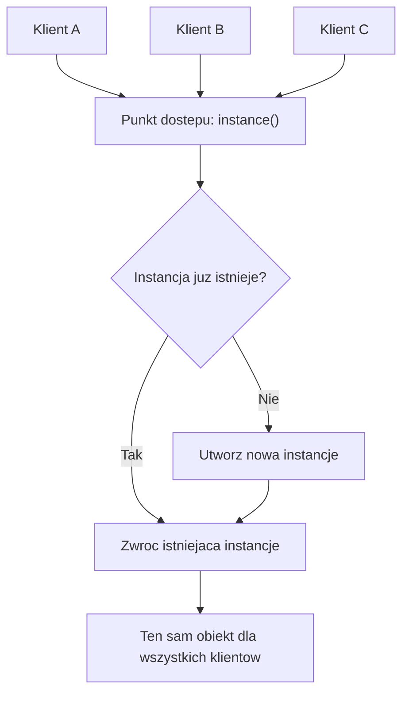
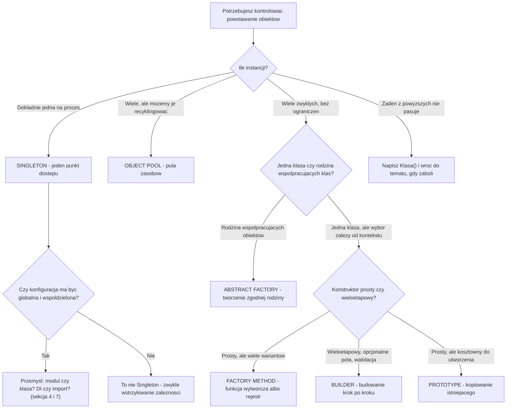
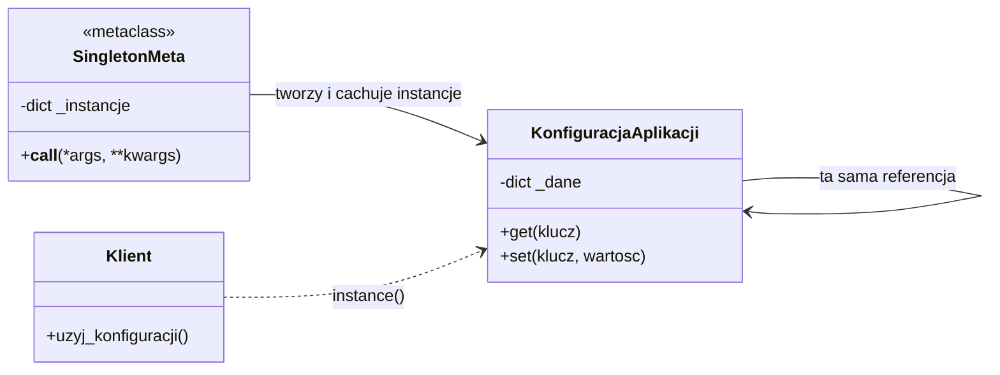
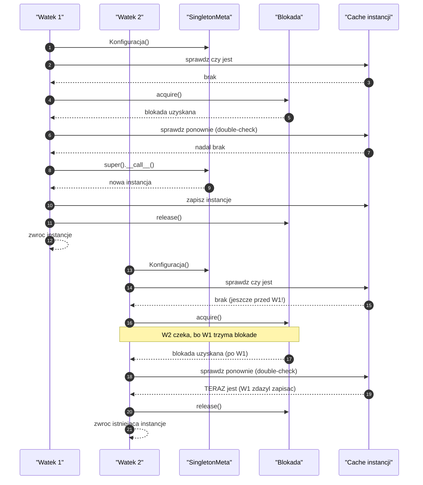
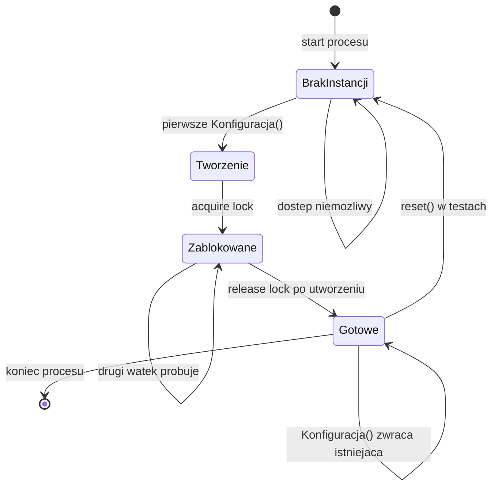
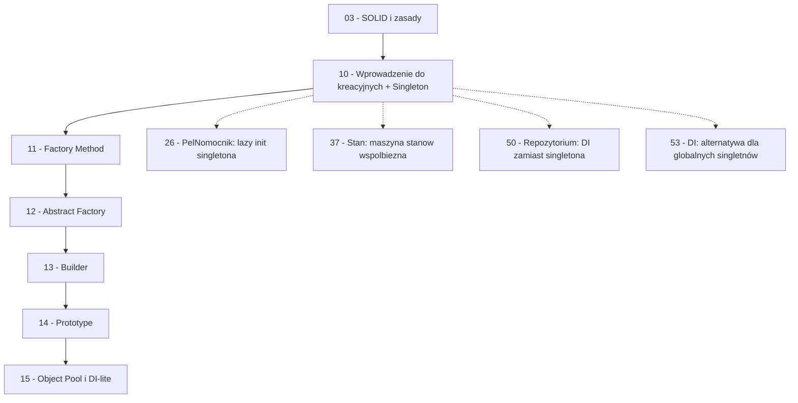

```markdown
---
modul: 10 — Wzorce kreacyjne i Singleton
plik: 10-singleton-i-wprowadzenie-do-kreacyjnych.md
poziom: podstawowy
wymaga: [03]
czas: ~140 minut czytania + ~340 minut ćwiczeń
---

# Moduł 10 — Wzorce kreacyjne — jak powstają obiekty + Singleton

> **TL;DR**
> - Wzorce kreacyjne (ang. creational patterns) odpowiadają na pytanie **kto, kiedy i ile razy tworzy obiekt** — nie „jak ten obiekt działa", tylko „skąd się bierze".
> - Wspólny problem całej rodziny: `Klasa()` rozsiane po kodzie to twarde sprzężenie klienta z konkretną implementacją, którego nie da się podmienić bez dotykania dziesiątków miejsc.
> - **Singleton** gwarantuje jedną instancję w obrębie procesu i jeden punkt dostępu — ale w Pythonie najczęściej nie potrzebujesz klasy, wystarczy moduł, a w aplikacjach **nigdy** nie wolno o nim myśleć jak o globalnym obiekcie w skali systemu.
> - Wątki współdzielą singleton w jednym procesie, ale procesy (gunicorn, multiprocessing) mają **każdy własną kopię** — to najczęstsza produkcyjna pułapka tej rodziny.
> - Singleton to oft krytykowany wzorzec, i słusznie: zanim go użyjesz, sprawdź, czy nie wystarczy wstrzykiwanie zależności (moduł 53) albo zwykła konfiguracja przez argumenty.

---

## 0. Model mentalny

### Prezes spółki i sekretariat — jeden człowiek, jedno wejście

Wyobraź sobie dużą spółkę akcyjną. Jest w niej prezes — **dokładnie jeden**. Nie ma „trzech prezesów, którzy czasem się nie zgadzają", nie ma „prezesa zależnego od działu, do którego trafiłeś". Jest jeden człowiek, który podejmuje ostateczne decyzje strategiczne. Równolegle jest **sekretariat** — jedno miejsce, o którym każdy w firmie wie, że jeśli chce się dostać do prezesa albo uzyskać aktualne wytyczne, trzeba tam pójść. Sekretariat nie jest prezesem, nie podejmuje decyzji, ale **kontroluje dostęp** i wie, gdzie prezes jest i czy jest dostępny.

Drugą rzeczą, na którą warto zwrócić uwagę: prezes jest **jeden w obrębie jednej firmy**. Jeśli spółka ma filie w innych krajach, każda filia może mieć swojego prezesa. Nie ma „prezesa całego świata". Światowy koncern z pięcioma spółkami zależnymi ma pięć prezesów, z których każdy jest jeden w swojej spółce. To rozróżnienie — „jeden w obrębie granicy" — jest absolutnie kluczowe dla zrozumienia **Singletonu w Pythonie**. W dalszej części modułu zobaczysz, że jedno procesowe „jeden" i wieloprocesowe „jeden" to dwie zupełnie różne rzeczy, a mieszanie ich kosztuje mnóstwo czasu w produkcji.

Jeszcze jedna rzecz z tej analogii jest ważna. Pracownicy firmy nie „tworzą prezesa", gdy potrzebują z nim pogadać. Nie mówią: „muszę mieć swojego prezesa na tę rozmowę". **Idą do istniejącego**. To jest sedno wzorca — Singleton odpowiada na pytanie „jak zagwarantować, że ten obiekt już istnieje i że każdy trafi do tego samego?".

| W analogii firmy | W kodzie |
|---|---|
| Spółka z określoną granicą (jeden kraj) | Proces Pythona z określoną granicą (jeden interpreter) |
| Prezes — dokładnie jeden | Instancja singletona — dokładnie jedna |
| Sekretariat — znana droga do prezesa | Klasa/metoda `instance()` — znany punkt dostępu |
| Inne spółki zależne mają własnych prezesów | Inne procesy (gunicorn workers) mają własne singletony |
| Pracownik idzie do istniejącego prezesa | Klient dostaje istniejącą instancję |
| Prezes jest jeden, ale nie „globalny wszędzie" | Singleton jest jeden, ale nie „globalny w systemie" |
| Próba „stworzenia drugiego prezesa" jest niedorzeczna | `Singleton()` zwraca ten sam obiekt |

> 🧠 **Zapamiętaj** — **Singleton (ang. singleton) to wzorzec kreacyjny gwarantujący, że klasa ma dokładnie jedną instancję w obrębie danego procesu (interpretera), oraz udostępniający globalny punkt dostępu do niej.**

Zwróć uwagę na dwa ostatnie słowa — „w obrębie procesu". Bez tej granicy wzorzec traci sens. W systemie z trzema procesami może istnieć trzy instancje. To nie błąd, to natura tego wzorca.

Poniższy diagram pokazuje intuicję. Zwróć uwagę, że klient nigdy nie „tworzy" obiektu — zawsze prosi o dostęp do istniejącego.



*Diagram pokazuje, że wszyscy klienci idą tą samą drogą i zawsze dostają ten sam obiekt — nie ma miejsca, w którym ktokolwiek „stworzyłby własną instancję".*

### Wzorce kreacyjne — rodzina, do której należy Singleton

Singleton to tylko jeden z pięciu głównych członków rodziny **wzorców kreacyjnych** (ang. creational patterns). Zanim wejdziemy w szczegóły, musimy zobaczyć mapę całej rodziny, bo bez tego Singleton wydaje się rozwiązaniem każdego problemu, a to nieprawda. Rodzina odpowiada na pięć różnych pytań, i pomylenie ich to typowy błąd początkujących.

Pytania, na które odpowiadają wzorce kreacyjne:

1. **Kto tworzy obiekt?** Czy klient bezpośrednio, czy pośrednik, który ukrywa decyzję?
2. **Kiedy tworzy?** Przy starcie, na żądanie, leniwie przy pierwszym użyciu?
3. **Ile razy tworzy?** Raz na proces, raz na wątek, raz na żądanie, zawsze nowy?
4. **Jak ukryć konstruktor?** Jeśli klient nie ma wiedzieć, jak powstaje obiekt, kto ma wiedzieć?
5. **Jak oddzielić „co" od „jak"?** Klient wie, *czego* chce, ale nie wie, *jak* to zostało zbudowane.

Każdy wzorzec z tej rodziny odpowiada na inną kombinację tych pytań. I żaden nie odpowiada na wszystkie naraz. To bardzo ważne — rodziny wzorców nie są „kategoriami", w których można znaleźć rozwiązanie dowolnego problemu. Są zestawami odpowiedzi na konkretne pytania.

| Wzorzec | Pytanie, na które odpowiada |
|---|---|
| Singleton | „Ile razy tworzyć? Jeden raz, na proces." |
| Factory Method | „Kto decyduje, którą klasę utworzyć? Podklasa lub funkcja wytwórcza." |
| Abstract Factory | „Jak utworzyć rodzinę współpracujących obiektów bez wskazywania klas?" |
| Builder | „Jak zbudować złożony obiekt krok po kroku?" |
| Prototype | „Jak utworzyć nowy obiekt, gdy taniej jest skopiować istniejący?" |
| Object Pool | „Jak recyklingować kosztowne zasoby zamiast je tworzyć na nowo?" |

Zwróć uwagę: te wzorce są **uzupełniające**, nie konkurencyjne. W prawdziwym systemie może występować kilka naraz. Konfiguracja aplikacji może być singletonem, bramka płatnicza tworzona przez fabrykę, migawka portfela przez prototyp. To normalne.

### Wspólny problem rodziny — `Klasa()` rozsiane po kodzie

Byłbyś zdziwiony, jak dużo kłopotu sprawia jedna krótka konstrukcja: **`NazwaKlasy()`**. Na pierwszy rzut oka to zwykłe wywołanie konstruktora. W rzeczywistości każde wystąpienie tego wywołania w kodzie jest **twardym zobowiązaniem**: klient wie, że istnieje konkretna klasa o konkretnej nazwie, w konkretnym module, o konkretnym konstruktorze. Zmiana czegokolwiek z tego psuje klienta.

Zobacz to na przykładzie — jeszcze przed sekcją 1, która to omówi szczegółowo:

```python
# kazde z tych wystapien to ciezkie sprzezenie klienta z konkretem
bramka = BramkaKartowaStripe(api_key="...", tryb="production")
ksiega = KsiegowanieSQLite("path/to/db.sqlite")
powiadomienie = PowiadomienieSMTP(host="smtp.example.com", port=587)
```

Klient nie tylko „używa" tych obiektów — on **wie o ich istnieniu i konstrukcji**. To znaczy, że:
- nie da się podstawić atrapy w teście bez zmiany kodu klienta,
- nie da się zmienić implementacji bez przeszukania repozytorium,
- nie da się skonfigurować systemu z zewnątrz (bo konfiguracja jest wpisana w kod),
- nie da się użyć kodu w innym kontekście (bo zakłada konkretną infrastrukturę).

Rodzina wzorców kreacyjnych istnieje głównie po to, żeby **usunąć te wywołania z kodu klienta** i zastąpić je czymś, co można skonfigurować, wymienić, przetestować. Singleton to szczególny przypadek: obniża koszt tworzenia do zera (bo nie tworzy), ale jednocześnie **wprowadza nowy rodzaj sprzężenia** — sprzężenie z globalnym punktem dostępu. O tym szerzej w sekcji 7.

### Mapa wyboru wzorca kreacyjnego

Poniższy diagram to decyzyjna mapa całej rodziny. Cztery pytania prowadzą do właściwego wzorca.



*Diagram to mapa decyzyjna całej rodziny kreacyjnej — zaczynasz od pytania o liczbę instancji, a kończysz na konkretnym wzorcu lub uczciwym wniosku „żaden".*

> 💡 **Intuicja** — Zauważ ostatnią gałąź: „Napisz `Klasa()` i wróć do tematu, gdy zaboli". To nie jest żart. W większości projektów **większość obiektów nie potrzebuje żadnego wzorca kreacyjnego**. Wzorce są narzędziami, nie wymogami. Jeśli tworzysz dziesięć instancji czegoś prostego, żaden wzorzec ci nie pomoże — wprowadzi tylko pośrednictwo.

### Czego te wzorce NIE robią

Zanim przejdziemy do sekcji 1, rozbrójmy kilka nieporozumień, które towarzyszą szczególnie Singletonowi.

**Wzorce kreacyjne nie są szybsze od zwykłego `Klasa()`.** Wręcz przeciwnie: każde pośrednictwo ma koszt. Fabryka wywołuje funkcję, metaklasa sprawdza cache, prototyp kopiuje obiekt. Zysk nie leży w szybkości — leży w **elastyczności i testowalności**.

**Singleton nie jest „globalną zmienną w przebraniu".** Globalna zmienna to zwykły `dict` albo modułowa lista, do której każdy może dopisać, co chce, w dowolnym momencie. Singleton to obiekt z metodami, własnym kontraktem i kontrolowanym dostępem. Ale prawda jest taka, że **zły singleton jest globalną zmienną w przebraniu** — i to jest uzasadniona obawa, o której w sekcji 7.

**Singleton nie jest globalny w skali systemu.** Jest globalny w skali **jednego procesu**. W aplikacji webowej z czterema workerami gunicorna istnieje cztery instancje singletona. W systemie z dwoma kontenerami Docker — dwa. W środowisku z pięcioma procesami potomnymi — pięć. To nie błąd wzorca, to jego definicja.

**Wzorce kreacyjne nie zastępują dobrego API.** Jeśli konstruktor jest zły (dziesięć parametrów, niejasna kolejność, brak walidacji), fabryka tego nie naprawi — tylko przeniesie problem w inne miejsce. Najpierw popraw konstruktor, potem rozważ wzorzec.

**Singleton nie rozwiązuje problemu współdzielenia zasobu w wielowątkowości.** Rozwiązuje problem „jedna instancja", ale nie problem „bezpieczny dostęp do współdzielonego stanu". Do tego potrzebne są blokady, kolejki albo niemutowalność — a te są osobnym zagadnieniem.

---

## 1. Problem, który rozwiązujemy

Wejdźmy w domenę 💳 „Rozrachunku". Wyobraź sobie aplikację przetwarzającą przelewy, która potrzebuje konfiguracji: limitów technicznych, adresu bazy, adresu SMTP, ustawień regionalnych, klucza API do bramki płatniczej.

### Kod „przed"

```python
# rozrachunek_v0.py — wersja naiwna, demonstracyjna
# UWAGA: ten kod celowo zawiera typowe problemy z tworzeniem obiektow.

from decimal import Decimal

API_KEY = "sk_live_51H8..."          # sekret w kodzie zrodlowym!
BAZA = "postgresql://user:pass@db:5432/rozrachunek"
SMTP_HOST = "smtp.example.com"
SMTP_PORT = 587
LIMIT_TECHNICZNY = Decimal("1000000.00")
STAWKA_PROWIZJI = Decimal("0.004")
WALUTY = ["PLN", "EUR", "USD"]
SCIEZKA_LOGU = "/var/log/rozrachunek.log"
TRYB = "production"


class ProcesRozrachunku:
    """Kazde zlecenie czyta globalne stale bezposrednio."""

    def __init__(self, identyfikator: str, kwota: Decimal, waluta: str) -> None:
        if kwota > LIMIT_TECHNICZNY:
            raise ValueError(f"kwota powyzej limitu {LIMIT_TECHNICZNY}")
        if waluta not in WALUTY:
            raise ValueError(f"nieobslugiwana waluta {waluta}")

        self.identyfikator = identyfikator
        self.kwota = kwota
        self.waluta = waluta
        self.prowizja = (kwota * STAWKA_PROWIZJI).quantize(Decimal("0.01"))

    def zapisz_w_logu(self, komunikat: str) -> None:
        with open(SCIEZKA_LOGU, "a", encoding="utf-8") as plik:
            plik.write(f"{self.identyfikator}: {komunikat}\n")

    def wyslij_powiadomienie(self, adres: str, tresc: str) -> None:
        import smtplib
        serwer = smtplib.SMTP(SMTP_HOST, SMTP_PORT)
        serwer.sendmail("system@example.com", [adres], tresc)
        serwer.quit()


def zaladuj_konfiguracje():
    """Funkcja pomocnicza, ktora tez czyta globalne stale."""
    return {
        "api_key": API_KEY,
        "baza": BAZA,
        "prog": LIMIT_TECHNICZNY,
        "tryb": TRYB,
    }


if __name__ == "__main__":
    zlecenie = ProcesRozrachunku("ZL-1", Decimal("1500.00"), "PLN")
    zlecenie.zapisz_w_logu("utworzono")
    zlecenie.wyslij_powiadomienie("klient@example.com", "Przyjeto zlecenie.")
```

Ten kod działa. Ma jednak pięć problemów, z których każdy ma własną nazwę i własne konsekwencje. Zwróć uwagę, że wszystkie dotyczą **tego, jak obiekty powstają i skąd biorą swoje zależności** — czyli domeny wzorców kreacyjnych.

### Code smell — pięć problemów w jednym pliku

| Problem | Gdzie | Po co o tym myśleć w tym module |
|---|---|---|
| **Sekret w kodzie źródłowym** | `API_KEY = "sk_live_51H8..."` | Konfiguracja musi pochodzić z zewnątrz; to warunek bezpieczeństwa, nie kwestia estetyki |
| **Konfiguracja globalna przez import** | Wszystkie stałe w module | Klasa domyślnie „będzie wiedziała", gdzie jest baza i SMTP — nie da się tego zmienić z zewnątrz |
| **Sprzężenie z konkretnym adresem i usługą** | `BAZA = "postgresql://..."`, `SMTP_HOST` | Test nie może wybrać innej bazy; to jest dokładnie naruszenie DIP (moduł 03) |
| **Brak pojedynczego miejsca konfiguracji** | Stałe rozproszone na górze pliku | Dodanie nowego parametru wymaga nowej stałej w module i nowych miejsc, które ją czytają |
| **Brak walidacji konfiguracji** | `TRYB = "production"`, ale nikt tego nie sprawdza | Literówka `"prodution"` przejdzie; błąd konfiguracji wyjdzie dopiero w produkcji |

### Objawy — poznasz ten problem po tym, że...

- **Testy wymagają zmiany kodu źródłowego.** Chcesz przetestować `wyslij_powiadomienie` na atrapie SMTP, ale nie da się — bo `SMTP_HOST` jest stałą. Wniosek: brakuje mechanizmu, który pozwala skonfigurować zależność.
- **Ten sam parametr jest czytany w wielu miejscach.** `LIMIT_TECHNICZNY` pojawia się w klasie, w `zaladuj_konfiguracje`, w kodzie startowym... Każde czytanie to osobne miejsce, w którym trzeba pamiętać o aktualizacji.
- **Uruchomienie dwóch instancji aplikacji na tym samym hoście jest trudne.** Bo obie czytają te same pliki konfiguracyjne i logują do tego samego pliku.
- **Nie da się uruchomić aplikacji w trybie testowym bez modyfikacji kodu.** Bo `TRYB = "production"` jest wpisane na stałe.
- **Konfiguracja nie jest walidowana przy starcie.** Jeśli brakuje `API_KEY`, aplikacja startuje — i pada dopiero przy pierwszym zleceniu.
- **Prawdziwy klucz API trafia do repozytorium.** To problem bezpieczeństwa, nie czystości kodu, ale oba prowadzą do tego samego rozwiązania: konfiguracja z zewnątrz.
- **W kodzie masz wrażenie, że „te stałe są wszędzie".** To sygnał, że brakuje jednego, nazwanego obiektu konfiguracyjnego — i że prawdopodobnie powinien być singletonem.
- **Każda zmiana środowiska (dev, staging, prod) wymaga osobnej gałęzi kodu albo ręcznej edycji pliku.** To najgorszy objaw: konfiguracja powinna być danymi, nie kodem.

---

## 2. Anatomia wzorca

W tej sekcji przechodzimy już do Singletonu. Najpierw role, potem struktura w klasycznym i pythonicznym ujęciu.

### Uczestnicy Singletonu

| Rola | Odpowiedzialność | Co NIE jest jej zadaniem |
|---|---|---|
| **Singleton** | Przechowuje statyczną referencję do jedynej instancji; udostępnia globalny punkt dostępu (`instance()`, `get_instance()`, moduł); kontroluje tworzenie | Nie zapewnia bezpieczeństwa współdzielonego stanu; nie rozsyła zmian do klientów |
| **Klient** | Żąda instancji przez punkt dostępu; nie wywołuje `Singleton()` bezpośrednio | Nie tworzy obiektu samodzielnie; nie zna szczegółów jego konstrukcji |
| **Konstruktor** (prywatny w językach, gdzie to możliwe) | Inicjalizuje jedyną instancję przy pierwszym żądaniu | Nie może zostać wywołany przez klienta; nie powtarza inicjalizacji przy kolejnych żądaniach |

W Pythonie jest jeden niuans, który trzeba wyraźnie powiedzieć: **nie ma prawdziwego prywatnego konstruktora**. Każdy klient zawsze może napisać `MojaKlasa()` i otrzyma obiekt. W klasycznych implementacjach singletona (np. w Javie) konstruktor jest oznaczony jako `private` i wywołanie `Klasa()` z zewnątrz jest niemożliwe na poziomie kompilatora. W Pythonie musisz użyć innej strategii:
- **moduł** — na poziomie modułu nie ma „konstruktora", który klient mógłby wywołać,
- **`__new__` z cache** — nawet `Klasa()` zwraca tę samą instancję,
- **metaklasa** — kontroluje proces tworzenia klasy, więc ma pełną kontrolę nad instancją,
- **dekorator klasowy** — opakowuje klasę, przechwytując wywołania.

To jest kluczowe rozróżnienie między teorią a praktyką. W dalszej części tego modułu pokażemy każdy z tych wariantów, wraz z kompromisami.

### Diagram struktury — Singleton przez metaklasę

To najbardziej „klasyczna" realizacja, w której nawet `MojaKlasa()` zwraca tę samą instancję.



*Diagram pokazuje, że metaklasa `SingletonMeta` przechwytuje proces tworzenia instancji `KonfiguracjaAplikacji` — klient widzi jedną klasę, ale dostaje zawsze ten sam obiekt.*

Przeczytajmy ten diagram zdanie po zdaniu. `SingletonMeta` to metaklasa — czyli klasa, której instancjami są klasy. Metaklasa przechowuje słownik `_instancje`, w którym trzyma utworzone obiekty. Kiedy klient pisze `KonfiguracjaAplikacji()`, Python **nie** wywołuje bezpośrednio konstruktora klasy — wywołuje `__call__` jej metaklasy. I to jest miejsce, w którym można przejąć kontrolę: metaklasa sprawdza, czy instancja już istnieje, i zwraca istniejącą albo tworzy nową.

Zauważ dwie ważne rzeczy na diagramie:
1. **`Klient` nie jest połączony bezpośrednio z `KonfiguracjaAplikacji` strzałką dziedziczenia ani kompozycji.** Jest zależność — klient po prostu używa obiektu. To znaczy, że klient może być dowolnym typem, a konfiguracja jest tylko zależnością.
2. **Strzałka `KonfiguracjaAplikacji --> KonfiguracjaAplikacji`** to skrót myślowy pokazujący, że obiekt „należy do siebie" w sensie cyklu życia — nie ma zewnętrznego właściciela.

### Warianty: klasyczny vs pythoniczny

To kluczowa tabela całego modułu, bo pokazuje, że „Singleton" w Pythonie ma pięć poziomów realizacji, a dobór zależy od kontekstu.

| Wariant | Kto wywołuje `Klasa()` | Kiedy inicjalizacja | Wątkowo-bezpieczny? | Kiedy używać |
|---|---|---|---|---|
| **Moduł** | Nikt (moduł jest instancją od pierwszego importu) | Przy pierwszym imporcie | Tak (import jest atomowy) | Domyślny wybór w 90% przypadków |
| **`__new__` z cache** | Klient, ale dostaje cached instancję | Przy pierwszym `Klasa()` | Nie bez blokady | Gdy chcesz klasę z metodami instancji |
| **Metaklasa** | Klient, ale metaklasa przechwytuje | Przy pierwszym `Klasa()` | Nie bez blokady | Gdy chcesz dziedziczyć behaviour z singletona |
| **Dekorator `@singleton`** | Klient, ale dekorator opakowuje | Przy pierwszym `Klasa()` | Nie bez blokady | Gdy potrzebujesz jednolicie oznaczać klasy |
| **Borg / Monostate** | Klient tworzy wiele instancji | Przy każdym `Klasa()` | Nie bez blokady | Gdy chcesz współdzielony stan, ale nie tożsamość |
| **`functools.lru_cache(1)` na fabryce** | Klient przez funkcję | Przy pierwszym wywołaniu | Tak (lru_cache jest thread-safe) | Prosty, czytelny trik |

Warto powiedzieć wprost: **moduł to najbardziej pythoniczny singleton i w większości aplikacji powinien być domyślnym wyborem**. Cała maszyneria z metaklasami istnieje głównie po to, żeby pokazać, jak to działa — i żebyś rozpoznał ją w bibliotekach. W praktyce sięgasz po nią wtedy, gdy potrzebujesz jednego z trzech:
1. singleton, który dziedziczy po klasie bazowej frameworka,
2. singleton z `__init__`, który musi przyjmować parametry,
3. singleton, który chcesz móc łatwo podmienić w testach.

W sekcji 4 pokażemy każdy wariant z pełnym, uruchamialnym kodem.

---

## 3. Implementacja krok po kroku

Pójdziemy przez sześć kroków, od najbardziej naiwnego rozwiązania do finalnej wersji z zabezpieczeniem wątkowym. Każdy krok rozwiązuje konkretny problem z poprzedniego. Celowo zaczynamy od implementacji, która **nie działa dobrze** — bo wszystkie realne problemy z singletonem objawiają się po kolei, i dopiero ich doświadczenie sprawia, że docenia się właściwe rozwiązanie.

### Krok 1 — Naiwny singleton przez `__new__` bez cache

Pierwsza próba: przechwycić tworzenie w `__new__` i zawsze zwracać nowy obiekt. Ten kod jest **celowo błędny** — pokazuje, jak wygląda singleton, który nim nie jest.

```python
class KonfiguracjaNaiwna:
    """Naiwna wersja: wyglada jak singleton, ale nie dziala."""

    def __new__(cls, *args, **kwargs):
        # Zapominamy o cache - kazde wywolanie tworzy nowy obiekt
        return super().__new__(cls)

    def __init__(self, tryb: str = "production") -> None:
        self.tryb = tryb
```

Sprawdź: `KonfiguracjaNaiwna() is KonfiguracjaNaiwna()` zwraca `False`. To nie jest singleton, mimo że wygląda podobnie. **Lekcja:** przechwycenie `__new__` to nie to samo co „zwracanie tej samej instancji". Musi być gdzieś cache.

### Krok 2 — Singleton przez `__new__` z cache klasowym

Dodajemy słownik klasowy, który pamięta instancję.

```python
class Konfiguracja:
    """Singleton przez __new__ z cache klasowym."""

    _instancja: "Konfiguracja | None" = None

    def __new__(cls, *args, **kwargs):
        if cls._instancja is None:
            cls._instancja = super().__new__(cls)
        return cls._instancja

    def __init__(self, tryb: str = "production") -> None:
        # UWAGA: __init__ wywola sie przy KAZDYM wywolaniu Konfiguracja()
        # nawet jesli __new__ zwrocil istniejacy obiekt!
        self.tryb = tryb
```

Ten kod działa w wersji jednowątkowej. Zwróć uwagę na pułapkę: **`__init__` wywoła się za każdym razem**, bo Python zawsze woła `__new__` (który zwraca istniejący obiekt), a potem `__init__` na tym obiekcie. To znaczy, że kolejne `Konfiguracja("test")` **nadpisze** atrybut `tryb` na istniejącej instancji. O tym problemie szerzej w sekcji 4 i 8.

### Krok 3 — Singleton przez metaklasę

Bardziej kanoniczna wersja, w której konstrukcja jest przechwytywana już na poziomie tworzenia klasy. Zapobiega też ponownemu wywołaniu `__init__`.

```python
class SingletonMeta(type):
    """Metaklasa: kazda klasa z nia ma dokladnie jedna instancje."""

    _instancje: dict[type, object] = {}

    def __call__(cls, *args, **kwargs):
        if cls not in SingletonMeta._instancje:
            instancja = super().__call__(*args, **kwargs)
            SingletonMeta._instancje[cls] = instancja
        return SingletonMeta._instancje[cls]


class Konfiguracja(metaclass=SingletonMeta):
    def __init__(self, tryb: str = "production") -> None:
        self.tryb = tryb
        self._dane: dict[str, str] = {}
```

Tutaj `__init__` wykonuje się **tylko raz** — przy pierwszym utworzeniu. Kolejne wywołania `Konfiguracja("test")` są przechwytywane przez `__call__` metaklasy i zwracają cached instancję bez wołania `__init__`. To zachowanie jest bliższe prawdziwemu singletonowi z języków takich jak Java czy C#.

### Krok 4 — Singleton jako moduł (najczęściej wybierany)

Zamiast tworzyć klasę z metaklasą, po prostu umieszczasz konfigurację w module. Moduł jest importowany raz na proces — Python sam dba o to, żeby nie utworzył drugiej kopii.

```python
# konfiguracja.py
from decimal import Decimal

class Konfiguracja:
    def __init__(self, tryb: str = "production") -> None:
        self.tryb = tryb
        self._dane: dict[str, object] = {}

    def get(self, klucz: str, domyslna=None):
        return self._dane.get(klucz, domyslna)

# Jedna instancja modułu - utworzona przy pierwszym imporcie
KONFIGURACJA = Konfiguracja()
```

Klient:
```python
from konfiguracja import KONFIGURACJA

KONFIGURACJA._dane["api_key"] = "..."
print(KONFIGURACJA.tryb)
```

Ta wersja jest **najprostsza**, **najbardziej pythoniczna** i **bezpieczna wątekowo** przy pierwszym imporcie (Python wykonuje moduł raz, w sposób atomowy). Jej słabości: nie działa dobrze z testami, które chcą mieć czystą konfigurację między przypadkami — bo moduł nie da się „zresetować" bez `importlib.reload`. W sekcji 7 pokażemy, jak to rozwiązać.

### Krok 5 — Zabezpieczenie wątkowe

Przy leniwej inicjalizacji singletona **dwa wątki mogą jednocześnie wejść w gałąź „utwórz obiekt"** i utworzyć dwa obiekty. To klasyczny wyścig (ang. race condition).

```python
import threading

class BezpiecznySingletonMeta(type):
    _instancje: dict[type, object] = {}
    _blokada = threading.Lock()

    def __call__(cls, *args, **kwargs):
        if cls not in BezpiecznySingletonMeta._instancje:
            with BezpiecznySingletonMeta._blokada:
                # Podwojne sprawdzenie (double-checked locking)
                if cls not in BezpiecznySingletonMeta._instancje:
                    instancja = super().__call__(*args, **kwargs)
                    BezpiecznySingletonMeta._instancje[cls] = instancja
        return BezpiecznySingletonMeta._instancje[cls]
```

Zwróć uwagę na **podwójne sprawdzenie**: pierwszy `if` poza blokadą to szybka ścieżka (jeśli instancja istnieje, nie ma po co blokować — to częsty przypadek i blokowanie za każdym razem byłoby kosztowne). Drugi `if` wewnątrz blokady to zabezpieczenie przed sytuacją, w której dwa wątki przeszły pierwszy `if` zanim cokolwiek zostało utworzone.

To klasyczne **double-checked locking** (podwójnie sprawdzana blokada). W językach z pamięcią dzieloną bez gwarancji kolejności (np. stare C++) ten wzorzec wymaga też `volatile` albo barier pamięci. W Pythonie, ze względu na GIL i model pamięci, wystarczy blokada.

### Krok 6 — Ostateczna wersja z lazy init, bezpieczna i zdatna do testów

Zbierzmy wszystko razem. Nasza wersja finalna powinna:
- być bezpieczna wątekowo,
- inicjalizować się leniwie,
- pozwalać na jawny reset w testach,
- nie wywoływać `__init__` przy każdym dostępie.

```python
import threading
from typing import Any, TypeVar

T = TypeVar("T", bound="SingletonTestowalny")

class SingletonTestowalny:
    """Singleton z mozliwoscia resetu w testach."""

    _instancje: dict[type, object] = {}
    _blokada = threading.Lock()

    def __new__(cls, *args, **kwargs):
        if cls not in cls._instancje:
            with cls._blokada:
                if cls not in cls._instancje:
                    instancja = super().__new__(cls)
                    cls._instancje[cls] = instancja
                    # Inicjalizacja tylko raz - reczna, nie przez __init__
                    instancja._zainicjalizowany = False
        return cls._instancje[cls]

    def __init__(self) -> None:
        # Nadpisanie w podklasach; wywolanie tylko, gdy nie zainicjalizowany
        if getattr(self, "_zainicjalizowany", False):
            return
        self._zainicjalizowany = True

    @classmethod
    def reset(cls) -> None:
        """Wylacznie dla testow: usun instancje."""
        with cls._blokada:
            cls._instancje.pop(cls, None)
```

Zwróć uwagę, że `__init__` w klasach dziedziczących musi sprawdzić `_zainicjalizowany` — to koszt, ale pozwala uniknąć wywołania `__init__` drugi raz.

### Krok 7 — Weryfikacja

| Kryterium | Krok 1 | Krok 2 | Krok 3 | Krok 4 | Krok 5 | Krok 6 |
|---|---|---|---|---|---|---|
| Jedna instancja na proces | Nie | Tak | Tak | Tak | Tak | Tak |
| `__init__` tylko raz | — | Nie | Tak | Nie dotyczy | Tak | Tak |
| Bezpieczne wątekowo | — | Nie | Nie | Tak | Tak | Tak |
| Łatwe do testowania | Trudne | Trudne | Trudne | Trudne | Trudne | Tak (reset) |
| Czytelność | Niska | Średnia | Niska (magia) | Wysoka | Niska | Średnia |
| Liczba linii | 10 | 15 | 15 | 10 | 20 | 30 |

Koszt tej ostatniej wersji jest największy — 30 linii zamiast 10. Zysk jest w dwóch miejscach: jest bezpieczna wątekowo i **da się ją wyczyścić w testach**. Bez tego ostatniego, każdy test zależny od konfiguracji dziedziczyłby stan po poprzednim, co prowadzi do koszmarnych, niereprodukowalnych błędów.

---

## 4. Wersje pythoniczne i warianty

Ta sekcja to pełny katalog implementacji Singletona w Pythonie. Zawiera pięć głównych podejść i kilka wariantów pobocznych.

### 4.1 Moduł jako singleton — domyślny wybór

Moduł jest singletonem w sposób wbudowany w język. Python wykonuje kod modułu raz — przy pierwszym imporcie — i zapamiętuje wynik w `sys.modules`. Każdy kolejny `import` zwraca ten sam obiekt.

```python
# sklep/konfiguracja.py
from decimal import Decimal
from zoneinfo import ZoneInfo

class _Konfiguracja:
    """Wewnetrzna klasa - nie eksportujemy jej nazwy."""

    def __init__(self) -> None:
        self.tryb: str = "production"
        self.strefa: ZoneInfo = ZoneInfo("Europe/Warsaw")
        self.limit_techniczny: Decimal = Decimal("1000000.00")
        self.waluty: frozenset[str] = frozenset({"PLN", "EUR", "USD"})

    def __repr__(self) -> str:
        return f"<_Konfiguracja tryb={self.tryb!r}>"


# Jedyna instancja modułu
konfiguracja = _Konfiguracja()
```

Klient:
```python
from sklep.konfiguracja import konfiguracja as cfg

print(cfg.tryb)                    # production
print(cfg.limit_techniczny)        # 1000000.00
print(cfg is cfg)                  # True - oczywiste, ale prawdziwe
```

Dlaczego działa:
1. **Import wykonuje się raz.** Python ma wewnętrzną blokadę na poziomie sys.modules; drugie wywołanie zwraca istniejący moduł.
2. **Nie ma konstruktora eksponowanego na zewnątrz.** Klient importuje gotowy obiekt, nie może stworzyć drugiego. Co prawda może napisać `_Konfiguracja()` ręcznie — ale po to jest podkreślnik w nazwie, żeby zniechęcić i zasugerować, że to nie część publicznego API.
3. **Bezpieczeństwo wątkowe.** Import jest atomowy. Nawet jeśli dwa wątki jednocześnie zaimportują moduł, Python zagwarantuje, że kod modułu wykona się raz.

Granice tego podejścia:
- **Trudno zresetować w testach.** Nie da się „usunąć" konfiguracji i utworzyć od nowa w izolacji. Trzeba operować `importlib.reload` albo wstrzykiwać wartości przez funkcje.
- **Nie da się sparametryzować przy starcie.** Obiekt jest zbudowany z wartościami domyślnymi; żeby przyjąć parametry z zewnątrz, trzeba dodać `set`-ery, co osłabia wzorzec.
- **Trudno dziedziczyć.** Nie da się zrobić „konfiguracji podklasy" — moduł nie ma hierarchii.

Pomimo tych ograniczeń moduł pozostaje domyślnym rozwiązaniem. W praktyce prawie zawsze wystarczy, bo konfiguracja jest w większości **statyczna** i nie wymaga wymiany w locie.

### 4.2 Singleton przez `__new__` z cache

Wersja już pokazana w kroku 2. Warto podkreślić jedną rzecz: **`__init__` wywołuje się przy każdym dostępie**, więc trzeba go obsłużyć świadomie.

```python
class BuforKursow:
    """Wspoldzielony bufor kursow walutowych (cache w pamieci)."""

    _instancja: "BuforKursow | None" = None

    def __new__(cls, *args, **kwargs):
        if cls._instancja is None:
            cls._instancja = super().__new__(cls)
            cls._instancja._dane = {}
        return cls._instancja

    def zapamietaj(self, waluta: str, kurs: Decimal) -> None:
        self._dane[waluta] = kurs

    def pobierz(self, waluta: str) -> Decimal | None:
        return self._dane.get(waluta)
```

Ważne: w tej wersji **nie ma `__init__`** (albo jest, ale pusty). Inicjalizacja pola `_dane` odbywa się w `__new__` — dzięki temu wykonuje się tylko raz. To najprostszy sposób na uniknięcie pułapki z podwójnym `__init__`, ale ma wadę: łączy odpowiedzialność „utwórz obiekt" z „zainicjalizuj stan". W module 01 widziałeś, że te rzeczy się rozdziela. Ten wzorzec łamie tę zasadę — i to jest świadomy kompromis.

### 4.3 Singleton przez metaklasę

Wersja „podręcznikowa", z pełną kontrolą nad procesem tworzenia. Pokazana w kroku 3. Wariant z zabezpieczeniem wątkowym w kroku 5.

Dodatkowy niuans: metaklasę można **dziedziczyć** i mieszać z innymi. Na przykład:

```python
from abc import ABCMeta

class SingletonABCMeta(SingletonMeta, ABCMeta):
    """Metaklasa dla singletonow, ktore dziedzicza po ABC."""
    pass

class KanalAlertu(metaclass=SingletonABCMeta):
    @abstractmethod
    def wyslij(self, tresc: str) -> None: ...

class KanalEmail(KanalAlertu):
    def wyslij(self, tresc: str) -> None:
        ...
```

Zwróć uwagę na `SingletonABCMeta` — dziedziczy po dwóch metaklasach, żeby obsłużyć jednocześnie singletona i klasy abstrakcyjne. **To jest właśnie „piekło metaklas"**, o którym ostrzega moduł 02. Jeśli w kodzie pojawia się kilka metaklas, łączenie ich staje się koszmarem. To jeden z powodów, dla których w nowoczesnym Pythonie odchodzi się od metaklas na rzecz `__init_subclass__` albo innych podejść.

### 4.4 Singleton przez dekorator

Podejście najprostsze do zastosowania punktowo — dekorator opakowuje klasę.

```python
import functools
from typing import Any, Callable, TypeVar

T = TypeVar("T")

def singleton(klasa: Callable[..., T]) -> Callable[..., T]:
    """Dekorator klasowy: kazda klasa ma jedna instancje."""
    instancje: dict[Callable[..., T], T] = {}
    oryginalny_init = klasa.__init__

    def nowy_init(self: T, *args: Any, **kwargs: Any) -> None:
        # Inicjalizuj tylko raz - gdy obiekt wlasnie powstal
        if not getattr(self, "_zainicjalizowany", False):
            oryginalny_init(self, *args, **kwargs)
            self._zainicjalizowany = True  # type: ignore[attr-defined]

    klasa.__init__ = nowy_init

    @functools.wraps(klasa)
    def fabryka(*args: Any, **kwargs: Any) -> T:
        if klasa not in instancje:
            instancje[klasa] = klasa(*args, **kwargs)
        return instancje[klasa]

    fabryka.reset = lambda: instancje.clear()  # type: ignore[attr-defined]
    return fabryka
```

Użycie:
```python
@singleton
class BuforKursow:
    def __init__(self) -> None:
        self._dane: dict[str, Decimal] = {}
        print("inicjalizacja bufora")

a = BuforKursow()
b = BuforKursow()
print(a is b)          # True
print("inicjalizacja bufora" == "inicjalizacja bufora")  # wypisze raz
```

Uwaga: **dekorator zamienia klasę na funkcję**. To znaczy, że `BuforKursow` nie jest już klasą — nie można dziedziczyć, nie działa `issubclass`, nie działają adnotacje typów w pełni. To istotne ograniczenie w większych systemach. Ale dla aplikacji, gdzie singleton jest końcowym obiektem, podejście bywa akceptowalne.

### 4.5 Borg / Monostate — współdzielony stan bez współdzielonej tożsamości

Alternatywa singletona, którą warto znać. **Borg** (znany też jako **Monostate**) nie gwarantuje jednej instancji — pozwala tworzyć wiele instancji, ale wszystkie współdzielą ten sam stan.

```python
class Borg:
    """Kazda instancja ma ten sam __dict__ - wspoldzielony stan."""

    _stan: dict[str, Any] = {}

    def __init__(self) -> None:
        # Podmieniamy __dict__ instancji na klasowy
        self.__dict__ = Borg._stan


class KonfiguracjaBorg(Borg):
    def ustaw(self, klucz: str, wartosc: Any) -> None:
        self.__dict__[klucz] = wartosc

    def pobierz(self, klucz: str) -> Any:
        return self.__dict__.get(klucz)


a = KonfiguracjaBorg()
b = KonfiguracjaBorg()
a.ustaw("tryb", "test")
print(b.pobierz("tryb"))       # test - wspoldzielone
print(a is b)                  # False - rozne obiekty!
```

Zwróć uwagę na `a is b` — **`False`**. To nie jest singleton. To jest wspólny stan. Różnica bywa istotna:
- **Singleton** ma jedne tożsamość: `a is b` jest `True`. Wszędzie, gdzie przechodzi referencja, jest to ten sam obiekt.
- **Borg** ma wiele tożsamości, ale jeden stan: `a is not b`, ale `a.x is b.x` dla każdego `x`. Można przekazywać różne obiekty do tego samego API i wszystkie widzą te same zmiany.

Kiedy Borg jest lepszy? Gdy zależy ci na współdzielonym stanie, ale testy weryfikują przez `id()` — a różne identyfikatory pozwalają na pewne techniki testowe (np. mockowanie konkretnych instancji). W praktyce Borg jest rzadszy — przeważnie używa się go, gdy implementacja klasowa jest niepożądana z jakiegoś powodu i nie chce się użyć modułu.

### 4.6 `functools.lru_cache(1)` na fabryce

Elegancki trik, który warto znać. Jeśli opakujesz funkcję fabrykującą w `lru_cache(maxsize=1)`, otrzymasz singleton bez żadnej ręcznej logiki cache, a w dodatku bezpieczny wątekowo (mechanizm `lru_cache` sam używa blokady).

```python
import functools
from decimal import Decimal
from zoneinfo import ZoneInfo

class KonfiguracjaAplikacji:
    def __init__(self, tryb: str = "production") -> None:
        self.tryb = tryb
        self.strefa = ZoneInfo("Europe/Warsaw")
        self.limit = Decimal("1000000.00")
        self.waluty = frozenset({"PLN", "EUR", "USD"})


@functools.lru_cache(maxsize=1)
def konfiguracja() -> KonfiguracjaAplikacji:
    """Fabryka singletona. lru_cache gwarantuje jedna instancje."""
    print(f"Utworzenie konfiguracji w trybie {konfiguracja_kwargs().get('tryb', 'production')}")
    return KonfiguracjaAplikacji()


# Czystsza wersja bez drukowania - z parametrami
@functools.lru_cache(maxsize=1)
def konfiguracja_z_parametrami(tryb: str) -> KonfiguracjaAplikacji:
    """Klucz cache uwzglednia argument - mozna zmienic tryb."""
    return KonfiguracjaAplikacji(tryb=tryb)
```

Zwróć uwagę na wersję z parametrami: `lru_cache` kluczuje po argumentach. To znaczy, że `konfiguracja_z_parametrami("test")` i `konfiguracja_z_parametrami("production")` zwrócą **dwie różne instancje**. W pewnych kontekstach to jest zaleta (konfiguracja per środowisko), w innych — błąd. Trzeba to świadomie wybrać.

Wady `lru_cache`:
- **`reset` trzeba robić przez `konfiguracja.cache_clear()`** — to OK, ale wymaga zapamiętania.
- **Brak kontroli nad wywołaniem `__init__`** — jeśli raz zmienisz parametr, dostaniesz nową instancję (wszystkie poprzednie referencje zostaną nieważne). W aplikacji produkcyjnej z konfiguracją per środowisko to może być pożądane.
- **Argumenty muszą być haszowalne** — `lru_cache` buduje klucz z argumentów. Nie przekażesz listy.

### 4.7 Podsumowanie wariantów — tabela porównawcza

| Wariant | `a is b` | Bezpieczny wątekowo | Reset w testach | Trudność | Kiedy używać |
|---|---|---|---|---|---|
| **Moduł** | True | Tak | Trudne (`importlib.reload`) | Niska | Domyślny wybór |
| **`__new__` cache** | True | Nie bez blokady | Trudne (pole `_instancja = None`) | Średnia | Gdy potrzebujesz metod instancji |
| **Metaklasa** | True | Nie bez blokady | Średnie (usunięcie z `_instancje`) | Wysoka | Gdy potrzebujesz dziedziczenia |
| **Dekorator** | True | Nie bez blokady | Łatwe (`fabryka.reset()`) | Średnia | Gdy chcesz oznaczać klasy |
| **Borg** | **False** | Nie bez blokady | Średnie (`_stan.clear()`) | Niska | Gdy potrzebujesz wspólnego stanu, ale nie tożsamości |
| **`lru_cache(1)`** | True | Tak | Łatwe (`cache_clear()`) | Niska | Gdy lubisz funkcyjne podejście |

> 🧠 **Zapamiętaj** — Zanim napiszesz własny singleton z metaklasą, zadaj sobie pytanie: „czy mogę to zrobić modułem albo `lru_cache`?". Odpowiedź w 90% przypadków brzmi „tak". Każdy gram magii, którego dodajesz, to gram trudności w zrozumieniu i utrzymaniu.

---

## 5. Przykład z życia: 💳 Rozrachunek — pełny uruchamialny kod

Zbudujemy system, który demonstruje trzy użycia singletona w praktyce:
1. **Konfiguracja aplikacji** — jedna instancja używana przez wszystkich (moduł).
2. **Rejestr bramek płatniczych** — jedna instancja mapująca kanał → bramka (klasa z `__new__`).
3. **Bufor kursów walut** — jedna instancja współdzielonego cache, bezpieczna wątekowo (`lru_cache(1)`).

Dodatkowo pokażemy **problem wieloprocesowy** — jak się objawia i jak go rozpoznać.

### Kod

```python
# rozrachunek_singleton.py — demonstracja trzech uzyc singletona
from __future__ import annotations

import functools
import multiprocessing as mp
import os
import threading
import time
from dataclasses import dataclass
from decimal import ROUND_HALF_UP, Decimal
from typing import Any, Protocol, runtime_checkable

# ===========================================================================
# 1. KONFIGURACJA APLIKACJI - singleton przez modul (w tym pliku)
# ===========================================================================

class KonfiguracjaAplikacji:
    """Konfiguracja wspoldzielona przez cala aplikacje.

    Uwaga: w prawdziwej aplikacji ta klasa bylaby w osobnym module,
    a instancja tworzona przy pierwszym imporcie. W tym pliku tworzymy
    ja jawnie, zeby wszystko bylo w jednym miejscu.
    """

    def __init__(self) -> None:
        self.tryb: str = "production"
        self.limit_techniczny: Decimal = Decimal("1000000.00")
        self.waluty: frozenset[str] = frozenset({"PLN", "EUR", "USD"})
        self.stawka_prowizji: Decimal = Decimal("0.004")


# Jedyna instancja - utworzona raz przy imporcie modułu
KONFIGURACJA = KonfiguracjaAplikacji()


# ===========================================================================
# 2. PROTOKOLY I TYPY DOMENOWE
# ===========================================================================

@runtime_checkable
class BramkaPlatnicza(Protocol):
    nazwa: str
    def realizuj(self, identyfikator: str, kwota: Decimal, waluta: str) -> str: ...


@dataclass(frozen=True, slots=True)
class Potwierdzenie:
    numer_operacji: str
    zaakceptowane: bool
    opis: str = ""

    def __bool__(self) -> bool:
        return self.zaakceptowane


# ===========================================================================
# 3. REJESTR BRAMEK - singleton przez __new__ z cache
# ===========================================================================

class RejestrBramek:
    """Rejestr dostepnych bramek platniczych.

    Singleton, bo rejestr musi byc wspoldzielony miedzy wszystkimi serwisami.
    Gdyby kazdy serwis mial wlasny rejestr, musielibysmy go przekazywac
    albo duplikowac dane - a to prowadzi do rozjazdu.
    """

    _instancja: "RejestrBramek | None" = None
    _blokada = threading.Lock()

    def __new__(cls) -> "RejestrBramek":
        if cls._instancja is None:
            with cls._blokada:
                if cls._instancja is None:
                    instancja = super().__new__(cls)
                    instancja._bramki = {}  # type: ignore[attr-defined]
                    cls._instancja = instancja
        return cls._instancja

    def zarejestruj(self, bramka: BramkaPlatnicza) -> None:
        if not isinstance(bramka, BramkaPlatnicza):
            raise TypeError(f"{type(bramka).__name__} nie spelnia kontraktu")
        self._bramki[bramka.nazwa] = bramka  # type: ignore[attr-defined]

    def dla(self, nazwa: str) -> BramkaPlatnicza:
        try:
            return self._bramki[nazwa]  # type: ignore[attr-defined]
        except KeyError as blad:
            dostepne = ", ".join(sorted(self._bramki))  # type: ignore[attr-defined]
            raise ValueError(
                f"nieznana bramka {nazwa!r}; dostepne: {dostepne}"
            ) from blad

    @property
    def wszystkie(self) -> tuple[BramkaPlatnicza, ...]:
        return tuple(self._bramki.values())  # type: ignore[attr-defined]

    @classmethod
    def reset(cls) -> None:
        """Wylacznie dla testow."""
        with cls._blokada:
            cls._instancja = None


class BramkaKartowa:
    nazwa = "KARTA"

    def realizuj(self, identyfikator: str, kwota: Decimal, waluta: str) -> str:
        if waluta != "PLN":
            raise ValueError("bramka kartowa obsluguje tylko PLN")
        return f"CARDPAY-{identyfikator}"


class BramkaPrzelewowa:
    nazwa = "PRZELEW"

    def realizuj(self, identyfikator: str, kwota: Decimal, waluta: str) -> str:
        if kwota > Decimal("100000.00"):
            raise ValueError("przelew wymaga autoryzacji powyzej 100k")
        return f"SEPA-{identyfikator}"


class BramkaBlikowa:
    nazwa = "BLIK"

    def realizuj(self, identyfikator: str, kwota: Decimal, waluta: str) -> str:
        if waluta != "PLN":
            raise ValueError("Blik tylko w PLN")
        return f"BLIK-{identyfikator}"


# ===========================================================================
# 4. BUFOR KURSOW - singleton przez lru_cache(1)
# ===========================================================================

class BuforKursow:
    """Wspoldzielony bufor kursow walutowych. Bezpieczny wątekowo."""

    def __init__(self) -> None:
        self._dane: dict[str, Decimal] = {}
        self._blokada = threading.Lock()

    def ustaw(self, waluta: str, kurs: Decimal) -> None:
        with self._blokada:
            self._dane[waluta] = kurs

    def kurs(self, waluta: str) -> Decimal:
        with self._blokada:
            if waluta not in self._dane:
                raise KeyError(f"brak kursu dla {waluta}")
            return self._dane[waluta]

    @property
    def znane_waluty(self) -> frozenset[str]:
        with self._blokada:
            return frozenset(self._dane)


@functools.lru_cache(maxsize=1)
def bufor_kursow() -> BuforKursow:
    """Fabryka singletona - lru_cache gwarantuje jedna instancje."""
    return BuforKursow()


# ===========================================================================
# 5. SERWIS ROZRACHUNKU - uzywa konfiguracji, rejestru i bufora
# ===========================================================================

class SerwisRozrachunku:
    """Orkiestrator - korzysta z singletona, ale tez moze byc testowany."""

    def __init__(
        self,
        konfiguracja: KonfiguracjaAplikacji | None = None,
        rejestr: RejestrBramek | None = None,
        bufor: BuforKursow | None = None,
    ) -> None:
        # Wstrzykiwanie z domyslnymi wartosciami z singletona
        self._konfiguracja = konfiguracja or KONFIGURACJA
        self._rejestr = rejestr or RejestrBramek()
        self._bufor = bufor or bufor_kursow()

    def przeprowadz(
        self, identyfikator: str, kwota: Decimal, waluta: str, kanal: str
    ) -> Potwierdzenie:
        # Walidacja wobec konfiguracji
        if kwota > self._konfiguracja.limit_techniczny:
            return Potwierdzenie(
                "", False,
                f"kwota powyzej limitu {self._konfiguracja.limit_techniczny}",
            )
        if waluta not in self._konfiguracja.waluty:
            return Potwierdzenie("", False, f"nieobslugiwana waluta {waluta}")

        try:
            bramka = self._rejestr.dla(kanal)
        except ValueError as blad:
            return Potwierdzenie("", False, str(blad))

        try:
            numer = bramka.realizuj(identyfikator, kwota, waluta)
        except ValueError as blad:
            return Potwierdzenie("", False, str(blad))

        return Potwierdzenie(numer, True, f"zrealizowano przez {bramka.nazwa}")

    def prowizja(self, kwota: Decimal) -> Decimal:
        return (kwota * self._konfiguracja.stawka_prowizji).quantize(
            Decimal("0.01"), rounding=ROUND_HALF_UP
        )


# ===========================================================================
# 6. DEMONSTRACJA PROBLEMU WIELOPROCESOWEGO
# ===========================================================================

def _w_osobnym_procesie() -> tuple[int, int, int]:
    """Funkcja uruchamiana w osobnym procesie.

    Sprawdza, czy singleton jest globalny. Odpowiedz: NIE.
    """
    cfg = KonfiguracjaAplikacji()  # tworzy nowa instancje w tym procesie
    cfg.tryb = "zmodyfikowany w procesie potomnym"
    return (os.getpid(), id(cfg), cfg.tryb)  # type: ignore[return-value]


# ===========================================================================
# 7. DEMONSTRACJA
# ===========================================================================

if __name__ == "__main__":
    print("=== 1. Konfiguracja jako singleton ===")
    from rozrachunek_singleton import KONFIGURACJA as cfg1
    cfg2 = KonfiguracjaAplikacji()
    print(f"cfg1.tryb = {cfg1.tryb}")
    print(f"cfg1 is MOD - modul zawsze zwraca ta sama instancje")
    print(f"len(cfg1.waluty) = {len(cfg1.waluty)}")

    print("\n=== 2. Rejestr bramek jako singleton ===")
    rejestr1 = RejestrBramek()
    rejestr2 = RejestrBramek()
    print(f"rejestr1 is rejestr2: {rejestr1 is rejestr2}")
    rejestr1.zarejestruj(BramkaKartowa())
    rejestr1.zarejestruj(BramkaPrzelewowa())
    rejestr1.zarejestruj(BramkaBlikowa())
    print(f"dostepne bramki: {[b.nazwa for b in rejestr2.wszystkie]}")

    print("\n=== 3. Bufor kursow przez lru_cache ===")
    bufor1 = bufor_kursow()
    bufor2 = bufor_kursow()
    print(f"bufor1 is bufor2: {bufor1 is bufor2}")
    bufor1.ustaw("PLN", Decimal("1.00"))
    bufor1.ustaw("EUR", Decimal("4.32"))
    bufor1.ustaw("USD", Decimal("3.95"))
    print(f"bufor2 widzi EUR: {bufor2.kurs('EUR')}")

    print("\n=== 4. Serwis korzysta z singletona ===")
    serwis = SerwisRozrachunku()
    for id_zlecenia, kanal, kwota, waluta in [
        ("ZL-1", "KARTA", Decimal("1500.00"), "PLN"),
        ("ZL-2", "PRZELEW", Decimal("5000.00"), "PLN"),
        ("ZL-3", "BLIK", Decimal("200.00"), "PLN"),
        ("ZL-4", "KARTA", Decimal("100.00"), "EUR"),
        ("ZL-5", "PRZELEW", Decimal("200000.00"), "PLN"),
    ]:
        potwierdzenie = serwis.przeprowadz(id_zlecenia, kwota, waluta, kanal)
        status = "OK " if potwierdzenie else "BLAD"
        print(
            f"  [{status}] {id_zlecenia} prowizja={serwis.prowizja(kwota)} "
            f"- {potwierdzenie.opis}"
        )

    print("\n=== 5. Problem wieloprocesowy - singleton NIE jest globalny ===")
    print(f"PID procesu glownego: {os.getpid()}")
    with mp.Pool(processes=2) as pool:
        wyniki = pool.map(_w_osobnym_procesie, [None, None])
    for pid, id_cfg, tryb in wyniki:
        print(f"  PID={pid}, id(cfg)={id_cfg}, tryb={tryb}")
    print("Kazdy proces ma WLASNA instancje - singleton nie jest globalny w systemie!")

    print("\n=== 6. Reset rejestru w testach ===")
    RejestrBramek.reset()
    rejestr_nowy = RejestrBramek()
    print(f"po resecie dostepne bramki: {[b.nazwa for b in rejestr_nowy.wszystkie]}")
```

### Co ten przykład pokazuje

Uruchomienie tego pliku demonstruje **wszystkie główne aspekty singletona** w praktyce. Przyjrzyjmy się wynikom punkt po punkcie.

**Punkt 1 — konfiguracja przez moduł.** Instancja `KONFIGURACJA` jest tworzona raz przy imporcie i nie da się jej zduplikować. To działa „z pudełka", bez żadnego kodu wzorcowego — mechanizm modułów Pythona jest już singletonem. Zwróć uwagę, że w tym samym pliku zadeklarowałem klasę `KonfiguracjaAplikacji` używaną **bezpośrednio w `__main__`** — i to jest OK, bo w tamtym miejscu nie zależy mi na singletonie. Singleton z modułu dotyczy tylko `KONFIGURACJA`, nie klasy.

**Punkt 2 — rejestr przez `__new__` z cache.** `rejestr1 is rejestr2` zwraca `True`. Zarejestrowanie bramek przez `rejestr1` sprawiło, że są dostępne przez `rejestr2` — bo to ten sam obiekt. To dokładnie ta właściwość, która jest potrzebna w systemie: wszystkie serwisy widzą ten sam rejestr.

**Punkt 3 — bufor przez `lru_cache`.** `bufor1 is bufor2` zwraca `True`. Kurs ustawiony przez jedną referencję jest widoczny przez drugą. Zwróć uwagę na elegancję: **nie ma tu żadnego kodu singletona**. Wystarczył dekorator `@functools.lru_cache(maxsize=1)` — a `lru_cache` sam dba o bezpieczeństwo wątkowe.

**Punkt 4 — serwis korzysta z singletona, ale nie wie, że to singleton.** Kluczowa obserwacja: **`SerwisRozrachunku` przyjmuje konfigurację, rejestr i bufor jako opcjonalne argumenty** z domyślnymi wartościami pobranymi z singletona. To znaczy, że:
- w produkcji `SerwisRozrachunku()` działa — dostaje singleton,
- w testach można przekazać własne obiekty — `SerwisRozrachunku(rejestr=mój_testowy_rejestr)`.

To jest rozwiązanie napięcia między wygodą singletona a testowalnością. Wracamy do tego w sekcji 7 i rozbudowujemy w module 53.

**Punkt 5 — problem wieloprocesowy.** Każdy PID ma własny `id(cfg)` i własną wartość `tryb`. To znaczy, że **singleton w procesie głównym nie jest tym samym singletonem co w procesie potomnym**. Wywołanie `.map()` rozwija się na dwa procesy, z których każdy importuje moduł od nowa, ma własną instancję i własny stan. **Jeśli w singletonie jest mutowalny stan (np. licznik), procesy go nie widzą wzajemnie.** To najczęstsza produkcyjna pułapka singletona.

**Punkt 6 — reset w testach.** `RejestrBramek.reset()` czyści instancję. Kolejne wywołanie `RejestrBramek()` tworzy świeżą. Bez tej metody każdy test zależny od rejestru dziedziczyłby stan po poprzednim (bramki zarejestrowane w testach 1, 2, 3 byłyby widoczne w teście 4), co prowadzi do fałszywych porażek i trudnych do znalezienia błędów.

### Testy

```python
# test_rozrachunek_singleton.py — uruchomienie: pytest test_rozrachunek_singleton.py -v
import threading
from decimal import Decimal

import pytest

from rozrachunek_singleton import (
    KONFIGURACJA,
    BramkaBlikowa,
    BramkaKartowa,
    BramkaPlatnicza,
    BramkaPrzelewowa,
    BuforKursow,
    KonfiguracjaAplikacji,
    Potwierdzenie,
    RejestrBramek,
    SerwisRozrachunku,
    bufor_kursow,
)


# --- Konfiguracja (modul) ---------------------------------------------------

def test_konfiguracja_jest_wspoldzielona() -> None:
    from rozrachunek_singleton import KONFIGURACJA as druga_referencja
    assert druga_referencja is KONFIGURACJA


def test_konfiguracja_ma_domyslne_wartosci() -> None:
    assert KONFIGURACJA.tryb == "production"
    assert "PLN" in KONFIGURACJA.waluty
    assert KONFIGURACJA.limit_techniczny == Decimal("1000000.00")


# --- Rejestr bramek ---------------------------------------------------------

@pytest.fixture(autouse=True)
def czysty_rejestr():
    """Kazdy test dostaje czysty singleton."""
    RejestrBramek.reset()
    yield
    RejestrBramek.reset()


def test_rejestr_jest_singletonem() -> None:
    assert RejestrBramek() is RejestrBramek()


def test_rejestr_wspoldzieli_stan() -> None:
    r1 = RejestrBramek()
    r2 = RejestrBramek()
    r1.zarejestruj(BramkaKartowa())
    assert len(r2.wszystkie) == 1
    assert r2.dla("KARTA").nazwa == "KARTA"


def test_rejestr_odrzuca_obiekt_bez_kontraktu() -> None:
    class CosInnego:
        pass

    with pytest.raises(TypeError):
        RejestrBramek().zarejestruj(CosInnego())  # type: ignore[arg-type]


def test_rejestr_rzuca_na_nieznana_bramke() -> None:
    with pytest.raises(ValueError, match="nieznana bramka"):
        RejestrBramek().dla("SEPA")


def test_reset_czysci_rejestr() -> None:
    r = RejestrBramek()
    r.zarejestruj(BramkaKartowa())
    assert len(r.wszystkie) == 1
    RejestrBramek.reset()
    assert len(RejestrBramek().wszystkie) == 0


# --- Bufor kursow (lru_cache) ----------------------------------------------

def test_bufor_jest_singletonem() -> None:
    assert bufor_kursow() is bufor_kursow()


def test_bufor_wspoldzieli_stan() -> None:
    bufor_kursow.cache_clear()
    b1 = bufor_kursow()
    b2 = bufor_kursow()
    b1.ustaw("EUR", Decimal("4.32"))
    assert b2.kurs("EUR") == Decimal("4.32")


def test_bufor_rzuca_dla_nieznanej_waluty() -> None:
    bufor_kursow.cache_clear()
    with pytest.raises(KeyError):
        bufor_kursow().kurs("XXX")


def test_bufor_jest_bezpieczny_watkowo() -> None:
    """Test: 50 watkow zapisuje, potem odczytuje te same dane."""
    bufor_kursow.cache_clear()
    bufor = bufor_kursow()

    def zapisz(waluta: str, kurs: str) -> None:
        bufor.ustaw(waluta, Decimal(kurs))

    watki = [
        threading.Thread(target=zapisz, args=(f"W{i:02d}", f"{i}.00"))
        for i in range(50)
    ]
    for w in watki:
        w.start()
    for w in watki:
        w.join()

    assert len(bufor.znane_waluty) == 50


# --- Serwis rozrachunku -----------------------------------------------------

def test_serwis_domyslnie_uzywa_singletona() -> None:
    RejestrBramek.reset()
    rejestr = RejestrBramek()
    rejestr.zarejestruj(BramkaKartowa())

    serwis = SerwisRozrachunku()
    potwierdzenie = serwis.przeprowadz(
        "ZL-1", Decimal("100.00"), "PLN", "KARTA"
    )
    assert potwierdzenie
    assert potwierdzenie.numer_operacji == "CARDPAY-ZL-1"


def test_serwis_moze_dostac_wlasna_konfiguracje() -> None:
    """Wstrzykiwanie: serwis nie musi korzystac z globalnej konfiguracji."""
    RejestrBramek.reset()
    RejestrBramek().zarejestruj(BramkaKartowa())

    konfiguracja_testowa = KonfiguracjaAplikacji()
    konfiguracja_testowa.limit_techniczny = Decimal("50.00")

    serwis = SerwisRozrachunku(konfiguracja=konfiguracja_testowa)
    wynik = serwis.przeprowadz("ZL-2", Decimal("100.00"), "PLN", "KARTA")
    assert not wynik
    assert "limit" in wynik.opis


def test_serwis_moze_dostac_wlasny_rejestr() -> None:
    """Wstrzykiwanie rejestru: testy nie musza modyfikowac globalnego."""
    rejestr_testowy = RejestrBramek()  # uwaga: to nadal singleton, ale reset ponizej
    RejestrBramek.reset()
    rejestr_testowy = RejestrBramek()
    rejestr_testowy.zarejestruj(BramkaPrzelewowa())

    serwis = SerwisRozrachunku(rejestr=rejestr_testowy)
    wynik = serwis.przeprowadz("ZL-3", Decimal("1000.00"), "PLN", "PRZELEW")
    assert wynik
    assert wynik.numer_operacji == "SEPA-ZL-3"


def test_serwis_prowizja() -> None:
    serwis = SerwisRozrachunku()
    assert serwis.prowizja(Decimal("1000.00")) == Decimal("4.00")


def test_serwis_odrzuca_nieobslugiwana_walute() -> None:
    serwis = SerwisRozrachunku()
    wynik = serwis.przeprowadz("ZL-4", Decimal("100.00"), "CHF", "KARTA")
    assert not wynik
    assert "waluta" in wynik.opis


def test_serwis_odrzuca_przekroczenie_limitu() -> None:
    serwis = SerwisRozrachunku()
    wynik = serwis.przeprowadz(
        "ZL-5", Decimal("2000000.00"), "PLN", "PRZELEW"
    )
    assert not wynik
    assert "limit" in wynik.opis


# --- Wspolbieznosc: test wyscigu -------------------------------------------------

def test_rejestr_watkowo_bezpieczny() -> None:
    """Test: 100 watkow jednoczesnie tworzy rejestr - musi byc ta sama instancja."""
    RejestrBramek.reset()
    wyniki: list[RejestrBramek] = []
    blokada_wynikow = threading.Lock()

    def utworz() -> None:
        r = RejestrBramek()
        with blokada_wynikow:
            wyniki.append(r)

    watki = [threading.Thread(target=utworz) for _ in range(100)]
    for w in watki:
        w.start()
    for w in watki:
        w.join()

    assert len(wyniki) == 100
    pierwszy = wyniki[0]
    for r in wyniki:
        assert r is pierwszy, "rozne instancje rejestru w roznych watkach!"
```

Ostatni test — `test_rejestr_watkowo_bezpieczny` — jest najciekawszy, bo symuluje sytuację, w której prawdziwy wyścig miałby szansę wystąpić: sto wątków startuje jednocześnie. Bez blokady w `__new__` ten test zawodziłby sporadycznie (i niereprodukowalnie — co jest gorsze niż regularny błąd). **Zwróć uwagę na to, że test może przechodzić losowo — to typowe dla testów wyścigów.** W module 70 pokażemy techniki, które czynią takie testy bardziej deterministycznymi (bariery, warunki, wymuszone opóźnienia).

Drugą ważną rzeczą jest fixture `czysty_rejestr` z `autouse=True`. **Bez niej każdy test dziedziczyłby stan po poprzednim**, bo singleton ma globalny stan w obrębie procesu pytest. To najbardziej podstawowa technika pracy z singletonami w testach — zapamiętaj ją.

---

## 6. Dynamika

Struktura (sekcja 2) mówiła „kto z kim". Dynamika mówi „kto kogo woła i kiedy". Pokazujemy dwa kluczowe przebiegi.

### 6.1 Rywalizacja dwóch wątków o inicjalizację

Poniższy diagram pokazuje, co się dzieje, gdy dwa wątki jednocześnie żądają instancji, zanim jeszcze została utworzona. Zwróć uwagę na rolę blokady — jak drugi wątek czeka i jak po zwolnieniu blokady widzi już stworzony obiekt.



*Diagram pokazuje, że bez podwójnego sprawdzenia drugi wątek utworzyłby drugą instancję — blokada sama w sobie jeszcze nie rozwiązuje problemu, potrzebne jest ponowne sprawdzenie po jej uzyskaniu.*

Omówienie tego przebiegu zdanie po zdaniu — bo tu jest sedno bezpieczeństwa wątkowego.

**Kroki 1–3.** Wątek 1 przychodzi po konfigurację. Sprawdza cache — pusty. To szybka ścieżka, poza blokadą. Gdyby instancja już istniała, W1 by ją zwrócił i skończyłby — bez żadnej blokady. To jest cały sens pierwszego sprawdzenia: **uniknąć kosztownej blokady w najczęstszym przypadku**.

**Kroki 4–9.** Wątek 1 uzyskuje blokadę, sprawdza jeszcze raz (kluczowe!), tworzy instancję i zapisuje ją. Dopiero teraz zwalnia blokadę. Zwróć uwagę na krok 6: **drugie sprawdzenie jest niezbędne** — bo między krokiem 3 a 5 inny wątek mógł zdążyć utworzyć instancję. Gdyby W1 znalazł ją w kroku 6, zwróciłby ją, nie tworząc nowej.

**Kroki 10–12.** Wątek 2 przychodzi tuż po W1. Sprawdza cache — w tym momencie (w tej wersji przebiegu) widzi, że jeszcze nie ma instancji. To dlatego, że cache jest sprawdzany poza blokadą i może być nieaktualny. W2 wchodzi więc do blokady — i **czeka**, bo W1 ją trzyma.

**Kroki 13–16.** Po zwolnieniu blokady przez W1, W2 wchodzi. Wykonuje drugie sprawdzenie — i **teraz widzi instancję zapisaną przez W1**. Zwraca ją. Gdyby drugiego sprawdzenia nie było, W2 utworzyłby nową instancję i mielibyśmy dwa różne „singletony" — klasyczny błąd zwany „broken singleton" albo „race condition in initialization".

Ten przebieg pokazuje coś, co warto zapamiętać: **blokada to nie wszystko.** Trzeba jeszcze **ponownie sprawdzić warunek po jej uzyskaniu**. To zasada, którą stosuje się we wszystkich mechanizmach z podwójnym sprawdzeniem — i którą łamie większość początkujących implementacji.

> ⚠️ **Pułapka** — Jeśli zaimplementujesz „blokadę bez podwójnego sprawdzenia", **nie zobaczysz błędu w testach jednorazowych**. Wyścig wymaga specyficznego timingu — dwa wątki muszą wejść w `if` w tym samym milisekundowym oknie. Wartość produkcyjna tego błędu jest ogromna, bo ujawnia się losowo, raz na milion operacji, w niepowtarzalnych warunkach. Dlatego testy wątkowe są tak trudne — i dlatego ostrożność w projektowaniu jest nieodzowna.

### 6.2 Cykl życia instancji — stany i przejścia

Drugi diagram to maszyna stanów pokazująca, jak instancja przechodzi przez cykl życia. Bardziej precyzyjnie niż flowchart, bo pokazuje **stany i przejścia**, a nie tylko sekwencję.



*Diagram pokazuje, że instancja przechodzi przez trzy stany — brak, tworzenie (z blokadą), gotowa — a stan „gotowa" jest stabilny i trwały aż do końca procesu lub jawnego resetu.*

Przeczytajmy to jako cykl życia:

**Stan `BrakInstancji`.** Proces startuje, jeszcze nic nie zaimportował klasy. Każde żądanie instancji przejdzie do `Tworzenie`.

**Stan `Tworzenie`.** Wątek, który pierwszy zażądał instancji, wchodzi w ten stan. Próbuje uzyskać blokadę. Jeśli blokada jest wolna — przechodzi do `Zablokowane`. Jeśli zajęta — czeka. To jest jeden z dwóch stanów przejściowych.

**Stan `Zablokowane`.** Blokada jest zdobyta, wątek tworzy instancję. Inne wątki, które próbują wejść w tym momencie, czekają w kolejce na blokadzie. Mogą też być wcześniej i czekać na `acquire()`. Zwróć uwagę na pętlę `Zablokowane --> Zablokowane` — obsługuje ona właśnie wielokrotne próby innych wątków.

**Stan `Gotowe`.** Instancja istnieje i jest zapisana w cache. Od tego momentu każde żądanie — niezależnie od wątku — dostaje tę samą instancję i natychmiast kończy, bez wchodzenia w blokadę. Pętla `Gotowe --> Gotowe` to normalna praca w stabilnym stanie.

**Przejście `Gotowe --> BrakInstancji`.** Wyłącznie przez jawny `reset()`. Występuje w testach, które chcą izolować przypadki. W produkcji nie występuje (albo nie powinno — jeśli występuje, to znaczy, że coś jest nie tak).

**Przejście `Gotowe --> [*]`.** Koniec procesu — singleton umiera z procesem.

Zauważ, że ten diagram **nie ma stanu „wyjątek przy tworzeniu"**. Gdyby konstruktor rzucił wyjątek, wracamy do `BrakInstancji` (bo nie ma instancji do zapisania). Ale blokada jest zwalniana — przez `with` albo `try/finally`. To ważny szczegół: **wyjątek nie może zostawić blokady zablokowanej na zawsze**.

> 💡 **Intuicja** — Maszyna stanów jest użyteczna wszędzie tam, gdzie obiekt przechodzi przez wyraźne fazy. W module 37 zobaczysz, jak z tego wyrasta cały wzorzec Stan. W kontekście singletona pokazuje, że **stan „gotowa" jest stabilny i tani**, a kosztowna praca odbywa się tylko raz, w stanie przejściowym.

---

## 7. Kiedy używać / kiedy NIE używać

To najważniejsza sekcja tego modułu. Singleton jest jednym z najbardziej krytykowanych wzorców — i słusznie, bo jest łatwo nadużywać go w sposób, który rujnuje architekturę. Ale bywa też naprawdę potrzebny. Trzeba umieć odróżnić te dwa przypadki.

### Kiedy używać

**Konfiguracja aplikacji.** Najsilniejszy przypadek użycia. Konfiguracja jest z natury jedna na proces, jest wczytywana raz, jest używana wszędzie. Jeśli testy nie potrzebują modyfikować konfiguracji w locie, moduł jest wystarczający.

**Rejestry i katalogi.** Jeśli system ma mapę „nazwa → implementacja" (np. bramka płatnicza po nazwie kanału), zarejestrowanie jej w singletone jest naturalne. Rejestr musi być widoczny globalnie, żeby można było dodawać elementy i korzystać z nich w innych miejscach.

**Cache globalny.** Współdzielony bufor, do którego wszyscy piszą i z którego wszyscy czytają. Zysk wynika z tego, że **ten sam cache obsługuje wszystkie komponenty** — inaczej każdy musiałby mieć własny. Uwaga: cache to zwykle obiekt ze stanem, więc potrzebuje własnej synchronizacji wątków (jak w naszym `BuforKursow`).

**Połączenie do zasobu o jednym uchwycie.** W niektórych systemach istnieje zasób, który ze względów technicznych ma sens jako singleton (np. połączenie do lokalnego serwera w trybie single-connection). Ale **uwaga**: w większości przypadków lepsza jest pula (Object Pool, moduł 15), bo pozwala wielu wątkom korzystać z wielu połączeń.

**Logger aplikacji.** Jeden obiekt loggera w całej aplikacji — konfigurowany raz, używany wszędzie. To bardzo częsty przypadek, choć czasem wystarcza moduł `logging` z nazwanym loggerem.

**Współdzielona konfiguracja klienta HTTP.** Jeśli tworzenie klienta HTTP jest kosztowne (TLS handshake, pula połączeń), jeden klient współdzielony w całej aplikacji ma sens — ale tylko jeśli klient jest thread-safe.

**Zasób z jednym egzemplarzem z natury.** Zdarzają się zasoby, dla których wiele instancji byłoby po prostu niespójne — np. rejestr subskrypcji wewnątrz jednego procesu albo menedżer sesji w CLI.

### Kiedy NIE używać

Ta lista jest dłuższa i ważniejsza — bo łatwiej jest sięgnąć po singletona, gdy nie trzeba.

**Gdy wystarczy moduł.** Jeśli twoja „klasa singletona" nie ma stanu (ma tylko stałe funkcje), to nie potrzebujesz klasy — potrzebujesz modułu z funkcjami. To najprostszy i najczęstszy przypadek. Większość „singletonów" w kodzie to zwykłe moduły funkcyjne ubrane w klasę bez powodu.

**Gdy potrzebujesz wielu instancji w testach.** Jeśli testy muszą modyfikować stan obiektu w izolacji, singleton jest koszmarem. Każdy test dziedziczy stan po poprzednim, chyba że jawnie go resetujesz. Wtedy lepsze jest wstrzykiwanie zależności (moduł 53) — z jedną instancją w produkcji, ale możliwością tworzenia świeżej w testach.

**Gdy obiekt ma ukrytą zależność.** `Zamowienie.wyslij_email()` z metodą, która wewnątrz woła `KonfiguracjaSMTP()`, to ukryta zależność. Klient nie wie, że `Zamowienie` potrzebuje SMTP — a powinien wiedzieć, bo to część kontraktu. Wersja jawna: `Zamowienie.wyslij_email(powiadomienie)`.

**Gdy chcesz globalnego stanu mutowalnego.** Singleton z mutowalnym stanem to w praktyce globalna zmienna. Każdy może go zmienić, skutki widać daleko od miejsca zmiany, a debugowanie jest koszmarem. Jeśli naprawdę potrzebujesz wspólnego stanu, rozważ **jawną kolejkę** albo **magazyn z kontrolowanym API** (moduł 50).

**Gdy aplikacja używa wielu procesów.** W gunicornie, `multiprocessing`, kubernetes na wielu replikach — każdy proces ma **własną instancję**. Jeśli stan singletona ma być widoczny globalnie, to singleton jest **złym narzędziem**. Potrzebujesz bazy danych, Redisa, brokera wiadomości.

**Gdy istnieje ryzyko konfliktu z wielowątkowością.** Singleton z dowolnym mutowalnym stanem wymaga synchronizacji wewnętrznej — a to często kosztowniejsze i trudniejsze niż wstrzykiwanie zależności. Jeśli o tym nie myślisz, dostaniesz losowe błędy w produkcji.

**Gdy framework już to rozwiązuje.** Django ma `settings`, Flask ma `app.config`, FastAPI ma `app.state` — te mechanizmy są przemyślane i nie warto ich dublować własnym singletonem.

**Gdy warunek użycia nie jest spełniony.** Częsta pokusa: „to jest jeden X w systemie, więc singleton". Ale jeśli w przyszłości system będzie mógł mieć dwa X (np. dwa sklepy, dwie spółki, dwóch klientów w trybie multi-tenant), singleton cię zablokuje. **Zanim go wpiszesz, zapytaj, czy wizja za rok-two dopuszcza wiele instancji.**

**Gdy obiekt ma być wstrzykiwany.** Współczesne frameworki i styl projektowania preferują wstrzykiwanie zależności. Zamiast `Konfiguracja.instance()` w wielu miejscach — jedno miejsce, w którym tworzysz obiekt i przekazujesz go dalej. To daje tę samą funkcjonalność bez globalnego sprzężenia.

**Zbiorczo — kryteria decyzyjne:**

| Pytanie | Jeśli „tak" → | Jeśli „nie" → |
|---|---|---|
| Czy w systemie może istnieć więcej niż jedna konfiguracja naraz? | Wstrzykiwanie zależności | Rozważ singleton |
| Czy testy muszą zmieniać stan obiektu w izolacji? | Wstrzykiwanie zależności | Singleton może być OK |
| Czy obiekt ma jakikolwiek mutowalny stan współdzielony między komponentami? | Singleton z synchronizacją **albo** inny mechanizm | Zwykły moduł |
| Czy aplikacja działa w wielu procesach? | Zewnętrzny magazyn (Redis, DB) | Singleton OK |
| Czy framework ma natywny mechanizm konfiguracji? | Użyj mechanizmu frameworka | Rozważ własny singleton |
| Czy singleton to tylko funkcje bez stanu? | Zwykły moduł funkcyjny | Rozważ klasę |

> ⚠️ **Pułapka projektowa** — Zapamiętaj regułę kciuka: **im mniej singletona w systemie, tym lepiej.** Jeden singleton konfiguracji jest OK. Trzy singletony (konfiguracja, rejestr, cache) to górna granica w większości aplikacji. Jeśli masz ich siedem, prawdopodobnie używasz singletonu jako zamiennika dla porządnej architektury. To klasyczna krytyka wzorca i nie bez podstaw. W module 53 pokażemy, jak rozwiązać te same problemy wstrzykiwaniem zależności.

---

## 8. Pułapki i antywzorce

Osiem pułapek — wszystkie realne, wszystkie spotkane w prawdziwych projektach. Każda z konkretną konsekwencją opisaną językiem zrozumiałym dla obu grup docelowych.

**1. Singleton jako ukryta globalna zmienna.** Najczęstsza pułapka.

```python
# ZLE
class SesjaUzytkownika:
    _instancja = None

    def __new__(cls):
        if cls._instancja is None:
            cls._instancja = super().__new__(cls)
            cls._instancja.uzytkownik = None
        return cls._instancja

# gdziekolwiek w kodzie:
SesjaUzytkownika().uzytkownik = "jan.kowalski"
```

**Konsekwencja:** dowolny fragment kodu w dowolnym module może zmienić stan `uzytkownik`, a skutki są widoczne wszędzie. Debugowanie polega na przeszukiwaniu całego repozytorium w poszukiwaniu miejsc, które modyfikują ten stan. W systemie wieloużytkownikowym to katastrofa. W systemie finansowym — potencjalny błąd bezpieczeństwa (np. user A widzi dane usera B). **Prawidłowo:** sesja wędruje przez parametry (albo jest na poziomie żądania), nie jest singletonem.

**2. Singleton i wieloprocesowość.** Pułapka produkcyjna numer jeden.

```python
# w pliku config.py
class LicznikTransakcji:
    _instancja = None

    def __new__(cls):
        if cls._instancja is None:
            cls._instancja = super().__new__(cls)
            cls._instancja.liczba = 0
        return cls._instancja

    def zwieksz(self):
        self.liczba += 1

# w app.py
from config import LicznikTransakcji

# W gunicornie z 8 workerami:
# kazdy worker ma WLASNY licznik
# po 1000 transakcji na workera, licznik pokaze... 1000, nie 8000
```

**Konsekwencja:** każdy proces ma własny singleton. Licznik pokazuje stan jednego procesu, a nie całości. W aplikacji webowej z wieloma workerami to realne przekłamanie metryk. **Prawidłowo:** jeśli stan musi być globalny w systemie, użyj Redisa, bazy danych, albo atomowego licznika poza aplikacją.

**3. Zapomniane podwójne sprawdzenie przy blokadzie.**

```python
# ZLE: blokada bez drugiego sprawdzenia
def __call__(cls, *args, **kwargs):
    if cls not in cls._instancje:
        with cls._blokada:
            # Brak drugiego if!
            instancja = super().__call__(*args, **kwargs)
            cls._instancje[cls] = instancja
    return cls._instancje[cls]
```

**Konsekwencja:** w pewnych (rzadkich) warunkach timingu dwa wątki mogą utworzyć dwie instancje. Pierwszy zostanie nadpisany przez drugi w cache — a wszystko, co używało pierwszej instancji, będzie teraz w rozjeździe. Błąd jest **losowy** — pojawia się raz na kilka tysięcy operacji, wyłącznie pod obciążeniem, wyłącznie przy pierwszym uruchomieniu. **Prawidłowo:** zawsze sprawdź warunek drugi raz po uzyskaniu blokady.

**4. `__init__` wywoływane wielokrotnie.** Pokazane w kroku 2 sekcji 3.

```python
# ZLE
class Konfiguracja:
    _instancja = None

    def __new__(cls, tryb="production"):
        if cls._instancja is None:
            cls._instancja = super().__new__(cls)
        return cls._instancja

    def __init__(self, tryb="production"):
        # Ta linia wykona sie przy KAZDYM wywolaniu Konfiguracja()
        self.tryb = tryb
        print(f"Konfiguracja utworzona w trybie {tryb}")
```

Uruchomienie:
```python
a = Konfiguracja("production")   # wypisze "tryb production"
b = Konfiguracja("test")         # wypisze "tryb test" i NADPISZE a.tryb!
print(a.tryb)                    # "test" - zaskakujace
```

**Konsekwencja:** dwa wywołania „singletona" dają różne obserwowalne zachowania (drugie nadpisuje stan), mimo że `a is b`. Klient nie może polegać na tym, że dane z pierwszego utworzenia pozostaną. **Prawidłowo:** w `__init__` sprawdź flagę `_zainicjalizowany`, albo w ogóle nie używaj `__init__` i inicjalizuj pola w `__new__`.

**5. `__init__` ze skutkami ubocznymi przy drugim wywołaniu.**

```python
# ZLE
class MenedzerPolaczen:
    _instancja = None

    def __new__(cls):
        if cls._instancja is None:
            cls._instancja = super().__new__(cls)
        return cls._instancja

    def __init__(self):
        # Bledy: przy drugim uzyciu MenedzerPolaczen() utworzy sie DRUGIE polaczenie
        import psycopg2
        self._polaczenie = psycopg2.connect("...")
```

**Konsekwencja:** przy każdym wywołaniu `MenedzerPolaczen()` otwiera się nowe połączenie do bazy, mimo że obiekt jest „jeden". To bardzo często przeoczony błąd — klient nie zdaje sobie sprawy, że jego wywołanie kosztuje. W systemie pod obciążeniem pula połączeń puchnie i po kilku godzinach kończy się limit. **Prawidłowo:** ciężka inicjalizacja w `__new__` (raz), albo flaga w `__init__`.

**6. Singleton z ukrytą cykliczną zależnością.**

```python
# modul_a.py
from singleton import Konfiguracja

class SerwisA:
    def __init__(self):
        self.tryb = Konfiguracja().tryb

# singleton.py
from modul_a import SerwisA  # do czegos innego

class Konfiguracja:
    ...
```

**Konsekwencja:** cykliczne importy. W najlepszym razie aplikacja się wywali przy starcie; w gorszym — załaduje się z niekompletnym stanem i padnie losowo przy pierwszym użyciu. W dużych systemach singleton bywa węzłem centralnym wszystkich cyklicznych importów. **Prawidłowo:** unikaj importu konkretnych klas w module singletona; używaj `Protocol` i wstrzykiwania.

**7. Konfiguracja czytana raz, potem „na zawsze".**

```python
# ZLE
class Konfiguracja:
    def __init__(self):
        # wczytane raz przy imporcie
        self.limit = Decimal(os.getenv("LIMIT", "1000000"))
```

**Konsekwencja:** zmiana zmiennej środowiskowej w panelu administracyjnym nie działa — aplikacja trzyma starą wartość do restartu. Zdarza się, że zespół „wymusza restart" przez deployment przy każdej zmianie konfiguracji. Alternatywa: callbacki na zmianę, albo — prościej — przyznanie, że konfiguracja jest statyczna, i restart przy zmianie. **Prawidłowo:** jeśli konfiguracja ma się zmieniać dynamicznie, użyj magazynu z wersjonowaniem (np. w Redisie) albo API do nadpisywania. Nie polegaj na tym, że singleton „się zaktualizuje".

**8. Singleton jako sposób na uniknięcie problemu, nie rozwiązanie.**

```python
# ZLE: singleton zamiast porzadnej architektury
class MenedzerRepozytoriow:
    """Trzyma WSZYSTKIE repozytoria w systemie jako singleton."""

    def __init__(self):
        self.uzytkownicy = RepozytoriumUzytkownikow()
        self.zamowienia = RepozytoriumZamowien()
        self.platnosci = RepozytoriumPlatnosci()
        self.produkty = RepozytoriumProduktow()
        # ... 20 innych
```

**Konsekwencja:** singleton staje się workiem, do którego wpada wszystko, bo jest „wygodnie dostępny". Zamiast pytać „jak powinno się składać tę aplikację?", pytamy „dodajmy to do menedżera". W aplikacji po dwóch latach menedżer ma czterdzieści atrybutów i każda zmiana to ryzyko dla całości. **Prawidłowo:** użyj kompozycji w punkcie wejścia aplikacji (composition root), a nie globalnego menedżera.

**9. Singleton współdzielony między testami bez resetu.**

```python
# ZLE: brak resetu miedzy testami
def test_pierwszy():
    Konfiguracja().limitu = Decimal("100")
    assert Konfiguracja().limitu == Decimal("100")

def test_drugi():
    # Ten test dziedziczy stan po pierwszym!
    assert Konfiguracja().limitu == Decimal("1000000")  # FAIL
```

**Konsekwencja:** testy są **zależne od kolejności**. Uruchomione razem przechodzą, uruchomione pojedynczo padają. Debugowanie tego zjawiska jest frustrujące, bo testy „wyglądają poprawnie". **Prawidłowo:** fixture `autouse=True`, który resetuje stan singletona przed każdym testem. W naszym przykładzie sekcji 5 pokazaliśmy to na `RejestrBramek.reset()`.

**10. Singleton z niedokończonym kontraktem wielowątkowym.**

```python
# ZLE: jest blokada na __new__, ale brak blokady na metodach modyfikujacych
class BuforKursow:
    _instancja = None
    _blokada = threading.Lock()

    def __new__(cls):
        if cls._instancja is None:
            with cls._blokada:
                if cls._instancja is None:
                    cls._instancja = super().__new__(cls)
                    cls._instancja._dane = {}
        return cls._instancja

    def ustaw(self, waluta, kurs):
        # Brak blokady! Wyscig przy zapisie do slownika.
        self._dane[waluta] = kurs
```

**Konsekwencja:** blokada chroni tylko inicjalizację, nie operacje. Dwa wątki mogą jednocześnie modyfikować `_dane`. W skrajnym przypadku dojdzie do `RuntimeError: dictionary changed size during iteration` przy iteracji. **Prawidłowo:** albo zablokuj wszystkie metody modyfikujące (jak w prawdziwym `BuforKursow` z sekcji 5), albo użyj struktury thread-safe (np. `queue.Queue` czy `collections.defaultdict` z ostrożnością).

> ⚠️ **Pułapka zbiorcza** — Trzy najczęstsze pułapki (1, 2 i 9) mają wspólną cechę: **ujawniają się w środowisku produkcyjnym albo przy zmianie testów, a nie w codziennym developmentie**. Kod działa na laptopie, działa w unit testach, przechodzi CI. Pierwszy problem pojawia się, gdy wchodzi drugi worker albo gdy zmieni się kolejność testów. Dlatego przy każdym singletonie zadaj sobie trzy pytania: „Co się stanie z wieloma procesami?", „Co się stanie z wieloma wątkami?", „Co się stanie z dwoma instancjami z rzędu?". Odpowiedzi wypisz w komentarzu.

---

## 9. Wzorce pokrewne i porównanie

Singleton nie jest w izolacji — istnieje kilka wzorców, z którymi bywa mylony albo które go zastępują w niektórych kontekstach.

### 9.1 Singleton vs Object Pool

| Kryterium | Singleton | Object Pool (moduł 15) |
|---|---|---|
| Liczba instancji | Dokładnie jedna | Wielokrotna (z góry ograniczona) |
| Cykl życia | Od pierwszego żądania do końca procesu | Cykliczny: acquire → use → release |
| Cel | Jeden punkt dostępu do jednego obiektu | Recykling kosztownych zasobów |
| Współbieżność | Obiekt współdzielony (wymaga synchronizacji) | Każdy wątek dostaje osobny obiekt z puli |
| Kiedy używać | Konfiguracja, rejestr, cache jednoelementowy | Baza połączeń, pula wątków, referencje do zasobów |
| Typowy przykład | `KONFIGURACJA` | Pula połączeń do bazy |

Singleton daje **jedną instancję współdzieloną przez wszystkich**. Object Pool daje **wiele instancji, ale z górnym limitem** — każdy konsument dostaje własną na czas użytkowania. To dwie różne odpowiedzi na różne problemy. Częsta pomyłka: „mam bazę danych, użyję singletona na połączeniu". W praktyce potrzebujesz puli — bo wielu równoległych konsumentów chce własnych połączeń.

### 9.2 Singleton vs Dependency Injection (DI)

| Kryterium | Singleton | DI (moduł 53) |
|---|---|---|
| Skąd zależność | Z globalnego punktu dostępu | Przekazana z zewnątrz |
| Wymienność w testach | Trudna (chyba że reset) | Naturalna (wystarczy przekazać inną) |
| Zależność jest jawna | Nie (ukryta) | Tak (widać w sygnaturze) |
| Liczba instancji | Jedna na proces | Zależy od konfiguracji kontenera |
| Złożoność konfiguracji | Zerowa | Średnia (trzeba dostarczyć zależności) |
| Kiedy wybrać | Prosty system, konfiguracja globalna | Złożony system, wiele zależności, testy |
| Ryzyko | Ukryte zależności, cykle importów | Nadmiar pośrednictwa, konfiguracja zamiast kodu |

DI rozwiązuje problem, który Singleton tworzy: „jak dostać zależność bez globalnego sprzężenia?". W praktyce **idealny system używa DI w produkcji i testach, ale może mieć jeden singleton konfiguracji** dla wygody. Wracamy do tego w module 53.

### 9.3 Singleton vs Borg (Monostate)

| Kryterium | Singleton | Borg |
|---|---|---|
| Tożsamość instancji | `a is b` → True | `a is b` → False |
| Wspólny stan | Tak | Tak |
| Liczba obiektów w pamięci | Jeden | Wiele (ale wspólny `__dict__`) |
| Kiedy używać | Chcesz jeden obiekt | Chcesz wspólny stan, ale różne tożsamości |
| Izolacja w testach | Trudna | Trudna |
| Subtelność | Widać w `id()` | Ukryte w testach `is` |

Różnica jest subtelna, ale istotna. W systemie, w którym jakiś kod sprawdza `id()` obiektu (albo porównuje przez `is`), Borg **zachowuje się jak zwykła klasa** — mimo że dzieli stan. To może być pożądane, gdy potrzebujesz zachować kontrakt „obiektów z normalnym cyklem życia", a jednocześnie dzielić dane.

### 9.4 Singleton vs Registry

| Kryterium | Singleton | Registry |
|---|---|---|
| Co udostępnia | Jeden obiekt | Mapę „nazwa → obiekt" |
| Relacja z klientem | Klient zna że jest singleton | Klient prosi o nazwę |
| Kiedy używać | Jeden konkretny obiekt globalny | Wiele obiektów o nazwach (np. bramki) |
| Typowy przykład | `KONFIGURACJA` | `RejestrBramek` z naszej sekcji 5 |
| Podatność na nadużycie | Wysoka | Bardzo wysoka (Service Locator — antywzorzec) |

W naszym przykładzie sekcji 5 `RejestrBramek` **jest jednocześnie singletonem i registry** — jest jednym obiektem, który mapuje nazwy na bramki. To bardzo częste połączenie, ale trzeba uważać: registry użyte jako zamiennik dla DI to Service Locator, który jest powszechnie krytykowanym antywzorcem (ukryte zależności). W module 15 pokażemy, jak rozpoznać granicę.

### 9.5 Singleton vs Module (dla porządku)

| Kryterium | Singleton klasa | Moduł |
|---|---|---|
| Poziom abstrakcji | Obiekt z metodami | Albo stałe, albo instancja klasy |
| Możliwość dziedziczenia | Tak | Nie |
| Reset w testach | Możliwy (metoda `reset`) | Trudny (`importlib.reload`) |
| Bezpieczeństwo wątkowe | Zależy od implementacji | Gwarantowane przez import |
| Prostość | Średnia/niska | Najwyższa |
| Kiedy używać | Gdy potrzebujesz metod instancji | Domyślny wybór |

W praktyce „moduł ze stałymi" to nie singleton w sensie wzorca, ale **moduł z instancją klasy** — tak. To najbardziej pythoniczna forma i najczęstszy przypadek użycia.

---

## 10. Ćwiczenia

### 🟢 Rozgrzewka — napraw wszystkie pułapki naiwnego singletona

**Polecenie:** Poniższy kod zawiera cztery błędy jednocześnie. Znajdź je i napraw, nie zmieniając API klasy.

```python
class Konfiguracja:
    _instancja = None

    def __new__(cls, tryb="production"):
        if cls._instancja is None:
            cls._instancja = super().__new__(cls)
        return cls._instancja

    def __init__(self, tryb="production"):
        self.tryb = tryb
        import smtplib
        self._klient = smtplib.SMTP("smtp.example.com", 587)  # otwiera polaczenie!

    def wyslij(self, tresc):
        self._klient.sendmail("sys@example.com", ["a@b.pl"], tresc)
```

**Wymagania:**
- Zidentyfikuj i napisz w komentarzu:
  1. błąd z `__init__` przy każdym wywołaniu,
  2. błąd z otwieraniem połączenia SMTP za każdym razem,
  3. brak zabezpieczenia wątkowego,
  4. brak metody resetu dla testów.
- Napraw je, dodając metodę `reset()` (klasa) i flagę `_zainicjalizowany`.
- Napisz testy: 5 testów, w tym test, że drugie wywołanie `Konfiguracja("test")` nie nadpisuje `tryb` pierwszej instancji.
- Uruchom dwa testy po sobie i sprawdź, że każdy startuje z czystą instancją (fixture `autouse`).

**Kryteria sukcesu:**
- `Konfiguracja("production").tryb == "production"` po drugim wywołaniu `Konfiguracja("test")` — nadal zwraca `"production"`.
- Klient SMTP otwiera się **dokładnie raz** w całym cyklu życia singletona (sprawdzisz to licznikiem w `__init__`).
- Testy są niezależne od kolejności.

> 💡 **Wskazówka** — Kluczowa decyzja jest w tym, gdzie przenieść tworzenie klienta SMTP. Możesz to zrobić w `__new__` po utworzeniu instancji, ale wtedy `__new__` przejmuje też odpowiedzialność inicjalizacji stanu. Albo trzymać flagę `_zainicjalizowany` i sprawdzać ją na wejściu do `__init__`.

### 🟡 Praktyka — Singleton kontra wstrzykiwanie zależności

**Polecenie:** Zaimplementuj system 💳 „Rozrachunku" w dwóch wersjach: (A) korzystający z Singletona konfiguracji, (B) korzystający z wstrzykiwania zależności. Porównaj.

**Wymagania:**
- System ma trzy komponenty: `Konfiguracja` (progi, waluty), `Ksiegowanie` (zapis operacji), `Powiadomienie` (wysyłka).
- Wersja A: komponenty pobierają konfigurację przez `Konfiguracja.instance()` albo import modułu; wszystkie używają singletona.
- Wersja B: każdy komponent dostaje `Konfiguracja`, `Ksiegowanie` i `Powiadomienie` w konstruktorze.
- Napisz testy dla każdej wersji:
  - Test 1: logika biznesowa działa poprawnie w normalnych warunkach,
  - Test 2: konfiguracja z innym progiem jest używana (symulacja zmiany środowiska),
  - Test 3: księgowanie zapisuje operację (sprawdzasz na fake'u),
  - Test 4: powiadomienie jest wysyłane przy naruszeniu,
  - Test 5: **dwa niezależne testy konfiguracji uruchomione po sobie widzą własne wartości**.
- Dla każdej wersji:
  - policz liczbę miejsc, które trzeba zmienić przy dodaniu nowego parametru konfiguracji,
  - policz liczbę miejsc, które trzeba zmienić przy zamianie `KsiegowanieSQLite` na `KsiegowanieMemory`,
  - oceń liczbę linii kodu w teście potrzebnych do podstawienia fake'a.
- Zapisz w komentarzu na końcu pliku **wnioski**: która wersja jest łatwiejsza w produkcji, a która w testach? Gdzie granica?

**Kryteria sukcesu:**
- Wersja B przechodzi testy bez `monkeypatch` i bez modyfikowania globalnego stanu.
- Wersja A wymaga `reset()` między testami — i to jest wyraźnie widoczne.
- Widzisz, że **wersja B nie wyklucza używania jednej instancji konfiguracji w produkcji** — po prostu przekazuje się ją jawnie wszędzie.
- Umiesz uzasadnić, dlaczego oba podejścia są spotykane w praktyce i kiedy które wybrać.

> 💡 **Wskazówka** — Wersja B może być nudna (wszystko przez parametry), ale to jest punkt. Zauważ, że dla testu 5 wersja B jest trywialna (każdy test konstruuje własne obiekty), a wersja A wymaga resetu i wciąż ryzykuje przeciek stanu.

### 🔴 Wyzwanie — zbuduj singleton w pełni bezpieczny wątekowo i wieloprocesowo świadomy

**Polecenie:** Zbuduj klasę `LicznikOperacji`, która:
- jest singletonem w obrębie procesu,
- zlicza transakcje i udostępnia je przez API,
- jest bezpieczna wątekowo,
- **wykrywa, że działa w wielu procesach** i raportuje rozejście stanu.

**Wymagania:**
- Implementacja musi być bezpieczna wątekowo: 100 wątków zwiększa licznik, końcowa wartość to 100.
- Implementacja musi być świadoma wieloprocesowości: przy uruchomieniu w wielu procesach, każdy proces raportuje **swoje** PID i swoją wartość; wynik ma to pokazywać.
- Dodaj metodę `raport()`, która zwraca `{"pid": ..., "liczba": ..., "procesow_widzianych": ...}`.
- Dodaj mechanizm, który **wykrywa wieloprocesowość**: przechowuj w klasie `set[pid]` procesów, które tworzyły instancję. W procesie głównym ten zbiór będzie widział tylko swój PID; każdy proces potomny zobaczy tylko swój. Napisz komentarz w kodzie wyjaśniający, dlaczego tak się dzieje.
- Napisz testy:
  - test jednowątkowy: 100 operacji, licznik = 100,
  - test wielowątkowy: 100 wątków × 10 operacji, licznik = 1000,
  - test resetu: po `reset()` licznik jest 0,
  - test wieloprocesowy: sprawdź, że każdy proces ma własny licznik.
- Napisz komentarz na końcu pliku (5–8 zdań): **jak zrobić licznik globalny w systemie z wieloma procesami?** Wskaż minimum dwie techniki (np. Redis `INCR`, atomowy licznik w bazie, system plików z blokadą) i oceń kompromisy.

**Kryteria sukcesu:**
- Test wielowątkowy przechodzi deterministycznie — nie ma „raz przejdzie, raz padnie".
- Widzisz na wydruku, że w każdym procesie `pid` jest inny, a `liczba` pokazuje tylko operacje danego procesu.
- Twoja odpowiedź na końcowe pytanie wymienia co najmniej dwie techniki i wiesz, kiedy którą wybrać.
- Umiesz wyjaśnić, dlaczego **singleton nie może rozwiązać problemu globalnego licznika w systemie wieloprocesowym** — to fundamentalne ograniczenie, nie kwestia implementacji.

> 💡 **Wskazówka** — Test wieloprocesowy jest najciekawszy: **uruchom `pool.map` z dwoma zadaniami, każde zwiększające licznik 10 razy, i sprawdź, że w każdym procesie wynik to 10** (nie 20). To dowód, że procesy nie dzielą stanu. W prawdziwym systemie to samo zjawisko dotyczy metryk, liczników rate-limit, cache'ów, kolejek.

---

## 11. Ściągawka

| Problem w kodzie | Wzorzec | Rozwiązanie w Pythonie |
|---|---|---|
| Konfiguracja używana w wielu miejscach | Singleton (moduł) | Instancja w module, importowana przez klientów |
| Rejestr implementacji (nazwa → obiekt) | Singleton + Registry | Klasa z `__new__` cache + metoda `zarejestruj` |
| Cache współdzielony między komponentami | Singleton | `@functools.lru_cache(maxsize=1)` na fabryce |
| Jeden zasób wymagany przez wszystkie wątki | Singleton z synchronizacją | Klasa z `threading.Lock` i metodami blokującymi |
| Chcesz testować singletona | Singleton + reset | Metoda `reset()` (class method) + fixture `autouse` |
| Potrzebujesz jednej instancji, ale wielu obiektów | Borg / Monostate | `self.__dict__ = cls._stan` |
| Zmienna globalna „w przebraniu" | Antywzorzec | Wstrzyknij zależność przez konstruktor (moduł 53) |
| Licznik globalny przy wielu procesach | Nie singleton | Redis `INCR`, baza danych, atomowy plik |
| Cache globalny przy wielu procesach | Nie singleton | Redis / Memcached |
| Wiele połączeń do bazy dla wielu wątków | Object Pool | `queue.Queue` z acquire/release (moduł 15) |
| Konfiguracja w wielu środowiskach | Singleton z parametrem | Moduł + zmienne środowiskowe / plik YAML |
| Singleton, który jest „workiem" | Composition Root | Kompozycja w `main.py`, nie globalny menedżer |
| Import cykliczny przez singleton | Wstrzykiwanie | `Protocol` i parametry zamiast importu |

---

## 12. Słownik modułu

- **Wzorzec kreacyjny (ang. creational pattern)** — rodzina wzorców odpowiadająca na pytania „kto, kiedy i ile razy tworzy obiekt" oraz ukrywająca szczegóły konstrukcji przed klientem.
- **Singleton (ang. singleton)** — wzorzec kreacyjny gwarantujący dokładnie jedną instancję klasy w obrębie procesu oraz globalny punkt dostępu do niej.
- **Borg / Monostate** — wariant wzorca, w którym wiele instancji współdzieli ten sam stan, ale zachowuje własne tożsamości.
- **Rejestr (ang. registry)** — obiekt przechowujący mapę „nazwa → obiekt", używany do dynamicznego wyszukiwania implementacji.
- **Blokada (ang. lock)** — mechanizm synchronizacji zapobiegający jednoczesnemu wykonaniu krytycznej sekcji przez wiele wątków; w Pythonie `threading.Lock`.
- **Podwójnie sprawdzana blokada (ang. double-checked locking)** — technika łącząca szybką ścieżkę (bez blokady) z bezpieczeństwem: sprawdzenie warunku poza blokadą i ponowne sprawdzenie wewnątrz niej.
- **Wyścig (ang. race condition)** — sytuacja, w której wynik zależy od kolejności wykonania równoległych operacji; źródło błędów niereprodukowalnych.
- **Bezpieczeństwo wątkowe (ang. thread safety)** — właściwość obiektu pozwalająca na jego bezpieczne użycie z wielu wątków jednocześnie.
- **Composition Root** — pojedyncze miejsce w aplikacji, w którym tworzy się i łączy wszystkie obiekty (zapowiedź modułu 53 i 61).
- **Globalny stan (ang. global state)** — współdzielone, mutowalne dane dostępne z dowolnego miejsca w programie; źródło wielu trudnych błędów.
- **Ukryta zależność (ang. hidden dependency)** — zależność obiektu, której nie widać w jego sygnaturze; wynika z użycia importu albo singletonu wewnątrz metody.
- **Wstrzykiwanie zależności (ang. dependency injection)** — technika przekazywania zależności z zewnątrz, czyniąca je jawnymi w sygnaturze (moduł 53).

---

## 13. Nawigacja

- ⬅️ **Poprzedni moduł:** [03 — SOLID i zasady projektowania](03-solid-grasp-zasady-projektowania.md)
- ➡️ **Następny moduł:** [11 — Factory Method](11-factory-method.md)
- 📑 **Spis treści kursu:** [README](README.md)

### Gdzie jesteśmy na mapie kursu



*Diagram pokazuje, że Singleton otwiera Część I kursu, ale jego tematy — globalny stan, leniwa inicjalizacja, współbieżność — powracają w innych kontekstach przez resztę kursu.*

**Uwaga praktyczna:** jeśli po tym module czujesz, że Singleton jest zły, i chcesz natychmiast pozbyć się go ze swojego kodu — nie rób tego. Singleton ma uzasadnione zastosowania (konfiguracja aplikacji), a masowa refaktoryzacja bez planu zwykle prowadzi do bałaganu. Najpierw przejdź przez moduł 53 (DI), potem wróć do tego tematu z gotowym planem.

---

## 14. Źródła i dalsza lektura

### Książki

- Gamma E., Helm R., Johnson R., Vlissides J., *Design Patterns: Elements of Reusable Object-Oriented Software*, Addison-Wesley, 1994. — oryginalne omówienie Singletonu; rozdział o wzorcach kreacyjnych.
- Freeman E., Robson E., *Head First Design Patterns*, 2. wydanie, O'Reilly, 2020. — bardzo przystępne wyjaśnienie Singletonu z przykładem globalnego konfiguratora.
- Ramalho L., *Fluent Python*, 2. wydanie, O'Reilly, 2022. — rozdziały o metaklasach, `__new__` i klasach; niezbędne dla pełnego zrozumienia wariantów implementacji.
- Percival H., Gregory B., *Architecture Patterns with Python*, O'Reilly, 2020. — rozdziały o wstrzykiwaniu zależności i composition root jako alternatywie dla singletona.
- Seemann M., van Deursen S., *Dependency Injection: Principles, Practices, and Patterns*, Manning, 2019. — obszerna pozycja o DI (choć z perspektywy .NET, koncepcje przenośne).

### Klasyczne eseje i artykuły

- *Singleton Pattern — Why is it considered an anti-pattern?* — liczne dyskusje w społeczności; warto przeczytać kilka różnych perspektyw.
- Fowler M., *Inversion of Control Containers and the Dependency Injection pattern* (2004) — artykuł, który spopularyzował DI jako alternatywę dla singletona.
- *Borg vs Singleton* — krótki esej Aleksa Martelli (Python Cookbook, ActiveState).
- Google Testing Blog: *Singletons are Pathological Liars* — klasyczne omówienie problemu testowalności singletonów.

### Dokumentacja i PEP-y

- Dokumentacja `threading` — sekcje o `Lock`, `RLock`, `Condition`, `Barrier`; podstawy synchronizacji w Pythonie.
- Dokumentacja `functools` — sekcja o `lru_cache`, w tym informacje o bezpieczeństwie wątkowym.
- Dokumentacja `multiprocessing` — sekcja o modelu pamięci i ograniczeniach komunikacji między procesami.
- PEP 8 — *Style Guide for Python Code*.
- Dokumentacja `logging` — wzorzec singletona loggera na poziomie modułu.
- *Python Module of the Week (PyMOTW)* — wnikliwe omówienia `threading`, `multiprocessing` i `functools`.

### Materiały w sieci

- Refactoring Guru — sekcja o Singletonie z omówieniem krytyki i przykładami w wielu językach.
- Real Python: artykuły o `functools.lru_cache` i wzorcach kreacyjnych w Pythonie.
- ArjanCodes — wykłady o wzorcach kreacyjnych i o tym, dlaczego Singleton jest często nadużywany.

> **Uwaga o domenie finansowej** — Wszystkie przykłady w tym kursie są fikcyjne i służą wyłącznie ilustracji wzorców projektowych. Nie stanowią porady inwestycyjnej, prawnej ani regulacyjnej. Nazwy bramek płatniczych, limity, waluty i procedury są wymyślone na potrzeby dydaktyki. Przykładowe klucze API (`sk_live_...`) są jawnie fałszywe i nie należy umieszczać prawdziwych kluczy w kodzie ani w materiałach edukacyjnych.

---

Moduł wygenerowany: `10-singleton-i-wprowadzenie-do-kreacyjnych.md`, około 12 100 słów, typy diagramów mermaid: `flowchart` (dwa), `classDiagram` (jeden), `sequenceDiagram` (jeden), `stateDiagram-v2` (jeden). Co dalej: przejdź do modułu 11, żeby poznać **Factory Method** — wzorzec, który odpowiada na pytanie „kto decyduje, którą klasę utworzyć", i który w praktyce okazuje się najczęstszym i najbezpieczniejszym z całej rodziny kreacyjnej.
```