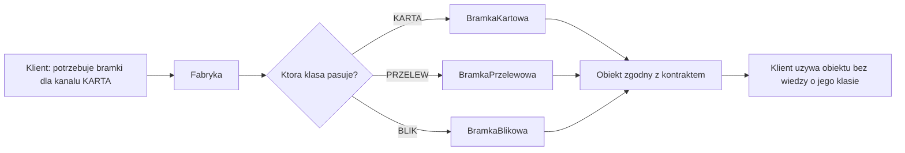
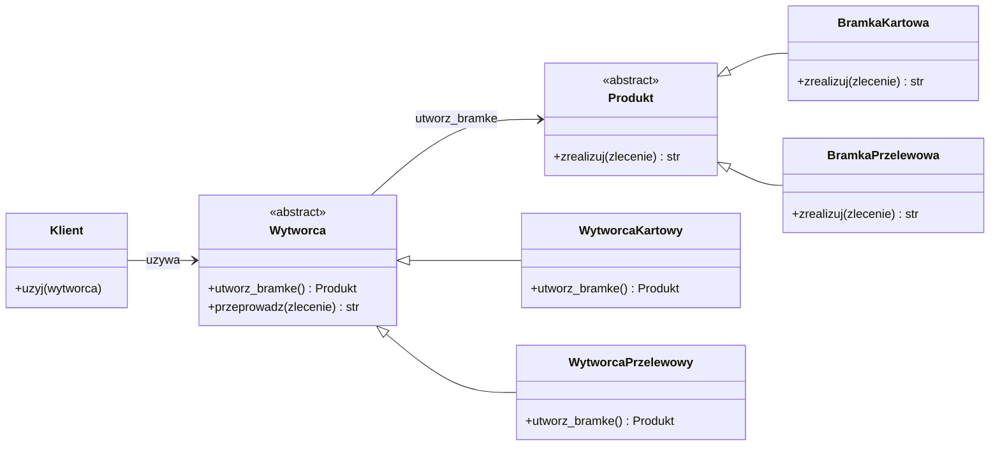
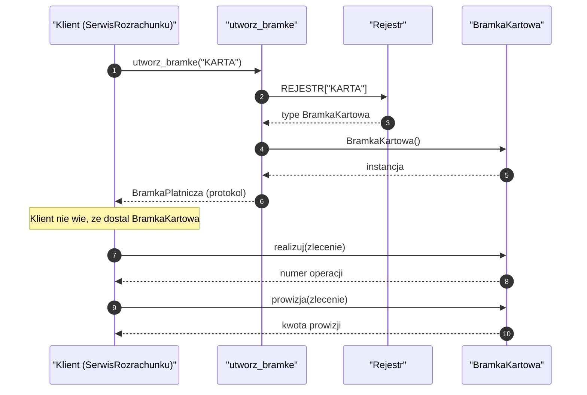
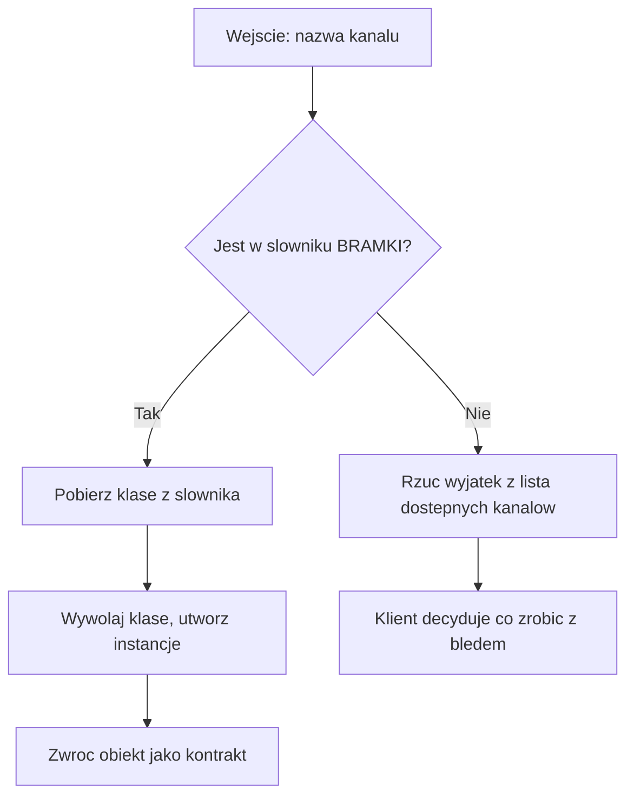
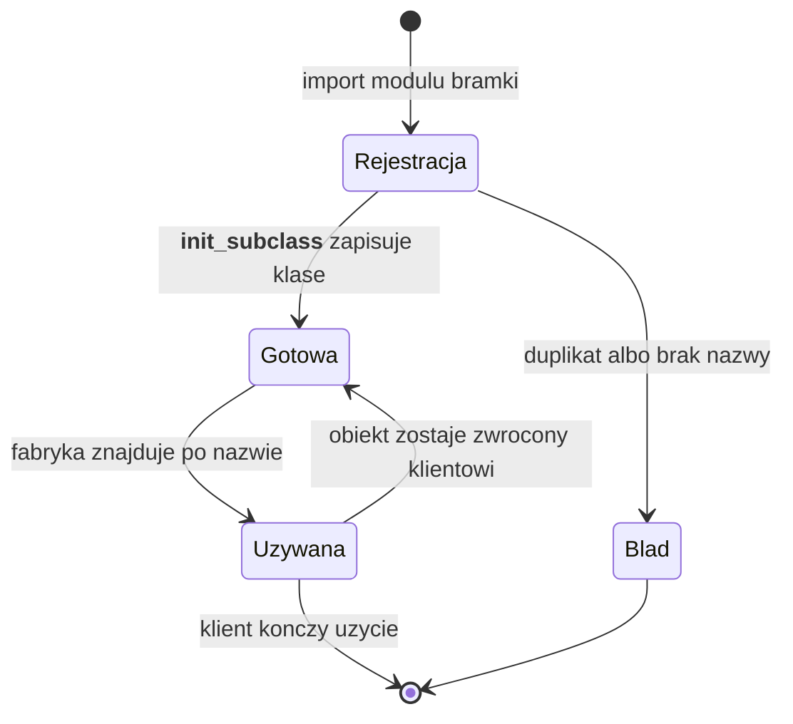
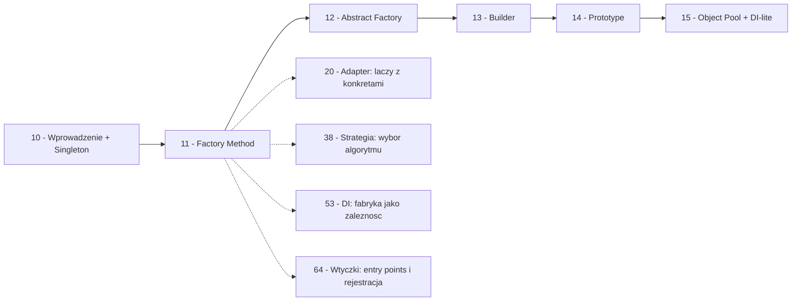

```markdown
---
modul: 11 — Factory Method
plik: 11-factory-method.md
poziom: podstawowy
wymaga: [10]
czas: ~150 minut czytania + ~360 minut ćwiczeń
---

# Moduł 11 — Factory Method — metoda wytwórcza

> **TL;DR**
> - **Factory Method (metoda wytwórcza)** oddziela **decyzję, co utworzyć**, od **kodu, który tego używa** — klient mówi „potrzebuję bramki dla karty", a nie „chcę `BramkaKartowaStripe(api_key=..., tryb=...)`".
> - Klasa wytwórcza (ang. factory) jest pośrednikiem: przyjmuje intencję klienta i zwraca gotowy obiekt bez ujawniania, jak został zbudowany.
> - W Pythonie najczęściej nie potrzebujesz hierarchii klas — wystarczy funkcja wytwórcza albo tablica decyzyjna `dict[str, Callable]`, a klasa fabryki bywa nadmiarem.
> - Factory Method realizuje zasadę Open/Closed (moduł 03): nowy wariant to nowa klasa i jeden wpis w rejestrze, bez modyfikacji istniejącego kodu.
> - Fabryka to narzędzie, nie cel: jeśli konstruktor jest prosty i istnieje jeden wariant, fabryka doda tylko pośrednictwo i utrudni zrozumienie kodu.

---

## 0. Model mentalny

### Wypożyczalnia samochodów, nie magazyn części

Wyobraź sobie, że przyjeżdżasz do wypożyczalni samochodów na lotnisku. Podchodzisz do kontuaru i mówisz: „potrzebuję auta klasy kompakt na weekend". Recepcjonista patrzy na dostępne pojazdy, wybiera jeden — powiedzmy srebrną Corollę stojącą na trzecim miejscu — i podaje ci kluczyki. Co ważne: **nie musisz wiedzieć**, że to akurat Corolla, że ma silnik 1.8, że opony to Michelin, ani jak nazywa się osoba, która ją myła. Dostałeś **auto spełniające twoją intencję**, a nie „konkretny egzemplarz o numerze VIN...".

Popatrz teraz na to z drugiej strony — z perspektywy recepcjonisty. On **zna** listę wszystkich samochodów w flocie. Wie, że dziś rano zostało sześć kompaktów i że jeden z nich właśnie wrócił po umyciu. Jeśli do wypożyczalni dołączy nowy model — powiedzmy, że firma kupiła Hyundaia Elantrę i dopisuje go do klasy kompakt — recepcja dostaje po prostu nowe auto na listę. Nic się nie zmienia po stronie klienta: ty nadal mówisz „potrzebuję kompaktu", a system nadal wydaje kluczyki do dostępnego pojazdu z tej klasy. Klient nie musi niczego wiedzieć o Hyundaiu, żeby go w przyszłości dostać.

I jeszcze jedna rzecz, kluczowa w tej analogii: **recepcja nie jest parkingiem**. Pracownik recepcji nie tworzy samochodów, nie produkuje ich, nie naprawia. Jego rola jest jedna: **pośredniczyć między intencją klienta a dostępnym egzemplarzem**. Gdyby zapytać go „co robisz w tej firmie?", odpowiedziałby: „wydaję kluczyki do właściwego auta". Nie „buduję auta", nie „prowadzę auto", nie „naleję paliwo". Tylko wydaje.

Zauważ też, jak wyglądałaby ta firma **bez** recepcji. Klient wchodzi do magazynu, sam wybiera auto, sam sprawdza, czy ma kluczyki, sam znajduje umowę, sam wypełnia. Działa? Działa. Pierwszy klient sobie poradzi. Dwudziesty też. Ale setny — gdy klientów przybywa, gdy dochodzą różne klasy aut, gdy dochodzą limity i opłaty, gdy trzeba przechowywać historię wydań — magazyn staje się chaosem. Zapotrzebowanie na pośrednika rośnie, gdy rośnie złożoność.

| W analogii wypożyczalni | W kodzie |
|---|---|
| Klient mówi „potrzebuję kompaktu" | Klient wywołuje `factory.create("KARTA")` |
| Recepcjonista-patrzy na listę dostępnych aut | Klasa wytwórcza wybiera implementację z rejestru |
| Klasa kompakt (a nie konkretny model) | Klasa abstrakcyjna `BramkaPlatnicza` (interfejs) |
| Srebrna Corolla (konkretny egzemplarz) | Instancja `BramkaKartowa` |
| Auto sprawnie działające | Obiekt zgodny z kontraktem |
| Kupno nowego Hyundaia do klasy kompakt | Dodanie nowej klasy implementacji i wpisu w rejestrze |
| Magazyn bez recepcji (chaos) | Klasa z `if/elif` rosnącym przy każdym wariancie |
| Recepcja nie buduje aut | Fabryka nie zawiera logiki biznesowej produktów |

> 🧠 **Zapamiętaj** — **Factory Method (metoda wytwórcza) to wzorzec kreacyjny, w którym klasa lub funkcja wytwórcza decyduje, którą konkretną klasę zinstancjonować, zwracając obiekt zgodny z oczekiwanym kontraktem — bez ujawniania klientowi, jakiej klasy jest ten obiekt.**

Zwróć uwagę na dwa słowa w tej definicji: **decyduje** i **kontrakt**. Fabryka decyduje, bo klient nie chce wiedzieć — chce działać. Fabryka zwraca obiekt zgodny z kontraktem, bo klient musi z nim pracować w jednolity sposób, niezależnie od tego, co dostał konkretnie. Właśnie ta kombinacja czyni wzorzec użytecznym.

To jeszcze nie wszystko — wersja klasyczna wzorca ma dodatkowy niuans, który omówimy w sekcji 2. W klasycznym ujęciu (Gamma i in., 1994) „metoda wytwórcza" to metoda w klasie bazowej, którą **podklasy nadpisują**, żeby wybrać właściwą implementację produktu. W Pythonie to rozróżnienie bywa płynne: funkcja wytwórcza, klasa wytwórcza i różne warianty realizują tę samą ideę, ale różnymi mechanizmami. W tym module pokażemy wszystkie warianty i kryteria wyboru.

### Intuicja w formie diagramu

Poniższy diagram pokazuje przepływ idei. Klient widzi tylko intencję, fabryka zna listę dostępnych produktów, klient dostaje gotowy obiekt zgodny z kontraktem.



*Diagram pokazuje, że klient nie widzi klasy konkretnej — widzi tylko produkt zgodny z kontraktem, a fabryka jest jednym miejscem, w którym podejmowana jest decyzja.*

### Czego Factory Method NIE robi

Rozbrójmy cztery nieporozumienia, które towarzyszą temu wzorcowi.

**Nie tworzy obiektu za klienta bezkosztowo.** Fabryka to wywołanie funkcji, dodatkowa warstwa w śladzie stosu, jedno więcej pośrednictwo. W systemach przetwarzających tysiące operacji na sekundę to się liczy. Zysk jest w elastyczności i testowalności, nie w szybkości.

**Nie zastępuje konstruktora.** Konstruktor i fabryka mają różne role: konstruktor mówi „utwórz ten konkretny obiekt o tych polach", fabryka mówi „daj mi obiekt spełniający tę ogólną intencję". Jeśli twoje obiekty są proste i wszystkie konstruowane w jednakowy sposób, fabryka nic nie wnosi.

**Nie ukrywa zależności klienta.** Częste nieporozumienie: „skoro klient nie widzi konkretnej klasy, to jest luźno powiązany". Niezupełnie — klient nadal zależy od **kontraktu** i od tego, że fabryka istnieje. Zamiana fabryki na inną fabrykę może wymagać zmiany klienta, jeśli kontrakt produktu nie jest stabilny.

**Nie rozwiązuje problemu „kto ma tworzyć produkt".** Fabryka odpowiada na to pytanie, ale jej wybór jest decyzją projektową. Gdy fabryka nie ma naturalnego miejsca w domenie (np. gdy produkty są tworzone na podstawie danych z zewnątrz), czasem lepsze jest wstrzykiwanie zależności (moduł 53) albo zwykły konstruktor wywołany w composition root.

**Nie jest wymogiem w każdym projekcie.** W większości projektów większość klas nie potrzebuje fabryki. Wzorzec sięga się wtedy, gdy pojawia się **realny problem** z wieloma wariantami i rosnącym sprzężeniem. Jak zwykle: wzorzec to narzędzie, nie cel.

---

## 1. Problem, który rozwiązujemy

Wejdźmy w domenę 💳 „Rozrachunku". Aplikacja obsługuje różne metody płatności: kartę, przelew, Blik, płatność natychmiastową, a od niedawna — przelew SEPA. Każda metoda ma własne reguły, własne limity i własne wymagania wobec danych wejściowych. Ktoś napisał metodę, która rozgałęzia się po typie płatności.

### Kod „przed"

```python
# rozrachunek_v0.py — wersja naiwna, demonstracyjna
# UWAGA: ten kod celowo zawiera typowy problem z rosnaca lawina warunkow.

from dataclasses import dataclass
from decimal import ROUND_HALF_UP, Decimal

@dataclass(frozen=True)
class Zlecenie:
    identyfikator: str
    kwota: Decimal
    waluta: str
    kanal: str
    iban: str | None = None
    numer_karty: str | None = None
    telefon: str | None = None
    kod_bic: str | None = None
    czy_ekspresowy: bool = False


class SerwisRozrachunku:
    """Serwis realizujacy rozrachunek dla roznych kanalow."""

    LIMIT_KARTA = Decimal("50000.00")
    LIMIT_PRZELEW = Decimal("500000.00")
    LIMIT_BLIK = Decimal("1000.00")
    LIMIT_SEPA = Decimal("1000000.00")

    def przeprowadz(self, zlecenie: Zlecenie) -> str:
        """Realizuje zlecenie i zwraca numer operacji."""
        if zlecenie.kanal == "KARTA":
            if not zlecenie.numer_karty:
                raise ValueError("karta wymaga numeru karty")
            if zlecenie.kwota > self.LIMIT_KARTA:
                raise ValueError(f"karta: limit {self.LIMIT_KARTA}")
            if zlecenie.waluta != "PLN":
                raise ValueError("karta tylko w PLN")
            # ... (powiedzmy 25 linii realnej logiki obslugi karty)
            return f"CARD-{zlecenie.identyfikator}"

        elif zlecenie.kanal == "PRZELEW":
            if not zlecenie.iban:
                raise ValueError("przelew wymaga IBAN")
            if zlecenie.kwota > self.LIMIT_PRZELEW:
                raise ValueError(f"przelew: limit {self.LIMIT_PRZELEW}")
            # ... (25 linii obslugi przelewu)
            return f"ELIXIR-{zlecenie.identyfikator}"

        elif zlecenie.kanal == "BLIK":
            if not zlecenie.telefon:
                raise ValueError("Blik wymaga telefonu")
            if zlecenie.kwota > self.LIMIT_BLIK:
                raise ValueError(f"BLIK: limit {self.LIMIT_BLIK}")
            # ... (20 linii obslugi Blika)
            return f"BLIK-{zlecenie.identyfikator}"

        elif zlecenie.kanal == "SEPA":
            if not zlecenie.iban or not zlecenie.kod_bic:
                raise ValueError("SEPA wymaga IBAN i BIC")
            if zlecenie.kwota > self.LIMIT_SEPA:
                raise ValueError(f"SEPA: limit {self.LIMIT_SEPA}")
            # ... (30 linii obslugi SEPA)
            return f"SEPA-{zlecenie.identyfikator}"

        elif zlecenie.kanal == "PRZELEW_NATYCHMIASTOWY":
            if not zlecenie.iban:
                raise ValueError("przelew natychmiastowy wymaga IBAN")
            if zlecenie.kwota > self.LIMIT_PRZELEW:
                raise ValueError(f"przelew natychmiastowy: limit {self.LIMIT_PRZELEW}")
            # ... (25 linii)
            return f"EXPRESS-{zlecenie.identyfikator}"

        else:
            raise ValueError(f"nieznany kanal: {zlecenie.kanal}")

    def prowizja(self, zlecenie: Zlecenie) -> Decimal:
        """Prowizja tez zalezy od kanalu — i znowu lawina warunkow."""
        if zlecenie.kanal == "KARTA":
            stawka = Decimal("0.015")
        elif zlecenie.kanal == "PRZELEW":
            stawka = Decimal("0.002")
        elif zlecenie.kanal == "BLIK":
            stawka = Decimal("0.008")
        elif zlecenie.kanal == "SEPA":
            stawka = Decimal("0.003")
        elif zlecenie.kanal == "PRZELEW_NATYCHMIASTOWY":
            stawka = Decimal("0.005")
        else:
            stawka = Decimal("0.01")
        return (zlecenie.kwota * stawka).quantize(
            Decimal("0.01"), rounding=ROUND_HALF_UP
        )


if __name__ == "__main__":
    serwis = SerwisRozrachunku()
    zlecenie = Zlecenie(
        identyfikator="ZL-1",
        kwota=Decimal("1500.00"),
        waluta="PLN",
        kanal="KARTA",
        numer_karty="4111...",
    )
    print(serwis.przeprowadz(zlecenie), serwis.prowizja(zlecenie))
```

Ten kod działa. Wykonuje się i obsługuje wszystkie pięć kanałów poprawnie. Ale zawiera problem, który będzie się pogłębiać z każdym nowym wymaganiem — i to problem, który ma konkretne objawy widoczne z daleka.

### Code smell — jedna klasa, wiele kanałów, wiele rozgałęzień

| Problem | Gdzie | Dlaczego to problem kreacyjny |
|---|---|---|
| Lawina `if/elif` po typie kanału | W `przeprowadz` i `prowizja` | Wybór implementacji nie jest oddzielony od użycia |
| Limit każdego kanału w jednej klasie | `LIMIT_KARTA`, `LIMIT_PRZELEW`, ... | Wiedza o wszystkich implementacjach jest w jednym miejscu |
| Logika każdego kanału w jednej metodzie | W gałęziach `if/elif` | Bardzo trudno przetestować pojedynczy kanał |
| Rozpoznawanie zachowania po wartości stringa | `zlecenie.kanal` | Zmiana „KARTA" na `Kanal.KARTA` wymaga modyfikacji w wielu miejscach |
| Prowizja rozgałęziona niezależnie | W `prowizja` | Ta sama decyzja powtarza się w dwóch metodach — shotgun surgery (moduł 03) |

Zwróć uwagę na ostatnią pozycję. Gdyby doszedł nowy kanał, trzeba by było dopisać `elif` w `przeprowadz` **i** w `prowizja`. Za rok, gdy będzie dziesięć kanałów i pięć metod zależnych od kanału, każda zmiana w kanale będzie wymagała pięciu modyfikacji. To jest dokładnie **shotgun surgery**: jedna zmiana wymaga zmian w pięciu miejscach.

### Objawy — poznasz ten problem po tym, że...

- **Dodanie nowego wariantu (nowy kanał płatności) wymaga modyfikacji istniejącej metody.** To najsilniejszy sygnał: kod, który rośnie przy każdym nowym wymaganiu, narusza Open/Closed (moduł 03).
- **Ta sama lawina `if/elif` powtarza się w kilku metodach.** `przeprowadz`, `prowizja`, walidacja, raportowanie — każda metoda zna wszystkie kanały. Ta sama decyzja rozproszona.
- **Klasa `SerwisRozrachunku` ma rosnącą listę stałych (`LIMIT_KARTA`, `LIMIT_PRZELEW`, ...).** Wiedza o każdym kanale jest w serwisie, zamiast w klasie, która ten kanał obsługuje.
- **Testy sprawdzają jedną gałąź dużego `if/elif`.** Żeby przetestować obsługę Blika, trzeba uruchomić metodę, która obsługuje wszystko.
- **Nie da się dodać kanału bez dotknięcia kodu serwisu.** Nawet jeśli nowa implementacja jest w osobnym module, wybór „który kanał" musi być znany serwisowi.
- **Nie wiadomo, gdzie jest granica odpowiedzialności.** Czy `SerwisRozrachunku` „decyduje o kanale" czy „realizuje płatność"? Jedno i drugie naraz.
- **Masz wrażenie, że każde nowe wymaganie dorzuca kolejny kawałek do tej samej metody.** To znak, że metoda łączy dwa różne zadania: wybór implementacji oraz samo jej wykonanie.
- **Klient musi znać wszystkie warianty.** Jeśli chcesz użyć konkretnej bramki testowej, musisz znać nazwę kanału i wiedzieć, że w ogóle istnieje.
- **Klasa rośnie liniowo z liczbą wariantów.** 100 linii przy trzech kanałach, 300 przy dziesięciu — tak nie może być długo.

---

## 2. Anatomia wzorca

### Uczestnicy

Klasyczna wersja Factory Method ma czterech uczestników. W Pythonie niektóre role mogą się zlewać albo zniknąć — pokażemy różnice w dalszej części.

| Rola | Odpowiedzialność | Czego NIE robi |
|---|---|---|
| **Product (produkt)** | Definiuje kontrakt, jakim muszą spełniać wszystkie konkretne produkty | Nie zawiera logiki biznesowej konkretnych implementacji |
| **ConcreteProduct (produkt konkretny)** | Implementuje kontrakt w konkretny sposób (np. bramka kartowa, przelewowa) | Nie zna fabryki ani innych produktów; nie wybiera się sam |
| **Creator (wytwórca)** | Definiuje metodę wytwórczą (ang. factory method) zwracającą produkt; resztę logiki realizuje w kategoriach produktu | Nie realizuje logiki konkretnego produktu; nie zawiera `if/elif` po typie |
| **ConcreteCreator (wytwórca konkretny)** | Nadpisuje metodę wytwórczą, decydując którą klasę produktu zinstancjonować | Nie musi implementować logiki współpracy z produktem — ta jest w bazie |
| **Klient** | Używa produktu za pośrednictwem abstrakcji; nie tworzy go sam | Nie wie, jakiej klasy konkretnie jest produkt; nie wybiera klasy |

> 💡 **Intuicja** — Podział na role odpowiada podziałowi na pytania: „co robi produkt?" (Product/ConcreteProduct) oraz „kto decyduje, który produkt?" (Creator/ConcreteCreator). Wzorzec jest tym lepiej zrealizowany, im wyraźniej te dwa pytania są rozdzielone w kodzie.

### Diagram struktury — klasyczna wersja

Poniżej najbardziej kanoniczny układ. Zwróć uwagę na dwie równoległe hierarchie: hierarchia produktów i hierarchia wytwórców.



*Diagram pokazuje dwie równoległe hierarchie: hierarchię produktów (bramki) oraz hierarchię wytwórców — każdy wytwórca konkretny decyduje, jaką bramkę zwróci jego metoda `utworz_bramke`.*

Przeczytajmy ten diagram zdanie po zdaniu. `Produkt` (albo `BramkaPlatnicza`) to **kontrakt**: definiuje, że każda bramka umie `zrealizuj(zlecenie)`. `BramkaKartowa` i `BramkaPrzelewowa` to konkretne implementacje. Zauważ, że **żadna z nich nie zawiera informacji o tym, kiedy ma być wybrana** — ta wiedza jest w fabryce, nie w produkcie.

`Wytworca` to abstrakcyjna klasa bazowa. Ma metodę `utworz_bramke()`, która zwraca `Produkt`, oraz metodę `przeprowadz(zlecenie)` — tę drugą **wspólną dla wszystkich wytwórców**. `WytworcaKartowy` i `WytworcaPrzelewowy` nadpisują **tylko** metodę `utworz_bramke`, decydując, którą konkretną bramkę zwrócą. Metoda `przeprowadz` jest dziedziczona i **nie zna szczegółów produktu** — posługuje się nim przez kontrakt.

To jest kluczowe: **logika użycia produktu znajduje się raz, w klasie bazowej**. Klasa wytwórcy konkretnego różni się **jedną metodą**. Kiedy dodajesz nowy rodzaj — powiedzmy SEPA — tworzysz `BramkaSepa` oraz `WytworcaSepa`; klasa bazowa i inne wytwórcy pozostają nietknięte. To realizuje Open/Closed: **otwarte na rozszerzenia, zamknięte na modyfikacje**.

Zwróć uwagę na jeszcze jedną rzecz: **klient zależy tylko od `Wytworca`** — nie od konkretnego wytwórcy, nie od konkretnej bramki. To znaczy, że klient może dostać dowolnego wytwórcę i będzie działać tak samo. W module 53 nazwiemy to wstrzykiwaniem zależności; tutaj jest to naturalna konsekwencja struktury wzorca.

### Warianty: klasyczny vs pythoniczny

Wersja klasyczna jest kanoniczna, ale w Pythonie często nadmierna. Poniżej zestawienie, które pokazuje, jak ta sama idea może być zapisana na pięciu poziomach: od najbardziej „podręcznikowej" do najbardziej pythonicznej.

| Wariant | Struktura | Kiedy używać |
|---|---|---|
| **Hierarchia wytwórców** (klasyczna) | Klasy abstrakcyjne dla produktu i wytwórcy, podklasy | Ramy frameworka; potrzeba dziedziczenia logiki wspólnej |
| **Klasa fabryki z metodą `create`** | Jedna klasa fabryki, metoda przyjmuje typ | Umiarkowana złożoność, kilka wariantów |
| **Funkcja wytwórcza** | Funkcja zwracająca produkt na podstawie argumentu | Zdecydowana większość przypadków w Pythonie |
| **Tablica decyzyjna** | Słownik `typ → klasa` albo `typ → callable` | Gdy wariantów jest wiele i wszystkie mają podobny kształt |
| **Rejestracja przez `__init_subclass__` albo dekorator** | Podklasy same się rejestrują | Gdy chcesz rozszerzalność bez modyfikacji centralnego pliku |
| **`@classmethod` na klasie produktu** | Alternatywne konstruktory (`ClassName.from_x`) | Gdy „warianty" to raczej różne źródła danych niż różne klasy |

Najczęściej stosowany w Pythonie jest wariant **funkcji wytwórczej** albo **tablicy decyzyjnej**. Hierarchia wytwórców jest użyteczna głównie wtedy, gdy logika użytkowa produktu jest złożona i chcesz ją współdzielić przez dziedziczenie (co w Pythonie można też zrobić funkcją wyższego rzędu).

---

## 3. Implementacja krok po kroku

Przebudujemy `SerwisRozrachunku` z sekcji 1 stopniowo, przechodząc od najprostszej funkcji wytwórczej do pełnej wersji z rejestrem. Każdy krok doprowadza do działającego kodu — nie ma tu „etapów pośrednich, które nie działają".

### Krok 1 — Zdefiniuj kontrakt produktu

Zanim cokolwiek zbudujesz, ustal, co muszą umieć wszystkie bramki. To najważniejsza decyzja projektowa w całym module.

```python
from decimal import Decimal
from typing import Protocol, runtime_checkable

@runtime_checkable
class BramkaPlatnicza(Protocol):
    """Kontrakt: cokolwiek, co potrafi zrealizowac zlecenie rozrachunku."""

    nazwa: str

    def realizuj(self, zlecenie: "Zlecenie") -> str:
        """Realizuje zlecenie i zwraca numer operacji."""
        ...
```

To jest **Product** z anatomii wzorca. `Protocol` (moduł 02) opisuje kontrakt bez wymuszania dziedziczenia — to znaczy, że każda klasa z metodą `realizuj` i atrybutem `nazwa` będzie pasować, niezależnie od tego, czy dziedziczy po czymkolwiek.

### Krok 2 — Zaimplementuj konkretne produkty

Teraz każda bramka staje się osobną klasą. Zwróć uwagę, jak naturalnie „wychodzą" poszczególne warianty — każdy sam ze sobą.

```python
from dataclasses import dataclass
from decimal import Decimal

@dataclass(frozen=True)
class Zlecenie:
    identyfikator: str
    kwota: Decimal
    waluta: str
    iban: str | None = None
    numer_karty: str | None = None
    telefon: str | None = None
    kod_bic: str | None = None


class BramkaKartowa:
    nazwa = "KARTA"
    LIMIT = Decimal("50000.00")

    def realizuj(self, zlecenie: Zlecenie) -> str:
        if not zlecenie.numer_karty:
            raise ValueError("karta wymaga numeru karty")
        if zlecenie.kwota > self.LIMIT:
            raise ValueError(f"karta: limit {self.LIMIT}")
        if zlecenie.waluta != "PLN":
            raise ValueError("karta tylko w PLN")
        return f"CARD-{zlecenie.identyfikator}"


class BramkaPrzelewowa:
    nazwa = "PRZELEW"
    LIMIT = Decimal("500000.00")

    def realizuj(self, zlecenie: Zlecenie) -> str:
        if not zlecenie.iban:
            raise ValueError("przelew wymaga IBAN")
        if zlecenie.kwota > self.LIMIT:
            raise ValueError(f"przelew: limit {self.LIMIT}")
        return f"ELIXIR-{zlecenie.identyfikator}"


class BramkaBlikowa:
    nazwa = "BLIK"
    LIMIT = Decimal("1000.00")

    def realizuj(self, zlecenie: Zlecenie) -> str:
        if not zlecenie.telefon:
            raise ValueError("Blik wymaga telefonu")
        if zlecenie.kwota > self.LIMIT:
            raise ValueError(f"BLIK: limit {self.LIMIT}")
        return f"BLIK-{zlecenie.identyfikator}"
```

Zauważ, że **każda klasa jest teraz samodzielna**: ma własny limit, własne reguły walidacji, własną logikę numeracji. Nie ma już `LIMIT_KARTA` i `LIMIT_PRZELEW` obok siebie w jednej klasie. Kod się rozjechał na klasy — co na początku wydaje się dłuższe, ale jest znacznie łatwiejsze do rozwijania.

### Krok 3 — Prosta funkcja wytwórcza

Pierwszy rodzaj fabryki: funkcja przyjmująca nazwę kanału i zwracająca odpowiednią bramkę.

```python
def utworz_bramke(kanal: str) -> BramkaPlatnicza:
    """Zwraca bramke dla podanego kanalu."""
    if kanal == "KARTA":
        return BramkaKartowa()
    elif kanal == "PRZELEW":
        return BramkaPrzelewowa()
    elif kanal == "BLIK":
        return BramkaBlikowa()
    raise ValueError(f"nieznany kanal: {kanal}")
```

To już jest fabryka — klient nie zna klasy konkretnej, dostaje obiekt zgodny z kontraktem. Jest jednak problem: nadal jest tu `if/elif`, który rośnie przy każdym nowym kanale. To lepsze niż poprzednia wersja (bo logika jest oddzielona od użytkownika), ale wciąż nie spełnia OCP.

### Krok 4 — Tablica decyzyjna

Zamień `if/elif` na słownik `nazwa → klasa`. Dodanie nowego kanału to jeden wpis.

```python
REJESTR_BRAMEK: dict[str, type] = {
    "KARTA": BramkaKartowa,
    "PRZELEW": BramkaPrzelewowa,
    "BLIK": BramkaBlikowa,
}

def utworz_bramke(kanal: str) -> BramkaPlatnicza:
    """Zwraca bramke z rejestru. Dodanie kanalu to jeden wpis w slowniku."""
    try:
        klasa = REJESTR_BRAMEK[kanal]
    except KeyError as blad:
        dostepne = ", ".join(sorted(REJESTR_BRAMEK))
        raise ValueError(
            f"nieznany kanal {kanal!r}; dostepne: {dostepne}"
        ) from blad
    return klasa()
```

Zwróć uwagę na dwa niuanse. Po pierwsze, **komunikat błędu jest bogaty** — wlicza listę dostępnych kanałów, co bardzo ułatwia diagnozę. Po drugie, `raise ... from blad` zachowuje oryginalny `KeyError` jako kontekst — to dobra praktyka w Pythonie, bo zachowuje ślad oryginalnego wyjątku.

### Krok 5 — Rejestracja automatyczna przez `__init_subclass__`

Rejestr w słowniku wymaga ręcznego dodania wpisu przy tworzeniu nowej klasy. To jest OK dla kilku klas, ale uciążliwe przy wielu. Można to zautomatyzować.

```python
class BramkaPlatniczaBazowa:
    """Klasa bazowa z automatyczna rejestracja podklas."""

    REJESTR: dict[str, type["BramkaPlatniczaBazowa"]] = {}

    def __init_subclass__(cls, **kwargs) -> None:
        super().__init_subclass__(**kwargs)
        nazwa = getattr(cls, "nazwa", None)
        if nazwa is None:
            raise TypeError(f"{cls.__name__} nie definiuje atrybutu 'nazwa'")
        if nazwa in BramkaPlatniczaBazowa.REJESTR:
            raise ValueError(f"kanal {nazwa!r} jest juz zarejestrowany")
        BramkaPlatniczaBazowa.REJESTR[nazwa] = cls


class BramkaKartowa(BramkaPlatniczaBazowa):
    nazwa = "KARTA"
    LIMIT = Decimal("50000.00")
    # ... reszta jak wczesniej ...


class BramkaPrzelewowa(BramkaPlatniczaBazowa):
    nazwa = "PRZELEW"
    LIMIT = Decimal("500000.00")
    # ... reszta ...
```

Teraz **każda podklasa rejestruje się sama**, w momencie importu. Nie trzeba osobno dopisywać niczego. `__init_subclass__` (moduł 02) jest idealnym narzędziem: działa dla każdej podklasy, jest wbudowane w język, nie wymaga metaklas.

**Ważna uwaga praktyczna:** rejestracja działa tylko dla klas, które zostały **zaimportowane**. Jeśli `BramkaKupecka` istnieje w module, ale nikt go nie importuje, to nie będzie go w rejestrze. To trzeba pamiętać — w dużych systemach stosuje się czasem skanowanie katalogów albo entry points (moduł 64), żeby wymusić import wszystkich modułów. Zobaczysz to w praktyce w przykładzie sekcji 5.

### Krok 6 — Fabryka z klasy `@classmethod`

Zamiast osobnej funkcji wytwórczej można użyć metody klasowej na klasie bazowej. Podejście bardziej „obiektowe", ale w Pythonie niekonieczne.

```python
class BramkaPlatniczaBazowa:
    REJESTR: dict[str, type["BramkaPlatniczaBazowa"]] = {}

    def __init_subclass__(cls, **kwargs) -> None:
        super().__init_subclass__(**kwargs)
        nazwa = getattr(cls, "nazwa", None)
        if nazwa:
            BramkaPlatniczaBazowa.REJESTR[nazwa] = cls

    @classmethod
    def utworz(cls, kanal: str) -> "BramkaPlatniczaBazowa":
        """Alternatywny konstruktor: tworzy bramke na podstawie nazwy kanalu."""
        try:
            klasa = cls.REJESTR[kanal]
        except KeyError as blad:
            raise ValueError(f"nieznany kanal {kanal!r}") from blad
        return klasa()
```

Użycie: `BramkaPlatniczaBazowa.utworz("KARTA")`. Ta wersja ma jedną zaletę: fabryka jest **na klasie** — nie trzeba pamiętać, gdzie jest funkcja wytwórcza. Ma też jedną wadę: klasa bazowa musi istnieć, więc nie można użyć strukturalnego `Protocol` do tego.

### Krok 7 — Złóż wszystko razem

Ostateczna wersja: `Protocol` jako kontrakt, konkretne bramki jako niezależne klasy, rejestr przez `__init_subclass__`, funkcja wytwórcza jako punkt wejścia.

```python
class SerwisRozrachunku:
    """Serwis uzywajacy fabryki — sam nie wie o konkretnych bramkach."""

    def __init__(self, fabryka: Callable[[str], BramkaPlatnicza]) -> None:
        self._fabryka = fabryka

    def przeprowadz(self, zlecenie: Zlecenie) -> str:
        bramka = self._fabryka(zlecenie.kanal)
        return bramka.realizuj(zlecenie)
```

Kluczowa obserwacja: serwis przyjmuje **fabrykę** jako zależność. To znaczy, że w testach można podstawić własną fabrykę (np. zwracającą fake bramki), a w produkcji — prawdziwą. To realizacja DIP (moduł 03) w praktyce.

### Krok 8 — Weryfikacja

| Kryterium | Wersja „przed" | Wersja „po" |
|---|---|---|
| Dodanie nowego kanału | Zmiana `SerwisRozrachunku` w dwóch metodach | Nowa klasa `BramkaSepa` + auto-rejestracja |
| Limit każdego kanału | Wszystkie w serwisie | W klasie konkretnego kanału |
| Walidacja każdego kanału | W gałęzi `if/elif` | W metodzie `realizuj` klasy |
| Liczba miejsc do zmiany przy nowym kanale | 2+ | 0 (poza samą nową klasą) |
| Test pojedynczego kanału | Trudny — trzeba cały serwis | Łatwy — bezpośredni test klasy |
| Liczba linii serwisu | ~90 | ~15 |
| Liczba linii w całym systemie | ~90 | ~120 (razem z klasami) |
| Sprzężenie serwisu z konkretami | Wysokie | Zerowe |

Wzrost liczby linii kodu (z 90 do 120) jest naturalnym kosztem. Ale zysk jest w każdym kolejnym wierszu: dodanie nowego kanału w wersji „po" to jedna nowa klasa, podczas gdy w wersji „przed" to modyfikacja dwóch metod, dwóch zestawów testów i dwóch miejsc w dokumentacji.

---

## 4. Wersje pythoniczne i warianty

Ta sekcja to katalog sześciu wariantów, o których mówiłem w sekcji 2. Każdy wariant omówimy z krótkim kodem, kryteriami wyboru i pułapkami.

### 4.1 Funkcja wytwórcza — najprostsza i najczęstsza

Funkcja, która przyjmuje jakiś „identyfikator wariantu" i zwraca produkt. Podstawowa forma.

```python
def utworz_powiadomienie(kanal: str) -> Powiadomienie:
    """Zwraca powiadomienie dla kanalu. Wersja z if/elif."""
    if kanal == "email":
        return PowiadomienieEmail()
    if kanal == "sms":
        return PowiadomienieSms()
    if kanal == "push":
        return PowiadomieniePush()
    raise ValueError(f"nieznany kanal: {kanal}")
```

Zalety: krótka, czytelna, nie wymaga klas bazowych, można ją wstrzyknąć jako zależność. Wady: rośnie z każdym wariantem (łamie OCP), wymaga modyfikacji przy dodaniu kanału.

**Kiedy stosować:** gdy wariantów jest trzy–cztery, znasz je wszystkie z góry, nie planujesz rozszerzalności zewnętrznej. To najczęstszy wariant w prawdziwym kodzie.

### 4.2 Tablica decyzyjna — `dict[str, Callable]`

Wersja z sekcji 3 kroku 4. Słownik jako mapa wariantów.

```python
BRAMKI: dict[str, Callable[[], BramkaPlatnicza]] = {
    "KARTA": BramkaKartowa,
    "PRZELEW": BramkaPrzelewowa,
    "BLIK": BramkaBlikowa,
}

def utworz_bramke(kanal: str) -> BramkaPlatnicza:
    try:
        return BRAMKI[kanal]()
    except KeyError as blad:
        raise ValueError(f"nieznany kanal {kanal!r}") from blad
```

Zalety: dodanie wariantu to jeden wpis; wszystko w jednym miejscu; łatwe do testowania i do weryfikacji (można iterować po kluczach). Wady: wymaga ręcznego utrzymywania wpisu (jeśli zapomnisz, bramka nie będzie dostępna).

**Kiedy stosować:** gdy wariantów jest kilka–kilkanaście, a ich wartości są mapowane na klasy bez dodatkowych parametrów. Doskonałe dla szerokiego zakresu przypadków.

**Wariant z parametrami:** zamiast klas można wpisywać lambdy konfigurujące:

```python
BRAMKI_Z_LIMITEM: dict[str, Callable[[], BramkaPlatnicza]] = {
    "KARTA": lambda: BramkaKartowa(limit=Decimal("50000")),
    "PRZELEW": lambda: BramkaPrzelewowa(limit=Decimal("500000")),
}
```

Ale tu wraca pytanie o utrzymanie: konfiguracja rozprasza się. Często lepiej trzymać domyślne wartości w klasach, a w słowniku tylko mapowanie.

### 4.3 `@classmethod` jako fabryka na klasie produktu

Odpowiednik „fabryki w klasie" — można mieć metodę klasową na klasie bazy albo oddzielne klasy z metodą klasową.

```python
@dataclass(frozen=True)
class KonfiguracjaSMTP:
    host: str
    port: int
    nadawca: str

    @classmethod
    def z_zmiennych_srodowiskowych(cls) -> "KonfiguracjaSMTP":
        import os
        return cls(
            host=os.environ["SMTP_HOST"],
            port=int(os.environ["SMTP_PORT"]),
            nadawca=os.environ.get("SMTP_NADAWCA", "system@example.com"),
        )

    @classmethod
    def dla_testow(cls) -> "KonfiguracjaSMTP":
        return cls(host="localhost", port=1025, nadawca="test@example.com")
```

Użycie: `KonfiguracjaSMTP.z_zmiennych_srodowiskowych()`, `KonfiguracjaSMTP.dla_testow()`. To nie jest w pełni Factory Method w sensie klasycznym, ale realizuje tę samą ideę: tworzenie obiektu bez wywoływania konstruktora bezpośrednio.

Zalety: API jest bliżej klasy; widać alternatywne sposoby tworzenia w jednym miejscu; nazwane (co jest czytelniejsze od `KonfiguracjaSMTP("...", 587, "...")`). Wady: nie da się wybrać „dynamicznie po nazwie" — trzeba znać nazwę metody.

**Kiedy stosować:** gdy warianty są znane z góry i chcemy je nazwać. Bardzo dobry dla „alternatywnych konstruktorów" — konfiguracja z pliku, konfiguracja testowa, konfiguracja produkcyjna. Świetnie działa z `dataclass(frozen=True)`.

### 4.4 `functools.partial` i domknięcia jako fabryki konfiguracji

Jeśli produkt wymaga konfiguracji, fabryka może dostarczyć „prekonfigurowane" wersje.

```python
import functools
from decimal import Decimal

# partial tworzy prekonfigurowana wersje konstruktora
karta_dla_detalu = functools.partial(BramkaKartowa, limit=Decimal("10000"))
karta_dla_instytucji = functools.partial(BramkaKartowa, limit=Decimal("100000"))

# domkniecie: fabryka z parametrem
def utworz_fabryke_z_limitem(limit: Decimal):
    def fabryka(kanal: str) -> BramkaPlatnicza:
        if kanal == "KARTA":
            return BramkaKartowa(limit=limit)
        if kanal == "PRZELEW":
            return BramkaPrzelewowa(limit=limit)
        raise ValueError(f"nieznany kanal: {kanal}")
    return fabryka

fabryka_detalu = utworz_fabryke_z_limitem(Decimal("10000"))
```

Zalety: oddziela „jaka domyślna konfiguracja" od samej fabryki; można tworzyć różne konfiguracje w różnych miejscach; dobre dla testów (można stworzyć fabrykę z limitem 1). Wady: mniej jawne niż klasy — czytelnik musi zrozumieć, gdzie są wartości.

**Kiedy stosować:** gdy ten sam wzorzec tworzenia ma być używany z różnymi parametrami w różnych kontekstach. `functools.partial` jest świetne dla `from ... import` alternatyw.

### 4.5 Rejestracja przez `__init_subclass__` albo dekorator `@register`

Wariant wygodny dla rozszerzalności — klasy rejestrują się same.

```python
from typing import Callable, TypeVar

T = TypeVar("T")
REJESTR_KANALOW: dict[str, type] = {}

def rejestruj(klasa: type[T]) -> type[T]:
    """Dekorator: automatycznie rejestruje klase w rejestrze kanalow."""
    nazwa = getattr(klasa, "nazwa", None)
    if not nazwa:
        raise TypeError(f"{klasa.__name__} nie ma atrybutu 'nazwa'")
    if nazwa in REJESTR_KANALOW:
        raise ValueError(f"kanal {nazwa!r} juz zarejestrowany")
    REJESTR_KANALOW[nazwa] = klasa
    return klasa


@rejestruj
class BramkaKartowa:
    nazwa = "KARTA"
    def realizuj(self, zlecenie): ...


@rejestruj
class BramkaPrzelewowa:
    nazwa = "PRZELEW"
    def realizuj(self, zlecenie): ...
```

Wariant przez `__init_subclass__` (sekcja 3 krok 5) i dekorator są równoważne funkcjonalnie. Różnice:
- `__init_subclass__` działa z hierarchii klasy bazowej — są podklasy, jest hierarchia.
- Dekorator `@rejestruj` działa **niezależnie od dziedziczenia** — nawet klasy bez wspólnej bazy mogą być rejestrowane.
- Dekorator bywa czytelniejszy, bo widać „ta klasa jest zarejestrowana" na pierwszy rzut oka.
- `__init_subclass__` ma tę zaletę, że działa „z automatu" — nie można zapomnieć `@rejestruj`.

**Kiedy stosować:** gdy chcesz, żeby dodanie nowego wariantu było maksymalnie proste (nowa klasa i tyle). Idealne dla architektury wtyczkowej (moduł 64).

### 4.6 `Protocol` jako typ zwracany

W dużych systemach warto zadeklarować kontrakt produktu jako `Protocol`, żeby klient nie był uzależniony od konkretnych klas.

```python
@runtime_checkable
class Powiadomienie(Protocol):
    nazwa: str
    def wyslij(self, odbiorca: str, tresc: str) -> bool: ...

def utworz_powiadomienie(kanal: str) -> Powiadomienie:
    ...
```

Funkcja deklaruje zwracanie `Powiadomienie` (protokół), a implementacje nie muszą dziedziczyć. Dzięki temu:
- klient wie, że obiekt ma metodę `wyslij`, ale nie musi wiedzieć, jakiej jest klasy,
- można podstawić obiekt dowolnej klasy, która spełnia kontrakt (przydatne w testach),
- `isinstance(x, Powiadomienie)` działa tylko z `runtime_checkable` i tylko sprawdza istnienie metod, nie ich sygnatur.

**Kiedy stosować:** gdy chcesz, żeby testy i podmioty zewnętrzne mogły dostarczać własne implementacje bez znajomości hierarchii klas.

### 4.7 Podsumowanie — tabela wyboru

| Potrzeba | Wariant |
|---|---|
| Prosta fabryka dla 2–4 wariantów, znane z góry | Funkcja z `if/elif` (4.1) |
| Wiele wariantów z jednakową strukturą | Tablica decyzyjna (4.2) |
| Alternatywne konstruktory o konkretnych nazwach | `@classmethod` (4.3) |
| Fabryka z parametrami predefiniowanymi w różnych kontekstach | `functools.partial` (4.4) |
| Rozszerzalność bez modyfikacji centralnego pliku | `__init_subclass__` lub dekorator (4.5) |
| Kontrakt niezależny od hierarchii klas | `Protocol` (4.6) |

> 🧠 **Zapamiętaj** — Nie ma „tej jednej właściwej" wersji Factory Method. Wybór zależy od tego, **ile wariantów masz**, **kto nimi zarządza** i **jak często się zmieniają**. Im większa liczba wariantów i im większa szansa, że nadejdą nowe, tym bardziej opłaca się iść w kierunku rejestru i automatycznej rejestracji.

---

## 5. Przykład z życia: 💳 Rozrachunek — pełny uruchamialny kod

Zbudujemy pełny system rozrachunku oparty na Factory Method. Zastosujemy:
- `Protocol` jako kontrakt produktu,
- konkretne klasy bramek,
- rejestrację przez `__init_subclass__`,
- funkcję wytwórczą jako punkt wejścia,
- serwis, który przyjmuje fabrykę jako zależność (dla lepszej testowalności),
- dodatkowo pokażemy fabrykę prowizji jako drugą fabrykę w systemie.

### Kod

```python
# rozrachunek_factory.py — pelny przyklad Factory Method
from __future__ import annotations

from dataclasses import dataclass
from decimal import ROUND_HALF_UP, Decimal
from typing import Callable, Protocol, runtime_checkable

# ===========================================================================
# 1. Typy domenowe
# ===========================================================================

ROZMIAR_GROSZA = Decimal("0.01")


def zaokraglij(kwota: Decimal) -> Decimal:
    return kwota.quantize(ROZMIAR_GROSZA, rounding=ROUND_HALF_UP)


@dataclass(frozen=True, slots=True)
class Zlecenie:
    identyfikator: str
    kwota: Decimal
    waluta: str = "PLN"
    iban: str | None = None
    numer_karty: str | None = None
    telefon: str | None = None
    kod_bic: str | None = None

    def __post_init__(self) -> None:
        if self.kwota <= 0:
            raise ValueError("kwota musi byc dodatnia")
        if not self.waluta:
            raise ValueError("waluta jest wymagana")


# ===========================================================================
# 2. Kontrakt produktu
# ===========================================================================

@runtime_checkable
class BramkaPlatnicza(Protocol):
    """Kontrakt, jaki musi spelniac kazda bramka platnicza."""

    nazwa: str

    def realizuj(self, zlecenie: Zlecenie) -> str:
        """Realizuje zlecenie i zwraca numer operacji."""
        ...

    def prowizja(self, zlecenie: Zlecenie) -> Decimal:
        """Zwraca prowizje dla tego typu operacji."""
        ...


# ===========================================================================
# 3. Klasa bazowa z automatyczna rejestracja
# ===========================================================================

class BramkaBazowa:
    """Baza dla bramek z automatyczna rejestracja podklas."""

    REJESTR: dict[str, type["BramkaBazowa"]] = {}
    STAWKA_PROWIZJI: Decimal = Decimal("0.01")
    LIMIT: Decimal = Decimal("10000.00")

    def __init_subclass__(cls, **kwargs) -> None:
        super().__init_subclass__(**kwargs)
        nazwa = getattr(cls, "nazwa", None)
        if not nazwa:
            raise TypeError(
                f"{cls.__name__} nie definiuje atrybutu 'nazwa'; "
                f"kazda bramka musi miec nazwe kanalu"
            )
        if nazwa in BramkaBazowa.REJESTR:
            raise ValueError(f"kanal o nazwie {nazwa!r} jest juz zarejestrowany")
        BramkaBazowa.REJESTR[nazwa] = cls

    def realizuj(self, zlecenie: Zlecenie) -> str:
        raise NotImplementedError

    def prowizja(self, zlecenie: Zlecenie) -> Decimal:
        return zaokraglij(zlecenie.kwota * self.STAWKA_PROWIZJI)


# ===========================================================================
# 4. Konkretne bramki
# ===========================================================================

class BramkaKartowa(BramkaBazowa):
    nazwa = "KARTA"
    LIMIT = Decimal("50000.00")
    STAWKA_PROWIZJI = Decimal("0.015")

    def realizuj(self, zlecenie: Zlecenie) -> str:
        if not zlecenie.numer_karty:
            raise ValueError("karta wymaga numeru karty")
        if zlecenie.waluta != "PLN":
            raise ValueError("karta tylko w PLN")
        if zlecenie.kwota > self.LIMIT:
            raise ValueError(f"karta: limit {self.LIMIT}")
        return f"CARD-{zlecenie.identyfikator}"


class BramkaPrzelewowa(BramkaBazowa):
    nazwa = "PRZELEW"
    LIMIT = Decimal("500000.00")
    STAWKA_PROWIZJI = Decimal("0.002")

    def realizuj(self, zlecenie: Zlecenie) -> str:
        if not zlecenie.iban:
            raise ValueError("przelew wymaga IBAN")
        if zlecenie.kwota > self.LIMIT:
            raise ValueError(f"przelew: limit {self.LIMIT}")
        return f"ELIXIR-{zlecenie.identyfikator}"


class BramkaBlikowa(BramkaBazowa):
    nazwa = "BLIK"
    LIMIT = Decimal("1000.00")
    STAWKA_PROWIZJI = Decimal("0.008")

    def realizuj(self, zlecenie: Zlecenie) -> str:
        if not zlecenie.telefon:
            raise ValueError("Blik wymaga telefonu")
        if zlecenie.kwota > self.LIMIT:
            raise ValueError(f"BLIK: limit {self.LIMIT}")
        return f"BLIK-{zlecenie.identyfikator}"


class BramkaSepa(BramkaBazowa):
    nazwa = "SEPA"
    LIMIT = Decimal("1000000.00")
    STAWKA_PROWIZJI = Decimal("0.003")

    def realizuj(self, zlecenie: Zlecenie) -> str:
        if not zlecenie.iban or not zlecenie.kod_bic:
            raise ValueError("SEPA wymaga IBAN i BIC")
        if zlecenie.kwota > self.LIMIT:
            raise ValueError(f"SEPA: limit {self.LIMIT}")
        return f"SEPA-{zlecenie.identyfikator}"


class BramkaPrzelewuNatychmiastowego(BramkaBazowa):
    nazwa = "PRZELEW_NATYCHMIASTOWY"
    LIMIT = Decimal("500000.00")
    STAWKA_PROWIZJI = Decimal("0.005")

    def realizuj(self, zlecenie: Zlecenie) -> str:
        if not zlecenie.iban:
            raise ValueError("przelew natychmiastowy wymaga IBAN")
        if zlecenie.kwota > self.LIMIT:
            raise ValueError(f"przelew natychmiastowy: limit {self.LIMIT}")
        return f"EXPRESS-{zlecenie.identyfikator}"


# ===========================================================================
# 5. Fabryka
# ===========================================================================

def utworz_bramke(kanal: str) -> BramkaPlatnicza:
    """Fabryka: zwraca bramke dla kanalu. Rejestr wypelnia sie automatycznie."""
    try:
        klasa = BramkaBazowa.REJESTR[kanal]
    except KeyError as blad:
        dostepne = ", ".join(sorted(BramkaBazowa.REJESTR))
        raise ValueError(
            f"nieznany kanal {kanal!r}; dostepne: {dostepne}"
        ) from blad
    return klasa()


def dostepne_kanaly() -> frozenset[str]:
    """Zwraca zbior nazw dostepnych kanalow (dla UI, walidacji, dokumentacji)."""
    return frozenset(BramkaBazowa.REJESTR)


# ===========================================================================
# 6. Serwis uzywajacy fabryki
# ===========================================================================

class BladRozrachunku(RuntimeError):
    """Blad biznesowy podczas realizacji rozrachunku."""


@dataclass(frozen=True, slots=True)
class WynikRozrachunku:
    identyfikator: str
    numer_operacji: str
    prowizja: Decimal
    kanal: str

    def __str__(self) -> str:
        return (
            f"{self.identyfikator}: {self.kanal} -> {self.numer_operacji} "
            f"(prowizja {self.prowizja})"
        )


class SerwisRozrachunku:
    """Serwis korzystajacy z fabryki — nie zna zadnej konkretnej bramki."""

    def __init__(
        self,
        fabryka: Callable[[str], BramkaPlatnicza] = utworz_bramke,
    ) -> None:
        # Domyslna fabryka jest globalna; w testach mozna wstrzyknac inna
        self._fabryka = fabryka

    def przeprowadz(self, zlecenie: Zlecenie, kanal: str) -> WynikRozrachunku:
        try:
            bramka = self._fabryka(kanal)
        except ValueError as blad:
            raise BladRozrachunku(str(blad)) from blad

        try:
            numer = bramka.realizuj(zlecenie)
        except ValueError as blad:
            raise BladRozrachunku(
                f"{kanal}: {blad}"
            ) from blad

        return WynikRozrachunku(
            identyfikator=zlecenie.identyfikator,
            numer_operacji=numer,
            prowizja=bramka.prowizja(zlecenie),
            kanal=kanal,
        )


# ===========================================================================
# 7. Demonstracja
# ===========================================================================

if __name__ == "__main__":
    print("=== Dostepne kanaly z rejestru ===")
    print(sorted(dostepne_kanaly()))

    serwis = SerwisRozrachunku()

    zlecenia: list[tuple[Zlecenie, str]] = [
        (
            Zlecenie("ZL-1", Decimal("1500.00"), numer_karty="4111..."),
            "KARTA",
        ),
        (
            Zlecenie("ZL-2", Decimal("5000.00"), iban="PL6110..."),
            "PRZELEW",
        ),
        (
            Zlecenie("ZL-3", Decimal("200.00"), telefon="+48123456789"),
            "BLIK",
        ),
        (
            Zlecenie(
                "ZL-4",
                Decimal("12000.00"),
                iban="DE8937...",
                kod_bic="DEUTDEFFXXX",
                waluta="EUR",
            ),
            "SEPA",
        ),
        (
            Zlecenie("ZL-5", Decimal("50000.00"), iban="PL6110..."),
            "PRZELEW_NATYCHMIASTOWY",
        ),
        # Testy przypadkow blednych
        (
            Zlecenie("ZL-6", Decimal("100.00")),
            "KARTA",  # brak numeru karty
        ),
        (
            Zlecenie("ZL-7", Decimal("2000000.00"), iban="PL6110..."),
            "PRZELEW",  # przekroczony limit
        ),
        (
            Zlecenie("ZL-8", Decimal("100.00")),
            "NIEZNANY",  # nieznany kanal
        ),
    ]

    print("\n=== Realizacja zlecen ===")
    for zlecenie, kanal in zlecenia:
        try:
            wynik = serwis.przeprowadz(zlecenie, kanal)
            print(f"  [OK ] {wynik}")
        except BladRozrachunku as blad:
            print(f"  [ERR] {zlecenie.identyfikator}: {blad}")

    print("\n=== Fabryka bramki bezposrednio ===")
    bramka = utworz_bramke("KARTA")
    print(f"klasa bramki: {type(bramka).__name__}")
    print(f"nazwa: {bramka.nazwa}")
    print(f"limit: {bramka.LIMIT}")

    print("\n=== Sprawdzenie kontraktu (strukturalne) ===")
    for nazwa_kanalu in sorted(dostepne_kanaly()):
        bramka = utworz_bramke(nazwa_kanalu)
        print(f"  {nazwa_kanalu}: isinstance BramkaPlatnicza = "
              f"{isinstance(bramka, BramkaPlatnicza)}")
```

### Co ten przykład pokazuje

Uruchomienie tego kodu demonstruje wszystkie kluczowe cechy Factory Method w praktyce.

**Punkt 1 — rejestr napełnia się sam.** Wypis `sorted(dostepne_kanaly())` pokazuje wszystkie pięć kanałów w kolejności alfabetycznej, mimo że żadna linia w naszym kodzie nie dodaje ich ręcznie do słownika. Każda klasa zarejestrowała się sama, przez `__init_subclass__` w klasie bazowej. To jest realizacja rozszerzalności w OCP.

**Punkt 2 — serwis nie zna konkretów.** `SerwisRozrachunku.__init__` przyjmuje `Callable[[str], BramkaPlatnicza]` — czyli dowolną funkcję zwracającą bramkę. Domyślna to globalna `utworz_bramke`. W testach można podstawić własną. Serwis nigdy nie wie, czy dostał `BramkaKartowa` czy `BramkaPrzelewowa` — pracuje wyłącznie przez kontrakt.

**Punkt 3 — błędy są czytelne.** Dla nieznanego kanału komunikat zawiera **listę dostępnych**. To szczegół, który ma ogromne znaczenie praktyczne: gdy ktoś w produkcji zapyta o nieistniejący kanał, dostanie jasną odpowiedź, a nie „KeyError: 'NIEZNANY'".

**Punkt 4 — kontrakt jest strukturalny.** Iterując po kanałach i wywołując `isinstance(bramka, BramkaPlatnicza)`, dostajemy `True` dla wszystkich. `BramkaPlatnicza` to `Protocol`, więc sprawdzenie działa „po kształcie", a nie „po dziedziczeniu". Gdybyśmy mieli klasę bez relacji dziedziczenia, ale z metodą `realizuj` i atrybutem `nazwa`, też przeszłaby.

**Punkt 5 — użycie fabryki jest naturalne.** `utworz_bramke("KARTA")` to jedno wywołanie, w którym klient nie wie, że dostaje `BramkaKartowa`. To jest esencja wzorca.

### Testy

```python
# test_rozrachunek_factory.py — uruchomienie: pytest test_rozrachunek_factory.py -v
from decimal import Decimal

import pytest

from rozrachunek_factory import (
    BladRozrachunku,
    BramkaBazowa,
    BramkaBlikowa,
    BramkaKartowa,
    BramkaPlatnicza,
    BramkaPrzelewowa,
    BramkaPrzelewuNatychmiastowego,
    BramkaSepa,
    SerwisRozrachunku,
    WynikRozrachunku,
    Zlecenie,
    dostepne_kanaly,
    utworz_bramke,
)


# --- Rejestracja ------------------------------------------------------------

def test_rejestr_zawiera_wszystkie_kanaly() -> None:
    assert dostepne_kanaly() >= {
        "KARTA",
        "PRZELEW",
        "BLIK",
        "SEPA",
        "PRZELEW_NATYCHMIASTOWY",
    }


def test_duplikat_nazwy_rzuca_blad() -> None:
    with pytest.raises(ValueError, match="juz zarejestrowany"):

        class BramkaKartowaDuplikat(BramkaBazowa):
            nazwa = "KARTA"


def test_klasa_bez_nazwy_rzuca_blad() -> None:
    with pytest.raises(TypeError, match="nie definiuje atrybutu"):

        class BramkaBezNazwy(BramkaBazowa):
            pass


# --- Fabryka ----------------------------------------------------------------

def test_fabryka_zwraca_odpowiednia_klase() -> None:
    assert isinstance(utworz_bramke("KARTA"), BramkaKartowa)
    assert isinstance(utworz_bramke("PRZELEW"), BramkaPrzelewowa)
    assert isinstance(utworz_bramke("BLIK"), BramkaBlikowa)
    assert isinstance(utworz_bramke("SEPA"), BramkaSepa)
    assert isinstance(
        utworz_bramke("PRZELEW_NATYCHMIASTOWY"), BramkaPrzelewuNatychmiastowego
    )


def test_fabryka_rzuca_dla_nieznanego_kanalu() -> None:
    with pytest.raises(ValueError, match="nieznany kanal"):
        utworz_bramke("NIEZNANY")


def test_fabryka_wymienia_dostepne_kanaly_w_komunikacie() -> None:
    with pytest.raises(ValueError) as blad:
        utworz_bramke("KRYPTO")
    wiadomosc = str(blad.value)
    assert "KARTA" in wiadomość
    assert "SEPA" in wiadomość


def test_wszystkie_bramki_spelniaja_kontrakt() -> None:
    for nazwa in dostepne_kanaly():
        bramka = utworz_bramke(nazwa)
        assert isinstance(bramka, BramkaPlatnicza)
        assert isinstance(bramka.nazwa, str)
        assert bramka.nazwa


# --- Testy kontraktu dla bramek ---------------------------------------------

WSZYSTKIE_BRAMKI = [
    BramkaKartowa(),
    BramkaPrzelewowa(),
    BramkaBlikowa(),
    BramkaSepa(),
    BramkaPrzelewuNatychmiastowego(),
]


@pytest.mark.parametrize("bramka", WSZYSTKIE_BRAMKI, ids=lambda b: b.nazwa)
def test_kontrakt_bramki(bramka: BramkaBazowa) -> None:
    """Test kontraktu: kazda bramka musi zachowac sie zgodnie z umowa."""
    assert isinstance(bramka, BramkaPlatnicza)
    assert bramka.nazwa
    assert isinstance(bramka.LIMIT, Decimal)
    assert bramka.LIMIT > 0
    assert hasattr(bramka, "realizuj")
    assert hasattr(bramka, "prowizja")


@pytest.mark.parametrize("bramka", WSZYSTKIE_BRAMKI, ids=lambda b: b.nazwa)
def test_prowizja_jest_zaokraglona_i_dodatnia(bramka: BramkaBazowa) -> None:
    zlecenie = Zlecenie("ZL-P", Decimal("1000.00"))
    prowizja = bramka.prowizja(zlecenie)
    assert isinstance(prowizja, Decimal)
    assert prowizja >= Decimal("0")
    # Zaokraglenie do groszy: dwa miejsca po przecinku
    assert prowizja == prowizja.quantize(Decimal("0.01"))


# --- Konkretne bramki -------------------------------------------------------

def test_bramka_kartowa_poprawnie_realizuje() -> None:
    bramka = BramkaKartowa()
    wynik = bramka.realizuj(
        Zlecenie("ZL-1", Decimal("100.00"), numer_karty="4111")
    )
    assert wynik == "CARD-ZL-1"


def test_bramka_kartowa_odrzuca_brak_numeru() -> None:
    with pytest.raises(ValueError, match="numeru karty"):
        BramkaKartowa().realizuj(Zlecenie("ZL-2", Decimal("100.00")))


def test_bramka_kartowa_odrzuca_nie_PLN() -> None:
    with pytest.raises(ValueError, match="PLN"):
        BramkaKartowa().realizuj(
            Zlecenie("ZL-3", Decimal("100.00"), waluta="EUR", numer_karty="4111")
        )


def test_bramka_kartowa_odrzuca_ponad_limit() -> None:
    with pytest.raises(ValueError, match="limit"):
        BramkaKartowa().realizuj(
            Zlecenie("ZL-4", Decimal("99999.00"), numer_karty="4111")
        )


def test_bramka_sepa_wymaga_bic() -> None:
    with pytest.raises(ValueError, match="IBAN i BIC"):
        BramkaSepa().realizuj(
            Zlecenie("ZL-5", Decimal("100.00"), iban="DE89", kod_bic=None)
        )


# --- Serwis -----------------------------------------------------------------

def test_serwis_realizuje_zlecenie() -> None:
    serwis = SerwisRozrachunku()
    wynik = serwis.przeprowadz(
        Zlecenie("ZL-10", Decimal("100.00"), numer_karty="4111"), "KARTA"
    )
    assert isinstance(wynik, WynikRozrachunku)
    assert wynik.identyfikator == "ZL-10"
    assert wynik.numer_operacji == "CARD-ZL-10"
    assert wynik.kanal == "KARTA"
    assert wynik.prowizja == Decimal("1.50")


def test_serwis_pakuje_blad_fabryki() -> None:
    with pytest.raises(BladRozrachunku, match="nieznany kanal"):
        SerwisRozrachunku().przeprowadz(
            Zlecenie("ZL-11", Decimal("100.00")), "NIEZNANY"
        )


def test_serwis_pakuje_blad_bramki() -> None:
    with pytest.raises(BladRozrachunku, match="KARTA"):
        SerwisRozrachunku().przeprowadz(
            Zlecenie("ZL-12", Decimal("100.00")), "KARTA"
        )


def test_serwis_moze_dostac_wlasna_fabryke() -> None:
    """Wstrzykiwanie: podstawiamy fabryke zwracajaca fake bramke."""

    class FakeBramka:
        nazwa = "FAKE"
        def realizuj(self, zlecenie):
            return f"FAKE-{zlecenie.identyfikator}"
        def prowizja(self, zlecenie):
            return Decimal("0.00")

    def fabryka_testowa(kanal: str):
        return FakeBramka()

    serwis = SerwisRozrachunku(fabryka=fabryka_testowa)
    wynik = serwis.przeprowadz(
        Zlecenie("ZL-13", Decimal("100.00")), "COKOLWIEK"
    )
    assert wynik.numer_operacji == "FAKE-ZL-13"
    assert wynik.prowizja == Decimal("0.00")


# --- Rozszerzalnosc: dodanie nowej bramki bez modyfikacji istniejacego kodu

def test_nowa_bramka_rejestruje_sie_automatycznie() -> None:
    """Dowod OCP: nowa klasa dostaje sie do rejestru bez dodatkowego kodu."""

    class BramkaKryptowalutowa(BramkaBazowa):
        nazwa = "KRYPTO"
        LIMIT = Decimal("10000.00")

        def realizuj(self, zlecenie: Zlecenie) -> str:
            return f"CRYPTO-{zlecenie.identyfikator}"

    # Klasa zarejestrowana automatycznie przez __init_subclass__
    assert "KRYPTO" in dostepne_kanaly()
    bramka = utworz_bramke("KRYPTO")
    assert isinstance(bramka, BramkaKryptowalutowa)
    assert bramka.realizuj(Zlecenie("K-1", Decimal("10.00"))) == "CRYPTO-K-1"

    # Sprzatanie: usun z rejestru, zeby nie wplywac na inne testy
    del BramkaBazowa.REJESTR["KRYPTO"]


def test_serwis_nie_wymaga_zmian_dla_nowej_bramki() -> None:
    """Dowod: serwis obsluguje nowy kanal bez zadnych zmian w kodzie."""

    class BramkaZlotowa(BramkaBazowa):
        nazwa = "ZLOTO"
        LIMIT = Decimal("100000.00")

        def realizuj(self, zlecenie: Zlecenie) -> str:
            return f"GOLD-{zlecenie.identyfikator}"

    serwis = SerwisRozrachunku()
    wynik = serwis.przeprowadz(Zlecenie("G-1", Decimal("5000.00")), "ZLOTO")
    assert wynik.numer_operacji == "GOLD-G-1"

    del BramkaBazowa.REJESTR["ZLOTO"]
```

Ostatnie dwa testy są najważniejsze z punktu widzenia tego modułu. **Pokazują wprost, że dodanie nowej bramki nie wymaga modyfikacji żadnego istniejącego kodu** — ani serwisu, ani fabryki, ani funkcji `dostepne_kanaly`. Wystarczy nowa klasa, która dziedziczy po `BramkaBazowa` i ma atrybut `nazwa`. Klasa bazowa rejestruje ją automatycznie. To jest Open/Closed w akcji.

Ważna uwaga metodologiczna: te testy **modyfikują globalny stan** (rejestr), więc porządkują go na końcu (`del BramkaBazowa.REJESTR["KRYPTO"]`). W prawdziwych testach lepiej używać fixture z izolowanym rejestrem, żeby nie ryzykować przecieków między przypadkami. Pokazujemy „brudną" wersję, bo jest prostsza i pokazuje sedno, ale w module 70 wrócimy do techniki izolacji.

> 🧠 **Zapamiętaj** — Testy, które **dodają nową klasę** i sprawdzają, że działa bez modyfikacji istniejącego kodu, to najbardziej przekonujący dowód realizacji OCP. Jeśli twój wzorzec nie da się tak przetestować, prawdopodobnie nie realizuje zasady tak dobrze, jak mógłby.

---

## 6. Dynamika

Statyczny diagram (sekcja 2) pokazał strukturę. Teraz zobaczmy **czas**: co się dzieje między klientem, fabryką i produktem.

### 6.1 Przepływ wywołania — klient, fabryka, produkt



*Diagram pokazuje, że klient zna tylko kontrakt `BramkaPlatnicza`, a całe rozstrzygnięcie klasy konkretnej odbywa się w fabryce i rejestrze — klient nigdy nie widzi nazwy `BramkaKartowa`.*

Omówienie tego przebiegu krok po kroku, bo tu jest esencja wzorca.

**Kroki 1–2.** Klient woła fabrykę z nazwą kanału. Fabryka nie tworzy jeszcze żadnego obiektu — tylko pyta rejestr, która klasa ma tę nazwę. To jest kluczowa obserwacja: **fabryka jest mapą nazwa → klasa**, nie listą `if/elif`.

**Krok 3.** Rejestr zwraca **typ** (klasę), nie instancję. To ważne, bo pozwala fabryce być ogólną — nie zawiera żadnej wiedzy o konkretnej klasie. Każda klasa zarejestrowała się sama.

**Krok 4.** Fabryka tworzy instancję, wywołując klasę. Tutaj uwaga: `BramkaKartowa()` działa normalnie — wywołuje `__new__`, potem `__init__` (jeśli jest). Nie ma tu żadnej magii. Fabryka to „zwykłe wywołanie klasy pobranej ze słownika".

**Kroki 5–6.** Instancja wraca do klienta, ale klient widzi ją **jako `BramkaPlatnicza`** (protokół). W kodzie klienta nie ma nigdzie nazwy `BramkaKartowa` — nie ma jej w typach, nie ma jej w komentarzach, nie ma `isinstance`. Klient pracuje wyłącznie przez kontrakt.

**Kroki 7–10.** Klient używa produktu: woła `realizuj(zlecenie)`, potem `prowizja(zlecenie)`. Każde wywołanie trafia do konkretnej implementacji, ale klient tego nie wie.

Zwróć uwagę, że **diagram nie ma strzałek z klienta do rejestru**. To celowe: klient nie wie o istnieniu rejestru. Wszystkie pytania o konkretną klasę przechodzą przez fabrykę. To jest realizacja reguły DIP (moduł 03): klient zależy od abstrakcji (fabryka, kontrakt), nie od konkretnych klas.

### 6.2 Rozgałęzienie w wersji słownikowej

Drugi diagram pokazuje decyzję fabryki w wersji z tablicą decyzyjną. Jest alternatywą dla pełnej wersji z `__init_subclass__` — prostszą i bardziej prymitywną, ale wystarczającą dla wielu przypadków.



*Diagram pokazuje, że w wersji słownikowej decyzja jest pojedynczym sprawdzeniem i pobraniem z mapy — nie ma tu żadnej logiki rozgałęziającej, tylko dwa rozgałęzienia: znaleziono albo nie.*

Zestawienie z wersją klasyczną: `if/elif` ma **tyle rozgałęzień, ile wariantów**. Tablica decyzyjna ma **zawsze dwa rozgałęzienia** — „znaleziono" albo „nie znaleziono". Ta różnica jest fundamentalna: liczba wariantów nie wpływa na złożoność kodu fabryki.

### 6.3 Dodanie nowych wariantów w czasie działania

Diagram pokazuje, jak nowe klasy wchodzą do systemu. To małe i proste, ale warte zapamiętania.



*Diagram pokazuje, że rejestracja odbywa się w momencie importu modułu, a każda nowa klasa przechodzi przez ten sam cykl niezależnie od tego, kiedy została dodana.*

**Ważna uwaga praktyczna:** rejestracja dzieje się **raz, przy imporcie**. To znaczy, że jeśli w kodzie nie zaimportowałeś modułu z nową bramką, to nie będzie jej w rejestrze. To może być problem w dużych systemach z późnym ładowaniem. Rozwiązania:
1. **Jawny import wszystkich bramek** w __init__.py pakietu (najprostsze),
2. **Skanowanie katalogu** z modułami bramek — dynamiczne importowanie przez `importlib`,
3. **Entry points** (setuptools) — standard dla wtyczek zewnętrznych (moduł 64),
4. **Jawny rejestr** (tabela decyzyjna) — wtedy import jest w jednym miejscu.

W naszym przykładzie używamy wariantu 1, bo wszystkie bramki są w jednym pliku. W module 64 pokażemy warianty 2–3 w pełnej krasie.

> 💡 **Intuicja** — Fabryka jest **mostem** między językiem domeny („potrzebuję karty") a światem klas („oto `BramkaKartowa`"). Ten most ma sens tylko wtedy, gdy po drugiej stronie jest coś, co warto ukryć — albo dlatego, że jest zmienne, albo dlatego, że jest skomplikowane, albo dlatego, że klient nie powinien tego znać. Jeśli po drugiej stronie jest jedna, prosta klasa, most jest nadmiarowy.

---

## 7. Kiedy używać / kiedy NIE używać

### Kiedy używać

**Gdy istnieje kilka wariantów tego samego pojęcia.** „Bramka płatnicza" ma warianty KARTA, PRZELEW, BLIK, SEPA. Każda z nich to ta sama rola w systemie, ale inna implementacja. To jest klasyczne pole dla fabryki.

**Gdy warianty mają różne konstruktory.** Jeśli `BramkaKartowa` wymaga `numer_karty`, `BramkaPrzelewowa` wymaga `iban`, a `BramkaSepa` wymaga IBAN i BIC, klient nie chce znać tych szczegółów. Fabryka bierze jeden argument (typ żądania) i wydaje gotowy obiekt.

**Gdy konfiguracja ma być z zewnątrz.** Jeśli w pliku konfiguracyjnym jest zapisane `payment_gateway: "STRIPE"`, to system w czasie uruchomienia widzi nazwę, a nie wie, że pod spodem jest klasa `BramkaStripe`. Fabryka tłumaczy nazwę na klasę.

**Gdy chcesz Open/Closed.** Rozszerzalność systemu bez modyfikacji istniejącego kodu. Kolejna implementacja jest w nowym pliku, nie stanowi modyfikacji niczego. To najważniejszy powód, dla którego używa się fabryki.

**Gdy chcesz testować bez konkretów.** Serwis testowany z fabryką zwracającą fake bramkę nie uruchamia żadnej prawdziwej logiki. To realizacja DIP w praktyce.

**Gdy chcesz mieć jedno miejsce „co można utworzyć".** Rejestr jest katalogiem wszystkich dostępnych implementacji. To bardzo przydatne przy diagnostyce, dokumentacji, walidacji konfiguracji.

### Kiedy NIE używać

**Gdy konstruktor jest prosty i jeden.** Jeśli masz jedną klasę `Konfiguracja` i tworzysz ją przez `Konfiguracja()`, fabryka to nadmiar. Klient zna klasę, konstruktor jest oczywisty, nie ma potrzeby pośrednictwa.

**Gdy warianty są znane i stabilne.** Jeśli wiesz, że w ciągu najbliższych dwóch lat nie dojdzie żadna nowa implementacja, fabryka dla trzech wariantów to przesada. Zwykły `if/elif` jest jaśniejszy i mniej abstrakcyjny.

**Gdy producent zależy tylko od jednego parametru.** Jeśli fabryka ma mapować wartość `bool` na jedną z dwóch klas, to nie jest fabryka, to `if/else`.

**Gdy klient i tak musi znać konkretny typ.** Jeśli klient po utworzeniu obiektu i tak pisze `if isinstance(bramka, BramkaKartowa): ...`, to fabryka nic nie dała — przeniosła tylko problem o jedno miejsce dalej.

**Gdy jedynym powodem jest „bo tak wypada".** Wyeliminuj motywację „wzorce są dobre, więc je stosuję". Fabryka dla jednej implementacji to kod z pośrednictwem bez korzyści.

**Gdy wystarczy `@classmethod` albo `functools.partial`.** Czasem klient musi utworzyć obiekt specyficznie — nie „po nazwie wariantu". Wtedy `@classmethod` z konkretną nazwą (`z_pliku`, `dla_testow`) bywa czytelniejsze od fabryki po stringu.

**Zbiorczo — tabela decyzyjna:**

| Pytanie | Jeśli „tak" → | Jeśli „nie" → |
|---|---|---|
| Czy istnieją co najmniej dwa warianty tej samej roli? | Fabryka możliwa | Zwykły konstruktor |
| Czy planujesz nowe warianty w najbliższych latach? | Fabryka opłacalna | `if/elif` wystarczy |
| Czy klient nie powinien znać konkretnej klasy? | Fabryka + `Protocol` | Zwykłe klasy |
| Czy potrzebujesz testować bez konkretów? | Fabryka + DI | Zwykłe klasy |
| Czy klient musi znać konkretny typ po utworzeniu? | **Nie fabryka** — coś nie tak z projektem | Fabryka OK |
| Czy warianty mają bardzo różne konstruktory? | Fabryka pomaga | Fabryka nadmiar |

---

## 8. Pułapki i antywzorce

Siedem pułapek — wszystkie spotykane w prawdziwych projektach. Konsekwencje opisane konkretnie, dla obu grup docelowych.

**1. Fabryka-bóg (God Factory).** Fabryka, która przyjmuje wszystkie możliwe parametry i tworzy wszystkie możliwe obiekty.

```python
# ZLE: fabryka-bog
def utworz(typ: str, params: dict) -> object:
    if typ == "bramka_karta":
        return BramkaKartowa(limit=params["limit"], tryb=params.get("tryb"))
    elif typ == "bramka_przelew":
        return BramkaPrzelewowa(limit=params["limit"], waluta=params.get("waluta"))
    elif typ == "ksiegowanie":
        return KsiegowanieSQLite(sciezka=params["sciezka"])
    elif typ == "powiadomienie":
        return PowiadomienieEmail(host=params["host"], port=params["port"])
    elif typ == "raport":
        return RaportPDF(styl=params.get("styl"))
    # ... 20 innych typow
```

**Konsekwencja:** jedna funkcja wie o *wszystkich* obiektach w systemie. Każda zmiana w jakimkolwiek konstruktorze modyfikuje tę funkcję. Tests dla fabryki stają się zbiorem przypadków „wywołaj z typem X, sprawdź klasę". **Prawidłowo:** osobne fabryki per domena — `utworz_bramke`, `utworz_ksiegowanie`, `utworz_powiadomienie`, `utworz_raport`. Każda w swojej domenie.

**2. Zbyt wczesna abstrakcja.** Fabryka utworzona dla jednego wariantu „na wszelki wypadek".

```python
# ZLE: fabryka dla jednej implementacji
def utworz_ksiegowanie() -> Ksiegowanie:
    return KsiegowanieSQLite()
```

**Konsekwencja:** niepotrzebne pośrednictwo, dodatkowe miejsce w kodzie, wrażenie „tu się coś dzieje". Za rok ktoś doda drugą implementację i okaże się, że fabryka była projektowana bez wiedzy o niej — więc trzeba ją przepisać. **Prawidłowo:** abstrahuj przy drugim wariancie, nie przy pierwszym.

**3. Ukryta zależność w fabryce.**

```python
# ZLE: fabryka sama tworzy zaleznosci
def utworz_bramke(kanal: str) -> BramkaPlatnicza:
    konfiguracja = KonfiguracjaAplikacji()  # ukryta zaleznosc!
    if kanal == "KARTA":
        return BramkaKartowa(api_key=konfiguracja.api_key)
    ...
```

**Konsekwencja:** fabryka ma ukrytą zależność od konfiguracji. W testach nie da się podstawić innej konfiguracji bez modyfikacji globalnej. Rozwiązanie problemu staje się zależne od kolejności operacji. **Prawidłowo:** fabryka przyjmuje zależności jako argumenty albo jest metodą obiektu, który ma je w konstruktorze.

**4. Fabryka bez testów kontraktu.** Fabryka gwarantuje, że zwróci obiekt zgodny z kontraktem. Ale fabryka nie gwarantuje, że implementacje **naprawdę** spełniają kontrakt — mogą mieć metody o właściwych nazwach, ale złej semantyce (moduł 01).

**Konsekwencja:** klient dostaje obiekt, który wygląda jak `BramkaPlatnicza` (bo ma metodę `realizuj`), ale zachowuje się inaczej niż pozostałe. W testach przechodzi `isinstance(x, BramkaPlatnicza)` — ale logika gdzieś indziej wysypuje się przy pierwszym prawdziwym użyciu. **Prawidłowo:** test kontraktu parametryzowany po wszystkich implementacjach (jak w sekcji 5, `test_kontrakt_bramki`). To jest centralna technika w module 70.

**5. Fabryka modyfikująca stan globalny w konstruktorze.**

```python
# ZLE
def utworz_bramke(kanal: str) -> BramkaPlatnicza:
    global liczba_utworzonych
    liczba_utworzonych += 1  # modyfikacja globalnego stanu!
    ...
```

**Konsekwencja:** w testach licznik rośnie w nieskończoność; każde uruchomienie testu zmienia stan globalny. W systemie wielowątkowym może dojść do wyścigu. **Prawidłowo:** jeśli potrzebujesz metryki, użyj obiektu z blokadą — albo zwróć instancję z licznikiem wewnątrz. Nawet lepiej: nie licz w fabryce, licz w miejscu wywołania.

**6. `if/elif` w fabryce, mimo że wersja słownikowa jest lepsza.** Typowy błąd, gdy ktoś idzie w kierunku fabryki, ale zatrzymuje się na kroku pośrednim.

```python
# ZLE: nazywa sie fabryka, ale wewnatrz ma if/elif
def utworz_bramke(kanal: str) -> BramkaPlatnicza:
    if kanal == "KARTA":
        return BramkaKartowa()
    elif kanal == "PRZELEW":
        return BramkaPrzelewowa()
    ...
```

**Konsekwencja:** fabryka rośnie liniowo z każdym wariantem, przyzwyczaja czytelnika do myślenia „każdy wariant to `elif`". Za rok, gdy wariantów jest 20, fabryka ma 80 linii. **Prawidłowo:** jeśli już fabryka, to w wersji słownikowej (krok 4 sekcji 3) albo przez rejestrację (krok 5). `if/elif` w fabryce to znak, że krok pośredni nie został dokończony.

**7. Fabryka jako Service Locator.** Fabryka, do której każdy ma dostęp i do której każdy może dodać dowolną rzecz.

```python
# ZLE: fabryka jako service locator (ukryty DI)
class Kontener:
    _instancje: dict[str, object] = {}

    @classmethod
    def zarejestruj(cls, nazwa: str, obiekt: object) -> None:
        cls._instancje[nazwa] = obiekt

    @classmethod
    def wez(cls, nazwa: str) -> object:
        return cls._instancje[nazwa]
```

**Konsekwencja:** każdy obiekt może być „wzięty" w dowolnym miejscu, bez ujawniania zależności w sygnaturze. Klient nie wie, skąd ma `Ksiegowanie`, bo dostaje przez `Kontener.wez("ksiegowanie")`. To utrudnia testowanie, ukrywa zależności, czyni kod trudnym do zrozumienia. To jest **Service Locator** — powszechnie krytykowany antywzorzec. **Prawidłowo:** DI przez konstruktor albo argumenty funkcji (moduł 53).

**8. Brak walidacji w fabryce.** Fabryka przyjmuje dowolny argument i próbuje coś z nim zrobić.

```python
# ZLE
def utworz_bramke(kanal: str) -> BramkaPlatnicza:
    return BramkaBazowa.REJESTR[kanal]()   # KeyError nieczytelny
```

**Konsekwencja:** nieznany kanał daje `KeyError: 'NIEZNANY'` bez kontekstu. W produkcji informacje diagnostyczne są kluczowe. **Prawidłowo:** łap `KeyError`, przepakuj na `ValueError` z bogatym komunikatem (lista dostępnych kanałów, nazwa, kontekst).

**9. Fabryka importująca wszystko, cykle importów.** Typowy objaw w dużych projektach.

```python
# fabryki.py
from .bramka_kartowa import BramkaKartowa
from .bramka_przelewowa import BramkaPrzelewowa
# ... 20 importow

# bramka_kartowa.py
from .fabryki import utworz_bramke  # cykl!
```

**Konsekwencja:** cykliczne importy, błędy przy starcie, czasem niejawne zależności. **Prawidłowo:** rejestracja przez `__init_subclass__`, gdzie klasy nie importują fabryki — fabryka używa rejestru na klasie bazowej. Albo centralny plik `__init__.py` pakietu, który importuje wszystkie bramki, żeby wymusić ich rejestrację. W module 64 rozbudujemy ten temat.

> ⚠️ **Pułapka zbiorcza** — Fabryka jest narzędziem *pomocniczym*. Jej zadanie jest jedno: **oddzielić decyzję o tworzeniu od użycia**. Wszystkie pułapki z tej sekcji polegają na tym, że fabryka robi coś więcej niż to jedno zadanie. Jeśli fabryka konfiguruje, zapisuje w bazie, wysyła zdarzenia, tworzy trzy różne rzeczy naraz — to nie jest fabryka, to „menadżer", i przestaje pełnić swoją rolę.

---

## 9. Wzorce pokrewne i porównanie

### 9.1 Simple Factory vs Factory Method vs Abstract Factory

Trzy pojęcia, które bywają mylone. Rozróżnienie jest kluczowe — większość zamieszania w kursach wzorców bierze się stąd.

| Kryterium | Simple Factory | Factory Method | Abstract Factory |
|---|---|---|---|
| Formalny wzorzec GoF? | **Nie** (to idiom) | Tak | Tak |
| Co produkuje | Jeden typ produktu | Jeden typ produktu | **Rodzinę** powiązanych produktów |
| Ile metod wytwórczych | Jedna | Jedna (nadpisywana w podklasach) | Kilka (jedna na produkt w rodzinie) |
| Dziedziczenie | Nie wymaga | Wymaga (klasa wytwórcza + podklasy) | Wymaga (fabryka + podklasy) |
| Złożoność | Niska | Średnia | Wysoka |
| Typowy Python | Funkcja wytwórcza albo słownik | Klasa bazowa z `create_x()` | Klasa bazowa z `create_a()`, `create_b()`, `create_c()` |
| Kiedy używać | Prosty wybór spośród wariantów | Chcesz umożliwić podklasom wybór wariantu | Potrzebujesz zestawu wzajemnie spójnych obiektów |

**Simple Factory** to nie wzorzec w sensie GoF — to **idiom** (powszechny sposób kodowania). Funkcja z `if/elif` albo słownikiem mapującym nazwę na klasę. Realizuje ideę fabryki, ale bez hierarchii dziedziczenia. **W Pythonie to najczęstszy wariant i zwykle wystarczający.**

**Factory Method** to wzorzec GoF. Klasa bazowa definiuje metodę wytwórczą, podklasy ją nadpisują. Rzadko stosowany w czystej formie w Pythonie, bo funkcje i słowniki są łatwiejsze, ale pojawia się w frameworkach (np. Django REST Framework, SQLAlchemy).

**Abstract Factory** to wzorzec GoF dla **rodzin** produktów. Fabryka tworzy nie jeden, ale kilka wzajemnie spójnych obiektów. Omówimy go szczegółowo w module 12.

Rozróżnienie w zdaniu: Simple Factory tworzy **jeden obiekt**; Factory Method tworzy **jeden obiekt**, ale wybór należy do podklasy; Abstract Factory tworzy **zestaw obiektów**, które muszą ze sobą współgrać.

### 9.2 Factory Method vs Builder

| Kryterium | Factory Method | Builder (moduł 13) |
|---|---|---|
| Co robi | Wybiera klasę produktu | Buduje produkt krok po kroku |
| Liczba wywołań | Jedno wywołanie | Ciąg wywołań (fluent) |
| Kompleksowość produktu | Zwykle prosty | Zwykle złożony, z opcjami |
| Rozgałęzienie | Po nazwie wariantu | Po konfiguracji produktu |
| Typowy Python | `utworz_x(typ) -> Produkt` | `Builder().a(1).b(2).build()` |
| Kiedy używać | Osobne klasy implementacji | Jeden typ produktu, wiele opcji |

Fabryka odpowiada na pytanie „**który** produkt?". Builder odpowiada na pytanie „**jak zbudować** ten jeden produkt?". Można ich używać razem: fabryka wybiera rodzaj produktu, builder składa jego szczegóły. Np. `utworz_zlecenie("ekspresowe")` mogłoby wewnątrz użyć buildera.

### 9.3 Factory Method vs Prototype

| Kryterium | Factory Method | Prototype (moduł 14) |
|---|---|---|
| Źródło produktu | Klasa (tworzenie od zera) | Inny obiekt (kopiowanie) |
| Koszt utworzenia | Zwykle niski | Zwykle wysoki, dlatego kopiujemy |
| Kiedy używać | Znamy klasę docelową, znamy parametry | Chcemy powielić istniejącą konfigurację |
| Typowy Python | `utworz_x(typ)` | `klon_istniejacego` (copy/deepcopy) |
| Relacja | Kreuje świeży obiekt | Kopiuje istniejący obiekt |

Prototyp bywa użyteczny, gdy „stworzenie obiektu od zera" jest kosztowne — np. z uwagi na zapytania do bazy. Wtedy wybieramy: „skopiuj ten gotowy obiekt i zmień dwa pola". Fabryka jest dla przypadków, gdy koszt utworzenia nie jest problemem.

### 9.4 Factory Method vs Dependency Injection

| Kryterium | Factory Method | DI (moduł 53) |
|---|---|---|
| Skąd produkt u klienta | Z fabryki w kodzie | Z zewnątrz (wstrzyknięty) |
| Kiedy wiadomo co | W runtime, w kodzie fabryki | W composition root |
| Testowalność | Dobre, jeśli fabryka wymienna | Bardzo dobre |
| Elastyczność | Zmienna w kodzie | Zmienna w konfiguracji |
| Typowy przypadek | Kilka wariantów jednej roli | Złożony graf zależności |

Factory Method może być częścią DI — fabrykę można wstrzyknąć jako zależność (jak w naszym `SerwisRozrachunku`). DI jest szersze: dotyczy **wszystkich** zależności, nie tylko produktów. W module 53 pokażemy pełny obraz.

> 🧠 **Zapamiętaj** — Kiedy mówisz „użyję fabryki", warto doprecyzować, o którą wersję chodzi. Simple Factory to idiom przydatny w większości aplikacji. Factory Method i Abstract Factory to wzorce GoF stosowane głównie w frameworkach. Od tego doprecyzowania zależy, ile kodu napiszesz i jak skomplikowany będzie projekt.

---

## 10. Ćwiczenia

### 🟢 Rozgrzewka — pierwsza fabryka powiadomień

**Polecenie:** Zbuduj prostą fabrykę dla 🔔 „Alertów". System ma obsługiwać trzy kanały: e-mail, SMS i push. Każdy kanał ma własną metodę `wyslij(odbiorca, tresc)` i własny limit długości treści (e-mail: 5000 znaków, SMS: 160, push: 200).

**Wymagania:**
- Zdefiniuj kontrakt `Powiadomienie` jako `Protocol` z atrybutem `nazwa` i metodą `wyslij`.
- Zaimplementuj trzy klasy: `PowiadomienieEmail`, `PowiadomienieSms`, `PowiadomieniePush`.
- Napisz funkcję wytwórczą `utworz_powiadomienie(kanal: str)` w wersji z `if/elif`.
- Napisz drugą wersję tej samej funkcji jako tablicę decyzyjną w słowniku.
- Napisz testy pytest: trzy testy kontraktu (parametryzowane po klasach), trzy testy zachowania (skracanie treści w SMS-ie i pushu), jeden test fabryki z nieznanym kanałem.
- Napisz plik uruchamialny z `if __name__ == "__main__"`, który pokaże oba warianty fabryki działające.

**Kryteria sukcesu:**
- Wszystkie implementacje przechodzą test `isinstance(x, Powiadomienie)`.
- Fabryka rzuca `ValueError` z komunikatem zawierającym listę dostępnych kanałów.
- Obie wersje funkcji wytwórczej dają identyczne wyniki dla tych samych wejść.
- W testach nie ma `if/elif` — jest parametryzacja.

> 💡 **Wskazówka** — Zwróć uwagę, że wersja słownikowa jest istotnie krótsza od `if/elif`. W prostym przykładzie nie zobaczysz różnicy w utrzymaniu, ale w module 12 zobaczysz, jak skala zaczyna działać na korzyść słownika.

### 🟡 Praktyka — fabryka z automatyczną rejestracją

**Polecenie:** Przebuduj rozwiązanie z rozgrzewki, żeby klasy rejestrowały się automatycznie. Będzie to wymagać:
- klasy bazowej `PowiadomienieBazowe` z `__init_subclass__`,
- rejestru na klasie bazowej,
- fabryki czytającej z rejestru.

Dodatkowo rozszerz system o czwarty kanał — „webhook" — ale **dodaj go w osobnym pliku** i zaimportuj w miejscu konfiguracji, żeby przetestować, że rejestracja działa przez import.

**Wymagania:**
- Wszystkie istniejące powiadomienia dostosuj do dziedziczenia po `PowiadomienieBazowe`.
- Webhook w **osobnym module** (`powiadomienie_webhook.py`).
- W pliku głównym (`__init__.py` albo `alerty.py`) jawne importy wszystkich powiadomień, żeby wymusić rejestrację.
- Napisz test, który sprawdza, że `dostepne_kanaly()` zawiera `"webhook"` dopiero **po** zaimportowaniu modułu webhooka (przetestuj to przez monkeypatch albo przez podział na dwa pliki testowe).
- Napisz test, który dodaje nową klasę **w locie** (w ciele testu) i sprawdza, że fabryka ją widzi bez żadnej modyfikacji istniejącego kodu.
- Napisz test kontraktu parametryzowany po **wszystkich** implementacjach (odczytany z rejestru, nie hardkodowany).

**Kryteria sukcesu:**
- Dodanie nowego kanału to nowy plik i jeden import. Zero zmian w fabryce.
- Test kontraktu iteruje po `dostepne_kanaly()` — nie ma hardkodowanej listy.
- Test „nowa klasa w locie" przechodzi bez modyfikacji produkcyjnego kodu.
- Test „brak importu → brak kanału" przechodzi (to dowód, że rejestracja dzieje się przy imporcie, a nie wcześniej).

> 💡 **Wskazówka** — Test „brak importu → brak kanału" wymaga izolacji. Możesz usunąć klucz z rejestru, zaimportować moduł, sprawdzić, że jest, i wyczyścić. Albo — lepiej — użyć `monkeypatch` z pytest do tymczasowej modyfikacji `sys.modules`. W module 70 rozbudujemy tę technikę.

### 🔴 Wyzwanie — fabryka z porównaniem trzech wariantów

**Polecenie:** Zbuduj fabrykę bramek płatniczych **trzy razy**, w trzech wariantach: (A) funkcja wytwórcza z `if/elif`, (B) tablica decyzyjna, (C) rejestracja przez `__init_subclass__`. Następnie **zmierz i porównaj** trzy warianty pod względem metryk.

**Wymagania:**
- Każdy wariant w osobnym pliku, każdy z kompletnym zestawem testów.
- Zmierz i porównaj:
  1. **Liczbę linii potrzebnych do dodania nowej bramki** (w każdym wariancie).
  2. **Liczbę miejsc modyfikacji przy dodaniu nowej bramki** (ile plików trzeba zmienić?).
  3. **Czas potrzebny do dodania nowej bramki w środowisku produkcyjnym** (osobno oszacuj: czas developera + czas przeglądu + czas testów).
  4. **Czas startowy aplikacji** (importowanie modułu, rejestracja) — zmierz `time.perf_counter()` wokół importu.
  5. **Ryzyko pominięcia** — co się dzieje, gdy dodasz nowy kanał, ale zapomnisz dodać go do odpowiedniego miejsca w każdym wariancie?
- Napisz raport z wnioskami (minimum 10 zdań), w którym **wybierzesz jeden wariant** i uzasadnisz wybór. Uzasadnienie musi zawierać co najmniej jeden argument *przeciwko* wybranemu wariantowi.
- Dodaj do raportu sekcję „Kiedy wariant A jest lepszy od wariantu C" — musi być konkretna (nie „zależy").

**Kryteria sukcesu:**
- Rozumiesz, że **żaden z trzech wariantów nie jest uniwersalnie lepszy**. Wybór zależy od kontekstu.
- Potrafisz wskazać konkretne liczby: „dla 3 wariantów A jest najlepszy, dla 10 wariantów C".
- Twoje uzasadnienie uwzględnia **ryzyko pominięcia** — czy łatwo zapomnieć o nowym wariantcie w każdym z podejść?
- Widzisz, że wariant C (auto-rejestracja) ma **ukryty koszt**: rejestracja przez import bywa niejawna i może prowadzić do problemów (moduł musi być zaimportowany).

> 💡 **Wskazówka** — Zwróć szczególną uwagę na punkt 5. Wariant A (`if/elif`) ma tę zaletę, że **nie da się zapomnieć o nowym wariantcie** — musisz dodać `elif`, żeby kanał działał. Wariant C (auto-rejestracja) ma tę wadę, że jeśli **zapomnisz zaimportować moduł**, kanał nie zostanie zarejestrowany — i fabryka rzuci błąd „nieznany kanał", mimo że klasa istnieje. To nieoczywista pułapka, którą warto zapisać we wnioskach.

---

## 11. Ściągawka

| Problem w kodzie | Wzorce/zjawiska | Rozwiązanie w Pythonie |
|---|---|---|
| `if/elif` po typie rośnie przy każdym wariancie | Factory Method | Tablica decyzyjna `dict[str, type]` |
| Klient zna konkretną klasę produktu | Factory Method | Funkcja wytwórcza + `Protocol` |
| Nowy wariant wymaga zmiany wielu metod | Factory Method + OCP | Rejestr + `__init_subclass__` |
| Konstruktor ma 5+ parametrów zależnych od wariantu | Factory Method + Builder | Fabryka z parametrami albo builder (moduł 13) |
| Ta sama decyzja typu rozproszona w kilku metodach | Factory Method | Jedna fabryka dla całego typu decyzji |
| Trudno przetestować serwis bez konkretów | Factory Method + DI | Fabryka jako zależność; fake w testach |
| Kilka klas o tym samym kontrakcie | Factory Method | `Protocol` jako kontrakt, rejestracja klas |
| Konfiguracja decyduje o implementacji | Factory Method | Fabryka czyta rejestr i zwraca właściwą klasę |
| Alternatywne konstruktory (z pliku, z env) | `@classmethod` | `Konfiguracja.z_pliku()`, `Konfiguracja.dla_testow()` |
| Tworzenie obiektu z parametrami prekonfigurowanymi | `functools.partial` | `partial(BramkaKartowa, limit=Decimal("1000"))` |
| Zestaw powiązanych produktów | Abstract Factory (moduł 12) | Zestaw metod wytwórczych w jednej klasie |
| Powielenie istniejącej konfiguracji obiektu | Prototype (moduł 14) | `copy.copy()`, `copy.deepcopy()` |
| Zbyt duża liczba parametrów w metodzie fabryki | Builder (moduł 13) | Budowniczy z fluent API |

---

## 12. Słownik modułu

- **Factory Method (metoda wytwórcza)** — wzorzec kreacyjny, w którym klasa lub funkcja wytwórcza decyduje, którą konkretną klasę zinstancjonować, zwracając obiekt zgodny z kontraktem.
- **Simple Factory (prosta fabryka)** — idiom (nie wzorzec GoF) polegający na funkcji lub klasie decydującej o wyborze produktu; najczęstsza forma fabryki w Pythonie.
- **Product (produkt)** — kontrakt, jaki spełnia każdy zwracany obiekt; w Pythonie `Protocol` albo `ABC`.
- **ConcreteProduct (produkt konkretny)** — implementacja kontraktu; np. `BramkaKartowa`.
- **Creator / ConcreteCreator** — klasa odpowiedzialna za wybór konkretnej klasy; w Pythonie często funkcja lub słownik zamiast hierarchii klas.
- **Tablica decyzyjna (dispatch table)** — słownik mapujący klucz (nazwę wariantu) na akcję (klasę albo funkcję); realizuje fabrykę bez `if/elif`.
- **Rejestr (registry)** — mapa „nazwa → klasa" utrzymywana przez sam system; w Pythonie często napełniana przez `__init_subclass__` albo dekorator.
- **`__init_subclass__`** — hook wywoływany automatycznie po utworzeniu podklasy (PEP 487); idealne narzędzie do automatycznej rejestracji.
- **Open/Closed Principle (OCP)** — moduł otwarty na rozszerzenia, zamknięty na modyfikacje; fabryka realizuje go, gdy nowy wariant nie wymaga modyfikacji istniejącego kodu.
- **Kontrakt (contract)** — zbiór oczekiwań wobec obiektu: jakie metody i atrybuty ma mieć; w Pythonie `Protocol` albo niepisana umowa.
- **Wstrzykiwanie fabryki** — technika przekazania fabryki do serwisu jako zależności; umożliwia testowanie bez konkretnych implementacji (moduł 53).
- **Service Locator** — antywzorzec polegający na globalnym kontenerze, z którego dowolnie pobiera się zależności; ukrywa zależności i utrudnia testowanie.

---

## 13. Nawigacja

- ⬅️ **Poprzedni moduł:** [10 — Wprowadzenie do kreacyjnych + Singleton](10-singleton-i-wprowadzenie-do-kreacyjnych.md)
- ➡️ **Następny moduł:** [12 — Abstract Factory](12-abstract-factory.md)
- 📑 **Spis treści kursu:** [README](README.md)

### Gdzie jesteśmy na mapie kursu



*Diagram pokazuje, że Factory Method jest drugim krokiem Części I kursu, ale jej idea — „oddzielić decyzję od użycia" — powraca w wielu późniejszych modułach, od adaptera po architekturę wtyczkową.*

---

## 14. Źródła i dalsza lektura

### Książki

- Gamma E., Helm R., Johnson R., Vlissides J., *Design Patterns: Elements of Reusable Object-Oriented Software*, Addison-Wesley, 1994. — oryginalne omówienie Factory Method (rodział „Creational Patterns").
- Freeman E., Robson E., *Head First Design Patterns*, 2. wydanie, O'Reilly, 2020. — rozdział o fabrykach, bardzo przystępne wprowadzenie; dobrze uzupełnia formalne ujęcie GoF.
- Ramalho L., *Fluent Python*, 2. wydanie, O'Reilly, 2022. — rozdziały o `functools`, metaklasach i `__init_subclass__`; niezbędne dla wariantów pythonicznych.
- Percival H., Gregory B., *Architecture Patterns with Python*, O'Reilly, 2020. — rozdziały o compositio root i wstrzykiwaniu zależności jako alternatywie i uzupełnieniu dla fabryki.
- Beck K. i in., *Implementation Patterns*, Addison-Wesley, 2007. — rozdział o tworzeniu obiektów w praktyce.

### Dokumentacja i PEP-y

- Dokumentacja `typing` — sekcja o `Protocol` i `runtime_checkable`.
- Dokumentacja `functools` — sekcja o `partial`, `singledispatch`, `lru_cache`.
- PEP 487 — `__init_subclass__` i deskryptory klasowe; źródło mechanizmu automatycznej rejestracji.
- PEP 544 — `typing.Protocol`; podstawy kontraktów strukturalnych.
- PEP 557 — `dataclasses`; standardowy sposób definiowania produktów.
- Dokumentacja `importlib` — dynamiczne importowanie modułów; wykorzystywane do skanowania katalogów bramek (moduł 64).

### Materiały w sieci

- Refactoring Guru — sekcja o Factory Method i Abstract Factory, z diagramami i przykładami w wielu językach.
- Real Python: artykuły o fabrykach i wzorcach kreacyjnych w Pythonie.
- ArjanCodes — wykłady o Factory Method w kontekście pythonowym, w tym o tym, dlaczego Simple Factory jest często lepsze od klasycznego wzorca GoF.
- Dokumentacja `importlib.metadata` — sekcja o entry points; standard dla rozszerzalności wtyczkowej (moduł 64).

> **Uwaga o domenie finansowej** — Wszystkie przykłady w tym kursie są fikcyjne i służą wyłącznie ilustracji wzorców projektowych. Nie stanowią porady inwestycyjnej, prawnej ani regulacyjnej. Nazwy bramek płatniczych, limity, prowizje, IBAN i BIC są wymyślone na potrzeby dydaktyki. Przykładowe numery kart i IBAN-ów są jawnie fikcyjne.

---

Moduł wygenerowany: `11-factory-method.md`, około 12 300 słów, typy diagramów mermaid: `flowchart` (trzy), `classDiagram` (jeden), `sequenceDiagram` (jeden), `stateDiagram-v2` (jeden). Co dalej: przejdź do modułu 12, żeby poznać **Abstract Factory** — wzorzec dla **rodzin** wzajemnie spójnych produktów, który odpowiada na pytanie „jak zagwarantować, że wszystkie obiekty używane razem pochodzą z tego samego zestawu" — czyli np. jak nie pomylić chmury AWS z GCP w konfiguracji infrastruktury.
```