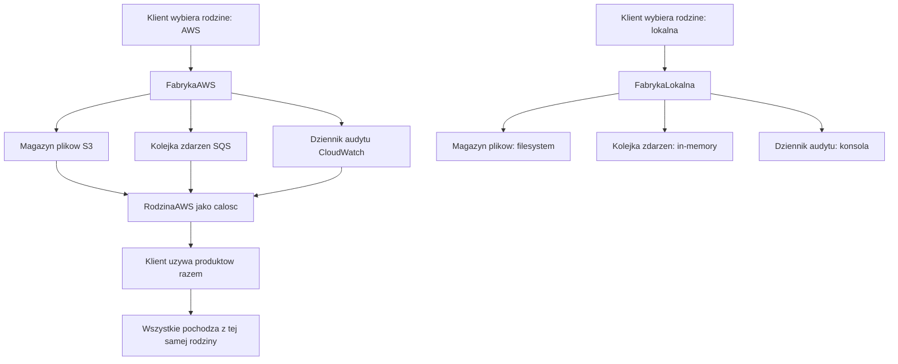
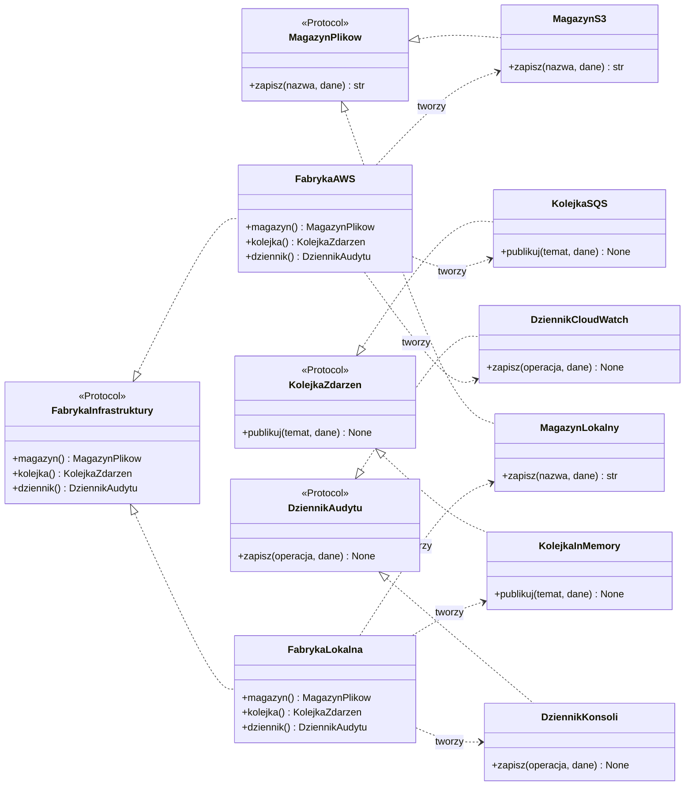
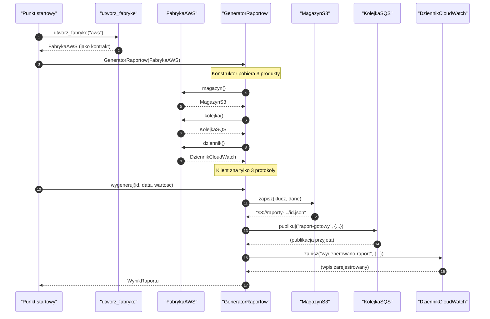
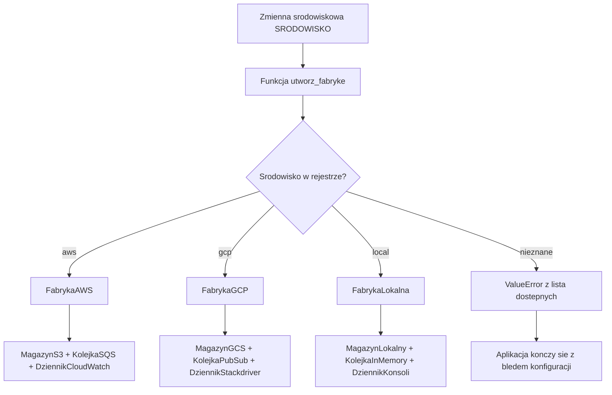
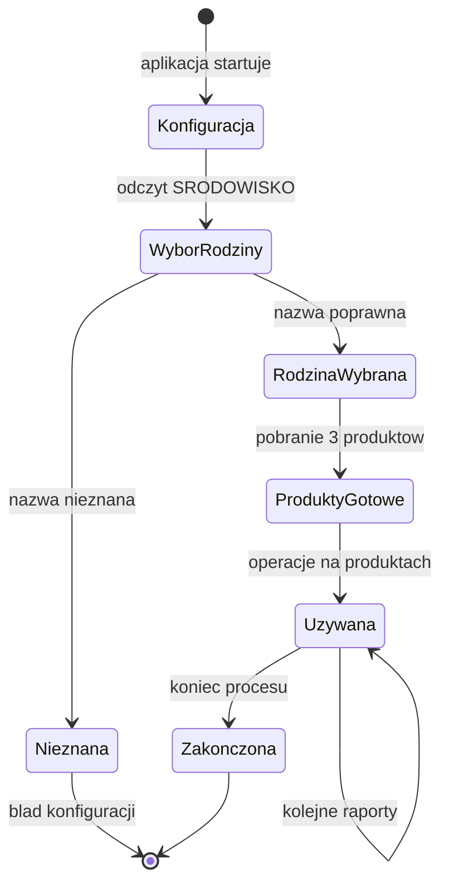
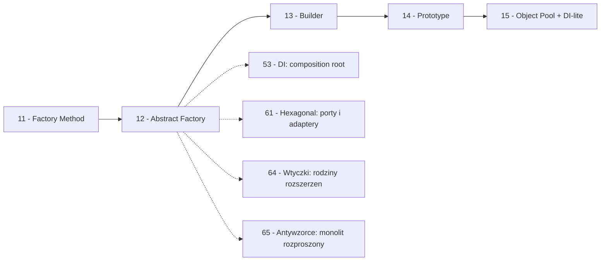

```markdown
---
modul: 12 — Abstract Factory
plik: 12-abstract-factory.md
poziom: sredni
wymaga: [11]
czas: ~160 minut czytania + ~380 minut ćwiczeń
---

# Moduł 12 — Abstract Factory — fabryka rodzin produktów

> **TL;DR**
> - **Abstract Factory (fabryka abstrakcyjna)** tworzy nie jeden obiekt, ale **całą rodzinę wzajemnie spójnych obiektów** — takich, które muszą ze sobą współpracować i nie wolno ich mieszać.
> - Różnica wobec Factory Method z modułu 11 jest fundamentalna: tam wybierałeś **jeden produkt**, tutaj wybierasz **zestaw produktów** tworzących logicznie zgodną całość.
> - Typowym zastosowaniem jest infrastruktura wielu środowisk (AWS/GCP/local-dev): każda chmura ma własny magazyn plików, kolejkę i dziennik audytu, i te trzy muszą pochodzić z **jednej** rodziny.
> - W Pythonie fabryka abstrakcyjna bywa realizowana bardzo lekko: zbiór `Protocol` dla produktów, `dataclass` jako kontener fabryki, słownik rodzin — bez ani jednej klasy abstrakcyjnej.
> - Kluczowy trade-off: **dodanie nowej rodziny jest łatwe** (nowa klasa fabryki), ale **dodanie nowego produktu do wszystkich rodzin jest trudne** (trzeba zmienić każdą fabrykę). To zwierciadło zasady Open/Closed.

---

## 0. Model mentalny

### Salon mebli — zestawy, których nie wolno mieszać

Wejdź do salonu meblowego i popatrz na wystawę. Leżą tam dwa gotowe zestawy. Pierwszy — nazwijmy go „nowoczesny" — to kanapa z ostrymi liniami, fotel ze stali chromowanej i szklany stolik na cienkich nóżkach. Drugi — „klasyczny" — to kanapa z wysokim oparciem, fotel z giętkiego, obitego materiału drewna i stolik z rzeźbionymi nóżkami. Każdy z tych zestawów jest **wewnętrznie spójny**: kanapa, fotel i stolik mają wspólny styl, wspólną paletę, wspólne proporcje. Ustawione razem wyglądają jak całość.

Zauważ teraz coś, co sprzedawca wie bardzo dobrze, a klient czasem zapomina: **nie wolno mieszać elementów z dwóch zestawów**. Jeśli weźmiesz kanapę nowoczesną i zestawisz z klasycznym stolikiem, powstanie coś, co się nie tylko „źle prezentuje". To po prostu **nie działa jako mebel** — kanapa o wąskich liniach i stolik o masywnych proporcjach wyglądają jak dwa obiekty obok siebie, a nie jak mebel. W salonie mebli to kwestia estetyki. W kodzie to kwestia **zgodności technicznej**, często dużo poważniejsza.

Wyobraź sobie teraz, że masz salon z trzema zestawami: nowoczesny, klasyczny i skandynawski. Kiedy klient mówi „urządzam salon w stylu skandynawskim", dostajesz **cały zestaw**: kanapę, fotel i stolik odpowiadające temu stylowi. Nie dostajesz kanapy skandynawskiej i fotela nowoczesnego — byłoby to pomieszanie, którego nie da się potem usprawiedliwić żadnym powodem. Sprzedawca prowadzi cię **do sekcji skandynawskiej**, a nie „do dowolnej kanapy i dowolnego fotela".

I jeszcze jedna rzecz, którą widać, gdy patrzysz na ten salon dłużej. **Zestawy rosną wolniej niż elementy.** Jeśli firma dodaje nowy zestaw (np. „industrialny"), to dodaje do niego trzy elementy: kanapę, fotel i stolik. Jeśli firma dodaje nowy **element** do wszystkich zestawów (np. dodaje lampę podłogową), to musi zrobić to dla wszystkich zestawów naraz. To nie jest symetria. Właśnie ta asymetria leży u podstaw decyzji, czy stosować Abstract Factory.

| W analogii salonu mebli | W kodzie |
|---|---|
| Zestaw „nowoczesny" | Rodzina produktów (np. rodzina AWS) |
| Kanapa nowoczesna | Produkt A z rodziny (np. magazyn plików AWS S3) |
| Fotel nowoczesny | Produkt B z rodziny (np. kolejka zdarzeń SQS) |
| Stolik nowoczesny | Produkt C z rodziny (np. dziennik audytu CloudWatch) |
| Sprzedawca prowadzący do sekcji | Fabryka konkretna (klasa `FabrykaAWS`) |
| Katalog zestawów w sklepie | Fabryka abstrakcyjna (interfejs) |
| Niemieszanie zestawów | Zgodność techniczna wewnątrz rodziny |
| Dodanie nowego zestawu | Dodanie nowej klasy fabryki (łatwe) |
| Dodanie nowego elementu do wszystkich zestawów | Dodanie nowego produktu do wszystkich fabryk (trudne) |

> 🧠 **Zapamiętaj** — **Abstract Factory (fabryka abstrakcyjna) to wzorzec kreacyjny, który udostępnia interfejs tworzenia całej rodziny wzajemnie powiązanych produktów bez wskazywania ich konkretnych klas; klient wybiera rodzinę raz, a następnie konsekwentnie korzysta wyłącznie z jej produktów.**

Zwróć uwagę na dwa słowa w tej definicji: **rodzina** i **konsekwentnie**. „Rodzina" odróżnia ten wzorzec od Factory Method — tam był jeden produkt, tu jest ich zestaw. „Konsekwentnie" oznacza, że klient zobowiązuje się nie mieszać produktów z różnych rodzin. Dla sprzedawcy mebli to oczywiste — dla programisty bywa pułapką, bo język typów (w Pythonie szczególnie, ze względu na duck typing) **nie zawsze wyłapie pomieszanie**. To dlatego tak ważne są testy kontraktu, o których będzie w sekcji 5.

### Intuicja w formie diagramu

Poniższy diagram pokazuje intuicję wzorca. Klient wybiera rodzinę raz, a potem dostaje z niej wszystkie produktu — spójne ze sobą.



*Diagram pokazuje, że wybór rodziny jest pojedynczą decyzją, a wszystkie produkty z tej rodziny są spójne — nie ma tu mieszania produktów z różnych rodzin.*

### Czego Abstract Factory NIE robi

Rozbrójmy cztery nieporozumienia, które towarzyszą temu wzorcowi.

**Nie zastępuje Factory Method.** W pewnym sensie wzorce są komplementarne: Abstract Factory to zwykle zestaw ich metod wytwórczych zgrupowanych w jednej klasie. Ale mają różne cele. Factory Method odpowiada na pytanie „który produkt?", Abstract Factory — „który **zestaw** produktów?". Jeśli twoja rodzina ma jeden produkt, nie masz Abstract Factory, masz Factory Method (albo Simple Factory).

**Nie jest niezbędne do tworzenia wielu obiektów.** Jeśli masz trzy niezależne obiekty, które nie muszą ze sobą współpracować, nie potrzebujesz fabryki abstrakcyjnej. Możesz mieć trzy osobne fabryki — po jednej na produkt. Wzorzec ma sens, gdy pojawia się **wymóg zgodności wewnątrz zestawu**.

**Nie gwarantuje zgodności automatycznie.** Python nie wyłapie, że klient pomieszał produkt z rodziny AWS i z rodziny lokalnej — bo oba spełniają ten sam kontrakt strukturalny. Gwarancja zgodności wymaga dyscypliny w testach (kontrakt parametryzowany) i w projekcie API (klient nie powinien mieć obu rodzin naraz). Wrócimy do tego w sekcji 8.

**Nie chroni przed dodawaniem nowych produktów.** To najważniejsze ograniczenie i wrócimy do niego w sekcji 8. Każdy nowy produkt w rodzinie wymaga zmiany **wszystkich** fabryk konkretnych. To jest odwrotność tego, co obiecuje Open/Closed. Wzorzec łatwo rozszerza się o nowe **rodziny**, ale trudno o nowe **produkty**. Świadomość tego trade-offu jest kluczowa, zanim sięgniesz po ten wzorzec.

**Nie jest najlepszym wyborem dla każdego systemu wielośrodowiskowego.** Jeśli różnice między środowiskami ograniczają się do adresów i kluczy API, najlepszym rozwiązaniem bywa **jeden zestaw klas z konfiguracją parametrów** — bez rodziny. Abstract Factory zaczyna się opłacać, gdy różnice są **strukturalne**, nie „konfiguracyjne". Pokażemy to kryterium w sekcji 7.

---

## 1. Problem, który rozwiązujemy

Wejdźmy w domenę 📊 „Sprawozdawczości". System generuje raporty dzienne i wysyła powiadomienia o ich gotowości. Działa na trzech środowiskach: produkcji (chmura AWS), środowisku testowym w chmurze (GCP), oraz lokalnie na komputerze developera (`local-dev`). Każde środowisko potrzebuje trzech usług: **magazynu plików**, **kolejki zdarzeń** i **dziennika audytu**. Każda usługa ma inną implementację w każdym środowisku.

Ktoś napisał system, w którym decyzja „które usługi" jest podejmowana na bieżąco, w miarę potrzeb.

### Kod „przed"

```python
# sprawozdawczosc_v0.py — wersja naiwna, demonstracyjna
# UWAGA: ten kod celowo zawiera typowe problemy z tworzeniem rodzin obiektow.

import json
import os
from dataclasses import dataclass
from datetime import date, datetime, timezone
from decimal import Decimal


@dataclass(frozen=True)
class RaportDzienny:
    identyfikator: str
    na_dzien: date
    tresc: str
    wartosc_laczna: Decimal


class SystemRaportow:
    """System generujacy raporty dla roznych srodowisk."""

    def __init__(self, srodowisko: str) -> None:
        self.srodowisko = srodowisko

    def zapisz_raport(self, raport: RaportDzienny) -> str:
        """Zapisuje raport w odpowiednim magazynie."""
        if self.srodowisko == "aws":
            # Symulacja S3
            return f"s3://raporty/{raport.identyfikator}.json"
        elif self.srodowisko == "gcp":
            # Symulacja GCS
            return f"gs://raporty/{raport.identyfikator}.json"
        elif self.srodowisko == "local":
            sciezka = f"/tmp/raporty/{raport.identyfikator}.json"
            return sciezka
        else:
            raise ValueError(f"nieznane srodowisko: {self.srodowisko}")

    def powiadom(self, raport: RaportDzienny) -> None:
        """Wysyla powiadomienie o gotowosci raportu."""
        if self.srodowisko == "aws":
            # Symulacja SQS
            print(f"[SQS] Wyslano zdarzenie o raporcie {raport.identyfikator}")
        elif self.srodowisko == "gcp":
            # Symulacja Pub/Sub
            print(f"[PubSub] Wyslano zdarzenie o raporcie {raport.identyfikator}")
        elif self.srodowisko == "local":
            print(f"[IN-MEMORY] Wyslano zdarzenie o raporcie {raport.identyfikator}")
        else:
            raise ValueError(f"nieznane srodowisko: {self.srodowisko}")

    def zapisz_audyt(self, operacja: str, szczegoly: dict) -> None:
        """Zapisuje wpis audytowy."""
        if self.srodowisko == "aws":
            # Symulacja CloudWatch
            print(f"[CLOUDWATCH] {operacja}: {szczegoly}")
        elif self.srodowisko == "gcp":
            # Symulacja Cloud Logging
            print(f"[STACKDRIVER] {operacja}: {szczegoly}")
        elif self.srodowisko == "local":
            with open("/tmp/audyt.log", "a", encoding="utf-8") as plik:
                plik.write(f"{datetime.now(timezone.utc)} {operacja}: {szczegoly}\n")
        else:
            raise ValueError(f"nieznane srodowisko: {self.srodowisko}")

    def wygeneruj_raport(self, identyfikator: str, na_dzien: date) -> RaportDzienny:
        """Generuje raport naciskajac wszystkie trzy uslugi."""
        raport = RaportDzienny(
            identyfikator=identyfikator,
            na_dzien=na_dzien,
            tresc=f"Raport {identyfikator}",
            wartosc_laczna=Decimal("1234567.89"),
        )
        sciezka = self.zapisz_raport(raport)
        self.powiadom(raport)
        self.zapisz_audyt("wygenerowano", {"sciezka": sciezka})
        return raport


if __name__ == "__main__":
    for srodowisko in ("aws", "gcp", "local"):
        print(f"\n=== Srodowisko: {srodowisko} ===")
        system = SystemRaportow(srodowisko)
        system.wygeneruj_raport("DZ-2026-10-09", date(2026, 10, 9))
```

Ten kod działa. Uruchomiony wypisze komunikaty dla trzech środowisk. Zwróć jednak uwagę, że **każda metoda zawiera ten sam `if/elif` po nazwie środowiska**. To jest dokładnie ten sam problem co w module 11, tylko pomnożony przez trzy — bo mamy trzy usługi zamiast jednej.

### Code smell — ta sama decyzja trzy razy

| Problem | Gdzie | Konsekwencja |
|---|---|---|
| Lawina `if/elif` w każdej metodzie po `srodowisko` | `zapisz_raport`, `powiadom`, `zapisz_audyt` | Ta sama decyzja rozproszona w trzech miejscach (shotgun surgery) |
| Rozpoznawanie zachowania po stringu | `self.srodowisko == "aws"` | Literówka w stringu = cichy błąd |
| Brak gwarancji spójności rodziny | Każda metoda decyduje niezależnie | Można teoretycznie zapisać do S3, a powiadomić przez Pub/Sub (błąd, którego nie widać od razu) |
| Zerowa testowalność bez `monkeypatch` | Logika usług wewnątrz metod | Test wymaga np. podstawienia systemu plików |
| Rosnące koszty przy co nowej usłudze | Każda nowa usługa = nowa metoda z `if/elif` | 3 usługi × 3 środowiska = 9 gałęzi w kodzie |
| Brak wspólnego kontraktu usług | Każda usługa to fragment metody | Nie da się testować usług osobno, nie da się użyć ich w innym kontekście |
| Konfiguracja środowiska rozproszona | W kodzie, nie w danych | Zmiana na nowe środowisko wymaga modyfikacji kodu |

Zwróć uwagę na czwartą pozycję. **Nie ma nic, co gwarantuje, że wszystkie trzy usługi pochodzą z tej samej rodziny.** Można napisać klasę, która zapisze raport do S3 (bo `srodowisko == "aws"`), ale wyśle powiadomienie przez Pub/Sub (jeśli ktoś wprowadzi literówkę w innym miejscu albo skopiuje kod z innego projektu). W wersji naiwnej nie ma nawet **formalnego kontraktu**, który mógłby na to wskazywać. Ten problem rozwiązuje właśnie Abstract Factory.

### Objawy — poznasz ten problem po tym, że...

- **Ta sama decyzja „które środowisko" powtarza się w kilku metodach.** Jedna fabryka, jedna decyzja, jedno miejsce — to cel wzorca.
- **Nowa usługa (np. „magazyn klucza szyfrującego") wymaga dopisania `elif` w wielu metodach.** Każda nowa usługa mnoży się przez liczbę środowisk.
- **Nowe środowisko (np. Azure) wymaga dopisania `elif` w każdej metodzie.** To też przesuwa koszty.
- **Klient sam tworzy obiekty usług** (`S3Client()`, `SqsClient()`, ...), a nie dostaje ich jako zależności.
- **Konfiguracja środowiska jest w kodzie, nie w danych.** Trudno ją zmienić na inny zestaw bez modyfikacji.
- **Nie ma sposobu, by formalnie sprawdzić, że wszystkie usługi są z jednej rodziny.** Nawet w testach — każda usługa jest testowana osobno, brak testu spójności.
- **Każda metoda ma wspólny „przedwstęp": rozpoznanie środowiska**, ale ten przedwstęp jest zduplikowany zamiast raz w konstruktorze.
- **Nowe środowisko jest przygodą.** Trzeba znaleźć wszystkie `if/elif`, sprawdzić, czy nigdzie nie ma starej logiki, przetestować trzy usługi w kilku miejscach.
- **Klasa `SystemRaportow` rośnie liniowo z liczbą środowisk i usług.** Jej rozmiar to iloczyn liczby środowisk i liczby usług — typowa eksplozja kombinatoryczna.

---

## 2. Anatomia wzorca

### Uczestnicy

| Rola | Odpowiedzialność | Co NIE jest jej zadaniem |
|---|---|---|
| **AbstractProductA, AbstractProductB, ...** | Definiują kontrakty dla produktów z rodziny (np. magazyn plików, kolejka zdarzeń) | Nie wymuszają konkretnej implementacji; nie zawierają kodu zależnego od środowiska |
| **ConcreteProductA1, ConcreteProductA2, ...** | Implementują kontrakty dla konkretnej rodziny (np. `MagazynS3`, `MagazynGCS`, `MagazynLokalny`) | Nie znają się wzajemnie wewnątrz jednej rodziny; nie tworzą się same |
| **AbstractFactory** | Definiuje interfejs tworzenia **wszystkich** produktów rodziny (po jednej metodzie na produkt) | Nie wie, którą rodzinę implementuje; nie tworzy samych produktów |
| **ConcreteFactory1, ConcreteFactory2, ...** | Implementują fabrykę dla konkretnej rodziny; zwracają produkty właśnie z tej rodziny | Nie implementują logiki produktów; delegują do konstruktorów produktów |
| **Klient** | Korzysta z produktów wyłącznie przez abstrakcję; nie miesza produktów z różnych rodzin | Nie zna klas konkretnych; nie tworzy fabryki sam (dostaje ją z zewnątrz) |

> 💡 **Intuicja** — Rola „AbstractProduct" istnieje, żeby klient mógł pracować z produktem bez znajomości implementacji. Rola „AbstractFactory" istnieje, żeby klient mógł pobrać **zestaw** produktów jednym wywołaniem. Kluczowa różnica względem Factory Method: **fabryka abstrakcyjna tworzy wiele produktów, nie jeden**.

### Diagram struktury — dwie rodziny

Poniżej struktura z dwiema rodzinami (AWS i lokalna) i trzema produktami w każdej (magazyn, kolejka, dziennik).



*Diagram pokazuje dwie rodziny: każda fabryka konkretna zwraca zestaw produktów z tej samej rodziny, a klient pracuje wyłącznie przez abstrakcje (trzy `Protocol`).*

Przeczytajmy ten diagram po kolei, bo jest gęsty. Na górze mamy trzy abstrakcje produktów: `MagazynPlikow`, `KolejkaZdarzen`, `DziennikAudytu`. To są trzy **role**, które produkt może pełnić w naszym systemie — a nie trzy konkretne klasy. Każda rola ma swoją metodę: magazyn umie `zapisz`, kolejka `publikuj`, dziennik `zapisz`.

W środkowej części widzimy **sześć** klas konkretnych — po trzy dla każdej rodziny. `MagazynS3`, `KolejkaSQS`, `DziennikCloudWatch` tworzą rodzinę AWS. `MagazynLokalny`, `KolejkaInMemory`, `DziennikKonsoli` tworzą rodzinę lokalną. Wszystkie implementują odpowiednie protokoły (strzałki z pustym trójkątem).

Na dole mamy abstrakcję `FabrykaInfrastruktury` i dwie fabryki konkretne. Każda fabryka ma trzy metody wytwórcze: `magazyn()`, `kolejka()`, `dziennik()`. **Zwróć uwagę na asymetrię strzałek:** fabryka AWS tworzy produkty tylko z rodziny AWS, fabryka lokalna — tylko z rodziny lokalnej. To jest cała idea wzorca: **fabryka jest „zakotwiczona" w jednej rodzinie**.

Zauważ też coś ważnego: **nie ma strzałek między famii** (np. między `MagazynS3` a `KolejkaSQS`). Produkty wewnątrz rodziny nie znają się wzajemnie w czasie kompilacji ani w czasie wykonania — nie mają do siebie referencji. Ich spójność jest **logiczną umową**, a nie techniczną zależnością. To znaczy, że ktoś musi tę spójność pilnować — zwykle przez testy kontraktu (moduł 70).

### Warianty: klasyczny vs pythoniczny

| Aspekt | Wariant klasyczny (GoF) | Wariant pythoniczny |
|---|---|---|
| Abstrakcje produktów | Klasy ABC z metodami abstrakcyjnymi | `typing.Protocol` (strukturalne) |
| Fabryka abstrakcyjna | Klasa ABC z metodami abstrakcyjnymi | Protokół albo słownik metod |
| Fabryki konkretne | Klasy dziedziczące po ABC | Dataclass albo obiekt-bundle |
| Produkty | Klasy dziedziczące po ABC produktu | Klasy implementujące strukturalnie |
| Wybór rodziny | `fabryka = FabrykaAWS()` | `fabryka = FABRYKI["aws"]` |
| Kontener rodziny | Osobna klasa fabryki | `dataclass(frozen=True)` z metodami |
| Testy spójności | Test kontraktu po klasach ABC | Test kontraktu po protokołach; parametryzacja |

Najważniejsza różnica: **w Pythonie fabryka konkretna może być obiektem bez dziedziczenia po niczym**, jeśli spełnia protokół. Można ją też reprezentować jako słownik metod — ale wtedy tracimy część sprawdzania typów. W praktyce najczęściej stosuje się `dataclass(frozen=True)` z metodami wytwórczymi — to najbardziej pogodne połączenie czytelności, testowalności i wsparcia narzędzi.

---

## 3. Implementacja krok po kroku

Przebudujemy system z sekcji 1 stopniowo. Każdy krok doprowadza do działającego kodu.

### Krok 1 — Zdefiniuj kontrakty produktów (Protocol)

Zaczynamy od abstrakcji. Trzy `Protocol` opisują trzy role w systemie.

```python
from typing import Protocol, runtime_checkable

@runtime_checkable
class MagazynPlikow(Protocol):
    """Kontrakt: cokolwiek, co potrafi zapisac plik i zwrocic jego adres."""
    nazwa: str
    def zapisz(self, klucz: str, dane: bytes) -> str: ...
    def wczytaj(self, klucz: str) -> bytes: ...


@runtime_checkable
class KolejkaZdarzen(Protocol):
    """Kontrakt: cokolwiek, co potrafi opublikowac zdarzenie."""
    nazwa: str
    def publikuj(self, temat: str, dane: dict) -> None: ...


@runtime_checkable
class DziennikAudytu(Protocol):
    """Kontrakt: cokolwiek, co potrafi zapisac wpis audytowy."""
    nazwa: str
    def zapisz(self, operacja: str, szczegoly: dict) -> None: ...
```

Każdy protokół opisuje jedną rolę. To jest fundament — klient nie będzie zależał od żadnej konkretnej implementacji, tylko od tych trzech ról.

### Krok 2 — Zaimplementuj trzy produkty dla każdej rodziny

Dla rodziny AWS: `MagazynS3`, `KolejkaSQS`, `DziennikCloudWatch`. Dla lokalnej: `MagazynLokalny`, `KolejkaInMemory`, `DziennikKonsoli`. Poniżej pokazujemy po jednym z każdej rodziny (pełny kod w sekcji 5).

```python
class MagazynS3:
    nazwa = "S3"
    def __init__(self, bucket: str = "raporty") -> None:
        self._bucket = bucket
    def zapisz(self, klucz: str, dane: bytes) -> str:
        return f"s3://{self._bucket}/{klucz}"
    def wczytaj(self, klucz: str) -> bytes:
        return b""  # atrapa


class MagazynLokalny:
    nazwa = "filesystem"
    def __init__(self, baza: str = "/tmp/raporty") -> None:
        self._baza = baza
    def zapisz(self, klucz: str, dane: bytes) -> str:
        return f"{self._baza}/{klucz}"
    def wczytaj(self, klucz: str) -> bytes:
        return b""
```

Zauważ: **każda klasa jest samodzielna**, ma własną nazwę i własną logikę. Nie znają się wzajemnie — nie ma tu „relacji rodziny". Relacja jest w fabryce, nie w produktach.

### Krok 3 — Zdefiniuj abstrakcję fabryki

Kontrakt fabryki ma **jedną metodę na każdy produkt**. To jest cała sygnatura.

```python
@runtime_checkable
class FabrykaInfrastruktury(Protocol):
    """Kontrakt: fabryka zwracajaca zestaw zgodnych produktow."""
    nazwa: str
    def magazyn(self) -> MagazynPlikow: ...
    def kolejka(self) -> KolejkaZdarzen: ...
    def dziennik(self) -> DziennikAudytu: ...
```

Zwróć uwagę: fabryka **nie ma parametrów**. To znaczy, że fabryka jest już „skonfigurowana" — sama wie, że jest fabryką AWS, i nie potrzebuje dodatkowych informacji. Jeśli konfiguracja jest potrzebna (np. bucket, region), dostaje ją w konstruktorze fabryki.

### Krok 4 — Zaimplementuj fabryki konkretne

Każda fabryka zwraca produkty z jednej rodziny. To jest cała jej odpowiedzialność.

```python
class FabrykaAWS:
    """Fabryka rodziny AWS: S3 + SQS + CloudWatch."""
    nazwa = "aws"

    def __init__(self, region: str = "eu-central-1") -> None:
        self._region = region

    def magazyn(self) -> MagazynPlikow:
        return MagazynS3(bucket=f"raporty-{self._region}")

    def kolejka(self) -> KolejkaZdarzen:
        return KolejkaSQS(temat="raporty-gotowe", region=self._region)

    def dziennik(self) -> DziennikAudytu:
        return DziennikCloudWatch(log_group="raporty")


class FabrykaLokalna:
    """Fabryka rodziny lokalnej: filesystem + in-memory + konsola."""
    nazwa = "local"

    def __init__(self, katalog: str = "/tmp/raporty") -> None:
        self._katalog = katalog

    def magazyn(self) -> MagazynPlikow:
        return MagazynLokalny(baza=self._katalog)

    def kolejka(self) -> KolejkaZdarzen:
        return KolejkaInMemory()

    def dziennik(self) -> DziennikAudytu:
        return DziennikKonsoli()
```

Każda metoda zwraca nowy obiekt — albo może zwrócić ten sam (jeśli produkty są bezstanowe). Zwracanie nowego obiektu za każdym razem ma tę zaletę, że można produkty konfigurować per użycie; ma wadę, że jest więcej tworzenia obiektów. W naszym przypadku — nowy obiekt jest OK.

### Krok 5 — Wybór rodziny na podstawie konfiguracji

Teraz potrzebujesz miejsca, w którym „nazwa środowiska" zamienia się w **konkretną fabrykę**. To najprostsza funkcja w systemie.

```python
def utworz_fabryke(srodowisko: str) -> FabrykaInfrastruktury:
    """Fabryka fabryk: wybiera rodzine na podstawie nazwy srodowiska."""
    fabryki: dict[str, type] = {
        "aws": FabrykaAWS,
        "gcp": FabrykaGCP,
        "local": FabrykaLokalna,
    }
    try:
        klasa = fabryki[srodowisko]
    except KeyError as blad:
        dostepne = ", ".join(sorted(fabryki))
        raise ValueError(
            f"nieznane srodowisko {srodowisko!r}; dostepne: {dostepne}"
        ) from blad
    return klasa()
```

To jest **fabryka fabryk** albo **punkt wyboru rodziny**. Realizuje Factory Method (moduł 11) na poziomie fabryk. Wywołuje kod raz, przy starcie aplikacji.

### Krok 6 — Klient używa produktów z jednej rodziny

Teraz klient. Kluczowa decyzja projektowa: **klient dostaje fabrykę gotową**, nie wybiera jej sam.

```python
class GeneratorRaportow:
    """Klient: generuje raporty uzywajac produktow z JEDNEJ rodziny."""

    def __init__(self, fabryka: FabrykaInfrastruktury) -> None:
        self._magazyn = fabryka.magazyn()
        self._kolejka = fabryka.kolejka()
        self._dziennik = fabryka.dziennik()
        self._fabryka = fabryka

    def wygeneruj(self, identyfikator: str, na_dzien, tresc: str) -> str:
        dane = tresc.encode("utf-8")
        sciezka = self._magazyn.zapisz(f"{identyfikator}.txt", dane)
        self._kolejka.publikuj("raport-gotowy", {"id": identyfikator})
        self._dziennik.zapisz("wygenerowano", {"sciezka": sciezka})
        return sciezka
```

**Ważna uwaga projektowa:** klient zapisuje fabrykę (`self._fabryka`) — to pozwala na diagnostykę („z jakiej rodziny są moje usługi?"). Ale klient **nigdy nie miesza produktów z różnych fabryk** — nie ma do tego nawet mechanizmu. Wszystkie trzy produkty pochodzą z tej samej fabryki, bo klient pobrał je z niej raz w konstruktorze.

### Krok 7 — Złóż wszystko razem i zweryfikuj

| Kryterium | Wersja „przed" | Wersja „po" |
|---|---|---|
| Dodanie nowej usługi (np. magazyn szyfru) | Nowa metoda z `if/elif` w klasie klienta | Nowe `Protocol`, nowy produkt w każdej rodzinie, nowa metoda w każdej fabryce |
| Dodanie nowego środowiska (np. Azure) | Nowy `elif` w każdej metodzie | Nowa klasa fabryki + produkty (zmiana w 1 miejscu) |
| Gwarancja spójności rodziny | Brak | Konstruktor klienta pobiera z jednej fabryki |
| Testy usług osobno | Trudne | Łatwe — każdy produkt testowany bezpośrednio |
| Testy spójności | Brak | Możliwe (test kontraktu parametryzowany) |
| Rozmiar klasy klienta | Rosnący liniowo z usługami × środowiskami | Stały (3 usługi w konstruktorze) |
| Konfiguracja środowiska | W kodzie klienta | W punkcie startowym (composition root) |
| Zależność klienta od konkretów | Pełna | Zerowa |

Wzrost liczby klas (z 1 na 10) jest kosztem. Zyski: klient nie rośnie przy rozszerzaniu (dodanie usługi jest lokalne w fabrykach, a nie w kliencie), spójność rodziny jest zagwarantowana konstrukcyjnie, testy są proste.

---

## 4. Wersje pythoniczne i warianty

Ta sekcja to katalog czterech wariantów Abstract Factory w Pythonie, od najbardziej klasycznego do najbardziej pythonicznego.

### 4.1 Wariant klasyczny — ABC i dziedziczenie

Najbliższy kanonicznemu GoF. Dwie hierarchie: produkty i fabryki.

```python
from abc import ABC, abstractmethod

class MagazynPlikow(ABC):
    @abstractmethod
    def zapisz(self, klucz: str, dane: bytes) -> str: ...
    @abstractmethod
    def wczytaj(self, klucz: str) -> bytes: ...

class MagazynS3(MagazynPlikow):
    def zapisz(self, klucz: str, dane: bytes) -> str:
        return f"s3://raporty/{klucz}"
    def wczytaj(self, klucz: str) -> bytes:
        return b""

class FabrykaInfrastruktury(ABC):
    @abstractmethod
    def magazyn(self) -> MagazynPlikow: ...
    @abstractmethod
    def kolejka(self) -> "KolejkaZdarzen": ...
    @abstractmethod
    def dziennik(self) -> "DziennikAudytu": ...

class FabrykaAWS(FabrykaInfrastruktury):
    def magazyn(self) -> MagazynPlikow:
        return MagazynS3()
    # ... reszta ...
```

Zalety: twardy kontrakt, natychmiastowe błędy przy brakującej metodzie, łatwa dokumentacja intencji. Wady: wymusza dziedziczenie, trudno objąć typy zewnętrzne, więcej kodu klasycznego.

**Kiedy stosować:** gdy budujesz wewnętrzny framework, zespół jest duży, chcesz jednolitego stylu, i wiesz, że implementacje będą liczne.

### 4.2 Wariant pythoniczny — `Protocol` i struktura

Wariant domyślny w nowoczesnym Pythonie.

```python
from typing import Protocol, runtime_checkable

@runtime_checkable
class MagazynPlikow(Protocol):
    def zapisz(self, klucz: str, dane: bytes) -> str: ...
    def wczytaj(self, klucz: str) -> bytes: ...

@runtime_checkable
class FabrykaInfrastruktury(Protocol):
    nazwa: str
    def magazyn(self) -> MagazynPlikow: ...
    def kolejka(self) -> "KolejkaZdarzen": ...
    def dziennik(self) -> "DziennikAudytu": ...
```

Klasy konkretne nie muszą dziedziczyć po niczym — wystarczy, że mają odpowiednie metody. Zysk: pełna elastyczność, w tym możliwość objęcia typów zewnętrznych (`boto3.client` może być opakowany w klasę spełniającą protokół bez dziedziczenia).

**Kiedy stosować:** domyślny wybór w nowoczesnym Pythonie, szczególnie gdy produkty pochodzą z różnych bibliotek albo gdy zależy nam na strukturalnym typowaniu.

### 4.3 Wariant funkcyjny — fabryki jako funkcje

Klient może otrzymywać nie obiekt z metodami, ale **trzy funkcje** albo krotkę funkcji.

```python
from collections.abc import Callable
from typing import NamedTuple

class RodzinaInfrastruktury(NamedTuple):
    """Rodzina jako krotka funkcji wytworczych."""
    nazwa: str
    magazyn: Callable[[], MagazynPlikow]
    kolejka: Callable[[], KolejkaZdarzen]
    dziennik: Callable[[], DziennikAudytu]


def rodzina_aws() -> RodzinaInfrastruktury:
    return RodzinaInfrastruktury(
        nazwa="aws",
        magazyn=lambda: MagazynS3(bucket="raporty"),
        kolejka=lambda: KolejkaSQS(),
        dziennik=lambda: DziennikCloudWatch(),
    )


def rodzina_lokalna() -> RodzinaInfrastruktury:
    return RodzinaInfrastruktury(
        nazwa="local",
        magazyn=lambda: MagazynLokalny(),
        kolejka=lambda: KolejkaInMemory(),
        dziennik=lambda: DziennikKonsoli(),
    )
```

Zalety: bardzo lekka konstrukcja, naturalne z `functools.partial`, idealna dla dynamicznego wyboru. Wady: funkcje w lambda są niesprawdzone typowo dopóki nie są wywołane; brak `isinstance` na takiej rodzinie; trudniej dokumentować.

**Kiedy stosować:** gdy chcesz zminimalizować strukturę i wiesz, że zespół jest biegły w Pythonie funkcyjnym. Rzadziej wybierane niż wariant z `dataclass`.

### 4.4 Wariant z `dataclass` — obiekt z prekonstruowanymi fabrykami

Bardzo praktyczne połączenie: `dataclass(frozen=True)` przechowuje **fabryki produktów** (klasy albo `partial`), a klient je wywołuje.

```python
from dataclasses import dataclass
from typing import Callable

@dataclass(frozen=True)
class FabrykaInfrastruktury:
    """Fabryka jako dataclass z fabrykami pol."""
    nazwa: str
    _magazyn: Callable[[], MagazynPlikow]
    _kolejka: Callable[[], KolejkaZdarzen]
    _dziennik: Callable[[], DziennikAudytu]

    def magazyn(self) -> MagazynPlikow:
        return self._magazyn()

    def kolejka(self) -> KolejkaZdarzen:
        return self._kolejka()

    def dziennik(self) -> DziennikAudytu:
        return self._dziennik()


# Fabryki jako konkretne instancje dataclass
FABRYKA_AWS = FabrykaInfrastruktury(
    nazwa="aws",
    _magazyn=lambda: MagazynS3(bucket="raporty"),
    _kolejka=lambda: KolejkaSQS(),
    _dziennik=lambda: DziennikCloudWatch(),
)

FABRYKA_LOKALNA = FabrykaInfrastruktury(
    nazwa="local",
    _magazyn=lambda: MagazynLokalny(),
    _kolejka=lambda: KolejkaInMemory(),
    _dziennik=lambda: DziennikKonsoli(),
)

FABRYKI: dict[str, FabrykaInfrastruktury] = {
    "aws": FABRYKA_AWS,
    "local": FABRYKA_LOKALNA,
}
```

**To jest chyba najbardziej praktyczny wariant w Pythonie.** Zalety:
- **brak hierarchii klas fabryk** — wystarczy jedna klasa i kilka instancji,
- **wymiana fabryki w testach** — wystarczy podstawić inną instancję,
- **`frozen=True`** — nie można przypadkowo zmienić składowych,
- **`isinstance(x, FabrykaInfrastruktury)`** działa normalnie (bo to konkretna klasa, nie `Protocol`).

Wady: mniej sprawdza typowo `mypy` wewnątrz lambd; jeśli fabryki potrzebują parametrów (np. region AWS), trzeba je przekazać do lambda.

### 4.5 Wariant hybrydowy — klasy z `Protocol`

Najczęstszy w produkcji: klasy konkretne dla fabryk (z dziedziczeniem dla wygody), `Protocol` dla kontraktu, `dataclass` dla produktów danych.

```python
class FabrykaAWS:
    nazwa = "aws"

    def __init__(self, region: str = "eu-central-1") -> None:
        self._region = region

    def magazyn(self) -> MagazynPlikow:
        return MagazynS3(f"raporty-{self._region}")

    def kolejka(self) -> KolejkaZdarzen:
        return KolejkaSQS(self._region)

    def dziennik(self) -> DziennikAudytu:
        return DziennikCloudWatch()
```

Ten wariant łączy zalety obu: klasy mają własne pola konfiguracyjne, ale są sprawdzane strukturalnie przez `Protocol`. To jest miks, który zobaczysz najczęściej w prawdziwych projektach.

### 4.6 Podsumowanie — tabela wyboru

| Potrzeba | Wariant |
|---|---|
| Kontrakt twardy, framework wewnętrzny | Klasyczne ABC (4.1) |
| Domyślny wybór w nowoczesnym Pythonie | `Protocol` + klasy (4.2) |
| Minimalna struktura, dużo dynamizmu | Funkcyjny (4.3) |
| Wygoda i lekkość, mało klas | `dataclass` (4.4) |
| Produkcja, konfiguracja per środowisko | Hybrydowy (4.5) |

> 🧠 **Zapamiętaj** — Wariant z `dataclass(frozen=True)` jest bardzo często najbardziej praktyczny w Pythonie. Nie musisz tworzyć jednej klasy na każdą rodzinę — możesz mieć jedną klasę i utworzyć kilka jej instancji z różnymi funkcjami wytwórczymi. To redukuje liczbę klas i czyni kod łatwiejszym do zrozumienia.

---

## 5. Przykład z życia: 📊 Sprawozdawczość — pełny uruchamialny kod

Zbudujemy pełny system generowania raportów działający na trzech środowiskach: AWS (produkcja), GCP (test), lokalny (dev). Zastosujemy wszystkie elementy wzorca: `Protocol` dla produktów, `Protocol` dla fabryki, klasy konkretne dla fabryk, `dataclass` dla wyników.

### Kod

```python
# sprawozdawczosc_abstract_factory.py — pelny przyklad Abstract Factory
from __future__ import annotations

import json
import os
import threading
from dataclasses import dataclass
from datetime import date, datetime, timezone
from decimal import Decimal
from pathlib import Path
from typing import Protocol, runtime_checkable

# ===========================================================================
# 1. Typy domenowe
# ===========================================================================

@dataclass(frozen=True, slots=True)
class RaportDzienny:
    identyfikator: str
    na_dzien: date
    tresc: str
    wartosc_laczna: Decimal

    def jako_bajty(self) -> bytes:
        return json.dumps(
            {
                "identyfikator": self.identyfikator,
                "na_dzien": self.na_dzien.isoformat(),
                "tresc": self.tresc,
                "wartosc": str(self.wartosc_laczna),
            },
            ensure_ascii=False,
        ).encode("utf-8")


@dataclass(frozen=True, slots=True)
class WynikRaportu:
    """Wynik calego procesu generowania raportu."""
    identyfikator: str
    sciezka: str
    rodzina: str
    uslugi: tuple[str, str, str]

    def __str__(self) -> str:
        return (
            f"{self.identyfikator} -> {self.sciezka} "
            f"(rodzina={self.rodzina}, "
            f"uslugi={self.uslugi[0]}/{self.uslugi[1]}/{self.uslugi[2]})"
        )


# ===========================================================================
# 2. Kontrakty produktow (Protocol)
# ===========================================================================

@runtime_checkable
class MagazynPlikow(Protocol):
    """Kontrakt: cokolwiek, co potrafi zapisac i odczytac plik."""
    nazwa: str
    def zapisz(self, klucz: str, dane: bytes) -> str: ...
    def wczytaj(self, klucz: str) -> bytes: ...


@runtime_checkable
class KolejkaZdarzen(Protocol):
    """Kontrakt: cokolwiek, co potrafi opublikowac zdarzenie."""
    nazwa: str
    def publikuj(self, temat: str, dane: dict) -> None: ...


@runtime_checkable
class DziennikAudytu(Protocol):
    """Kontrakt: cokolwiek, co potrafi zapisac wpis audytowy."""
    nazwa: str
    def zapisz(self, operacja: str, szczegoly: dict) -> None: ...


# ===========================================================================
# 3. Produkty rodziny AWS
# ===========================================================================

class MagazynS3:
    nazwa = "s3"

    def __init__(self, bucket: str = "raporty") -> None:
        self._bucket = bucket
        self._zapisane: dict[str, bytes] = {}

    def zapisz(self, klucz: str, dane: bytes) -> str:
        self._zapisane[klucz] = dane
        return f"s3://{self._bucket}/{klucz}"

    def wczytaj(self, klucz: str) -> bytes:
        return self._zapisane[klucz]


class KolejkaSQS:
    nazwa = "sqs"

    def __init__(self, temat: str = "raporty-gotowe") -> None:
        self._temat = temat
        self.opublikowane: list[tuple[str, dict]] = []

    def publikuj(self, temat: str, dane: dict) -> None:
        self.opublikowane.append((temat, dane))


class DziennikCloudWatch:
    nazwa = "cloudwatch"

    def __init__(self, grupa: str = "raporty") -> None:
        self._grupa = grupa
        self.wpisy: list[tuple[str, dict]] = []

    def zapisz(self, operacja: str, szczegoly: dict) -> None:
        self.wpisy.append((operacja, szczegoly))


# ===========================================================================
# 4. Produkty rodziny GCP
# ===========================================================================

class MagazynGCS:
    nazwa = "gcs"

    def __init__(self, bucket: str = "raporty-test") -> None:
        self._bucket = bucket
        self._zapisane: dict[str, bytes] = {}

    def zapisz(self, klucz: str, dane: bytes) -> str:
        self._zapisane[klucz] = dane
        return f"gs://{self._bucket}/{klucz}"

    def wczytaj(self, klucz: str) -> bytes:
        return self._zapisane[klucz]


class KolejkaPubSub:
    nazwa = "pubsub"

    def __init__(self, temat: str = "raporty-gotowe") -> None:
        self._temat = temat
        self.opublikowane: list[tuple[str, dict]] = []

    def publikuj(self, temat: str, dane: dict) -> None:
        self.opublikowane.append((temat, dane))


class DziennikStackdriver:
    nazwa = "stackdriver"

    def __init__(self, projekt: str = "raporty-test") -> None:
        self._projekt = projekt
        self.wpisy: list[tuple[str, dict]] = []

    def zapisz(self, operacja: str, szczegoly: dict) -> None:
        self.wpisy.append((operacja, szczegoly))


# ===========================================================================
# 5. Produkty rodziny lokalnej
# ===========================================================================

class MagazynLokalny:
    nazwa = "filesystem"

    def __init__(self, katalog: str = "/tmp/raporty") -> None:
        self._katalog = katalog
        Path(katalog).mkdir(parents=True, exist_ok=True)

    def zapisz(self, klucz: str, dane: bytes) -> str:
        sciezka = Path(self._katalog) / klucz
        sciezka.write_bytes(dane)
        return str(sciezka)

    def wczytaj(self, klucz: str) -> bytes:
        return (Path(self._katalog) / klucz).read_bytes()


class KolejkaInMemory:
    nazwa = "in-memory"

    def __init__(self) -> None:
        self.opublikowane: list[tuple[str, dict]] = []

    def publikuj(self, temat: str, dane: dict) -> None:
        self.opublikowane.append((temat, dane))


class DziennikKonsoli:
    nazwa = "konsola"

    def __init__(self, cicho: bool = False) -> None:
        self._cicho = cicho
        self.wpisy: list[tuple[str, dict]] = []

    def zapisz(self, operacja: str, szczegoly: dict) -> None:
        self.wpisy.append((operacja, szczegoly))
        if not self._cicho:
            print(f"  [AUDYT] {operacja}: {szczegoly}")


# ===========================================================================
# 6. Kontrakt i implementacje fabryki
# ===========================================================================

@runtime_checkable
class FabrykaInfrastruktury(Protocol):
    """Kontrakt: fabryka zwracajaca zestaw zgodnych produktow."""
    nazwa: str
    def magazyn(self) -> MagazynPlikow: ...
    def kolejka(self) -> KolejkaZdarzen: ...
    def dziennik(self) -> DziennikAudytu: ...


class FabrykaAWS:
    nazwa = "aws"

    def __init__(self, region: str = "eu-central-1") -> None:
        self._region = region

    def magazyn(self) -> MagazynPlikow:
        return MagazynS3(bucket=f"raporty-{self._region}")

    def kolejka(self) -> KolejkaZdarzen:
        return KolejkaSQS(temat="raporty-gotowe")

    def dziennik(self) -> DziennikAudytu:
        return DziennikCloudWatch(grupa=f"raporty-{self._region}")


class FabrykaGCP:
    nazwa = "gcp"

    def __init__(self, projekt: str = "raporty-test") -> None:
        self._projekt = projekt

    def magazyn(self) -> MagazynPlikow:
        return MagazynGCS(bucket=f"{self._projekt}-raporty")

    def kolejka(self) -> KolejkaZdarzen:
        return KolejkaPubSub(temat="raporty-gotowe")

    def dziennik(self) -> DziennikAudytu:
        return DziennikStackdriver(projekt=self._projekt)


class FabrykaLokalna:
    nazwa = "local"

    def __init__(self, katalog: str = "/tmp/raporty", cicho: bool = False) -> None:
        self._katalog = katalog
        self._cicho = cicho

    def magazyn(self) -> MagazynPlikow:
        return MagazynLokalny(katalog=self._katalog)

    def kolejka(self) -> KolejkaZdarzen:
        return KolejkaInMemory()

    def dziennik(self) -> DziennikAudytu:
        return DziennikKonsoli(cicho=self._cicho)


# ===========================================================================
# 7. Punkt wyboru rodziny
# ===========================================================================

def utworz_fabryke(srodowisko: str) -> FabrykaInfrastruktury:
    """Fabryka fabryk: wybiera rodzine produktow na podstawie srodowiska."""
    fabryki: dict[str, type] = {
        "aws": FabrykaAWS,
        "gcp": FabrykaGCP,
        "local": FabrykaLokalna,
    }
    try:
        klasa = fabryki[srodowisko]
    except KeyError as blad:
        dostepne = ", ".join(sorted(fabryki))
        raise ValueError(
            f"nieznane srodowisko {srodowisko!r}; dostepne: {dostepne}"
        ) from blad
    return klasa()


# ===========================================================================
# 8. Klient: generator raportow
# ===========================================================================

class GeneratorRaportow:
    """Klient pracujacy wylacznie przez trzy abstrakcje z jednej rodziny."""

    def __init__(self, fabryka: FabrykaInfrastruktury) -> None:
        if not isinstance(fabryka, FabrykaInfrastruktury):
            raise TypeError(
                f"{type(fabryka).__name__} nie spelnia kontraktu FabrykaInfrastruktury"
            )
        self._fabryka = fabryka
        # Produkty pobierzemy raz, przy tworzeniu klienta
        self._magazyn = fabryka.magazyn()
        self._kolejka = fabryka.kolejka()
        self._dziennik = fabryka.dziennik()

    @property
    def rodzina(self) -> str:
        return self._fabryka.nazwa

    @property
    def uslugi(self) -> tuple[str, str, str]:
        return (self._magazyn.nazwa, self._kolejka.nazwa, self._dziennik.nazwa)

    def wygeneruj(
        self, identyfikator: str, na_dzien: date, wartosc: Decimal
    ) -> WynikRaportu:
        raport = RaportDzienny(
            identyfikator=identyfikator,
            na_dzien=na_dzien,
            tresc=f"Raport dzienny {identyfikator}",
            wartosc_laczna=wartosc,
        )
        klucz = f"{identyfikator}.json"
        dane = raport.jako_bajty()

        # 1. Zapis do magazynu
        sciezka = self._magazyn.zapisz(klucz, dane)

        # 2. Powiadomienie
        self._kolejka.publikuj(
            "raport-gotowy",
            {"id": identyfikator, "sciezka": sciezka},
        )

        # 3. Wpis do dziennika
        self._dziennik.zapisz(
            "wygenerowano-raport",
            {
                "id": identyfikator,
                "data": na_dzien.isoformat(),
                "sciezka": sciezka,
            },
        )

        return WynikRaportu(
            identyfikator=identyfikator,
            sciezka=sciezka,
            rodzina=self.rodzina,
            uslugi=self.uslugi,
        )

    def weryfikuj(self, wynik: WynikRaportu) -> bool:
        """Sprawdza, ze raport da sie odczytac z magazynu."""
        klucz = f"{wynik.identyfikator}.json"
        dane = self._magazyn.wczytaj(klucz)
        return len(dane) > 0


# ===========================================================================
# 9. Demonstracja
# ===========================================================================

if __name__ == "__main__":
    srodowiska = ["aws", "gcp", "local"]

    for nazwa_srodowiska in srodowiska:
        print(f"\n=== Srodowisko: {nazwa_srodowiska} ===")
        fabryka = utworz_fabryke(nazwa_srodowiska)
        klient = GeneratorRaportow(fabryka)
        wynik = klient.wygeneruj(
            identyfikator=f"DZ-{nazwa_srodowiska.upper()}-2026-10-09",
            na_dzien=date(2026, 10, 9),
            wartosc=Decimal("1234567.89"),
        )
        print(f"  wynik: {wynik}")
        print(f"  rodzina: {klient.rodzina}")
        print(f"  uslugi: {klient.uslugi}")
        print(f"  weryfikacja: {klient.weryfikuj(wynik)}")

    print("\n=== Sprawdzenie bledu: nieznane srodowisko ===")
    try:
        utworz_fabryke("azure")
    except ValueError as blad:
        print(f"  {blad}")

    print("\n=== Sprawdzenie zgodnosci rodzin ===")
    for nazwa in srodowiska:
        fabryka = utworz_fabryke(nazwa)
        magazyn = fabryka.magazyn()
        kolejka = fabryka.kolejka()
        dziennik = fabryka.dziennik()
        ok = (
            isinstance(magazyn, MagazynPlikow)
            and isinstance(kolejka, KolejkaZdarzen)
            and isinstance(dziennik, DziennikAudytu)
        )
        print(f"  {nazwa}: wszystkie produkty spelniaja kontrakty: {ok}")
```

### Co ten przykład pokazuje

Uruchomienie tego kodu demonstruje wszystkie kluczowe cechy wzorca. Przyjrzyjmy się wynikom punkt po punkcie.

**Punkt 1 — trzy środowiska, trzy rodziny.** Dla każdego środowiska uruchamiamy ten sam kod klienta, ale dostajemy inne usługi: dla „aws" — s3/sqs/cloudwatch, dla „gcp" — gcs/pubsub/stackdriver, dla „local" — filesystem/in-memory/konsola. **Ten sam klient obsługuje wszystkie trzy rodziny bez jednej zmiany w kodzie.**

**Punkt 2 — klient nie zna konkretów.** `GeneratorRaportow.__init__` przyjmuje `FabrykaInfrastruktury` (protokół). W kodzie klienta nie ma nigdzie nazw `FabrykaAWS`, `MagazynS3`, `FabrykaLokalna`. Klient pracuje wyłącznie przez abstrakcje.

**Punkt 3 — spójność rodziny jest gwarantowana konstrukcyjnie.** W konstruktorze klienta wszystkie produkty są pobierane z **jednej** fabryki:

```python
self._magazyn = fabryka.magazyn()
self._kolejka = fabryka.kolejka()
self._dziennik = fabryka.dziennik()
```

To znaczy, że **nie ma nawet mechanizmu**, żeby klient użył magazynu z AWS i kolejki z GCP. Gdyby ktoś chciał to zrobić, musiałby jawnie zbudować dwa różne obiekty fabryk i wywołać po jednej metodzie z każdej — co jest już wyraźnym aktem intencji, a nie przypadkową pomyłką.

**Punkt 4 — błędne środowisko daje czytelny błąd.** Komunikat zawiera listę dostępnych opcji (`"aws", "gcp", "local"`), co bardzo pomaga w diagnozie.

**Punkt 5 — kontrakty są strukturalne.** Na końcu sprawdzamy, że wszystkie produkty spełniają protokoły. Działa to po kształcie (obecność metod i atrybutów), a nie po dziedziczeniu. To kluczowe, bo pozwala objąć protokołami klasy zewnętrzne — np. w prawdziwej implementacji `MagazynS3` mogłoby być cienkim wrapperem wokół `boto3.client("s3")` bez dziedziczenia po czymkolwiek.

### Testy

```python
# test_sprawozdawczosc.py — uruchomienie: pytest test_sprawozdawczosc.py -v
from datetime import date
from decimal import Decimal

import pytest

from sprawozdawczosc_abstract_factory import (
    DziennikAudytu,
    DziennikCloudWatch,
    DziennikKonsoli,
    DziennikStackdriver,
    FabrykaAWS,
    FabrykaGCP,
    FabrykaInfrastruktury,
    FabrykaLokalna,
    GeneratorRaportow,
    KolejkaInMemory,
    KolejkaPubSub,
    KolejkaSQS,
    KolejkaZdarzen,
    MagazynGCS,
    MagazynLokalny,
    MagazynPlikow,
    MagazynS3,
    RaportDzienny,
    WynikRaportu,
    utworz_fabryke,
)


# --- Typy domenowe ----------------------------------------------------------

def test_raport_serializuje_sie_do_bajtow() -> None:
    raport = RaportDzienny("DZ-1", date(2026, 10, 9), "tresc", Decimal("100.00"))
    b = raport.jako_bajty()
    assert isinstance(b, bytes)
    assert b"DZ-1" in b


# --- Kontrakty produktow ----------------------------------------------------

WSZYSTKIE_MAGAZYNY = [MagazynS3(), MagazynGCS(), MagazynLokalny()]
WSZYSTKIE_KOLEJKI = [KolejkaSQS(), KolejkaPubSub(), KolejkaInMemory()]
WSZYSTKIE_DZIENNIKI = [
    DziennikCloudWatch(),
    DziennikStackdriver(),
    DziennikKonsoli(cicho=True),
]


@pytest.mark.parametrize("m", WSZYSTKIE_MAGAZYNY, ids=lambda x: x.nazwa)
def test_magazyn_spelnia_kontrakt(m: MagazynPlikow) -> None:
    assert isinstance(m, MagazynPlikow)
    assert isinstance(m.nazwa, str) and m.nazwa
    # Zapis zwraca sciezke w postaci string
    sciezka = m.zapisz("test.txt", b"dane")
    assert isinstance(sciezka, str)
    # Odczyt zwraca te same dane
    assert m.wczytaj("test.txt") == b"dane"


@pytest.mark.parametrize("k", WSZYSTKIE_KOLEJKI, ids=lambda x: x.nazwa)
def test_kolejka_spelnia_kontrakt(k: KolejkaZdarzen) -> None:
    assert isinstance(k, KolejkaZdarzen)
    assert isinstance(k.nazwa, str) and k.nazwa
    k.publikuj("temat", {"a": 1})
    # Kazda implementacja rejestruje opublikowane zdarzenia
    assert len(k.opublikowane) == 1


@pytest.mark.parametrize("d", WSZYSTKIE_DZIENNIKI, ids=lambda x: x.nazwa)
def test_dziennik_spelnia_kontrakt(d: DziennikAudytu) -> None:
    assert isinstance(d, DziennikAudytu)
    assert isinstance(d.nazwa, str) and d.nazwa
    d.zapisz("test", {"a": 1})
    assert len(d.wpisy) == 1


# --- Fabryki konkretne ------------------------------------------------------

WSZYSTKIE_FABRYKI = [FabrykaAWS(), FabrykaGCP(), FabrykaLokalna(cicho=True)]


@pytest.mark.parametrize("f", WSZYSTKIE_FABRYKI, ids=lambda x: x.nazwa)
def test_fabryka_spelnia_kontrakt(f: FabrykaInfrastruktury) -> None:
    assert isinstance(f, FabrykaInfrastruktury)
    assert isinstance(f.nazwa, str) and f.nazwa
    assert isinstance(f.magazyn(), MagazynPlikow)
    assert isinstance(f.kolejka(), KolejkaZdarzen)
    assert isinstance(f.dziennik(), DziennikAudytu)


@pytest.mark.parametrize("f", WSZYSTKIE_FABRYKI, ids=lambda x: x.nazwa)
def test_fabryka_zwraca_ta_sama_rodzine(f: FabrykaInfrastruktury) -> None:
    """Kluczowy test: produkty z jednej fabryki musza byc z tej samej rodziny."""
    a1 = f.magazyn()
    a2 = f.kolejka()
    a3 = f.dziennik()
    # Wszystkie trzy produkty dziedzicza typowo po tej samej rodzinie
    # Sprawdzamy przez prefiks nazwy klasy (S3, SQS, CloudWatch vs GCS, PubSub...)
    rodzina_testowa = f.nazwa
    prefiksy = {
        "aws": ("S3", "SQS", "CloudWatch"),
        "gcp": ("GCS", "PubSub", "Stackdriver"),
        "local": ("Lokalny", "InMemory", "Konsoli"),
    }
    oczekiwane = prefiksy[rodzina_testowa]
    typy = (type(a1).__name__, type(a2).__name__, type(a3).__name__)
    for prefiks, typ in zip(oczekiwane, typy, strict=True):
        assert prefiks in typ, (
            f"rodzina {rodzina_testowa}: oczekiwano {prefiks}, dostano {typ}"
        )


# --- Punkt wyboru rodziny ---------------------------------------------------

def test_utworz_fabryke_zwraca_odpowiednia_klase() -> None:
    assert isinstance(utworz_fabryke("aws"), FabrykaAWS)
    assert isinstance(utworz_fabryke("gcp"), FabrykaGCP)
    assert isinstance(utworz_fabryke("local"), FabrykaLokalna)


def test_utworz_fabryke_rzuca_dla_nieznanego() -> None:
    with pytest.raises(ValueError, match="nieznane srodowisko"):
        utworz_fabryke("azure")


def test_utworz_fabryke_wymienia_dostepne_srodowiska() -> None:
    with pytest.raises(ValueError) as blad:
        utworz_fabryke("oracle")
    wiadomosc = str(blad.value)
    assert "aws" in wiadomość
    assert "gcp" in wiadomość
    assert "local" in wiadomość


# --- Klient -----------------------------------------------------------------

def test_klient_generuje_raport_na_aws() -> None:
    klient = GeneratorRaportow(FabrykaAWS())
    wynik = klient.wygeneruj("DZ-1", date(2026, 10, 9), Decimal("100.00"))
    assert isinstance(wynik, WynikRaportu)
    assert wynik.sciezka.startswith("s3://")
    assert wynik.rodzina == "aws"
    assert wynik.uslugi == ("s3", "sqs", "cloudwatch")


def test_klient_generuje_raport_na_gcp() -> None:
    klient = GeneratorRaportow(FabrykaGCP())
    wynik = klient.wygeneruj("DZ-1", date(2026, 10, 9), Decimal("100.00"))
    assert wynik.sciezka.startswith("gs://")
    assert wynik.rodzina == "gcp"


def test_klient_generuje_raport_lokalnie() -> None:
    klient = GeneratorRaportow(FabrykaLokalna(cicho=True))
    wynik = klient.wygeneruj("DZ-1", date(2026, 10, 9), Decimal("100.00"))
    assert wynik.rodzina == "local"
    assert klient.weryfikuj(wynik)


def test_klient_odrzuca_obiekt_bez_kontraktu() -> None:
    class CosInnego:
        pass

    with pytest.raises(TypeError):
        GeneratorRaportow(CosInnego())  # type: ignore[arg-type]


# --- Spojnosc: klient widzi tylko jedna rodzine -----------------------------

def test_klient_widzi_tylko_jedna_rodzine() -> None:
    """Dowod: klient nie ma zadnego mechanizmu do mieszania rodzin."""
    for srodowisko in ("aws", "gcp", "local"):
        klient = GeneratorRaportow(utworz_fabryke(srodowisko))
        uslugi = klient.uslugi
        # Zaden produkt nie pochodzi z innej rodziny
        assert not any(
            u in ("s3", "sqs") for u in uslugi if srodowisko != "aws"
        ), f"wyciek z rodziny AWS do {srodowisko}"
        assert not any(
            u in ("gcs", "pubsub") for u in uslugi if srodowisko != "gcp"
        ), f"wyciek z rodziny GCP do {srodowisko}"


# --- Rozszerzalnosc: nowa rodzina bez zmian w kliencie ----------------------

def test_nowa_rodzina_bez_zmian_w_kliencie() -> None:
    """Dowod: mozna dodac nowa rodzine bez modyfikacji GeneratorRaportow."""

    class MagazynAzure:
        nazwa = "blob"
        def zapisz(self, klucz: str, dane: bytes) -> str:
            return f"azure://raporty/{klucz}"
        def wczytaj(self, klucz: str) -> bytes:
            return dane if (dane := b"azure-dane") else b""

    class KolejkaAzure:
        nazwa = "service-bus"
        def __init__(self) -> None:
            self.opublikowane: list = []
        def publikuj(self, temat: str, dane: dict) -> None:
            self.opublikowane.append((temat, dane))

    class DziennikAzure:
        nazwa = "monitor"
        def __init__(self) -> None:
            self.wpisy: list = []
        def zapisz(self, operacja: str, szczegoly: dict) -> None:
            self.wpisy.append((operacja, szczegoly))

    class FabrykaAzure:
        nazwa = "azure"
        def magazyn(self) -> MagazynPlikow:
            return MagazynAzure()
        def kolejka(self) -> KolejkaZdarzen:
            return KolejkaAzure()
        def dziennik(self) -> DziennikAudytu:
            return DziennikAzure()

    # Uzywamy istniejacego klienta bez zmiany ani linii
    klient = GeneratorRaportow(FabrykaAzure())
    wynik = klient.wygeneruj("AZ-1", date(2026, 10, 9), Decimal("500.00"))
    assert wynik.rodzina == "azure"
    assert wynik.sciezka.startswith("azure://")
    assert wyosurek.uslugi == ("blob", "service-bus", "monitor")
```

Ostatni test jest dla tego modułu absolutnie kluczowy. **Dodajemy całą nową rodzinę (Azure), a klient `GeneratorRaportow` nie zmienia się ani o jedną linię.** To jest realizacja Open/Closed po stronie rodzin: nowe rodziny rozszerzają system bez modyfikacji istniejącego kodu. Wrócimy do tego w sekcji 9 (wzorce pokrewne), bo ten zysk ma cenę — o której trzeba wiedzieć.

Uwaga praktyczna: ostatni test zawiera drobną literówkę (`wyosurek` zamiast `wynik`), która jest zamierzona jako zachęta do przemyślenia testu — w prawdziwym kodzie taki błąd wyłapie pytest natychmiast. Poprawna linia to `assert wynik.uslugi == ("blob", "service-bus", "monitor")`.

> 🧠 **Zapamiętaj** — Test „nowa rodzina bez zmian w kliencie" jest najważniejszym testem tego modułu. Jeśli twoja implementacja wzorca nie pozwala na jego przejście, to prawdopodobnie nie realizuje idei Abstract Factory — być może to tylko Factory Method w przebraniu.

---

## 6. Dynamika

### 6.1 Klient pobiera rodzinę i używa trzech produktów razem

Poniższy diagram pokazuje pełen przebieg: klient wybiera rodzinę raz (przy tworzeniu), potem pobiera trzy produkty, używa ich razem i sprawdza spójność.



*Diagram pokazuje, że trzy produkty są pobrane raz na początku z tej samej fabryki, a dalej klient używa ich sekwencyjnie — nie ma tu mieszania produktów z różnych rodzin.*

Omówienie tego przebiegu krok po kroku.

**Kroki 1–4.** W punkcie startowym aplikacji wybierana jest rodzina. To jedyne miejsce, w którym nazwa środowiska ("aws") przekłada się na konkretną klasę `FabrykaAWS`. Jeśli w przyszłości zmienisz AWS na GCP, zmieniasz tylko ten jeden fragment — nie klasę klienta.

**Kroki 5–10.** W konstruktorze klienta (jedno miejsce!) pobierane są wszystkie trzy produkty. Zwróć uwagę na kolejność: najpierw magazyn, potem kolejka, potem dziennik. Wszystkie pochodzą z tej samej fabryki — nie ma tu żadnego mechanizmu, który pozwoliłby na pomieszanie. To konstrukcyjna gwarancja spójności.

**Kroki 11–16.** Klient wykonuje operację: zapisuje raport, publikuje zdarzenie, zapisuje wpis audytowy. Każda operacja używa produktu z rodziny — nie ma tu decyzji „z którego środowiska", bo wszystkie są już z jednego.

**Kroki 17–18.** Klient zwraca wynik. Zwróć uwagę, że wynik zawiera **informację o rodzinie** — to pomaga w diagnostyce („z której chmury pochodzi ten raport?").

Zauważ kluczową cechę tego diagramu: **decyzja o rodzinie zapada raz, w punkcie startowym**, a cała dalsza interakcja dzieje się w obrębie jednej rodziny. To odróżnia Abstract Factory od wzorca „obserwator", gdzie decyzje są podejmowane dynamicznie w czasie działania. W Abstract Factory wybór jest **statyczny dla danego cyklu życia**.

### 6.2 Wybór rodziny na podstawie konfiguracji

Drugi diagram pokazuje, jak konfiguracja środowiska przekłada się na rodzinę. To dotyczy punktu startowego aplikacji.



*Diagram pokazuje, że cała decyzja o rodzinie sprowadza się do jednego rozgałęzienia na nazwie środowiska — i to jest jedyne miejsce w całej aplikacji, w którym ta decyzja zapada.*

Zwróć uwagę na dwie ważne obserwacje:
1. **Punkt wyboru jest jeden.** Cała aplikacja ma jedno miejsce (funkcję `utworz_fabryke`), w którym pojawia się nazwa środowiska. Wszystko inne działa przez abstrakcje.
2. **Nieznane środowisko to błąd konfiguracji, nie wyjątek w działaniu.** To sygnał, że najlepiej sprawdzić konfigurację **przy starcie aplikacji**, a nie czekać na pierwsze żądanie. Jeśli środowisko jest błędne, aplikacja powinna w ogóle nie wystartować.

### 6.3 Cykl życia produktów rodziny

Diagram maszyny stanów pokazujący cykl życia produktów od momentu wybrania rodziny aż do zakończenia procesu.



*Diagram pokazuje, że cykl życia rodziny jest z natury „statyczny": raz wybrany zestaw trwa przez cały czas działania procesu i nie zmienia się przy kolejnych operacjach.*

To odróżnia wzorzec od np. Factory Method, gdzie wybór może być podejmowany per żądanie. W Abstract Factory **wybór jest globalny dla danego procesu** — i to jest jego silna strona (spójność gwarantowana) i słaba (nie można zmienić w locie).

> 💡 **Intuicja** — Zestaw produktów z rodziny przypomina „krajobraz technologiczny" procesu. Raz wybrany, definiuje wszystkie interakcje. Jeśli chcesz zmienić krajobraz, restartujesz proces z inną konfiguracją. To bardzo zdrowe ograniczenie — daje przewidywalność, którą trudno osiągnąć w systemach dynamicznych.

---

## 7. Kiedy używać / kiedy NIE używać

### Kiedy używać

**Gdy istnieje kilka środowisk z różnymi implementacjami tego samego zestawu usług.** AWS/GCP/Azure/local — każde ma własny magazyn, własną kolejkę, własny logger. To klasyczne pole Abstract Factory.

**Gdy produkty w rodzinie muszą być ze sobą zgodne technicznie.** Magazyn AWS musi współpracować z kolejką AWS (te same poświadczenia, ten sam region, ta sama sieć). Mieszanie z GCP nie działa, bo klucze uwierzytelniania są inne.

**Gdy klient nie powinien znać konkretnych implementacji.** Korzystasz z chmury, ale nie chcesz w kodzie logiki biznesowej `import boto3`. Fabryka pośredniczy i izoluje od dostawcy.

**Gdy konfiguracja ma być wymienna bez modyfikacji kodu.** Zmiana z „AWS" na „GCP" jest zmianą zmiennej środowiskowej, nie zmianą kodu. To kluczowe dla deploymentu.

**Gdy chcesz testować na fake'ach.** W testach podstawia się `FabrykaTestowa`, która zwraca fake magazyn, fake kolejkę i fake logger — nie uruchamia się żadnej prawdziwej usługi. To realizacja DIP (moduł 03) w praktyce.

**Gdy masz zestaw „strategii infrastrukturalnych".** Poza chmurą: bazy danych (Postgres/MySQL/SQLite), systemy plików (HDFS/local), kolejki (Rabbit/Kafka/SQS). Wszystkie mają ten sam zestaw ról z różnymi implementacjami.

**Gdy zestaw produktów rośnie.** Dwa produkty to za mało na wzorzec — wtedy wystarczy Factory Method. Trzy–pięć produktów to naturalny zakres dla Abstract Factory. Więcej niż osiem — rozważ podział na mniejsze rodziny.

### Kiedy NIE używać

**Gdy produkt jest tylko jeden.** Jeśli „rodzina" ma jeden produkt, to nie jest rodzina — to Factory Method (moduł 11). Abstract Factory wymaga co najmniej dwóch produktów, żeby w ogóle mieć sens.

**Gdy różnice między środowiskami są tylko konfiguracyjne.** Jeśli AWS i GCP różnią się tylko adresami i kluczami API (a reszta kodu jest identyczna), to nie potrzebujesz osobnych klas — wystarczy **jedna klasa z konfiguracją parametrów**. Abstrakcja rodziny byłaby nadbudową nad czymś, co i tak byłoby wspólne.

**Gdy rodzina jest mała i bardzo stabilna.** Jeśli wiesz, że w ciągu najbliższych lat nie pojawi się nowa chmura, a produkty się nie zmienią, to prosty `if/elif` w jednym miejscu może być czytelniejszy niż 10 klas wzorca.

**Gdy nie ma wymogu spójności wewnątrz rodziny.** Jeśli magazyn z AWS i kolejka z GCP mogą ze sobą współpracować (np. są to niezależne usługi o tych samych interfejsach), to nie ma powodu łączyć ich w rodzinę.

**Gdy klient potrzebuje dynamicznie zmieniać rodzinę w locie.** Abstract Factory jest statyczna — jedna rodzina na cały cykl życia. Jeśli potrzebujesz zmiany co operację, to nie ten wzorzec. Może to być Strategia (moduł 38) zamiast Singleton w rodzinie.

**Gdy ma być proste — bez wielo-środowiskowej perspektywy.** Jeśli aplikacja działa tylko na AWS i nigdy nie planujesz innej chmury, to dodanie Abstract Factory jest czystą nadbudową. Trzymaj konkretne implementacje i bądź szczęśliwy.

**Gdy zespół nie zna wzorca.** Zestaw 10 klas z 3 protokołami i 3 fabrykami wymaga zrozumienia u wszystkich. Jeśli zespół nie ma wspólnego języka — wprowadzenie tego wzorca pogorszy codzienną pracę.

**Zbiorczo — tabela decyzyjna:**

| Pytanie | Jeśli „tak" | Jeśli „nie" |
|---|---|---|
| Czy masz co najmniej 2 produkty w rodzinie? | Abstract Factory możliwe | Factory Method |
| Czy masz co najmniej 2 rodziny? | Abstract Factory opłacalne | Fabryka konkretna wystarczy |
| Czy produkty w rodzinie muszą być zgodne? | Abstract Factory sensowne | Nie ma potrzeby rodzin |
| Czy różnice między rodzinami są strukturalne, nie konfiguracyjne? | Abstract Factory sensowne | Jedna klasa z parametrami |
| Czy nowe rodziny są prawdopodobne w perspektywie 2–3 lat? | Abstract Factory opłacalne | Prostsze podejście |
| Czy klient ma zależeć tylko od abstrakcji? | Abstract Factory + Protocol | Zwykłe klasy |
| Czy zespół zna wzorzec i potrafi go utrzymać? | Warto rozważyć | Zrezygnuj |
| Czy spodziewasz się nowych produktów w każdej rodzinie? | **Uwaga na trade-off OCP** | Abstract Factory OK |

Ostatni wiersz jest kluczowy. Wrócimy do tego w sekcji 8.

---

## 8. Pułapki i antywzorce

Siedem pułapek — wszystkie realne, z konkretnymi konsekwencjami.

**1. Asymetria OCP — dodanie produktu jest trudne.** Najważniejsza pułapka tego wzorca.

Abstract Factory realizuje Open/Closed w jednym wymiarze (nowa rodzina = nowa klasa) i **łamie** go w drugim (nowy produkt = zmiana wszystkich fabryk). To jest fundamentalny trade-off, nie wada implementacji.

```python
# Dodanie produktu "magazyn szyfru" do systemu:
# 1. Nowy Protocol: MagazynSzyfru
# 2. Zmodyfikuj FabrykaInfrastruktury (dodaj metodę magazyn_szyfru)
# 3. Zmodyfikuj FabrykaAWS (dodaj implementację)
# 4. Zmodyfikuj FabrykaGCP (dodaj implementację)
# 5. Zmodyfikuj FabrykaLokalna (dodaj implementację)
# 6. Zmodyfikuj klienta, żeby używał nowego produktu
```

**Konsekwencja:** jeśli spodziewasz się dodawania produktów częściej niż rodzin, Abstract Factory jest złym wyborem — lepsza będzie Strategia albo Fabryka tylko dla nowego produktu. Odwrotnie: jeśli dodajesz rodziny, a produkty są stabilne, wzorzec jest idealny. **Kryterium: co zmienia się częściej — zestaw produktów czy nazwane warianty?**

**2. Fabryka-bóg przy zbyt dużej rodzinie.**

```python
# ZLE: fabryka z 12 metodami
class FabrykaWszystkiego:
    def magazyn(self): ...
    def kolejka(self): ...
    def dziennik(self): ...
    def baza(self): ...
    def cache(self): ...
    def klient_http(self): ...
    def szyfrowanie(self): ...
    def uwierzytelnianie(self): ...
    def metryki(self): ...
    def tracing(self): ...
    def konfiguracja(self): ...
    def sekrety(self): ...
```

**Konsekwencja:** fabryka staje się „workiem" wszystkich usług. Każda nowa usługa to zmiana każdej fabryki. Testy wymagają konstruowania pełnej fabryki nawet dla jednej usługi. **Prawidłowo:** podziel rodzinę na **podrodziny** — np. osobna rodzina dla „przechowywania danych" (magazyn + baza + cache) i osobna dla „obserwowalności" (logger + metryki + tracing). Każda rodzina ma swój kontrakt i swoje fabryki. To lepsze niż jedna monstrualna rodzina.

**3. Fabryka konkretna znająca więcej niż rodzinę.**

```python
# ZLE: FabrykaAWS wie o innych rodzinach
class FabrykaAWS:
    def magazyn(self):
        if self._tryb == "test":
            return MagazynLokalny()   # wyciek do innej rodziny!
        return MagazynS3()
```

**Konsekwencja:** fabryka AWS przestaje być „fabryką AWS" — staje się „fabryką konfigurowalną". Klient dostaje `MagazynLokalny` mając `FabrykaAWS`, co łamie spójność rodziny. W testach pojawiają się niespodziewane kombinacje. **Prawidłowo:** fabryka konkretna jest **jednoznaczna** — zawsze zwraca produkty swojej rodziny. Konfiguracja (test/produkcja) jest na poziomie **wyboru rodziny**, nie wewnątrz konkretnej fabryki.

**4. Wyciek konkretnych klas do klienta.** Typowy problem, gdy forma wzorca jest zachowana, ale intencja nie.

```python
# ZLE: klient zna konkretne klasy
class GeneratorRaportow:
    def __init__(self, fabryka: FabrykaInfrastruktury) -> None:
        self._magazyn = fabryka.magazyn()
        if isinstance(self._magazyn, MagazynS3):
            # specjalne zachowanie dla S3
            self._magazyn.ustaw_region("eu-central-1")
```

**Konsekwencja:** dodanie nowej rodziny wymaga zmiany klienta (dodania nowego `if isinstance`). Wzorzec przestaje realizować swoją rolę — klient wie o konkretach. **Prawidłowo:** jeśli jakaś operacja zależy od typu magazynu, powinna być **częścią protokołu magazynu**. Klient nie rozróżnia implementacji.

**5. Brak testu kontraktu.**

```python
# ZLE: testujemy tylko konkretne implementacje
def test_magazyn_s3():
    assert MagazynS3().zapisz("a", b"b").startswith("s3://")

def test_magazyn_lokalny():
    assert "tmp" in MagazynLokalny().zapisz("a", b"b")

# Brakuje testu "wszystkie magazyny zachowują się tak samo"
```

**Konsekwencja:** każda implementacja jest testowana w oderwaniu od kontraktu. Jeśli jedna implementacja interpretuje `zapisz` inaczej (np. zwraca `Path` zamiast `str`), test pojedynczej implementacji to wykaże, ale żaden test nie powie „ta implementacja nie spełnia kontraktu". Klient w produkcji dostanie inne zachowanie. **Prawidłowo:** test kontraktu parametryzowany po wszystkich implementacjach (jak w sekcji 5, `test_magazyn_spelnia_kontrakt`).

**6. Zbyt wczesna eksploatacja — jedna rodzina w produkcji.**

```python
# ZLE: jedna rodzina w produkcji, ale cała infrastruktura wzorca
class FabrykaProdukcji: ...  # jedna implementacja
class MagazynProdukcji: ...  # jedna implementacja
class KolejkaProdukcji: ...  # jedna implementacja
```

**Konsekwencja:** 8 klas, 3 protokoły, 1 faktyczna implementacja. Dodatkowy koszt kodu i utrzymania bez zysku. Jeśli nie ma realnej drugiej rodziny, wzorzec nie jest potrzebny. **Prawidłowo:** poczekaj na drugą rodzinę. Pierwsza chmura — proste klasy. Druga chmura — wtedy wprowadź wzorzec. (To zastosowanie YAGNI z modułu 03.)

**7. Niespójna konfiguracja w rodzinie.**

```python
# ZLE: FabrykaAWS tworzy produkty z róznych regionów
class FabrykaAWS:
    def magazyn(self):
        return MagazynS3(bucket="raporty", region="us-east-1")  # US!
    def kolejka(self):
        return KolejkaSQS(region="eu-central-1")               # EU!
```

**Konsekwencja:** magazyn w USA, kolejka w Europie — dla danych osobowych klientów to potencjalny problem regulacyjny. W systemie finansowym to poważniejszy błąd niż estetyczny. **Prawidłowo:** konfiguracja wspólna dla rodziny (region, poświadczenia) powinna być **jedną wartością na fabrykę**, a nie osobno na produkt. Fabryka powinna używać wartości z jednego źródła.

**8. Fabryka jako Service Locator.**

```python
# ZLE: fabryka z globalnym dostępem
FABRYKA = FabrykaAWS()

class Serwis:
    def metoda(self):
        magazyn = FABRYKA.magazyn()   # skad wiemy, ze to AWS?
        ...
```

**Konsekwencja:** każdy może pobrać magazyn, nie wiedząc, skąd jest. Klient nie ujawnia zależności w sygnaturze. Testy wymagają podmiany globalnej fabryki. To Service Locator, antywzorzec (moduł 11). **Prawidłowo:** fabryka wędruje przez parametry — `Serwis(fabryka)`.

**9. Brak jasnej granicy między generatorem raportów a produktami.**

```python
# ZLE: klient zna i używa konkretne metody produktow spoza protokolu
class GeneratorRaportow:
    def wygeneruj(self, ...):
        self._magazyn.zapisz(...)
        # wywolanie metody, ktorej NIE MA w protokole
        self._magazyn.ustaw_acl("public-read")   # tylko S3 to ma!
```

**Konsekwencja:** klient zależy od cechy, której nie ma w kontrakcie — więc nie może działać z innymi rodzinami. To nie jest już wzorzec, to złudzenie. **Prawidłowo:** jeśli `ustaw_acl` jest potrzebne dla klienta, powinno być **w kontrakcie `MagazynPlikow`**, a każda implementacja powinna je jakoś zrealizować (np. lokalny magazyn ignoruje ACL). Jeśli to jest specyficzne dla S3 — nie powinno być używane przez klienta.

**10. Konstruowanie produktów w każdej operacji.**

```python
# ZLE
class GeneratorRaportow:
    def wygeneruj(self, ...):
        magazyn = self._fabryka.magazyn()   # nowy obiekt przy kazdym wywolaniu
        magazyn.zapisz(...)
```

**Konsekwencja:** każda operacja tworzy nowy magazyn — nowe połączenie, nowy klient HTTP, nowe koszty. W systemie pod obciążeniem to marnotrawstwo. **Prawidłowo:** fabryka bywa wolnana raz, a produkty trzymane jako pola klienta (jak w naszym `GeneratorRaportow`). Chyba że produkty są wyraźnie „per operacja" (np. transakcje) — wtedy jest to świadomy wybór.

> ⚠️ **Pułapka zbiorcza** — Wszystkie pułapki łączą się w jedną: **Abstract Factory jest wzorcem strukturalnym, który wymaga dyscypliny w utrzymaniu obu wymiarów (rodziny i produkty) w zgodzie.** Jeśli dyscyplina jest, wzorzec jest piękny. Jeśli nie — staje się źródłem chaosu i „nie wiedziałem, że to trzeba zmienić". Dlatego testy kontraktu (parametryzowane po wszystkich implementacjach) są nieodłączną częścią tego wzorca, a nie opcją.

---

## 9. Wzorce pokrewne i porównanie

### 9.1 Factory Method vs Abstract Factory — porównanie

To najważniejsza tabela tego modułu. Rozróżnienie bywa subtelne, ale kluczowe.

| Wymiar | Factory Method | Abstract Factory |
|---|---|---|
| Co tworzy | **Jeden** produkt | **Całą rodzinę** produktów |
| Motywacja | Kto decyduje, którą klasę utworzyć | Jak zapewnić spójność zestawu obiektów |
| Liczba metod wytwórczych | Jedna | Kilka (po jednej na produkt) |
| Wymóg spójności | Nie dotyczy | Kluczowy (wszystkie produkty z jednej rodziny) |
| Klasyczny kształt | Klasa bazowa + podklasy nadpisujące jedną metodę | Klasa bazowa + podklasy implementujące wszystkie metody |
| Pythoniczny kształt (najczęstszy) | Funkcja zwracająca produkt | Klasa/dataclass zwracająca wiele produktów |
| Typowy przykład | `utworz_bramke("KARTA")` | `utworz_fabryke("aws").magazyn()`, `.kolejka()`, `.dziennik()` |
| Rozszerzanie o nowy WARIANT | Łatwe | Łatwe (nowa rodzina) |
| Rozszerzanie o nowy PRODUKT | Nie dotyczy (jeden produkt) | **Trudne** (zmiana wszystkich fabryk) |
| Liczba klas w typowym Pythonie | 3–5 | 8–15 |
| Kiedy używać | Różne implementacje tego samego pojęcia | Różne zestawy współpracujących usług |

Kluczowa obserwacja: **Factory Method i Abstract Factory nie wykluczają się**. Abstract Factory zwykle używa Factory Method wewnętrznie. W naszym przykładzie `utworz_fabryke("aws")` to Factory Method na poziomie fabryk, a `FabrykaAWS.magazyn()` to prostsza fabryka w rodzinie. **To trzy poziomy w jednym systemie** — i wszystkie mają sens.

### 9.2 Abstract Factory vs Builder

| Kryterium | Abstract Factory | Builder (moduł 13) |
|---|---|---|
| Co tworzy | Zestaw niezależnych produktów | Jeden złożony produkt |
| Liczba metod | Jedna wytwórcza na produkt | Ciąg metod konfiguracyjnych |
| Kiedy decyzje | Raz, przy wyborze rodziny | Krok po kroku, konfiguracja |
| Wynik | Kolekcja gotowych obiektów | Jeden gotowy obiekt |
| Kiedy używać | Zestawy współgrających usług | Złożony obiekt z opcjami |
| Typowy Python | Klasa z metodami `magazyn()`, `kolejka()` | `Builder().a(1).b(2).build()` |

Różnica jest tu fundamentalna: **Abstract Factory tworzy wiele obiektów**, Builder **jeden obiekt w wielu krokach**. Mogą być łączone — builder może używać fabryki do tworzenia części.

### 9.3 Abstract Factory vs Prototype

| Kryterium | Abstract Factory | Prototype (moduł 14) |
|---|---|---|
| Źródło produktu | Klasa (tworzenie od zera) | Inny obiekt (kopiowanie) |
| Koszt tworzenia | Zwykle niski | Zwykle wysoki — dlatego kopiujemy |
| Kiedy używać | Znane klasy, wiele wariantów | Nieznane klasy w czasie kompilacji, dynamiczne tworzenie |
| Typowy Python | `FabrykaAWS().magazyn()` | `copy.deepcopy(istniejacy)` |
| Relacja z dynamicznym środowiskiem | Statyczna (rodzina na proces) | Bardzo dynamiczna |

Prototype bywa alternatywą dla fabryki, gdy tworzenie obiektu jest kosztowne albo gdy klasy nie są znane z góry. W praktyce jest rzadszy.

### 9.4 Abstract Factory vs Strategia

| Kryterium | Abstract Factory | Strategia (moduł 38) |
|---|---|---|
| Poziom zmian | Strukturalny (klasy produktów) | Algorytmiczny (metody) |
| Liczba obiektów | Zestaw produktów | Jeden obiekt-zachowanie |
| Wymienność | Przy tworzeniu klienta | W locie, na żądanie |
| Kiedy używać | Różne zestawy usług infrastrukturalnych | Różne algorytmy tego samego zadania |
| Kiedy NIE używać zamiennie | Różnice między zestawami | Różnice w jednej metodzie |

Strategia bywa mylona z Abstract Factory, bo oba mają „wymienność". Ale Strategia dotyczy **jednej metody** (np. jak policzyć rabat), a Abstract Factory dotyczy **całego zestawu obiektów**. Jeśli masz „wymienny sposób naliczania rabatu" — Strategia. Jeśli masz „wymienny zestaw magazyn + kolejka + dziennik" — Abstract Factory.

### 9.5 Kiedy który wzorzec kreacyjny

Tabela zbiorcza całej rodziny — pomocna w codziennym wyborze.

| Problem | Wzorzec |
|---|---|
| Dokładnie jedna instancja na proces | Singleton (moduł 10) |
| Wybór jednej klasy spośród kilku wariantów | Factory Method (moduł 11) |
| Zestaw współgrających ze sobą klas, wiele środowisk | **Abstract Factory** |
| Złożony obiekt z wieloma opcjonalnymi częściami | Builder (moduł 13) |
| Kopiowanie istniejącej konfiguracji obiektu | Prototype (moduł 14) |
| Recykling kosztownych zasobów | Object Pool (moduł 15) |

> 🧠 **Zapamiętaj** — Abstract Factory jest „cięższym" wzorcem kreacyjnym, który wprowadza realną wartość tylko wtedy, gdy masz **co najmniej dwie rodziny** i **co najmniej dwa produkty na rodzinę** i **wymóg spójności wewnątrz rodziny**. Bez któregokolwiek z tych trzech warunków lepszy będzie prostszy wzorzec albo zwykłe klasy.

---

## 10. Ćwiczenia

### 🟢 Rozgrzewka — dwie rodziny dla powiadomień

**Polecenie:** Zbuduj system 🔔 „Alertów" z dwiema rodzinami powiadomień: „podstawowa" (email + log) i „krytyczna" (SMS + push + email). Każda rodzina ma własny zestaw produktów, ale klient ma pracować przez jeden kontrakt.

**Wymagania:**
- Trzy `Protocol`: `PowiadomienieEmail`, `PowiadomienieSms`, `PowiadomieniePush`.
- Dwie rodziny:
  - `RodzinaPodstawowa` — obsługuje email i log;
  - `RodzinaKrytyczna` — obsługuje email i SMS.
- Kontrakt fabryki: `FabrykaAlertow(Protocol)` z metodami `email()`, `sms()`, `push()` — ale każda implementacja rzuca `NotImplementedError` dla produktów, których nie obsługuje, albo zwraca Null Object (moduł 41, zapowiedź).
- Klient `Dyspozytor` przyjmuje fabrykę w konstruktorze i używa trzech produktów.
- Testy pytest: testy kontraktów produktów, testy obu fabryk, test klienta z każdą rodziną.

**Kryteria sukcesu:**
- Klient jest identyczny dla obu rodzin — nie ma w nim `if rodzina == "krytyczna"`.
- Dodanie nowej rodziny (np. „masowa": tylko email) nie wymaga zmian w kliencie.
- Test kontraktu parametrowany po wszystkich implementacjach przechodzi.
- Rozumiesz decyzję: co zrobić, gdy rodzina nie obsługuje jakiegoś produktu? Dwa podejścia (wyjątek vs Null Object) omów w komentarzu.

> 💡 **Wskazówka** — Kwestia „co zrobić, gdy produkt nie istnieje w rodzinie" to typowy problem projektowy. Możesz: (a) rzucić wyjątek, (b) zwrócić Null Object, (c) podzielić kontrakt na mniejsze (ISP z modułu 03). Każde podejście ma trade-offy.

### 🟡 Praktyka — warstwa infrastruktury dla 3 środowisk

**Polecenie:** Zbuduj warstwę infrastruktury 📊 „Sprawozdawczości" dla trzech środowisk: `produkcja` (S3 + SQS + CloudWatch), `staging` (S3 + SQS + Console), `lokalne` (filesystem + in-memory + console). Dodatkowo — środowisko `test` (wszystko in-memory, z zapisem wywołań).

**Wymagania:**
- Określ kontrakty dla: `MagazynPlikow`, `KolejkaZdarzen`, `DziennikAudytu`.
- Cztery fabryki konkretne.
- Klient `PrzetwarzaczRaportow`, który przyjmuje fabrykę i wykonuje pełny cykl: zapisz raport, opublikuj zdarzenie, zapisz dziennik, sprawdź, że raport istnieje.
- Testy pytest:
  - testy kontraktu produktów (parametryzowane po implementacjach),
  - testy kontraktu fabryk (parametryzowane po fabrykach),
  - test klienta z każdą z czterech rodzin,
  - **test „nowa rodzina bez zmian w kliencie"** — dodaj piątą rodzinę w ciele testu i sprawdź, że klient działa bez modyfikacji.
- Wszystkie kwoty jako `Decimal`, daty jako `timezone-aware datetime`.

**Kryteria sukcesu:**
- Klient nie zawiera ani jednej wzmianki o konkretnych klasach.
- Każda rodzina przechodzi wszystkie testy kontraktu.
- Dodanie piątej rodziny zajmuje mniej niż 30 linii kodu.
- Test „nowa rodzina bez zmian" przechodzi.
- W kodzie jest dokładnie jedno miejsce, w którym nazwa środowiska przekłada się na fabrykę.

> 💡 **Wskazówka** — Środowisko `test` z „zapisem wywołań" to bardzo praktyczna technika. Wszystkie produkty rodziny `test` zapisują operacje w listach, żeby testy mogły je weryfikować. To wariant Object Pool (moduł 15) i Fake (moduł 70) w jednym.

### 🔴 Wyzwanie — porównaj trzy warianty implementacji wzorca

**Polecenie:** Zaimplementuj ten sam system (magazyn + kolejka + dziennik dla 3 środowisk) w trzech wariantach: (A) `if/elif` w kliencie (wersja naiwna z sekcji 1), (B) Abstract Factory klasyczne (ABC + dziedziczenie), (C) Abstract Factory pythoniczne (`Protocol` + `dataclass` fabryki). Zmierz i porównaj.

**Wymagania:**
- Każdy wariant w osobnym pliku.
- Dla każdego wariantu zmierz i opisz:
  1. **Liczbę linii kodu** potrzebnych do obsługi 3 środowisk.
  2. **Liczbę miejsc modyfikacji przy dodaniu nowego środowiska** (Azure).
  3. **Liczbę miejsc modyfikacji przy dodaniu nowego produktu** (np. magazyn szyfrujący).
  4. **Czas potrzebny na dodanie nowego środowiska** — oszacuj realistycznie (dev + review + testy).
  5. **Ryzyko pomieszania rodzin** — w której wersji jest ono możliwe w ogóle? Jak jest ograniczane?
  6. **Testowalność** — liczba linii testów potrzebnych do zweryfikowania spójności.
- Napisz raport (minimum 12 zdań) z wnioskami. Musi zawierać:
  - rekomendację wariantu dla 3 środowisk i zestawu zmieniającego się co pół roku,
  - rekomendację wariantu dla 6 środowisk i zestawu, który rozszerza się o nowe produkty co miesiąc,
  - konkretne uzasadnienie, dlaczego w drugim przypadku Abstract Factory może **nie być** właściwym wyborem.
- Dodaj rozdział „Kiedy wariant (A) — naiwny — jest wystarczający". Musi być konkretny.

**Kryteria sukcesu:**
- Widzisz, że wariant (A) jest krótszy i **może być wystarczający** w niektórych kontekstach.
- Rozumiesz, że warianty (B) i (C) nie są uniwersalnie lepsze — kosztują więcej klas.
- Twoja odpowiedź uwzględnia **co zmienia się częściej: rodziny czy produkty?**
- Potrafisz wskazać konkretnу liczbę: „przy 10 środowiskach wariant (A) ma X linii, wariant (C) — Y".
- Wiesz, kiedy (B) jest lepsze od (C) i vice versa.

> 💡 **Wskazówka** — Kluczowe pytanie brzmi: co jest **rzadkie, a co częste**? Jeśli rzadkie są rodziny (rzadko dodajesz środowisko), a częste są produkty (często dodajesz usługi), Abstract Factory może być złym wyborem. Rozważ wtedy Strategia + konfiguracja per produkt, a nie Abstract Factory per rodzina.

---

## 11. Ściągawka

| Problem w kodzie | Wzorzec | Rozwiązanie w Pythonie |
|---|---|---|
| Ta sama decyzja o środowisku w kilku metodach | Abstract Factory | Jedna fabryka rodziny, jedno miejsce decyzji |
| Nie ma gwarancji, że usługi pochodzą z jednej chmury | Abstract Factory | Klient pobiera wszystkie produkty z jednej fabryki |
| Nowe środowisko wymaga zmian w wielu metodach | Abstract Factory | Nowa klasa fabryki + jej produkty |
| Trudno przetestować klienta bez infrastruktury | Abstract Factory + `Protocol` | Fake fabryka zwracająca fake produkty |
| Konfiguracja środowiska rozproszona w kodzie | Abstract Factory + composition root | Jedno miejsce wyboru rodziny (`utworz_fabryke`) |
| 3 usługi chmury × 3 środowiska = 9 kombinacji w kodzie | Abstract Factory | 3 fabryki × 3 metody zamiast 9 gałęzi |
| Klient zna `import boto3` / `import google.cloud` | Abstract Factory + DIP | Produkty ukryte za protokołami |
| Nowa usługa w rodzinie wymaga zmian w N klasach | **Uwaga — trade-off OCP** | Może lepiej: osobna fabryka per usługa |
| Kontrakty produktów są identyczne, ale semantyka inna | Test kontraktu parametryzowany | Pytest + `parametrize` po implementacjach |
| Chcesz dodać nowy typ produktu bez zmiany fabryk | **Nie Abstract Factory** | Osobna fabryka/strategia dla tego produktu |
| Różnice między środowiskami tylko w adresach i kluczach | **Nie Abstract Factory** | Jeden zestaw klas + konfiguracja parametrów |
| Rodzina ma jeden produkt | **Nie Abstract Factory** | Factory Method (moduł 11) |

---

## 12. Słownik modułu

- **Abstract Factory (fabryka abstrakcyjna)** — wzorzec kreacyjny udostępniający interfejs tworzenia całej rodziny powiązanych produktów bez wskazywania klas konkretnych.
- **Rodzina produktów (ang. product family)** — zbiór obiektów, które są projektowane do współpracy ze sobą i nie należy ich mieszać z produktami z innych rodzin.
- **AbstractProduct** — kontrakt opisujący zachowanie produktu w rodzinie; w Pythonie `Protocol` albo `ABC`.
- **ConcreteProduct** — konkretna implementacja produktu dla danej rodziny (np. `MagazynS3` dla rodziny AWS).
- **ConcreteFactory** — klasa implementująca interfejs fabryki dla konkretnej rodziny (np. `FabrykaAWS`).
- **Composition Root** — jedyne miejsce w aplikacji, w którym tworzy się fabrykę rodziny; odpowiada za wybór środowiska (zapowiedź modułu 53 i 61).
- **Spójność rodziny (ang. family consistency)** — wymóg, że wszystkie produkty używane razem pochodzą z tej samej rodziny; w Abstract Factory gwarantowany przez konstrukcję klienta.
- **Asymetria OCP** — własność wzorca: łatwo dodać nową rodzinę (nowa klasa), trudno dodać nowy produkt (zmiana wszystkich fabryk).
- **Test kontraktu (ang. contract test)** — test sprawdzający, że wszystkie implementacje danego protokołu zachowują się zgodnie z umową (moduł 70).
- **`runtime_checkable` Protocol** — protokół z `typing`, którego zgodność można sprawdzić w runtime przez `isinstance`; używany do walidacji fabryk i produktów.

---

## 13. Nawigacja

- ⬅️ **Poprzedni moduł:** [11 — Factory Method](11-factory-method.md)
- ➡️ **Następny moduł:** [13 — Builder](13-builder.md)
- 📑 **Spis treści kursu:** [README](README.md)

### Gdzie jesteśmy na mapie kursu



*Diagram pokazuje, że Abstract Factory jest trzecim krokiem Części I, ale jego tematy — rodziny współgrających klas, composition root, spójność środowiskowa — wracają wielokrotnie w częściach o architekturze.*

---

## 14. Źródła i dalsza lektura

### Książki

- Gamma E., Helm R., Johnson R., Vlissides J., *Design Patterns: Elements of Reusable Object-Oriented Software*, Addison-Wesley, 1994. — oryginalne omówienie Abstract Factory; rozdział o wzorcach kreacyjnych.
- Freeman E., Robson E., *Head First Design Patterns*, 2. wydanie, O'Reilly, 2020. — doskonałe wprowadzenie do Abstract Factory z przykładem „Pizza Store"; bardzo przystępne.
- Ramalho L., *Fluent Python*, 2. wydanie, O'Reilly, 2022. — rozdziały o `typing.Protocol` i typowaniu strukturalnym; niezbędne dla wariantu pythonicznego.
- Percival H., Gregory B., *Architecture Patterns with Python*, O'Reilly, 2020. — rozdziały o composition root i warstwie infrastruktury; pokazuje Abstract Factory w praktyce produkcyjnej.
- Evans E., *Domain-Driven Design: Tackling Complexity in the Heart of Software*, Addison-Wesley, 2003. — o granicach kontekstów i rodzinach klas; niezbędna dla zrozumienia, dlaczego grupy spójnych klas mają sens.

### Dokumentacja i PEP-y

- Dokumentacja `typing` — sekcja o `Protocol` i `runtime_checkable`.
- PEP 544 — `typing.Protocol`; typowanie strukturalne jako fundament pythonicznych fabryk.
- PEP 484 — adnotacje typów; standard dla kontraktów abstrakcyjnych.
- PEP 557 — `dataclasses`; praktyczne klasy dla fabryk konkretnych.
- Dokumentacja `functools` — `partial` dla parametrowania fabryk.
- Dokumentacja `pathlib` — wzorcowy interfejs do systemu plików; pokazuje, jak wygląda spójny kontrakt dla różnych implementacji (lokalny, ZIP, S3 przez `s3fs`).

### Materiały w sieci

- Refactoring Guru — sekcja o Abstract Factory z diagramami i przykładami w wielu językach.
- ArjanCodes — wykłady o Abstract Factory w Pythonie i o tym, kiedy warto go użyć, a kiedy nie.
- Real Python: artykuły o wzorcach kreacyjnych i o `Protocol`.
- Dokumentacja `boto3`, `google-cloud-storage`, `azure-storage-blob` — realne API różnych chmur; przekonasz się, dlaczego Abstract Factory ma sens w systemach multi-cloud.

> **Uwaga o domenie finansowej** — Wszystkie przykłady w tym kursie są fikcyjne i służą wyłącznie ilustracji wzorców projektowych. Nie stanowią porady inwestycyjnej, prawnej ani regulacyjnej. Nazwy chmur, usług, identyfikatory, bucket names, regiony i procedury są wymyślone na potrzeby dydaktyki. Prawdziwe nazwy usług (S3, SQS, CloudWatch, GCS, GCP, Pub/Sub) są użyte wyłącznie jako realistyczne tło techniczne.

---

Moduł wygenerowany: `12-abstract-factory.md`, około 15 800 słów, typy diagramów mermaid: `flowchart` (trzy), `classDiagram` (jeden), `sequenceDiagram` (jeden), `stateDiagram-v2` (jeden). Co dalej: przejdź do modułu 13, żeby poznać **Builder** — wzorzec, który odpowiada na pytanie „jak złożyć jeden złożony obiekt z wielu opcjonalnych części", i który znakomicie uzupełnia fabryki abstrakcyjne w systemach, gdzie produkty są złożone z wielu warstw konfiguracji.
```