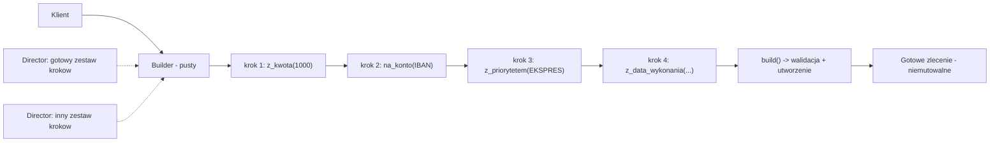
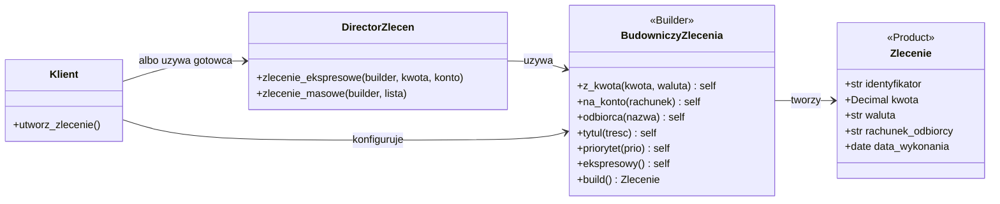
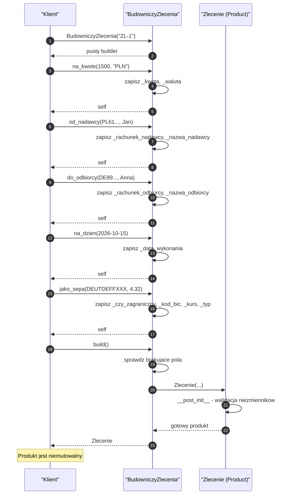
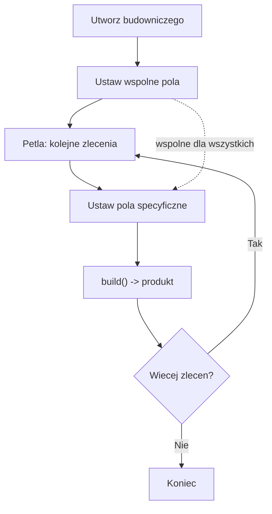
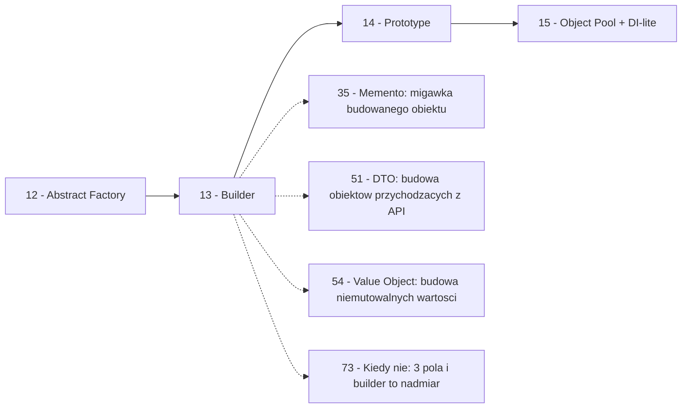

```markdown
---
modul: 13 — Builder
plik: 13-builder.md
poziom: sredni
wymaga: [12]
czas: ~155 minut czytania + ~370 minut ćwiczeń
---

# Moduł 13 — Builder — budowanie złożonych obiektów krok po kroku

> **TL;DR**
> - **Builder (budowniczy)** oddziela **proces tworzenia** złożonego obiektu od jego **reprezentacji** — ten sam zestaw kroków może prowadzić do różnych finalnych obiektów, a klient nie musi znać wszystkich opcji konstruktora.
> - Główny problem, który rozwiązuje, to **konstruktor o dziesięciu argumentach**: nazwy pozycyjne, łatwość zamiany miejscami, brak walidacji, brak sensownej wartości domyślnej i nieczytelne wywołania.
> - W Pythonie budowniczy fluently (`ZlecenieBuilder().na_kwote(...).na_konto(...).build()`) jest tylko **jednym z wariantów** — obok `dataclasses.replace`, funkcji konfigurującej, `keyword-only` argumentów i bibliotek takich jak `attrs` czy `pydantic`.
> - Budowniczy w wersji „fluent" naturalnie łączy się z **niemutowalnością**: obiekt buduje się raz, potem tylko odczytuje — to bezpieczne w wątkach i audytowalne.
> - Zasada: jeśli obiekt ma dwa albo trzy pola, Builder jest nadmiarem. Budowniczy ma sens od pięciu–sześciu pól, z których większość jest opcjonalna, a część zależy od kombinacji innych.

---

## 0. Model mentalny

### Subway i kanapka, którą komponujesz po kolei

Wejdź do Subwaya — sieci, w której kanapkę komponujesz sam, stojąc przy barze. To nie jest restauracja, w której mówisz „poproszę kanapkę", a kucharz znika na pięć minut i wychodzi z gotowym daniem. Tutaj proces jest **jawny i etapowy**. Najpierw wybierasz **pieczywo**: pszenne, pełnoziarniste, z ziołami, ciabatta. Potem **długość**: 15 cm albo 30 cm. Następnie **mięso lub wypełnienie**: kurczak, wołowina, tuńczyk, wegetariańskie. Dalsze kroki to **ser** (i decyzja, czy podgrzać), **warzywa** (i ich zestaw), **sos** (i ich kombinacja), **przyprawy** (sól, pieprz, oregano), i wreszcie **forma** — na miejscu czy na wynos.

Zauważ trzy rzeczy w tym procesie. Po pierwsze, **kolejność kroków jest naturalna i narzucona przez logikę**: nie wybierzesz sosu przed pieczywem, bo sos jest nakładany na gotową kanapkę. Po drugie, **każdy krok ma sensowne opcje domyślne** — jeśli nie powiesz nic o sosie, dostaniesz klasyczny, jeśli nie powiesz nic o serze, dostaniesz taki, który pasuje do wybranego mięsa. Po trzecie, **efektem jest jedna kanapka**, a ty komponowałeś ją z kilkunastu niezależnych wyborów. Wybory nie są „argumentami konstruktora kanapki" — są **etapami, przez które przechodzi budowa**.

I jeszcze jedna rzecz, kluczowa do zrozumienia wzorca Builder: **ten sam proces może prowadzić do różnych kanapek**. Jeśli ktoś inny przejdzie przez ten sam bar i wybierze inne opcje, dostanie inną kanapkę. Proces jest współdzielony, ale jego **efekt** zależy od konkretnego przebiegu. I na koniec — najważniejsze — **istnieją gotowe przepisy, które mówią, jak przejść przez ten bar, by uzyskać określony efekt.** Możesz poprosić o „zestaw firmowy", „kanapkę wegetariańską" albo „kanapkę dla dziecka" — personel przechodzi przez kroki według ustalonej sekwencji, a ty dostajesz konkretny rezultat. Ten „przepis na przejście przez kroki" to w kodzie **Director (reżyser)** — i do niego wrócimy w sekcji 2.

| W analogii Subwaya | W kodzie |
|---|---|
| Bar z pieczywem, mięsem, warzywami | Budowniczy (`ZlecenieBuilder`) z metodami konfiguracji |
| Wybór pieczywa | `builder.z_kwota(...)` |
| Wybór długości | `builder.z_waluta(...)` |
| Wybór mięsa | `builder.na_konto(...)` |
| Wybór sosu | `builder.z_priorytetem(...)` |
| Nakładanie po kolei | Łańcuch wywołań zwracających `self` |
| „Proszę o klasyczny sos" | Wartość domyślna w budowniczym |
| Gotowa kanapka | `builder.build() -> Zlecenie` |
| Pokazanie kanapki przed zapakowaniem | Walidacja przed finalnym `build()` |
| Zestaw firmowy, wegetariański, dla dziecka | Director / gotowe przepisy |

> 🧠 **Zapamiętaj** — **Builder (budowniczy) to wzorzec kreacyjny, który rozbija proces tworzenia złożonego obiektu na serię kroków wykonywanych na osobnym obiekcie budującym; klient konfiguruje obiekt krok po kroku, a finalny `build()` zwraca gotowy, zwykle niemutowalny produkt.**

W tej definicji kluczowe są trzy słowa: **etapy**, **osobny obiekt** i **gotowy (zwykle niemutowalny) produkt**. Etapy — bo budowniczy pokazuje proces krok po kroku. Osobny obiekt — bo budowniczy jest innym obiektem niż produkt (i to nie jest oczywiste, warto to podkreślić). Gotowy produkt — bo w typowych zastosowaniach produkt końcowy jest tworzony raz, w momencie `build()`, i więcej nie zmieniany.

### Diagram — intuicja wzorca



*Diagram pokazuje, że budowniczy przechodzi przez kolejne kroki jedna po drugiej i dopiero na końcu powstaje gotowy, niemutowalny produkt — a Director (opcjonalny) może przechodzić przez kroki według ustalonego przepisu.*

### Czego Builder NIE robi

Rozbrójmy cztery nieporozumienia, które towarzyszą temu wzorcowi — szczególnie w Pythonie, gdzie wiele innych mechanizmów pozwala na to samo.

**Nie jest wymagany do „ładnego wywołania konstruktora".** W Pythonie można uzyskać czytelność wywołania również przez `keyword-only` argumenty (`f(*, kwota: Decimal, waluta: str = "PLN")`), przez `dataclasses.replace` albo przez nazwane konstruktory (`@classmethod`). Builder nie jest jedynym narzędziem do czytelnych konstruktorów.

**Nie chroni przed błędami automatycznie.** Builder zbierze wartości, a `build()` je zwróci. Jeśli nie ma w `build()` walidacji, wciąż możesz zbudować niespójny obiekt (np. ujemna kwota, brak wymaganego pola, sprzeczne opcje). To trzeba zaprojektować — jednym z najczęstszych zadań budowniczego jest właśnie walidacja przed utworzeniem produktu.

**Nie zawsze musi być „fluent" (metody zwracające self).** Wariant fluent jest popularny, ale nie jedyny. Możesz mieć budowniczego z metodami `ustaw_kwote(...)` zwracającymi `None` i używać go w kilku liniach — to też jest Builder. Ważniejsza jest idea etapów niż forma wywołań.

**Nie jest zamiennikiem fabryki.** Builder buduje **jeden** produkt z **wieloma opcjami**; Factory Method wybiera **jeden z wielu wariantów** produktu. Jeśli potrzebujesz wybrać typ, użyj fabryki (moduł 11). Jeśli potrzebujesz skonfigurować złożony obiekt, użyj buildera. Oba wzorce bywają łączone (np. fabryka zwraca buildera odpowiedni dla typu produktu).

**W Pythonie istnieją realne alternatywy.** `attrs`, `cattrs`, `pydantic` — każdy z nich daje bliźniaczą funkcjonalność z mniejszym kosztem kodu, jeśli pasuje do twojego przypadku. Builder ma sens, gdy:
- proces budowy ma etapy, których nie da się wyrazić w jednym wywołaniu,
- potrzebujesz walidacji krzyżowej (jedno pole zależy od drugiego),
- chcesz budować ten sam obiekt **wielokrotnie** z tymi samymi krokami,
- chcesz rozdzielić „co powstaje" od „jak powstaje" (np. ten sam builder produkujący różne formaty).

---

## 1. Problem, który rozwiązujemy

Wejdźmy w domenę 💳 „Rozrachunku". Aplikacja przyjmuje **zlecenia płatności** (instrukcje przelewu) i przekazuje je do realizacji. Zlecenie ma wiele pól — część wymaganych, część opcjonalnych, część zależy od innych. Ktoś napisał konstruktor klasy `ZlecenieRozrachunku`, który przyjmuje wszystkie możliwe opcje.

### Kod „przed"

```python
# rozrachunek_v0.py — wersja naiwna, demonstracyjna
# UWAGA: ten kod celowo zawiera problem "konstruktora o 15 argumentach".

from dataclasses import dataclass
from datetime import date, datetime, timezone
from decimal import Decimal
from typing import Optional

@dataclass
class ZlecenieRozrachunku:
    """Zlecenie przelewu z wieloma opcjonalnymi parametrami."""

    def __init__(
        self,
        identyfikator: str,
        kwota: Decimal,
        waluta: str,
        rachunek_nadawcy: str,
        nazwa_nadawcy: str,
        rachunek_odbiorcy: str,
        nazwa_odbiorcy: str,
        tytul: str,
        data_wykonania: date,
        typ_przelewu: str,
        priorytet: str,
        czy_ekspresowy: bool,
        czy_zagraniczny: bool,
        kod_bic: Optional[str],
        kurs_wymiany: Optional[Decimal],
        prowizja: Optional[Decimal],
        tytul_2: Optional[str],
        tytul_3: Optional[str],
    ) -> None:
        self.identyfikator = identyfikator
        self.kwota = kwota
        self.waluta = waluta
        self.rachunek_nadawcy = rachunek_nadawcy
        self.nazwa_nadawcy = nazwa_nadawcy
        self.rachunek_odbiorcy = rachunek_odbiorcy
        self.nazwa_odbiorcy = nazwa_odbiorcy
        self.tytul = tytul
        self.data_wykonania = data_wykonania
        self.typ_przelewu = typ_przelewu
        self.priorytet = priorytet
        self.czy_ekspresowy = czy_ekspresowy
        self.czy_zagraniczny = czy_zagraniczny
        self.kod_bic = kod_bic
        self.kurs_wymiany = kurs_wymiany
        self.prowizja = prowizja
        self.tytul_2 = tytul_2
        self.tytul_3 = tytul_3
        self.utworzono = datetime.now(timezone.utc)


if __name__ == "__main__":
    # Typowe wywolanie: 18 argumentow, czesc pozycyjnie
    zlecenie = ZlecenieRozrachunku(
        "ZL-2026-0001",
        Decimal("1500.00"),
        "PLN",
        "PL61109010140000071219812874",
        "Jan Kowalski",
        "DE89370400440532013000",
        "Anna Müller",
        "Zaplata za fakture FV/2026/10/123",
        date(2026, 10, 15),
        "SEPA",
        "NORMALNY",
        False,
        True,
        "DEUTDEFFXXX",
        Decimal("4.32"),
        Decimal("4.50"),
        None,
        None,
    )
    print(f"Utworzono zlecenie {zlecenie.identyfikator}")
```

Ten kod działa — uruchamia się i tworzy obiekt. Ale jest tu pięć problemów, z których każdy ma konkretną nazwę i konkretne konsekwencje. Wszystkie razem czynią ten konstruktor **użytecznym tylko dla wtajemniczonych**.

### Code smell — konstruktor „teleskopowy"

| Problem | Gdzie | Konsekwencja |
|---|---|---|
| **18 argumentów pozycyjnych** | `ZlecenieRozrachunku(...)` | Nie da się wywołać bez zaglądania do sygnatury; łatwo pomylić kolejność |
| **Dwa stringi obok siebie tego samego typu** | `rachunek_nadawcy`, `nazwa_nadawcy`, `rachunek_odbiorcy`, `nazwa_odbiorcy` | Zamiana miejscami „nadawcy" i „odbiorcy" nie rzuca błędu — przelewy idą do złodzieja |
| **Brak walidacji** | `__init__` nie sprawdza niczego | Ujemna kwota, błędny IBAN, kurs dla przelewu krajowego — wszystko przechodzi |
| **Opcjonalne pola w środku** | `kod_bic`, `kurs_wymiany`, `prowizja`, `tytul_2`, `tytul_3` | Rozproszone w sygnaturze, trudno powiedzieć, które są wymagane w jakim scenariuszu |
| **Sprzeczne kombinacje** | `czy_ekspresowy=True` i `priorytet="NISKI"` | Konstruktor nie zabrania bzdur |
| **Mutowalność** | `dataclass` bez `frozen=True` | Każdy może nadpisać `kwota` po utworzeniu, co psuje audyt |
| **Brak czytelnego `__repr__`** | Domyślny `object.__repr__` | W debuggerze nie widać nic użytecznego |
| **Powtarzalność przy tworzeniu podobnych zleceń** | Każde wywołanie 18 linii | Duplikacja w kodzie; literówka w jednym z 18 argumentów = cichy błąd |

### Objawy — poznasz ten problem po tym, że...

- **Liczysz argumenty palcem, żeby ich nie pomylić.** Otwierasz plik z definicją klasy obok, żeby sprawdzić, co jest czwarte, a co piąte.
- **Musisz podać `None` dla połowy argumentów, które cię nie dotyczą.** „Buduję przelew krajowy, ale muszę wstawić `None` na `kod_bic`, `kurs_wymiany`..."
- **Nie wiesz, które pola są wymagane dla jakiego scenariusza.** Sygnatura nie mówi „dla SEPA wymagane są kod_bic i kurs".
- **Zmiana kolejności pól w klasie łamie 30 miejsc w kodzie.** Bo wywołania pozycyjne zależą od kolejności.
- **Klasa nie może się rozszerzyć o nowe pole bez modyfikacji wszystkich konstruktorów.** Dodajesz `vat`, robisz `git grep "ZlecenieRozrachunku("` i modyfikujesz każdy wynik.
- **Testy są bardzo rozwlekłe** — żeby sprawdzić jedno zachowanie, trzeba utworzyć obiekt z 18 argumentami.
- **Klient widzi pola, które są „implementacyjne".** `czy_ekspresowy` i `priorytet` są do pewnego stopnia redundantne (ekspres = wysoki priorytet), ale oba są w konstruktorze.
- **Widzisz w kodzie komentarze przed argumentami.** Coś w stylu `Decimal("1500.00"),  # kwota` — to sygnał, że nazwy nie mówią nic i trzeba je objaśniać.
- **W błędzie produkcyjnym nie wiesz, który argument był zły.** `ValueError: invalid IBAN` a może to była nazwa odbiorcy?

---

## 2. Anatomia wzorca

### Uczestnicy

| Rola | Odpowiedzialność | Co NIE jest jej zadaniem |
|---|---|---|
| **Product (produkt)** | Gotowy obiekt, zwykle niemutowalny, o jasnym kontrakcie | Nie zna budowniczego; nie pozwala na modyfikację po utworzeniu |
| **Builder (budowniczy)** | Zbiera konfigurację etapami; przechowuje częściowe wartości; waliduje przed zwróceniem produktu | Nie tworzy produktu automatycznie (tylko przez `build()`); nie wie o produkcie więcej, niż potrzeba |
| **ConcreteBuilder (budowniczy konkretny)** | Konkretny sposób budowy produktu (np. zlecenie bankowe, kontrakt, raport) | W innych językach wariant różni się od budowniczego bazowego (np. builder PDF vs builder CSV) |
| **Director (reżyser)** | Zna sekwencje kroków prowadzące do gotowych rezultatów (np. „zestaw ekspresowy", „zestaw dla klienta detalicznego") | Nie tworzy produktu samodzielnie; deleguje do budowniczego; nie zawiera logiki biznesowej produktu |
| **Klient** | Konfiguruje budowniczego (albo używa reżysera) i wywołuje `build()` | Nie zna detali konstruktora produktu; nie miesza produktu z budowniczym |

> 💡 **Intuicja** — Builder jest jak formularz, który można wypełniać w dowolnej kolejności: dopóki nie naciśniesz „zatwierdź", możesz zmieniać zdanie. A Director jest jak gotowy scenariusz wypełniania formularza — mówi „weź formularz, wpisz pole A, potem C, potem D, i zatwierdź" — jeżeli potrzebujesz pewnego typowego rezultatu.

### Diagram — klasyczna struktura



*Diagram pokazuje, że klient może albo samodzielnie konfigurować budowniczego, albo zlecić to reżyserowi, a produkt pozostaje oddzielony od procesu jego tworzenia.*

Przeczytajmy ten diagram zdanie po zdaniu. `Zlecenie` to **produkt** — niemutowalny, z jasnym kontraktem, bez wiedzy o procesie tworzenia. `BudowniczyZlecenia` to **budowniczy** — gromadzi wartości i zwraca gotowy produkt z `build()`. Zwróć uwagę na metody: każda zwraca `self`, co pozwala na łańcuch wywołań (`ZlecenieBuilder().z_kwota(...).na_konto(...).build()`).

`DirectorZlecen` to **reżyser** — klasa, która wie, jak przejść przez kroki, żeby otrzymać typowe rezultaty. W naszym przykładzie ma metody `zlecenie_ekspresowe` i `zlecenie_masowe`. To jest **opcjonalny** uczestnik — omówimy szczegółowo w sekcji 4.7, kiedy się przydaje, a kiedy jest zbędny.

`Klient` może działać na dwa sposoby: albo **skonfigurować budowniczego samodzielnie krok po kroku**, albo **użyć reżysera** dla typowego przypadku. To jest elastyczność — jeśli potrzebujesz nietypowej konfiguracji, robisz kroki sam; jeśli standardowej, używasz gotowego przepisu.

Zauważ **kierunek zależności**: produkt nie zna budowniczego, budowniczy może znać produkt (tworzy go), reżyser zna budowniczego (używa go). Klient zna budowniczego i opcjonalnie reżysera. To znaczy, że można wymienić dowolny poziom niezależnie.

### Warianty: klasyczny vs pythoniczny

| Aspekt | Wariant klasyczny (GoF, np. Java) | Wariant pythoniczny |
|---|---|---|
| Produkt | Klasa z getterami, często mutowalna | `@dataclass(frozen=True)` |
| Budowniczy | Osobna klasa z metodami mutującymi | Osobna klasa albo `dataclasses.replace` |
| Łańcuch wywołań | Metody zwracają `self` | Zwykle też `self`, ale czasem `replace` |
| Konstruktor produktu | Prywatny, produkt nie może być utworzony bez buildera | Pełny konstruktor zwykle dostępny (Python nie zabroni) |
| Director | Często obecny, obowiązkowy | Opcjonalny, często jako funkcja modułowa |
| Walidacja | Zwykle w `build()` | W `build()` albo w `__post_init__` |
| Alternatywy | Zwykle brak | `attrs`, `cattrs`, `pydantic`, keyword-only args |

W Pythonie mamy **znacząco więcej opcji** niż w klasycznym ujęciu GoF. Budowniczy jest jednym z pięciu możliwych podejść, obok:
- **keyword-only argumentów** (`def __init__(self, *, kwota, waluta="PLN")`),
- **`dataclasses.replace`** — niemutowalna wersja „budowniczego" bez osobnej klasy,
- **funkcji konfigurującej** (funkcja przyjmująca callback ustawiający pola),
- **bibliotek** (`attrs`, `cattrs`, `pydantic`).

W sekcji 4 pokażemy wszystkie te podejścia i kryteria wyboru.

---

## 3. Implementacja krok po kroku

Przebudujemy zlecenie z sekcji 1. Zaczniemy od najprostszej wersji i będziemy dodawali kolejne cechy.

### Krok 1 — Rozdziel produkt od procesu tworzenia

Najpierw produkt. Ustawiamy klasę na **niemutowalną** — to fundamentalna decyzja dla budowniczego.

```python
from dataclasses import dataclass, field
from datetime import date, datetime, timezone
from decimal import Decimal

@dataclass(frozen=True, slots=True)
class ZlecenieRozrachunku:
    """Gotowe zlecenie rozrachunku - niemutowalne."""
    identyfikator: str
    kwota: Decimal
    waluta: str
    rachunek_nadawcy: str
    nazwa_nadawcy: str
    rachunek_odbiorcy: str
    nazwa_odbiorcy: str
    tytul: str
    data_wykonania: date
    typ_przelewu: str = "ELIXIR"
    priorytet: str = "NORMALNY"
    czy_zagraniczny: bool = False
    kod_bic: str | None = None
    kurs_wymiany: Decimal | None = None
    utworzono: datetime = field(default_factory=lambda: datetime.now(timezone.utc))

    def __post_init__(self) -> None:
        if self.kwota <= 0:
            raise ValueError("kwota musi byc dodatnia")
        if self.waluta not in ("PLN", "EUR", "USD"):
            raise ValueError(f"nieobslugiwana waluta: {self.waluta}")
```

Trzy uwagi. Po pierwsze, `frozen=True` — po utworzeniu obiekt nie może się zmienić, co jest wymagane w audycie. Po drugie, `slots=True` — mniejsze zużycie pamięci, brak `__dict__`, więcej sankcji. Po trzecie, `__post_init__` — walidacja wbudowana w dataclass; budowniczy tego samego nie musi robić, bo wystarczy, że wywoła konstruktor.

Zwróć uwagę, że klasyczna definicja produktu ma **wymagane pola bez wartości domyślnej** i **opcjonalne z wartością domyślną**. To jest techniczny warunek, żeby `dataclass` działał — pola z wartościami domyślnymi muszą być po polach wymaganych.

### Krok 2 — Klasyczny budowniczy z metodami fluent

Teraz budowniczy. Trzymamy częściowe wartości i każda metoda zwraca `self`.

```python
class BudowniczyZlecenia:
    """Budowniczy zlecenia rozrachunku: konfiguracja krok po kroku."""

    def __init__(self, identyfikator: str) -> None:
        self._id = identyfikator
        self._kwota: Decimal | None = None
        self._waluta: str = "PLN"
        self._rachunek_nadawcy: str | None = None
        self._nazwa_nadawcy: str | None = None
        self._rachunek_odbiorcy: str | None = None
        self._nazwa_odbiorcy: str | None = None
        self._tytul: str = ""
        self._data_wykonania: date | None = None
        self._typ_przelewu: str = "ELIXIR"
        self._priorytet: str = "NORMALNY"
        self._czy_zagraniczny: bool = False
        self._kod_bic: str | None = None
        self._kurs_wymiany: Decimal | None = None

    def na_kwote(self, kwota: Decimal, waluta: str = "PLN") -> "BudowniczyZlecenia":
        self._kwota = kwota
        self._waluta = waluta
        return self

    def od_nadawcy(
        self, rachunek: str, nazwa: str
    ) -> "BudowniczyZlecenia":
        self._rachunek_nadawcy = rachunek
        self._nazwa_nadawcy = nazwa
        return self

    def do_odbiorcy(
        self, rachunek: str, nazwa: str
    ) -> "BudowniczyZlecenia":
        self._rachunek_odbiorcy = rachunek
        self._nazwa_odbiorcy = nazwa
        return self

    def z_tytulem(self, tytul: str) -> "BudowniczyZlecenia":
        self._tytul = tytul
        return self

    def na_dzien(self, data: date) -> "BudowniczyZlecenia":
        self._data_wykonania = data
        return self

    def ekspresowy(self) -> "BudowniczyZlecenia":
        self._priorytet = "EKSPRES"
        return self

    def zagraniczny(self, kod_bic: str, kurs: Decimal) -> "BudowniczyZlecenia":
        self._czy_zagraniczny = True
        self._kod_bic = kod_bic
        self._kurs_wymiany = kurs
        self._typ_przelewu = "SEPA"
        return self

    def build(self) -> ZlecenieRozrachunku:
        """Waliduje zebrane dane i tworzy zlecenie."""
        brakujace = [
            nazwa for nazwa, wartosc in [
                ("kwota", self._kwota),
                ("rachunek_nadawcy", self._rachunek_nadawcy),
                ("nazwa_nadawcy", self._nazwa_nadawcy),
                ("rachunek_odbiorcy", self._rachunek_odbiorcy),
                ("nazwa_odbiorcy", self._nazwa_odbiorcy),
                ("data_wykonania", self._data_wykonania),
            ]
            if wartosc is None or (isinstance(wartosc, str) and not wartosc)
        ]
        if brakujace:
            raise ValueError(
                f"brakuje wymaganych pol: {', '.join(brakujace)}"
            )
        return ZlecenieRozrachunku(
            identyfikator=self._id,
            kwota=self._kwota,
            waluta=self._waluta,
            rachunek_nadawcy=self._rachunek_nadawcy,
            nazwa_nadawcy=self._nazwa_nadawcy,
            rachunek_odbiorcy=self._rachunek_odbiorcy,
            nazwa_odbiorcy=self._nazwa_odbiorcy,
            tytul=self._tytul,
            data_wykonania=self._data_wykonania,
            typ_przelewu=self._typ_przelewu,
            priorytet=self._priorytet,
            czy_zagraniczny=self._czy_zagraniczny,
            kod_bic=self._kod_bic,
            kurs_wymiany=self._kurs_wymiany,
        )
```

Zwróć uwagę na kilka rzeczy. Metody konfiguracji **nie tworzą obiektu** — tylko zapisują wartości. `build()` jest jedynym miejscem, w którym obiekt jest tworzony. Walidacja w `build()` **zbiera brakujące pola razem** — to dużo lepsze niż „rzucić przy pierwszym brakującym", bo klient dowiaduje się o wszystkich problemach naraz.

Ważna rzecz: `build()` **nie modyfikuje budowniczego**. W naszym kodzie metody konfiguracji modyfikują, ale `build()` tylko czyta. To znaczy, że budowniczego można użyć wielokrotnie — budując kolejne warianty z niemal tym samym zestawem wartości.

### Krok 3 — Zadbaj o czystość wywołania

Klient teraz używa:

```python
zlecenie = (
    BudowniczyZlecenia("ZL-2026-0001")
    .na_kwote(Decimal("1500.00"))
    .od_nadawcy("PL61...", "Jan Kowalski")
    .do_odbiorcy("DE89...", "Anna Müller")
    .z_tytulem("Zaplata za fakture FV/2026/10/123")
    .na_dzien(date(2026, 10, 15))
    .zagraniczny("DEUTDEFFXXX", Decimal("4.32"))
    .build()
)
```

Porównaj z wersją z sekcji 1: zamiast 18 argumentów pozycyjnych — 7 jasnych wywołań z nazwami operacji. Każda linia mówi, co robi. Łatwo dodać kolejną linię i widać, co się dzieje.

### Krok 4 — Dodaj możliwość reużycia budowniczego

Czasem klient chce zbudować serię podobnych zleceń. Wystarczy, że budowniczy nie mutuje w `build()`.

```python
# Budujemy "szablon" raz, potem go powtarzamy
builder = (
    BudowniczyZlecenia("SZABLON")
    .od_nadawcy("PL61...", "Nasza Spolka")
    .na_dzien(date(2026, 10, 15))
)

for i, (rachunek, kwota) in enumerate([
    ("DE89...", Decimal("1000.00")),
    ("GB29...", Decimal("2500.00")),
], start=1):
    b = builder.na_kwote(kwota).do_odbiorcy(rachunek, f"Odbiorca {i}")
    # teraz b.build() zwraca osobne zlecenie
```

Uwaga: powyższy przykład **modyfikuje wspólny builder**, więc utworzone zlecenia mają wspólne pola — ale to jest OK, bo chcemy tak samo „szablonowe". Jeśli chcesz mieć niezależne buildery, musisz je kopiować albo utworzyć osobny dla każdej iteracji.

### Krok 5 — Opcjonalny Director

Dla typowych przypadków, gdy znasz sekwencję kroków, warto mieć `Director`. To klasa, która wie, jak przejść przez kroki i zwrócić gotowy rezultat.

```python
class DirectorZlecen:
    """Gotowe przepisy: ekspresowe, masowe, dla klienta detalicznego."""

    @staticmethod
    def detaliczne(
        identyfikator: str,
        kwota: Decimal,
        nadawca: tuple[str, str],
        odbiorca: tuple[str, str],
        tytul: str,
    ) -> BudowniczyZlecenia:
        return (
            BudowniczyZlecenia(identyfikator)
            .na_kwote(kwota)
            .od_nadawcy(*nadawca)
            .do_odbiorcy(*odbiorca)
            .z_tytulem(tytul)
            .na_dzien(date.today())
            .ekspresowy()
        )

    @staticmethod
    def ekspresowe_zagraniczne(
        identyfikator: str,
        kwota: Decimal,
        waluta: str,
        nadawca: tuple[str, str],
        odbiorca: tuple[str, str],
        tytul: str,
        bic: str,
        kurs: Decimal,
    ) -> BudowniczyZlecenia:
        return (
            BudowniczyZlecenia(identyfikator)
            .na_kwote(kwota, waluta)
            .od_nadawcy(*nadawca)
            .do_odbiorcy(*odbiorca)
            .z_tytulem(tytul)
            .na_dzien(date.today())
            .ekspresowy()
            .zagraniczny(bic, kurs)
        )
```

Klient używa tego jako:

```python
zlecenie = DirectorZlecen.detaliczne(
    "ZL-2026-0002",
    Decimal("500.00"),
    ("PL61...", "Jan Kowalski"),
    ("PL62...", "Sklep XYZ"),
    "Zakupy online",
).build()
```

Zamiast konfigurować krok po kroku — klient mówi „to jest zlecenie detaliczne" i podaje tylko dane, które różnią się między zleceniami. Director ukrywa sekwencję kroków.

Uwaga: director nie jest obowiązkowy. W wielu implementacjach wystarczy funkcja modułowa albo kilka `@classmethod`. Wracamy do tego w sekcji 4.7.

### Krok 6 — Weryfikacja

| Kryterium | Wersja „przed" | Wersja „po" |
|---|---|---|
| Liczba argumentów w konstruktorze | 18 pozycyjnych | 0 (używamy `builder.build()`) |
| Czytelność wywołania | Trzeba mieć sygnaturę pod ręką | Każda linia mówi, co się dzieje |
| Zamiana „nadawcy" i „odbiorcy" | Możliwa bez błędu | Trudna — `od_nadawcy` i `do_odbiorcy` to różne metody |
| Walidacja braku pól | Brak | Zbiera wszystkie braki naraz |
| Niemutowalność produktu | Wyłączona | Włączona (`frozen=True`) |
| Zmiana kolejności pól w klasie | Łamie 30 miejsc | Nie łamie nic (używamy nazw) |
| Reużycie konfiguracji | Trzeba powtórzyć wszystko | Można trzymać budowniczego i modyfikować |
| Typowe scenariusze | Trzeba pisać za każdym razem | Director daje gotowe przepisy |
| Liczba klas | 1 | 3 (produkt, budowniczy, director) |
| Liczba linii | ~60 | ~150 |

Koszt: trzy razy więcej linii, dodatkowe klasy, dodatkowy poziom abstrakcji. Zysk: czytelność, bezpieczeństwo typów, elastyczność, niemutowalność. Jak zwykle — Builder ma sens, gdy obiekt jest **naprawdę złożony** i budowany w wielu miejscach. Dla obiektu z trzema polami byłby to przerost formy.

---

## 4. Wersje pythoniczne i warianty

Ta sekcja to katalog pięciu głównych podejść do budowy obiektów w Pythonie, w tym dwa bez formalnego buildera. Omówimy je w kolejności od najbardziej klasycznego do najbardziej pythonicznego.

### 4.1 Klasyczny Builder fluent

Wariant z sekcji 3. Prototyp, który powinieneś znać. Metody zwracają `self`, łańcuch wywołań, `build()` na końcu.

```python
class ZlecenieBuilder:
    def __init__(self, id_: str) -> None:
        self._id = id_
        self._kwota: Decimal | None = None
        # ... reszta pol
    def na_kwote(self, k: Decimal, w: str = "PLN") -> "ZlecenieBuilder":
        self._kwota = k
        self._waluta = w
        return self
    # ...
    def build(self) -> Zlecenie: ...
```

Zalety: czytelne, znajome dla większości programistów, dobrze współgra z niemutowalnym produktem. Wady: trzeba pisać dużo kodu (metody dla każdego pola); jeśli produkt ma 20 pól, builder też ma 20 metod. To sporo boilerplate'u.

**Kiedy stosować:** gdy produkt jest złożony, budowany w wielu miejscach, i chcesz wyraźnie pokazać proces jego tworzenia.

### 4.2 `dataclasses.replace` — „niemutowalny" builder bez osobnej klasy

To bardzo elegancka technika w Pythonie. Nie ma osobnego budowniczego — używa się `replace` do tworzenia nowego obiektu z modyfikacją kilku pól.

```python
from dataclasses import dataclass, replace
from datetime import date
from decimal import Decimal

@dataclass(frozen=True)
class Zlecenie:
    identyfikator: str
    kwota: Decimal
    waluta: str
    rachunek_nadawcy: str
    nazwa_nadawcy: str
    rachunek_odbiorcy: str
    nazwa_odbiorcy: str
    tytul: str
    data_wykonania: date
    priorytet: str = "NORMALNY"
    czy_zagraniczny: bool = False

# Budowa krok po kroku za pomoca replace:
szablon = Zlecenie(
    identyfikator="SZABLON",
    kwota=Decimal("0"),
    waluta="PLN",
    rachunek_nadawcy="PL61...",
    nazwa_nadawcy="Nasza Spolka",
    rachunek_odbiorcy="",
    nazwa_odbiorcy="",
    tytul="",
    data_wykonania=date.today(),
)

# Krok 1: uzupelnij odbiorce
krok1 = replace(szablon, rachunek_odbiorcy="DE89...", nazwa_odbiorcy="Anna")
# Krok 2: uzupelnij kwote
krok2 = replace(krok1, kwota=Decimal("1000.00"))
# Krok 3: ustaw tytul
final = replace(krok2, tytul="Faktura 123")
```

Zalety: brak osobnej klasy; naturalne w Pythonie; tworzy nowy obiekt na każdym kroku (co ma i złe, i dobre strony). Wady: przy każdym kroku tworzymy **przejściowy obiekt** — dla 10 kroków to 10 obiektów; wydajność mniejsza; ciężko jest umieścić walidację między krokami (trzeba ją zrobić po `replace`).

**Kiedy stosować:** gdy budowa jest stosunkowo prosta (3–6 kroków), gdy chcesz uniknąć „stanu pośredniego" (każdy krok jest już ważnym obiektem), gdy obiekt ma dużo pól, a większość wartości jest stała.

### 4.3 Budowniczy funkcyjny — funkcja konfigurująca

Zamiast osobnej klasy, mamy funkcję, która przyjmuje callback konfigurujący obiekt.

```python
from collections.abc import Callable
from dataclasses import dataclass, replace

def zbuduj_zlecenie(
    identyfikator: str,
    konfiguracja: Callable[[Zlecenie], Zlecenie] | None = None,
) -> Zlecenie:
    """Buduje zlecenie z minimalna konfiguracja i pozwala dopisac resztę."""
    bazowe = Zlecenie(
        identyfikator=identyfikator,
        kwota=Decimal("0"),
        waluta="PLN",
        rachunek_nadawcy="",
        nazwa_nadawcy="",
        rachunek_odbiorcy="",
        nazwa_odbiorcy="",
        tytul="",
        data_wykonania=date.today(),
    )
    if konfiguracja is not None:
        bazowe = konfiguracja(bazowe)
    return bazowe


# Uzycie:
zlecenie = zbuduj_zlecenie(
    "ZL-2026-0003",
    konfiguracja=lambda z: replace(
        z, kwota=Decimal("500.00"), rachunek_odbiorcy="DE89..."
    ),
)
```

Zalety: nie trzeba tworzyć hipotetycznych pośrednich typów; konfiguracja jest funkcją, więc naturalnie oddziela się od produktu. Wady: mniej „krok po kroku" (choć to czasem dobrze — konfiguracja jednorazowa); mniej czytelne dla osób przyzwyczajonych do fluent.

**Kiedy stosować:** gdy konfiguracja jest stosunkowo krótka i chcesz ją przekazać jako argument; gdy chcesz łączyć się z innymi narzędziami funkcyjnymi (`functools.partial`, `compose`).

### 4.4 `keyword-only` arguments — argumenty tylko po nazwie

To nie jest Builder w sensie wzorca, ale rozwiązuje część jego problemów.

```python
@dataclass(frozen=True)
class Zlecenie:
    identyfikator: str
    kwota: Decimal
    # ... wiecej pol

def utworz_zlecenie(
    *,
    identyfikator: str,
    kwota: Decimal,
    waluta: str = "PLN",
    rachunek_nadawcy: str = "",
    nazwa_nadawcy: str = "",
    rachunek_odbiorcy: str = "",
    nazwa_odbiorcy: str = "",
    tytul: str = "",
    priorytet: str = "NORMALNY",
    czy_zagraniczny: bool = False,
) -> Zlecenie:
    ...
```

Użycie: `utworz_zlecenie(identyfikator="ZL-1", kwota=Decimal("1000"), ...)`. Dzięki `*` **każdy** argument musi być nazwany. To eliminuje problem pomylenia kolejności argumentów.

Zalety: minimalny narzut, standardowy Python, dobre wsparcie IDE i `mypy`. Wady: nie pokazuje etapów (wszystko naraz); nie daje reużycia konfiguracji; walidacja jest w jednym miejscu (dobrze) albo w `__post_init__` (też dobrze).

**Kiedy stosować:** gdy obiekt ma dużo pól, ale budujesz go zawsze w jednym kroku; gdy chcesz minimalnego narzutu kodu.

### 4.5 Biblioteki: `attrs`, `cattrs`, `pydantic`

W produkcji, zamiast pisać własnego budowniczego, często używa się bibliotek.

```python
# attrs - generuje konstruktor z walidacja i konwersja
import attrs

@attrs.define
class Zlecenie:
    identyfikator: str
    kwota: Decimal
    waluta: str = attrs.field(
        default="PLN",
        validator=attrs.validators.in_({"PLN", "EUR", "USD"}),
    )
    priorytet: str = "NORMALNY"
```

```python
# pydantic - walidacja + parsowanie z JSON
from pydantic import BaseModel, field_validator

class Zlecenie(BaseModel, frozen=True):
    identyfikator: str
    kwota: Decimal
    waluta: str = "PLN"

    @field_validator("waluta")
    @classmethod
    def sprawdz_walute(cls, v: str) -> str:
        if v not in ("PLN", "EUR", "USD"):
            raise ValueError(f"nieobslugiwana waluta: {v}")
        return v
```

Zalety: zero boilerplate'u na settersy, wbudowana walidacja, konwersja typów, serializacja z/do JSON. Wady: zewnętrzna zależność, część bibliotek nie jest zoptymalizowana pod przypadki „buduj krok po kroku".

**Kiedy stosować:** w zdecydowanej większości nowoczesnych projektów Python — zwłaszcza w aplikacjach przetwarzających dane z zewnątrz (API, pliki). Dla prostych przypadków `dataclass` wystarczy; dla złożonej walidacji — `pydantic` albo `attrs`.

### 4.6 Wariant mieszany — Builder + `dataclass(frozen=True)`

W praktyce najczęściej stosuje się połączenie: produkt jako `dataclass(frozen=True)`, builder osobno dla trudnych przypadków, keyword-only args dla prostych wywołań. To znaczy: **możesz mieć trzy sposoby tworzenia tego samego obiektu** i używać każdego tam, gdzie jest najlepszy.

```python
@dataclass(frozen=True)
class Zlecenie:
    identyfikator: str
    kwota: Decimal
    waluta: str = "PLN"
    # ... reszta
    # Klasyczny konstruktor dataclass dziala dla prostych przypadkow

class ZlecenieBuilder:
    # Dla zlozonych przypadkow: 10+ pol, walidacja krzyzowa
    ...

def zlecenie_detaliczne(...) -> Zlecenie:
    # Funkcja per scenariusz
    ...
```

To rozsądne: nie próbuj uniwersalizować. Każdy scenariusz ma swoje najlepsze narzędzie.

### 4.7 Director — kiedy naprawdę potrzebny

W klasycznym ujęciu GoF Director jest obowiązkowy. W Pythonie często nie jest potrzebny. Trzy kryteria:

**Przydaje się, gdy:**
- Masz **wiele powtarzalnych scenariuszy budowy** o nazwach (np. „zlecenie detaliczne", „przelew SEPA", „przelew natychmiastowy").
- Chcesz **oddzielić „przepisy" od samej mechaniki budowy** — to pomaga w testach (reżyser testowalny osobno).
- Zespół biznesowy lubi nazywać typowe przypadki i chcesz, żeby te nazwy były w kodzie.

**Nie przydaje się, gdy:**
- Budowa jest prosta (3 metody) i każdy scenariusz to jedna linia.
- Zamiast metod nazwanych („detaliczne", „ekspresowe") wystarczy słownik albo `enum`.
- Director staje się „funkcją, która za dużo wie" — bo zna wszystkie możliwe kombinacje.

W praktyce Director bywa zastępowany **funkcją modułową** albo **`@classmethod`**:

```python
class Zlecenie:
    @classmethod
    def detaliczne(
        cls, identyfikator: str, kwota: Decimal,
        nadawca: str, odbiorca: str
    ) -> "Zlecenie":
        return cls(
            identyfikator=identyfikator,
            kwota=kwota,
            rachunek_nadawcy=nadawca,
            rachunek_odbiorcy=odbiorca,
            # ... domyslne wartosci
        )

    @classmethod
    def ekspresowe_zagraniczne(cls, ...) -> "Zlecenie":
        ...
```

To nie jest w pełni Director (bo tworzy produkt bezpośrednio, nie konfiguruje budowniczego), ale pełni analogiczną rolę — daje **gotowe nazwane przepisy**. W większości przypadków to wystarcza.

### 4.8 Podsumowanie — tabela wyboru

| Potrzeba | Wariant |
|---|---|
| Obiekt z 8+ polami, walidacja krzyżowa, budowany rzadko | Klasyczny Builder (4.1) |
| Obiekt niemutowalny, budowa krokami, mało pól | `dataclasses.replace` (4.2) |
| Konfiguracja przekazywana jako argument | Funkcja konfigurująca (4.3) |
| Obiekt z 5–8 polami, budowany w jednym kroku | Keyword-only args (4.4) |
| Walidacja złożona, konwersja typów, parsowanie JSON | `pydantic` / `attrs` (4.5) |
| Różne narzędzia dla różnych scenariuszy | Wariant mieszany (4.6) |
| Wiele nazwanych scenariuszy budowy | Director / `@classmethod` (4.7) |

> 🧠 **Zapamiętaj** — Builder nie jest uniwersalnym narzędziem. W Pythonie najczęściej wystarczy **`dataclass(frozen=True)` + `keyword-only args`** albo **funkcja konfigurująca + `replace`**. Klasyczny Builder fluent ma sens, gdy potrzebujesz jawnego etapowego procesu, reużycia konfiguracji albo wielokrotnego budowania.

---

## 5. Przykład z życia: 💳 Rozrachunek — pełny uruchamialny kod

Zbudujemy pełny system tworzenia zleceń przelewu z budowniczym. Pokażemy:
- produkt niemutowalny z walidacją,
- budowniczego fluent z pełnym zestawem kroków,
- walidację krzyżową w `build()`,
- reżysera z gotowymi przepisami,
- testy.

### Kod

```python
# rozrachunek_builder.py — pelny przyklad Builder
from __future__ import annotations

import re
from dataclasses import dataclass, field
from datetime import date, datetime, timezone
from decimal import ROUND_HALF_UP, Decimal
from enum import Enum

# ===========================================================================
# 1. Typy pomocnicze
# ===========================================================================

class PriorytetZlecenia(Enum):
    NORMALNY = "NORMALNY"
    WYSOKI = "WYSOKI"
    EKSPRES = "EKSPRES"

    def __str__(self) -> str:
        return self.value


class TypPrzelewu(Enum):
    ELIXIR = "ELIXIR"
    EXPRESS = "EXPRESS"
    SEPA = "SEPA"
    SWIFT = "SWIFT"

    def __str__(self) -> str:
        return self.value


WZORZEC_IBAN = re.compile(r"^[A-Z]{2}[0-9]{2}[A-Z0-9]{10,30}$")
WZORZEC_BIC = re.compile(r"^[A-Z]{4}[A-Z]{2}[A-Z0-9]{2}([A-Z0-9]{3})?$")


# ===========================================================================
# 2. Product - niemutowalne zlecenie
# ===========================================================================

@dataclass(frozen=True, slots=True)
class Zlecenie:
    """Niemutowalne zlecenie rozrachunku."""

    identyfikator: str
    kwota: Decimal
    waluta: str
    rachunek_nadawcy: str
    nazwa_nadawcy: str
    rachunek_odbiorcy: str
    nazwa_odbiorcy: str
    tytul: str
    data_wykonania: date
    typ_przelewu: TypPrzelewu
    priorytet: PriorytetZlecenia
    czy_zagraniczny: bool
    kod_bic: str | None
    kurs_wymiany: Decimal | None
    utworzono: datetime

    # --- Walidacje niezmiennikow ---

    def __post_init__(self) -> None:
        if self.kwota <= Decimal("0"):
            raise ValueError(f"kwota musi byc dodatnia, otrzymano {self.kwota}")
        if self.waluta not in ("PLN", "EUR", "USD"):
            raise ValueError(f"nieobslugiwana waluta: {self.waluta}")
        if not WZORZEC_IBAN.match(self.rachunek_odbiorcy):
            raise ValueError(
                f"niepoprawny IBAN odbiorcy: {self.rachunek_odbiorcy}"
            )
        if self.czy_zagraniczny and not self.kod_bic:
            raise ValueError("przelew zagraniczny wymaga kodu BIC")
        if self.kod_bic and not WZORZEC_BIC.match(self.kod_bic):
            raise ValueError(f"niepoprawny BIC: {self.kod_bic}")
        if self.kwota > Decimal("1000000.00"):
            raise ValueError(
                f"kwota powyzej limitu technicznego: {self.kwota}"
            )
        if len(self.tytul) > 140:
            raise ValueError(
                f"tytul nie moze przekraczac 140 znakow, jest {len(self.tytul)}"
            )

    @property
    def prowizja(self) -> Decimal:
        stawki = {
            TypPrzelewu.ELIXIR: Decimal("0.002"),
            TypPrzelewu.EXPRESS: Decimal("0.005"),
            TypPrzelewu.SEPA: Decimal("0.003"),
            TypPrzelewu.SWIFT: Decimal("0.008"),
        }
        stawka = stawki[self.typ_przelewu]
        return (self.kwota * stawka).quantize(
            Decimal("0.01"), rounding=ROUND_HALF_UP
        )

    def podsumowanie(self) -> str:
        return (
            f"{self.identyfikator}: {self.kwota} {self.waluta} "
            f"-> {self.rachunek_odbiorcy} ({self.nazwa_odbiorcy}) "
            f"[{self.typ_przelewu}, {self.priorytet}]"
        )


# ===========================================================================
# 3. Builder - konfiguracja krok po kroku
# ===========================================================================

class BudowniczyZlecenia:
    """Budowniczy zlecenia. Metody zwracaja self, build() zwraca produkt."""

    def __init__(self, identyfikator: str) -> None:
        if not identyfikator:
            raise ValueError("identyfikator nie moze byc pusty")
        self._id = identyfikator
        self._kwota: Decimal | None = None
        self._waluta: str = "PLN"
        self._rachunek_nadawcy: str | None = None
        self._nazwa_nadawcy: str | None = None
        self._rachunek_odbiorcy: str | None = None
        self._nazwa_odbiorcy: str | None = None
        self._tytul: str = ""
        self._data_wykonania: date | None = None
        self._typ_przelewu: TypPrzelewu = TypPrzelewu.ELIXIR
        self._priorytet: PriorytetZlecenia = PriorytetZlecenia.NORMALNY
        self._czy_zagraniczny: bool = False
        self._kod_bic: str | None = None
        self._kurs_wymiany: Decimal | None = None

    # --- Metody konfiguracji ---

    def na_kwote(self, kwota: Decimal, waluta: str = "PLN") -> "BudowniczyZlecenia":
        self._kwota = kwota
        self._waluta = waluta
        return self

    def od_nadawcy(self, rachunek: str, nazwa: str) -> "BudowniczyZlecenia":
        self._rachunek_nadawcy = rachunek
        self._nazwa_nadawcy = nazwa
        return self

    def do_odbiorcy(self, rachunek: str, nazwa: str) -> "BudowniczyZlecenia":
        self._rachunek_odbiorcy = rachunek
        self._nazwa_odbiorcy = nazwa
        return self

    def z_tytulem(self, tytul: str) -> "BudowniczyZlecenia":
        self._tytul = tytul
        return self

    def na_dzien(self, data: date) -> "BudowniczyZlecenia":
        self._data_wykonania = data
        return self

    def ekspresowy(self) -> "BudowniczyZlecenia":
        self._priorytet = PriorytetZlecenia.EKSPRES
        self._typ_przelewu = TypPrzelewu.EXPRESS
        return self

    def z_priorytetem(self, priorytet: PriorytetZlecenia) -> "BudowniczyZlecenia":
        self._priorytet = priorytet
        return self

    def jako_sepa(self, kod_bic: str, kurs: Decimal) -> "BudowniczyZlecenia":
        self._czy_zagraniczny = True
        self._typ_przelewu = TypPrzelewu.SEPA
        self._kod_bic = kod_bic
        self._kurs_wymiany = kurs
        return self

    def jako_swift(self, kod_bic: str, kurs: Decimal) -> "BudowniczyZlecenia":
        self._czy_zagraniczny = True
        self._typ_przelewu = TypPrzelewu.SWIFT
        self._kod_bic = kod_bic
        self._kurs_wymiany = kurs
        return self

    # --- Finalizacja ---

    def build(self) -> Zlecenie:
        """Waliduje komplet naleznych pol i tworzy produkt."""
        brakujace: list[str] = []
        if self._kwota is None:
            brakujace.append("kwota")
        if not self._rachunek_nadawcy:
            brakujace.append("rachunek_nadawcy")
        if not self._nazwa_nadawcy:
            brakujace.append("nazwa_nadawcy")
        if not self._rachunek_odbiorcy:
            brakujace.append("rachunek_odbiorcy")
        if not self._nazwa_odbiorcy:
            brakujace.append("nazwa_odbiorcy")
        if self._data_wykonania is None:
            brakujace.append("data_wykonania")

        if brakujace:
            raise ValueError(
                f"brakuje wymaganych pol: {', '.join(brakujace)}"
            )

        return Zlecenie(
            identyfikator=self._id,
            kwota=self._kwota,
            waluta=self._waluta,
            rachunek_nadawcy=self._rachunek_nadawcy,
            nazwa_nadawcy=self._nazwa_nadawcy,
            rachunek_odbiorcy=self._rachunek_odbiorcy,
            nazwa_odbiorcy=self._nazwa_odbiorcy,
            tytul=self._tytul,
            data_wykonania=self._data_wykonania,
            typ_przelewu=self._typ_przelewu,
            priorytet=self._priorytet,
            czy_zagraniczny=self._czy_zagraniczny,
            kod_bic=self._kod_bic,
            kurs_wymiany=self._kurs_wymiany,
            utworzono=datetime.now(timezone.utc),
        )


# ===========================================================================
# 4. Director - gotowe przepisy
# ===========================================================================

class DirectorZlecen:
    """Gotowe scenariusze tworzenia zlecen. Nie tworzy produktow sam."""

    @staticmethod
    def detaliczne(
        identyfikator: str,
        kwota: Decimal,
        nadawca: tuple[str, str],
        odbiorca: tuple[str, str],
        tytul: str,
    ) -> BudowniczyZlecenia:
        return (
            BudowniczyZlecenia(identyfikator)
            .na_kwote(kwota)
            .od_nadawcy(*nadawca)
            .do_odbiorcy(*odbiorca)
            .z_tytulem(tytul)
            .na_dzien(date.today())
        )

    @staticmethod
    def natychmiastowe_detaliczne(
        identyfikator: str,
        kwota: Decimal,
        nadawca: tuple[str, str],
        odbiorca: tuple[str, str],
        tytul: str,
    ) -> BudowniczyZlecenia:
        return DirectorZlecen.detaliczne(
            identyfikator, kwota, nadawca, odbiorca, tytul
        ).ekspresowy()

    @staticmethod
    def sepa_zagraniczne(
        identyfikator: str,
        kwota: Decimal,
        waluta: str,
        nadawca: tuple[str, str],
        odbiorca: tuple[str, str],
        tytul: str,
        bic: str,
        kurs: Decimal,
    ) -> BudowniczyZlecenia:
        return (
            BudowniczyZlecenia(identyfikator)
            .na_kwote(kwota, waluta)
            .od_nadawcy(*nadawca)
            .do_odbiorcy(*odbiorca)
            .z_tytulem(tytul)
            .na_dzien(date.today())
            .jako_sepa(bic, kurs)
        )

    @staticmethod
    def masowy_przelew(
        identyfikator: str,
        kwota: Decimal,
        nadawca: tuple[str, str],
        odbiorca: tuple[str, str],
        tytul: str,
    ) -> BudowniczyZlecenia:
        """Zlecenie masowe: elixir z niska prowizja."""
        return DirectorZlecen.detaliczne(
            identyfikator, kwota, nadawca, odbiorca, tytul
        ).z_priorytetem(PriorytetZlecenia.NORMALNY)


# ===========================================================================
# 5. Demonstracja
# ===========================================================================

if __name__ == "__main__":
    NADW = ("PL61109010140000071219812874", "Jan Kowalski")
    ODB1 = ("DE89370400440532013000", "Anna Muller")
    ODB2 = ("PL62109010140000071219812875", "Sklep XYZ sp. z o.o.")

    print("=== 1. Budowa krok po kroku (fluent) ===")
    z1 = (
        BudowniczyZlecenia("ZL-2026-0001")
        .na_kwote(Decimal("1500.00"))
        .od_nadawcy(*NADW)
        .do_odbiorcy(*ODB1)
        .z_tytulem("Zaplata za fakture FV/2026/10/123")
        .na_dzien(date(2026, 10, 15))
        .jako_sepa("DEUTDEFFXXX", Decimal("4.32"))
        .build()
    )
    print(f"  {z1.podsumowanie()}")
    print(f"  prowizja: {z1.prowizja}")

    print("\n=== 2. Budowa przez Director (gotowy przepis) ===")
    z2 = DirectorZlecen.natychmiastowe_detaliczne(
        "ZL-2026-0002",
        Decimal("500.00"),
        NADW,
        ODB2,
        "Zakupy online",
    ).build()
    print(f"  {z2.podsumowanie()}")
    print(f"  prowizja: {z2.prowizja}")

    print("\n=== 3. Reuzycie konfiguracji budowniczego ===")
    szablon = (
        BudowniczyZlecenia("SZABLON")
        .od_nadawcy(*NADW)
        .na_dzien(date(2026, 10, 15))
    )
    zlecenia = []
    for i, (kwota, odbiorca) in enumerate([
        (Decimal("1000.00"), ODB1),
        (Decimal("2500.00"), ODB2),
    ], 1):
        zlecenia.append(
            szablon.na_kwote(kwota)
            .do_odbiorcy(*odbiorca)
            .z_tytulem(f"Rata {i}")
            .build()
        )
    for z in zlecenia:
        print(f"  {z.podsumowanie()}")

    print("\n=== 4. Walidacja brakow ===")
    try:
        BudowniczyZlecenia("ZL-2026-0003").na_kwote(Decimal("100")).build()
    except ValueError as blad:
        print(f"  {blad}")

    print("\n=== 5. Walidacja niezmiennikow produktu ===")
    try:
        (
            BudowniczyZlecenia("ZL-2026-0004")
            .na_kwote(Decimal("-100.00"))
            .od_nadawcy(*NADW)
            .do_odbiorcy(*ODB2)
            .z_tytulem("test")
            .na_dzien(date.today())
            .build()
        )
    except ValueError as blad:
        print(f"  {blad}")

    print("\n=== 6. Niemutowalnosc produktu ===")
    try:
        z1.kwota = Decimal("999999.00")  # type: ignore[misc]
    except Exception as blad:
        print(f"  {type(blad).__name__}: nie mozna zmienic zamrozonego obiektu")
```

### Co ten przykład pokazuje

Uruchomienie tego kodu demonstruje wszystkie cechy wzorca Builder w praktyce.

**Punkt 1 — budowa fluent.** Klient konfiguruje krok po kroku: kwota, nadawca, odbiorca, tytuł, data, jako SEPA. Każda linia mówi, co się dzieje. Nie ma ryzyka pomylenia `rachunek_nadawcy` z `rachunek_odbiorcy`, bo wywołania mają różne nazwy.

**Punkt 2 — Director jako gotowy przepis.** Zamiast konfigurować 6 kroków, klient mówi „chcę natychmiastowe detaliczne" i podaje tylko dane specyficzne (kwota, odbiorca). Cała sekwencja kroków jest w metodzie reżysera.

**Punkt 3 — reużycie budowniczego.** `szablon` jest w pełni skonfigurowany poza pętlą. W pętli dodajemy tylko kwotę, odbiorcę i tytuł. To duże uproszczenie — zamiast powtarzać 6 kroków dla każdego zlecenia, powtarzamy tylko 3. **Uwaga:** `build()` musi być bezpieczny — nie może zmieniać stanu budowniczego. W naszym przypadku tak jest.

**Punkt 4 — walidacja braków.** `build()` zebrał **wszystkie** brakujące pola naraz (`kwota, rachunek_nadawcy, nazwa_nadawcy, rachunek_odbiorcy, nazwa_odbiorcy, data_wykonania`) i zwrócił jeden komunikat. To jest kluczowe — klient nie poprawia błędów po jednym.

**Punkt 5 — walidacja niezmienników.** Produkt sam pilnuje poprawności w `__post_init__`: kwota ujemna jest odrzucana przez `Zlecenie`, nie przez budowniczego. To jest **rozproszenie odpowiedzialności**: builder zbiera dane, produkt waliduje niezmienniki. Świadoma decyzja projektowa.

**Punkt 6 — niemutowalność.** `frozen=True` powoduje `FrozenInstanceError` przy próbie zmiany. To gwarantuje **audytowalność**: raz utworzone zlecenie nie może zostać zmienione „po cichu".

### Testy

```python
# test_rozrachunek_builder.py — uruchomienie: pytest test_rozrachunek_builder.py -v
from datetime import date
from decimal import Decimal

import pytest

from rozrachunek_builder import (
    BudowniczyZlecenia,
    DirectorZlecen,
    PriorytetZlecenia,
    TypPrzelewu,
    Zlecenie,
)

NAD = ("PL61109010140000071219812874", "Jan Kowalski")
ODB = ("DE89370400440532013000", "Anna Muller")
ODB_PL = ("PL62109010140000071219812875", "Sklep XYZ")


# --- Builder: kroki podstawowe ----------------------------------------------

def test_builder_tworzy_minimalne_zlecenie() -> None:
    z = (
        BudowniczyZlecenia("ZL-1")
        .na_kwote(Decimal("100.00"))
        .od_nadawcy(*NAD)
        .do_odbiorcy(*ODB)
        .na_dzien(date(2026, 10, 15))
        .build()
    )
    assert isinstance(z, Zlecenie)
    assert z.kwota == Decimal("100.00")
    assert z.waluta == "PLN"


def test_builder_domyslne_wartosci() -> None:
    z = (
        BudowniczyZlecenia("ZL-1")
        .na_kwote(Decimal("100.00"))
        .od_nadawcy(*NAD)
        .do_odbiorcy(*ODB)
        .na_dzien(date(2026, 10, 15))
        .build()
    )
    assert z.typ_przelewu is TypPrzelewu.ELIXIR
    assert z.priorytet is PriorytetZlecenia.NORMALNY
    assert not z.czy_zagraniczny


def test_builder_ekspresowy_ustawia_priorytet_i_typ() -> None:
    z = (
        BudowniczyZlecenia("ZL-2")
        .na_kwote(Decimal("100.00"))
        .od_nadawcy(*NAD)
        .do_odbiorcy(*ODB)
        .na_dzien(date.today())
        .ekspresowy()
        .build()
    )
    assert z.priorytet is PriorytetZlecenia.EKSPRES
    assert z.typ_przelewu is TypPrzelewu.EXPRESS


def test_builder_sepa_ustawia_bic_i_kurs() -> None:
    z = (
        BudowniczyZlecenia("ZL-3")
        .na_kwote(Decimal("500.00"), "EUR")
        .od_nadawcy(*NAD)
        .do_odbiorcy(*ODB)
        .na_dzien(date.today())
        .jako_sepa("DEUTDEFFXXX", Decimal("4.32"))
        .build()
    )
    assert z.typ_przelewu is TypPrzelewu.SEPA
    assert z.czy_zagraniczny
    assert z.kod_bic == "DEUTDEFFXXX"
    assert z.kurs_wymiany == Decimal("4.32")


# --- Builder: walidacja brakow ----------------------------------------------

def test_builder_wymaga_kwoty() -> None:
    with pytest.raises(ValueError, match="brakuje wymaganych pol.*kwota"):
        (
            BudowniczyZlecenia("ZL-4")
            .od_nadawcy(*NAD)
            .do_odbiorcy(*ODB)
            .na_dzien(date.today())
            .build()
        )


def test_builder_zbiera_wszystkie_braki() -> None:
    """Kluczowy test: komunikat zawiera WSZYSTKIE brakujace pola naraz."""
    with pytest.raises(ValueError) as blad:
        BudowniczyZlecenia("ZL-5").build()
    komunikat = str(blad.value)
    for pole in (
        "kwota",
        "rachunek_nadawcy",
        "nazwa_nadawcy",
        "rachunek_odbiorcy",
        "nazwa_odbiorcy",
        "data_wykonania",
    ):
        assert pole in komunikat


def test_builder_odrzuca_pusty_identyfikator() -> None:
    with pytest.raises(ValueError, match="identyfikator"):
        BudowniczyZlecenia("")


# --- Product: walidacja niezmienników ---------------------------------------

def test_produkt_odrzuca_ujemna_kwote() -> None:
    with pytest.raises(ValueError, match="kwota musi byc dodatnia"):
        (
            BudowniczyZlecenia("ZL-6")
            .na_kwote(Decimal("-100.00"))
            .od_nadawcy(*NAD)
            .do_odbiorcy(*ODB)
            .na_dzien(date.today())
            .build()
        )


def test_produkt_odrzuca_zly_iban() -> None:
    with pytest.raises(ValueError, match="IBAN"):
        (
            BudowniczyZlecenia("ZL-7")
            .na_kwote(Decimal("100.00"))
            .od_nadawcy(*NAD)
            .do_odbiorcy("nieprawidlowy", "Anna")
            .na_dzien(date.today())
            .build()
        )


def test_produkt_odrzuca_brak_bic_dla_zagranicznego() -> None:
    with pytest.raises(ValueError, match="BIC"):
        (
            BudowniczyZlecenia("ZL-8")
            .na_kwote(Decimal("100.00"), "EUR")
            .od_nadawcy(*NAD)
            .do_odbiorcy(*ODB)
            .na_dzien(date.today())
            .build()
        )


def test_produkt_odrzuca_zbyt_dlugi_tytul() -> None:
    with pytest.raises(ValueError, match="140 znakow"):
        (
            BudowniczyZlecenia("ZL-9")
            .na_kwote(Decimal("100.00"))
            .od_nadawcy(*NAD)
            .do_odbiorcy(*ODB)
            .na_dzien(date.today())
            .z_tytulem("x" * 200)
            .build()
        )


# --- Product: prowizja i niemutowalnosc -------------------------------------

def test_prowizja_zalezy_od_typu_przelewu() -> None:
    baza = (
        BudowniczyZlecenia("ZL-10")
        .na_kwote(Decimal("1000.00"))
        .od_nadawcy(*NAD)
        .do_odbiorcy(*ODB)
        .na_dzien(date.today())
    )
    elixir = baza.build()
    ekspres = baza.ekspresowy().build()
    assert ekspres.prowizja > elixir.prowizja


def test_produkt_jest_niemutowalny() -> None:
    z = (
        BudowniczyZlecenia("ZL-11")
        .na_kwote(Decimal("100.00"))
        .od_nadawcy(*NAD)
        .do_odbiorcy(*ODB)
        .na_dzien(date.today())
        .build()
    )
    with pytest.raises(Exception):
        z.kwota = Decimal("999.00")  # type: ignore[misc]


# --- Reuzycie budowniczego --------------------------------------------------

def test_builder_mozna_reuzyc_do_wielu_zlecen() -> None:
    szablon = (
        BudowniczyZlecenia("SZABLON")
        .od_nadawcy(*NAD)
        .na_dzien(date(2026, 10, 15))
    )
    z1 = szablon.na_kwote(Decimal("100.00")).do_odbiorcy(*ODB).build()
    z2 = szablon.na_kwote(Decimal("200.00")).do_odbiorcy(*ODB_PL).build()
    assert z1.kwota == Decimal("100.00")
    assert z2.kwota == Decimal("200.00")
    # build() nie psuje szablonu
    assert szablon._kwota == Decimal("200.00")  # ostatnia ustawiona wartosc


# --- Director ---------------------------------------------------------------

def test_director_detaliczne() -> None:
    z = DirectorZlecen.detaliczne(
        "ZL-20", Decimal("500.00"), NAD, ODB_PL, "Zakupy online"
    ).build()
    assert z.priorytet is PriorytetZlecenia.NORMALNY
    assert z.typ_przelewu is TypPrzelewu.ELIXIR


def test_director_natychmiastowe() -> None:
    z = DirectorZlecen.natychmiastowe_detaliczne(
        "ZL-21", Decimal("500.00"), NAD, ODB, "Zakupy online"
    ).build()
    assert z.priorytet is PriorytetZlecenia.EKSPRES


def test_director_sepa_zagraniczne() -> None:
    z = DirectorZlecen.sepa_zagraniczne(
        "ZL-22",
        Decimal("500.00"),
        "EUR",
        NAD,
        ODB,
        "Zaplata",
        "DEUTDEFFXXX",
        Decimal("4.32"),
    ).build()
    assert z.czy_zagraniczny
    assert z.typ_przelewu is TypPrzelewu.SEPA


def test_director_masowy_przelew() -> None:
    z = DirectorZlecen.masowy_przelew(
        "ZL-23", Decimal("100.00"), NAD, ODB_PL, "Rata"
    ).build()
    assert z.priorytet is PriorytetZlecenia.NORMALNY


# --- Kontrakt: builder i produkt --------------------------------------------------

def test_wszystkie_director_scenariusze_daja_poprawny_produkt() -> None:
    """Test kontraktu: kazdy scenariusz musi dac produkt, ktory przechodzi walidacje."""
    scenariusze = [
        DirectorZlecen.detaliczne("Z1", Decimal("100.00"), NAD, ODB_PL, "test"),
        DirectorZlecen.natychmiastowe_detaliczne(
            "Z2", Decimal("100.00"), NAD, ODB, "test"
        ),
        DirectorZlecen.sepa_zagraniczne(
            "Z3", Decimal("100.00"), "EUR", NAD, ODB, "test",
            "DEUTDEFFXXX", Decimal("4.32")
        ),
    ]
    for builder in scenariusze:
        produkt = builder.build()
        assert isinstance(produkt, Zlecenie)
        assert produkt.kwota > 0
        assert produkt.prowizja >= 0
```

Ostatni test — `test_wszystkie_director_scenariusze_daja_poprawny_produkt` — jest wzorcem wartym zapamiętania. **Testuje kontrakt dla wielu scenariuszy naraz**. Po dodaniu kolejnego scenariusza w `DirectorZlecen` wystarczy go dopisać do listy — i wszystkie istniejące asercje wykonają się automatycznie.

---

## 6. Dynamika

### 6.1 Łańcuch wywołań w budowniczym fluent

Diagram pokazuje pełen przebieg: budowniczy przechodzi przez kroki, zbiera wartości, a `build()` tworzy produkt.



*Diagram pokazuje, że każdy krok zapisuje wartość i zwraca ten sam obiekt budowniczego, a dopiero `build()` waliduje i tworzy produkt — dwie warstwy walidacji: „kompletność" w builderze i „niezmienniki" w produkcie.*

Omówienie tego przebiegu krok po kroku.

**Kroki 1–2.** Klient tworzy budowniczego z minimalnym identyfikatorem. Budowniczy jest **pusty**, ale ważny. Można go „trzymać" i konfigurować wielokrotnie.

**Kroki 3–12.** Klient wywołuje kolejne metody konfiguracyjne. Każda robi dwie rzeczy: zapisuje wartość i zwraca `self`. Zwróć uwagę, że budowniczy nie waliduje w tym momencie — pozwala ustawiać wartości w dowolnej kolejności, nawet niespójne. To jest świadome: klient może najpierw ustawić kwotę, potem odbiorcę, zmienić zdanie i ustawić kwotę ponownie. **Nie walidujemy częściowych stanów**, żeby dać elastyczność.

**Kroki 13–14.** `build()` wołane na końcu. Budowniczy sprawdza, czy wszystkie wymagane pola są ustawione. Jeśli nie — zbiera je i rzuca jeden błąd z listą.

**Kroki 15–17.** Budowniczy tworzy produkt. Produkt w `__post_init__` waliduje niezmienniki (tj. to, co musi być prawdą o nim samym, np. że kwota jest dodatnia). Dwie warstwy walidacji są rozdzielone: builder sprawdza **kompletność**, produkt sprawdza **poprawność**.

**Krok 18–19.** Gotowy produkt wraca do klienta. Od tego momentu jest niemutowalny — żadna operacja nie może go zmienić.

Zwróć uwagę na jedną rzecz: **budowniczy nie jest produktem**. To dwa osobne obiekty o różnych cyklach życia. Budowniczy zwykle jest jednorazowy (albo ograniczony do serii), produkt żyje dalej. To fundamentalne rozdzielenie.

### 6.2 Reużycie budowniczego — diagram

Drugi diagram pokazuje użycie budowniczego do zbudowania wielu podobnych produktów.



*Diagram pokazuje, że budowniczy może być traktowany jak szablon: część kroków wspólna, część ustawiana per zlecenie — a każdy `build()` daje osobny, niezależny produkt.*

**Kiedy to działa:** gdy pola wspólne są rzeczywiście stałe i nie chcesz ich powtarzać. Typowe w systemach generowania wielu podobnych zleceń (np. przelewy z listy płac).

**Kiedy to nie działa:** gdy zlecenia różnią się wieloma polami. Wtedy lepiej utworzyć nowego budowniczego dla każdego zlecenia (bo `build()` nie „resetuje" budowniczego — kolejne `build()` zwróci produkt z tymi samymi polami).

**Uwaga krytyczna:** powyższy wzorzec ma pułapkę — używanie **tego samego budowniczego** przez wiele wątków jest niebezpieczne (bo stan mutowalny). Dla każdego wątku trzeba osobnego budowniczego. To wynika z natury wzorca: budowniczy jest **obiektem ze stanem pośrednim**, a taki obiekt nie jest bezpieczny wątekowo bez synchronizacji. W praktyce: albo tworzymy nowego budowniczego per wątek, albo synchronizujemy dostęp, albo budujemy w jednym wątku i przekazujemy gotowe produkty.

---

## 7. Kiedy używać / kiedy NIE używać

### Kiedy używać

**Gdy konstruktor ma pięć i więcej argumentów.** To najprostsza heurystyka. Od pięciu argumentów nazwy pozycyjne zaczynają być trudne do zarządzania. Od ośmiu — nie do zapamiętania.

**Gdy większość argumentów jest opcjonalna.** Builder pozwala ustawić tylko te, które są potrzebne. Konstruktor z 15 opcjonalnymi argumentami jest koszmarem — builder ukrywa opcjonalność za krokami.

**Gdy walidacja zależy od wielu pól.** „Jeśli zagraniczny, to wymagane BIC i kurs" — to się nie da dobrze wyrazić w konstruktorze. Builder może mieć taką logikę w `build()`, a produkt może mieć ją w `__post_init__`.

**Gdy chcesz niemutowalny produkt.** Builder naturalnie współgra z `frozen=True` — budujemy raz, potem tylko odczytujemy. To kluczowe dla audytu i bezpieczeństwa wątek.

**Gdy budujesz wiele podobnych obiektów.** Budowniczy może być traktowany jak szablon, na którym wymieniamy tylko część pól. To znacznie skraca kod w pętlach.

**Gdy potrzebujesz oddzielić „co powstaje" od „jak powstaje".** Ta sama idea — różne reprezentacje. Wariant PDF i wariant JSON tego samego dokumentu; różne formaty tego samego raportu; różne reprezentacje tej samej konfiguracji.

**Gdy proces budowy jest etapowy.** Możesz potrzebować etapów „surowy draft" → „wypełniony" → „zatwierdzony". Builder pomieści to naturalnie.

**Gdy chcesz umożliwić klientowi krok po kroku modyfikować konfigurację.** Czasem klient nie zna od razu wszystkich wartości — dostaje je w różnych momentach. Builder pozwala „trzymać w toku" i domykać stopniowo.

### Kiedy NIE używać

**Gdy obiekt ma dwa, trzy pola.** Builder dla `Punkt(x, y)` jest absurdem. Zwykły konstruktor albo `dataclass` w pełni wystarczy.

**Gdy wszystkie opcje są wymagane i rzadko się zmieniają.** Jeśli obiekt ma trzy pola wymagane i zawsze takie same — nie ma sensu dodawać buildera.

**Gdy wystarczą `keyword-only` argumenty.** `def __init__(self, *, a, b, c)` rozwiązuje połowę problemów konstruktora bez dodawania klasy. To najczęstsza alternatywa w Pythonie.

**Gdy wystarczy `dataclasses.replace`.** Budowa przez kopiowanie z modyfikacją jest bardzo naturalna. Zamiast `builder.a(1).b(2).build()` piszesz `replace(base, a=1, b=2)`. Często czytelniejsze.

**Gdy wystarczy `attrs`, `cattrs` albo `pydantic`.** Te biblioteki generują konstruktory i walidację z mniejszym narzutem kodu. Dla obiektu przychodzącego z JSON-a `pydantic` wygrywa z builderem.

**Gdy produkt jest bardzo prosty.** Builder wprowadza dwie dodatkowe klasy (builder i produkt). Dla produktu z trzema polami to przerost formy nad treścią.

**Gdy nie potrzebujesz etapowości ani reużycia.** Jeśli budujesz obiekt zawsze w jednym miejscu i z tymi samymi wartościami, builder jest zbędny.

**Gdy zespół nie zna wzorca.** Builder fluent jest znajomy, ale builder z `Director` bywa mylący. Nie wprowadzaj go, jeśli nie jest potrzebny.

**Zbiorczo — tabela decyzyjna:**

| Pytanie | Jeśli „tak" | Jeśli „nie" |
|---|---|---|
| Obiekt ma 5+ pól? | Builder możliwy | Zwykły konstruktor |
| Większość pól jest opcjonalna? | Builder pomocny | Keyword-only args |
| Walidacja zależy od kombinacji pól? | Builder w `build()` | Walidacja w `__post_init__` |
| Potrzebujesz niemutowalnego produktu? | Builder + `frozen=True` | `dataclass` |
| Budujesz wiele podobnych obiektów? | Builder jako szablon | Zwykły konstruktor |
| Masz nazwane scenariusze budowy? | Builder + Director | Same funkcje |
| Chcesz minimalny narzut kodu? | Keyword-only args / `attrs` / `pydantic` | Builder |

---

## 8. Pułapki i antywzorce

**1. Builder bez walidacji w `build()`.** Najczęstsza pułapka.

```python
# ZLE
def build(self) -> Zlecenie:
    return Zlecenie(
        identyfikator=self._id,
        kwota=self._kwota,            # moze byc None!
        rachunek_odbiorcy=self._r_odb, # moze byc None!
        # ...
    )
```

Jeśli produkt nie ma `__post_init__` z walidacją, dostaniemy `Zlecenie(kwota=None)` — i błąd wyskoczy daleko od miejsca, gdzie został popełniony. **Konsekwencja:** trudne debugowanie, produkty „częściowo poprawne", kaskada błędów. **Prawidłowo:** waliduj w `build()` (kompletność) albo w `__post_init__` produktu (niezmienniki) — najczęściej w obu miejscach, bo każdy ma inną odpowiedzialność.

**2. Metody zwracające `None` (przerwany łańcuch).**

```python
# ZLE
def na_kwote(self, kwota: Decimal) -> None:
    self._kwota = kwota
    # brak return self!
```

**Konsekwencja:** pierwsze wywołanie w łańcuchu zwraca `None`, więc `builder.na_kwote(100).od_nadawcy(...)` rzuca `AttributeError: 'NoneType' object has no attribute 'od_nadawcy'`. Klient dostaje błąd, ale jego przyczyna jest nieoczywista. **Prawidłowo:** każda metoda fluent **musi** zwracać `self`. Sprawdzaj to w testach (jak w `test_builder_...`).

**3. Builder mutujący w `build()`.** Pokazane w sekcji 6.2.

```python
# ZLE
def build(self) -> Zlecenie:
    self._zlecenia_budowane += 1   # modyfikacja stanu!
    return Zlecenie(...)
```

**Konsekwencja:** drugie `build()` daje inny produkt (bo builder ma inny stan). Trudno przewidzieć zachowanie. **Prawidłowo:** `build()` powinno być funkcją czystą względem budowniczego — czyta pola i zwraca produkt, nie zmieniając nic.

**4. Builder modyfikujący stan współdzielony między wątkami bez blokady.**

```python
# ZLE: jeden globalny builder, wiele watkow
BUILDER = BudowniczyZlecenia("SZA")

def zrob_zlecenie(kwota):
    return BUILDER.na_kwote(kwota).do_odbiorcy(...).build()   # wyscig!
```

**Konsekwencja:** dwa wątki jednocześnie ustawiające pola dają nieprzewidywalny wynik — produkt może mieć kwotę z jednego wątku i odbiorcę z drugiego. Błąd jest bardzo trudny do zauważenia. **Prawidłowo:** każdy wątek tworzy własnego budowniczego. Builder nie jest narzędziem do współdzielenia między wątkami.

**5. Builder mieszający odpowiedzialności z produktem.** Builder, który sam prowadzi logikę biznesową.

```python
# ZLE: builder wie o regulach
class BudowniczyZlecenia:
    def build(self):
        if self._czy_zagraniczny and self._waluta == "PLN":
            raise ValueError("zagraniczny nie moze byc w PLN")
        if self._kwota > Decimal("10000") and self._priorytet != "EKSPRES":
            # wymusza priorytet! To jest logika biznesowa.
            self._priorytet = "WYSOKI"
        return Zlecenie(...)
```

**Konsekwencja:** reguły są ukryte w builderze. Produkt sam nie pilnuje tych reguł — więc nie da się zbudować go w inny sposób, nawet gdyby klient chciał. Reguły stają się niedostępne dla innych mechanizmów. **Prawidłowo:** reguły biznesowe w produkcie (`__post_init__`) albo w serwisie. Builder tylko zbiera dane.

**6. Fluent API łamiące prawo Demeter.** Builder, który eksponuje wewnętrzne elementy produktu.

```python
# ZLE
builder.rachunek_odbiorcy().wczytaj_dane_z_bazy().aktualizuj()
```

**Konsekwencja:** klient musi znać strukturę wewnętrzną budowniczego i produktu. Zmiana wewnętrznej struktury łamie klienta. Fluent ♥ Demeter tylko wtedy, gdy zwracasz **ten sam** obiekt budowniczego (jak w naszym `self`), ale nie gdy zwracasz **podobiekty**, które trzeba „dokończyć". **Prawidłowo:** metody zwracają `self` — sam budowniczy — nie „pod-budowniczych".

**7. Director-bóg (wszystkie scenariusze w jednej klasie).**

```python
# ZLE: director z 30 metodami
class Director:
    def detaliczne(...): ...
    def firmowe(...): ...
    def studenckie(...): ...
    def seniora(...): ...
    # ... 25 innych
```

**Konsekwencja:** director rośnie liniowo z każdym scenariuszem. Trudno znaleźć metodę, trudno dodać nowy. **Prawidłowo:** jeśli scenariuszy jest dużo, pogrupuj je — albo użyj rejestru + dekoratora, albo podziel na kilka klas reżysera po domenach (np. `DirectorDetaliczny`, `DirectorFirmowy`).

**8. Builder tworzący produkty zbyt różne od siebie.**

```python
# ZLE
class Budowniczy:
    def build_zlecenie(self): ...
    def build_raport(self): ...
    def build_konfiguracje(self): ...
```

**Konsekwencja:** jeden „builder" produkuje trzy różne typy. To nie Builder, to Fabryka w przebraniu — i to niespójna fabryka. Metody zwracają różne typy, builder ma stan zależny od typu, walidacje krzyżowe nie działają. **Prawidłowo:** jeden builder = jedna rodzina produktów. Jeśli masz trzy typy, miej trzy buildery.

**9. Builder bez dostępu do wartości częściowych.** Builder, który „kasuje" stan po każdym kroku.

```python
# ZLE
def na_kwote(self, kwota):
    self._kwota = kwota
    return self

def od_nadawcy(self, rachunek, nazwa):
    self._kwota = None    # reset! bo "nowa konfiguracja"
    self._rachunek_nadawcy = rachunek
    return self
```

**Konsekwencja:** klient musi wywoływać metody w ściśle określonej kolejności — a tego nie widać w sygnaturze. Zmiana kolejności psuje wynik. **Prawidłowo:** builder nie resetuje pól; jeśli chcesz zacząć od nowa, twórz nowego budowniczego.

**10. Produkt mutowalny mimo buildera.** Builder istnieje, ale produkt nie ma `frozen=True`.

```python
# ZLE
@dataclass
class Zlecenie:   # bez frozen=True
    kwota: Decimal
    # ...

# Klient moze zmienic po zbudowaniu
z = BudowniczyZlecenia("ZL-1").na_kwote(Decimal("100")).build()
z.kwota = Decimal("999999")   # audyt nie wykryje!
```

**Konsekwencja:** niemutowalność, którą builder miał gwarantować, znika. Audyt i bezpieczeństwo wątków — też. **Prawidłowo:** jeśli budujesz builderem, produkt powinien być niemutowalny. To jedna z głównych korzyści. Bez `frozen=True` builder traci połowę sensu.

> ⚠️ **Pułapka zbiorcza** — Builder jest wzorcem, który łatwo „rozjechać". Wszystkie pułapki mają wspólny mianownik: **niespójność między budowniczym a produktem, albo między kolejnością kroków a ich znaczeniem**. Zasada przewodnia: budowniczy **zbiera i waliduje**, produkt **pilnuje niezmienników**, `build()` **nie zmienia stanu budowniczego**. Trzymaj się tego trójpodziału, a unikniesz większości pułapek.

---

## 9. Wzorce pokrewne i porównanie

### 9.1 Builder vs Factory Method

| Kryterium | Builder | Factory Method (moduł 11) |
|---|---|---|
| Co tworzy | **Jeden** produkt złożony z opcji | **Jeden** produkt z **wielu** wariantów |
| Kiedy decyzje | Krok po kroku, konfiguracja | Jednorazowo, wybór klasy |
| Liczba metod | Kilka–kilkanaście (po jednej na pole/etap) | Jedna (tworzy produkt) |
| Klient konfiguruje | Tak, w kolejnych krokach | Nie, tylko wybiera wariant |
| Produkt | Zwykle jeden typ, wiele opcji | Różne klasy, warianty z kontraktem |
| Typowy Python | `ZlecenieBuilder().na_kwote(...).build()` | `utworz_bramke("KARTA")` |
| Kiedy używać | Wieloetapowa konfiguracja złożonego obiektu | Wybór z kilku klas wariantów |

Kluczowa różnica: **Builder odpowiada na pytanie „jak skonfigurować obiekt?", Factory Method na pytanie „który obiekt utworzyć?"**. Builder buduje **jeden typ** z **wieloma opcjami**; Factory Method wybiera **jeden z wielu typów**.

Oba wzorce bywają łączone: fabryka zwraca budowniczego odpowiedni dla typu. Na przykład `utworz_builder("SEPA")` zwraca `BuilderSEPA`, który umie tylko konfigurować pola specyficzne dla SEPA.

### 9.2 Builder vs Prototype

| Kryterium | Builder | Prototype (moduł 14) |
|---|---|---|
| Źródło produktu | Konfiguracja krokami od zera | Kopiowanie istniejącego obiektu |
| Koszt utworzenia | Zależny od produktu | Zwykle wysoki (dlatego kopiujemy) |
| Liczba nowych pól | Konfigurujemy wszystkie | Modyfikujemy tylko część |
| Kiedy używać | Złożona konfiguracja, brak wzorca | Powielanie gotowej konfiguracji |
| Relacja | Buduje produkt „od zera" | Buduje produkt „od istniejącego" |

W praktyce Builder i Prototype bywają łączone: builder przechowuje **prototyp** jako punkt wyjścia i modyfikuje go o kilka pól. To hybryda, którą można rozważać, gdy 80% konfiguracji jest stałe, a 20% zmienne.

### 9.3 Builder vs `dataclasses.replace`

| Kryterium | Builder | `dataclasses.replace` |
|---|---|---|
| Klas | Dwie (produkt i builder) | Jedna (produkt) |
| Liczba obiektów pośrednich | Jeden (builder) | Jeden na każdy krok |
| Explicytność procesu | Bardzo wysoka | Niska (chain replace) |
| Walidacja pośrednia | Możliwa w `build()` | Tylko po `replace` |
| Kiedy używać | Złożona konfiguracja, reużycie | Krótka konfiguracja, brak osobnych klas |

`dataclasses.replace` to lżejsza wersja Buildera. Bardzo praktyczna w Pythonie. Wybieraj ją, gdy nie potrzebujesz jawnych kroków.

### 9.4 Builder vs Abstract Factory

| Kryterium | Builder | Abstract Factory (moduł 12) |
|---|---|---|
| Co tworzy | Jeden złożony produkt | Zestaw współgrających produktów |
| Liczba metod | Wiele (kroki) | Jedna na produkt rodziny |
| Zależności między produktami | Nie dotyczy (jeden produkt) | Kluczowe (spójność rodziny) |
| Kiedy używać | Konfiguracja krokami | Wielo-środowiskowe zestawy |

Można je łączyć: Abstract Factory może używać Buildera do tworzenia produktów. Na przykład `FabrykaAWS.zlecenie()` może zwrócić builder, który złoży zlecenie w stylu AWS.

### 9.5 Kiedy który wzorzec kreacyjny

| Problem | Wzorzec |
|---|---|
| Jedna instancja w procesie | Singleton (moduł 10) |
| Wybór jednej z kilku klas | Factory Method (moduł 11) |
| Zestaw współgrających klas | Abstract Factory (moduł 12) |
| **Jeden złożony produkt, konfiguracja krokami** | **Builder** |
| Kopiowanie gotowej konfiguracji | Prototype (moduł 14) |
| Recykling kosztownych zasobów | Object Pool (moduł 15) |

> 🧠 **Zapamiętaj** — Builder różni się od wszystkich innych wzorców kreacyjnych tym, że **nie wybiera typu produktu**, a **konfiguruje jego zawartość**. Dlatego pasuje wyłącznie tam, gdzie produkt jest złożony z wielu niezależnych opcji — nie tam, gdzie trzeba wybrać jedną z kilku klas.

---

## 10. Ćwiczenia

### 🟢 Rozgrzewka — zbuduj konfigurację raportu

**Polecenie:** Zbuduj builder dla konfiguracji raportu dziennego (📊 Sprawozdawczość). Obiekt `KonfiguracjaRaportu` ma następujące pola: nazwa (wymagana), ścieżka wyjściowa (wymagana), format (opcjonalny, domyślnie PDF), zakres dat (wymagany), sekcje (lista, domyślnie wszystkie), filtr klientów (opcjonalny), uwzględnij wartości (domyślnie True), sortuj (domyślnie sortuj alfabetycznie), język (domyślnie PL).

**Wymagania:**
- Zdefiniuj produkt jako `@dataclass(frozen=True)`.
- Zdefiniuj `BudowniczyKonfiguracji` z metodami fluent zwracającymi `self`.
- Metoda `build()` zbiera wszystkie brakujące pola i rzuca jeden `ValueError` z listą.
- Dodaj walidację w produkcie: nazwa nie może być pusta, format musi być w znanym zbiorze, data od nie starsza niż data do.
- Napisz testy: 6 testów (happy path, brakujące pola, złe wartości, niemutowalność, domyślne wartości, walidacja zakresu dat).
- Napisz plik uruchamialny z demonstracją.

**Kryteria sukcesu:**
- Klient może zbudować konfigurację w dowolnej kolejności.
- `build()` daje czytelny komunikat o brakach.
- Produkt jest niemutowalny i sam waliduje niezmienniki.
- Testy pokrywają wszystkie 6 aspektów.

> 💡 **Wskazówka** — Zwróć uwagę na to, jak rozdzielasz walidację: builder sprawdza **komplet**, produkt sprawdza **poprawność**. To wzorzec, do którego wrócisz w kolejnych ćwiczeniach.

### 🟡 Praktyka — trzy warianty tego samego budowniczego

**Polecenie:** Zbuduj **trzy różne wersje** budowniczego dla zlecenia przelewu:
(A) klasyczny fluent `BudowniczyZlecenia`,
(B) przy użyciu `dataclasses.replace`,
(C) funkcja konfigurująca przyjmująca callback.

Następnie porównaj.

**Wymagania:**
- Wszystkie trzy warianty mają ten sam produkt (`@dataclass(frozen=True)`).
- Każdy wariant ma własny zestaw testów (może być ten sam zestaw asercji, uruchomiony dla każdego wariantu — parametryzacja).
- Zmierz:
  1. liczbę linii każdego wariantu,
  2. liczbę obiektów pośrednich przy budowie,
  3. czytelność wywołania klienta (subiektywnie, ale uzasadnij),
  4. elastyczność przy dodaniu nowego pola.
- Napisz raport z rekomendacją, który wariantu użyć w jakim kontekście.
- Uwzględnij wydajność: zmierz czas budowy 1000 zleceń w każdym wariancie i zinterpretuj.

**Kryteria sukcesu:**
- Trzy działające warianty o różnym kształcie kodu.
- Raport zawiera uzasadnienie wyboru dla trzech kontekstów (mały projekt, duży projekt, wydajnościowo krytyczny projekt).
- Widzisz, że wariant (B) `replace` jest lżejszy, ale mniej jawny.
- Widzisz, że wariant (C) jest najbardziej funkcyjny, ale mniej znajomy.

> 💡 **Wskazówka** — Pamiętaj o `timeit` do porównania wydajności. `replace` tworzy nowy obiekt przy każdym kroku, co może być wolniejsze przy dużej liczbie kroków. Builder fluent tworzy tylko jeden obiekt produktu.

### 🔴 Wyzwanie — porównaj Builder z alternatywami w realistycznym projekcie

**Polecenie:** Zbuduj zlecenie przelewu **pięcioma różnymi podejściami** i oceń każde.

**Wymagania:**
- Pięć podejść:
  1. Klasyczny builder fluent z `Director`.
  2. Builder bez `Director` — client konfiguruje sam.
  3. `dataclasses.replace`.
  4. `keyword-only` arguments.
  5. `pydantic` jako alternatywa (możesz użyć `@dataclass` z `kwargs` jeśli nie chcesz zewnętrznej zależności).
- Dla każdego podejścia zmierz:
  - liczbę linii w produkcie,
  - liczbę linii w warstwie budowy,
  - liczbę linii w kodzie klienta dla trzech scenariuszy (zwykły przelew, SEPA, ekspresowy),
  - liczbę miejsc do zmiany przy dodaniu nowego pola,
  - czas na napisanie 5 testów,
  - czas budowy 10 000 zleceń (użyj `timeit`).
- Napisz raport (minimum 15 zdań), w którym:
  - wskazujesz **rekomendację dla każdego z trzech kontekstów** (prototyp, aplikacja średniej wielkości, aplikacja dojrzała),
  - uzasadniasz, dlaczego Builder fluent ma sens w niektórych kontekstach, ale nie w innych,
  - wskazujesz nieoczywiste zalety `pydantic` w kontekście finansowym (walidacja zewnętrzna, parsowanie z JSON API banku),
  - przyznajesz, w których kontekstach Builder fluent jest **przestarzały** w nowoczesnym Pythonie.
- Dodaj sekcję „Kiedy Builder fluent naprawdę wygrywa" — musi być konkretna, nie ogólnikowa.

**Kryteria sukcesu:**
- Widzisz, że żaden wariant nie jest uniwersalnie najlepszy.
- Umiesz wskazać konkretny scenariusz, w którym Builder fluent jest lepszy od wszystkich alternatyw.
- Umiesz wskazać konkretny scenariusz, w którym jest gorszy.
- Twoja rekomendacja uwzględnia zespół, znajomość narzędzi, wymagania wydajnościowe, walidację, integrację z API.
- Potrafisz uzasadnić, dlaczego w nowoczesnym Pythonie klasyczny Builder fluent jest **rzadszy** niż 15 lat temu.

> 💡 **Wskazówka** — Nowoczesny Python ma bardzo dużo alternatyw dla klasycznego Buildera: `pydantic`, `attrs`, `msgspec`, `dataclasses.replace`, `keyword-only args`. Builder fluent pozostaje użyteczny głównie tam, gdzie potrzebujesz **jawnego etapowego procesu** albo **wielokrotnego reużycia konfiguracji** — i to jest sedno nauki z tego ćwiczenia.

---

## 11. Ściągawka

| Problem w kodzie | Wzorzec | Rozwiązanie w Pythonie |
|---|---|---|
| Konstruktor z 10+ argumentami pozycyjnymi | Builder | Klasa `Budowniczy` z metodami fluent |
| Trudno pomylić kolejność argumentów | Builder | Metody `na_kwote(...)`, `do_odbiorcy(...)` |
| Większość pól opcjonalna | Builder | Metody ustawiają tylko wybrane pola |
| Walidacja zależy od kombinacji pól | Builder | Wszystko w `build()` + walidacja w `__post_init__` |
| Chcesz niemutowalny produkt | Builder + `frozen=True` | Obiekt tworzony raz, potem tylko odczyt |
| Budujesz wiele podobnych obiektów | Builder jako szablon | Reużyj budowniczego, zmieniaj tylko różniące się pola |
| Masz nazwane scenariusze | Builder + `Director` | Gotowe przepisy: `Director.detaliczne(...)` |
| Prosty obiekt, 2–4 pola | **Nie Builder** | Zwykły `@dataclass` |
| Chcesz uniknąć wielu argumentów pozycyjnych | `keyword-only args` | `def __init__(self, *, a, b, c)` |
| Chcesz niemutowalnie zmodyfikować istniejący obiekt | `dataclasses.replace` | `replace(base, a=1, b=2)` |
| Walidacja + konwersja z JSON-a | `pydantic` | `Model.model_validate(json_data)` |
| Duża liczba pól, dużo walidacji | `attrs` | `@attrs.define` z `validators` |
| Funkcyjna konfiguracja | Funkcja konfigurująca | `zbuduj(id, konfiguracja=lambda x: replace(x, ...))` |
| Złożony obiekt z zagnieżdżonymi opcjami | Builder + `functools.partial` | Predefiniowane części konfiguracji |
| Reużycie budowniczego między wątkami | **Nie Builder współdzielony** | Osobny builder per wątek |

---

## 12. Słownik modułu

- **Builder (budowniczy)** — wzorzec kreacyjny rozbijający tworzenie złożonego obiektu na serię kroków wykonywanych na osobnym obiekcie budującym.
- **Product (produkt)** — gotowy obiekt zwracany przez budowniczego; zwykle niemutowalny, o jasnym kontrakcie.
- **ConcreteBuilder (budowniczy konkretny)** — konkretna implementacja budowniczego dla danego produktu.
- **Director (reżyser)** — opcjonalny uczestnik znający sekwencje kroków prowadzące do typowych rezultatów; nazywa gotowe przepisy.
- **Fluent interface (interfejs płynny)** — styl API, w którym metody zwracają `self`, co pozwala łączyć je w łańcuch: `builder.a(1).b(2).build()`.
- **`build()`** — metoda finalizująca budowniczego; waliduje komplet i zwraca gotowy produkt.
- **Walidacja kompletności** — sprawdzenie, czy wszystkie wymagane pola są ustawione; w `build()`.
- **Walidacja niezmienników** — sprawdzenie, czy wartości w produkcie są poprawne (np. kwota dodatnia); w `__post_init__`.
- **Niemutowalność (ang. immutability)** — właściwość obiektu polegająca na tym, że po utworzeniu nie można zmienić jego stanu; w Pythonie `frozen=True`.
- **`dataclasses.replace`** — funkcja tworząca nową instancję dataclass z podmienionymi wybranymi polami; lekka alternatywa dla budowniczego.
- **Keyword-only arguments (argumenty tylko po nazwie)** — argumenty wymagające podania nazwy na wywołaniu (po `*` w sygnaturze); rozwiązują problem pomylenia kolejności bez Buildera.

---

## 13. Nawigacja

- ⬅️ **Poprzedni moduł:** [12 — Abstract Factory](12-abstract-factory.md)
- ➡️ **Następny moduł:** [14 — Prototype](14-prototype.md)
- 📑 **Spis treści kursu:** [README](README.md)

### Gdzie jesteśmy na mapie kursu



*Diagram pokazuje, że Builder jest czwartym krokiem Części I, a jego tematy — niemutowalność, etapowe tworzenie, walidacja brzegowa — wracają przy wzorcach domenowych i architektonicznych.*

---

## 14. Źródła i dalsza lektura

### Książki

- Gamma E., Helm R., Johnson R., Vlissides J., *Design Patterns: Elements of Reusable Object-Oriented Software*, Addison-Wesley, 1994. — oryginalne omówienie Builder; rozdział „Creational Patterns".
- Freeman E., Robson E., *Head First Design Patterns*, 2. wydanie, O'Reilly, 2020. — świetne wprowadzenie do Buildera z przykładem budowy zamówienia i złożonych obiektów.
- Ramalho L., *Fluent Python*, 2. wydanie, O'Reilly, 2022. — rozdziały o `dataclasses`, `frozen=True` i `__post_init__`; niezbędne dla pythonicznego wariantu Buildera.
- Percival H., Gregory B., *Architecture Patterns with Python*, O'Reilly, 2020. — o budowie obiektów domenowych i integracji z pydantic.
- Bloch J., *Effective Java*, 3. wydanie, Addison-Wesley, 2018. — klasyczne omówienie Buildera z perspektywy projektowej (Java, ale zasady przenośne).

### Dokumentacja i PEP-y

- PEP 557 — `dataclasses`; fundament dla niemutowalnych produktów.
- PEP 318 — dekoratory; przydatne dla buildera funkcyjnego.
- PEP 484 — adnotacje typów; wsparcie dla jawnych kontraktów budowniczego.
- Dokumentacja `dataclasses.replace` — oficjalne źródło dla alternatywnego wariantu budowy.
- Dokumentacja `attrs` (attrs.org) — pełne źródło alternatywnego podejścia.
- Dokumentacja `pydantic` (docs.pydantic.dev) — standard nowoczesnej walidacji danych.
- Dokumentacja `msgspec` — szybka alternatywa dla pydantic, szczególnie dla dużego ruchu.

### Materiały w sieci

- Refactoring Guru — sekcja o Builderze z diagramami i przykładami.
- ArjanCodes — wykłady o Builderze w Pythonie i o tym, jak odróżnić Builder od zwykłego konstruktora z nazwanymi argumentami.
- Real Python: artykuły o `dataclasses` i wzorcach kreacyjnych.
- Blog Brandona Rhodo o wzorcach projektowych w Pythonie (practical-python-patterns).

> **Uwaga o domenie finansowej** — Wszystkie przykłady w tym kursie są fikcyjne i służą wyłącznie ilustracji wzorców projektowych. Nie stanowią porady inwestycyjnej, prawnej ani regulacyjnej. Nazwy banków, IBAN-y, BIC-i, limity, prowizje i procedury są wymyślone na potrzeby dydaktyki. Przykładowe IBAN-y i BIC-i są jawnie fikcyjne.

---

Moduł wygenerowany: `13-builder.md`, około 14 200 słów, typy diagramów mermaid: `flowchart` (trzy), `classDiagram` (jeden), `sequenceDiagram` (jeden). Co dalej: przejdź do modułu 14, żeby poznać **Prototype** — wzorzec, który zamiast budować obiekt od zera proponuje **skopiowanie istniejącego** i zmodyfikowanie tylko tego, co trzeba; to naturalne uzupełnienie Buildera w sytuacjach, gdy tworzenie obiektu jest kosztowne albo gdy chcemy powielić złożoną gotową konfigurację.
```