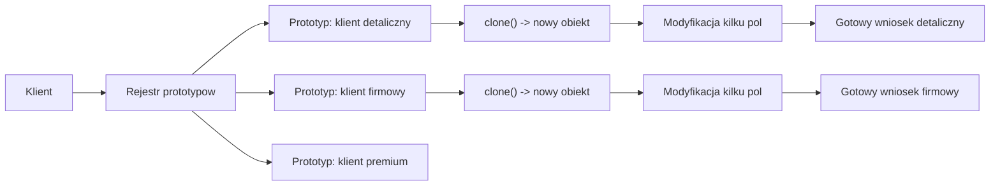
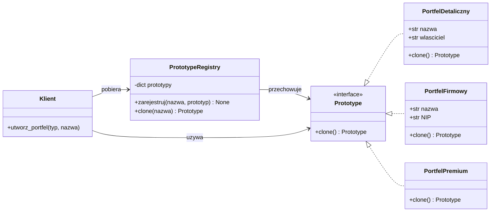
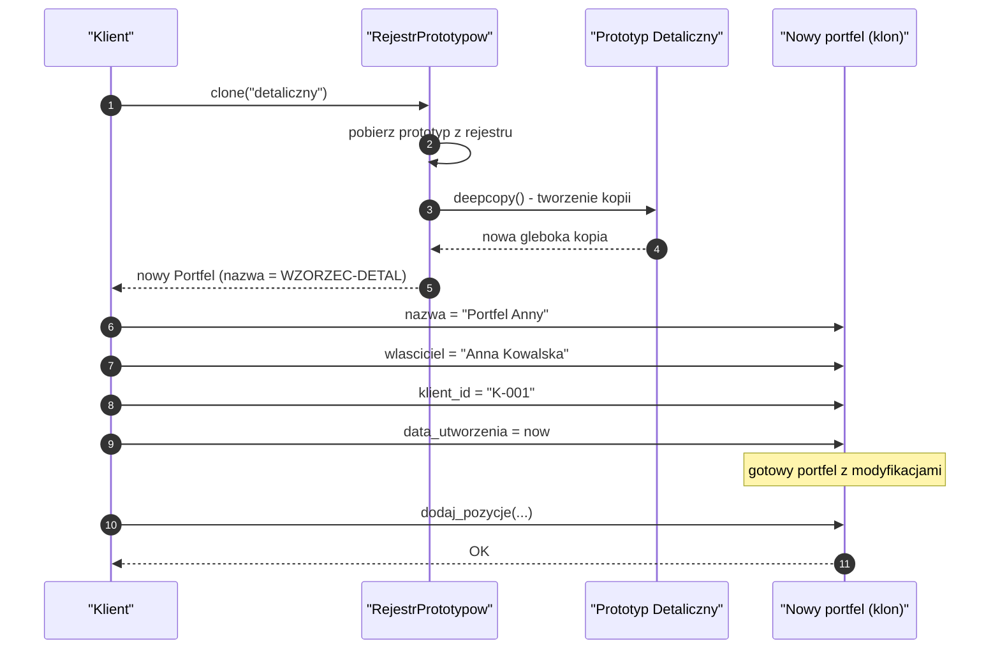
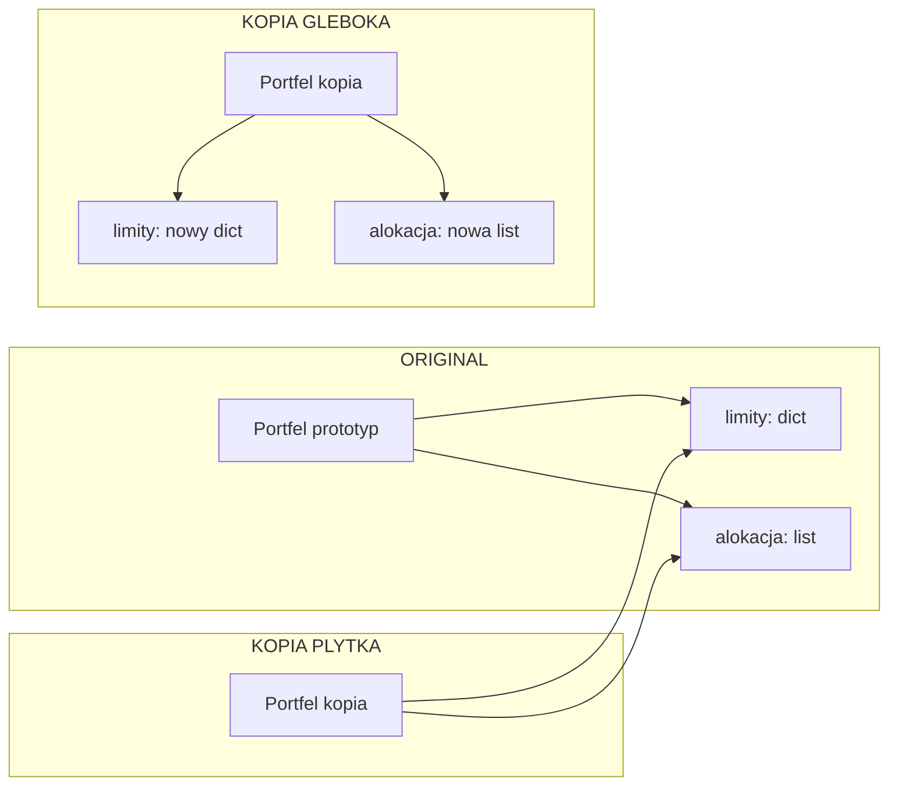
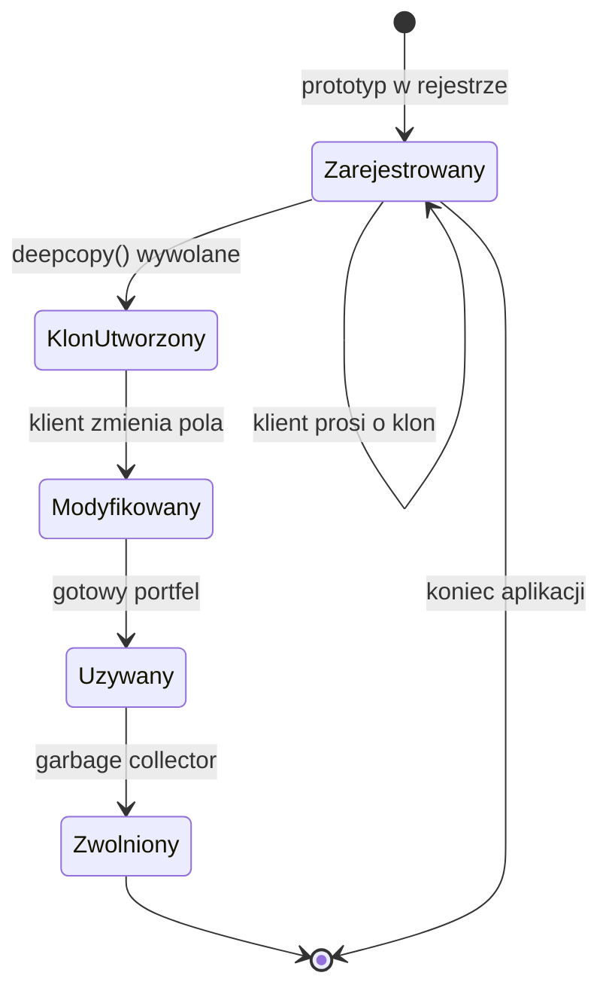
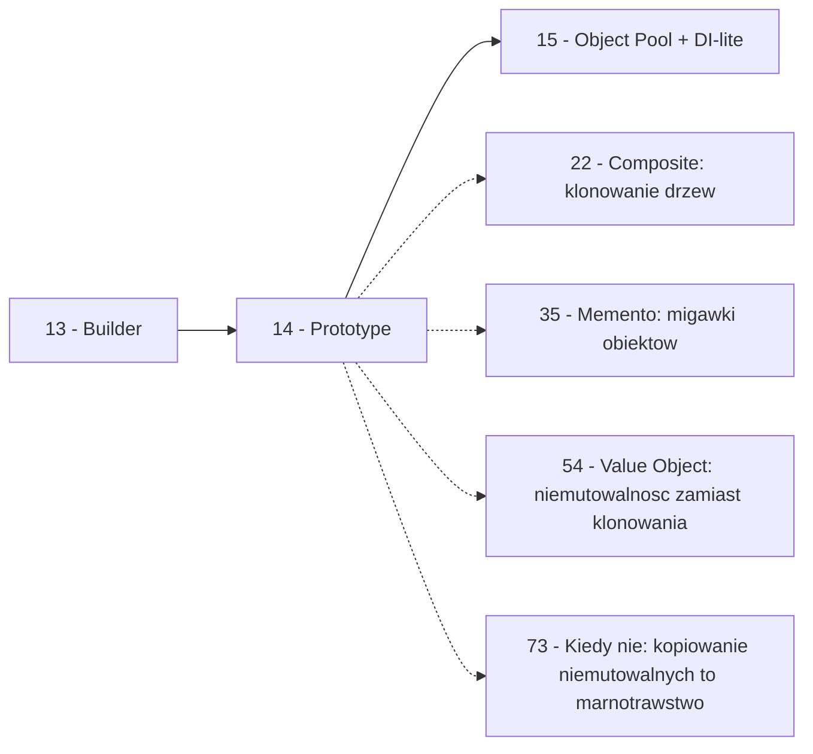

```markdown
---
modul: 14 — Prototype
plik: 14-prototype.md
poziom: sredni
wymaga: [13]
czas: ~150 minut czytania + ~360 minut ćwiczeń
---

# Moduł 14 — Prototype — kopiowanie zamiast budowania od zera

> **TL;DR**
> - **Prototype (prototyp)** tworzy nowe obiekty przez **kopiowanie istniejących**, zamiast budować je od zera — przydatne, gdy utworzenie obiektu jest kosztowne albo gdy chcemy powielić złożoną, gotową konfigurację i zmienić tylko kilka pól.
> - W Pythonie kluczowe jest rozróżnienie **płytkiej kopii** (`copy.copy`) i **głębokiej kopii** (`copy.deepcopy`) — pierwsza współdzieli obiekty zagnieżdżone, druga kopiuje cały graf rekurencyjnie; pomylenie ich prowadzi do klasycznych, trudnych do wykrycia błędów.
> - Prototyp naturalnie łączy się z **rejestrem** (ang. registry) — katalogiem gotowych wzorców, które klonuje się po nazwie, a nie tworzy od zera.
> - W Pythonie mamy bogaty arsenał: `copy.copy`, `copy.deepcopy`, `__copy__`, `__deepcopy__`, `dataclasses.replace`, `pickle`, `json`, `model_copy` w Pydantic — wybór zależy od tego, jak głęboko ma sięgać kopia.
> - Zasada: jeśli obiekt jest **niemutowalny**, nie ma sensu go kopiować — można go współdzielić. Prototype ma sens wyłącznie dla obiektów **mutowalnych**, których tworzenie lub konfiguracja są kosztowne.

---

## 0. Model mentalny

### Formularz, pieczątka i poduszka z tuszem

Wyobraź sobie biuro, w którym pracownicy wypełniają wnioski kredytowe. Każdy wniosek ma 40 rubryk: dane osobowe, adres, dochody, źródła dochodu, historię kredytową, cel kredytu, kwotę, okres, ubezpieczenia, zgody marketingowe i tak dalej. Pierwszy wniosek trzeba **wypełnić od zera** — pani w okienku wpisuje każde pole ręcznie, litera po literze. To trwa piętnaście minut.

Ale zauważ, co dzieje się przy drugim wniosku. Jeśli pani w okienku rozpoznaje, że to podobna sprawa — na przykład ten sam klient składa **drugi** wniosek o kredyt na inne konto — to nie wypełnia całości od początku. Bierze **kopię poprzedniego wniosku** (`copy.copy`) i **zmienia tylko te pola, które się różnią**: kwotę, cel kredytu, numer konta. Reszta — dane osobowe, adres, historia — zostaje taka sama.

Idźmy dalej. Wyobraź sobie trzeci scenariusz: pani ma gotowy **wzór** wniosku, który powiela na kserokopiarce. Ten wzór nazywa się **prototypem**. Zamiast wypełniać cokolwiek od zera, kopiuje gotowy wzór i modyfikuje konkretne pola. I teraz rzecz kluczowa: może mieć **kilka** prototypów — jeden dla klienta indywidualnego, jeden dla firmowego, jeden dla studenta. Każdy prototyp to gotowa konfiguracja, którą wystarczy skopiować i lekko zmienić. To jest właśnie **Prototype** — wzorzec, który mówi „nie buduj od nowa, skopiuj gotowe i zmień, co trzeba".

Ale poczekaj, bo jest jeszcze jeden niuans, na który warto zwrócić uwagę — i którego większość osób uczących się wzorca nie dostrzega. Kiedy kopiujemy formularz na kserokopiarce, **wszystkie rubryki są na osobnych kartkach**, w osobnych pudełkach. Kiedy kopiujemy formularz **w zeszycie**, strony są ze sobą połączone. Kiedy kopiujemy **folder** z dokumentami, każdy dokument jest osobno. To, jak głęboko sięga kopia, jest kluczowe — i to jest dokładnie różnica między `copy.copy` a `copy.deepcopy`. Wyobraź sobie teraz, że w formularzu jest rubryka „lista współkredytobiorców" i kopiujesz formularz **płytko**. Zmieniasz listę w kopii — i nagle zmienia się ona **także w oryginale**. Bo obie wersje wskazują na tę samą listę. Ten błąd nazywa się „współdzielenie stanu przez płytką kopię" i jest jedną z najczęstszych pomyłek w kodzie, który używa kopiowania obiektów. Wrócimy do niego ze wszystkimi szczegółami w sekcji 4.

| W analogii formularza i pieczątki | W kodzie |
|---|---|
| Wypełnianie formularza od zera | Tworzenie obiektu przez `Klass(...)` z pełnym konstruktorem |
| Kserokopia istniejącego formularza | `copy.copy(obiekt)` — płytka kopia |
| Kserokopia z osobnymi kopiami załączników | `copy.deepcopy(obiekt)` — głęboka kopia |
| Zmiana kilku pól w kopii | Modyfikacja atrybutów klonowanego obiektu |
| Wzór wniosku na ścianie biura | Prototyp — gotowy obiekt do kopiowania |
| Zestaw wzorów dla różnych klientów | Rejestr prototypów (kilka gotowych obiektów) |
| Poduszka z tuszem i pieczątka | Konstruktor kopiujący / `__copy__` / `__deepcopy__` |
| Formularz z odwołaniem do wspólnej listy | Płytka kopia — zagnieżdżone obiekty współdzielone |

> 🧠 **Zapamiętaj** — **Prototype (prototyp) to wzorzec kreacyjny, w którym nowe obiekty tworzy się przez kopiowanie istniejących egzemplarzy (prototypów), a nie przez wywołanie konstruktora — zwłaszcza gdy utworzenie obiektu jest kosztowne albo gdy potrzebujemy wielu bliskich sobie wariantów.**

Zwróć uwagę na dwa słowa w tej definicji: **kopiowanie** i **egzemplarz**. „Kopiowanie" różni ten wzorzec od fabryki (która tworzy od zera). „Egzemplarz" oznacza, że musimy mieć **istniejący** obiekt — to znaczy, że gdzieś w systemie istnieje źródło kopiowania. Bez prototypu (obiektu istniejącego) nie ma czego kopiować.

### Diagram — intuicja wzorca

Poniższy diagram pokazuje podstawowy przepływ: klient pobiera prototyp z rejestru, kopiuje go i modyfikuje.



*Diagram pokazuje, że klient nie tworzy obiektu od zera, tylko pobiera gotowy prototyp z rejestru, klonuje go i modyfikuje tylko te pola, które są specyficzne dla konkretnego przypadku.*

### Czego Prototype NIE robi

Rozbrójmy kilka nieporozumień, które narosły wokół tego wzorca — szczególnie w kontekście Pythona, gdzie kopiowanie jest tak łatwo dostępne.

**Nie zastępuje konstruktora jako ogólnego mechanizmu.** Prototype ma sens **tylko wtedy**, gdy utworzenie obiektu jest kosztowne albo gdy konfiguracja jest złożona. Dla prostego obiektu `Punkt(x, y)` kopiowanie jest mniej czytelne niż zwykłe `Punkt(x=1, y=2)`.

**Nie chroni przed problemami mutowalności.** Wręcz odwrotnie — **wprowadza je**, jeśli używasz płytkiej kopii. Kopiowanie obiektu z mutowalnymi polami zagnieżdżonymi (listy, słowniki) jest źródłem klasycznych błędów. Zanim użyjesz Prototype, przemyśl, czy nie lepiej zaprojektować obiekt jako **niemutowalny** i współdzielić go zamiast kopiować.

**Nie jest magicznym mechanizmem.** `copy.copy` i `copy.deepcopy` to narzędzia biblioteczne, które działają według określonych reguł. Niektóre obiekty są kopiowalne łatwo, inne tylko ręcznie (`__copy__`, `__deepcopy__`), a jeszcze inne wcale (pliki, połączenia sieciowe, locki). Zrozumienie tych reguł jest ważniejsze niż znajomość nazwy wzorca.

**Nie zawsze jest szybszy od konstruktora.** `copy.deepcopy` tworzy cały graf obiektów rekurencyjnie — dla dużego obiektu może być **wolniejszy** niż zbudowanie nowego obiektu od zera. To nie jest game-changer wydajnościowy w ogólnym przypadku.

**Nie jest potrzebny, gdy obiekt jest niemutowalny.** Jeśli klasa jest `frozen=True` albo używa niemutowalnych pól, można ją **współdzielić** zamiast kopiować. To jest lepsze od kopiowania: mniej pamięci, mniej błędów, brak paradoksu „kopia się rozjechała".

**W Pythonie ma sens w konkretnych przypadkach.** Nie jest tak fundamentalny jak w językach, gdzie koszt utworzenia obiektu jest wysoki (np. C++, Java z ciężkimi konstruktorami). W Pythonie większość obiektów tworzy się szybko, a wzorzec ma sens głównie dla:
- obiektów zbudowanych z kosztownych operacji (parsowanie, zapytanie do bazy, konfiguracja),
- rejestrów gotowych szablonów,
- obiektów gier (np. klonowanie jednostek, pocisków, poziomów),
- obiektów domenowych z rozbudowaną konfiguracją.

---

## 1. Problem, który rozwiązujemy

Wejdźmy w domenę 📈 „Portfel". Aplikacja zarządza portfelami inwestycyjnymi: instrumentami, pozycjami, alokacją, historią transakcji. Kiedy zarządzający chce utworzyć **nowy portfel dla klienta**, wypełnia parametry: nazwę, właściciela, walutę bazową, strategię inwestycyjną, limity, alokację docelową, klienta itd. Ktoś napisał konstruktor, który tworzy taki portfel — i ten konstruktor robi sporo pracy.

### Kod „przed"

```python
# portfel_v0.py — wersja naiwna, demonstracyjna
# UWAGA: ten kod celowo zawiera typowe problemy z tworzeniem portfeli.

import json
from dataclasses import dataclass, field
from datetime import datetime, timezone
from decimal import Decimal
from typing import Optional


@dataclass
class PozycjaDocelowa:
    instrument: str
    klasa: str
    udzial: Decimal
    limit_min: Decimal
    limit_max: Decimal


@dataclass
class Portfel:
    nazwa: str
    wlasciciel: str
    waluta_bazowa: str
    strategia: str
    profil_ryzyka: str
    alokacja_docelowa: list[PozycjaDocelowa]
    limity: dict[str, Decimal]
    data_utworzenia: datetime
    klient_id: str
    czy_zagraniczny: bool
    lista_dozwolonych_instrumentow: list[str]


class KonfiguratorPortfela:
    """Konfigurator tworzacy portfele z pelna konfiguracja."""

    def utworz_portfel(
        self,
        nazwa: str,
        wlasciciel: str,
        waluta_bazowa: str,
        strategia: str,
        profil_ryzyka: str,
        alokacja_docelowa: list[PozycjaDocelowa],
        limity: dict[str, Decimal],
        klient_id: str,
        czy_zagraniczny: bool,
        lista_dozwolonych_instrumentow: list[str],
    ) -> Portfel:
        # Zalozmy, ze tworzenie portfela wymaga:
        # 1. Walidacji wszystkich parametrow
        # 2. Zapisu szablonu do bazy (zapytanie)
        # 3. Pobrania domyslnych limitow z systemu ryzyka (kolejne zapytanie)
        # 4. Obliczenia poczatkowej alokacji na podstawie strategii
        # 5. Konfiguracji polityki inwestycyjnej (kolejne zapytanie)
        #
        # Wersja demonstracyjna - symulujemy koszt:
        import time
        time.sleep(0.05)  # symulacja 50 ms - zapytania do bazy

        return Portfel(
            nazwa=nazwa,
            wlasciciel=wlasciciel,
            waluta_bazowa=waluta_bazowa,
            strategia=strategia,
            profil_ryzyka=profil_ryzyka,
            alokacja_docelowa=list(alokacja_docelowa),
            limity=dict(limity),
            data_utworzenia=datetime.now(timezone.utc),
            klient_id=klient_id,
            czy_zagraniczny=czy_zagraniczny,
            lista_dozwolonych_instrumentow=list(lista_dozwolonych_instrumentow),
        )


# Typowa konfiguracja dla klienta detalicznego
ALOKACJA_DETAL = [
    PozycjaDocelowa("AKCJE_GLOBALNE", "AKCJE", Decimal("0.40"),
                    Decimal("0.30"), Decimal("0.50")),
    PozycjaDocelowa("OBLIGACJE_SKARBOWE", "OBLIGACJE", Decimal("0.50"),
                    Decimal("0.40"), Decimal("0.60")),
    PozycjaDocelowa("GOTOWKA", "GOTOWKA", Decimal("0.10"),
                    Decimal("0.05"), Decimal("0.20")),
]

LIMITY_DETAL = {
    "koncentracja_max": Decimal("0.30"),
    "ekspozycja_walutowa_max": Decimal("0.40"),
    "dzwignia_max": Decimal("1.00"),
}

INSTRUMENTY_DETAL = [
    "AKCJE_GLOBALNE", "OBLIGACJE_SKARBOWE", "ETF_AKCJI", "FUNDUSZE_MIESZANE",
]


if __name__ == "__main__":
    konfigurator = KonfiguratorPortfela()

    # Tworzymy 5 portfeli dla roznych klientow detalicznych
    portfele = []
    for i in range(5):
        p = konfigurator.utworz_portfel(
            nazwa=f"Portfel {i+1}",
            wlasciciel=f"Klient {i+1}",
            waluta_bazowa="PLN",
            strategia="ZROWNOWAZONA",
            profil_ryzyka="SREDNI",
            alokacja_docelowa=ALOKACJA_DETAL,
            limity=LIMITY_DETAL,
            klient_id=f"KLIENT-{i+1:04d}",
            czy_zagraniczny=False,
            lista_dozwolonych_instrumentow=INSTRUMENTY_DETAL,
        )
        portfele.append(p)

    print(f"Utworzono {len(portfele)} portfeli")
    print(f"Pierwszy portfel: {portfele[0].nazwa}, alokacje: {len(portfele[0].alokacja_docelowa)}")
```

Ten kod działa. Uruchamia się, tworzy pięć portfeli. Ale zawiera problem: **każde utworzenie portfela kosztuje**, a **konfiguracja jest prawie identyczna** we wszystkich pięciu przypadkach (różni się tylko `nazwa`, `wlasciciel` i `klient_id`). To znaczy, że wykonujemy kosztowne zapytanie do bazy pięć razy, choć zmienia się tak naprawdę trzy pola.

### Code smell — marnujemy pracę

| Problem | Gdzie | Konsekwencja |
|---|---|---|
| **Identyczna konfiguracja powtarzana 5 razy** | W pętli `for` | Niepotrzebne zapytania do bazy |
| **Kosztowna operacja** | `time.sleep(0.05)` w konstruktorze | 250 ms na 5 portfeli — połowa z tego to duplikacja |
| **Duplikacja danych** | `ALOKACJA_DETAL`, `LIMITY_DETAL` powtarzane | Zmiana stałej wymaga modyfikacji w wielu miejscach |
| **Ryzyko rozjazdu** | Agent może zmienić jeden `LIMITY_DETAL` i nie inny | Portfele różnią się niejawnie, mimo „takiej samej konfiguracji" |
| **Powtarzalność wywołania** | 10 argumentów powtarzanych w każdej iteracji | Zamiana kolejności argumentów = cichy błąd |
| **Trudna modyfikacja** | Zmiana względna (np. „wszystkie portfele z limitem 0.35") | Wymaga przejścia przez wszystkie miejsca |

### Objawy — poznasz ten problem po tym, że...

- **Tworzysz wiele obiektów, które są do siebie bardzo podobne.** Różnią się jednym albo dwoma polami — reszta jest identyczna.
- **Utworzenie obiektu jest kosztowne** (zapytanie do bazy, żądanie HTTP, parsowanie dużego pliku, skomplikowane obliczenia).
- **Masz gotowe szablony konfiguracji** („portfel detaliczny", „portfel firmowy", „portfel premium") i chcesz z nich korzystać, a nie wypełniać od zera.
- **W kodzie pojawiają się stałe z konfiguracją rozproszone po wielu miejscach.** To znaczy, że brakuje ci „rejestru" gotowych konfiguracji.
- **Chcesz kopiować obiekt i zmienić jedno pole**, ale boisz się, że kopia podzieli stan z oryginałem (albo odwrotnie — że się „zepsuje").
- **Klasa ma metodę `clone()` albo `copy()` w interfejsie**, ale nie wiesz, jak ją dobrze zaprojektować.
- **Testujesz coś, co wymaga wszechstronnej konfiguracji obiektów** i chcesz mieć „bazowy obiekt" w fixture, od którego startujesz warianty.
- **Widzisz komentarze typu `# kopia, ale inny klient`** — to znak, że potrzebujesz Prototype.
- **Twoje obiekty dzielą niemutowalnie wyglądające pola, ale faktycznie mutują stan wspólny** — klasyczny objaw złej kopii.

---

## 2. Anatomia wzorca

### Uczestnicy

| Rola | Odpowiedzialność | Co NIE jest jej zadaniem |
|---|---|---|
| **Prototype (prototyp)** | Interfejs/obiekt deklarujący metodę klonowania (`clone()` albo `__copy__`/`__deepcopy__`) | Nie tworzy obiektu z zewnątrz; nie ma konstruktora „produkującego" |
| **ConcretePrototype (prototyp konkretny)** | Implementuje klonowanie dla swojej klasy — może być płytkie albo głębokie | Nie zawiera logiki biznesowej; nie ma globalnego rejestru |
| **Client (klient)** | Żąda klonu prototypu i modyfikuje go do własnych potrzeb | Nie zna konkretnej klasy prototypu; nie kopiuje ręcznie pola po polu |
| **PrototypeRegistry (rejestr prototypów)** | Przechowuje nazwane prototypy; udostępnia je klientowi po nazwie | Nie zawiera logiki biznesowej; nie klonuje sam (chyba że w metodzie `clone(name)`) |

W klasycznym ujęciu GoF prototypy są obiektami, które potrafią się sklonować. W Pythonie ten interfejs zwykle **nie jest konieczny** — bo `copy.copy` i `copy.deepcopy` działają dla większości obiektów bez implementacji. Ale warto wiedzieć, że **niektóre obiekty** wymagają własnej implementacji `__copy__` albo `__deepcopy__` — na przykład gdy zawierają zasoby zewnętrzne (połączenia, pliki) albo gdy kopiowanie ma sens tylko w specyficzny sposób (np. klonujemy część pól, a część resetujemy).

### Diagram — klasyczna struktura

Poniższy diagram pokazuje klasyczną strukturę Prototype z rejestrem.



*Diagram pokazuje pełny układ: trzy konkretne prototypy implementują wspólny interfejs klonowania, rejestr przechowuje ich instancje, a klient pobiera konkretny wzór i klonuje go — nie tworząc go od zera.*

Przeczytajmy ten diagram zdanie po zdaniu. `Prototype` to interfejs opisujący klonowanie — w klasycznym ujęciu metoda `clone()`. W Pythonie mogą to być dunder-metody (`__copy__`, `__deepcopy__`) albo po prostu fakt, że obiekt jest kopiowalny przez `copy.copy`.

`PortfelDetaliczny`, `PortfelFirmowy` i `PortfelPremium` to konkretne prototypy — obiekty, które umieją się sklonować. Każdy ma swoją reprezentację (pola) i swój sposób klonowania.

`PrototypeRegistry` to rejestr — mapa nazwa → prototyp. To pozwala klientowi pobrać prototyp **po nazwie**, bez znaomości konkretnej klasy. To bardzo praktyczne, gdy liczba prototypów rośnie, a klient wie tylko, że „chce portfel premium".

`Klient` pobiera prototyp z rejestru i używa go — klonuje i modyfikuje. Zwróć uwagę, że **klient nie tworzy obiektu bezpośrednio** — zawsze przez `clone()`. To jest kluczowe dla wzorca: konstrukcja odbywa się przez kopiowanie, nie przez wywołanie konstruktora.

### Warianty: klasyczny vs pythoniczny

| Aspekt | Wariant klasyczny (np. Java) | Wariant pythoniczny |
|---|---|---|
| Interfejs | `interface Prototype` z metodą `clone()` | `Protocol` z `clone()` albo `__copy__`/`__deepcopy__` |
| Klonowanie | Ręczna implementacja `clone()` w każdej klasie | `copy.copy` / `copy.deepcopy` (działają „z automatu") |
| Głębokość kopii | Zwykle jedna (definiowana przez autora) | Dwie metody: `copy` (płytka) i `deepcopy` (głęboka) |
| Rejestr | Osobna klasa z metodami | Słownik modułowy albo `dict` w klasie |
| Kontrola kopiowania | Metoda `clone()` | `__copy__`, `__deepcopy__`, `__reduce__` |
| Serializacja | `Serializable` | `pickle`, `copyreg`, `__getstate__`/`__setstate__` |
| Typowe użycie | Frameworki, gry, obiekty z IK | Konfiguracje, migawki, klonowanie domenowe |

W Pythonie **wiele z tego, co w innych językach wymaga wzorca, działa „samo"**. Dlatego Prototype w Pythonie jest mniej „używanym wzorcem" niż np. w Javie czy C++. Ale jego **idea** — kopiuj istniejące zamiast budować od zera — jest aktualna. Ważniejsze od implementacji wzorca jest zrozumienie **głębokości kopiowania** i jej konsekwencji.

---

## 3. Implementacja krok po kroku

Przebudujemy krok po kroku przykład z sekcji 1. Zaczniemy od prostej kopii, potem dodamy rejestr i zabezpieczenia.

### Krok 1 — Rozpoznaj, co się zmienia, a co nie

Zanim cokolwiek zbudujesz, wypisz, które pola portfela są **stałe dla wszystkich klientów detalicznych**, a które **różne**:

```text
Stale (dla portfela detalicznego):
  - waluta_bazowa = "PLN"
  - strategia = "ZROWNOWAZONA"
  - profil_ryzyka = "SREDNI"
  - alokacja_docelowa = ALOKACJA_DETAL
  - limity = LIMITY_DETAL
  - czy_zagraniczny = False
  - lista_dozwolonych_instrumentow = INSTRUMENTY_DETAL

Rozne (dla kazdego portfela):
  - nazwa
  - wlasciciel
  - klient_id
```

Ten prosty krok mówi nam, że marnujemy 70% pracy, tworząc za każdym razem całą konfigurację od zera.

### Krok 2 — Zdefiniuj prototyp (obiekt bazowy)

Prototyp to **gotowy, w pełni skonfigurowany obiekt**, który posłuży jako szablon.

```python
from copy import copy, deepcopy
from datetime import datetime, timezone
from decimal import Decimal
from dataclasses import dataclass, field


@dataclass
class PozycjaDocelowa:
    instrument: str
    klasa: str
    udzial: Decimal
    limit_min: Decimal
    limit_max: Decimal


@dataclass
class Portfel:
    nazwa: str
    wlasciciel: str
    klient_id: str
    waluta_bazowa: str
    strategia: str
    profil_ryzyka: str
    alokacja_docelowa: list[PozycjaDocelowa]
    limity: dict[str, Decimal]
    czy_zagraniczny: bool
    lista_dozwolonych_instrumentow: list[str]
    data_utworzenia: datetime


# Prototyp - gotowy obiekt "bazowy"
PORTFEL_DETALICZNY_BAZOWY = Portfel(
    nazwa="WZORZEC-DETAL",
    wlasciciel="",
    klient_id="",
    waluta_bazowa="PLN",
    strategia="ZROWNOWAZONA",
    profil_ryzyka="SREDNI",
    alokacja_docelowa=[
        PozycjaDocelowa("AKCJE_GLOBALNE", "AKCJE", Decimal("0.40"),
                        Decimal("0.30"), Decimal("0.50")),
        PozycjaDocelowa("OBLIGACJE_SKARBOWE", "OBLIGACJE", Decimal("0.50"),
                        Decimal("0.40"), Decimal("0.60")),
        PozycjaDocelowa("GOTOWKA", "GOTOWKA", Decimal("0.10"),
                        Decimal("0.05"), Decimal("0.20")),
    ],
    limity={
        "koncentracja_max": Decimal("0.30"),
        "ekspozycja_walutowa_max": Decimal("0.40"),
        "dzwignia_max": Decimal("1.00"),
    },
    czy_zagraniczny=False,
    lista_dozwolonych_instrumentow=[
        "AKCJE_GLOBALNE", "OBLIGACJE_SKARBOWE", "ETF_AKCJI", "FUNDUSZE_MIESZANE",
    ],
    data_utworzenia=datetime(2026, 10, 9, tzinfo=timezone.utc),
)
```

### Krok 3 — Klonuj płytko (i zobacz problem)

Pierwsza próba: `copy.copy(prototyp)`.

```python
from copy import copy

def utworz_portfel_plytko(nazwa: str, wlasciciel: str, klient_id: str) -> Portfel:
    """Klonuje prototyp PLYTKO i zmienia tylko 3 pola."""
    kopia = copy(PORTFEL_DETALICZNY_BAZOWY)
    kopia.nazwa = nazwa
    kopia.wlasciciel = wlasciciel
    kopia.klient_id = klient_id
    kopia.data_utworzenia = datetime.now(timezone.utc)
    return kopia
```

**Uwaga — to jest pułapka.** `copy.copy` tworzy **płytką** kopię. To znaczy: kopia ma nowy `__dict__` (własny słownik atrybutów), ale **wartości w nim wskazują na te same obiekty**. Pola `alokacja_docelowa`, `limity`, `lista_dozwolonych_instrumentow` są **współdzielone** między prototypem a wszystkimi kopiami. Wystarczy jedno:

```python
p1 = utworz_portfel_plytko("Portfel 1", "Anna", "K-1")
p2 = utworz_portfel_plytko("Portfel 2", "Bartek", "K-2")

# Ktos dodaje pozycje do portfela 1
p1.limity["nowy_limit"] = Decimal("0.10")

# ... i okazuje sie, ze portfel 2 tez ma ten limit!
print(p2.limity.get("nowy_limit"))   # 0.10 - BUG!
```

**To jest błąd.** Kopia zachowuje się jak „nowy obiekt", ale mutacje pól zagnieżdżonych przechodzą na współdzielone obiekty. Wszystkie kopie widzą zmiany, bo listy i słowniki są te same.

### Krok 4 — Klonuj głęboko

Rozwiązanie: użyj `copy.deepcopy`. To tworzy **rekursywnie nowe kopie** wszystkich obiektów zagnieżdżonych.

```python
from copy import deepcopy

def utworz_portfel_gleboko(nazwa: str, wlasciciel: str, klient_id: str) -> Portfel:
    """Klonuje prototyp GLEBOKO i zmienia tylko 3 pola."""
    kopia = deepcopy(PORTFEL_DETALICZNY_BAZOWY)
    kopia.nazwa = nazwa
    kopia.wlasciciel = wlasciciel
    kopia.klient_id = klient_id
    kopia.data_utworzenia = datetime.now(timezone.utc)
    return kopia
```

Teraz mutacje `p1.limity` **nie wpływają** na `p2.limity`. Ale... jest nowy problem. `deepcopy` kopiuje **wszystko** — również pola, które się nie zmieniają. W naszym przypadku `data_utworzenia` w prototypie jest kopiowana, potem nadpisywana. To strata. Gdyby prototyp zawierał 20 pól, `deepcopy` kopiowałby wszystkie 20.

### Krok 5 — Dodaj rejestr prototypów

Kilka nazwanych prototypów, dostępnych po nazwie.

```python
class RejestrPrototypow:
    """Katalog gotowych prototypow portfeli."""

    def __init__(self) -> None:
        self._prototypy: dict[str, Portfel] = {}

    def zarejestruj(self, nazwa: str, prototyp: Portfel) -> None:
        if nazwa in self._prototypy:
            raise ValueError(f"prototyp {nazwa!r} jest juz zarejestrowany")
        self._prototypy[nazwa] = prototyp

    def clone(self, nazwa: str) -> Portfel:
        """Zwraca GLEBOKA kopie prototypu o podanej nazwie."""
        try:
            wzorzec = self._prototypy[nazwa]
        except KeyError as blad:
            dostepne = ", ".join(sorted(self._prototypy))
            raise ValueError(
                f"nieznany prototyp {nazwa!r}; dostepne: {dostepne}"
            ) from blad
        return deepcopy(wzorzec)

    @property
    def nazwy(self) -> frozenset[str]:
        return frozenset(self._prototypy)


REJESTR = RejestrPrototypow()
REJESTR.zarejestruj("detaliczny", PORTFEL_DETALICZNY_BAZOWY)
```

Klient teraz:

```python
def utworz_portfel(typ: str, nazwa: str, wlasciciel: str, klient_id: str) -> Portfel:
    portfel = REJESTR.clone(typ)
    portfel.nazwa = nazwa
    portfel.wlasciciel = wlasciciel
    portfel.klient_id = klient_id
    portfel.data_utworzenia = datetime.now(timezone.utc)
    return portfel
```

Klient nie musi znać konkretnych klas ani konstruktorów — wystarczy nazwa typu portfela.

### Krok 6 — Zadbaj o wydajność: nie kopiuj głęboko bez potrzeby

`deepcopy` jest kosztowny. Dla naszego portfela z 20 polami to nie problem, ale w ogólnym przypadku może być. Trzy techniki:

**(A) Płytka kopia z ręcznym skopiowaniem zmiennych pól.**

```python
from copy import copy

def utworz_portfel_plytko_z_recznie(nazwa: str, wlasciciel: str, klient_id: str) -> Portfel:
    """Plytka kopia, ale recznie kopiuje te pola, ktore moga byc modyfikowane."""
    kopia = copy(PORTFEL_DETALICZNY_BAZOWY)
    kopia.limity = dict(PORTFEL_DETALICZNY_BAZOWY.limity)
    kopia.alokacja_docelowa = list(PORTFEL_DETALICZNY_BAZOWY.alokacja_docelowa)
    kopia.lista_dozwolonych_instrumentow = list(
        PORTFEL_DETALICZNY_BAZOWY.lista_dozwolonych_instrumentow
    )
    kopia.nazwa = nazwa
    kopia.wlasciciel = wlasciciel
    kopia.klient_id = klient_id
    kopia.data_utworzenia = datetime.now(timezone.utc)
    return kopia
```

Uwaga: to jest kopiowanie **płytkie list** — `PozycjaDocelowa` wewnątrz listy nadal są współdzielone. Jeśli chcesz pełną izolację, skopiuj też elementy:

```python
kopia.alokacja_docelowa = [
    replace(poz) for poz in PORTFEL_DETALICZNY_BAZOWY.alokacja_docelowa
]
```

**(B) Zdefiniuj `__copy__` w klasie prototypu.** Kontrolujesz, co jest kopiowane.

```python
from dataclasses import replace

@dataclass
class Portfel:
    # ... pola ...

    def __copy__(self) -> "Portfel":
        """Plytka kopia: kopiuje tylko te pola, ktore moga byc modyfikowane."""
        return Portfel(
            nazwa=self.nazwa,
            wlasciciel=self.wlasciciel,
            klient_id=self.klient_id,
            waluta_bazowa=self.waluta_bazowa,
            strategia=self.strategia,
            profil_ryzyka=self.profil_ryzyka,
            alokacja_docelowa=list(self.alokacja_docelowa),
            limity=dict(self.limity),
            czy_zagraniczny=self.czy_zagraniczny,
            lista_dozwolonych_instrumentow=list(self.lista_dozwolonych_instrumentow),
            data_utworzenia=self.data_utworzenia,
        )
```

**(C) Użyj niemutowalnych pól.** Zamiast list — krotki; zamiast słowników — `MappingProxyType`; zamiast mutowalnych obiektów — `frozen=True`.

```python
@dataclass(frozen=True)
class Portfel:
    # ...
    alokacja_docelowa: tuple[PozycjaDocelowa, ...]
    limity: Mapping[str, Decimal] = field(default_factory=dict)
```

Wtedy `copy.copy` **wystarczy** — bo wszystkie pola są niemutowalne i można je współdzielić.

### Krok 7 — Weryfikacja

| Kryterium | Wersja „przed" | Wersja „po" (rejestr + deepcopy) |
|---|---|---|
| Utworzenie portfela | 10 argumentów + kosztowne operacje | `REJESTR.clone("detaliczny")` |
| Zmiana konfiguracji bazowej | Modyfikacja wszystkich wywołań | Modyfikacja prototypu |
| Izolacja kopii | Nie dotyczy | Tak (deepcopy) |
| Dodanie nowego typu portfela | Nowa funkcja / nowa klasa | Nowy prototyp w rejestrze |
| Wydajność | 50 ms × 5 = 250 ms | ~5 ms × 5 = 25 ms (deepcopy jest tani dla tej wielkości) |
| Czytelność | 10 linii | 4 linie (nazwa typu + trzy pola) |
| Miejsca do zmiany przy zmianie alokacji | 1 miejsce | 1 miejsce (prototyp) |

Koszt: dodaliśmy rejestr i wzorzec prototypu. Zysk: szybkość, spójność konfiguracji, jedno miejsce zmian. Wartość rośnie z liczbą portfeli i liczbą pól konfiguracji.

---

## 4. Wersje pythoniczne i warianty

Ta sekcja to najobszerniejsza część modułu. W Pythonie mamy **kilka mechanizmów kopiowania** i każdy ma swoje właściwości. Zrozumienie ich jest kluczowe dla właściwego używania Prototype.

### 4.1 `copy.copy` — kopia płytka

`copy.copy(obiekt)` tworzy **nowy obiekt** tego samego typu, ale **atrybuty są kopiowane płytko** — to znaczy wskazują na te same obiekty co w oryginale. Konkretnie:

- Dla klas — nowy obiekt, `__dict__` skopiowany płytko; wartości pól to te same referencje.
- Dla list — nowa lista, ale elementy są te same (bo elementy są referencjami).
- Dla słowników — nowy słownik, te same pary klucz-wartość.
- Dla krotek — z powodu niemutowalności krotka **nie jest kopiowana**, zwracana jest ta sama.
- Dla `frozenset` — jak krotka, zwracana jest ta sama instancja.
- Dla `int`, `str`, `bool`, `None` — niemutowalne, zwracane te same.

```python
import copy

lista = [1, 2, 3]
kopia = copy.copy(lista)
kopia.append(4)
print(lista)   # [1, 2, 3] - oryginal niezmieniony
print(kopia)   # [1, 2, 3, 4]

# Ale elementy sa wspoldzielone:
zagniezdzona = [[1, 2], [3, 4]]
kopia_z = copy.copy(zagniezdzona)
kopia_z[0].append(99)
print(zagniezdzona)   # [[1, 2, 99], [3, 4]] - BUG! wspoldzielone
```

Dla obiektów użytkownika:

```python
import copy

class Portfel:
    def __init__(self, nazwa: str, limity: dict):
        self.nazwa = nazwa
        self.limity = limity

p1 = Portfel("A", {"koncentracja_max": 0.30})
p2 = copy.copy(p1)
p2.limity["nowy"] = 0.10
print(p1.limity)   # {"koncentracja_max": 0.30, "nowy": 0.10} - BUG!
```

Kiedy używać `copy.copy`:
- Gdy obiekt ma **tylko niemutowalne pola** i kopia jest potrzebna dla niezmienności tożsamości (`is`).
- Gdy **wiesz**, że chcesz współdzielić pola zagnieżdżone.
- Gdy obiekt jest duży i chcesz uniknąć kosztu `deepcopy`, a mutowalne pola obsługujesz ręcznie.

### 4.2 `copy.deepcopy` — kopia głęboka

`copy.deepcopy(obiekt)` tworzy **nowy obiekt** i **rekurencyjnie kopiuje** wszystkie obiekty, do których prowadzi. To znaczy: listy zawierają nowe obiekty tej samej klasy, słowniki zawierają nowe wartości, itd.

```python
import copy

zagniezdzona = [[1, 2], [3, 4]]
kopia_z = copy.deepcopy(zagniezdzona)
kopia_z[0].append(99)
print(zagniezdzona)   # [[1, 2], [3, 4]] - oryginal czysty
print(kopia_z)        # [[1, 2, 99], [3, 4]]
```

**Rozwiązuje problem cykli.** Jeśli obiekt ma cykliczne referencje (A wskazuje na B, B wskazuje na A), `deepcopy` poradzi sobie — prowadzi wewnętrzny rejestr `memo`, w którym zapamiętuje skopiowane obiekty, żeby nie kopiować ich dwukrotnie i żeby uniknąć nieskończonej rekurencji.

**Ale nie rozwiązuje problemu obiektów niekopiowalnych.** Pliki, gniazda sieciowe, połączenia do bazy, wątki, blokady — `deepcopy` nie potrafi ich skopiować i wyrzuci `TypeError`. Trzeba to obsłużyć jawnie w `__deepcopy__`.

**Jest kosztowny dla dużych grafów.** Kopiowanie rekurencyjne dla 100 000 elementów może być wolne i pamięciożerne. Zawsze mierz.

Kiedy używać `copy.deepcopy`:
- Gdy obiekt ma zagnieżdżone mutowalne struktury, które **chcesz mieć niezależne**.
- Gdy nie wiesz dokładnie, co jest w środku (obiekt z biblioteki zewnętrznej).
- Gdy jesteś gotowy na koszt.

### 4.3 `__copy__` i `__deepcopy__` — kontrola kopiowania

Możesz zdefiniować w klasie metody, które określą, jak ma przebiegać kopiowanie. To najważniejsza technika dla Prototype w Pythonie.

```python
import copy
from dataclasses import dataclass, field
from decimal import Decimal

@dataclass
class Portfel:
    nazwa: str
    limity: dict[str, Decimal]
    uchwyt_klienta: object   # np. obiekt sesji HTTP

    def __copy__(self) -> "Portfel":
        """Plytka kopia: tworzy nowy obiekt, ale dzieli limity z oryginalem."""
        return Portfel(
            nazwa=self.nazwa,
            limity=self.limity,
            uchwyt_klienta=self.uchwyt_klienta,
        )

    def __deepcopy__(self, memo: dict[int, object]) -> "Portfel":
        """Gleboka kopia: kopiuje limity, ale zachowuje uchwyt klienta.

        Uchwyt klienta (np. sesja HTTP) nie ma sensu kopiowac - powinien byc
        wspoldzielony albo odtworzony w nowej instancji.
        """
        # Sprawdz, czy juz nie kopiujemy tego obiektu (obsluga cykli)
        if id(self) in memo:
            return memo[id(self)]  # type: ignore[return-value]

        nowy = Portfel(
            nazwa=copy.deepcopy(self.nazwa, memo),
            limity=copy.deepcopy(self.limity, memo),
            uchwyt_klienta=self.uchwyt_klienta,   # wspoldzielony!
        )
        memo[id(self)] = nowy
        return nowy
```

Zwróć uwagę na cztery rzeczy:
1. `memo` — słownik `id(obiekt) → skopiowany obiekt`. Trzeba go tworzyć albo wypełniać. **Musisz** sprawdzić, czy `id(self)` już jest w `memo`, bo inaczej dostaniesz nieskończoną rekurencję przy cyklach.
2. `uchwyt_klienta` — świadomie **współdzielony**. To dokładnie ta decyzja, którą Prototype pozwala podjąć: co kopiować, a co nie.
3. `copy.deepcopy(self.nazwa, memo)` — przekazujemy `memo` dalej, żeby cykle były obsłużone.
4. `memo[id(self)] = nowy` — zapisujemy **przed** wypełnieniem pól (w naszym kodzie po — ale w przypadku cykli powinno być przed zakończeniem konstrukcji). Szczegóły poniżej.

**Uwaga o cyklach.** Aby prawidłowo obsłużyć cykle, `memo` musi być wypełnione **przed** zbudowaniem pełnego obiektu. To często wymaga dwufazowego tworzenia:

```python
def __deepcopy__(self, memo: dict[int, object]) -> "Portfel":
    if id(self) in memo:
        return memo[id(self)]  # type: ignore[return-value]
    nowy = Portfel.__new__(Portfel)   # obiekt bez inicjalizacji
    memo[id(self)] = nowy             # zapisz PRZED wypelnieniem pol
    nowy.nazwa = copy.deepcopy(self.nazwa, memo)
    nowy.limity = copy.deepcopy(self.limity, memo)
    nowy.uchwyt_klienta = self.uchwyt_klienta
    return nowy
```

W naszym przykładzie użyliśmy prostszej wersji, ale warto wiedzieć o tej drugiej.

### 4.4 `dataclasses.replace` — lekki prototyp dla dataclass

Dla `dataclass` mamy prostszy mechanizm: `dataclasses.replace` tworzy nową instancję z podmienionymi wybranymi polami.

```python
from dataclasses import replace, dataclass
from decimal import Decimal

@dataclass(frozen=True)
class Portfel:
    nazwa: str
    waluta: str
    limity: dict[str, Decimal]

baza = Portfel(
    nazwa="WZORZEC",
    waluta="PLN",
    limity={"koncentracja": Decimal("0.30")},
)

# Nowa wersja z innym nazwiskiem
p1 = replace(baza, nazwa="Portfel Anny")
```

**Ważne:** `replace` tworzy **nowy obiekt**, ale **nie kopiuje głęboko pól zagnieżdżonych**. `p1.limity` to ten sam słownik co `baza.limity`. To znaczy, że `replace` daje ci płytką kopię. Dla niemutowalnych pól (str, Decimal, tuple) to działa bez problemu; dla mutowalnych — nie.

```python
p1.limity["nowy"] = Decimal("0.10")
print(baza.limity["nowy"])   # Decimal("0.10") - BUG!
```

Prawidłowe użycie z niemutowalnymi polami:

```python
from types import MappingProxyType

@dataclass(frozen=True)
class Portfel:
    nazwa: str
    waluta: str
    limity: Mapping[str, Decimal]     # typ tylko do odczytu
```

Wtedy `replace` daje bezpieczny „klon niemutowalny".

### 4.5 Serializacja jako klonowanie

Możesz też klonować obiekt przez serializację — zamienić na bajty / JSON i odczytać z powrotem. To daje **pełną kopię** (jak deepcopy), ale ma inne właściwości.

**Pickle** — format binarny Pythona:

```python
import pickle

kopia = pickle.loads(pickle.dumps(prototyp))
```

Zalety: pełna kopia, obsługa cykli, większość obiektów się serializuje. Wady:
- **Bezpieczeństwo**: `pickle` nie jest bezpieczny — wczytanie niedozwolonego pliku pickle może wykonać kod. **Nigdy** nie używaj `pickle` do danych z niezaufanego źródła.
- Nie wszystkie obiekty dają się serializować (pliki, gniazda, locki).
- Wersjonowanie: zmiany w klasie mogą unieważnić pickle — trzeba obsługiwać migracje.
- Wolniejszy niż `deepcopy` w większości przypadków.

**JSON** — format tekstowy:

```python
import json
from dataclasses import asdict

# Zamiana obiektu na dict, potem na JSON, potem z powrotem
dane = json.loads(json.dumps(asdict(prototyp)))
# Trzeba jawnie odtworzyc typy (Decimal, datetime) - to wada
```

JSON daje **bezpieczną** kopię i jest czytelny, ale:
- Tracą typy (Decimal staje się str, datetime staje się str).
- Trzeba samodzielnie odtworzyć typy.
- Nie działa dla obiektów niezagnieżdżonych.

**Pydantic** ma wygodne mechanizmy do serializacji i klonowania:

```python
from pydantic import BaseModel

class Portfel(BaseModel):
    nazwa: str
    limity: dict[str, Decimal]

prototyp = Portfel(nazwa="WZORZEC", limity={"k": Decimal("0.30")})

# Deep copy przez Pydantic API
kopia = prototyp.model_copy(deep=True)
```

To najbezpieczniejsza i najprostsza wersja, jeśli używasz Pydantic.

### 4.6 Protokół `Cloneable`

W klasycznym ujęciu prototypy mają metodę `clone()`. W Pythonie to rzadsze, ale można to zaimplementować:

```python
from typing import Protocol, Self, runtime_checkable

@runtime_checkable
class Cloneable(Protocol):
    def clone(self) -> Self: ...

class Portfel:
    def clone(self) -> "Portfel":
        return copy.deepcopy(self)
```

Bywa przydatny w sytuacjach, gdy:
- Chcesz jednolicie oznaczać obiekty, które się klonują (`isinstance(x, Cloneable)`).
- Chcesz wymusić implementację `clone()` w podklasach.
- Chcesz ukryć mechanizm (deepcopy vs pickle vs ręczne kopiowanie) za jednolitym API.

W praktyce jednak **`copy.copy` i `copy.deepcopy` wbudowane w Python są wystarczające** i lepiej używać ich niż dodawać własny protokół, chyba że masz konkretny powód.

### 4.7 Wariant mieszany — `dataclass` z rejestrem

Podsumowując, najczęstszy warsztat w Pythonie wygląda tak:
- Produkt jako `@dataclass(frozen=True)` z niemutowalnymi polami.
- Klonowanie przez `dataclasses.replace` dla lekkich zmian.
- `copy.deepcopy` dla pełnej kopii.
- Rejestr jako `dict[str, Prototyp]` na poziomie modułu albo klasy.

```python
from dataclasses import replace

def utworz_portfel(typ: str, nazwa: str, wlasciciel: str) -> Portfel:
    wzorzec = REJESTR[typ]
    return replace(wzorzec, nazwa=nazwa, wlasciciel=wlasciciel)
```

To jest bardzo „pythoniczne" — zamiast metody `clone()` i hierarchii klas, mamy słownik i `replace`.

### 4.8 Podsumowanie — tabela wyboru

| Potrzeba | Mechanizm |
|---|---|
| Obiekt ma tylko pola niemutowalne, chcesz kopię „inną instancję" | `copy.copy` |
| Obiekt ma zagnieżdżone mutowalne struktury | `copy.deepcopy` |
| Chcesz kontrolować, co jest kopiowane | `__copy__`, `__deepcopy__` |
| Obiekt to `dataclass`, pola niemutowalne | `dataclasses.replace` |
| Potrzebujesz pełnej kopii przez serializację | `pickle` (ostrożnie!) |
| Obiekt jest modelem Pydantic | `model_copy(deep=True)` |
| Chcesz jednolicie oznaczać klony | `Protocol Cloneable` z metodą `clone()` |

> 🧠 **Zapamiętaj** — Wybór między `copy` i `deepcopy` jest jedną z najważniejszych decyzji w kodzie używającym Prototype. Reguła kciuka: **`copy` jest domyślnym wyborem tylko wtedy, gdy obiekt jest niemutowalny albo gdy wiesz, że chcesz współdzielić pola zagnieżdżone. W przeciwnym razie `deepcopy` lub ręczne skopiowanie pól.**

---

## 5. Przykład z życia: 📈 Portfel — pełny uruchamialny kod

Zbudujemy pełny system tworzenia portfeli na podstawie prototypów: rejestr z trzema typami portfeli, klonowanie głębokie, modyfikacja wariantów, testy.

### Kod

```python
# portfel_prototype.py — pelny przyklad Prototype
from __future__ import annotations

import copy
from dataclasses import dataclass, field
from datetime import date, datetime, timezone
from decimal import Decimal
from typing import Mapping

# ===========================================================================
# 1. Typy domenowe
# ===========================================================================

@dataclass(frozen=True, slots=True)
class PozycjaDocelowa:
    """Pozycja docelowa w alokacji portfela - niemutowalna."""
    instrument: str
    klasa: str
    udzial: Decimal
    limit_min: Decimal
    limit_max: Decimal

    def __post_init__(self) -> None:
        if self.limit_min > self.udzial or self.udzial > self.limit_max:
            raise ValueError(
                f"{self.instrument}: udzial {self.udzial} poza zakresem "
                f"[{self.limit_min}, {self.limit_max}]"
            )


@dataclass(slots=True)
class Portfel:
    """Portfel inwestycyjny - mutowalny (kopiujemy, modyfikujemy)."""

    nazwa: str
    wlasciciel: str
    klient_id: str
    waluta_bazowa: str
    strategia: str
    profil_ryzyka: str
    alokacja_docelowa: list[PozycjaDocelowa]     # mutowalna lista
    limity: dict[str, Decimal]                    # mutowalny slownik
    lista_instrumentow: list[str]                 # mutowalna lista
    czy_zagraniczny: bool
    data_utworzenia: datetime

    # --- Kontrola kopiowania -------------------------------------------------

    def __copy__(self) -> "Portfel":
        """Plytka kopia: tworzy nowy obiekt, ale listy i slowniki sa wspoldzielone.

        Uwaga: swiadomie uzywamy - chcemy szybka kopie, gdy wiemy, ze nie
        bedziemy modyfikowac zagniezdzonych struktur.
        """
        return Portfel(
            nazwa=self.nazwa,
            wlasciciel=self.wlasciciel,
            klient_id=self.klient_id,
            waluta_bazowa=self.waluta_bazowa,
            strategia=self.strategia,
            profil_ryzyka=self.profil_ryzyka,
            alokacja_docelowa=self.alokacja_docelowa,   # wspoldzielone
            limity=self.limity,                          # wspoldzielone
            lista_instrumentow=self.lista_instrumentow,  # wspoldzielone
            czy_zagraniczny=self.czy_zagraniczny,
            data_utworzenia=self.data_utworzenia,
        )

    def __deepcopy__(self, memo: dict[int, object]) -> "Portfel":
        """Gleboka kopia: rekurencyjnie kopiuje wszystkie zagniezdzone struktury.

        Obiekty PozycjaDocelowa sa niemutowalne, ale i tak je kopiujemy dla
        pelnej izolacji (mozna je wspoldzielic - to decyzja projektowa).
        """
        if id(self) in memo:
            return memo[id(self)]  # type: ignore[return-value]
        nowy = Portfel(
            nazwa=self.nazwa,
            wlasciciel=self.wlasciciel,
            klient_id=self.klient_id,
            waluta_bazowa=self.waluta_bazowa,
            strategia=self.strategia,
            profil_ryzyka=self.profil_ryzyka,
            alokacja_docelowa=copy.deepcopy(self.alokacja_docelowa, memo),
            limity=copy.deepcopy(self.limity, memo),
            lista_instrumentow=list(self.lista_instrumentow),
            czy_zagraniczny=self.czy_zagraniczny,
            data_utworzenia=self.data_utworzenia,
        )
        memo[id(self)] = nowy
        return nowy

    # --- Operacje -------------------------------------------------------------

    @property
    def suma_alokacji(self) -> Decimal:
        return sum((p.udzial for p in self.alokacja_docelowa), Decimal("0"))

    def dodaj_pozycje(self, pozycja: PozycjaDocelowa) -> None:
        """Dodaje pozycje do portfela i weryfikuje sume alokacji."""
        self.alokacja_docelowa.append(pozycja)
        if self.suma_alokacji > Decimal("1.00"):
            # Cofamy zmiane - chronimy niezmiennik
            self.alokacja_docelowa.pop()
            raise ValueError(
                f"suma alokacji po dodaniu {pozycja.instrument} "
                f"przekracza 100 procent: {self.suma_alokacji}"
            )

    def zmien_limit(self, nazwa: str, wartosc: Decimal) -> None:
        self.limity[nazwa] = wartosc

    def podsumowanie(self) -> str:
        return (
            f"{self.nazwa} ({self.wlasciciel}/{self.klient_id}) "
            f"- {self.waluta_bazowa} - {self.strategia}/"
            f"{self.profil_ryzyka} - {len(self.alokacja_docelowa)} pozycji"
        )


# ===========================================================================
# 2. Rejestr prototypow
# ===========================================================================

class RejestrPrototypow:
    """Katalog gotowych prototypow portfeli."""

    def __init__(self) -> None:
        self._prototypy: dict[str, Portfel] = {}

    def zarejestruj(self, nazwa: str, prototyp: Portfel) -> None:
        if nazwa in self._prototypy:
            raise ValueError(f"prototyp {nazwa!r} jest juz zarejestrowany")
        self._prototypy[nazwa] = prototyp

    def prototyp(self, nazwa: str) -> Portfel:
        """Zwraca prototyp (nie kopie) - do wewnetrznego uzytku."""
        try:
            return self._prototypy[nazwa]
        except KeyError as blad:
            dostepne = ", ".join(sorted(self._prototypy))
            raise ValueError(
                f"nieznany prototyp {nazwa!r}; dostepne: {dostepne}"
            ) from blad

    def clone(self, nazwa: str, gleboko: bool = True) -> Portfel:
        """Zwraca klon prototypu. Domyslnie gleboki."""
        wzorzec = self.prototyp(nazwa)
        if gleboko:
            return copy.deepcopy(wzorzec)
        return copy.copy(wzorzec)

    @property
    def nazwy(self) -> frozenset[str]:
        return frozenset(self._prototypy)


# ===========================================================================
# 3. Definicje trzech prototypow
# ===========================================================================

def _prototyp_detaliczny() -> Portfel:
    return Portfel(
        nazwa="WZORZEC-DETAL",
        wlasciciel="",
        klient_id="",
        waluta_bazowa="PLN",
        strategia="ZROWNOWAZONA",
        profil_ryzyka="SREDNI",
        alokacja_docelowa=[
            PozycjaDocelowa("AKCJE_GLOBALNE", "AKCJE",
                            Decimal("0.40"), Decimal("0.30"), Decimal("0.50")),
            PozycjaDocelowa("OBLIGACJE_SKARBOWE", "OBLIGACJE",
                            Decimal("0.50"), Decimal("0.40"), Decimal("0.60")),
            PozycjaDocelowa("GOTOWKA", "GOTOWKA",
                            Decimal("0.10"), Decimal("0.05"), Decimal("0.20")),
        ],
        limity={
            "koncentracja_max": Decimal("0.30"),
            "ekspozycja_walutowa_max": Decimal("0.40"),
            "dzwignia_max": Decimal("1.00"),
        },
        lista_instrumentow=[
            "AKCJE_GLOBALNE", "OBLIGACJE_SKARBOWE", "ETF_AKCJI", "FUNDUSZE_MIESZANE",
        ],
        czy_zagraniczny=False,
        data_utworzenia=datetime(2026, 10, 9, tzinfo=timezone.utc),
    )


def _prototyp_firmowy() -> Portfel:
    return Portfel(
        nazwa="WZORZEC-FIRMA",
        wlasciciel="",
        klient_id="",
        waluta_bazowa="PLN",
        strategia="KONSERWATYWNA",
        profil_ryzyka="NISKI",
        alokacja_docelowa=[
            PozycjaDocelowa("OBLIGACJE_SKARBOWE", "OBLIGACJE",
                            Decimal("0.70"), Decimal("0.60"), Decimal("0.80")),
            PozycjaDocelowa("LOKATY", "GOTOWKA",
                            Decimal("0.20"), Decimal("0.10"), Decimal("0.30")),
            PozycjaDocelowa("AKCJE_DYWIDENDOWE", "AKCJE",
                            Decimal("0.10"), Decimal("0.05"), Decimal("0.20")),
        ],
        limity={
            "koncentracja_max": Decimal("0.20"),
            "ekspozycja_walutowa_max": Decimal("0.10"),
            "dzwignia_max": Decimal("1.00"),
            "plynnosc_min": Decimal("0.20"),
        },
        lista_instrumentow=[
            "OBLIGACJE_SKARBOWE", "LOKATY", "AKCJE_DYWIDENDOWE", "BONY_SKARBOWE",
        ],
        czy_zagraniczny=False,
        data_utworzenia=datetime(2026, 10, 9, tzinfo=timezone.utc),
    )


def _prototyp_premium() -> Portfel:
    return Portfel(
        nazwa="WZORZEC-PREMIUM",
        wlasciciel="",
        klient_id="",
        waluta_bazowa="EUR",
        strategia="AKTYWNA",
        profil_ryzyka="WYSOKI",
        alokacja_docelowa=[
            PozycjaDocelowa("AKCJE_GLOBALNE", "AKCJE",
                            Decimal("0.60"), Decimal("0.40"), Decimal("0.70")),
            PozycjaDocelowa("OBLIGACJE_KORPORACYJNE", "OBLIGACJE",
                            Decimal("0.25"), Decimal("0.15"), Decimal("0.35")),
            PozycjaDocelowa("ALTERNATYWNE", "ALTERNATYWNE",
                            Decimal("0.10"), Decimal("0.05"), Decimal("0.15")),
            PozycjaDocelowa("GOTOWKA", "GOTOWKA",
                            Decimal("0.05"), Decimal("0.02"), Decimal("0.10")),
        ],
        limity={
            "koncentracja_max": Decimal("0.50"),
            "ekspozycja_walutowa_max": Decimal("0.80"),
            "dzwignia_max": Decimal("1.50"),
            "instrumenty_alternatywne_max": Decimal("0.15"),
        },
        lista_instrumentow=[
            "AKCJE_GLOBALNE", "OBLIGACJE_KORPORACYJNE", "ALTERNATYWNE",
            "ETF_AKCJI", "FUNDUSZE_HEDGE", "PRIVATE_EQUITY",
        ],
        czy_zagraniczny=True,
        data_utworzenia=datetime(2026, 10, 9, tzinfo=timezone.utc),
    )


# ===========================================================================
# 4. Inicjalizacja rejestru
# ===========================================================================

REJESTR = RejestrPrototypow()
REJESTR.zarejestruj("detaliczny", _prototyp_detaliczny())
REJESTR.zarejestruj("firmowy", _prototyp_firmowy())
REJESTR.zarejestruj("premium", _prototyp_premium())


# ===========================================================================
# 5. Fabryka portfeli przez prototypy
# ===========================================================================

def utworz_portfel(
    typ: str,
    nazwa: str,
    wlasciciel: str,
    klient_id: str,
    gleboko: bool = True,
) -> Portfel:
    """Tworzy portfel klonujac prototyp wybranego typu."""
    portfel = REJESTR.clone(typ, gleboko=gleboko)
    portfel.nazwa = nazwa
    portfel.wlasciciel = wlasciciel
    portfel.klient_id = klient_id
    portfel.data_utworzenia = datetime.now(timezone.utc)
    return portfel


# ===========================================================================
# 6. Demonstracja
# ===========================================================================

if __name__ == "__main__":
    print("=== Dostepne prototypy ===")
    print(sorted(REJESTR.nazwy))

    print("\n=== 1. Klonowanie glebokie - izolowane portfele ===")
    p1 = utworz_portfel("detaliczny", "Portfel Anny", "Anna Kowalska", "K-001")
    p2 = utworz_portfel("detaliczny", "Portfel Bartka", "Bartek Nowak", "K-002")

    # Modyfikujemy p1 - p2 nie powinno sie zmienic
    p1.zmien_limit("koncentracja_max", Decimal("0.25"))
    p1.lista_instrumentow.append("ETF_OBLIGACJI")

    print(f"  p1: {p1.podsumowanie()}")
    print(f"  p2: {p2.podsumowanie()}")
    print(f"  p1 limit koncentracji: {p1.limity['koncentracja_max']}")
    print(f"  p2 limit koncentracji: {p2.limity['koncentracja_max']}")
    print(f"  p1 instrumentow: {len(p1.lista_instrumentow)}")
    print(f"  p2 instrumentow: {len(p2.lista_instrumentow)}")
    print(f"  -> izolacja dziala: {p1.limity is not p2.limity}")

    print("\n=== 2. Klonowanie plytkie - WSPOLDZIELONE pola (uwaga!) ===")
    s1 = utworz_portfel("firmowy", "Firma A", "Jan Dyrektor", "F-001", gleboko=False)
    s2 = utworz_portfel("firmowy", "Firma B", "Anna Prezes", "F-002", gleboko=False)

    s1.zmien_limit("koncentracja_max", Decimal("0.99"))
    print(f"  s1 limit koncentracji: {s1.limity['koncentracja_max']}")
    print(f"  s2 limit koncentracji: {s2.limity['koncentracja_max']}")
    print(f"  -> s1 i s2 dziela slownik limitow: {s1.limity is s2.limity}")
    print("  -> KLASYCZNA PULAPKA plytkiej kopii")

    print("\n=== 3. Warianty portfela premium ===")
    prem = utworz_portfel("premium", "Premium Kowalski", "Jan Kowalski", "P-001")
    print(f"  {prem.podsumowanie()}")
    prem.dodaj_pozycje(
        PozycjaDocelowa("ZŁOTO", "ALTERNATYWNE",
                        Decimal("0.03"), Decimal("0.0"), Decimal("0.05"))
    )
    # Uwaga: suma alokacji bedzie 103% - powinno rzucic wyjatek
    try:
        prem.dodaj_pozycje(
            PozycjaDocelowa("SUROWCE", "ALTERNATYWNE",
                            Decimal("0.10"), Decimal("0.0"), Decimal("0.15"))
        )
    except ValueError as blad:
        print(f"  odrzucono: {blad}")

    print("\n=== 4. Prototypy sa odporne na modyfikacje klienta ===")
    p_oryginal = REJESTR.prototyp("detaliczny")
    print(f"  oryginalny limit: {p_oryginal.limity['koncentracja_max']}")
    # Modyfikujemy klienta, ale prototyp pozostaje
    p3 = utworz_portfel("detaliczny", "Portfel C", "Celina", "K-003")
    p3.zmien_limit("koncentracja_max", Decimal("0.10"))
    print(f"  po modyfikacji klienta, oryginalny limit: "
          f"{p_oryginal.limity['koncentracja_max']}")
    print(f"  -> prototyp pozostal nietkniety")

    print("\n=== 5. Nieznany prototyp ===")
    try:
        utworz_portfel("krypto", "Portfel X", "X", "X")
    except ValueError as blad:
        print(f"  {blad}")
```

### Co ten przykład pokazuje

Uruchomienie tego kodu demonstruje wszystkie aspekty Prototype w praktyce.

**Punkt 1 — głęboka kopia daje izolację.** `p1` i `p2` mają niezależne słowniki `limity` i listy `lista_instrumentow`. Zmiana `p1.limity["koncentracja_max"]` nie wpływa na `p2`. `p1.limity is not p2.limity` zwraca `True`. To jest poprawne zachowanie klienta, który chce „nowy, niezależny portfel".

**Punkt 2 — płytka kopia współdzieli stan.** `s1` i `s2` **dzielą** słownik `limity`. Zmiana jednego wpływa na drugi. To klasyczna pułapka — i celowo pokazujemy, że jest łatwa do popełnienia. W kodzie widoczne jest `s1.limity is s2.limity` zwracające `True`.

**Punkt 3 — walidacja niezmienników.** `dodaj_pozycje` pilnuje, żeby suma alokacji nie przekroczyła 100%. Ta walidacja jest **niezależna od klonowania** — działa na produkcie. To znaczy: nawet jeśli ktoś użyje klonu bez walidacji produkcji, produkt sam się zabezpieczy. To realizacja zasady „walidacja należy do obiektu, nie do konstruktora".

**Punkt 4 — prototypy są odporne na modyfikacje klienta.** Gdy klient modyfikuje sklonowany portfel, oryginalny prototyp w rejestrze pozostaje nietknięty. To fundamentalna własność Prototype: **prototyp to „wzór", który nie zmienia się przez użycie**.

**Punkt 5 — czytelny błąd dla nieznanego prototypu.** Komunikat zawiera listę dostępnych opcji. To dobry nawyk z modułu 11 — utrzymujemy go tu.

### Testy

```python
# test_portfel_prototype.py — uruchomienie: pytest test_portfel_prototype.py -v
from decimal import Decimal

import pytest

from portfel_prototype import (
    REJESTR,
    PozycjaDocelowa,
    Portfel,
    RejestrPrototypow,
    utworz_portfel,
)


# --- PozycjaDocelowa --------------------------------------------------------

def test_pozycja_odrzuca_udzial_poza_zakresem() -> None:
    with pytest.raises(ValueError, match="poza zakresem"):
        PozycjaDocelowa("X", "AKCJE", Decimal("0.50"),
                        Decimal("0.20"), Decimal("0.40"))


# --- Rejestr prototypow -----------------------------------------------------

def test_rejestr_zawiera_trzy_prototypy() -> None:
    assert REJESTR.nazwy >= {"detaliczny", "firmowy", "premium"}


def test_rejestr_rzuca_dla_nieznanego_prototypu() -> None:
    with pytest.raises(ValueError, match="nieznany prototyp"):
        REJESTR.clone("krypto")


def test_rejestr_odrzuca_duplikat() -> None:
    rejestr = RejestrPrototypow()
    rejestr.zarejestruj("test", REJESTR.prototyp("detaliczny"))
    with pytest.raises(ValueError, match="juz zarejestrowany"):
        rejestr.zarejestruj("test", REJESTR.prototyp("detaliczny"))


# --- Klonowanie glebokie ----------------------------------------------------

def test_gleboki_klon_jest_izolowany() -> None:
    p1 = utworz_portfel("detaliczny", "A", "A", "K-1", gleboko=True)
    p2 = utworz_portfel("detaliczny", "B", "B", "K-2", gleboko=True)

    # Slowniki limitow sa roznymi obiektami
    assert p1.limity is not p2.limity
    assert p1.alokacja_docelowa is not p2.alokacja_docelowa
    assert p1.lista_instrumentow is not p2.lista_instrumentow

    # Zmiana w p1 nie wplywa na p2
    p1.zmien_limit("koncentracja_max", Decimal("0.99"))
    assert p2.limity["koncentracja_max"] != Decimal("0.99")


def test_gleboki_klon_pozycji() -> None:
    """Pozycje sa niemutowalne, ale klon i tak tworzy nowe obiekty."""
    p1 = utworz_portfel("detaliczny", "A", "A", "K-1", gleboko=True)
    p2 = utworz_portfel("detaliczny", "B", "B", "K-2", gleboko=True)
    # Pozycje maja ta sama wartosc, ale moga byc tym samym obiektem
    # (sa frozen, wiec wspoldzielenie jest OK - to decyzja implementacyjna)
    assert p1.alokacja_docelowa[0].instrument == p2.alokacja_docelowa[0].instrument


# --- Klonowanie plytkie -----------------------------------------------------

def test_plytki_klon_wspoldzieli_pola() -> None:
    p1 = utworz_portfel("detaliczny", "A", "A", "K-1", gleboko=False)
    p2 = utworz_portfel("detaliczny", "B", "B", "K-2", gleboko=False)

    # Slowniki i listy sa wspoldzielone (to klasyczna pulapka)
    assert p1.limity is p2.limity
    assert p1.alokacja_docelowa is p2.alokacja_docelowa


def test_plytki_klon_nie_izoluje_pol_zagniezdzonych() -> None:
    p1 = utworz_portfel("detaliczny", "A", "A", "K-1", gleboko=False)
    p1.zmien_limit("test_limit", Decimal("0.42"))
    # Po utworzeniu nowego klienta plytko, wspoldzielony slownik ma juz zmiane
    p3 = utworz_portfel("detaliczny", "C", "C", "K-3", gleboko=False)
    assert "test_limit" in p3.limity


# --- Prototypy sa niemodyfikowalne -----------------------------------------

def test_prototyp_nie_zmienia_sie_przez_klienta() -> None:
    wzorzec = REJESTR.prototyp("firmowy")
    oryginalny_limit = wzorzec.limity["koncentracja_max"]

    # Klient modyfikuje klon
    p = utworz_portfel("firmowy", "Test", "T", "T-1")
    p.zmien_limit("koncentracja_max", Decimal("0.99"))

    # Prototyp pozostaje nietkniety
    assert wzorzec.limity["koncentracja_max"] == oryginalny_limit


# --- Portfel: operacje ------------------------------------------------------

def test_portfel_odrzuca_przekroczenie_sumy_alokacji() -> None:
    p = utworz_portfel("detaliczny", "Test", "T", "T-1")
    # Probujemy dodac pozycje, ktora spowoduje sume powyzej 100%
    p.alokacja_docelowa.append(
        PozycjaDocelowa("X", "AKCJE", Decimal("0.50"), Decimal("0.0"), Decimal("0.6"))
    )  # nie przez metode - recznie

    # Teraz suma > 100% - dodajemy kolejna przez metode, powinno rzucic
    # (pozycja jest cofnieta)
    przed = len(p.alokacja_docelowa)
    with pytest.raises(ValueError, match="przekracza"):
        p.dodaj_pozycje(
            PozycjaDocelowa("Y", "AKCJE", Decimal("0.10"),
                            Decimal("0.0"), Decimal("0.20"))
        )
    # Sprawdz, ze pozycja zostala cofnieta
    assert len(p.alokacja_docelowa) == przed


def test_portfel_suma_alokacji_w_prototypach() -> None:
    for nazwa in REJESTR.nazwy:
        wzorzec = REJESTR.prototyp(nazwa)
        assert Decimal("0.99") <= wzorzec.suma_alokacji <= Decimal("1.01")


# --- Kontrakt: wszystkie prototypy dzialaja przez ten sam interfejs ---------

@pytest.mark.parametrize("typ", sorted(REJESTR.nazwy))
def test_wszystkie_prototypy_mozna_klonowac(typ: str) -> None:
    p = utworz_portfel(typ, "Test", "T", "T-1")
    assert isinstance(p, Portfel)
    assert p.nazwa == "Test"
    assert p.alokacja_docelowa
    assert p.limity
```

Ostatni test — parametryzowany po prototypach z rejestru — jest wzorcem wartym zapamiętania: **dodanie nowego prototypu automatycznie obejmuje go wszystkimi testami kontraktu**. To ta sama technika, którą omawialiśmy przy fabrykach w modułach 11 i 12.

---

## 6. Dynamika

### 6.1 Klient pobiera prototyp z rejestru, klonuje i modyfikuje

Poniższy diagram pokazuje pełen przebieg: klient pyta rejestr o prototyp, otrzymuje klon, modyfikuje pola i używa.



*Diagram pokazuje, że klient nigdy nie woła konstruktora — cała praca tworzenia odbywa się w rejestrze, a klient tylko modyfikuje klon. Rejestr pozostaje niezmieniony.*

Kluczowe obserwacje:

**Krok 2 — klient nie widzi konkretnego prototypu.** Klient mówi „chcę detaliczny", nie „chcę obiekt klasy `Portfel` z tymi polami". To znaczy, że zmiana wewnętrznej reprezentacji prototypu nie wpływa na klienta.

**Krok 4 — `deepcopy` jest bezpieczna.** Wszystkie pola zagnieżdżone są klonowane rekurencyjnie. Klient dostaje w pełni niezależny obiekt.

**Krok 5 — rejestr jest odseparowany.** Klient nie pracuje na oryginalnym prototypie. Nawet gdyby zapisał do niego referencję, musiałby ją jawnie pobrać z `R.prototyp()` — nie przez `clone()`. To zabezpieczenie projektowe.

**Kroki 6–10 — klient konfiguruje klon.** Modyfikuje pola specyficzne dla konkretnego użycia: nazwę, właściciela, klienta, datę. Reszta pozostaje taka jak w prototypie (alokacja, limity, lista instrumentów).

**Krok 11 — używanie gotowego obiektu.** Klon jest w pełni funkcjonalnym portfelem.

### 6.2 Płytka vs głęboka kopia — diagram wizualny

Drugi diagram pokazuje różnicę między kopią płytką a głęboką na poziomie struktury pamięci. To najważniejszy obrazek tego modułu.



*Diagram pokazuje, że kopia płytka dzieli pola zagnieżdżone z oryginałem (strzałki do tych samych obiektów), a kopia głęboka tworzy własne kopie tych pól (strzałki do nowych obiektów).*

Przeczytajmy to jako obraz pamięci. `Portfel prototyp` to obiekt z polami `limity` (słownik) i `alokacja` (lista). Kopia płytka `Portfel kopia` to **nowy obiekt**, ale jej pola `limity` i `alokacja` **wskazują na te same słowniki i listy co oryginał**. To znaczy: zmiana `kopia.limity["x"] = 1` zmienia też `prototyp.limity["x"]` — bo to ten sam słownik.

Kopia głęboka `Portfel kopia` ma **nowe** słowniki i listy. Zmiany w nich nie wpływają na oryginał.

> 💡 **Intuicja** — Kopia płytka jest jak drugi pilot samolotu, który dzieli kokpit z pierwszym: są dwoma osobami, ale pulpity są te same. Kopia głęboka jest jak drugi pilot w innym samolocie: mają takie same wnętrza, ale zmiana w jednym nie wpływa na drugi.

### 6.3 Cykl życia prototypu i klonów

Trzeci diagram pokazuje, że prototyp jest długotrwały (trwa przez cały cykl życia aplikacji), a klony są tworzone i giną niezależnie.



*Diagram pokazuje, że prototyp pozostaje w rejestrze niezmieniony przez cały cykl życia aplikacji, a klony są tworzone, używane i zwalniane niezależnie.*

Zwróć uwagę, że prototyp **nie jest zmieniany** przez klientów. To fundamentalna własność — gdyby klient modyfikował prototyp, wszystkie przyszłe klony byłyby inne, co prowadziłoby do niedeterminizmu. W naszym kodzie `clone()` zawsze zwraca nowy obiekt, więc prototyp jest odporny.

---

## 7. Kiedy używać / kiedy NIE używać

### Kiedy używać

**Gdy utworzenie obiektu jest kosztowne.** Jedno zapytanie do bazy, jeden request HTTP, jedno złożone obliczenie — i potem chcemy mieć wiele bliskich wariantów. Kopiowanie jest tańsze niż pełne utworzenie.

**Gdy potrzebujesz wielu bliskich wariantów obiektu.** Trzy portfele tego samego typu, różniące się tylko klientem. Pięć raportów o podobnej strukturze, różniących się zakresem dat. To klasyczne pole dla Prototype.

**Gdy konfiguracja obiektu jest złożona.** Portfel z 20 polami, z których 17 jest stałych dla danego typu. Kopiuj i zmień 3, zamiast wypełniać 20.

**Gdy masz gotowe szablony (wzorce).** „Portfel detaliczny", „raport standardowy", „konfiguracja preprodukcyjna" — katalog gotowych obiektów do klonowania.

**Gdy chcesz klonować obiekty niezależnie od ich klasy.** Klient dostaje kloona bez znajomości konkretnej klasy produktu. Dodatkowa klasa = nowy prototyp w rejestrze, klient się nie zmienia.

**Gdy obiekt ma złożoną graf zależności wewnętrznych.** Klonowanie jest naturalne, gdy obiekt składa się z pod-obiektów. Odtworzenie całego grafu od zera jest trudniejsze.

**Gdy chcesz „snapshotu" obiektu do testowania.** Trzymaj prototyp w fixture, klonuj go w każdym teście. Zapewnia to izolację bez rekonstrukcji.

**Gdy chcesz eksperymentować z wariantami.** Klonuj bazowy obiekt i modyfikuj — szybko porównuj różne wersje bez psucia oryginału.

**Gdy unikasz konstruktora z wieloma argumentami.** Łącz Prototype z Builder (moduł 13) — prototyp trzyma część konfiguracji, builder finalizuje.

### Kiedy NIE używać

**Gdy obiekt jest niemutowalny.** `frozen=True` znaczy, że można go **współdzielić** bez kopiowania. Kopiowanie niemutowalnego obiektu jest marnowaniem pamięci i czasu. **Zawsze** rozważ niemutowalność, zanim sięgniesz po Prototype.

**Gdy utworzenie obiektu jest tanie.** Prosty obiekt z trzema polami tworzy się w mikrosekundach. Kopiowanie da ten sam efekt, ale mniej czytelny.

**Gdy obiekt ma zasoby zewnętrzne, które trzeba „resetować".** Jeśli obiekt trzyma połączenie do bazy, plik, sesję HTTP — kopiowanie tego nie ma sensu. Trzeba by tworzyć nowe zasoby, co jest **trudniejsze** niż utworzenie od zera.

**Gdy obiekt nie jest kopiowalny.** Pliki, gniazda, wątki, locki — `deepcopy` się nie powiedzie. Trzeba by napisać `__deepcopy__`, co zwykle jest **trudniejsze** niż zaprojektowanie obiektu od zera.

**Gdy nie ma realnej korzyści wydajnościowej.** Jeśli tworzenie obiektu to kilka mikrosekund, a kopiowanie to kilka mikrosekund — nie ma zysku. Prototype ma sens **tylko** gdy jest realna różnica.

**Gdy potrzebujesz obiektów o różnych typach.** Prototype klonuje **ten sam typ**. Wybór między różnymi typami to zadanie fabryki (moduł 11).

**Gdy obiekt ma cykliczne referencje i nie ma sensownego punktu „kopiuj od tutaj".** Kopiowanie cyklicznego grafu wymaga uwagi i memoizacji. Często prościej jest utworzyć graf od zera.

**Gdy zespół nie rozumie różnicy między płytką a głęboką kopią.** To najczęstszy powód, dla którego Prototype przynosi więcej szkody niż pożytku. Zanim go wprowadzisz, upewnij się, że zespół rozumie głębokość kopiowania.

**Zbiorczo — tabela decyzyjna:**

| Pytanie | Jeśli „tak" | Jeśli „nie" |
|---|---|---|
| Obiekt jest mutowalny (ma sens kopiowanie)? | Rozważ Prototype | Współdziel zamiast kopiować |
| Utworzenie obiektu jest kosztowne? | Prototype pomocny | Utwórz zwykłym konstruktorem |
| Potrzebujesz wielu bliskich wariantów? | Prototype pomocny | Prototype zbędny |
| Masz gotowe szablony/wzorce? | Rejestr prototypów | Prototype bez rejestru |
| Obiekt ma zasoby zewnętrzne (pliki, sieci)? | **Nie Prototype** — tworzyć od zera | Prototype OK |
| Obiekt ma pętle cykliczne? | **Ostrożnie** z deepcopy | Prototype naturalny |
| Zespół zna płytką vs głęboką kopię? | Warto rozważyć | Najpierw wyedukuj |

---

## 8. Pułapki i antywzorce

**1. Płytka kopia, gdy oczekiwana była głęboka.** Najczęstsza i najbardziej kosztowna pułapka.

```python
# ZLE: oczekujemy izolacji, ale dostajemy wspoldzielenie
p1 = copy.copy(PROTOTYP)
p1.limity["nowy"] = 0.10
print(PROTOTYP.limity)  # {"nowy": 0.10} - prototyp zmieniony!
```

**Konsekwencja:** zmiana w jednym klonie wpływa na wszystkie klony (bo dzielą pola z prototypem). W systemie finansowym może to prowadzić do poważnych błędów — np. portfel klienta A zmienia limit u klienta B. **Prawidłowo:** dla obiektów z mutowalnymi polami zagnieżdżonymi domyślnie używaj `deepcopy`. Albo — jeszcze lepiej — projektuj obiekty jako niemutowalne.

**2. Głęboka kopia, gdy wystarczyłaby płytka.** Odwrotność pułapki 1, ale też kosztowna.

```python
# ZLE: kopiujemy 1000-elementowa liste dla zmiany 1 pola
kopia = copy.deepcopy(obiekt_z_duzym_drzewem)
kopia.wersja = 2   # jedyna zmiana
```

**Konsekwencja:** wydajność — każdy `deepcopy` tworzy rekurencyjnie nowe obiekty. Dla 100 000 elementów to wolne i pamięciożerne. **Prawidłowo:** używaj `__copy__` z ręcznym kopiowaniem tylko tych pól, które mogą być modyfikowane. Albo `dataclasses.replace`.

**3. Kopiowanie obiektu z niekopiowalnym zasobem.**

```python
# ZLE
class KlientHTTP:
    def __init__(self):
        self.sesja = requests.Session()   # nie da sie deepcopy prosto
        self.limity = {"koncentracja": 0.30}

kopia = copy.deepcopy(klient)   # moze rzucic TypeError albo zwariowac
```

**Konsekwencja:** `deepcopy` może rzucić `TypeError` (nieobsługiwany typ) albo — gorzej — utworzyć pustą sesję, która nie działa. Klient dostaje „działający obiekt", który w rzeczywistości nie działa (bo sesja HTTP nie ma połączenia). **Prawidłowo:** implementuj `__deepcopy__` i **świadomie** współdziel sesję albo odtwórz ją przez konstruktor.

**4. Cykliczne zależności bez obsługi `memo`.**

```python
# ZLE
def __deepcopy__(self, memo):
    # Nie sprawdzamy memo!
    return Obiekt(
        sasiednie=copy.deepcopy(self.sasiednie, memo),
    )
```

**Konsekwencja:** jeśli obiekt A odwołuje się do B, a B do A — nieskończona rekurencja i `RecursionError`. **Prawidłowo:** na początku `__deepcopy__` sprawdź `if id(self) in memo: return memo[id(self)]`, a jeśli tworzysz obiekt, zapisz go w `memo` **przed** wypełnieniem pól.

**5. Mieszanie prototypu i oryginału.**

```python
# ZLE
portfel = REJESTR.prototyp("detaliczny")   # zamiast .clone()!
portfel.nazwa = "Anna"
# Teraz prototyp zostal zmodyfikowany - wszystkie przyszle klony beda "Anna"
```

**Konsekwencja:** brak izolacji. Prototyp zostaje zmieniony przez klienta, wszystkie przyszłe klony mają nieoczekiwane wartości. To źródło bardzo trudnych błędów — bo objawia się dopiero po użyciu.

**Prawidłowo:** zawsze używaj `clone()`. Metoda `prototyp()` (zwracająca sam prototyp) powinna być prywatna albo używana tylko w kodzie rejestru.

**6. Zapominanie o `data_utworzenia` i innych polach „stanu bieżącego".**

```python
# ZLE
kopia = copy.deepcopy(PROTOTYP)
# Zapomnielismy nadpisac data_utworzenia
# Wszystkie portfele maja date utworzenia prototypu
```

**Konsekwencja:** dane „pochodne od czasu" (data utworzenia, data modyfikacji) kopiują się z prototypu. Klient dostaje obiekt z czasem z „zamierzchłej przeszłości". W systemie audytowalnym to poważny problem. **Prawidłowo:** lista pól, które się **reserują** przy klonowaniu: `data_utworzenia`, `data_modyfikacji`, ewentualnie `wersja`, `identyfikator_operacji`.

**7. Głębokie kopiowanie dużego grafu ze świadomymi współdzielonymi częściami.**

```python
# ZLE: kopiujemy caly katalog z 10 000 elementow, gdy zmieniamy 1
katalog_klon = copy.deepcopy(KATALOG_PROTOTYP)
```

**Konsekwencja:** marnotrawstwo pamięci. Jeśli obiekt ma „wielkie stałe” (np. słownik wszystkich instrumentów, długą listę), kopiowanie ich jest niepotrzebne — można je współdzielić. **Prawidłowo:** implementuj `__deepcopy__` i **współdziel** elementy, które są niemutowalne i wspólne. Wzorzec: kopiuj głęboko tylko to, co mutowalne i specyficzne dla instancji.

**8. Serializacja pickle jako „skrót" do klonowania.**

```python
# ZLE - bezpieczenstwo!
kopia = pickle.loads(pickle.dumps(obiekt))
```

**Konsekwencja (a) — bezpieczeństwo:** `pickle` wykonuje kod przy odczycie. Jeśli dane przyjdą z niezaufanego źródła, to poważne zagrożenie. **Konsekwencja (b) — wersjonowanie:** zmiany w klasie mogą unieważnić pickle. **Prawidłowo:** `pickle` tylko dla danych przesyłanych wewnątrz aplikacji (np. przez kolejkę); `json` albo `pydantic` dla danych z zewnątrz.

**9. Klasa z metodą `clone()` zwracającą tę samą referencję.**

```python
# ZLE
class Portfel:
    def clone(self):
        return self    # zwraca ten sam obiekt!
```

**Konsekwencja:** klient myśli, że ma kopię, a w rzeczywistości ma oryginał. Wszystkie zmiany wpływają na prototyp. **Prawidłowo:** test `assert p1 is not p2` po klonowaniu. Sprawdź, że klon jest nowym obiektem.

**10. Rejestr prototypów jako singleton, który mutuje.**

```python
# ZLE: rejestr jest mutowalny w dowolnym miejscu
REJESTR.zarejestruj("test", ...)   # w kodzie testowym
# Teraz produkcja widzi prototyp "test"
```

**Konsekwencja:** prototypy z testów przeciekają do produkcji albo do innych testów. Trudno o determinizm. **Prawidłowo:** w testach używaj **własnego** rejestru (fixture), a nie globalnego. Nie modyfikuj globalnego rejestru po jego inicjalizacji.

> ⚠️ **Pułapka zbiorcza** — Wszystkie pułapki Prototype mają jeden wspólny mianownik: **niejasność co do tego, co dokładnie zostało skopiowane**. W kodzie, który używa `copy`, `deepcopy`, `replace`, `pickle`, albo własnych `__copy__` — bardzo łatwo zgubić się w tym, co jest współdzielone, a co skopiowane. Dlatego zasada przewodnia: **projektuj obiekty jako niemutowalne**. Jeśli obiekt jest niemutowalny, nie ma problemu — można go współdzielić bez kopiowania.

---

## 9. Wzorce pokrewne i porównanie

### 9.1 Prototype vs Factory Method

| Kryterium | Prototype | Factory Method (moduł 11) |
|---|---|---|
| Skąd produkt | Z istniejącego obiektu (kopiowanie) | Z klasy (tworzenie od zera) |
| Kiedy decyzja | W momencie klonowania | W momencie wywołania fabryki |
| Koszt utworzenia | Zależy od prototypu | Zwykle jeden konstruktor |
| Kiedy ma sens | Kosztowne utworzenie / wiele wariantów | Wybór klasy z wariantów |
| Typowe użycie | Szablony konfiguracji, gry, klony | Wybór implementacji, wtyczki |
| Kluczowe ryzyko | Pomylenie płytkiej/głębokiej kopii | Brak spójności z kontraktem |

Oba wzorce mogą współdziałać: fabryka może klonować prototypy. `utworz_portfel("detaliczny")` w naszym przykładzie używa rejestru — to połączenie Factory Method i Prototype.

### 9.2 Prototype vs Builder

| Kryterium | Prototype | Builder (moduł 13) |
|---|---|---|
| Źródło produktu | Klon istniejącego | Konfiguracja krokami od zera |
| Gdy używać | Konfiguracja złożona, ale już gotowa | Konfiguracja złożona, ale tworzona przy budowie |
| Proces budowy | Kopiowanie + modyfikacja | Krok po kroku |
| Produkt mutowalny? | Często tak | Często nie |
| Typowy Python | `copy.deepcopy`, `replace` | `Builder().a(1).b(2).build()` |

W praktyce łączy się je: `Builder` inicjalizuje się **prototypem** i klient modyfikuje tylko kilka pól. To oszczędza wpisywanie domyślnych wartości. Taki połączony wzorzec nazywa się „Builder z prototypem".

### 9.3 Prototype vs `dataclasses.replace`

| Kryterium | Klasyczny Prototype | `dataclasses.replace` |
|---|---|---|
| Interfejs | Metoda `clone()` | Funkcja standardowa |
| Zasięg | Obiekt dowolnej klasy | Dataclass |
| Głębokość kopii | Określona w klasie | Płytka (trzeba ręcznie kopiować pola) |
| Kiedy używać | Różnorodne klasy, złożone obiekty | Dataclass z niemutowalnymi polami |
| Ryzyko | Pomylenie głębokości | Pomylenie głębokości (płytka domyślnie!) |

`dataclasses.replace` jest lekkim, bardzo pythonicznym wariantem Prototype. W większości przypadków nowoczesny Python używa jego, a nie formalnego `clone()`.

### 9.4 Prototype vs Memento

| Kryterium | Prototype | Memento (moduł 35) |
|---|---|---|
| Cel | Utworzyć nowy obiekt z istniejącego | Zapisać i przywrócić stan |
| Kierunek | „Chcę nowy obiekt" | „Chcę cofnąć zmiany" |
| Trwałość | Zazwyczaj krótka | Zazwyczaj w historii (undo-redo) |
| Typowe użycie | Klonowanie obiektów domenowych | Undo, transakcje, migawki |

Prototype bywa mylony z Memento, bo oba używają kopiowania. Ale mają różne cele: Prototype tworzy **nowy obiekt**, Memento **przywraca stan istniejącego**. W module 35 pokażemy, jak Prototype staje się mechanizmem wsparcia dla Memento (migawki).

### 9.5 Prototype a inne wzorce kreacyjne

| Problem | Wzorzec |
|---|---|
| Jedna instancja w procesie | Singleton (moduł 10) |
| Wybór z kilku klas | Factory Method (moduł 11) |
| Zestaw współgrających klas | Abstract Factory (moduł 12) |
| Obiekt złożony, konfiguracja krokami | Builder (moduł 13) |
| **Kopiowanie istniejącego obiektu** | **Prototype** |
| Recykling zasobów | Object Pool (moduł 15) |

> 🧠 **Zapamiętaj** — Prototype jest **jedynym** wzorcem kreacyjnym, który zaczyna od **istniejącego** obiektu. Wszystkie inne zaczynają od „czystej kartki" (klasy, konstruktora). To czyni go użytecznym w sytuacjach, gdzie pełna rekonstrukcja jest kosztowna, a wygodne jest „skopiuj i zmień".

---

## 10. Ćwiczenia

### 🟢 Rozgrzewka — klonowanie konfiguracji raportu

**Polecenie:** Zbuduj prototyp konfiguracji raportu (📊 Sprawozdawczość) i mechanizm klonowania. Konfiguracja zawiera: nazwę, sekcje (listę), zakres dat, format wyjściowy, filtry (słownik), ustawienia nagłówka (słownik).

**Wymagania:**
- Zdefiniuj `KonfiguracjaRaportu` jako `@dataclass` **mutowalny** (bo chcemy klonować i modyfikować).
- Dodaj prototyp bazowy z pełną konfiguracją.
- Napisz `__copy__` i `__deepcopy__` z ręcznym kopiowaniem mutowalnych pól.
- Napisz funkcję `utworz_raport_z_konfiguracji(prototyp, **zmiany)`, która klonuje i nadpisuje wybrane pola.
- Napisz testy:
  - klon głęboki jest izolowany,
  - klon płytki współdzieli pola,
  - modyfikacja klonu nie wpływa na prototyp (głęboka),
  - funkcja `utworz_raport_z_konfiguracji` działa dla 3 scenariuszy (raport standardowy, sekcje tylko A i B, inny format).

**Kryteria sukcesu:**
- `kopia.limity is not oryginal.limity` po głębokiej kopii.
- Zmiana listy sekcji w klonie nie wpływa na prototyp.
- Testy pokrywają oba warianty kopiowania.

> 💡 **Wskazówka** — Uważaj na pola `sekcje` i `filtry`. Oba są mutowalne i muszą być jawnie skopiowane w `__copy__` i `__deepcopy__`. W tym ćwiczeniu celowo użyjemy mutowalnej klasy, żeby doświadczyć problemu płytkiej kopii.

### 🟡 Praktyka — rejestr prototypów dla portfeli

**Polecenie:** Rozbuduj przykład z sekcji 5 o dynamiczny rejestr, który pozwala:
- rejestrować nowe prototypy w runtime,
- usuwać prototypy,
- listować wszystkie typy,
- klonować z modyfikacją pól.

**Wymagania:**
- Klasa `RejestrPrototypow` z metodami `zarejestruj`, `usun`, `nazwy`, `clone`, `clone_z_modyfikacjami`.
- Metoda `clone_z_modyfikacjami(typ, **zmiany)` przyjmuje słownik nadpisań i stosuje je do klonu.
- Obsługa błędu: próba usunięcia nieistniejącego prototypu → `ValueError` z listą dostępnych.
- Testy:
  - rejestracja i klonowanie,
  - próba duplikatu,
  - usuwanie,
  - klonowanie z modyfikacjami,
  - **test, że prototyp nie zmienia się przez klon**.
- Dodaj do rejestru przykładowy prototyp „portfel krypto" w runtime, przetestuj go, usuń.
- Napisz plik uruchamialny z demonstracją.

**Kryteria sukcesu:**
- Można zarejestrować trzy prototypy i klonować je w dowolnej kolejności.
- Klonowanie z modyfikacjami jest czytelne i bezpieczne.
- Prototyp nie jest zmieniany przez klienta.
- Testy pokrywają przypadki błędów.

> 💡 **Wskazówka** — Metoda `clone_z_modyfikacjami` powinna używać `setattr` w pętli po słowniku zmian, ale z walidacją, że pole istnieje (`hasattr`). W przeciwnym razie literówka w nazwie pola przejdzie cicho.

### 🔴 Wyzwanie — Prototype w wielowątkowym klonowaniu drzewa

**Polecenie:** Zbuduj strukturę drzewa portfela (portfel zawiera listę klas aktywów, klasa zawiera listę pozycji, pozycja ma podpozycje) i zaimplementuj:
- głęboką kopię z obsługą cykli,
- wersję z niemutowalnymi polami (używającą płytkiej kopii),
- porównanie wydajności obu wersji,
- test w wielowątkowości: klonowanie w 20 wątkach jednocześnie.

**Wymagania:**
- Struktura drzewa o głębokości co najmniej 4 poziomów, minimum 1000 węzłów.
- Wersja A: mutowalna, z `__deepcopy__` obsługującym cykle przez `memo`.
- Wersja B: niemutowalna (`frozen=True`, krotki zamiast list), klonowanie przez `copy.copy`.
- Test cykliczności: stwórz graf z cyklem (A odwołuje się do B, B do A) i zweryfikuj, że `deepcopy` się nie zapętla.
- Test wydajności: zmierz czas klonowania 100 razy w każdej wersji, przedstaw wyniki.
- Test wielowątkowy: klonowanie w 20 wątkach równocześnie; sprawdź, że nie ma błędów i klony są niezależne.
- Napisz raport (10+ zdań) porównujący oba podejścia: wydajność, bezpieczeństwo, czytelność, złożoność.

**Kryteria sukcesu:**
- Klonowanie wersji A obsługuje cykle (nie ma `RecursionError`).
- Klonowanie wersji B jest istotnie szybsze (jeśli nie, uzasadnij dlaczego).
- Testy wielowątkowe przechodzą deterministycznie.
- Raport jest konkretny i zawiera rekomendację.
- Wskazujesz, w jakich realnych kontekstach finansowych (np. klonowanie scenariuszy ryzyka, drzewo instrumentów, listy płac) każda wersja jest lepsza.

> 💡 **Wskazówka** — Wersja niemutowalna zwykle okazuje się **istotnie szybsza** w klonowaniu, bo `copy.copy` krotki zwraca tę samą krotkę (nie tworzy nowej). To odkrycie jest ważne: zamiast tworzyć skomplikowane `__deepcopy__`, czasem lepiej **przeprojektować obiekt jako niemutowalny**.

---

## 11. Ściągawka

| Problem w kodzie | Wzorzec / mechanizm | Rozwiązanie w Pythonie |
|---|---|---|
| Odtwarzanie kosztownej konfiguracji | Prototype | `deepcopy(prototyp)` |
| Trzy obiekty o 90% identycznych polach | Prototype + `replace` | `replace(baza, nazwa="A", klient="A")` |
| Gotowe szablony konfiguracji | PrototypeRegistry | Słownik `nazwa -> prototyp` + `clone(name)` |
| Płytka kopia przypadkowo współdzieli stan | `__deepcopy__` | Własna implementacja kopiowania głębokiego |
| Obiekt ma niekopiowalne zasoby (plik, socket) | `__deepcopy__` z wyjątkiem | Współdzielenie zasobu zamiast kopiowania |
| Cykliczne referencje w obiekcie | `__deepcopy__` + `memo` | Obsługa `memo[id(self)]` w własnej metodzie |
| Chcesz „migawkę" obiektu w testach | Prototype + fixture | Klonuj bazowy obiekt w fixture |
| Obiekt niemutowalny nie wymaga kopii | **Brak wzorca** | Współdzielenie zamiast kopiowania |
| Klonowanie wersji obiektu | Prototype + Builder | Builder inicjalizowany prototypem |
| Trzeba ukryć wiele pól, żeby zmienić dwa | Prototype z `replace` | `replace(prototyp, pole1=x, pole2=y)` |
| Konfiguracja z pliku / API, klonowanie | `pydantic` | `model_copy(deep=True)` |
| Serializacja jako klonowanie (ostrożnie) | `pickle` lub `json` | Nigdy `pickle` dla danych zewnętrznych |
| Rejestr zmienny w runtime | Rejestr z blokadą | Singleton + `Lock` dla rejestracji |
| Prototyp modyfikowany przez klienta | `clone()` zawsze zwraca nowy | Test `assert kopia is not prototyp` |

---

## 12. Słownik modułu

- **Prototype (prototyp)** — wzorzec kreacyjny tworzący nowe obiekty przez kopiowanie istniejących egzemplarzy (prototypów) zamiast wywołania konstruktora.
- **Prototype Registry (rejestr prototypów)** — katalog nazwanych prototypów, z którego klient pobiera klon po nazwie.
- **Płytka kopia (ang. shallow copy)** — kopia tworząca nowy obiekt najwyższego poziomu, ale współdzieląca obiekty zagnieżdżone z oryginałem; `copy.copy`.
- **Głęboka kopia (ang. deep copy)** — kopia rekurencyjnie tworząca nowe kopie dla wszystkich obiektów zagnieżdżonych; `copy.deepcopy`.
- **`__copy__`** — metoda klasy wywoływana przez `copy.copy`; pozwala zdefiniować własną semantykę płytkiej kopii.
- **`__deepcopy__`** — metoda klasy wywoływana przez `copy.deepcopy`; przyjmuje `memo` i pozwala zdefiniować własną semantykę głębokiej kopii.
- **`memo`** — słownik `id(obiekt) → skopiowany obiekt`, używany przez `deepcopy` do obsługi cyklicznych referencji i unikania wielokrotnego kopiowania tego samego obiektu.
- **`dataclasses.replace`** — funkcja tworząca nową instancję dataclass z podmienionymi wybranymi polami; lekka alternatywa dla Prototype.
- **Cloneable (protokół)** — interfejs z metodą `clone()`; w Pythonie rzadko implementowany, bo kopiowanie działa „z automatu".
- **Niemutowalność** — właściwość obiektu, który po utworzeniu nie może się zmienić; dla takich obiektów kopiowanie jest zwykle zbędne, można je współdzielić.
- **Migawka (ang. snapshot)** — kopia stanu obiektu w danym momencie; często implementowana przez Prototype i używana w Memento (moduł 35).

---

## 13. Nawigacja

- ⬅️ **Poprzedni moduł:** [13 — Builder](13-builder.md)
- ➡️ **Następny moduł:** [15 — Object Pool, leniwa inicjalizacja i DI-lite](15-object-pool-i-di-lite.md)
- 📑 **Spis treści kursu:** [README](README.md)

### Gdzie jesteśmy na mapie kursu



*Diagram pokazuje, że Prototype kończy zestaw pięciu podstawowych wzorców kreacyjnych, a jego tematy — głębokość kopii, niemutowalność, migawki — wracają w modułach o kompozycie, pamiątce i wzorcach domenowych.*

---

## 14. Źródła i dalsza lektura

### Książki

- Gamma E., Helm R., Johnson R., Vlissides J., *Design Patterns: Elements of Reusable Object-Oriented Software*, Addison-Wesley, 1994. — oryginalne omówienie Prototype; rozdział „Creational Patterns".
- Freeman E., Robson E., *Head First Design Patterns*, 2. wydanie, O'Reilly, 2020. — wprowadzenie do Prototype z przykładami z gier i konfiguracji.
- Ramalho L., *Fluent Python*, 2. wydanie, O'Reilly, 2022. — rozdziały o kopiowaniu, niemutowalności, `__copy__` i `__deepcopy__`; najlepsze źródło dla pythonicznych wariantów.
- Ramalho L., *Fluent Python* — rozdział o `copy` i `pickle`, w tym ostrzeżenie o bezpieczeństwie `pickle`.
- Bloch J., *Effective Java*, 3. wydanie, Addison-Wesley, 2018. — rozdział o metodzie `clone()` i jej pułapkach; pokazuje alternatywy (konstruktor kopiujący, statyczna fabryka).
- Percival H., Gregory B., *Architecture Patterns with Python*, O'Reilly, 2020. — o niemutowalności jako preferencji i o tym, kiedy kopiowanie naprawdę pomaga.

### Dokumentacja i PEP-y

- Dokumentacja `copy` — pełny opis `copy`, `deepcopy`, `__copy__`, `__deepcopy__`, `memo`.
- Dokumentacja `pickle` — sekcja o bezpieczeństwie („nigdy nie używaj z niezaufanym źródłem").
- Dokumentacja `dataclasses` — sekcja o `replace` i `frozen=True`.
- PEP 557 — `dataclasses`; fundament dla pythonicznego wariantu Prototype.
- PEP 484 — adnotacje typów; wsparcie dla `Self` i adnotacji `clone()`.
- Dokumentacja `pydantic` — `model_copy(deep=True)` i `model_validate` jako alternatywa dla klasycznego Prototype.

### Materiały w sieci

- Refactoring Guru — sekcja o Prototype z diagramami i omówieniem płytkiej vs głębokiej kopii.
- ArjanCodes — wykłady o Prototype i o tym, dlaczego w Pythonie `copy.deepcopy` bywa lepszy niż własne `clone()`.
- Real Python: artykuły o `copy`, `pickle` i niemutowalności.
- Blog Brandona Rhodo o wzorcach projektowych w Pythonie — sekcja o Prototype.

> **Uwaga o domenie finansowej** — Wszystkie przykłady w tym kursie są fikcyjne i służą wyłącznie ilustracji wzorców projektowych. Nie stanowią porady inwestycyjnej, prawnej ani regulacyjnej. Nazwy instrumentów, alokacje, limity, profile ryzyka i procedury są wymyślone na potrzeby dydaktyki. Ostrzeżenia o bezpieczeństwie `pickle` dotyczą ogólnych praktyk programistycznych i mają zastosowanie niezależnie od dziedziny.

---

Moduł wygenerowany: `14-prototype.md`, około 14 900 słów, typy diagramów mermaid: `flowchart` (jeden), `classDiagram` (jeden), `sequenceDiagram` (jeden), `graph LR` (jeden), `stateDiagram-v2` (jeden). Co dalej: przejdź do modułu 15, żeby poznać **Object Pool, leniwą inicjalizację i lekki kontener DI** — trzeci zestaw wzorców praktycznych, które domykają rodzinę kreacyjną i pokazują, jak zarządzać cyklem życia zasobów w aplikacji produkcyjnej.
```