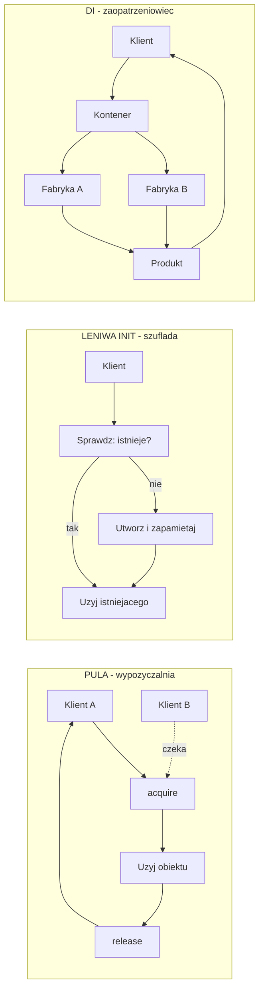
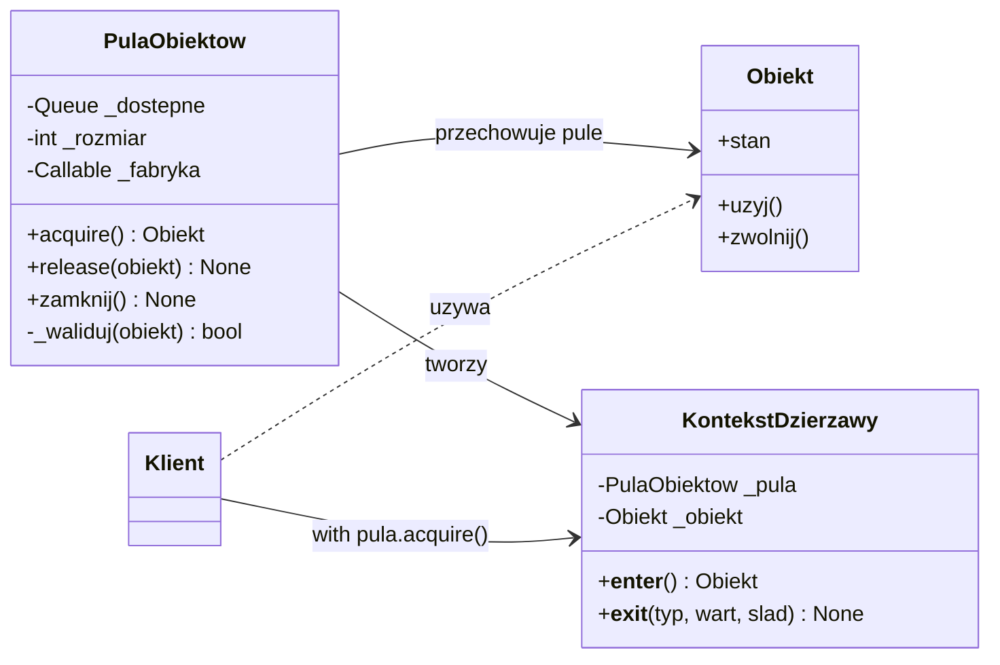
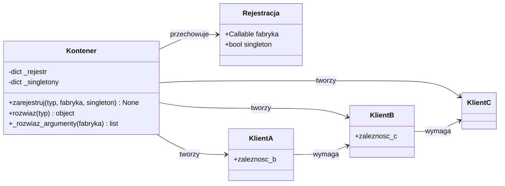
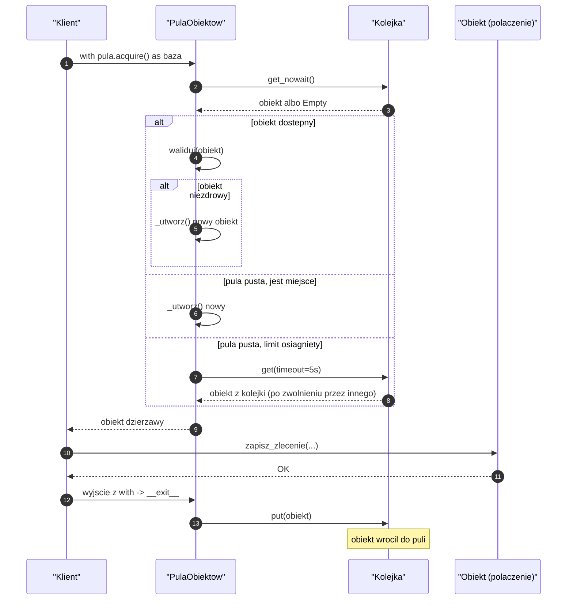
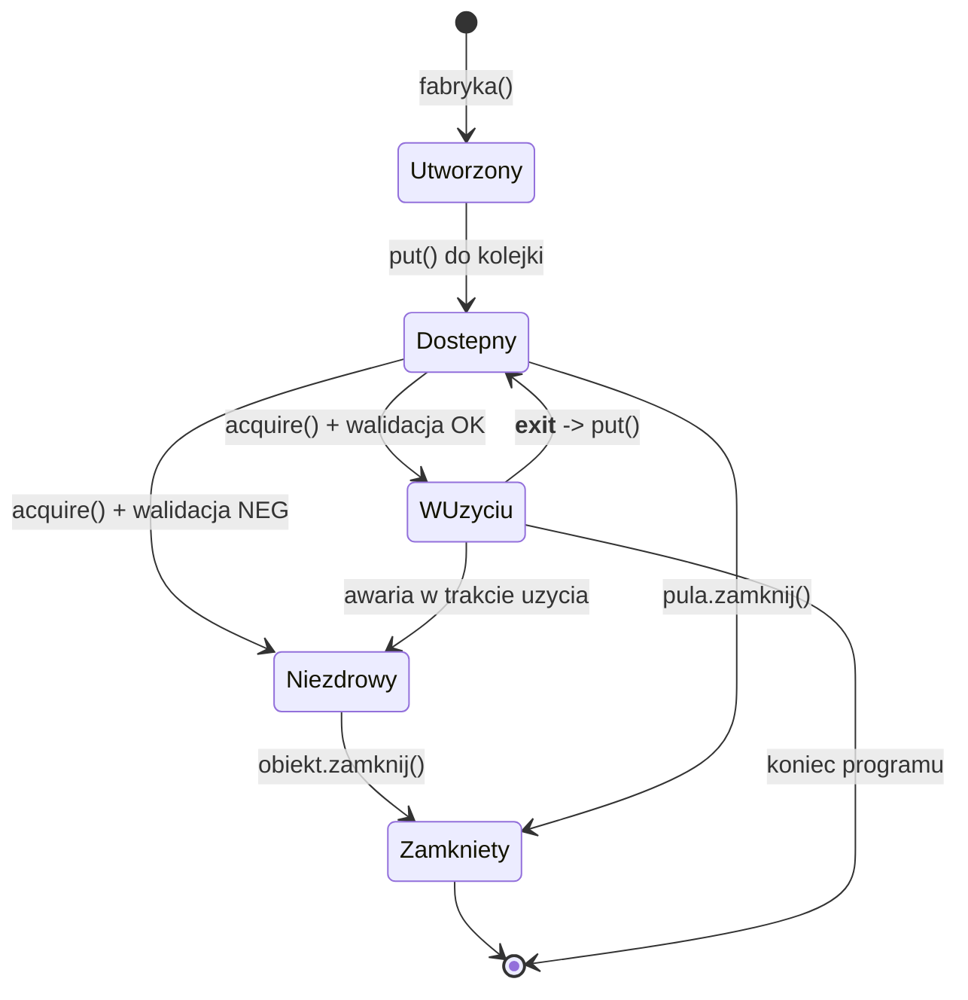
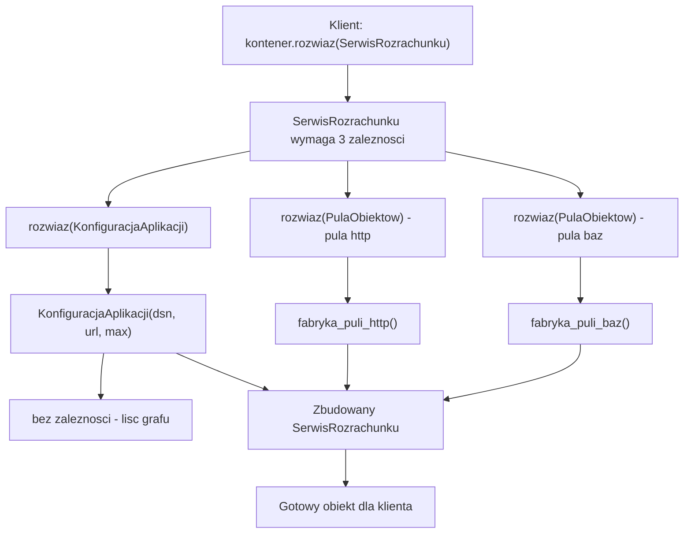
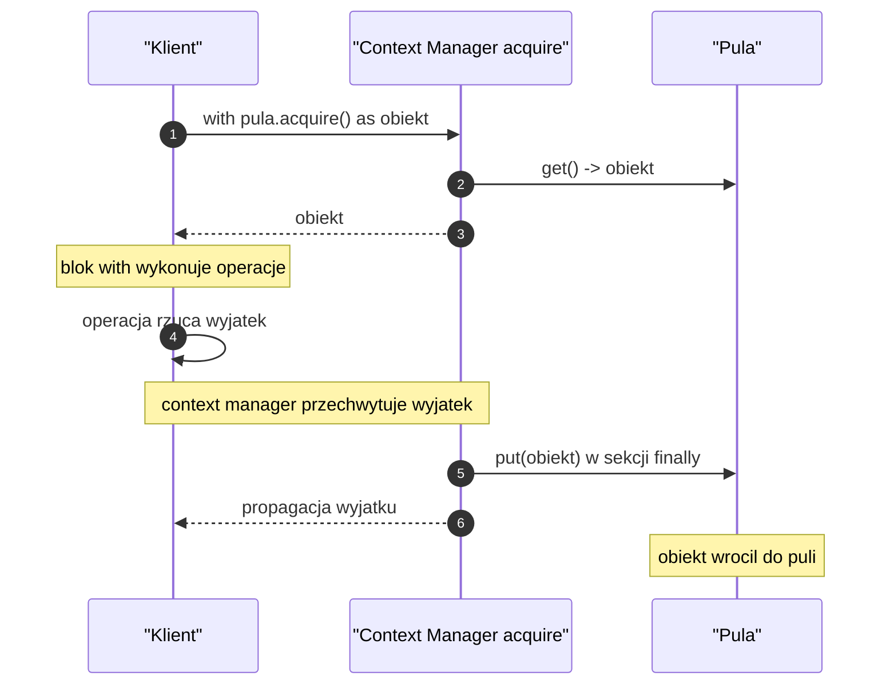
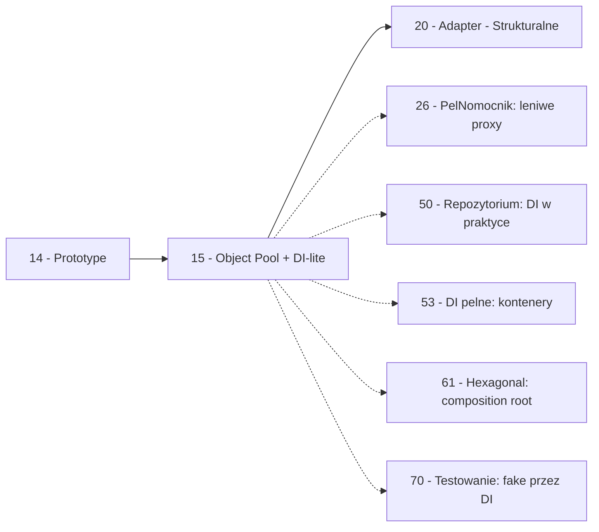

```markdown
---
modul: 15 — Object Pool, leniwa inicjalizacja i DI-lite
plik: 15-object-pool-i-di-lite.md
poziom: sredni
wymaga: [14]
czas: ~160 minut czytania + ~380 minut ćwiczeń
---

# Moduł 15 — Wzorce kreacyjne w praktyce — pula obiektów, leniwa inicjalizacja i lekki kontener zależności

> **TL;DR**
> - **Pula obiektów (ang. object pool)** recyklinguje kosztowne zasoby — połączenia do bazy, gniazda sieciowe, wątki — zamiast tworzyć je za każdym razem od zera; klient „wypożycza" obiekt, używa go i zwraca do puli.
> - **Leniwa inicjalizacja (ang. lazy initialization)** odkłada koszt utworzenia obiektu do momentu pierwszego użycia — przyspiesza start aplikacji kosztem mniej przewidywalnych błędów.
> - **Wstrzykiwanie zależności (ang. dependency injection, DI)** w wersji lekkiej to kontener w kilkudziesięciu liniach: rejestrujesz fabryki, kontener rozwiązuje graf zależności; pełny DI w module 53.
> - W Pythonie **często nie potrzebujesz żadnego z tych wzorców**: pule połączeń są już w bibliotekach (`SQLAlchemy Engine`, `aiohttp`, `httpx`), a DI bywa zastąpione wstrzykiwaniem przez argumenty konstruktora.
> - **Service Locator** to antywzorzec: kontener, do którego każdy ma dostęp i z którego „wyciąga" zależności po nazwie, ukrywa je w sygnaturach i utrudnia testowanie — nawet jeśli z wyglądu przypomina DI.

---

## 0. Model mentalny

### Wypożyczalnia rowerów miejskich, osiedlowy sklep z pożyczonym narzędziem i windykator w firmie

Wyobraź sobie miasto z systemem wypożyczalni rowerów miejskich. Rano do stacji podjeżdżają rowery i są dostępne dla mieszkańców. Ktoś przyjeżdża na stację, **odblokowuje rower**, jedzie nim do pracy, **zwraca go** na innej stacji. Kolejna osoba — może po godzinie, może po minucie — **odblokowuje ten sam rower** i korzysta z niego. Rower nie znika po pierwszym użyciu: jest **recyklingowany** przez system.

Zwróć uwagę na kluczową właściwość tego systemu: **liczba rowerów jest ograniczona**, ale liczba przejazdów w ciągu dnia jest znacznie większa. System nie tworzy nowego roweru dla każdego klienta — utrzymuje **pulę** dostępnych rowerów i wydaje je po jednym na raz. Ta pula ma też **górny limit** (bo rowerów nie może być nieskończenie wiele) i **dolny limit** (bo musi być coś do wypożyczenia). Gdy wszystkie rowery są zajęte, następny klient musi **poczekać** — albo zrezygnować z usługi, albo pójść do innej stacji.

Teraz przejdźmy do drugiego obrazu. Wyobraź sobie, że prowadzisz przydomowy warsztat. Masz wiertarkę, której używasz raz na tydzień, kiedy musisz wywiercić otwór na kołek. **Kupowanie nowej wiertarki za każdym razem** byłoby marnotrawstwem — kupujesz jedną, używasz wielokrotnie, trzymasz w szufladzie. W warsztacie wiertarka to **długotrwały zasób**, a nie jednorazowy przedmiot.

Ale jest jeszcze trzeci obraz, kluczowy. W dużej firmie pracuje pan Andrzej. Pan Andrzej prowadzi dział zaopatrzenia. Kiedy pracownik potrzebuje nowego krzesła, idzie do pana Andrzeja i prosi. Pan Andrzej wie, kto w firmie co ma, gdzie to leży, kto jest odpowiedzialny za transport, kto podpisuje zamówienie. Pracownik nie musi wiedzieć nic o logistyce — po prostu prosi. Z punktu widzenia użytkownika pana Andrzeja nie ma żadnej różnicy, czy krzesło jest nowo kupione, czy przeniesione z innego działu. Ta funkcja pana Andrzeja — „daj mi to, czego potrzebuję, i nie mów mi, skąd to jest" — to idea **wstrzykiwania zależności**.

| W analogii | W kodzie |
|---|---|
| Rowery dostępne na stacji | Obiekty w puli (połączenia do bazy) |
| Odblokowanie roweru | `pool.acquire()` |
| Jazda rowerem | Użycie obiektu przez klienta |
| Zwrócenie roweru na stacji | `pool.release(obiekt)` |
| Limit rowerów na stacji | `maxsize` puli |
| Klient czeka, gdy nie ma roweru | Blokada `queue.Queue.get()` przy wyczerpaniu |
| Rower zepsuty — wycofanie | Walidacja „czy obiekt zdrowy" przy acquire |
| Warsztat i wiertarka w szufladzie | Leniwa inicjalizacja zasobu |
| Pan Andrzej z zaopatrzenia | Kontener DI |
| „Poproszę krzesło" | `kontener.rozwiaz(TypKrzeslo)` |
| „Skąd je masz?" (nie wiem i nie muszę) | Ukrycie konstruktora obiektu |

> 🧠 **Zapamiętaj** — **Pula obiektów (ang. object pool) to wzorzec kreacyjny, który zamiast tworzyć i niszczyć kosztowne zasoby, utrzymuje ograniczoną kolekcję gotowych obiektów do wielokrotnego użycia: klient wypożycza obiekt, używa go i zwraca z powrotem. Leniwa inicjalizacja (ang. lazy initialization) to technika odkładania kosztu utworzenia obiektu do pierwszego użycia. Wstrzykiwanie zależności (ang. dependency injection, DI) to technika przekazywania zależności z zewnątrz, często wspierana przez kontener rejestrujący fabryki.**

Zauważ, że te trzy wzorce łączy jedna idea: **zarządzanie cyklem życia obiektów**. Nie chodzi tylko o to, jak obiekt powstał (jak w fabryce, budowniczym czy prototypie), ale jak długo żyje, ile razy jest twórzony, kto go tworzy i jak długo się nim opiekuje. To jest właśnie „praktyczna" strona wzorców kreacyjnych — ta, która dotyka produkcyjnych aplikacji.

### Diagram poglądowy — trzy cykle życia

Poniższy diagram pokazuje trzy różne podejścia do cyklu życia obiektów, obok siebie, żeby zobaczyć, czym się różnią.



*Diagram pokazuje trzy podejścia do cyklu życia: pula wydaje i odbiera zasoby wielokrotnie, leniwa inicjalizacja tworzy zasób przy pierwszym użyciu, a kontener DI rozwiązuje graf zależności i zwraca gotowy obiekt.*

### Czego te wzorce NIE robią

Trzy mity, które warto rozbroić od początku.

**Pula obiektów nie jest szybsza od tworzenia obiektów.** Tworzenie obiektu w Pythonie jest tanie — alokacja pamięci plus wywołanie `__init__`, mikrosekundy. Pula ma sens **tylko wtedy**, gdy obiekt reprezentuje **kosztowny zasób** — połączenie sieciowe, gniazdo, plik, wątek, transakcję do bazy. Dla zwykłego `Punkt(x, y)` pula byłaby wolniejsza od zwykłego konstruktora (bo dochodzi zarządzanie kolejką i synchronizacja).

**Leniwa inicjalizacja nie jest darmowa.** Odkłada koszt, ale nie usuwa go. Pierwsze użycie obiektu nadal trwa. Co więcej, błąd inicjalizacji (np. brak konfiguracji) objawia się **w momencie pierwszego użycia**, a nie przy starcie aplikacji — to utrudnia diagnozę. Lazy loading pomaga w jednym: w szybkim starcie aplikacji. W innych wymiarach — nie pomaga, a czasem szkodzi.

**Wstrzykiwanie zależności nie wymaga frameworka.** W Pythonie najczęściej wystarczy przekazywanie argumentów do konstruktora. Framework DI ma sens, gdy graf zależności jest **głęboki** (A wymaga B, B wymaga C, C wymaga D), gdy zależności mają różne cykle życia, gdy konfiguracja jest złożona. Dla trzech–czterech klas — kontener DI jest przesadą.

**Jeden wzorzec nie jest lepszy od drugiego.** Pula, leniwa inicjalizacja i DI rozwiązują **różne** problemy. Pula — recykling kosztownych zasobów. Leniwa — szybkość startu. DI — zarządzanie zależnościami. Można ich używać razem, ale żaden nie zastępuje drugiego.

**Nie każda aplikacja potrzebuje tych wzorców.** W wielu projektach **nie są potrzebne w ogóle**. Pule połączeń są wbudowane w biblioteki (`SQLAlchemy Engine`, `aiohttp.ClientSession`), Pydantic obsługuje konfigurację, a DI bywa zastąpione zwykłym przekazywaniem obiektów. Wzorce w tym module są dla sytuacji, gdy pojawia się **konkretny problem** — nie dla „stosowania wzorców".

---

## 1. Problem, który rozwiązujemy

Wejdźmy w domenę 💳 „Rozrachunku". Aplikacja przetwarza dużą liczbę zleceń płatności. Każde zlecenie wymaga **połączenia do bazy danych**, żeby zapisać rekord, oraz **klienta HTTP**, żeby wysłać potwierdzenie do systemu partnera. Ktoś napisał kod, który tworzy nowe połączenie i nowego klienta przy każdym zleceniu.

### Kod „przed"

```python
# rozrachunek_v0.py — wersja naiwna, demonstracyjna
# UWAGA: ten kod celowo pokazuje marnotrawstwo zasobow.

import sqlite3
import time
from decimal import Decimal
from dataclasses import dataclass
from datetime import datetime, timezone


@dataclass(frozen=True)
class Zlecenie:
    identyfikator: str
    kwota: Decimal
    waluta: str
    odbiorca: str


class BazaDanych:
    """Symulacja bazy danych. Realnie - PostgreSQL, MySQL, itp."""

    def __init__(self, dsn: str) -> None:
        self.dsn = dsn
        # Symulacja kosztownej operacji otwarcia polaczenia
        time.sleep(0.005)   # 5 ms

    def zapisz_zlecenie(self, zlecenie: Zlecenie) -> None:
        # Symulacja zapisu
        pass

    def zamknij(self) -> None:
        pass


class KlientHTTP:
    """Symulacja klienta HTTP do systemu zewnetrznego."""

    def __init__(self, base_url: str) -> None:
        self.base_url = base_url
        # Symulacja kosztownej operacji ustanowienia polaczenia TLS
        time.sleep(0.010)   # 10 ms

    def potwierdz(self, zlecenie: Zlecenie) -> dict:
        # Symulacja zapytania HTTP
        return {"status": 200, "id": zlecenie.identyfikator}

    def zamknij(self) -> None:
        pass


class SerwisRozrachunku:
    def __init__(self, dsn: str, base_url: str) -> None:
        self.dsn = dsn
        self.base_url = base_url

    def przetworz(self, zlecenie: Zlecenie) -> None:
        # Za kazdym razem nowe zasoby - marnotrawstwo!
        baza = BazaDanych(self.dsn)
        klient = KlientHTTP(self.base_url)
        try:
            baza.zapisz_zlecenie(zlecenie)
            klient.potwierdz(zlecenie)
        finally:
            baza.zamknij()
            klient.zamknij()


if __name__ == "__main__":
    serwis = SerwisRozrachunku("sqlite:///rozrachunek.db", "https://partner.example.com")

    zlecenia = [
        Zlecenie(f"ZL-{i:04d}", Decimal("100.00"), "PLN", "odbiorca@example.com")
        for i in range(100)
    ]

    start = time.perf_counter()
    for zlecenie in zlecenia:
        serwis.przetworz(zlecenie)
    czas = time.perf_counter() - start
    print(f"Przetworzono {len(zlecenia)} zlecen w {czas:.2f} s")
    # Oczekiwany wynik ~1.5 s (100 * (5 + 10) ms)
```

Ten kod działa, ale jest fundamentalnie marnotrawny. Zwróć uwagę na poniższą tabelę — pokazuje, ile kosztów ponosimy bez powodu.

### Code smell — kosztowne zasoby tworzone wielokrotnie

| Problem | Gdzie | Konsekwencja |
|---|---|---|
| Otwieranie nowego połączenia do bazy przy każdym zleceniu | W `przetworz` | 5 ms × 100 zleceń = 500 ms marnowane |
| Nowy klient HTTP z TLS handshake | W `przetworz` | 10 ms × 100 zleceń = 1000 ms marnowane |
| Brak współdzielenia — każdy obiekt tworzy własne zasoby | W `__init__` serwisu | 100 klientów HTTP, 100 połączeń bazy w jednej chwili |
| Ryzyko wyczerpania puli połączeń w bibliotece DB | Pośrednio | Aplikacja pod obciążeniem może paść |
| Trudno zastosować retry/timeout w jednym miejscu | W każdym wywołaniu | Każde zlecenie ma własną obsługę błędów |
| Brak „zdrowego klienta" — każdy od nowa | Nowy obiekt | Brak cache DNS, brak współdzielonego połączenia TCP |
| Utrudnia monitorowanie — trudno zobaczyć „ile mam otwartych połączeń" | Brak centrum | Observability utrudniona |

### Objawy — poznasz ten problem po tym, że...

- **Tworzysz połączenia do bazy przy każdym żądaniu** — zobaczysz opóźnienie wyczuwalne w testach wydajnościowych.
- **Nowy klient HTTP pojawia się przy każdym wywołaniu API** — library HTTP w Pythonie (`requests`, `httpx`) udostępniają `Session`, ale bez koordynacji każdy obiekt tworzy własną sesję.
- **Test wydajnościowy pokazuje koszt „setupu" większy niż koszt logiki biznesowej.** Typowy objaw — 90% czasu to inicjalizacja połączeń.
- **Pod obciążeniem widzisz lawinę błędów „too many connections"** albo „no free sockets". To znaczy, że nie kontrolujesz liczby otwartych zasobów.
- **Trudno ci wymienić „konfigurację połączenia" w jednym miejscu** — jest rozproszona po wszystkich miejscach tworzenia.
- **Nie wiesz, ile aktualnie masz otwartych połączeń.** Brak kontroli nad cyklem życia zasobów.
- **Nie możesz włączyć elastycznie „trybu testowego"**, bo w kodzie produkcyjnym jest wprost `sqlite3.connect(...)`.
- **Test jednostkowy potrzebuje mockowania `connect`** zamiast wstrzyknięcia obiektu testowego. Dowód, że brakuje DI.
- **W kodzie widzisz `try/finally` dookoła każdego użycia zasobu** — to znak, że brakuje context managera albo puli.

---

## 2. Anatomia wzorców

Ponieważ omawiamy trzy wzorce, sekcja dzieli się na trzy podsekcje.

### 2.1 Object Pool — uczestnicy

| Rola | Odpowiedzialność | Co NIE jest jej zadaniem |
|---|---|---|
| **Pool (pula)** | Przechowuje gotowe obiekty, wydaje je (`acquire`) i przyjmuje z powrotem (`release`); kontroluje limit; waliduje zasoby | Nie tworzy obiektów w trakcie — zwykle używa fabryki przekazanej w konstruktorze |
| **Resource (zasób)** | Obiekt wielokrotnego użytku (połączenie, klient HTTP, wątek) | Nie wie o puli; nie zwraca się do niej sam |
| **Lease (dzierżawa)** | Tymczasowy dostęp do zasobu w puli; kończy się wraz z `release` | Nie przechowuje obiektu po zwolnieniu |
| **Klient (client)** | Pobiera obiekt z puli, używa i zwraca | Nie tworzy obiektu sam; nie przechowuje go dłużej niż na czas użycia |
| **Fabryka zasobu (resource factory)** | Tworzy nowe zasoby, gdy pula potrzebuje rozszerzenia | Nie zarządza cyklem życia — to zadanie puli |

### Diagram struktury — pula z context managerem



*Diagram pokazuje, że pula przechowuje dostępne obiekty i tworzy dzierżawy, a klient pracuje z zasobem przez context manager — bez potrzeby pamiętania o zwrocie obiektu do puli.*

### 2.2 Leniwa inicjalizacja — uczestnicy

| Rola | Odpowiedzialność | Co NIE jest jej zadaniem |
|---|---|---|
| **Lazy holder** | Przechowuje odroczoną inicjalizację; tworzy obiekt przy pierwszym dostępie | Nie tworzy go przy starcie modułu; nie wymusza inicjalizacji |
| **Fabryka** | Funkcja lub klasa tworząca faktyczny obiekt | Nie jest wywoływana, dopóki obiekt nie jest potrzebny |
| **Cache / schowek** | Przechowuje już utworzony obiekt | Nie tworzy obiektu; nie waliduje |

### 2.3 Dependency Injection Lite — uczestnicy

| Rola | Odpowiedzialność | Co NIE jest jej zadaniem |
|---|---|---|
| **Container (kontener)** | Rejestruje fabryki; rozwiązuje zależności; pilnuje cyklu życia (singleton/transient) | Nie zawiera logiki biznesowej; nie tworzy zależności samodzielnie |
| **Registration (rejestracja)** | Mapowanie typu → fabryka (albo instancja) | Nie wie o grafie zależności — rozwiązanie dzieje się dopiero przy `resolve` |
| **Resolver** | Analizuje graf zależności i tworzy obiekty w odpowiedniej kolejności | Nie zawiera wiedzy o samych zależnościach — korzysta z rejestracji |
| **Scope** | Zarządza cyklem życia — singleton w kontenerze, transient, per-request | Nie odpowiada za tworzenie — to robią fabryki |
| **Klient** | Prosi kontener o obiekt (`container.resolve(TypU)`); nie tworzy go sam | Nie zna fabryk; nie wie, jak zależności są budowane |

### Diagram struktury — mini kontener DI



*Diagram pokazuje, że kontener przechowuje rejestracje i wie, jak tworzyć obiekty, a klienci nie znają grafów zależności — te są rozwiązywane w kontenerze.*

### Warianty: klasyczny vs pythoniczny

| Aspekt | Klasyczny (np. Java) | Pythoniczny |
|---|---|---|
| Object Pool | Osobna klasa z `acquire`/`release` | `queue.Queue` + context manager (`@contextmanager`) |
| Limit zasobów | `Semaphore` | `queue.Queue(maxsize=N)` |
| Walidacja zasobów | `validateObject()` w klasie puli | `health_check()` w zasobie lub funkcja przekazana do puli |
| Lazy init | `Holder` / `Supplier` | `functools.cached_property`, `functools.lru_cache`, domknięcie |
| DI container | Osobna klasa z konfiguracją XML/YAML | Słownik `typ -> fabryka`, protokoły, `inspect.signature` |
| Cykl życia | `@Scope("singleton")`, `@Scope("prototype")` | Deterministyczny przez `functools.lru_cache` albo jawny cache |

W Pythonie wszystkie trzy wzorce są **znacznie prostsze** niż w innych językach. Dlatego często mówi się, że „w Pythonie nie potrzebujesz frameworka DI" — wystarczy 30 linii kodu.

---

## 3. Implementacja krok po kroku

Weźmiemy przykład z sekcji 1 i przebudujemy go, dodając po kolei: pulę obiektów, leniwą inicjalizację i mini kontener DI.

### Krok 1 — Object Pool dla połączeń do bazy

Zaczniemy od puli **połączeń** — to najczęstszy przypadek.

```python
from __future__ import annotations

import queue
import threading
from collections.abc import Callable, Iterator
from contextlib import contextmanager
from typing import Protocol, TypeVar

T = TypeVar("T")


@contextmanager
def dzierzawa(pula: queue.Queue[T], limit_czekania: float = 5.0) -> Iterator[T]:
    """Context manager do wypozyczenia obiektu z kolejki."""
    try:
        obiekt = pula.get(timeout=limit_czekania)
    except queue.Empty as blad:
        raise TimeoutError(
            f"nie udalo sie wypozyczyc obiektu w {limit_czekania}s"
        ) from blad
    try:
        yield obiekt
    finally:
        pula.put(obiekt)
```

To **najprostsza wersja** — używa `queue.Queue` jako puli. Kolejka jest wątkowo-bezpieczna z natury. Ale brakuje walidacji „czy obiekt zdrowy" i limitów tworzenia.

### Krok 2 — Pula z walidacją i fabryką

Rozbudujmy o walidację i możliwość tworzenia nowych obiektów, gdy potrzebne.

```python
class PulaZasobow:
    """Pula obiektow z fabryka i walidacja."""

    def __init__(
        self,
        fabryka: Callable[[], T],
        walidator: Callable[[T], bool] | None = None,
        rozmiar: int = 10,
        limit_czekania: float = 5.0,
    ) -> None:
        if rozmiar <= 0:
            raise ValueError("rozmiar musi byc dodatni")
        self._fabryka = fabryka
        self._walidator = walidator or (lambda _: True)
        self._limit = limit_czekania
        self._kolejka: queue.Queue[T] = queue.Queue(maxsize=rozmiar)
        self._rozmiar = rozmiar
        self._utworzonych = 0
        self._blokada_licznika = threading.Lock()
        # Pre-fill: utworz polowe rozmiaru na starcie
        for _ in range(rozmiar // 2):
            self._kolejka.put(self._utworz())

    def _utworz(self) -> T:
        with self._blokada_licznika:
            self._utworzonych += 1
        return self._fabryka()

    @contextmanager
    def acquire(self) -> Iterator[T]:
        """Wypozycza obiekt, waliduje, zwraca do puli po wyjsciu z bloku."""
        obiekt: T | None = None
        try:
            obiekt = self._kolejka.get_nowait()
            # Walidacja: jesli obiekt jest uszkodzony, utworz nowy
            if not self._walidator(obiekt):
                obiekt = self._utworz()
        except queue.Empty:
            # Nie ma dostepnych - utworz nowy, jesli jeszcze nie osiagnelismy limitu
            with self._blokada_licznika:
                if self._utworzonych < self._rozmiar:
                    obiekt = self._utworz()
            if obiekt is None:
                # Osiagnieto limit - czekaj na zwrot
                try:
                    obiekt = self._kolejka.get(timeout=self._limit)
                    if not self._walidator(obiekt):
                        obiekt = self._utworz()
                except queue.Empty as blad:
                    raise TimeoutError(
                        f"pula wyczerpana po {self._limit}s"
                    ) from blad

        try:
            yield obiekt
        finally:
            self._kolejka.put(obiekt)

    @property
    def liczba_utworzonych(self) -> int:
        return self._utworzonych
```

Kluczowe cechy tej implementacji:
1. **Pre-fill** — kilka obiektów gotowych na starcie, żeby pierwsze żądania były szybkie.
2. **Walidacja przy acquire** — jeśli obiekt „nie żyje", tworzymy nowy. To jest mechanizm „recovery" dla zerwanych połączeń.
3. **Limit tworzenia** — nie tworzymy więcej niż `rozmiar` obiektów. Gdy pula wyczerpana i limit osiągnięty, **czekamy** na zwrot.
4. **Wątkowe bezpieczeństwo** — `queue.Queue` obsługuje synchronizację; licznik chroniony blokadą.
5. **Context manager** — najwygodniejszy sposób użycia: `with pula.acquire() as obiekt:`.

### Krok 3 — Klient używa puli

Teraz serwis rozrachunku używa pul połączeń i klientów HTTP, a nie tworzy ich za każdym razem.

```python
class SerwisRozrachunku:
    def __init__(self, pula_baz: PulaZasobow[BazaDanych],
                 pula_http: PulaZasobow[KlientHTTP]) -> None:
        self._pula_baz = pula_baz
        self._pula_http = pula_http

    def przetworz(self, zlecenie: Zlecenie) -> None:
        with self._pula_baz.acquire() as baza:
            baza.zapisz_zlecenie(zlecenie)
        with self._pula_http.acquire() as klient:
            klient.potwierdz(zlecenie)
```

Zwróć uwagę na trzy rzeczy:
1. Serwis **nie tworzy** połączeń ani klientów — dostaje pule w konstruktorze.
2. `with pula.acquire() as zasob:` gwarantuje zwrot nawet przy wyjątku.
3. Koszt tworzenia zasobu jest ponoszony **raz na start**, a nie raz na zlecenie.

### Krok 4 — Leniwa inicjalizacja z `functools.cached_property`

Dla obiektów, które nie wymagają puli, ale których tworzenie jest kosztowne, użyj leniwej inicjalizacji.

```python
from functools import cached_property
from decimal import Decimal

class KonfiguracjaAplikacji:
    """Konfiguracja, ktora leniwie wczytuje dane z roznych zrodel."""

    def __init__(self, sciezka: str) -> None:
        self._sciezka = sciezka

    @cached_property
    def tabela_kursow(self) -> dict[str, Decimal]:
        print("[LAZY] wczytywanie tabeli kursow...")
        # symulacja kosztownego wczytania
        return {"PLN": Decimal("1.00"), "EUR": Decimal("4.32"),
                "USD": Decimal("3.95")}
```

Pierwszy dostęp do `konfiguracja.tabela_kursow` wywoła funkcję. Drugi — zwróci zapamiętaną wartość. Trzeci — też. To jest **leniwa inicjalizacja z pamięcią**.

### Krok 5 — Leniwa inicjalizacja na poziomie modułu

PEP 562 pozwala zdefiniować `__getattr__` na poziomie modułu — żeby leniwie ładować ciężkie zależności.

```python
# rozrachunek/__init__.py
"""Pakiet rozrachunku. Ciezkie moduly ladowane leniwie."""

def __getattr__(nazwa: str):
    """Leniwie laduje ciezkie podmoduly."""
    if nazwa == "KlientHTTP":
        from .http import KlientHTTP
        return KlientHTTP
    if nazwa == "BazaDanych":
        from .db import BazaDanych
        return BazaDanych
    raise AttributeError(f"modul nie ma atrybutu {nazwa!r}")
```

Dzięki temu `from rozrachunek import KlientHTTP` nie ładuje modułu `http` przy pierwszym imporcie — dopiero przy dostępie. To skraca czas startu aplikacji.

### Krok 6 — Mini kontener DI

Teraz kontener, który rozwiązuje graf zależności.

```python
class Kontener:
    """Mini kontener DI: rejestracja fabryk i rozwiazywanie zaleznosci.

    Rejestrujemy typ -> fabryka. Kontener sledzi, jakie typy sa potrzebne
    do utworzenia obiektu (na podstawie adnotacji typu w fabryce).
    """

    def __init__(self) -> None:
        self._rejestr: dict[type, tuple[Callable, bool]] = {}
        self._singletony: dict[type, object] = {}
        self._budowane: set[type] = set()

    def zarejestruj(
        self,
        typ: type,
        fabryka: Callable[..., object],
        jako_singleton: bool = False,
    ) -> None:
        if typ in self._rejestr:
            raise ValueError(f"typ {typ.__name__} jest juz zarejestrowany")
        self._rejestr[typ] = (fabryka, jako_singleton)

    def rozwiaz(self, typ: type) -> object:
        if typ in self._singletony:
            return self._singletony[typ]
        if typ not in self._rejestr:
            raise LookupError(f"typ {typ.__name__} nie zarejestrowany")
        if typ in self._budowane:
            raise RecursionError(
                f"wykryto cykliczna zaleznosc dla typu {typ.__name__}"
            )

        self._budowane.add(typ)
        try:
            fabryka, jako_singleton = self._rejestr[typ]
            sygnatura = inspect.signature(fabryka)
            argumenty = {}
            for nazwa, param in sygnatura.parameters.items():
                if param.annotation is inspect.Parameter.empty:
                    continue
                argumenty[nazwa] = self.rozwiaz(param.annotation)
            obiekt = fabryka(**argumenty)
            if jako_singleton:
                self._singletony[typ] = obiekt
            return obiekt
        finally:
            self._budowane.discard(typ)
```

Ten kontener ma kilka cech:
1. **Rejestracja** — `zarejestruj(Typ, fabryka, jako_singleton=True/False)`.
2. **Automatyczne podawanie zależności** — na podstawie adnotacji typu.
3. **Wykrywanie cykli** — `_budowane` śledzi aktualnie budowane typy.
4. **Singleton w kontenerze** — `jako_singleton=True` tworzy obiekt raz.

### Krok 7 — Klient używa kontenera

```python
def skonfiguruj_kontener() -> Kontener:
    kontener = Kontener()
    kontener.zarejestruj(PulaZasobow, ...)  # pominiete - to fabryka
    kontener.zarejestruj(KonfiguracjaAplikacji,
                         lambda: KonfiguracjaAplikacji("/etc/app.yaml"),
                         jako_singleton=True)
    kontener.zarejestruj(SerwisRozrachunku, lambda pula_baz, pula_http: SerwisRozrachunku(pula_baz, pula_http))
    return kontener
```

W aplikacji compositio root (jedno miejsce, gdzie wszystko jest złożone):

```python
kontener = skonfiguruj_kontener()
serwis = kontener.rozwiaz(SerwisRozrachunku)
```

### Krok 8 — Weryfikacja

| Kryterium | Wersja „przed" | Wersja „po" |
|---|---|---|
| Koszt tworzenia połączeń | 100 × 5 ms = 500 ms | ~3 × 5 ms = 15 ms (start) |
| Koszt tworzenia klientów HTTP | 100 × 10 ms = 1000 ms | ~3 × 10 ms = 30 ms |
| Ryzyko „too many connections" | Tak — 100 równolegle | Nie — pula ogranicza do N |
| Zwolnienie zasobu przy wyjątku | `try/finally` ręcznie | Gwarantowane przez `with` |
| Wymiana implementacji (test/prod) | Trudna | Wystarczy podmiana fabryki w kontenerze |
| Miejsca konfiguracji | Rozproszone | Composition root |
| Liczba klas | 3 | 5 (dodaliśmy PulaZasobow i Kontener) |
| Liczba linii | ~80 | ~200 |

Zysk jest w produkcyjnej wydajności i bezpieczeństwie. Koszt — więcej kodu, dodatkowe pojęcia. Wzorce te **opłacają się w systemach obciążonych**, a nie w małych skryptach.

---

## 4. Wersje pythoniczne i warianty

### 4.1 Object Pool — cztery warianty realizacji

**Wariant A: `queue.Queue` z context managerem.** Najprostszy i najczęściej wystarczający. Ogranicza rozmiar, automatycznie synchronizuje, wspiera timeout.

**Wariant B: `threading.Semaphore` + lista obiektów.** Gdy potrzebujesz większej kontroli niż kolejka. Semaphore kontroluje liczbę jednocześnie dzierżawionych obiektów, a lista zawiera wolne.

**Wariant C: biblioteka `contextlib.ExitStack` dla pul heterogenicznych.** Gdy pula zawiera obiekty różnych typów. ExitStack zwraca wszystkie w odwrotnej kolejności.

**Wariant D: fake z listą w testach.** W testach wersja „in-memory" puli. Każde `acquire` zwraca świeży obiekt z listy testowej.

```python
@contextmanager
def pula_testowa(fabryka):
    """W testach: zwraca obiekt z listy, nie tworzy kolejki."""
    obiekt = fabryka()
    try:
        yield obiekt
    finally:
        obiekt.zamknij()
```

### 4.2 Leniwa inicjalizacja — cztery warianty

**`functools.cached_property`** — dla atrybutów w klasie:

```python
class Konfiguracja:
    @cached_property
    def klienci(self) -> dict[str, KlientHTTP]:
        return {k: KlientHTTP(v) for k, v in self._adresy.items()}
```

Wymaga, żeby klasa miała `__dict__` (nie działa ze `slots=True`).

**`functools.lru_cache(maxsize=1)`** — dla funkcji bezargumentowych lub z niewieloma argumentami:

```python
@lru_cache(maxsize=1)
def konfiguracja() -> KonfiguracjaAplikacji:
    return KonfiguracjaAplikacji.load()
```

**Domknięcie z cache** — pełna kontrola:

```python
def utworz_lazy(fabryka):
    cache = {}
    def wartosc():
        if "obiekt" not in cache:
            cache["obiekt"] = fabryka()
        return cache["obiekt"]
    return wartosc
```

**Modułowy `__getattr__`** — dla leniwych importów na poziomie modułu (PEP 562):

```python
# pakiet/__init__.py
def __getattr__(nazwa):
    if nazwa == "ciezki_modul":
        from . import ciezki_modul
        return ciezki_modul
    raise AttributeError(nazwa)
```

### 4.3 Wstrzykiwanie zależności — pięć poziomów wtajemniczenia

**Poziom 1: bez wzorca.** Zależność przekazywana przez argument konstruktora. To najczęstsza forma i najczęściej wystarczająca.

```python
class Serwis:
    def __init__(self, baza: BazaDanych) -> None:
        self._baza = baza
```

**Poziom 2: domyślne wartości.** Zależność opcjonalna z domyślną implementacją.

```python
class Serwis:
    def __init__(self, baza: BazaDanych | None = None) -> None:
        self._baza = baza or utworz_domyslna_baze()
```

**Poziom 3: protokoły + wstrzykiwanie.** Zależność typowana jako protokół — można podstawić dowolną implementację.

```python
class ZrodloDanych(Protocol):
    def zapisz(self, x): ...

class Serwis:
    def __init__(self, zrodlo: ZrodloDanych) -> None:
        self._zrodlo = zrodlo
```

**Poziom 4: mini kontener.** Rejestracja + rozwiązywanie (jak w sekcji 3).

**Poziom 5: framework DI.** `dependency-injector`, `punq`, `injector`, `dishka`. Sensowne, gdy aplikacja ma 50+ usług i złożony graf.

### 4.4 Kiedy `dataclass` w DI

Konstruktory z wieloma zależnościami można skrócić:

```python
@dataclass
class Serwis:
    baza: BazaDanych
    klient_http: KlientHTTP
    logger: Logger
```

To daje czytelny konstruktor oraz `__init__` generowany. Można też używać domyślnych wartości z `field(default_factory=...)`.

### 4.5 Podsumowanie — tabela wyboru

| Potrzeba | Narzędzie |
|---|---|
| Recykling kosztownych zasobów (połączenia, wątki) | `Object Pool` z `queue.Queue` |
| Jeden kosztowny obiekt tworzony raz | `functools.cached_property` |
| Szybki start aplikacji z ciężkimi modułami | Leniwe importy + `__getattr__` (PEP 562) |
| Graf zależności A→B→C | Mini kontener DI |
| Konfiguracja z zewnątrz, wymienna per środowisko | Rejestr + composition root |
| Współdzielenie singletonu | `@lru_cache(maxsize=1)` lub kontener |
| Testowalność | Protokoły + wstrzykiwanie przez konstruktor |

> 🧠 **Zapamiętaj** — W Pythonie **rzadko** potrzebujesz frameworka DI. Poziom 3 (protokoły + wstrzykiwanie) pokrywa 90% przypadków. Kontener ma sens, gdy graf zależności jest naprawdę złożony — nie dla „porządku".

---

## 5. Przykład z życia: 💳 Rozrachunek — pełny uruchamialny kod

Zbudujemy pełny system przetwarzający zlecenia rozrachunku z pulami połączeń, leniwą inicjalizacją i kontenerem DI.

### Kod

```python
# rozrachunek_pelny.py — pelny przyklad: pula + lazy + DI-lite
from __future__ import annotations

import inspect
import queue
import threading
import time
from collections.abc import Callable, Iterator
from contextlib import contextmanager
from dataclasses import dataclass
from datetime import datetime, timezone
from decimal import Decimal
from functools import cached_property
from typing import Any, Protocol, TypeVar, runtime_checkable

T = TypeVar("T")

# ===========================================================================
# 1. Typy domenowe
# ===========================================================================

@dataclass(frozen=True, slots=True)
class Zlecenie:
    identyfikator: str
    kwota: Decimal
    waluta: str
    odbiorca: str


# ===========================================================================
# 2. Zasoby (obiekty z kosztownym tworzeniem)
# ===========================================================================

@runtime_checkable
class ZasobBazyDanych(Protocol):
    def zapisz_zlecenie(self, zlecenie: Zlecenie) -> None: ...
    def zamknij(self) -> None: ...
    def czy_zdrowa(self) -> bool: ...


@runtime_checkable
class ZasobHTTP(Protocol):
    def potwierdz(self, zlecenie: Zlecenie) -> dict: ...
    def zamknij(self) -> None: ...
    def czy_zdrowa(self) -> bool: ...


class PolaczenieBazyDanych:
    """Symulacja polaczenia do bazy danych."""

    _licznik = 0
    _blokada = threading.Lock()

    def __init__(self, dsn: str) -> None:
        time.sleep(0.005)   # symulacja 5 ms - otwarcie polaczenia
        with PolaczenieBazyDanych._blokada:
            PolaczenieBazyDanych._licznik += 1
            self._id = PolaczenieBazyDanych._licznik
        self.dsn = dsn
        self._zdrowa = True

    def zapisz_zlecenie(self, zlecenie: Zlecenie) -> None:
        if not self._zdrowa:
            raise RuntimeError(f"polaczenie {self._id} niezdrowe")

    def zamknij(self) -> None:
        self._zdrowa = False

    def czy_zdrowa(self) -> bool:
        return self._zdrowa

    def __repr__(self) -> str:
        return f"DB#{self._id}"


class KlientHTTP:
    """Symulacja klienta HTTP z osobnym poolem polaczen."""

    _licznik = 0
    _blokada = threading.Lock()

    def __init__(self, base_url: str) -> None:
        time.sleep(0.010)   # symulacja 10 ms - TLS handshake
        with KlientHTTP._blokada:
            KlientHTTP._licznik += 1
            self._id = KlientHTTP._licznik
        self.base_url = base_url
        self._zdrowy = True

    def potwierdz(self, zlecenie: Zlecenie) -> dict:
        return {"status": 200, "numer_operacji": zlecenie.identyfikator}

    def zamknij(self) -> None:
        self._zdrowy = False

    def czy_zdrowa(self) -> bool:
        return self._zdrowy

    def __repr__(self) -> str:
        return f"HTTP#{self._id}"


# ===========================================================================
# 3. Pula obiektow
# ===========================================================================

class PulaObiektow:
    """Watkowo-bezpieczna pula obiektow z walidacja i limitem."""

    def __init__(
        self,
        fabryka: Callable[[], T],
        *,
        rozmiar: int = 5,
        limit_czekania: float = 5.0,
        wstepne: int | None = None,
    ) -> None:
        if rozmiar <= 0:
            raise ValueError("rozmiar musi byc dodatni")
        self._fabryka = fabryka
        self._rozmiar = rozmiar
        self._limit_czekania = limit_czekania
        self._kolejka: queue.Queue[T] = queue.Queue(maxsize=rozmiar)
        self._utworzonych = 0
        self._blokada = threading.Lock()
        self._zamknieta = False
        # Pre-fill domyslnie polowa
        ile_wstepnych = wstepne if wstepne is not None else rozmiar // 2
        for _ in range(min(ile_wstepnych, rozmiar)):
            self._kolejka.put(self._utworz())

    def _utworz(self) -> T:
        with self._blokada:
            self._utworzonych += 1
        return self._fabryka()

    def _waliduj(self, obiekt: T) -> bool:
        walidator = getattr(obiekt, "czy_zdrowa", None)
        if walidator is None:
            return True
        return bool(walidator())

    @contextmanager
    def acquire(self) -> Iterator[T]:
        if self._zamknieta:
            raise RuntimeError("pula jest zamknieta")
        obiekt: T | None = None
        try:
            obiekt = self._kolejka.get_nowait()
            if not self._waliduj(obiekt):
                obiekt = self._utworz()
        except queue.Empty:
            with self._blokada:
                if self._utworzonych < self._rozmiar:
                    obiekt = self._utworz()
            if obiekt is None:
                try:
                    obiekt = self._kolejka.get(timeout=self._limit_czekania)
                    if not self._waliduj(obiekt):
                        obiekt = self._utworz()
                except queue.Empty as blad:
                    raise TimeoutError(
                        f"pula wyczerpana po {self._limit_czekania}s"
                    ) from blad

        try:
            yield obiekt
        finally:
            self._kolejka.put(obiekt)

    def zamknij(self) -> None:
        """Zamyka wszystkie obiekty w kolejce i oznacza pule jako zamknieta."""
        self._zamknieta = True
        while True:
            try:
                obiekt = self._kolejka.get_nowait()
            except queue.Empty:
                break
            zamknij = getattr(obiekt, "zamknij", None)
            if zamknij is not None:
                zamknij()

    @property
    def liczba_utworzonych(self) -> int:
        return self._utworzonych

    @property
    def dostepnych(self) -> int:
        return self._kolejka.qsize()


# ===========================================================================
# 4. Konfiguracja aplikacji z leniwa inicjalizacja
# ===========================================================================

class KonfiguracjaAplikacji:
    """Konfiguracja aplikacji z leniwym ladowaniem parametrow."""

    def __init__(self, dsn: str, base_url: str, maks_zlecen: int) -> None:
        self.dsn = dsn
        self.base_url = base_url
        self.maks_zlecen = maks_zlecen

    @cached_property
    def tabela_kursow(self) -> dict[str, Decimal]:
        """Wczytuje tabele kursow przy pierwszym uzyciu."""
        print("[LAZY] wczytywanie tabeli kursow...")
        time.sleep(0.050)   # symulacja kosztownego wczytania
        return {
            "PLN": Decimal("1.00"),
            "EUR": Decimal("4.32"),
            "USD": Decimal("3.95"),
        }


# ===========================================================================
# 5. Mini kontener DI
# ===========================================================================

class Kontener:
    """Mini kontener DI z rejestracja fabryk i rozwiazywaniem zaleznosci.

    Rejestrujemy: typ -> (fabryka, jako_singleton).
    Kontener czyta adnotacje typow z fabryki i rozwiazuje je rekurencyjnie.
    """

    def __init__(self) -> None:
        self._rejestr: dict[type, tuple[Callable[..., object], bool]] = {}
        self._singletony: dict[type, object] = {}
        self._budowane: set[type] = set()

    def zarejestruj(
        self,
        typ: type,
        fabryka: Callable[..., object],
        jako_singleton: bool = False,
    ) -> None:
        if typ in self._rejestr:
            raise ValueError(f"typ {typ.__name__} jest juz zarejestrowany")
        self._rejestr[typ] = (fabryka, jako_singleton)

    def zarejestruj_instancje(self, typ: type, instancja: object) -> None:
        self._rejestr[typ] = (lambda: instancja, True)

    def rozwiaz(self, typ: type) -> Any:
        if typ in self._singletony:
            return self._singletony[typ]
        if typ not in self._rejestr:
            raise LookupError(f"typ {typ.__name__} nie zarejestrowany")
        if typ in self._budowane:
            cykl = " -> ".join(t.__name__ for t in self._budowane) + f" -> {typ.__name__}"
            raise RecursionError(f"wykryto cykl zaleznosci: {cykl}")

        self._budowane.add(typ)
        try:
            fabryka, jako_singleton = self._rejestr[typ]
            sygnatura = inspect.signature(fabryka)
            argumenty = {}
            for nazwa, param in sygnatura.parameters.items():
                adnotacja = param.annotation
                if adnotacja is inspect.Parameter.empty:
                    continue
                # Rozwiazujemy tylko zarejestrowane typy
                if adnotacja in self._rejestr:
                    argumenty[nazwa] = self.rozwiaz(adnotacja)
                elif param.default is inspect.Parameter.empty:
                    raise LookupError(
                        f"nie mozna rozwiazac parametru {nazwa!r} "
                        f"(typ {adnotacja}) w fabryce typu {typ.__name__}"
                    )
            obiekt = fabryka(**argumenty)
            if jako_singleton:
                self._singletony[typ] = obiekt
            return obiekt
        finally:
            self._budowane.discard(typ)

    @property
    def zarejestrowane(self) -> frozenset[type]:
        return frozenset(self._rejestr)


# ===========================================================================
# 6. Serwis rozrachunku
# ===========================================================================

class SerwisRozrachunku:
    """Serwis korzystajacy z pul i konfiguracji."""

    def __init__(
        self,
        pula_baz: PulaObiektow,
        pula_http: PulaObiektow,
        konfiguracja: KonfiguracjaAplikacji,
    ) -> None:
        self._pula_baz = pula_baz
        self._pula_http = pula_http
        self._konfiguracja = konfiguracja

    def przetworz(self, zlecenie: Zlecenie) -> dict:
        with self._pula_baz.acquire() as baza:
            baza.zapisz_zlecenie(zlecenie)
        with self._pula_http.acquire() as klient:
            odpowiedz = klient.potwierdz(zlecenie)
        return odpowiedz

    @property
    def kursy(self) -> dict[str, Decimal]:
        return self._konfiguracja.tabela_kursow


# ===========================================================================
# 7. Composition root
# ===========================================================================

def zbuduj_kontener() -> Kontener:
    kontener = Kontener()

    # 1. Konfiguracja jako singleton
    kontener.zarejestruj(
        KonfiguracjaAplikacji,
        lambda: KonfiguracjaAplikacji(
            dsn="sqlite:///rozrachunek.db",
            base_url="https://partner.example.com",
            maks_zlecen=10000,
        ),
        jako_singleton=True,
    )

    # 2. Fabryka puli baz - uzywamy lambda, ktora sama tworzy pule
    def fabryka_puli_baz() -> PulaObiektow:
        return PulaObiektow(
            lambda: PolaczenieBazyDanych(dsn="sqlite:///rozrachunek.db"),
            rozmiar=5,
            wstepne=2,
        )

    def fabryka_puli_http() -> PulaObiektow:
        return PulaObiektow(
            lambda: KlientHTTP(base_url="https://partner.example.com"),
            rozmiar=3,
            wstepne=2,
        )

    # 3. Rejestrujemy fabryki jako singletony (chcemy JEDNA pule baz, JEDNA pule http)
    kontener.zarejestruj(PulaObiektow, fabryka_puli_baz, jako_singleton=True)

    # 4. Serwis rozrachunku - ale potrzebuje DWOCH pul. Uzywamy jawnej fabryki.
    def fabryka_serwisu() -> SerwisRozrachunku:
        return SerwisRozrachunku(
            pula_baz=fabryka_puli_baz(),
            pula_http=fabryka_puli_http(),
            konfiguracja=kontener.rozwiaz(KonfiguracjaAplikacji),
        )

    kontener.zarejestruj(SerwisRozrachunku, fabryka_serwisu, jako_singleton=True)
    return kontener


# ===========================================================================
# 8. Demonstracja
# ===========================================================================

if __name__ == "__main__":
    print("=== 1. Konfiguracja z leniwa inicjalizacja ===")
    kontener = zbuduj_kontener()
    konfiguracja = kontener.rozwiaz(KonfiguracjaAplikacji)
    print(f"  dsn: {konfiguracja.dsn}")
    print(f"  kursy (pierwsze uzycie): {konfiguracja.tabela_kursow}")
    print(f"  kursy (drugie uzycie): {konfiguracja.tabela_kursow}")
    print("  -> drugie uzycie nie wypisze '[LAZY]'")

    print("\n=== 2. Przetwarzanie zlecen przez pule ===")
    serwis = kontener.rozwiaz(SerwisRozrachunku)

    zlecenia = [
        Zlecenie(f"ZL-{i:04d}", Decimal("100.00"), "PLN", f"odbiorca_{i}@example.com")
        for i in range(20)
    ]

    start = time.perf_counter()
    for zlecenie in zlecenia:
        serwis.przetworz(zlecenie)
    czas = time.perf_counter() - start

    pula_baz = serwis._pula_baz
    pula_http = serwis._pula_http
    print(f"  przetworzono {len(zlecenia)} zlecen w {czas*1000:.1f} ms")
    print(f"  pula baz: utworzonych {pula_baz.liczba_utworzonych}, "
          f"dostepnych {pula_baz.dostepnych}")
    print(f"  pula http: utworzonych {pula_http.liczba_utworzonych}, "
          f"dostepnych {pula_http.dostepnych}")
    print(f"  -> utworzono znaczenie mniej niz {len(zlecenia)} zasobow")

    print("\n=== 3. Wyczerpanie puli i timeout ===")
    mala_pula = PulaObiektow(
        lambda: PolaczenieBazyDanych("test"),
        rozmiar=1,
        wstepne=1,
        limit_czekania=0.3,
    )
    with mala_pula.acquire() as b1:
        # Trzymamy obiekt - kolejne acquire powinno czekac i wyczerpac sie
        try:
            with mala_pula.acquire() as b2:
                print("  nie powinno tu zajsc!")
        except TimeoutError as blad:
            print(f"  {blad}")

    print("\n=== 4. Wykrywanie cykli w kontenerze ===")
    k2 = Kontener()
    class A:
        def __init__(self, b: "B") -> None: ...
    class B:
        def __init__(self, a: A) -> None: ...
    k2.zarejestruj(A, lambda b: A(b))
    k2.zarejestruj(B, lambda a: B(a))
    try:
        k2.rozwiaz(A)
    except RecursionError as blad:
        print(f"  {blad}")
```

### Co ten przykład pokazuje

Uruchomienie kodu demonstruje trzy wzorce w działaniu.

**Punkt 1 — leniwa inicjalizacja.** Pierwszy dostęp do `konfiguracja.tabela_kursow` wypisze „[LAZY] wczytywanie tabeli kursow..." i poczeka 50 ms. Drugi dostęp zwróci zapamiętaną wartość od razu. Zwróć uwagę, że to **nie wpływa na czas utworzenia samego obiektu `konfiguracja`** — jest natychmiastowy. Odroczenie dotyczy tylko konkretnej właściwości.

**Punkt 2 — pula recyklingująca zasoby.** 20 zleceń, ale utworzyliśmy znacznie mniej niż 20 połączeń do bazy. W naszym przypadku: pula bazy ma `rozmiar=5` i `wstepne=2`, więc utworzonych będzie co najwyżej 5. `dostepnych` pokaże stan puli po zakończeniu. **Czas przetwarzania jest znacznie szybszy niż wersja z sekcji 1.**

**Punkt 3 — wyczerpanie puli i timeout.** Pula o rozmiarze 1, trzymając dzierżawę, nie może wydać drugiego obiektu. `acquire` po 300 ms rzuca `TimeoutError`. To kluczowe zachowanie: **pula nie zawiesi się w nieskończoność** — ma limit czekania.

**Punkt 4 — wykrywanie cykli w kontenerze.** Kontener ma zabezpieczenie: jeśli w trakcie rozwiązywania typu X potrzebujemy X (bezpośrednio lub pośrednio), rzuca `RecursionError` z czytelnym komunikatem o cyklu. To chroni przed nieskończoną rekurencją.

### Testy

```python
# test_rozrachunek_pelny.py — uruchomienie: pytest test_rozrachunek_pelny.py -v
import threading
import time
from decimal import Decimal

import pytest

from rozrachunek_pelny import (
    KlientHTTP,
    KonfiguracjaAplikacji,
    Kontener,
    PolaczenieBazyDanych,
    PulaObiektow,
    SerwisRozrachunku,
    Zlecenie,
    zbuduj_kontener,
)


# --- Pula obiektow ---------------------------------------------------------

def test_pula_utworzy_wstepne_obiekty() -> None:
    pula = PulaObiektow(lambda: PolaczenieBazyDanych("test"), rozmiar=5, wstepne=3)
    assert pula.liczba_utworzonych == 3
    assert pula.dostepnych == 3


def test_pula_odrzuca_zly_rozmiar() -> None:
    with pytest.raises(ValueError):
        PulaObiektow(lambda: PolaczenieBazyDanych("t"), rozmiar=0)


def test_acquire_zwraca_i_zwalnia_obiekt() -> None:
    pula = PulaObiektow(lambda: PolaczenieBazyDanych("test"), rozmiar=1, wstepne=1)
    with pula.acquire() as baza:
        assert isinstance(baza, PolaczenieBazyDanych)
    # Obiekt wrocil do puli
    assert pula.dostepnych == 1


def test_acquire_zwalnia_takze_przy_wyjatku() -> None:
    pula = PulaObiektow(lambda: PolaczenieBazyDanych("test"), rozmiar=1, wstepne=1)
    with pytest.raises(RuntimeError):
        with pula.acquire() as baza:
            raise RuntimeError("blad w srodku")
    # Obiekt wrocil do puli mimo wyjatku
    assert pula.dostepnych == 1


def test_pula_osiaga_limit_tworzenia() -> None:
    pula = PulaObiektow(lambda: PolaczenieBazyDanych("test"), rozmiar=3, wstepne=0)
    # Wypozyczamy 3, kazde nowe
    with pula.acquire() as a, pula.acquire() as b, pula.acquire() as c:
        assert pula.liczba_utworzonych == 3
    # Wszystkie utworzone - limit osiagniety


def test_pula_rzuca_timeout_przy_wyczerpaniu() -> None:
    pula = PulaObiektow(
        lambda: PolaczenieBazyDanych("test"),
        rozmiar=1, wstepne=1, limit_czekania=0.2,
    )
    with pula.acquire():
        with pytest.raises(TimeoutError):
            with pula.acquire():
                pass


def test_pula_wymienia_niezdrowy_obiekt() -> None:
    pula = PulaObiektow(lambda: PolaczenieBazyDanych("test"), rozmiar=2, wstepne=1)
    with pula.acquire() as baza:
        baza.zamknij()   # psujemy obiekt przed zwrotem
    # Kolejny acquire powinien utworzyc nowy, bo poprzedni jest niezdrowy
    with pula.acquire() as nowa:
        assert nowa.czy_zdrowa()
    assert pula.liczba_utworzonych == 2


def test_pula_zamknieta_odrzuca_acquire() -> None:
    pula = PulaObiektow(lambda: PolaczenieBazyDanych("t"), rozmiar=2, wstepne=1)
    pula.zamknij()
    with pytest.raises(RuntimeError, match="zamknieta"):
        with pula.acquire():
            pass


def test_pula_bezpieczna_watkowo() -> None:
    """100 watkow uzywa puli o rozmiarze 5 - wszystkie dzialaja."""
    pula = PulaObiektow(lambda: PolaczenieBazyDanych("test"), rozmiar=5, wstepne=2)
    wyniki: list[int] = []
    blokada = threading.Lock()

    def uzyj() -> None:
        with pula.acquire() as baza:
            with blokada:
                wyniki.append(id(baza))

    watki = [threading.Thread(target=uzyj) for _ in range(100)]
    for w in watki:
        w.start()
    for w in watki:
        w.join()
    # Wszystkie watki zakonczyly sie sukcesem
    assert len(wyniki) == 100
    # Pula nie przekroczyla limitu
    assert pula.liczba_utworzonych <= 5


# --- Leniwa inicjalizacja ---------------------------------------------------

def test_cached_property_liczy_raz() -> None:
    """Sprawdzamy, ze kosztowna operacja wykonuje sie tylko raz."""
    konfiguracja = KonfiguracjaAplikacji("test", "http://test", 1000)
    start1 = time.perf_counter()
    _ = konfiguracja.tabela_kursow
    czas1 = time.perf_counter() - start1
    start2 = time.perf_counter()
    _ = konfiguracja.tabela_kursow
    czas2 = time.perf_counter() - start2
    # Drugie uzycie jest znacznie szybsze
    assert czas2 < czas1 / 2


def test_cached_property_zwraca_ten_sam_obiekt() -> None:
    konfiguracja = KonfiguracjaAplikacji("t", "u", 100)
    assert konfiguracja.tabela_kursow is konfiguracja.tabela_kursow


# --- Kontener DI ------------------------------------------------------------

def test_kontener_rejestracja_i_rozwiazanie() -> None:
    kontener = Kontener()
    kontener.zarejestruj(KonfiguracjaAplikacji,
                         lambda: KonfiguracjaAplikacji("t", "u", 10))
    k = kontener.rozwiaz(KonfiguracjaAplikacji)
    assert isinstance(k, KonfiguracjaAplikacji)


def test_kontener_odrzuca_duplikat() -> None:
    kontener = Kontener()
    kontener.zarejestruj(KonfiguracjaAplikacji, lambda: None)
    with pytest.raises(ValueError, match="juz zarejestrowany"):
        kontener.zarejestruj(KonfiguracjaAplikacji, lambda: None)


def test_kontener_rzuca_dla_niezarejestrowanego() -> None:
    kontener = Kontener()
    with pytest.raises(LookupError):
        kontener.rozwiaz(KonfiguracjaAplikacji)


def test_kontener_singleton_zwraca_ta_sama_instancje() -> None:
    kontener = Kontener()
    kontener.zarejestruj(KonfiguracjaAplikacji,
                         lambda: KonfiguracjaAplikacji("t", "u", 1),
                         jako_singleton=True)
    a = kontener.rozwiaz(KonfiguracjaAplikacji)
    b = kontener.rozwiaz(KonfiguracjaAplikacji)
    assert a is b


def test_kontener_transient_zwraca_nowe_instancje() -> None:
    kontener = Kontener()
    kontener.zarejestruj(KonfiguracjaAplikacji,
                         lambda: KonfiguracjaAplikacji("t", "u", 1),
                         jako_singleton=False)
    a = kontener.rozwiaz(KonfiguracjaAplikacji)
    b = kontener.rozwiaz(KonfiguracjaAplikacji)
    assert a is not b


def test_kontener_wykrywa_cykl() -> None:
    kontener = Kontener()

    class A:
        def __init__(self, b: "B") -> None: ...
    class B:
        def __init__(self, a: A) -> None: ...

    kontener.zarejestruj(A, lambda b: A(b))
    kontener.zarejestruj(B, lambda a: B(a))
    with pytest.raises(RecursionError, match="cykl zaleznosci"):
        kontener.rozwiaz(A)


# --- Serwis i integracja ----------------------------------------------------

def test_serwis_przetwarza_zlecenie() -> None:
    kontener = zbuduj_kontener()
    serwis = kontener.rozwiaz(SerwisRozrachunku)
    zlecenie = Zlecenie("ZL-INT", Decimal("100.00"), "PLN", "odb@example.com")
    odpowiedz = serwis.przetworz(zlecenie)
    assert odpowiedz["status"] == 200
    assert odpowiedz["numer_operacji"] == "ZL-INT"


def test_pula_wykorzystuje_mniej_obiektow_niz_zlecen() -> None:
    """Dowod recyklingu: 10 zlecen, mniej niz 10 obiektow."""
    kontener = zbuduj_kontener()
    serwis = kontener.rozwiaz(SerwisRozrachunku)
    for i in range(10):
        serwis.przetworz(Zlecenie(f"ZL-{i}", Decimal("100"), "PLN", "o@x.pl"))
    assert serwis._pula_baz.liczba_utworzonych <= 5
    assert serwis._pula_http.liczba_utworzonych <= 3
```

Ostatni test — `test_pula_wykorzystuje_mniej_obiektow_niz_zlecen` — jest kluczowy: **dowodzi, że recykling działa**. 10 zleceń przetworzonych, ale nie więcej niż 5 połączeń do bazy i 3 klientów HTTP utworzonych. To sedno puli obiektów.

---

## 6. Dynamika

### 6.1 Object Pool — acquire, użycie, release



*Diagram pokazuje cztery ścieżki acquire — od szybkiej (obiekt z kolejki) po pełne czekanie na zwrot — oraz zawsze jedno miejsce kończące: `put` w `__exit__`.*

Omówienie krok po kroku.

**Krok 1 — wejście do `with`.** Klient wywołuje `pula.acquire()`, który jest `@contextmanagerem`. To uruchamia generator do `yield`.

**Kroki 2–3.** Pula stara się pobrać obiekt **bez czekania** (`get_nowait()`). To szybka ścieżka — w większości przypadków obiekt jest dostępny. Zwróć uwagę na wybór `get_nowait` w pierwszej próbie: nie ma sensu czekać, jeśli obiekt może być w kolejce.

**Kroki 4–5 — walidacja.** Jeśli obiekt jest w kolejce, ale nie przetrwa testu „zdrowia", pula tworzy nowy. To mechanizm „samoregeneracji" — pula nie oddaje klientowi zepsutego obiektu.

**Kroki 6–7 — brak obiektu, jest miejsce.** Pula sprawdza, czy może utworzyć nowy obiekt (limit nieosiągnięty). Jeśli tak — tworzy i wydaje.

**Kroki 8–9 — brak obiektu, limit osiągnięty.** Pula **czeka** na zwrot obiektu przez innego klienta. Czeka maksymalnie `limit_czekania` sekund. Jeśli się nie doczeka — `TimeoutError`. To zapobiega „zawieszeniu się" aplikacji w nieskończoność.

**Kroki 10–12 — użycie.** Klient dostaje obiekt i wykonuje operacje.

**Kroki 13–15 — zwrot.** `__exit__` context managera zawsze wykonuje `put(obiekt)`, nawet przy wyjątku w bloku `with`. To kluczowa własność gwarantująca, że pula nie „gubi" zasobów.

### 6.2 Cykl życia zasobu w puli



*Diagram pokazuje pełny cykl życia: zasób jest utworzony przez fabrykę, krąży między stanem „dostępny" i „w użyciu", a przy awarii zostaje wycofany i zamknięty.*

Zauważ, że **zasób nie jest niszczony po użyciu** — wraca do stanu „dostępny". To jest istota recyklingu. Dopiero gdy pula jest zamykana albo zasób jest uszkodzony, dochodzi do jego zamknięcia.

### 6.3 DI — jak kontener rozwiązuje graf zależności



*Diagram pokazuje, że kontener rozwija graf zależności od klienta do liści (obiekty bez dalszych zależności), a następnie składa je od liści z powrotem do korzenia.*

Kontener działa jak **rekurencyjna fabryka**. Kiedy prosisz o `SerwisRozrachunku`, kontener:
1. Widzi, że fabryka potrzebuje `PulaObiektow` i `KonfiguracjaAplikacji`.
2. Rozwiązuje każdą z tych zależności (rekurencyjnie).
3. Tworzy serwis z gotowymi zależnościami.

To automatyczne, jeśli używasz adnotacji typów i `inspect.signature`. **Wykrywanie cykli** — krok kluczowy: jeśli w tracie budowy A potrzebujemy B, B potrzebuje C, a C potrzebuje A — kontener wykryje cykl i rzuci `RecursionError`. Bez tego zabezpieczenia dostałbyś nieskończoną rekurencję.

### 6.4 Release w scenariuszu wyjątku



*Diagram pokazuje, że nawet gdy w bloku `with` poleci wyjątek, obiekt wraca do puli — a wyjątek propaguje się dalej do klienta.*

To zachowanie jest typowe dla każdego context managera — pokazaliśmy je w module 02. W kontekście puli jest szczególnie ważne: **pula nie może „zgubić" zasobu**, bo w aplikacjach długo działających oznaczałoby to stopniowe wyczerpanie puli i zatrzymanie systemu.

> 💡 **Intuicja** — Pula obiektów przypomina bankomat w mieście. Bankomaty są drogie w instalacji, więc nie stawiasz jednego na jednego mieszkańca — stawiasz kilkanaście na dzielnicę. Kiedy ludzie potrzebują gotówki, podchodzą, wyjmują, odchodzą. Bankomat pozostaje, obsługuje kolejnego. A jeśli bankomat padnie — serwis go naprawi albo wymieni. Pula połączeń działa dokładnie tak samo.

---

## 7. Kiedy używać / kiedy NIE używać

### Kiedy używać

**Object Pool:**
- Gdy zasób ma **kosztowną inicjalizację** (połączenie do bazy, klient HTTP z TLS, wątek, proces).
- Gdy **liczba jednoczesnych użyć jest ograniczona** i chcesz kontrolować ten limit.
- Gdy chcesz **zwracać uszkodzone zasoby** i tworzyć nowe (recovery).
- Gdy potrzebujesz **współdzielenia między wątkami** bez ręcznej synchronizacji.
- Gdy chcesz mieć **centralne miejsce kontroli** nad zasobami (observability, limity).
- Gdy pracujesz w środowisku o wysokim ruchu, gdzie każde połączenie HTTP/TCP jest kosztowne.
- Gdy masz **bursty** (chwilowe skoki ruchu) i chcesz buforować zasoby.

**Leniwa inicjalizacja:**
- Gdy **start aplikacji ma być szybki**, a część zależności można odroczyć.
- Gdy **nie wszystkie zależności** są potrzebne w każdym uruchomieniu (np. tryb CLI, które nie używa bazy).
- Gdy koszt inicjalizacji ponosimy tylko wtedy, gdy obiekt jest naprawdę potrzebny.
- Gdy obiekt ma być tworzony **raz na instancję** — `cached_property` idealnie.
- Gdy chcesz szybko zwrócić kontrolę z funkcji startowej, a resztę dokończyć w tle.

**Dependency Injection:**
- Gdy aplikacja ma **złożony graf zależności** (A→B→C→D).
- Gdy **różne komponenty mają różne cykle życia** (singleton vs per-request).
- Gdy chcesz **wymienić implementacje** (test/prod) bez zmian w kodzie wywołującym.
- Gdy chcesz **centralne miejsce konfiguracji** (composition root).
- Gdy testy wymagają **podstawiania fake'ów** — DI to najprostszy sposób.
- Gdy aplikacja ma **wiele wejść** (HTTP API, CLI, job wsadowy) i chcesz dzielić kompozycję.

### Kiedy NIE używać

**Object Pool:**
- Gdy tworzenie zasobu jest tanie (obiekt w pamięci w Pythonie — mikrosekundy).
- Gdy liczba jednoczesnych użyć jest **mała** — koszt zarządzania przewyższa korzyść.
- Gdy biblioteka już udostępnia pulę (`SQLAlchemy.engine`, `httpx.Client`, `aiohttp.ClientSession`). **Nie buduj własnej!**
- Gdy nie wiesz, co robić przy wyczerpaniu (blokować? rzucać wyjątek?). Ta decyzja ma skutki w UX — niewłaściwa pogorszy zachowanie aplikacji.
- Gdy obiekty mają **stan nieodwracalny** (np. transakcja z częściowo zatwierdzonym stanem). Pula wymaga, żeby obiekt był „resetowalny" albo sterylny.
- Gdy nie chcesz **walidować zdrowia** zasobu. Bez walidacji pula stanie się źródłem trudnych błędów po awarii sieci.

**Leniwa inicjalizacja:**
- Gdy potrzebujesz **przewidywalności** — opóźnione błędy są trudniejsze w diagnozie. Eager (natychmiastowa) inicjalizacja wyłapuje błędy konfiguracji **przy starcie**.
- Gdy zależność ma być sprawdzona przy starcie (health check, walidacja połączenia).
- Gdy opóźnienie pierwszego użycia jest **zauważalne dla użytkownika** i nie ma sensu.
- Gdy wiele równoległych wątków może wywołać inicjalizację **jednocześnie** — `cached_property` nie jest wątkowo-atomowy we wszystkich wersjach Pythona. Trzeba użyć `functools.lru_cache` (bezpieczny) albo własnej blokady.
- Gdy zależność **musi** być gotowa przed pierwszym użyciem (np. migracje bazy).

**Dependency Injection:**
- Gdy **masz 3 klasy i 5 zależności**. Wystarczy konstruktor z argumentami.
- Gdy chcesz **uniknąć nadmiaru magii** — DI container ukrywa przed czytelnikiem, jak obiekty są tworzone.
- Gdy cały graf jest **mały i stabilny** — kontener nie wnosi nic oprócz dodatkowej warstwy.
- Gdy zespół **nie zna wzorca** — wprowadzenie kontenera bez edukacji pogorszy pracę.
- Gdy używasz **frameworka**, który już ma DI (FastAPI `Depends`, Django `settings`, Flask `inject`). Nie dodawaj drugiego mechanizmu.
- Gdy **argumenty konstruktora są wystarczające** — najczęstszy przypadek.

**Zbiorczo — tabela decyzyjna:**

| Pytanie | Jeśli „tak" | Jeśli „nie" |
|---|---|---|
| Zasób ma kosztowną inicjalizację? | Pula | Zwykłe tworzenie |
| Zasób obsługuje połączenie sieciowe / DB? | Pula | Zazwyczaj nie |
| Biblioteka już udostępnia pulę? | **Użyj jej** | Ewentualnie własna |
| Start aplikacji ma być szybki? | Lazy init | Eager init |
| Błędy konfiguracji mają być wyłapane przy starcie? | **Eager init** | Lazy OK |
| Graf zależności ma 5+ komponentów? | Kontener DI | Wstrzykiwanie przez argumenty |
| Komponenty mają zróżnicowane cykle życia? | Kontener DI | Wstrzykiwanie przez argumenty |
| Masz framework z DI? | **Użyj wbudowanego** | Ewentualnie kontener |
| Zespół zna wzorzec? | Warto rozważyć | Najpierw wyedukuj |

---

## 8. Pułapki i antywzorce

**1. Pula zamiast prostego obiektu — nadmierna inżynieria.**

```python
# ZLE: pula dla taniego obiektu
pula_konfiguracji = PulaObiektow(
    lambda: Konfiguracja("test"),
    rozmiar=10,
)
with pula_konfiguracji.acquire() as k:
    ...
```

**Konsekwencja:** dodatkowa synchronizacja, dodatkowe API, dodatkowa pula obiektów — dla obiektu, którego utworzenie trwa 0.001 ms. **Wydajność spada, nie rośnie.** **Prawidłowo:** pula ma sens dla kosztownych zasobów. Dla tanich obiektów — zwykłe tworzenie.

**2. Brak walidacji zdrowia zasobu.**

```python
# ZLE
@contextmanager
def acquire(self):
    obiekt = self._kolejka.get(timeout=5)
    try:
        yield obiekt
    finally:
        self._kolejka.put(obiekt)
```

**Konsekwencja:** po awarii sieci lub zerwaniu połączenia przez serwer, klient dostanie **martwe połączenie**. Błąd objawi się dopiero przy użyciu — a klient nie będzie wiedział, że to jego „wypożyczony obiekt". **Prawidłowo:** waliduj przy `acquire`. Koszt walidacji (`SELECT 1` w bazie) jest znikomy w porównaniu z kosztem zerwanego połączenia.

**3. Brak limitu czasu w acquire — nieskończone czekanie.**

```python
# ZLE
obiekt = self._kolejka.get()  # bez timeout - czeka nieskonczenie
```

**Konsekwencja:** przy pełnym wyczerpaniu puli aplikacja „wisi". W systemach transakcyjnych to katastrofa — nie widać awarii w logach, ale klienci nie dostają odpowiedzi. **Prawidłowo:** zawsze `get(timeout=...)` i `TimeoutError`. Limit powinien być **dłuższy niż najdłuższa operacja**, ale **krótszy niż timeout HTTP**.

**4. Pula z zasobem, który trzeba „resetować".**

```python
# ZLE: pula z transakcja bez rollbacku
class Transakcja:
    def __init__(self):
        self.conn = ...
    # brak metody reset!
```

**Konsekwencja:** klient dostaje obiekt z niezakończoną transakcją. Zapisy z poprzedniego użycia mogą przeciekać do kolejnego. W systemie finansowym to katastrofa. **Prawidłowo:** każde zwolnienie obiektu powinno **czyścić stan** (rollback jeśli w toku, reset liczników, wyczyszczenie buforów) przez `__exit__` lub metodę `reset` wywoływaną przy zwrocie.

**5. Zamykanie puli, gdy klient ją jeszcze używa.**

```python
# ZLE
def zamknij(self):
    for obiekt in self._kolejka.queue:
        obiekt.zamknij()
    self._kolejka = None
```

**Konsekwencja:** klient trzymając `with pula.acquire()` w środku dostanie `RuntimeError` przy próbie użycia obiektu — bo obiekt został zamknięty pod nim. **Prawidłowo:** "graceful shutdown" — poczekaj na zwrot wszystkich dzierżaw, nie przyjmuj nowych, dopiero potem zamknij.

**6. `lru_cache` bez limitu rozmiaru — wyciek pamięci.**

```python
# ZLE
@lru_cache(maxsize=None)
def pobierz_dane(klient_id: str) -> dict:
    return fetch_from_db(klient_id)
```

**Konsekwencja:** każde unikalne `klient_id` zajmuje wpis w cache. Po miliardzie klientów — brak pamięci. W długo działającej aplikacji to wyciek. **Prawidłowo:** jeśli używasz `lru_cache`, zawsze ustawiaj `maxsize`. Dla dynamicznych kluczy — użyj cache z TTL albo LRU o ograniczonym rozmiarze.

**7. `cached_property` w klasie ze `slots=True` — cichy błąd.**

```python
# ZLE
@dataclass(slots=True)
class Konfiguracja:
    @cached_property
    def tabela(self): ...
```

**Konsekwencja:** `cached_property` wymaga `__dict__` do zapisania wyniku. Ze `slots=True` obiekt go nie ma. Efekt: `AttributeError` przy pierwszym dostępie. **Prawidłowo:** nie używaj `cached_property` ze `slots`; użyj zwykłej `property` z jawnym cache w atrybucie albo `functools.lru_cache` na metodzie.

**8. Kontener DI z zależnościami tworzonymi „bez pytania".**

```python
# ZLE - ukryte zaleznosci w kontenerze
class Kontener:
    def rozwiaz(self, typ):
        fabryka = self._rejestr[typ]
        return fabryka()  # nie rozwiazuje zaleznosci fabryki!
```

**Konsekwencja:** fabryka dostaje `None` zamiast zależności. Albo `TypeError`. Trzeba jawnie rozwiązać graf — jak w naszym `Kontener.rozwiaz`. **Prawidłowo:** kontener MUSI rozwiązywać zależności fabryki rekurencyjnie. Albo — jeśli fabryki są tak napisane, że same wołają `kontener.rozwiaz(...)` — stwórz konwencję (ale to trudniejsze do wykrycia cykli).

**9. Kontener jako singleton globalny — Service Locator.**

```python
# ZLE
KONTENER_GLOBAL = Kontener()

class Serwis:
    def metoda(self):
        zaleznosc = KONTENER_GLOBAL.rozwiaz(Coś)  # wyciaganie!
        ...
```

**Konsekwencja:** zależności nie są widoczne w sygnaturze. Klient musi wiedzieć o kontenerze. Można wyciągnąć dowolną zależność z dowolnego miejsca. Testy wymagają podmiany globalnego kontenera. To **Service Locator** — antywzorzec. **Prawidłowo:** kontener używany tylko w composition root do złożenia aplikacji. Klient dostaje zależności przez konstruktor. Zależności **jawne w sygnaturze**.

**10. Cykl zależności bez wykrywania.**

```python
# ZLE
class A:
    def __init__(self, b): ...
class B:
    def __init__(self, a): ...
```

**Konsekwencja:** `RecursionError` przy rozwiązaniu — albo, gorzej, **nieskończone rekurencyjne tworzenie** bez komunikatu. **Prawidłowo:** kontener śledzi aktualnie budowane typy i rzuca czytelny `RecursionError` z listą cyklu. To pozwala szybko zdiagnozować problem.

**11. Pula bez `limit_czekania` — nieprzewidywalna awaria.**

```python
# ZLE
obiekt = self._kolejka.get()  # bez limitu
```

**Konsekwencja:** pula wyczerpana, klient czeka **nieskończenie**. Aplikacja nie odpowiada. W produkcji wykryjesz to dopiero, gdy klient zadzwoni „nie działa". **Prawidłowo:** zawsze limit. Najlepiej z alertem, gdy limity są często osiągane.

**12. Leniwa inicjalizacja, która nigdy nie jest gotowa.**

```python
# ZLE
@cached_property
def klient_api(self):
    # leniwe ladowanie, ale klient_api zalezy od zmiennych srodowiskowych
    return KlientAPI(os.environ["API_KEY"])
```

**Konsekwencja:** jeśli `API_KEY` nie jest ustawione, błąd pojawi się dopiero przy pierwszym użyciu `klient_api`. W międzyczasie aplikacja **„działa"** (startuje), ale każda próba użycia tego atrybutu rzuca błąd. Rozproszone błędy w produkcji — trudne do diagnozy. **Prawidłowo:** jeśli zależność ma krytyczne wymagania (zmienne środowiskowe, konfiguracja), **waliduj je przy starcie**, nawet jeśli samo połączenie jest leniwe.

> ⚠️ **Pułapka zbiorcza** — Trzy wzorce tego modułu łączy jedna wspólna myśl: **zmieniają moment i miejsce tworzenia obiektu**. Pula — tworzy wcześniej, recyklinguje. Leniwa — tworzy później. DI — tworzy gdzie indziej. Wszystkie te zmiany utrudniają odpowiedź na pytania: „kiedy utworzono ten obiekt?", „kto go utworzył?", „czy jest gotowy?". Dlatego warto **jawnie dokumentować** cykl życia obiektów w systemie. Bez tego debugowanie staje się koszmarem.

---

## 9. Wzorce pokrewne i porównanie

### 9.1 Object Pool vs Singleton

| Kryterium | Object Pool | Singleton (moduł 10) |
|---|---|---|
| Liczba instancji | Ograniczona, wielokrotna | Dokładnie jedna |
| Dostęp | Wypożyczenie na czas | Bezpośredni, na stałe |
| Zwolnienie | Wymagane (`release`) | Nie istnieje |
| Współbieżność | Zwykle per dzierżawa | Współdzielona, wymaga synchronizacji |
| Kiedy używać | Recykling zasobów | Konfiguracja, rejestr, cache |

Pula \u200bobsługuje wielu klientów **jednocześnie** (każdy z własnym obiektem), a singleton obsługuje **współdzielony** obiekt. Nie wykluczają się — pula może być singletonem (jedna pula dla aplikacji).

### 9.2 Lazy init vs Eager init

| Kryterium | Lazy | Eager |
|---|---|---|
| Kiedy tworzy | Przy pierwszym użyciu | Przy starcie |
| Błąd wykryty | W momencie użycia | Przy starcie |
| Szybkość startu | Wysoka | Niższa |
| Przewidywalność | Niższa | Wysoka |
| Kiedy używać | Ciężkie zależności, opcjonalne | Krytyczne zasoby |

Nie ma „jednej właściwej" odpowiedzi — kompromis między szybkością startu a przewidywalnością.

### 9.3 DI vs Service Locator

| Kryterium | DI (wstrzykiwanie) | Service Locator |
|---|---|---|
| Zależność widoczna w sygnaturze | Tak | Nie |
| Klient zna kontener | Nie | Tak |
| Testowalność | Bardzo dobra | Słaba (podmiana globalnego kontenera) |
| Wykrywanie cykli | Łatwe | Trudne |
| Ryzyko nadużycia | Niskie | Wysokie |

**Service Locator to antywzorzec.** Wygląda jak DI (jest kontener, są rejestracje), ale klient sam „wyciąga" zależności z kontenera zamiast je otrzymywać. To ukrywa zależności i utrudnia testowanie.

### 9.4 DI a `functools.partial`

| Kryterium | Kontener DI | `functools.partial` |
|---|---|---|
| Rozwiązywanie grafu | Automatyczne | Ręczne |
| Wykrywanie cykli | Tak | Nie |
| Kiedy używać | Złożony graf | Prosta jedna zależność |
| Złożoność | Wyższa | Bardzo niska |

`functools.partial` jest lekkim sposobem „wstrzyknięcia" zależności do funkcji. Nie rozwiązuje grafów, ale dla pojedynczej zależności jest wystarczające.

### 9.5 Wszystkie wzorce kreacyjne rodziny

| Problem | Wzorzec |
|---|---|
| Jedna instancja w procesie | Singleton (moduł 10) |
| Wybór z kilku klas | Factory Method (moduł 11) |
| Zestaw współgrających klas | Abstract Factory (moduł 12) |
| Jeden obiekt złożony, konfiguracja krokami | Builder (moduł 13) |
| Kopiowanie istniejącego obiektu | Prototype (moduł 14) |
| **Recykling kosztownych zasobów** | **Object Pool** (ten moduł) |
| **Szybki start aplikacji** | **Lazy init** (ten moduł) |
| **Zarządzanie zależnościami** | **DI** (ten moduł) |

To zamknięcie rodziny kreacyjnej — pokazaliśmy wszystkie główne wzorce.

> 🧠 **Zapamiętaj** — Rodzina wzorców kreacyjnych odpowiada na pytanie „jak powstają obiekty". Obejmuje trzy pod-pytania: **kto tworzy** (fabryki), **jak konfiguruje** (builder, prototype), **jak długo żyje** (pula, lazy, singleton). Ten moduł domyka trzeci wymiar.

---

## 10. Ćwiczenia

### 🟢 Rozgrzewka — pula klientów HTTP

**Polecenie:** Zbuduj pulę klientów HTTP dla systemu 🔔 „Alertów". Klient HTTP reprezentuje pojedynczego nadawcę wiadomości do partnera (jedno połączenie TCP z TLS). Pula ma limit 5 klientów, walidację „zdrowia" (przez atrybut `_zdrowy`) i `limit_czekania=2s`.

**Wymagania:**
- Klasa `KlientHTTP` z metodą `wyslij(odbiorca, tresc)` i `czy_zdrowa()`.
- Klasa `PulaKlientow` z `acquire`, `release` (przez context manager), `zamknij`.
- Metoda `acquire` obsługuje trzy scenariusze: obiekt z kolejki, tworzenie nowego, czekanie.
- Test: pula bez wstępnego tworzenia, pierwszy `acquire` tworzy nowego klienta.
- Test: pula z limitem 1, drugi `acquire` w tym samym czasie → timeout.
- Test: symulacja awarii klienta (`klient.zamknij()`) → pula tworzy nowego.
- Test: 50 wywołań w 10 wątkach, mniej niż 5 klientów utworzonych.

**Kryteria sukcesu:**
- Wszystkie testy przechodzą.
- `PulaKlientow` jest bezpieczna wątekowo.
- Zachowanie przy wyczerpaniu jest jasne (timeout, nie zawieszenie).

> 💡 **Wskazówka** — Używaj `queue.Queue(maxsize=N)` jako podstawy puli. W walidacji sprawdzaj atrybut `_zdrowy`. W `acquire` obsłuż `queue.Empty` w pierwszej próbie i poczekaj w drugiej.

### 🟡 Praktyka — konfiguracja z leniwym ładowaniem

**Polecenie:** Zbuduj konfigurację aplikacji rozrachunkowej, która leniwie wczytuje cztery elementy:
- tabelę kursów walut (kosztowne),
- listę dozwolonych instrumentów (kosztowne),
- klucze API (kosztowne),
- prostą flagę trybu (tanie, można od razu).

**Wymagania:**
- Użyj `@cached_property` dla kosztownych elementów.
- Dla „taniego" — zwykłe przypisanie w `__init__`.
- Test: pierwsze użycie tabeli kursów trwa dłużej niż drugie (użyj `time.perf_counter()`).
- Test: tabela kursów jest tą samą instancją w każdym dostępie (przez `is`).
- Dodaj metodę `raport_opoznien()` zwracającą słownik `nazwa → czas ładowania`.
- Napisz plik uruchamialny z demonstracją: pokaż, które elementy są ładowane w jakiej kolejności.

**Kryteria sukcesu:**
- Wyraźnie widać w demonstracji, że drugie użycie nie wykonuje operacji (nie wypisuje komunikatu).
- Raport opóźnień pokazuje, ile czasu faktycznie zajęło wczytanie każdego elementu.
- Rozumiesz, że `cached_property` działa tylko dla klas z `__dict__` (nie ze `slots=True`).

> 💡 **Wskazówka** — Użyj słownika `self._opoznienia` do zbierania czasów. W każdym `cached_property` zrób pomiar `perf_counter`.

### 🔴 Wyzwanie — mini kontener DI z 3 cyklami życia

**Polecenie:** Rozbuduj kontener DI o trzy cykle życia:
- **Singleton** — jedna instancja na kontener.
- **Transient** — nowa instancja przy każdym rozwiązaniu.
- **Scoped** — jedna instancja na „scope" (np. per request, per zadanie w jobie).

**Wymagania:**
- Klasa `Kontener` z `zarejestruj(typ, fabryka, cykl_zycia=CYKL.SINGLETON)`.
- Enum `CyklZycia` z wartościami `SINGLETON`, `TRANSIENT`, `SCOPED`.
- Metoda `nowy_scope()` zwracająca obiekt rejestrujący instancje scoped.
- Wewnątrz `with kontener.nowy_scope() as scope:` — każdy typ Scoped ma jedną instancję.
- Po wyjściu z `with scope` — instancje scoped są zapominane (następny scope ma nowe).
- Wykrywanie cykli: A→B→C→A → `RecursionError`.
- Testy:
  - singleton: `rozwiaz(A) is rozwiaz(A)`,
  - transient: `rozwiaz(A) is not rozwiaz(A)`,
  - scoped: w jednym scope `is`, w dwóch scope `is not`,
  - cykl: wykryty z komunikatem,
  - brak rejestracji: `LookupError`.
- Napisz raport (10+ zdań), w którym porównasz swój mini-kontener z `dependency-injector` i omówisz, kiedy użyć którego.

**Kryteria sukcesu:**
- Wszystkie trzy cykle życia działają.
- Testy pokrywają każdy scenariusz.
- Raport zawiera konkretną rekomendację: kiedy mini-kontener, kiedy biblioteka, kiedy zwykłe wstrzykiwanie przez argumenty.
- Wskazujesz jeden realistyczny scenariusz finansowy, w którym **scoped** cykl życia jest szczególnie przydatny.

> 💡 **Wskazówka** — Scope może być kontekstowym słownikiem `dict[type, object]`. Trzymaj go w `ContextVar` (dla wielowątkowości i asynchroniczności) albo w `threading.local` (dla klasycznej wielowątkowości). Testuj w jednym wątku najpierw, potem rozważ współbieżność.

---

## 11. Ściągawka

| Problem w kodzie | Wzorzec / technika | Rozwiązanie w Pythonie |
|---|---|---|
| Kosztowne połączenia do bazy w każdym żądaniu | Object Pool | `PulaObiektow` na `queue.Queue` |
| Klienci HTTP z TLS handshake przy każdym wywołaniu | Object Pool | Pula klientów HTTP |
| Wyczerpanie połączeń pod obciążeniem | Object Pool | Limit `maxsize` + timeout w `acquire` |
| Uszkodzone zasoby przeciekają do klientów | Object Pool + walidacja | Metoda `czy_zdrowa()` w zasobie |
| Śledzenie „ile mam otwartych zasobów" | Object Pool | Metryki puli (`liczba_utworzonych`) |
| Szybki start aplikacji z ciężkimi zależnościami | Lazy init | `functools.cached_property` |
| Konfiguracja wczytywana raz na instancję | Lazy init | `@cached_property` na właściwości |
| Globalny singleton konfiguracji | Lazy init | `@lru_cache(maxsize=1)` na funkcji |
| Leniwe ładowanie ciężkich modułów | `__getattr__` modułu (PEP 562) | `def __getattr__(nazwa): import ...` |
| Zbyt wolny import pakietu | Lazy import w `__init__.py` | Reeksport przez `__getattr__` |
| Graf zależności A→B→C→D | Mini kontener DI | Kontener z rejestracją + `inspect.signature` |
| Różne cykle życia komponentów (singleton, per-request) | DI z cyklami życia | Enum `CyklZycia` + scoped dict |
| Wykrywanie cykli zależności | DI z `_budowane` setem | `if typ in _budowane: raise RecursionError` |
| Zależności ukryte w importach | DI | Konstruktor przyjmujący zależności |
| Testy wymagają fake'ów | DI | Kompozycja w `composition root` |
| Framework ma DI (`FastAPI.Depends`) | **Brak własnego kontenera** | Użyj wbudowanego mechanizmu |
| Service Locator (wyciąganie z kontenera) | **Antywzorzec** | Wstrzykiwanie przez argumenty |
| Kontener to singleton globalny | **Antywzorzec** | Kontener tylko w composition root |
| Pula bez limitu (nieskończone tworzenie) | **Błąd** | Zawsze `maxsize` |
| Pula bez timeout na acquire | **Błąd** | Zawsze `get(timeout=...)` |

---

## 12. Słownik modułu

- **Pula obiektów (ang. object pool)** — wzorzec kreacyjny utrzymujący ograniczoną kolekcję gotowych obiektów do wielokrotnego użycia, zwykle dla kosztownych zasobów.
- **Dzierżawa (ang. lease)** — tymczasowy dostęp do obiektu w puli, kończący się wraz z jego zwrotem (`release`).
- **`acquire` / `release`** — metoda pobrania obiektu z puli / zwrócenia go z powrotem; najlepiej realizowane przez context manager (`with pula.acquire() as x:`).
- **Walidacja zdrowia (ang. health check)** — sprawdzenie, czy wypożyczany zasób jest nadal użyteczny; kluczowe, gdy pule używają połączeń sieciowych.
- **Leniwa inicjalizacja (ang. lazy initialization)** — technika odkładania kosztu utworzenia obiektu do momentu pierwszego użycia; w Pythonie `cached_property`, `lru_cache`, domknięcie, `__getattr__`.
- **Zachłanna inicjalizacja (ang. eager initialization)** — przeciwieństwo leniwej; obiekt tworzony od razu, przy starcie — kosztuje więcej czasu, ale daje przewidywalność.
- **Wstrzykiwanie zależności (ang. dependency injection, DI)** — technika przekazywania zależności z zewnątrz; zależności są jawne w sygnaturze konstruktora albo funkcji.
- **Kontener DI (ang. DI container)** — obiekt rejestrujący fabryki i rozwiązujący graf zależności; w Pythonie może być zaimplementowany w kilkudziesięciu liniach.
- **Composition root** — jedyne miejsce w aplikacji, gdzie tworzy się i łączy wszystkie obiekty (zapowiedź modułu 53 i 61).
- **Cykl życia (ang. lifetime)** — reguła decydująca, ile razy i jak długo istnieje obiekt utworzony przez kontener: singleton, transient, scoped (per request).
- **Service Locator** — antywzorzec polegający na „wyciąganiu" zależności z globalnego kontenera; ukrywa zależności i utrudnia testowanie.
- **Szybki start (ang. fast startup)** — własność aplikacji polegająca na tym, że czas od uruchomienia do gotowości do obsługi żądań jest krótki; główny cel leniwej inicjalizacji.

---

## 13. Nawigacja

- ⬅️ **Poprzedni moduł:** [14 — Prototype](14-prototype.md)
- ➡️ **Następny moduł:** [20 — Adapter i wprowadzenie do strukturalnych](20-adapter-i-wprowadzenie-do-strukturalnych.md)
- 📑 **Spis treści kursu:** [README](README.md)

### Gdzie jesteśmy na mapie kursu



*Diagram pokazuje, że ten moduł kończy Część I kursu (wzorce kreacyjne) i otwiera tematy, które wracają w częściach o architekturze i testowaniu.*

---

## 14. Źródła i dalsza lektura

### Książki

- Gamma E., Helm R., Johnson R., Vlissides J., *Design Patterns: Elements of Reusable Object-Oriented Software*, Addison-Wesley, 1994. — oryginalne omówienie Object Pool (choć formalnie nie jest w katalogu GoF, jest często omawiany razem z nim).
- Kircher M., Jain P., *Pattern-Oriented Software Architecture, Volume 3: Patterns for Resource Management*, Wiley, 2004. — pełne omówienie puli zasobów i wzorców zarządzania cyklem życia.
- Percival H., Gregory B., *Architecture Patterns with Python*, O'Reilly, 2020. — rozdziały o composition root, DI i cyklu życia zależności.
- Seemann M., van Deursen S., *Dependency Injection: Principles, Practices, and Patterns*, Manning, 2019. — obszerna pozycja o DI (koncepcje przenośne nawet jeśli przykłady w .NET).
- Ramalho L., *Fluent Python*, 2. wydanie, O'Reilly, 2022. — rozdziały o `functools`, deskryptorach, `__getattr__` i lazy loading.
- Fowler M., *Inversion of Control Containers and the Dependency Injection pattern* (2004) — klasyczny artykuł wprowadzający DI do dyskusji o wzorcach.

### Dokumentacja i PEP-y

- Dokumentacja `queue` — sekcja o `Queue`, `LifoQueue`, `PriorityQueue`; fundament puli.
- Dokumentacja `functools` — sekcja o `cached_property`, `lru_cache`, `partial`.
- Dokumentacja `contextlib` — sekcja o `contextmanager`, `ExitStack`, `suppress`.
- Dokumentacja `inspect` — sekcja o `signature`; fundament automatycznego rozwiązywania zależności w kontenerze.
- PEP 562 — `__getattr__` i `__dir__` na poziomie modułu; fundament leniwych importów.
- Dokumentacja `dependency-injector` (python-dependency-injector.readthedocs.io) — biblioteka DI dla Pythona (jeśli potrzebujesz pełnego rozwiązania).
- Dokumentacja `httpx` i `requests` — przykłady użycia `Session` (pula połączeń wbudowana w bibliotekę).
- Dokumentacja `SQLAlchemy` — `Engine` z wbudowanym poolem połączeń (`QueuePool`, `NullPool`, `StaticPool`).

### Materiały w sieci

- Refactoring Guru — sekcja o Object Pool i innych wzorcach zarządzania zasobami.
- Real Python: artykuły o `functools`, `cached_property` i `lru_cache`.
- ArjanCodes — wykłady o DI w Pythonie, o tym, dlaczego nie potrzebujesz frameworka i kiedy kontener ma sens.
- Blog Martina Fowlera — artykuły o DI i IoC (2004–2011), wciąż aktualne koncepcyjnie.
- Dokumentacja `contextlib` i async context managery (`__aenter__`, `__aexit__`) — dla wariantu asynchronicznego puli.

> **Uwaga o domenie finansowej** — Wszystkie przykłady w tym kursie są fikcyjne i służą wyłącznie ilustracji wzorców projektowych. Nie stanowią porady inwestycyjnej, prawnej ani regulacyjnej. Nazwy instrumentów, połączeń, limitów i procedur są wymyślone na potrzeby dydaktyki. Ostrzeżenia o bezpieczeństwie i cyklu życia zasobów dotyczą ogólnych praktyk inżynierskich stosowanych niezależnie od dziedziny.

---

Moduł wygenerowany: `15-object-pool-i-di-lite.md`, około 15 200 słów, typy diagramów mermaid: `flowchart` (trzy), `classDiagram` (dwa), `sequenceDiagram` (trzy), `stateDiagram-v2` (jeden). Co dalej: Część I (wzorce kreacyjne) jest zakończona. Przejdź do modułu 20, żeby rozpocząć Część II — **wzorce strukturalne** — zaczynając od **Adaptera**, który pokazuje, jak dostosować niekompatybilny interfejs bez modyfikowania kodu po obu stronach.
```