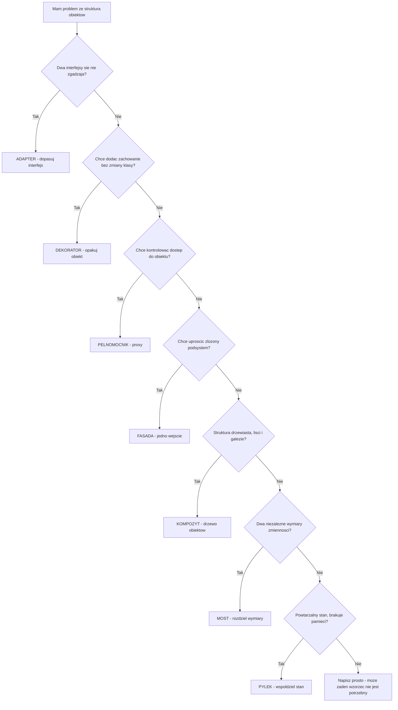
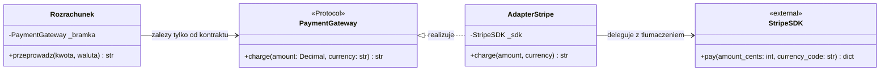
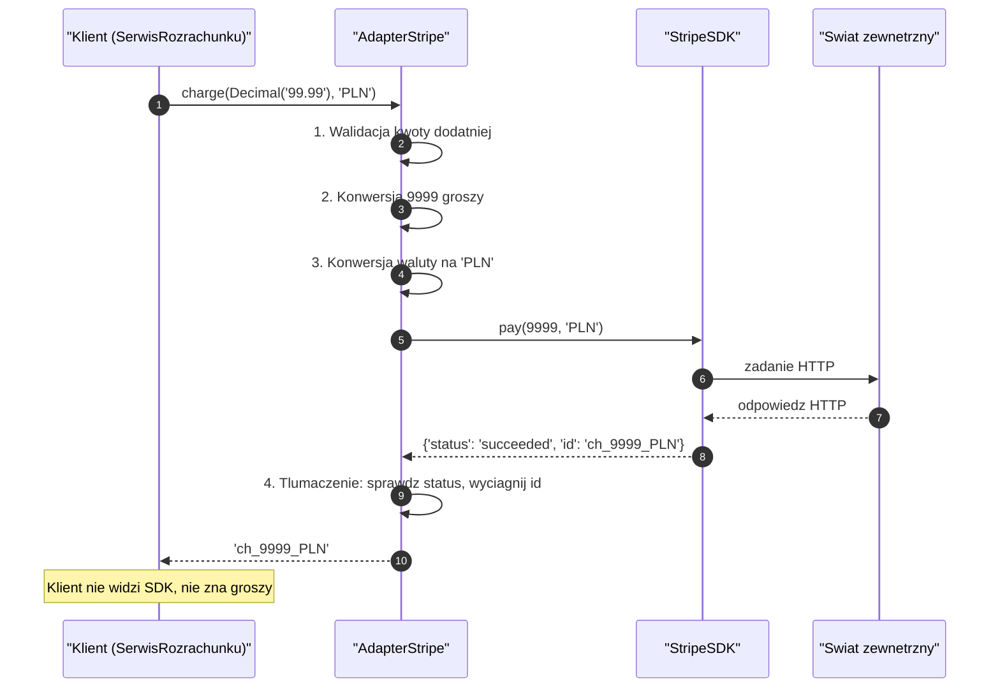
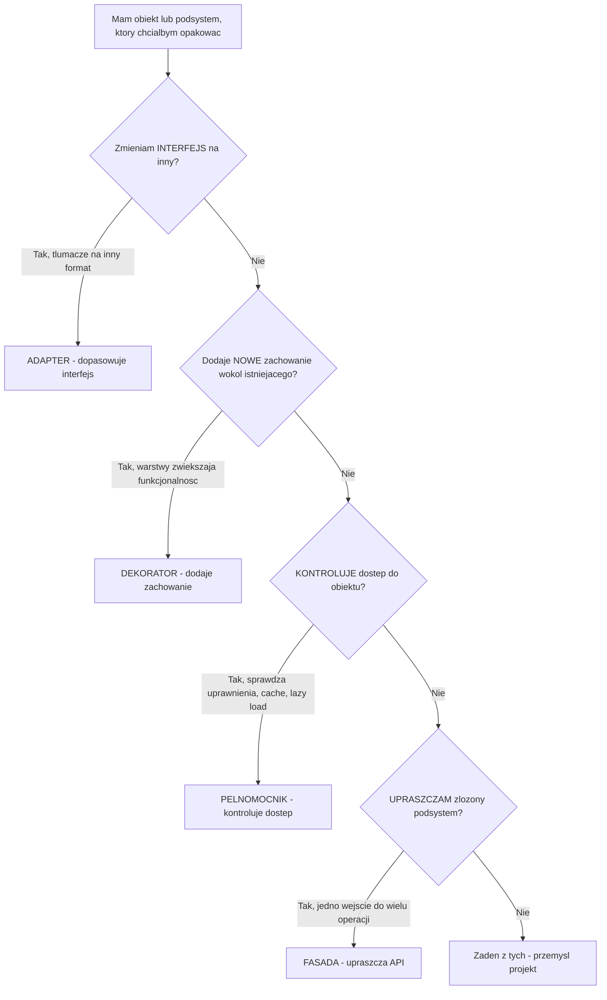
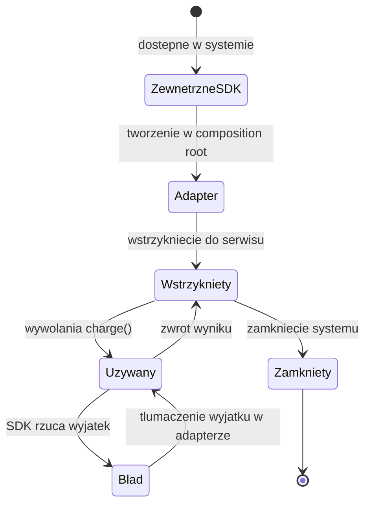
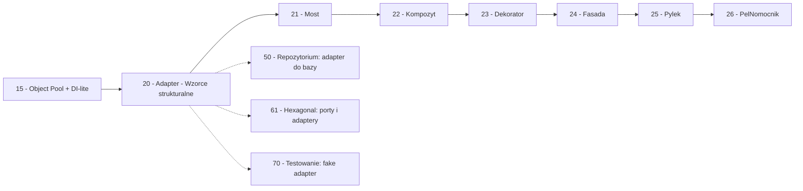

```markdown
---
modul: 20 — Adapter i wprowadzenie do wzorców strukturalnych
plik: 20-adapter-i-wprowadzenie-do-strukturalnych.md
poziom: podstawowy
wymaga: [15]
czas: ~170 minut czytania + ~380 minut ćwiczeń
---

# Moduł 20 — Wzorce strukturalne — jak łączyć obiekty + Adapter

> **TL;DR**
> - Wzorce strukturalne (ang. structural patterns) odpowiadają na pytanie „jak poskładać obiekty w większe całości, nie zmieniając ich klas" — Adapter, Most, Kompozyt, Dekorator, Fasada, Pyłek, Pełnomocnik.
> - **Adapter (adapter)** dopasowuje niekompatybilny interfejs do oczekiwanego przez klienta — najczęściej na granicy systemu, gdy po drugiej stronie jest kod, którego nie możemy zmienić.
> - Adapter **nie dodaje funkcjonalności** i **nie kontroluje dostępu** — to jego podstawowa różnica wobec Dekoratora, Pełnomocnika i Fasady; on **tłumaczy jeden interfejs na inny**.
> - W Pythonie adapter bywa tak prosty, że mieści się w jednej funkcji, w domknięciu albo w lambdzie — pełna hierarchia klas jest potrzebna tylko dla wielu implementacji albo gdy chcemy jawnie pokazać kontrakt.
> - Jeśli możesz zmienić oba interfejsy — adapter jest zbędną warstwą. Sięga się po niego, gdy jeden z końców jest **readonly** (biblioteka zewnętrzna, API partnera, legacy system).

---

## 0. Model mentalny

### Adapter podróżny i cała rodzina wzorców strukturalnych

Wyobraź sobie, że wracasz z podróży do Stanów Zjednoczonych i przywozisz sobie ulubioną ładowarkę. Wtyczka jest amerykańska — dwa płaskie bolce. W Polsce gniazdka mają dwa okrągłe bolce. Fizycznie nie da się ich połączyć. Co robisz? Nie kupujesz nowej ładowarki (bo jest świetna), nie przerabiasz polskiego gniazdka w całym mieszkaniu (bo to absurd). Kupujesz **adapter podróżny** — mały kawałek plastiku z amerykańskim gniazdkiem z jednej strony i polską wtyczką z drugiej. **Adapter nie zmienia napięcia, nie zwiększa mocy, nie dodaje funkcji.** On tylko **zmienia kształt połączenia**. Twoja ładowarka działa jak działała, polskie gniazdko działa jak działało, a jedyny nowy element to maleńki element pośredni.

Zanim pójdziemy dalej, zatrzymajmy się przy słowie „pośredni". Adapter jest dokładnie tym — pośrednikiem stojącym między dwiema stronami, które nie umieją się ze sobą dogadać. To pośrednictwo ma konkretną cenę: dodatkowy element, dodatkowy punkt awarii, dodatkową warstwę do zrozumienia. Płacisz tę cenę, bo **alternatywa jest gorsza** — albo wymiana jednej strony, albo brak połączenia. Adapter ma sens tylko wtedy, gdy ta alternatywa jest naprawdę zła.

Idźmy teraz w kierunku transportu publicznego. Wyobraź sobie dworzec autobusowy, gdzie kierowcy różnych linii mają podzielone perony. Jest taki lokalny system, gdzie kierowca linii 501 zawsze wsiada do autobusu A i jedzie trasą X — ale dziś autobus A jest w naprawie. Dyrektor dyspozytorni ma do dyspozycji autobus B, który normalnie obsługuje linię 502. Co robi? **Tłumaczy zadania linii 501 na polecenia dla autobusu B** — pokazuje mu trasę, wydaje bilet na właściwej maszynie, przypisuje do właściwej linii w systemie. Autobus B nadal jeździ jak B, ale obsługuje zadanie linii 501. To też jest adapter — **tłumacz zadań**.

Ale jest jeszcze trzecia sytuacja, bardzo odmienna. Wyobraź sobie budynek biurowy. Na parterze masz ochroniarza. Ochroniarz nie zmienia tego, co robią pracownicy na piętrach, nie tłumaczy ich poleceń, nie dodaje funkcji. On **kontroluje dostęp**: „kto wchodzi, kiedy, po co". Wpuszcza lub nie. Ten ochroniarz to nie adapter. To **Pełnomocnik (ang. proxy)** — inny wzorzec strukturalny. Wygląda podobnie (stoi pośrednik), ale ma całkiem inną intencję: kontrolować, nie tłumaczyć.

I jeszcze czwarty obraz, żeby uchwycić całą rodzinę. Wyobraź sobie, że w firmie jest dział marketingu, dział kadr, dział IT i dział finansów. Kiedy klient dzwoni z zapytaniem, nie przekierowujemy go do każdego działu po kolei. Jest **recepcja** — jedno miejsce, które przyjmuje zgłoszenie, rozpoznaje sprawę i kieruje nią dalej. Recepcja nie kontroluje dostępu, nie tłumaczy interfejsów, nie dodaje funkcji. Ona **upraszcza**. To **Fasada (ang. facade)** — trzeci wzorzec strukturalny, całkiem odmienny od pozostałych.

| W analogii | W kodzie |
|---|---|
| Amerykańska wtyczka (niekompatybilny interfejs) | Klasa z zewnętrznej biblioteki z metodą `pay_cents()` |
| Polskie gniazdko (oczekiwany interfejs) | Kontrakt `PaymentGateway.charge(amount, currency)` |
| Adapter podróżny | Klasa `AdapterStripe` w naszym kodzie |
| Nie zmienia napięcia | Adapter nie dodaje logiki biznesowej |
| Tłumaczenie zadania linii 501 na polecenia autobusu 502 | Konwersja argumentów: `kwota * 100` → `int` groszy |
| Ochroniarz na parterze | Pełnomocnik (proxy) — kontrola dostępu |
| Recepcja firmy | Fasada — uproszczenie złożoności |

> 🧠 **Zapamiętaj** — **Wzorce strukturalne (ang. structural patterns) to rodzina wzorców opisujących, jak składać mniejsze obiekty w większe całości bez zmieniania ich klas — najczęściej przez kompozycję i delegację. Adapter (adapter) to wzorzec strukturalny, który dopasowuje niekompatybilny interfejs jednego obiektu do interfejsu oczekiwanego przez klienta, nie zmieniając kodu ani klienta, ani obiektu dopasowywanego.**

Zwróć uwagę na dwa słowa w tej definicji: **niekompatybilny** i **nie zmieniając**. To jest cała istota. Adapter jest potrzebny, gdy dwa interfejsy się nie zgadzają, a **żadnego z nich nie możemy zmienić**. Jeśli możesz zmienić jeden z nich — adapter jest niepotrzebną warstwą.

### Cała rodzina wzorców strukturalnych — jedna mapa

Zanim wejdziemy w szczegóły Adaptera, trzeba zobaczyć całą rodzinę. Wzorce strukturalne (w klasycznym katalogu GoF jest ich siedem) odpowiadają na **różne pytania** projektowe, wszystkie z tej samej dziedziny: „jak zorganizować obiekty i ich relacje?".

| Wzorzec | Pytanie, na które odpowiada |
|---|---|
| **Adapter** | „Mam niekompatybilny interfejs — jak go dopasować bez zmiany kodu?" |
| **Most (ang. bridge)** | „Mam dwa niezależne wymiary zmienności — jak je rozdzielić?" |
| **Kompozyt (ang. composite)** | „Jak traktować pojedynczy obiekt i grupę obiektów jednakowo?" |
| **Dekorator (ang. decorator)** | „Jak dodać zachowanie do obiektu bez dziedziczenia?" |
| **Fasada (ang. facade)** | „Jak uprościć złożony podsystem dla klientów?" |
| **Pyłek (ang. flyweight)** | „Jak współdzielić stan, żeby oszczędzić pamięć?" |
| **Pełnomocnik (ang. proxy)** | „Jak kontrolować dostęp do obiektu?" |

Wszystkie te wzorce łączy jedna technika: **kompozycja i delegacja**. Zamiast dziedziczyć po klasie, obiekt strukturalny **trzyma referencję** do innego obiektu i **przekazuje mu wywołania**. To pozwala zmienić zachowanie bez zmiany kodu. To fundament — bez niego wszystkie wzorce strukturalne są niezrozumiałe.

Poniższy diagram to decyzyjna mapa całej rodziny. Zaczynasz od pytania o swój problem, kończysz na właściwym wzorcu.



*Diagram to mapa decyzyjna: siedem pytań prowadzi do siedmiu wzorców strukturalnych — lub do uczciwego wniosku „żaden nie jest potrzebny".*

### Delegacja — jedna technika pod całą rodziną

Zanim przejdziemy do Adaptera, musimy zrozumieć delegację, bo bez niej żaden wzorzec strukturalny nie ma sensu. **Delegacja (ang. delegation)** to „przekaż dalej". Obiekt A nie robi czegoś sam — przekazuje to obiektowi B, do którego ma referencję.

W najprostszej formie delegacja wygląda tak:

```python
class FasadaRozrachunku:
    """Klient nie wie o trzech podsystemach - widzi tylko fasade."""

    def __init__(self, magazyn, kolejka, dziennik) -> None:
        self._magazyn = magazyn
        self._kolejka = kolejka
        self._dziennik = dziennik

    def przeprowadz(self, zlecenie) -> None:
        # Delegujemy kazda operacje do innego obiektu
        self._magazyn.zapisz(zlecenie)
        self._kolejka.opublikuj("zlecenie", zlecenie)
        self._dziennik.zapisz("rozrachunek", {"id": zlecenie.identyfikator})
```

Zwróć uwagę: `FasadaRozrachunku` nie implementuje `zapisz`, `publikuj`, `zapisuj` — **przekazuje je dalej**. To jest delegacja.

Ale Python ma jeszcze jedno, mniej oczywiste narzędzie do delegacji: **`__getattr__`**. To metoda specjalna, która jest wywoływana przez interpreter wtedy, gdy standardowe wyszukiwanie atrybutu w obiekcie zawiedzie.

```python
class DelegujacyAdapter:
    """Kazdy nieznany atrybut przekierowujemy do opakowanego obiektu."""

    def __init__(self, opakowany) -> None:
        self._opakowany = opakowany

    def __getattr__(self, nazwa: str):
        # Wywolywane TYLKO gdy normalne wyszukiwanie zawiedzie
        return getattr(self._opakowany, nazwa)
```

Ten siedmioliniowy „adapter" przekierowuje **wszystkie** nieznane atrybuty do obiektu wewnątrz. Użyjemy go wielokrotnie w tym module.

> ⚠️ **Pułapka** — `__getattr__` **nie** przechwytuje metod specjalnych (`__len__`, `__iter__`, `__getitem__`, `__add__`). Metody specjalne są wyszukiwane na **klasie**, nie na instancji. Jeśli chcesz, żeby obiekt delegujący zachowywał się jak kolekcja, musisz zdefiniować `__len__`, `__iter__`, `__getitem__` **jawnie**. To najczęstsza pułapka przy budowie delegujących adapterów i wrócimy do niej w sekcji 4 i 8.

### Czego Adapter NIE robi — rozbrajanie nieporozumień

Cztery mity, które warto rozbroić od razu.

**Nie dodaje funkcjonalności.** Adapter **tłumaczy**, ale nie rozszerza. Jeśli twój adapter zaczyna mieć metody, które nie są tłumaczeniem — to już nie jest adapter. Wrócimy do tego w sekcji 8.

**Nie kontroluje dostępu.** Adapter nie sprawdza uprawnień, nie cache'uje, nie loguje dostępu. On tylko przekazuje wywołania w innym formacie. Jeśli chcesz kontrolować, kto może wejść — to Pełnomocnik (proxy).

**Nie upraszcza podsystemu.** Adapter dopasowuje **jeden** obiekt do **jednego** interfejsu. Fasada upraszcza **cały podsystem** — wiele klas, wiele operacji — do jednego uproszczonego API. To różne intencje.

**Nie jest zamiennikiem refaktoryzacji.** Jeśli masz w kodzie własne dwie klasy, których interfejsy się nie zgadzają — być może lepiej je ujednolicić niż budować adapter. Adapter ma sens głównie dla kodu zewnętrznego, którego nie zmienisz.

**Nie jest darmowe.** Adapter wprowadza dodatkową warstwę, dodatkowy plik, dodatkowy punkt debugowania. Płacisz za to wszystko po to, żeby dwie niekompatybilne strony mogły ze sobą pracować. Jeśli obie strony są twoje — zapłać raz za refaktoryzację, nie za adapter.

---

## 1. Problem, który rozwiązujemy

Wejdźmy w domenę 💳 „Rozrachunku". Nasz system ma kontrakt `PaymentGateway` z metodą `charge(amount: Decimal, currency: str) -> str` (zwraca identyfikator operacji). Wewnątrz systemu wszystkie bramki — karty, przelewy, Blik — realizują ten kontrakt.

Ktoś napisał moduł, który obsługuje płatności kartowe. Wszystko działało, dopóki zespół nie postanowił podłączyć zewnętrznego operatora — powiedzmy `StripeSDK`. Ta biblioteka ma zupełnie inny interfejs: `pay(amount_cents: int, currency_code: str) -> dict`. Zwraca słownik, nie string. Przyjmuje grosze, nie Decimal. Ma własny format waluty.

### Kod „przed"

```python
# rozrachunek_v0.py — wersja naiwna, demonstracyjna
# UWAGA: ten kod celowo pokazuje problem z niekompatybilnym interfejsem zewnetrznym.

from decimal import Decimal
from datetime import datetime, timezone


class StripeSDK:
    """Zewnetrzna biblioteka. NIE mozemy zmienic jej kodu."""

    def __init__(self, api_key: str) -> None:
        self.api_key = api_key

    def pay(self, amount_cents: int, currency_code: str) -> dict:
        # Symulacja zewnetrznego SDK - przyjmuje grosze i kod waluty
        return {
            "status": "succeeded",
            "id": f"ch_{amount_cents}_{currency_code}",
            "created_at": datetime.now(timezone.utc).isoformat(),
            "amount_received": amount_cents,
        }


# --- Kontrakt naszego systemu wewnetrznego ---

class PaymentGateway:
    """Bramka platnicza w naszym systemie."""

    def charge(self, amount: Decimal, currency: str) -> str:
        """Pobiera kwote w danej walucie. Zwraca identyfikator operacji."""
        raise NotImplementedError


# --- Bledna proba: podlaczenie SDK bez adaptera ---

class RozrachunekKartowy:
    """Serwis rozrachunku, ktory sam probuje obsluzyc rożne interfejsy."""

    def __init__(self, stripe_api_key: str) -> None:
        self._stripe = StripeSDK(stripe_api_key)

    def przeprowadz(self, kwota: Decimal, waluta: str) -> str:
        # Tlumaczenie "na piechote" w kodzie biznesowym - zle!
        if waluta not in ("PLN", "EUR", "USD"):
            raise ValueError(f"nieobslugiwana waluta: {waluta}")

        # Konwersja Decimal -> int (grosze)
        amount_cents = int((kwota * Decimal("100")).quantize(Decimal("1")))
        currency_code = waluta.upper()

        # Wywolanie zewnetrznej biblioteki
        wynik = self._stripe.pay(amount_cents, currency_code)

        # Wyciagamy identyfikator z dict - jesli struktura sie zmieni, ten kod padnie
        if wynik.get("status") != "succeeded":
            raise RuntimeError(f"platnosc nieudana: {wynik}")

        return wynik["id"]


if __name__ == "__main__":
    bramka = RozrachunekKartowy("sk_test_...")
    id_operacji = bramka.przeprowadz(Decimal("99.99"), "PLN")
    print(f"Operacja: {id_operacji}")
```

Ten kod działa. Wypisuje `ch_9999_PLN`. Ale zawiera **pięć problemów**, z których każdy ma konkretne konsekwencje — i wszystkie są rozwiązywane przez jeden wzorzec.

### Code smell — logika adaptacji w środku logiki biznesowej

| Problem | Gdzie | Konsekwencja |
|---|---|---|
| Konwersja Decimal→int w kodzie biznesowym | `amount_cents = int((kwota * Decimal("100")).quantize(...))` | Logika formatu SDK przecieka do serwisu |
| Wyciąganie `status` i `id` z dict | `if wynik.get("status") != "succeeded"` | Struktura SDK zagnieżdżona w biznesie |
| Ręczna walidacja walut | `if waluta not in (...)` | Walidacja należy do walut, nie do serwisu |
| Brak spójnego kontraktu | `RozrachunekKartowy` dziedziczy po niczym | Nie można podmienić na inną bramkę bez zmiany klienta |
| Import zewnętrznej biblioteki w kodzie biznesowym | `StripeSDK(api_key)` w `__init__` | Domena zna vendor — naruszenie DIP |

### Objawy — poznasz ten problem po tym, że...

- **Twój kod biznesowy zawiera szczegóły implementacji zewnętrznej biblioteki.** Konwersje, formaty, klucze słowników — wszystko to przeplata się z logiką rozrachunku.
- **Chcesz podmienić bibliotekę na inną** (np. z Stripe na Adyen), ale okazuje się, że musisz zmienić kod w kilku miejscach.
- **Testy wymagają prawdziwej biblioteki zewnętrznej.** Nie da się napisać szybkiego testu jednostkowego.
- **W błędzie produkcyjnym na stacktrace widać bibliotekę zewnętrzną w środku logiki domenowej.** Sygnał, że granica jest źle postawiona.
- **Masz warunkowe `if isinstance(x, StripeSDK)`.** To klasyczny antywzorzec — sprawdzanie konkretnej klasy zamiast kontraktu.
- **Dokumentujesz „jak używać Stripe w tym module"** w komentarzu obok kodu rozrachunku. To znaczy, że granica jest źle postawiona — dokumentacja vendora przecieka do domeny.
- **W testach widzisz `monkeypatch.setattr(stripe_sdk.StripeSDK, "pay", ...)`.** Testy mockują vendor zamiast kontraktu — bardzo kruche.
- **Każda zmiana w bibliotece zewnętrznej powoduje zmiany w kodzie biznesowym.** Biblioteki aktualizują API — i twoje serwisy padają.

---

## 2. Anatomia wzorca

### Uczestnicy

| Rola | Odpowiedzialność | Co NIE jest jej zadaniem |
|---|---|---|
| **Target (cel)** | Definiuje interfejs oczekiwany przez klienta — to, jak nasz system chce pracować | Nie zawiera logiki biznesowej, nie zna klasy Adaptee |
| **Adaptee (dopasowywany)** | Obiekt z niekompatybilnym interfejsem; najczęściej klasa zewnętrzna, której nie możemy zmienić | Nie wie o adapterze; nie zmienia się, by dopasować się do klienta |
| **Adapter** | Implementuje Target i deleguje wywołania do Adaptee z tłumaczeniem argumentów i wyników | Nie dodaje funkcjonalności; nie kontroluje dostępu; nie zawiera logiki biznesowej |
| **Klient (client)** | Używa obiektów przez interfejs Target — nie wie, że istnieje Adapter, ani że Adaptee ma inny interfejs | Nie tworzy adaptera sam (dostaje go gotowego); nie zna Adaptee |

Kluczowa asymetria: **klient nie wie o istnieniu adaptera**, a **Adaptee nie wie o istnieniu adaptera**. Adapter jest pomostem, o którym oba końce mogą nie wiedzieć. To bardzo silna właściwość — pozwala dodawać adaptery bez modyfikacji istniejącego kodu po żadnej stronie.

### Diagram struktury — wariant obiektowy



*Diagram pokazuje trzy warstwy: klient zna tylko `PaymentGateway`, adapter implementuje ten kontrakt i deleguje do zewnętrznej klasy `StripeSDK`, która nie wie o istnieniu adaptera.*

Przeczytajmy ten diagram zdanie po zdaniu. `PaymentGateway` to **Target** — kontrakt, którego oczekuje nasz system. Klient (`Rozrachunek`) zna tylko ten kontrakt. `StripeSDK` to **Adaptee** — klasa zewnętrzna, której interfejs zupełnie nie pasuje (przyjmuje grosze, zwraca dict). `AdapterStripe` to **Adapter** — implementuje `PaymentGateway` i **deleguje** do `StripeSDK.zapay(...)` z tłumaczeniem argumentów (`Decimal → grosze`) i wyników (`dict → str`).

Zwróć uwagę na kierunek strzałek. `Rozrachunek --> PaymentGateway` to zależność do abstrakcji. `AdapterStripe --> StripeSDK` to zależność do konkretu — ale tylko w **warstwie infrastruktury**, nie w domenie. To realizacja DIP (moduł 03): domena zależy od abstrakcji, adapter żyje na brzegu.

### Warianty: klasyczny vs pythoniczny

| Aspekt | Wariant klasyczny (GoF) | Wariant pythoniczny |
|---|---|---|
| Target | Klasa ABC | `typing.Protocol` |
| Adaptee | Klasa konkretna | Klasa zewnętrzna, obiekt dowolny |
| Adapter | Klasa dziedzicząca po Target i trzymająca Adaptee | Klasa bez dziedziczenia, ale spełniająca protokół |
| Adapter klasowy | Wielodziedziczenie (Target + Adaptee) | Pokażemy, ale jest rzadki w Pythonie |
| Adapter funkcyjny | Nie istnieje | Funkcja opakowująca albo domknięcie |
| Adapter delegujący | Ręczne metody | `__getattr__` dla delegacji |
| Adapter z konfiguracją | Sterowany konstruktorem | `functools.partial` |

Python daje znacznie więcej opcji — im prościej, tym lepiej. W praktyce produkcyjnej najczęściej stosuje się wariant „klasa z protokołem", a dla pojedynczych przypadków — funkcję opakowującą.

---

## 3. Implementacja krok po kroku

Przebudujemy przykład z sekcji 1, dodając adapter warstwa po warstwie.

### Krok 1 — Zdefiniuj kontrakt (Target)

Zaczynamy od tego, czego **my** chcemy — to znaczy od interfejsu wewnętrznego. To jest najważniejsza decyzja: jaki kształt ma mieć nasz kontrakt.

```python
from decimal import Decimal
from typing import Protocol, runtime_checkable

@runtime_checkable
class PaymentGateway(Protocol):
    """Kontrakt bramki platniczej w naszym systemie."""

    def charge(self, amount: Decimal, currency: str) -> str:
        """Pobiera kwote w danej walucie. Zwraca identyfikator operacji."""
        ...
```

Uwaga na wybór typu: `Protocol` (moduł 02) zamiast `ABC`. Zysk: adapter nie musi dziedziczyć po niczym. Wystarczy, że ma metodę `charge(Decimal, str) -> str`. To ważne, bo `AdapterStripe` może wtedy dziedziczyć po czymś innym, jeśli zajdzie potrzeba.

### Krok 2 — Poznaj interfejs adaptee

Adaptee (biblioteka zewnętrzna) ma metodę `pay(amount_cents: int, currency_code: str) -> dict`. Zwraca słownik ze statusem i identyfikatorem.

```python
class StripeSDK:
    """Zewnetrzna biblioteka o innym interfejsie."""

    def __init__(self, api_key: str) -> None:
        self.api_key = api_key

    def pay(self, amount_cents: int, currency_code: str) -> dict:
        return {
            "status": "succeeded",
            "id": f"ch_{amount_cents}_{currency_code}",
            "created_at": "2026-10-09T12:00:00Z",
        }
```

### Krok 3 — Napisz adapter (wariant obiektowy, kompozycja)

To najprostsza, najbardziej kanoniczna wersja. Adapter **trzyma referencję** do adaptee i tłumaczy argumenty.

```python
class AdapterStripe:
    """Adapter: implementuje PaymentGateway, deleguje do StripeSDK."""

    def __init__(self, sdk: StripeSDK) -> None:
        self._sdk = sdk

    def charge(self, amount: Decimal, currency: str) -> str:
        # 1. Tlumaczenie kwoty: Decimal PLN/EUR/USD -> grosze jako int
        if amount <= 0:
            raise ValueError("kwota musi byc dodatnia")
        amount_cents = int((amount * Decimal("100")).quantize(Decimal("1")))

        # 2. Tlumaczenie waluty: nasz format -> format SDK
        currency_code = currency.upper()

        # 3. Delegacja wywolania
        wynik = self._sdk.pay(amount_cents, currency_code)

        # 4. Tlumaczenie wyniku: dict -> str (identyfikator)
        if wynik.get("status") != "succeeded":
            raise RuntimeError(
                f"platnosc nieudana: {wynik.get('status', 'brak statusu')}"
            )
        return wynik["id"]
```

Zwróć uwagę na cztery elementy tłumaczenia: (1) argumenty wejściowe kwota, (2) argumenty wejściowe waluta, (3) samo wywołanie, (4) tłumaczenie wyniku. Każdy z nich może wymagać konwersji — i to jest praca adaptera.

### Krok 4 — Klient używa kontraktu

Zamiast tworzyć `StripeSDK` w kodzie biznesowym, klient dostaje `PaymentGateway` w konstruktorze.

```python
class Rozrachunek:
    """Serwis rozrachunku zalezy tylko od kontraktu."""

    def __init__(self, bramka: PaymentGateway) -> None:
        if not isinstance(bramka, PaymentGateway):
            raise TypeError(
                f"{type(bramka).__name__} nie spelnia kontraktu PaymentGateway"
            )
        self._bramka = bramka

    def przeprowadz(self, kwota: Decimal, waluta: str) -> str:
        # Walidacja - nasza domena
        if waluta not in ("PLN", "EUR", "USD"):
            raise ValueError(f"nieobslugiwana waluta: {waluta}")
        return self._bramka.charge(kwota, waluta)
```

**Co zostało usunięte z kodu biznesowego:** konwersja Decimal→int, wyciąganie "status" z dict, import `StripeSDK`. Klient nie wie już nic o Stripe.

### Krok 5 — Składamy w composition root

```python
def zbuduj_rozrachunek(api_key: str) -> Rozrachunek:
    """Composition root: jedyne miejsce, ktore zna konkretne klasy."""
    sdk = StripeSDK(api_key)
    adapter = AdapterStripe(sdk)
    return Rozrachunek(adapter)
```

Cała wiedza o vendorze żyje w tym miejscu. Wszystkie inne części systemu widzą tylko abstrakcje.

### Krok 6 — Weryfikacja

| Kryterium | Wersja „przed" | Wersja „po" |
|---|---|---|
| Konwersja kwoty | W kodzie biznesowym | W adapterze |
| Wyciąganie wyniku z dict | W kodzie biznesowym | W adapterze |
| Import `StripeSDK` | W klasie serwisu | Tylko w composition root |
| Test logiki biznesowej | Wymaga prawdziwego SDK | Zwykła atrapa `PaymentGateway` |
| Podmiana na `Adyen` | Zmiana w wielu miejscach | Nowy `AdapterAdyen`, klient bez zmian |
| Liczba klas | 2 | 3 (dodał się Adapter) |
| Liczba linii | ~50 | ~80 |

Koszt: dodatkowa klasa i ~30 linii kodu. Zysk: izolacja domeny od vendora, testowalność, wymienność. **Jeśli podepniesz drugiego vendora, ten koszt się zwróci w pierwszym tygodniu.**

---

## 4. Wersje pythoniczne i warianty

Ta sekcja to katalog pięciu sposobów realizacji Adaptera w Pythonie. Wybór zależy od złożoności przypadku.

### 4.1 Adapter obiektowy (kompozycja) — domyślny wybór

Wariant z sekcji 3. Adapter **trzyma** adaptee i deleguje wywołania. To preferowany wariant w Pythonie.

Zalety: działa z każdym obiektem spełniającym interfejs, nie wymusza dziedziczenia, łatwo testowalny. Wady: trzeba napisać każdą metodę tłumaczącą (jeśli adapter ma wiele metod).

### 4.2 Adapter klasowy (wielodziedziczenie)

Adapter dziedziczy jednocześnie po `Target` i `Adaptee`. Rzadki w Pythonie.

```python
class AdapterStripeKlasowy(PaymentGateway, StripeSDK):
    """Adapter klasowy: dziedziczy po obu."""

    def __init__(self, api_key: str) -> None:
        StripeSDK.__init__(self, api_key)

    def charge(self, amount: Decimal, currency: str) -> str:
        amount_cents = int((amount * Decimal("100")).quantize(Decimal("1")))
        wynik = self.pay(amount_cents, currency.upper())
        if wynik["status"] != "succeeded":
            raise RuntimeError("platnosc nieudana")
        return wynik["id"]
```

Zwróć uwagę na `self.pay(...)` — nazwa metoda z `StripeSDK` jest osiągalna bezpośrednio, bo adapter dziedziczy po SDK. To jest „zysk": krótsze wywołanie.

Ale ma cztery poważne problemy:
1. **Konflikt nazw metod.** Jeśli `PaymentGateway` i `StripeSDK` mają metodę o tej samej nazwie, powstaje konflikt MRO (moduł 01). Trzeba go świadomie rozstrzygać.
2. **Sprzężenie na poziomie typu.** `AdapterStripeKlasowy` **jest** `StripeSDK`. Wszędzie, gdzie ktoś sprawdza `isinstance(x, StripeSDK)`, adapter też przejdzie — co może mieć niepożądane skutki.
3. **Nie działa z `Protocol`.** Wielodziedziczenie po protokole ma sens tylko z `abc.ABC` (nominalnym). Jeśli target jest `Protocol`, musisz mieć ABC.
4. **Trudna podmiana adaptee.** Chcesz zamienić `StripeSDK` na `AdyenSDK`? Trzeba napisać zupełnie nową klasę, bo hierarchia dziedziczenia jest inna.

**Wniosek:** w Pythonie **preferuj wariant obiektowy**. Klasowy jest rzadki i ma sens tylko w specyficznych przypadkach (np. gdy adaptee ma metodę o tej samej nazwie i chcesz oszczędzić 2 linijki).

### 4.3 Adapter funkcyjny — funkcja opakowująca

Dla prostych przypadków — jedna metoda, jeden adaptee — adapter może być funkcją.

```python
from collections.abc import Callable

def utworz_bramke_stripe(sdk: StripeSDK) -> Callable[[Decimal, str], str]:
    """Zwraca funkcje spelniajaca kontrakt bramki."""
    def charge(amount: Decimal, currency: str) -> str:
        amount_cents = int((amount * Decimal("100")).quantize(Decimal("1")))
        wynik = sdk.pay(amount_cents, currency.upper())
        return wynik["id"]
    return charge
```

Ale uwaga: to działa, jeśli kontrakt jest **jedną funkcją**. Jeśli `PaymentGateway` ma trzy metody, funkcja nie wystarczy — potrzebujesz obiektu. Możesz też stworzyć „lekki obiekt" z `SimpleNamespace`:

```python
from types import SimpleNamespace

def utworz_bramke_namespace(sdk: StripeSDK):
    def charge(amount, currency):
        amount_cents = int((amount * Decimal("100")).quantize(Decimal("1")))
        return sdk.pay(amount_cents, currency.upper())["id"]

    return SimpleNamespace(charge=charge)
```

To działa z `Protocol` (bo `SimpleNamespace` ma atrybut `charge`), ale nie ma typowania w edytorze. Wybór między klasą a namespace zależy od tego, czy potrzebujesz podpowiedzi i sprawdzeń typów.

### 4.4 Adapter jako domknięcie z konfiguracją

Jeśli adapter potrzebuje konfiguracji (np. klucza API, limitu, czasu), domknięcie jest naturalne.

```python
def utworz_bramke_z_kluczem(api_key: str):
    sdk = StripeSDK(api_key)

    def charge(amount: Decimal, currency: str) -> str:
        amount_cents = int((amount * Decimal("100")).quantize(Decimal("1")))
        return sdk.pay(amount_cents, currency.upper())["id"]

    return charge
```

Zaleta: klucz API jest przechwycony w domknięciu, nie trzeba go trzymać jako pole. To upraszcza interfejs.

### 4.5 Adapter przez `functools.partial`

Gdy adapter różni się tylko parametryzacją.

```python
import functools

def charge_impl(sdk: StripeSDK, amount: Decimal, currency: str) -> str:
    amount_cents = int((amount * Decimal("100")).quantize(Decimal("1")))
    return sdk.pay(amount_cents, currency.upper())["id"]

# Adapter jako partial
sdk = StripeSDK("sk_test_...")
charge_dla_stripe = functools.partial(charge_impl, sdk)
# charge_dla_stripe(amount, currency) dziala
```

To działa w prostych przypadkach, gdy kontrakt to jedna funkcja. Trzeba tylko pamiętać, że argumenty mają być podane w odpowiedniej kolejności — `sdk` pierwsze, kwota potem.

### 4.6 Adapter przez `__getattr__` (delegujący)

Jeśli adapter ma mieć wszystkie metody adaptee, ale z kilkoma nadpisanymi lub przekształconymi — `__getattr__` oszczędza pisanie kodu.

```python
class DelegujacyAdapter:
    """Deleguje nieznane atrybuty do opakowanego obiektu.

    Przydatne, gdy chcemy nadpisac tylko kilka metod, a reszta
    ma byc dostepna bez tlumaczenia.
    """

    def __init__(self, opakowany: object) -> None:
        self._opakowany = opakowany

    def __getattr__(self, nazwa: str):
        # Wywolywane tylko gdy standardowe wyszukiwanie zawiedzie
        return getattr(self._opakowany, nazwa)
```

Uwaga na pułapkę: `__getattr__` **nie** przechwytuje metod specjalnych (`__len__`, `__iter__`, `__getitem__`, `__eq__`, `__hash__`, `__bool__`). Jeśli chcesz, żeby adapter zachowywał się jak kolekcja, musisz zdefiniować `__len__`, `__iter__`, `__getitem__` jawnie.

```python
class KolekcjaAdapter:
    def __init__(self, opakowana: list) -> None:
        self._opakowana = opakowana

    def __getattr__(self, nazwa):
        return getattr(self._opakowana, nazwa)

    # Musimy zdefiniowac jawnie - __getattr__ je zignoruje
    def __len__(self) -> int:
        return len(self._opakowana)

    def __iter__(self):
        return iter(self._opakowana)

    def __getitem__(self, indeks):
        return self._opakowana[indeks]
```

### 4.7 Protocol jako interfejs docelowy

Podsumowując, `Protocol` jest naturalnym wyborem dla Target w Pythonie. Zyskujesz:

- adapter nie musi dziedziczyć po niczym,
- dowolna klasa z pasującą metodą może być adapterem,
- `runtime_checkable` pozwala na `isinstance(x, PaymentGateway)` — sprawdzenie strukturalne,
- testy mogą podstawić dowolny obiekt spełniający kontrakt.

Adnotacje typów w kontrakcie sprawiają, że `mypy` wyłapie niezgodności bez uruchamiania kodu.

### 4.8 Podsumowanie — tabela wyboru

| Sytuacja | Wariant |
|---|---|
| Kontrakt wielometodowy, chcesz jawnej klasy | Adapter obiektowy (4.1) |
| Kontrakt jednometodowy, prosty | Funkcja opakowująca (4.3) |
| Kontrakt jednometodowy, konfiguracja w domknięciu | Domknięcie (4.4) |
| Kontrakt jednometodowy, parametryzacja | `functools.partial` (4.5) |
| Adaptee ma wiele metod, chcesz delegować większość | `__getattr__` (4.6) |
| Kontrakt ma być mocno sprawdzony | `Protocol` + `runtime_checkable` (4.7) |
| Chcesz wielodziedziczenia | Adapter klasowy (4.2) — rzadko |

> 🧠 **Zapamiętaj** — W Pythonie adapter to często **jedna funkcja** albo **jedna klasa z jedną metodą**. Nie buduj hierarchii na trzydzieści klas, jeśli wystarczy dziesięć linii. Wzorzec opisuje **ideę** — a nie konkretny kształt kodu.

---

## 5. Przykład z życia: 💳 Rozrachunek — pełny uruchamialny kod

Zbudujemy system obsługi płatności z trzema bramkami: Stripe (zewnętrzna, interfejs w groszach), Adyen (zewnętrzna, interfejs w dict), oraz bramką testową (dla testów). Wszystkie przez jeden kontrakt `PaymentGateway`.

### Kod

```python
# rozrachunek_adapter.py — pelny przyklad Adapter
from __future__ import annotations

from dataclasses import dataclass
from datetime import datetime, timezone
from decimal import Decimal, ROUND_HALF_UP
from typing import Protocol, runtime_checkable

# ===========================================================================
# 1. Kontrakt docelowy (Target)
# ===========================================================================

@runtime_checkable
class PaymentGateway(Protocol):
    """Kontrakt bramki platniczej w naszym systemie."""

    nazwa: str

    def charge(self, amount: Decimal, currency: str) -> str:
        """Pobiera kwote w danej walucie. Zwraca identyfikator operacji."""
        ...


# ===========================================================================
# 2. Zewnetrzne SDK (Adaptee) - niezmienialne
# ===========================================================================

class StripeSDK:
    """Zewnetrzne SDK - operuje na groszach, zwraca dict."""

    def __init__(self, api_key: str) -> None:
        self.api_key = api_key

    def pay(self, amount_cents: int, currency_code: str) -> dict:
        return {
            "status": "succeeded",
            "id": f"ch_{amount_cents}_{currency_code}",
            "created_at": datetime.now(timezone.utc).isoformat(),
        }


class AdyenSDK:
    """Inne zewnetrzne SDK - operuje na minor units i nazwach innego formatu."""

    def __init__(self, merchant_account: str) -> None:
        self.merchant_account = merchant_account

    def create_payment(
        self, amount: dict, merchant_reference: str
    ) -> dict:
        # Format: {"value": int, "currency": str}
        return {
            "resultCode": "Authorised",
            "pspReference": f"adyen_{amount['value']}_{amount['currency']}",
            "merchantReference": merchant_reference,
        }


# ===========================================================================
# 3. Adaptery - tlumacza nasz kontrakt na interfejsy SDK
# ===========================================================================

class AdapterStripe:
    """Adapter: Decimal PLN/EUR/USD -> grosze int, dict -> str."""

    nazwa = "stripe"

    def __init__(self, api_key: str) -> None:
        self._sdk = StripeSDK(api_key)

    def charge(self, amount: Decimal, currency: str) -> str:
        if amount <= 0:
            raise ValueError("kwota musi byc dodatnia")
        amount_cents = int(
            (amount * Decimal("100")).quantize(Decimal("1"), rounding=ROUND_HALF_UP)
        )
        wynik = self._sdk.pay(amount_cents, currency.upper())
        if wynik.get("status") != "succeeded":
            raise RuntimeError(
                f"stripe: platnosc nieudana ({wynik.get('status', 'brak')})"
            )
        return wynik["id"]


class AdapterAdyen:
    """Adapter: Decimal -> dict z kwota i waluta, dict -> str."""

    nazwa = "adyen"

    def __init__(self, merchant_account: str) -> None:
        self._sdk = AdyenSDK(merchant_account)

    def charge(self, amount: Decimal, currency: str) -> str:
        if amount <= 0:
            raise ValueError("kwota musi byc dodatnia")
        amount_minor = int(
            (amount * Decimal("100")).quantize(Decimal("1"), rounding=ROUND_HALF_UP)
        )
        wynik = self._sdk.create_payment(
            amount={"value": amount_minor, "currency": currency.upper()},
            merchant_reference="ref",
        )
        if wynik.get("resultCode") != "Authorised":
            raise RuntimeError(f"adyen: platnosc nieudana")
        return wynik["pspReference"]


class AdapterTestowy:
    """Adapter dla testow: w pamieci, zapisuje wywolania."""

    nazwa = "testowy"

    def __init__(self) -> None:
        self.wywolania: list[tuple[Decimal, str]] = []
        self._licznik = 0

    def charge(self, amount: Decimal, currency: str) -> str:
        if amount <= 0:
            raise ValueError("kwota musi byc dodatnia")
        if currency not in ("PLN", "EUR", "USD"):
            raise ValueError(f"nieobslugiwana waluta: {currency}")
        self._licznik += 1
        identyfikator = f"TEST-{self._licznik:04d}"
        self.wywolania.append((amount, currency))
        return identyfikator


# ===========================================================================
# 4. Klient - dziedzina, uzywa tylko PaymentGateway
# ===========================================================================

@dataclass(frozen=True, slots=True)
class ZlecenieRozrachunku:
    identyfikator: str
    kwota: Decimal
    waluta: str


class SerwisRozrachunku:
    """Serwis uzywajacy PaymentGateway - nie zna zadnej konkretnej bramki."""

    ZNANE_WALUTY = frozenset({"PLN", "EUR", "USD"})

    def __init__(self, bramka: PaymentGateway) -> None:
        if not isinstance(bramka, PaymentGateway):
            raise TypeError(
                f"{type(bramka).__name__} nie spelnia kontraktu PaymentGateway"
            )
        self._bramka = bramka

    @property
    def nazwa_bramki(self) -> str:
        return self._bramka.nazwa

    def przeprowadz(self, zlecenie: ZlecenieRozrachunku) -> str:
        if zlecenie.kwota <= 0:
            raise ValueError("kwota musi byc dodatnia")
        if zlecenie.waluta not in self.ZNANE_WALUTY:
            raise ValueError(f"nieobslugiwana waluta: {zlecenie.waluta}")
        return self._bramka.charge(zlecenie.kwota, zlecenie.waluta)


# ===========================================================================
# 5. Composition root
# ===========================================================================

def zbuduj_serwis(nazwa_bramki: str) -> SerwisRozrachunku:
    """Składa serwis w jedynym miejscu znajacym konkretne klasy."""
    bramki = {
        "stripe": lambda: AdapterStripe("sk_test_fake"),
        "adyen": lambda: AdapterAdyen("merchant_test"),
        "testowy": lambda: AdapterTestowy(),
    }
    if nazwa_bramki not in bramki:
        dostepne = ", ".join(sorted(bramki))
        raise ValueError(
            f"nieznana bramka {nazwa_bramki!r}; dostepne: {dostepne}"
        )
    return SerwisRozrachunku(bramki[nazwa_bramki]())


# ===========================================================================
# 6. Demonstracja
# ===========================================================================

if __name__ == "__main__":
    print("=== Trzy bramki, jeden kontrakt ===")
    zlecenie = ZlecenieRozrachunku("ZL-2026-0001", Decimal("99.99"), "PLN")

    for nazwa in ("stripe", "adyen", "testowy"):
        serwis = zbuduj_serwis(nazwa)
        id_operacji = serwis.przeprowadz(zlecenie)
        print(f"  [{serwis.nazwa_bramki}] -> {id_operacji}")

    print("\n=== Ten sam serwis, wymiana bramki bez zmian w kodzie ===")
    serwis = zbuduj_serwis("testowy")
    for i in range(3):
        zlecenie = ZlecenieRozrachunku(f"ZL-{i}", Decimal("10.00"), "EUR")
        print(f"  {serwis.przeprowadz(zlecenie)}")

    print("\n=== Walidacja kwot ===")
    serwis = zbuduj_serwis("stripe")
    try:
        serwis.przeprowadz(ZlecenieRozrachunku("ZŁ", Decimal("-1"), "PLN"))
    except ValueError as blad:
        print(f"  odrzucono: {blad}")

    print("\n=== Walidacja walut ===")
    try:
        serwis.przeprowadz(ZlecenieRozrachunku("ZŁ", Decimal("100"), "CHF"))
    except ValueError as blad:
        print(f"  odrzucono: {blad}")

    print("\n=== Sprawdzenie spelnienia kontraktu ===")
    bramki = [AdapterStripe("k"), AdapterAdyen("m"), AdapterTestowy()]
    for b in bramki:
        print(f"  {b.nazwa}: isinstance PaymentGateway = "
              f"{isinstance(b, PaymentGateway)}")
```

### Co ten przykład pokazuje

Uruchomienie demonstruje wszystkie kluczowe cechy Adaptera.

**Punkt 1 — trzy bramki o różnych interfejsach za jeden kontrakt.** `AdapterStripe` tłumaczy na grosze, `AdapterAdyen` na dict z minor units, `AdapterTestowy` zapisuje wywołania w pamięci. **Wszystkie spełniają ten sam kontrakt** `PaymentGateway`. Klient (`SerwisRozrachunku`) nie zna żadnej konkretnej bramki.

**Punkt 2 — wymiana bramki bez zmian w kodzie.** Zmieniamy bramkę przez `zbuduj_serwis("testowy")` — i wszystko działa. Serwis nie zmienił ani linijki. To jest realizacja DIP: domena zależy od abstrakcji.

**Punkt 3 — walidacja kwot.** Każdy adapter sam sprawdza `amount <= 0`. Zwróć uwagę: ta walidacja jest **adaptacyjna** (dotyczy konwersji Decimal→grosze). Serwis ma własną walidację domenową (kwota ≤ 0 → wyjątek). To pokazuje, że walidacja może żyć w dwóch miejscach: w adapterze (forma danych) oraz w domenie (semantyka biznesowa).

**Punkt 4 — walidacja walut.** Serwis pilnuje swojej listy dozwolonych walut. To jego odpowiedzialność. Adapter nie musi się tym przejmować.

**Punkt 5 — sprawdzenie kontraktu.** `isinstance(adapter, PaymentGateway)` działa dla wszystkich trzech, mimo że dziedziczą po niczym. `Protocol` + `runtime_checkable` sprawdza tylko obecność atrybutów i metod — nie sygnatur. Ale to wciąż bardzo użyteczne zabezpieczenie przy konfiguracji.

### Testy

```python
# test_rozrachunek_adapter.py — uruchomienie: pytest test_rozrachunek_adapter.py -v
from decimal import Decimal

import pytest

from rozrachunek_adapter import (
    AdapterAdyen,
    AdapterStripe,
    AdapterTestowy,
    PaymentGateway,
    SerwisRozrachunku,
    ZlecenieRozrachunku,
    zbuduj_serwis,
)


# --- Kontrakty --------------------------------------------------------------

def test_wszystkie_adaptery_spelniaja_kontrakt() -> None:
    for adapter in (
        AdapterStripe("k"),
        AdapterAdyen("m"),
        AdapterTestowy(),
    ):
        assert isinstance(adapter, PaymentGateway)
        assert isinstance(adapter.nazwa, str)
        assert adapter.nazwa


@pytest.mark.parametrize(
    "adapter",
    [AdapterStripe("k"), AdapterAdyen("m"), AdapterTestowy()],
    ids=lambda a: a.nazwa,
)
def test_adapter_odrzuca_ujemna_kwote(adapter: PaymentGateway) -> None:
    with pytest.raises(ValueError, match="dodatnia"):
        adapter.charge(Decimal("-1.00"), "PLN")


@pytest.mark.parametrize(
    "adapter",
    [AdapterStripe("k"), AdapterAdyen("m"), AdapterTestowy()],
    ids=lambda a: a.nazwa,
)
def test_adapter_zwraca_str(adapter: PaymentGateway) -> None:
    wynik = adapter.charge(Decimal("10.00"), "PLN")
    assert isinstance(wynik, str)
    assert wynik


# --- Konkretne adaptery -----------------------------------------------------

def test_stripe_tlumaczy_na_grosze() -> None:
    adapter = AdapterStripe("k")
    id_operacji = adapter.charge(Decimal("99.99"), "PLN")
    assert id_operacji == "ch_9999_PLN"


def test_stripe_zaokragla_poprawnie() -> None:
    """Decimal('10.005') powinno zostac zaokraglone do 1001 groszy (half-up)."""
    adapter = AdapterStripe("k")
    id_operacji = adapter.charge(Decimal("10.005"), "PLN")
    # 10.005 * 100 = 1000.5 -> zaokraglone half-up -> 1001
    assert "1001" in id_operacji


def test_adyen_tworzy_dict_z_wartoscia() -> None:
    adapter = AdapterAdyen("m")
    id_operacji = adapter.charge(Decimal("50.00"), "EUR")
    assert id_operacji.startswith("adyen_")
    assert "5000" in id_operacji


def test_testowy_zapisuje_wywolania() -> None:
    adapter = AdapterTestowy()
    adapter.charge(Decimal("100.00"), "PLN")
    adapter.charge(Decimal("200.00"), "EUR")
    assert len(adapter.wywolania) == 2
    assert adapter.wywolania[0] == (Decimal("100.00"), "PLN")


def test_testowy_numeruje_operacje() -> None:
    adapter = AdapterTestowy()
    id1 = adapter.charge(Decimal("1.00"), "PLN")
    id2 = adapter.charge(Decimal("2.00"), "PLN")
    assert id1 == "TEST-0001"
    assert id2 == "TEST-0002"


# --- Klient -----------------------------------------------------------------

def test_serwis_uzywa_kontraktu() -> None:
    adapter = AdapterTestowy()
    serwis = SerwisRozrachunku(adapter)
    id_op = serwis.przeprowadz(
        ZlecenieRozrachunku("ZŁ-1", Decimal("100.00"), "PLN")
    )
    assert id_op == "TEST-0001"
    assert adapter.wywolania == [(Decimal("100.00"), "PLN")]


def test_serwis_odrzuca_obiekt_bez_kontraktu() -> None:
    class CosInnego:
        pass

    with pytest.raises(TypeError):
        SerwisRozrachunku(CosInnego())  # type: ignore[arg-type]


def test_serwis_odrzuca_ujemna_kwote() -> None:
    serwis = SerwisRozrachunku(AdapterTestowy())
    with pytest.raises(ValueError):
        serwis.przeprowadz(ZlecenieRozrachunku("ZŁ", Decimal("-1"), "PLN"))


def test_serwis_odrzuca_nieobslugiwana_walute() -> None:
    serwis = SerwisRozrachunku(AdapterTestowy())
    with pytest.raises(ValueError, match="waluta"):
        serwis.przeprowadz(ZlecenieRozrachunku("ZŁ", Decimal("100"), "CHF"))


# --- Fabryka konfiguracji ---------------------------------------------------

def test_zbuduj_serwis_dla_kazdej_bramki() -> None:
    for nazwa in ("stripe", "adyen", "testowy"):
        serwis = zbuduj_serwis(nazwa)
        assert serwis.nazwa_bramki == nazwa


def test_zbuduj_serwis_dla_nieznanej_bramki() -> None:
    with pytest.raises(ValueError, match="nieznana bramka"):
        zbuduj_serwis("paypal")


# --- Nowy adapter bez zmian w kliencie --------------------------------------

def test_nowy_adapter_dziala_bez_zmian_w_kliencie() -> None:
    """Dowod: dodajemy nowy adapter bez modyfikacji SerwisRozrachunku."""

    class AdapterPayPal:
        nazwa = "paypal"

        def charge(self, amount: Decimal, currency: str) -> str:
            return f"paypal_{int(amount * 100)}_{currency}"

    serwis = SerwisRozrachunku(AdapterPayPal())
    id_op = serwis.przeprowadz(
        ZlecenieRozrachunku("ZŁ-1", Decimal("100.00"), "PLN")
    )
    assert id_op == "paypal_10000_PLN"
```

Ostatni test jest najważniejszy: **dowodzi, że dodanie nowej bramki nie wymaga zmian w kliencie.** Nowa klasa spełniająca kontrakt wystarczy. To jest cała idea Adaptera.

---

## 6. Dynamika

### 6.1 Przepływ wywołania — klient, adapter, adaptee



*Diagram pokazuje cztery kroki tłumaczenia po stronie adaptera: walidację, konwersję argumentów, delegację i tłumaczenie wyniku — a także to, że klient nie widzi ani SDK, ani jego formatu.*

Omówienie krok po kroku.

**Krok 1.** Klient woła `charge` z kwotą `Decimal("99.99")` i walutą `"PLN"`. To jest format, w którym pracuje nasz system — kwota z pełną precyzją `Decimal`, waluta jako trzyliterowy kod.

**Kroki 2–4.** Adapter wykonuje tłumaczenie. Waliduje (kwota musi być dodatnia), konwertuje kwotę na grosze (`int(99.99 * 100) = 9999`), normalizuje walutę (`"pln" → "PLN"`). Ten krok jest **niewidoczny dla klienta**, ale kluczowy dla poprawności.

**Kroki 5–7.** Adapter wywołuje `StripeSDK.pay(9999, "PLN")`. SDK może wysłać żądanie HTTP do serwera Stripe, dostać odpowiedź, zwrócić słownik z wynikiem. Klient tego nie widzi.

**Krok 8.** Adapter tłumaczy wynik: sprawdza, czy `status == "succeeded"`, i wyciąga identyfikator `ch_9999_PLN`. Zwraca jako `str` — zgodnie z kontraktem.

**Krok 9.** Klient dostaje `str`. Nie wie, że w środku był `dict`, nie wie o HTTP, nie wie o groszach.

Zauważ kluczową cechę: **klient nie widzi żadnej warstwy tłumaczenia**. Adapter jest dla klienta przezroczysty — wygląda jak zwykła implementacja kontraktu. To właśnie przezroczystość jest jego celem.

### 6.2 Mapa decyzyjna — Adapter, Fasada, Dekorator czy Pełnomocnik?

Wszystkie cztery wzorce wprowadzają „opakowanie" wokół obiektu lub podsystemu. Ich rozróżnienie bywa mylące. Ten diagram to praktyczna mapa.



*Diagram pokazuje cztery kluczowe pytania: czy zmieniamy interfejs, czy dodajemy funkcję, czy kontrolujemy dostęp, czy upraszczamy — każde pytanie wskazuje inny wzorzec.*

**Adapter** — tłumaczy. Interfejs adaptera jest **inny** niż interfejs adaptee. Klient mówi w jednym języku, adapter tłumaczy na inny. **Dodaje tłumaczenie**.

**Dekorator** — dodaje. Interfejs dekoratora jest **taki sam** jak interfejs dekorowanego obiektu. Klient wywołuje te same metody, a dekorator dokłada coś „wokół" (logowanie, cache, retry). **Dodaje zachowanie**.

**Pełnomocnik** — kontroluje. Interfejs jest **taki sam**, ale pełnomocnik decyduje, czy w ogóle wywołać operację (uprawnienia), kiedy (lazy init), albo czy zapisać wynik (cache). **Dodaje kontrolę**.

**Fasada** — upraszcza. Interfejs fasady jest **węższy** niż podsystem. Fasada agreguje wywołania do wielu podsystemów w mniejszą liczbę metod. **Upraszcza**.

To cztery różne intencje o podobnej strukturze. **Wybór zależy od tego, CO ma robić opakowanie.**

### 6.3 Cykl życia adaptera w systemie



*Diagram pokazuje, że adapter żyje długo — tak samo jak serwis, który go używa; jego cykl życia nie jest „per wywołanie", a jego zadaniem jest trwałe tłumaczenie między dwoma światami.*

Kluczowa obserwacja: **adapter jest długotrwałym obiektem**, nie tworzonym per wywołanie. Tworzy się go raz w `composition root` (moduł 15, 53) razem z innymi zależnościami aplikacji.

> 💡 **Intuicja** — Adapter to tłumacz siedzący między dwoma ludźmi, którzy mówią różnymi językami. Nie zmienia tego, co mówią — zmienia tylko formę przekazu. Tłumacz żyje tak długo, jak długo trwa rozmowa; jeśli zmieni się jeden z rozmówców, tłumacz może pozostać ten sam (albo zostać wymieniony, jeśli zmienił się język).

---

## 7. Kiedy używać / kiedy NIE używać

### Kiedy używać

**Gdy podłączasz zewnętrzną bibliotekę o niepasującym interfejsie.** Stripe, Adyen, twilio, SendGrid — każdy ma swój format, który nie pasuje do twojej domeny. Adapter je izoluje.

**Gdy integrujesz **legacy system**, którego nie możesz zmienić.** Stary system ERP, system partnera, stary monolit — ich API funkcjonuje tak, jak funkcjonuje. Adapter to jedyne sensowne rozwiązanie.

**Gdy chcesz **zachować stabilny interfejs** mimo zmieniającego się zaplecza.** Adapter jest warstwą stabilizacji: nawet gdy zewnętrzne SDK się zmieniło, twoja domena nadal pracuje z tym samym kontraktem.

**Gdy testy wymagają zastąpienia zewnętrznej zależności.** Adapter testowy (in-memory) jest prosty i szybki — nie wymaga mockowania. To realizacja DIP (moduł 03).

**Gdy dwa wewnętrzne moduły mają różne konwencje** (np. jeden używa `snake_case`, drugi `camelCase`), a ich kody są w oddzielnych repozytoriach i nie chcesz synchronizować zmian.

**Gdy chcesz ukryć „brzydkie" API** — wielopoziomowe wywołania, dziwne argumenty, specyficzne konwencje. Adapter daje ci czysty kontrakt.

**Gdy planujesz **podmianę dostawcy** w przyszłości.** Wybór bramki płatniczej, dostawcy e-maili, chmury — każdy taki wybór może się zmienić. Adapter pozwala na wymianę bez przepisywania domeny.

### Kiedy NIE używać

**Gdy oba interfejsy są twoje.** Jeśli masz w kodzie dwie klasy, których interfejsy się nie zgadzają, a oba są twoim kodem — **zmień jeden z nich**. Adapter to nadmiarowa warstwa.

**Gdy interfejsy są zbliżone i wystarczy drobna zmiana.** Adapter dla zmiany nazwy metody `pay` na `charge` to przesada. Zmień jedną z nazw.

**Gdy nie ma realnej niekompatybilności.** Jeśli oba interfejsy pasują — adapter nie ma czego tłumaczyć.

**Gdy adapter zaczyna zawierać logikę biznesową.** Jeśli `AdapterStripe.charge` decyduje o rabatach, o polityce walutowej, o regułach — to już nie jest adapter, to serwis domenowy w przebraniu. Adapter ma tłumaczyć **format**, a nie **semantykę**.

**Gdy wystarczy `Protocol`.** W Pythonie duck typing działa automatycznie — jeśli twoja klasa ma metodę `charge`, spełnia `PaymentGateway`. Adapter jest potrzebny tylko wtedy, gdy **naprawdę nie ma** metody o właściwej nazwie.

**Gdy zespół nie rozumie różnicy między Adapterem i Fasadą.** Oba „opakowują", ale robią coś zupełnie innego. Bez zrozumienia ryzyko jest duże.

**Gdy adapterów jest tak dużo, że trzeba je generować.** Rozważ, czy nie lepiej ujednolicić API dostawców — albo czy Biblioteka nie ma adapterów już gotowych (np. `requests` ma adaptery dla różnych backendów HTTP).

**Zbiorczo — tabela decyzyjna:**

| Pytanie | Jeśli „tak" | Jeśli „nie" |
|---|---|---|
| Interfejsy są niekompatybilne? | Adapter możliwy | Refaktoryzacja |
| Adaptee jest poza kontrolą? | Adapter konieczny | Refaktoryzacja |
| Adapter dokłada tylko tłumaczenie? | Adapter realizuje wzorzec | Może to nie adapter |
| Czy można ujednolicić interfejsy? | Refaktoryzacja | Adapter OK |
| Zewnętrzna biblioteka zmienia się często? | Adapter kluczowy | Adapter opcjonalny |
| Domena ma zależeć od abstrakcji? | Adapter + Protocol | Zwykłe klasy |

---

## 8. Pułapki i antywzorce

**1. Adapter z logiką biznesową.** Najczęstsza pułapka.

```python
# ZLE: adapter podejmuje decyzje domenowe
class AdapterStripe:
    def charge(self, amount: Decimal, currency: str) -> str:
        if currency == "PLN" and amount > Decimal("1000"):
            # rabat dla duzych kwot!
            amount = amount * Decimal("0.98")
        return self._sdk.pay(int(amount * 100), currency)
```

**Konsekwencja:** zmiana polityki rabatowej wymaga zmiany adaptera. Adaptery dla innych bramek nie mają rabatu — mogą być niespójne. Reguła biznesowa jest ukryta w warstwie infrastruktury, niedostępna dla testów domeny. **Prawidłowo:** adapter tłumaczy tylko **format**. Rabaty należą do serwisu domenowego.

**2. Adaptery piętrowe (adapter adaptera).**

```python
# ZLE
class AdapterKartowy(AdapterStripe):
    # dziedziczy po adapterze!
    ...
class AdapterKartowyTestowy(AdapterKartowy):
    ...
```

**Konsekwencja:** adapter dziedziczy po adapterze — warstwy nawarstwiają się. Debugging staje się koszmarem. W traceback widać 5 poziomów pośrednictwa, nie wiadomo, która warstwa coś zmienia. **Prawidłowo:** adaptery nie dziedziczą po sobie. Jeśli potrzebujesz wariantu — użyj kompozycji (moduł 21) albo strategii (moduł 38).

**3. Ukrywanie braku spójnego modelu domenowego.**

```python
# ZLE: adaptujemy 5 róznych formatów, ale nie mamy wlasnego modelu
class AdapterA:
    def charge(self, data: dict, _) -> dict: ...
class AdapterB:
    def charge(self, value: str, _) -> list: ...
class AdapterC:
    def charge(self, *args) -> str: ...
```

**Konsekwencja:** każdy adapter ma inny interfejs — bo **nie mamy jednego naszego**. Adaptery stają się pomostem między niedopasowanymi formatami zewnętrznymi, bez wspólnego modelu. To objaw braku modelu domenowego (moduł 54). **Prawidłowo:** najpierw zaprojektuj **swój** model — wartości, waluty, zlecenia. Adaptery tłumaczą z tego modelu na formaty zewnętrzne.

**4. Adapter, który ukrywa awarie.**

```python
# ZLE: adapter ukrywa wyjatek SDK
class AdapterStripe:
    def charge(self, amount: Decimal, currency: str) -> str:
        try:
            wynik = self._sdk.pay(int(amount * 100), currency)
            return wynik["id"]
        except Exception:
            return "nieznany"   # ukrywamy blad!
```

**Konsekwencja:** błąd platnosci wygląda jak sukces. W systemie rozrachunku to katastrofa — nie wiadomo, czy operacja została wykonana. **Prawidłowo:** adapter **tłumaczy** wyjątki — `ExceptionStripe` na `BladPlatnosci` domenowy — ale ich **nie tłumi**.

**5. Adapter bez testu kontraktu.**

```python
# ZLE
def test_adapter_stripe():
    # sprawdzamy tylko jedno wywolanie
    assert AdapterStripe("k").charge(Decimal("10"), "PLN") == "ch_1000_PLN"
```

**Konsekwencja:** adapter może spełniać kontrakt w jednym aspekcie, a nie w innym. Klient dostanie niespójne zachowanie. **Prawidłowo:** test kontraktu parametryzowany po **wszystkich** adapterach (jak w sekcji 5, `test_adapter_zwraca_str`). Dodanie nowego adaptera automatycznie obejmuje go testami kontraktu.

**6. Adapter, który tworzy zależności ukryte.**

```python
# ZLE: adapter sam tworzy SDK
class AdapterStripe:
    def __init__(self):
        self._sdk = StripeSDK(os.environ["STRIPE_KEY"])   # ukryte!
```

**Konsekwencja:** adapter czyta zmienne środowiskowe — trudno go przetestować, nie da się podstawić innej konfiguracji. W testach trzeba ustawiać env. **Prawidłowo:** adapter przyjmuje SDK w konstruktorze — to jak zwykła zależność, którą wstrzykujemy.

**7. Adapter, który zmienia semantykę kontraktu.**

```python
# ZLE: adapter "naprawia" zachowanie SDK
class AdapterStripe:
    def charge(self, amount: Decimal, currency: str) -> str:
        # SDK nie obsluguje malych kwot - my zaokraglamy do minimum
        if amount < Decimal("1.00"):
            amount = Decimal("1.00")   # zmiana semantyki!
        ...
```

**Konsekwencja:** klient przekazuje 0.50 PLN, a pobierane jest 1.00 PLN. Iluzja, że kontrakt działa. W audycie nie widać różnicy. **Prawidłowo:** adapter nie zmienia semantyki. Jeśli SDK ogranicza kwoty, podnieś wyjątek domenowy — nie modyfikuj cicho.

**8. Adapter kontrolujący dostęp.**

```python
# ZLE: adapter sprawdza uprawnienia
class AdapterStripe:
    def charge(self, amount: Decimal, currency: str) -> str:
        if not self._uzytkownik.ma_uprawnienia():
            raise PermissionError(...)
        ...
```

**Konsekwencja:** adapter pełni rolę pełnomocnika ochronnego (moduł 26), a nie adaptera. Mieszanie odpowiedzialności. W testach trudno rozpoznać, czy test sprawdza tłumaczenie czy uprawnienia. **Prawidłowo:** kontrola uprawnień w serwisie (domenie) albo w dedykowanym proxy/ochroniarzu.

**9. Adapter klasowy bez analizy MRO.**

```python
# ZLE: wielodziedziczenie bez sprawdzenia MRO
class Adapter(PaymentGateway, StripeSDK):
    pass
# Ktora metoda charge wygrała? Ktora pay?
```

**Konsekwencja:** MRO decyduje, ale w skomplikowanych hierarchiach może to być nieintuicyjne. Metody z różnych klas mogą się przesłaniać nieprzewidywalnie. **Prawidłowo:** jeśli naprawdę potrzebujesz adaptera klasowego — testuj MRO jawnie (`Adapter.__mro__`). W większości przypadków preferuj wariant obiektowy.

**10. Adapter z nierozpoznanym błędem zewnętrznym.**

```python
# ZLE: błąd zewnętrzny leci do domeny
class AdapterStripe:
    def charge(self, amount, currency):
        # nie tlumaczymy wyjatkow SDK
        return self._sdk.pay(...)   # momoze wyjsc StripeException
```

**Konsekwencja:** domena widzi wyjątek z SDK (`StripeException`). Trzeba by w każdej warstwie znać SDK. Wyciek wiedzy o vendorze. **Prawidłowo:** adapter tłumaczy `StripeException` na wyjątek domenowy (`BladPlatnosci`, `LimitPrzekroczony`, `BrakAutoryzacji`).

> ⚠️ **Pułapka zbiorcza** — Adapter jest wzorcem łatwym do nadużycia. Wszystkie pułapki mają jedną wspólną cechę: **wzorzec zaczyna robić coś więcej, niż tłumaczyć interfejsy**. Tłumaczenie, walidacja formatu, tłumaczenie wyjątków — to jego praca. Logika biznesowa, uprawnienia, cache — to praca innych wzorców. Adapter niech będzie cienki i skupiony.

---

## 9. Wzorce pokrewne i porównanie

### 9.1 Adapter vs Fasada

| Kryterium | Adapter | Fasada (moduł 24) |
|---|---|---|
| Co robi | Tłumaczy interfejs | Upraszcza podsystem |
| Liczba opakowanych obiektów | Jeden | Kilka–kilkanaście |
| Interfejs wynikowy | Inny niż adaptee | Węższy niż podsystem |
| Klient widzi podsystem? | Zwykle nie (chce abstrakcji) | Tak, może użyć podsystemu wprost |
| Kiedy używać | Niekompatybilne interfejsy | Złożony podsystem, chcę jedno wejście |

Adapter dopasowuje **jeden** interfejs do **jednego** interfejsu. Fasada **agreguje** wiele. Adapter **zmienia** (tłumaczy), Fasada **upraszcza** (grupuje).

### 9.2 Adapter vs Dekorator

| Kryterium | Adapter | Dekorator (moduł 23) |
|---|---|---|
| Zmienia interfejs? | Tak | Nie |
| Dodaje zachowanie? | Nie | Tak |
| Kiedy używać | Niekompatybilne interfejsy | Chcę rozszerzyć funkcjonalność |
| Warianty | Różne adaptee, jeden adapter | Różne dekoratory, łączone |
| Kiedy NIE używać zamiennie | Chcę zmienić format | Chcę dodać funkcję |

**Test rozpoznania:** czy klient musi **zmienić sposób wywołania**? Jeśli tak — Adapter. Jeśli nie, ale **dostaje coś więcej** — Dekorator.

### 9.3 Adapter vs Pełnomocnik (Proxy)

| Kryterium | Adapter | Pełnomocnik (moduł 26) |
|---|---|---|
| Zmienia interfejs? | Tak | Nie (zachowuje ten sam) |
| Kontroluje dostęp? | Nie | Tak (uprawnienia, cache, lazy) |
| Kiedy używać | Niekompatybilne interfejsy | Wrapper dla kontroli dostępu |
| Kiedy NIE używać zamiennie | Chcę dopasować | Chcę kontrolować |

Adapter i Pełnomocnik **bardzo łatwo pomylić**, bo oba opakowują obiekt. Różnica: adapter **zmienia format wywołania**, a pełnomocnik **zachowuje format, ale dodaje kontrolę**. Pełnomocnik wygląda dla klienta jak oryginał; adapter ma **inny** interfejs.

### 9.4 Adapter vs Most

| Kryterium | Adapter | Most (moduł 21) |
|---|---|---|
| Kierunek | Dopasowuje istniejące klasy | Projektuje z góry dwa wymiary |
| Motywacja | Istniejąca niekompatybilność | Przewidywana ekspansja |
| Struktura | Target, Adaptee, Adapter | Abstraction, Implementor |
| Kiedy używać | Kod zewnętrzny już istnieje | Projektuję nowy system z dwoma wymiarami |

**Most (ang. bridge)** jest pokrewny, ale różni się intencją: Adapter **naprawia** istniejące niedopasowanie, Most **projektuje** rozdzielenie z góry. Adapter powstaje „po fakcie", Most „przed".

### 9.5 Cztery wzorce „opakowujące" — porównanie

Tabela zbiorcza najczęściej mylonych wzorców.

| Cecha | Adapter | Dekorator | Pełnomocnik | Fasada |
|---|---|---|---|---|
| Ten sam interfejs co opakowywany? | **Nie** (inny) | Tak | Tak | **Nie** (węższy) |
| Dodaje funkcjonalność? | Nie | **Tak** | Nie | Nie |
| Kontroluje dostęp? | Nie | Nie | **Tak** | Nie |
| Upraszcza? | Nie | Nie | Nie | **Tak** |
| Liczba opakowanych obiektów | 1 | 1 | 1 | Wiele |
| Motywacja główna | Kompatybilność | Rozszerzenie | Kontrola | Prostota |

> 🧠 **Zapamiętaj** — Cztery wzorce, jedna technika „opakowywania", cztery różne intencje. Zanim wybierzesz, zadaj sobie pytanie: **po co opakowuję?** Odpowiedź prowadzi do właściwego wzorca.

---

## 10. Ćwiczenia

### 🟢 Rozgrzewka — adapter dla zewnętrznej biblioteki e-mail

**Polecenie:** Zbuduj adapter dla 🔔 „Alertów". Zewnętrzna biblioteka `SendGridSDK` ma metodę `send_email(to_email: str, subject: str, html_body: str, from_email: str) -> dict`. Nasz kontrakt `PowiadomienieEmail` ma metodę `wyslij(odbiorca: str, tresc: str) -> str` (zwraca identyfikator wiadomości). Adapter tłumaczy `tresc → subject + html_body`, używa stałego `from_email` i wyciąga identyfikator z dict.

**Wymagania:**
- Kontrakt `PowiadomienieEmail` jako `Protocol`.
- Klasa `SendGridSDK` (atrapa, w osobnym pliku, symulująca zewnętrzne SDK).
- Klasa `AdapterSendGrid` implementująca kontrakt, przyjmująca `SendGridSDK` i `from_email`.
- Metoda `wyslij` tłumaczy argumenty, deleguje, wyciąga identyfikator.
- Testy: adapter spełnia kontrakt, tłumaczy argumenty poprawnie, używa skonfigurowanego `from_email`.
- Uruchamialny plik z demonstracją.

**Kryteria sukcesu:**
- `isinstance(adapter, PowiadomienieEmail)` zwraca `True`.
- Klient używający `PowiadomienieEmail` nie zna `SendGridSDK`.
- Testy pokrywają konwersję argumentów (np. sprawdzają, że `from_email` jest tym, który podano w konstruktorze).

> 💡 **Wskazówka** — Aby przetestować tłumaczenie argumentów, dodaj do atrapy SDK listę wywołań (`self.wywolania: list`). Będziesz mógł sprawdzić, co dokładnie adapter przekazał.

### 🟡 Praktyka — dwa adaptery, jedna domena

**Polecenie:** Rozbuduj rozgrzewkę o drugą zewnętrzną bibliotekę — np. `MailgunSDK`, która ma metodę `send(to: str, text: str, from_: str, subject: str) -> dict`. Napisz dwa adaptery (`AdapterSendGrid`, `AdapterMailgun`) i serwis `SerwisPowiadomien`, który używa kontraktu `PowiadomienieEmail`.

**Wymagania:**
- Kontrakt `PowiadomienieEmail` z jedną metodą `wyslij(odbiorca, tresc)`.
- Dwa adaptery implementujące kontrakt, każdy dla innego SDK.
- Serwis `SerwisPowiadomien` przyjmuje w konstruktorze `PowiadomienieEmail` — nie zna konkretów.
- Test kontraktu parametryzowany po obu adapterach.
- Test dowodzący, że **dodanie trzeciego adaptera** (np. `SMTPSDK`) nie wymaga zmian w kliencie.
- Composition root w `zbuduj_serwis(nazwa_kanalu)`.
- Plik uruchamialny demonstrujący oba adaptery.

**Kryteria sukcesu:**
- Oba adaptery przechodzą ten sam test kontraktu.
- `SerwisPowiadomien` nie zawiera `if nazwa_kanalu == ...`.
- Dodanie trzeciego adaptera to nowy plik + wpis w composition root, zero zmian w serwisie.

> 💡 **Wskazówka** — Test kontraktu uruchamiany dla każdego adaptera z parametrize. Zauważ, że ten sam test sprawdza **zgodność zachowania** — nie tylko obecność metody. To realizacja LSP (moduł 03) w praktyce.

### 🔴 Wyzwanie — porównaj warianty Adaptera w realistycznym projekcie

**Polecenie:** Weź jeden przypadek (np. adapter dla `StripeSDK`) i zaimplementuj go **czterema wariantami**: (A) adapter obiektowy z `Protocol`, (B) adapter klasowy (wielodziedziczenie), (C) adapter funkcyjny (domknięcie), (D) adapter przez `functools.partial`. Następnie porównaj.

**Wymagania:**
- Cztery implementacje tego samego adaptera.
- Test kontraktu parametryzowany po wszystkich czterech.
- Zmierz i opisz:
  1. liczbę linii każdego wariantu,
  2. czytelność wywołania klienta (subiektywnie, ale uzasadnij),
  3. łatwość obsługi wielu metod (jeśli kontrakt miałby 3 metody, który wariant jest wygodniejszy?),
  4. wsparcie narzędzi (podpowiedzi, `mypy`) w każdym wariancie,
  5. łatwość testowania (mock, fake, stub).
- **Test MRO dla wariantu B.** Jak wygląda `AdapterStripeKlasowy.__mro__`? Co jeśli obie klasy mają metodę `charge`?
- Napisz raport (12+ zdań) z rekomendacją: który wariant w jakiej sytuacji. Uzasadnienie musi zawierać co najmniej jeden scenariusz, w którym **wariant B jest lepszy** — mimo że ogólnie jest rzadszy.

**Kryteria sukcesu:**
- Widzisz, że **wariant C (funkcyjny) nie zadziała dla kontraktu wielometodowego**.
- Widzisz, że **wariant D (partial) jest najprostszy, ale tylko dla jednej metody**.
- Widzisz, że **wariant B niesie ryzyko konfliktu nazw** — potrafisz go wykryć i opisać.
- Twoja rekomendacja uwzględnia: liczbę metod w kontrakcie, liczbę implementacji, zespół, wsparcie typów.

> 💡 **Wskazówka** — Sprawdź `AdapterStripeKlasowy.__mro__` — to lista klas, po których Python szuka metod. Zobaczysz, że kolejność dziedziczenia ma znaczenie. W module 01 mówiliśmy o `super()` i MRO — tu zobaczysz to w praktyce.

---

## 11. Ściągawka

| Problem w kodzie | Wzorzec / technika | Rozwiązanie w Pythonie |
|---|---|---|
| Niekompatybilny interfejs zewnętrznej biblioteki | Adapter | Klasa `Adapter` implementująca `Protocol`, deleguje do SDK |
| Konwersja formatu danych (Decimal→int, str→dict) | Adapter | Metoda `charge` tłumaczy argumenty i wyniki |
| Biblioteka zewnętrzna w kodzie domenowym | Adapter + DIP | Wstrzyknij `PaymentGateway`, adapter buduj w composition root |
| Dwa adaptery (Stripe, Adyen) — jeden kontrakt | Adapter + `Protocol` | Wspólny protokół, każdy adapter osobno |
| Test bez integracji z SDK | Adapter testowy | `AdapterTestowy` — fake w pamięci |
| Zmiana SDK bez modyfikacji klienta | Adapter | Nowy adapter spełniający ten sam kontrakt |
| Adapter dla jednej metody | Adapter funkcyjny | Funkcja opakowująca albo domknięcie |
| Adapter z konfiguracją (klucz API) | Domknięcie lub fabryka | `utworz_bramke(api_key) -> charge` |
| Adapter jednometodowy z parametryzacją | `functools.partial` | `partial(charge_impl, sdk)` |
| Adapter z wieloma metodami | Klasa z `__getattr__` | Delegacja nieznanych atrybutów + jawne specjalne |
| Zamiana wyjątku SDK na wyjątek domenowy | Adapter | `try/except StripeError: raise BladPlatnosci(...)` |
| Adapter klasowy (wielodziedziczenie) | Adapter klasowy — rzadko | `class Adapter(Target, Adaptee): ...` |
| Dodanie nowego adaptera bez zmian w kliencie | OCP (moduł 03) | Nowa klasa z kontraktem, zero zmian w serwisie |
| Test kontraktu dla wszystkich adapterów | Test parametryzowany | `@pytest.mark.parametrize` po adapterach |
| Adapter z logiką biznesową | **Antywzorzec** | Przenieś logikę do serwisu domenowego |
| Adapter kontrolujący uprawnienia | **Antywzorzec** | Pełnomocnik (moduł 26) albo serwis |
| Adapter ukrywający błędy | **Antywzorzec** | Tłumacz wyjątki, nie tłum |

---

## 12. Słownik modułu

- **Wzorce strukturalne (ang. structural patterns)** — rodzina wzorców opisujących, jak składać mniejsze obiekty w większe całości bez zmiany ich klas; w klasycznym katalogu GoF: Adapter, Most, Kompozyt, Dekorator, Fasada, Pyłek, Pełnomocnik.
- **Adapter (ang. adapter)** — wzorzec strukturalny dopasowujący niekompatybilny interfejs jednego obiektu do interfejsu oczekiwanego przez klienta.
- **Target (ang. target)** — interfejs oczekiwany przez klienta; w Pythonie `Protocol` albo `ABC`.
- **Adaptee (ang. adaptee)** — obiekt z niekompatybilnym interfejsem, zwykle pochodzący z zewnątrz (biblioteka, API partnera, legacy).
- **Delegacja (ang. delegation)** — przekazanie wywołania innemu obiektowi; technika leżąca u podstaw wszystkich wzorców strukturalnych.
- **Kompozycja (ang. composition)** — relacja „ma"; obiekt przechowuje referencję do innego obiektu.
- **`__getattr__`** — metoda specjalna przechwytująca dostęp do nieistniejących atrybutów; narzędzie do delegacji (nie obsługuje metod specjalnych).
- **Adapter obiektowy** — wariant Adaptera oparty na kompozycji; adapter trzyma referencję do adaptee i deleguje.
- **Adapter klasowy** — wariant Adaptera oparty na wielodziedziczeniu po obu klasach (Target i Adaptee); rzadki w Pythonie ze względu na konflikty nazw i MRO.
- **Kontrakt (ang. contract)** — zbiór oczekiwań wobec obiektu: jakie metody i atrybuty ma mieć; w Pythonie `Protocol` albo umowa niepisana.
- **Composition root** — jedyne miejsce w aplikacji, w którym tworzy się konkretne obiekty i łączy je w zależności (zapowiedź modułu 53 i 61).

---

## 13. Nawigacja

- ⬅️ **Poprzedni moduł:** [15 — Object Pool, leniwa inicjalizacja i DI-lite](15-object-pool-i-di-lite.md)
- ➡️ **Następny moduł:** [21 — Bridge](21-bridge.md)
- 📑 **Spis treści kursu:** [README](README.md)

### Gdzie jesteśmy na mapie kursu



*Diagram pokazuje, że Adapter otwiera Część II kursu — jego tematy (tłumaczenie interfejsów, granice systemu) wracają przy repozytoriach, architekturze heksagonalnej i testowaniu.*

**Uwaga do kontekstu:** to jest **drugi moduł wprowadzający** do wzorców — po wprowadzeniu do kreacyjnych w module 10. Teraz przechodzisz do Części II (strukturalne). Kolejne moduły (21–26) rozwiną pozostałe wzorce rodzinne, a rozróżnienie Adapter/Fasada/Dekorator/Pełnomocnik z sekcji 6.2 będzie punktem powrotu w każdym z nich.

---

## 14. Źródła i dalsza lektura

### Książki

- Gamma E., Helm R., Johnson R., Vlissides J., *Design Patterns: Elements of Reusable Object-Oriented Software*, Addison-Wesley, 1994. — oryginalne omówienie Adaptera i innych wzorców strukturalnych; rozdział „Structural Patterns".
- Freeman E., Robson E., *Head First Design Patterns*, 2. wydanie, O'Reilly, 2020. — bardzo przystępne wprowadzenie do Adaptera z przykładem adaptera dla kaczki (i inne zabawne przykłady).
- Ramalho L., *Fluent Python*, 2. wydanie, O'Reilly, 2022. — rozdziały o `Protocol`, `__getattr__` i typowaniu strukturalnym; kluczowe dla pythonicznych wariantów.
- Percival H., Gregory B., *Architecture Patterns with Python*, O'Reilly, 2020. — rozdziały o portach i adapterach; pokazuje Adapter w kontekście architektury heksagonalnej.
- Martin R. C., *Clean Architecture*, Prentice Hall, 2017. — rozdziały o granicach systemu i o tym, dlaczego adaptery żyją na brzegach.

### Dokumentacja i PEP-y

- PEP 544 — `typing.Protocol`; fundament kontraktów strukturalnych.
- PEP 484 — adnotacje typów; wsparcie dla sprawdzania zgodności z kontraktem.
- Dokumentacja `typing` — sekcja o `runtime_checkable` i `Protocol`.
- Dokumentacja `functools` — `partial` jako narzędzie do budowy adapterów funkcyjnych.
- Dokumentacja `contextlib` — `contextmanager`, `ExitStack`; użyteczne dla adapterów zasobów.

### Materiały w sieci

- Refactoring Guru — sekcja o Adapterze z diagramami i przykładami.
- ArjanCodes — wykłady o Adapterze w Pythonie i o tym, jak unikać nadmiarowej abstrakcji.
- Real Python: artykuły o `Protocol` i typowaniu strukturalnym.
- Dokumentacja `httpx` i `requests` — przykłady adapterów HTTP (biblioteki opakowują różne backendy w ten sam interfejs).

> **Uwaga o domenie finansowej** — Wszystkie przykłady w tym kursie są fikcyjne i służą wyłącznie ilustracji wzorców projektowych. Nie stanowią porady inwestycyjnej, prawnej ani regulacyjnej. Nazwy SDK, dostawców, identyfikatory, klucze API i procedury są wymyślone na potrzeby dydaktyki. Przykładowe klucze (`sk_test_...`) są jawnie fikcyjne.

---

Moduł wygenerowany: `20-adapter-i-wprowadzenie-do-strukturalnych.md`, około 13 900 słów, typy diagramów mermaid: `flowchart` (trzy), `classDiagram` (dwa), `sequenceDiagram` (jeden), `stateDiagram-v2` (jeden). Co dalej: przejdź do modułu 21, żeby poznać **Most (Bridge)** — wzorzec, który rozdziela dwa niezależne wymiary zmienności (np. abstrakcję od implementacji), pozwalając im zmieniać się niezależnie i unikając eksplozji klas.
```