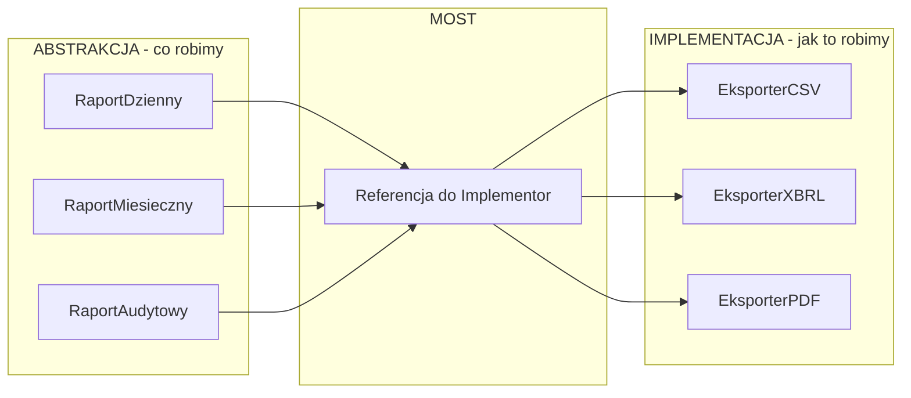
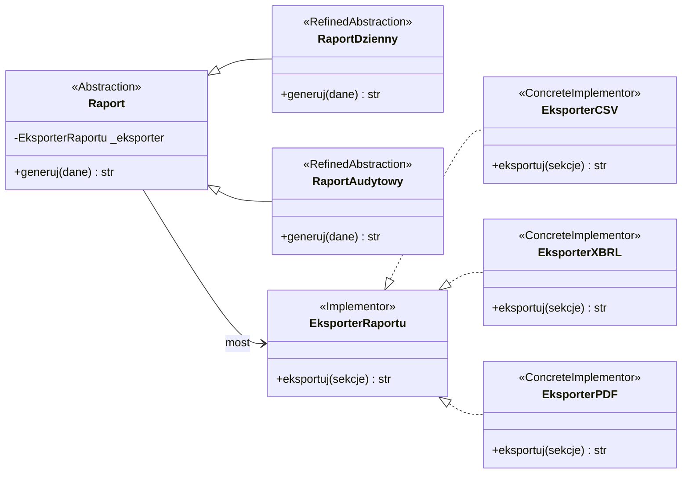
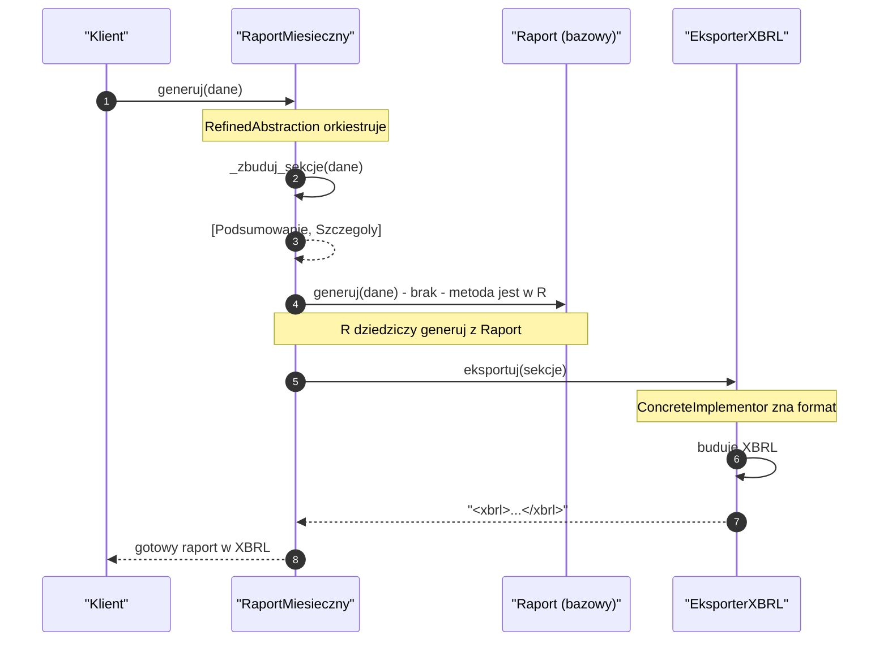
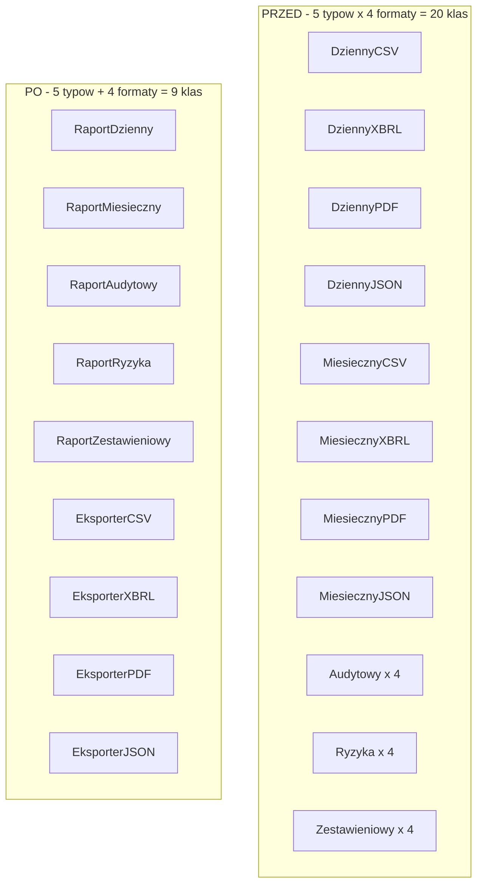
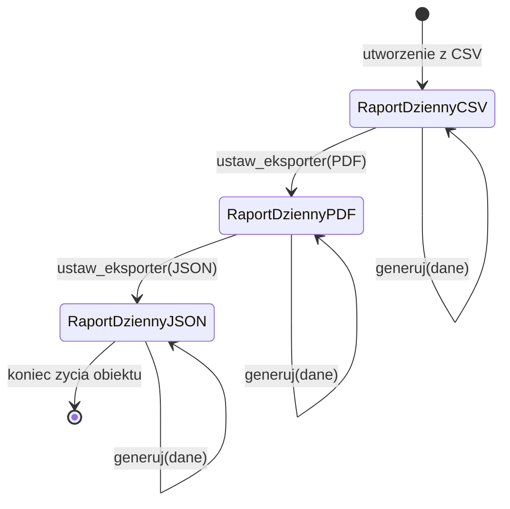
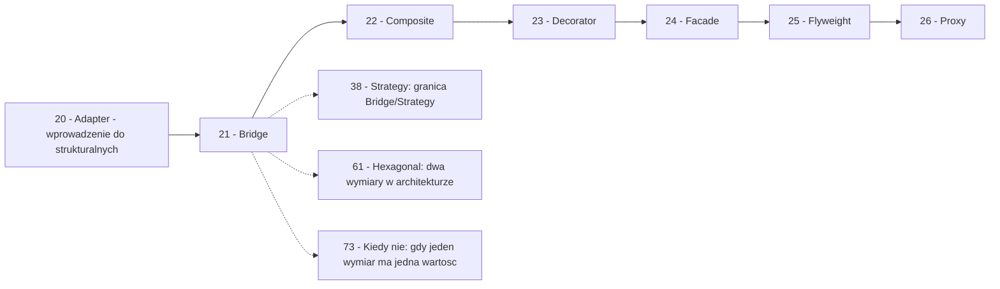

```markdown
---
modul: 21 — Bridge
plik: 21-bridge.md
poziom: sredni
wymaga: [20]
czas: ~155 minut czytania + ~360 minut ćwiczeń
---

# Moduł 21 — Bridge — rozdzielenie abstrakcji od implementacji

> **TL;DR**
> - **Bridge (most)** rozdziela dwa niezależne wymiary zmienności — „co robimy" (abstrakcja) od „jak to robimy" (implementacja) — pozwalając im zmieniać się niezależnie, bez mnożenia się klas.
> - Rozwiązuje problem **eksplozji klas**: 5 typów raportów × 4 formaty eksportu = 20 klas bez mostu, tylko 9 klas z mostem — wzrost jest **liniowy**, nie **multiplikatywny**.
> - Klasyczna struktura: `Abstraction` zna tylko kontrakt `Implementor`, a `RefinedAbstraction` jest jego wariantem; referencja z abstrakcji do implementacji to właśnie „mostek".
> - Most jest projektowany **z góry** (od początku), podczas gdy Adapter (moduł 20) łata niedopasowanie **po fakcie** — to fundamentalna różnica intencji, mimo że oba mają podobną strukturę.
> - W Pythonie granica między Mostem a Strategią (moduł 38) bywa płynna, bo oba opierają się na kompozycji i delegacji; mostek mówi o strukturze systemu, strategia o wymiennym algorytmie w runtime.

---

## 0. Model mentalny

### Pilot i telewizor, czyli dwa niezależne światy

Wejdź do salonu z pilotem w ręce. Pilot ma przyciski: „włącz", „wyłącz", „głośniej", „ciszej", „kanał +", „kanał −", „menu", „źródło". Naciśnięcie „głośniej" sprawia, że telewizor staje się głośniejszy. Naciśnięcie „kanał +" przełącza na kanał wyżej. To wszystko wydaje się oczywiste — ale zatrzymaj się i pomyśl, co tu tak naprawdę zachodzi.

**Pilot nie wie, jakiego producenta jest telewizor.** Możesz podłączyć go do Samsunga, do LG, do starego Sony z 2014 roku. Każdy z tych telewizorów ma swoje wnętrze — inny procesor obrazu, inny sposób dekodowania sygnału, inną listę kanałów. Ale pilot widzi tylko jedno: „włącz", „głośniej", „kanał +". Pilot mówi językiem wysokiego poziomu. Telewizor implementuje ten język na swój sposób.

Zauważ teraz drugą rzecz: **telewizor nie wie, że istnieje pilot.** Możesz włączyć go przyciskiem na obudowie, aplikacją mobilną albo sterowaniem głosowym. Telewizor wie tylko, jak przyjąć polecenie „głośniej". Skąd ono przyszło — nie ma znaczenia. To znaczy, że obie strony — pilot i telewizor — są **niezależne**. Możesz wymienić pilota na inny, telewizor pozostanie ten sam. Możesz zmienić telewizor, pilot pozostanie ten sam.

Idźmy dalej. Wyobraź sobie, że chcesz rozbudować pilota o funkcję „tryb filmowy" — przycisk, który jednocześnie ustawia jasność na 30%, wyłącza wygładzanie ruchu i przełącza na wejście HDMI 2. To jest nowy **wariant pilota**. Ale nie musisz robić osobnych wersji tego przycisku dla każdego producenta telewizora — piszesz jeden przycisk, który wykonuje sekwencję poleceń. Każdy telewizor zrozumie tę sekwencję po swojemu.

I jeszcze trzeci obraz, kluczowy. Wyobraź sobie, że masz **dwa wymiary zmienności** — rodzaj pilota (prosty, zaawansowany, dziecięcy) i markę telewizora (Samsung, LG, Sony). Bez mostu trzeba by było zrobić dziewięć pilotów: „Samsung-zaawansowany", „Samsung-dziecięcy", „LG-prosty", „Sony-dziecięcy" i tak dalej. A gdyby doszła marka Philips i rodzaj „uniwersalny" — już dwanaście. Liczba pilotów rośnie jak **iloczyn**, nie suma.

Z mostem dzielimy świat na dwie osie. Trzy rodzaje pilotów to trzy klasy. Trzy marki telewizorów to trzy klasy obsługi. Razem sześć klas obsługuje wszystkie dziewięć kombinacji. Dodanie czwartej marki to jedna nowa klasa (nie trzy). Dodanie czwartego rodzaju pilota to też jedna nowa klasa. **Wzrost jest liniowy, nie multiplikatywny** — i na tym polega cała magia mostu.

| W analogii pilota i telewizora | W kodzie |
|---|---|
| Pilot — rodzaj abstrakcji | `Raport` (abstrakcja) |
| Przycisk „głośniej" | Metoda abstrakcji (`generuj()`) |
| Sekwencja „tryb filmowy" | `RefinedAbstraction` (np. `RaportAudytowy`) |
| Telewizor — konkretna marka | `Implementor` (np. `EksporterRaportu`) |
| Wnętrze Samsunga | `ConcreteImplementor` (np. `EksporterXBRL`) |
| Pilot zna tylko polecenia | Abstrakcja zna tylko kontrakt implementora |
| Telewizor zna tylko polecenia | Implementor zna tylko kontrakt abstrakcji |
| Wymiana pilota | Zmiana `RefinedAbstraction` bez zmian w implementorach |
| Wymiana telewizora | Zmiana `ConcreteImplementor` bez zmian w abstrakcjach |

> 🧠 **Zapamiętaj** — **Bridge (most) to wzorzec strukturalny rozdzielający abstrakcję (co robimy) od implementacji (jak to robimy), tak żeby obie mogły zmieniać się niezależnie, bez mnożenia klas przez kombinacje wariantów.**

Zwróć uwagę na dwa słowa w tej definicji: **abstrakcja** i **implementacja**. To nie są słowa w potocznym sensie. W języku wzorca „abstrakcja" oznacza **wyższy poziom sterowania** — to, co widzi klient i co orkiestruje pracę. „Implementacja" oznacza **niższy poziom wykonania** — to, co robi faktyczną pracę. W naszym przypadku „abstrakcja" to raport (który decyduje, jakie sekcje, jaka kolejność, jaka treść), a „implementacja" to eksporter (który wie, jak zapisać dane do CSV, PDF, XBRL).

Jest jeszcze jedna rzecz do zapamiętania. Bridge jest wzorcem **strukturalnym**, nie behawioralnym. To znaczy: chodzi o **kształt systemu** (jak rozdzielone są odpowiedzialności), a nie o **dynamiczne zachowanie** (jak podejmowane są decyzje w runtime). W praktyce różnica bywa subtelna, bo oba aspekty się spotykają — wróćmy do tego w sekcji 9.

### Diagram — intuicja dwóch niezależnych osi



*Diagram pokazuje, że trzy rodzaje raportów mogą korzystać z trzech eksporterów bez tworzenia kombinacji — każda oś zmienia się niezależnie od drugiej.*

### Czego Bridge NIE robi

Rozbrójmy cztery nieporozumienia, które towarzyszą temu wzorcowi — zwłaszcza w Pythonie, gdzie łatwo jest go pomylić ze Strategią.

**Nie jest Strategią.** Bardzo często utożsamia się oba wzorce, bo w kodzie wyglądają podobnie (kompozycja + delegacja). Ale **intencja jest odmienna**. Strategia mówi: „wybierz algorytm w runtime". Most mówi: „rozłącz strukturę, żeby dwa wymiary rozwoju mogły iść niezależnie". Można mieć Strategię, która w runtime wymienia sposób liczenia prowizji (jeden wymiar zmienności, wewnątrz jednego komponentu). Można mieć Most, w którym raport współpracuje z eksporterem (dwa wymiary ewolucji). W sekcji 9 rozłożymy to na czynniki pierwsze.

**Nie jest Adapterem.** Oba mają podobną strukturę: obiekt A trzyma referencję do obiektu B. Ale Adapter (moduł 20) **łata już istniejące niedopasowanie** — używamy go, gdy biblioteka zewnętrzna ma inny interfejs. Most **projektuje rozdzielenie z góry** — używamy go, gdy przewidujemy rozwój w dwóch niezależnych kierunkach. Adapter to reakcja, Most to decyzja projektowa.

**Nie jest Abstract Factory.** Abstract Factory (moduł 12) tworzy **rodziny spójnych obiektów**. Most **łączy abstrakcję z implementacją**. Formalnie rzecz biorąc, Abstract Factory często współpracuje z Mostem: fabryka może tworzyć Implementory, a abstrakcja korzysta z fabryki, żeby je uzyskać. Ale role są różne.

**Nie rozwiązuje problemu „zbyt wielu wymiarów".** Jeśli masz trzy wymiary zmienności (np. typ raportu × format + kanał dystrybucji × język), Most z dwoma osiami nie wystarczy. Potrzebujesz innych narzędzi — na przykład kompozycji (moduł 22) albo dekoracji (moduł 23). O tym w sekcji 8.

**Nie zawsze się opłaca.** Jeśli jeden wymiar ma tylko jedną wartość — most jest nadmiarowy. Jeśli nie planujesz rozwoju w obu kierunkach, most to abstrakcja przed potrzebą (YAGNI z modułu 03). Most jest decyzją projektową, która „płaci się" dopiero wtedy, gdy coś się rozwija.

---

## 1. Problem, który rozwiązujemy

Wejdźmy w domenę 📊 „Sprawozdawczości". Nasz system generuje trzy rodzaje raportów: **dzienny** (podsumowanie dnia), **miesięczny** (raport zarządczy), **audytowy** (pełny z historią). Każdy raport może być eksportowany w trzech formatach: **CSV** (dane tabelaryczne), **XBRL** (format regulacyjny), **PDF** (dokument dla ludzi). Ktoś napisał klasy dla każdej kombinacji.

### Kod „przed"

```python
# sprawozdawczosc_v0.py — wersja naiwna, demonstracyjna
# UWAGA: ten kod celowo pokazuje eksplozje klas - 3x3 = 9 klas.

from decimal import Decimal
from datetime import date, datetime
from dataclasses import dataclass


@dataclass(frozen=True)
class PozycjaRaportu:
    konto: str
    opis: str
    kwota: Decimal
    waluta: str


# --- 9 klas: dla kazdej kombinacji (typ raportu + format) ---

class RaportDziennyCSV:
    def generuj(self, dane: list[PozycjaRaportu]) -> str:
        linie = ["konto;opis;kwota;waluta"]
        for p in dane:
            linie.append(f"{p.konto};{p.opis};{p.kwota};{p.waluta}")
        return "\n".join(linie)


class RaportDziennyXBRL:
    def generuj(self, dane: list[PozycjaRaportu]) -> str:
        # Format XBRL - uproszczony
        return "<xbrl><dzienny>" + "".join(
            f"<e konto='{p.konto}' kwota='{p.kwota}'/>" for p in dane
        ) + "</dzienny></xbrl>"


class RaportDziennyPDF:
    def generuj(self, dane: list[PozycjaRaportu]) -> str:
        return (
            f"PDF [raport dzienny]\n"
            + "\n".join(f"  {p.konto}: {p.kwota} {p.waluta}" for p in dane)
        )


class RaportMiesiecznyCSV:
    def generuj(self, dane: list[PozycjaRaportu]) -> str:
        linie = ["konto;opis;kwota;waluta"]
        for p in dane:
            linie.append(f"{p.konto};{p.opis};{p.kwota};{p.waluta}")
        return "\n".join(linie)


class RaportMiesiecznyXBRL:
    def generuj(self, dane: list[PozycjaRaportu]) -> str:
        return "<xbrl><miesieczny>" + "".join(
            f"<e konto='{p.konto}' kwota='{p.kwota}'/>" for p in dane
        ) + "</miesieczny></xbrl>"


class RaportMiesiecznyPDF:
    def generuj(self, dane: list[PozycjaRaportu]) -> str:
        return (
            f"PDF [raport miesieczny]\n"
            + "\n".join(f"  {p.konto}: {p.kwota} {p.waluta}" for p in dane)
        )


class RaportAudytowyCSV:
    def generuj(self, dane: list[PozycjaRaportu]) -> str:
        # Audyt: dodatkowa kolumna z data
        linie = ["konto;opis;kwota;waluta;data"]
        for p in dane:
            linie.append(f"{p.konto};{p.opis};{p.kwota};{p.waluta};{date.today()}")
        return "\n".join(linie)


class RaportAudytowyXBRL:
    def generuj(self, dane: list[PozycjaRaportu]) -> str:
        return "<xbrl><audyt>" + "".join(
            f"<e konto='{p.konto}' kwota='{p.kwota}'/>" for p in dane
        ) + "</audyt></xbrl>"


class RaportAudytowyPDF:
    def generuj(self, dane: list[PozycjaRaportu]) -> str:
        return (
            f"PDF [raport audytowy]\n"
            + "\n".join(f"  {p.konto}: {p.kwota} {p.waluta}" for p in dane)
        )


if __name__ == "__main__":
    dane = [
        PozycjaRaportu("1000", "Kasa", Decimal("5000.00"), "PLN"),
        PozycjaRaportu("2000", "Bank", Decimal("120000.00"), "PLN"),
    ]
    print(RaportDziennyCSV().generuj(dane))
    print("---")
    print(RaportAudytowyXBRL().generuj(dane))
```

Ten kod działa. Generuje raporty w trzech formatach dla trzech typów. Ale zawiera problem, który **rośnie z każdym nowym wariantem** — i widać to wyraźnie w tabeli poniżej.

### Code smell — eksplozja klas przez kombinacje

| Problem | Gdzie | Konsekwencja |
|---|---|---|
| 9 klas dla 3×3 kombinacji | Cały plik | Dodanie czwartego formatu to 3 nowe klasy |
| Duplikacja logiki generowania CSV | `RaportDziennyCSV`, `RaportMiesiecznyCSV`, `RaportAudytowyCSV` | Ten sam kod w trzech miejscach |
| Duplikacja logiki generowania XBRL | Analogicznie | Trzy kopie |
| Zmiana formatu CSV wymaga zmian w 3 klasach | Wszystkie `...CSV` | Shotgun surgery (moduł 03) |
| Zmiana typu raportu (np. dodanie daty) wymaga zmian w 3 klasach | Wszystkie `RaportDzienny*` | Analogicznie |
| Klient musi znać konkretną klasę | `RaportDziennyXBRL()` | Nie da się wybrać dynamicznie po nazwie |
| Brak wspólnego kontraktu | Każda klasa osobno | Nie da się wymienić implementacji |

Zwróć uwagę na dwie pierwsze kolumny. **Logika CSV** w trzech klasach jest identyczna — to duplikacja (naruszenie DRY z modułu 03). **Logika typu raportu** (np. dodanie kolumny `data` w raporcie audytowym) też jest rozproszona. Dwa wymiary zmienności są pomieszane w jeden płaski zbiór klas.

### Objawy — poznasz ten problem po tym, że...

- **Liczba klas rośnie jak iloczyn, nie suma.** Trzy typy × trzy formaty = dziewięć klas. Cztery typy × cztery formaty = szesnaście.
- **Nazwy klas mają dwa słowa połączone.** `RaportDziennyCSV`, `RaportMiesiecznyXBRL` — to klasyczny sygnał eksplozji. Każdy dodatek do nazwy to nowy wymiar.
- **Duplikacja logiki formatu.** Wszystkie klasy `...CSV` mają identyczny kod generowania CSV. To samo dla `...XBRL`.
- **Dodanie nowego formatu wymaga modyfikacji wszystkich klas typu.** Dodajesz JSON-a — musisz napisać `RaportDziennyJSON`, `RaportMiesiecznyJSON`, `RaportAudytowyJSON`.
- **Dodanie nowego typu raportu wymaga modyfikacji wszystkich klas formatu.** Analogicznie.
- **W kodzie jest `if isinstance(x, RaportDziennyCSV)` albo `if typ == "dzienny" and format == "csv"`.** To znak, że brakuje abstrakcji.
- **Nie da się „przeskoczyć" między wymiarami.** Zmiana formatu w trakcie działania programu wymaga utworzenia nowego obiektu zupełnie innej klasy.
- **Testy dla logiki CSV są pisane trzy razy.** Bo każda klasa formatu ma własny kod.
- **W dokumentacji lub w interfejsie widzisz matrycę „typ × format"** — to znak, że projektant myślał już w kategoriach dwóch wymiarów.

---

## 2. Anatomia wzorca

### Uczestnicy

| Rola | Odpowiedzialność | Co NIE jest jej zadaniem |
|---|---|---|
| **Abstraction (abstrakcja)** | Definiuje interfejs wysokiego poziomu; przechowuje referencję do Implementor; deleguje do niego operacje niskopoziomowe | Nie zawiera szczegółów implementacji technicznej; nie zna ConcreteImplementor |
| **RefinedAbstraction (rozszerzona abstrakcja)** | Rozszerza Abstraction o dodatkowe operacje wysokiego poziomu | Nie implementuje operacji niskopoziomowych; deleguje do Implementor |
| **Implementor (implementator)** | Definiuje interfejs operacji niskopoziomowych | Nie zna Abstraction; nie decyduje o tym, kiedy operacje są wołane |
| **ConcreteImplementor (konkretny implementator)** | Implementuje operacje niskopoziomowe w konkretnej technologii | Nie zna RefinedAbstraction; nie orkiestruje operacji |
| **Klient (client)** | Używa Abstraction za pośrednictwem jego interfejsu | Nie zna Implementor ani ConcreteImplementor |

Kluczowa asymetria: **Abstraction zna Implementor**, ale **Implementor nie zna Abstraction**. Abstrakcja deleguje do implementatora; implementator nie wie, że jest używany przez abstrakcję. Ta jednostronna zależność jest tym, co czyni most skutecznym — pozwala wymieniać implementacje bez wpływu na abstrakcje.

### Diagram struktury



*Diagram pokazuje dwie niezależne hierarchie — abstrakcji (raporty) i implementacji (eksportery) — połączone jedną referencją, która stanowi mostek.*

Przeczytajmy ten diagram zdanie po zdaniu. `Raport` to abstrakcja — ma referencję do `EksporterRaportu` i metodę `generuj(dane)`, która orkiestruje pracę. `RaportDzienny` i `RaportAudytowy` to **rozszerzone abstrakcje** — warianty raportu, które różnią się tym, jakie sekcje generują, ale nie tym, jak je zapisać. Każdy z nich dziedziczy po `Raport` (linia z pustym trójkątem).

`EksporterRaportu` to implementor — kontrakt na „jak zapisać dane". `EksporterCSV`, `EksporterXBRL`, `EksporterPDF` to konkretne implementacje. Każda z nich realizuje kontrakt (linia przerywana z pustym trójkątem).

Zwróć uwagę na **strzałkę `Raport --> EksporterRaportu`**. To jest most. Wskazuje z abstrakcji do implementora — nie odwrotnie. To kluczowe: abstrakcja wie o implementorze, ale implementor nie wie o abstrakcji.

I jeszcze jedna rzecz: **liczba klas**. Mamy 3 abstrakcje + 1 kontrakt implementora + 3 konkretne implementacje = 7 klas, ale obsługują 9 kombinacji. Bez mostu byłoby 9 konkretnych klas + 0 abstrakcji = 9. Z mostem mamy 7 klas, ale **odzwierciedlających strukturę problemu**, nie kombinatorykę.

### Warianty: klasyczny vs pythoniczny

| Aspekt | Wariant klasyczny (GoF) | Wariant pythoniczny |
|---|---|---|
| Abstraction | Klasa abstrakcyjna z referencją | `ABC` albo zwykła klasa |
| RefinedAbstraction | Podklasy | Podklasy (bez zmian) |
| Implementor | ABC z metodami abstrakcyjnymi | `typing.Protocol` |
| ConcreteImplementor | Klasy dziedziczące po ABC | Klasy spełniające protokół |
| Most | Pole z referencją | Pole z referencją (bez zmian) |
| Wymienność implementacji | Metoda `set_implementor` albo konstruktor | Konstruktor albo reasignacja pola |
| Alternatywa funkcyjna | Nie stosowana | Implementor jako `Callable` |
| Alternatywa przez Strategy | Nie omawiana | Pytać „czy to nie jest Strategia?" |

W Pythonie most bywa **tak prosty**, że oddzielna hierarchia klas dla abstrakcji jest zbędna. Często wystarczy jedna klasa abstrakcji (bez `RefinedAbstraction`) plus konfigurowalny implementor. Ale nie zawsze — o tym w sekcji 4.

---

## 3. Implementacja krok po kroku

Przebudujemy kod z sekcji 1 stopniowo, pokazując kolejne kroki.

### Krok 1 — Rozpoznaj dwa wymiary

Zanim napiszesz kod, nazwij dwa wymiary zmienności. To jeden z najczęstszych momentów, w których trzeba **dobrze przemyśleć strukturę** zamiast od razu pisać.

```text
Wymiar 1: JAKI raport?
  - Raport dzienny
  - Raport miesieczny
  - Raport audytowy

Wymiar 2: W JAKIM formacie?
  - CSV
  - XBRL
  - PDF
```

Jeśli widzisz macierz typów × formatów — masz kandydata na most. Macierz dwuwymiarowa jest kluczowym sygnałem.

### Krok 2 — Zdefiniuj kontrakt implementora

Zacznij od tego, co niskopoziomowe — jak zapisać dane. Ten kontrakt jest **wewnętrzny**, klient go nie widzi.

```python
from typing import Protocol, runtime_checkable

@runtime_checkable
class EksporterRaportu(Protocol):
    """Kontrakt implementatora: jak zapisac sekcje raportu."""

    nazwa: str

    def eksportuj(self, sekcje: list["SekcjaRaportu"]) -> str:
        """Eksportuje sekcje do formatu docelowego."""
        ...
```

Uwaga na strukturę `SekcjaRaportu` — to nasz **własny model**, nie format konkretny. Implementator tłumaczy nasz model na format zewnętrzny.

### Krok 3 — Zdefiniuj abstrakcję

Teraz abstrakcja — klasa, która orkiestruje pracę, ale nie zna szczegółów formatu.

```python
from decimal import Decimal
from dataclasses import dataclass
from abc import ABC, abstractmethod

@dataclass(frozen=True)
class SekcjaRaportu:
    """Sekcja raportu - nasz model wewnetrzny."""
    nazwa: str
    pozycje: tuple[dict, ...]


class Raport(ABC):
    """Abstrakcja: orkiestruje generowanie raportu, deleguje eksport."""

    def __init__(self, eksporter: EksporterRaportu) -> None:
        self._eksporter = eksporter

    @property
    def nazwa_eksportera(self) -> str:
        return self._eksporter.nazwa

    @abstractmethod
    def _zbuduj_sekcje(self, dane: list[PozycjaRaportu]) -> list[SekcjaRaportu]:
        """Podklasy decyduja, jakie sekcje utworzyc."""
        ...

    def generuj(self, dane: list[PozycjaRaportu]) -> str:
        """Orkiestruje generowanie, deleguje eksport do implementora."""
        sekcje = self._zbuduj_sekcje(dane)
        return self._eksporter.eksportuj(sekcje)
```

Zwróć uwagę: `Raport` zna `EksporterRaportu` i deleguje mu pracę. Ale **nie wie, którą konkretną implementację dostał** — jego zadanie to „zbuduj sekcje i przekaż do eksportu". To jest abstrakcja.

### Krok 4 — Zdefiniuj rozszerzone abstrakcje

Warianty raportów — różnią się **jakimi sekcjami** operują, ale nie tym, jak je zapisać.

```python
class RaportDzienny(Raport):
    """Raport dzienny: jedna sekcja z pozycjami dnia."""

    def _zbuduj_sekcje(self, dane):
        return [
            SekcjaRaportu(
                nazwa="Dzien",
                pozycje=tuple(
                    {"konto": p.konto, "kwota": str(p.kwota), "waluta": p.waluta}
                    for p in dane
                ),
            )
        ]


class RaportMiesieczny(Raport):
    """Raport miesieczny: sekcja podsumowania + sekcja szczegolow."""

    def _zbuduj_sekcje(self, dane):
        suma = sum((p.kwota for p in dane), Decimal("0"))
        return [
            SekcjaRaportu(
                nazwa="Podsumowanie",
                pozycje=({"kwota_laczna": str(suma)},),
            ),
            SekcjaRaportu(
                nazwa="Szczegoly",
                pozycje=tuple(
                    {"konto": p.konto, "kwota": str(p.kwota)} for p in dane
                ),
            ),
        ]


class RaportAudytowy(Raport):
    """Raport audytowy: dodatkowa sekcja z metadanymi."""

    def _zbuduj_sekcje(self, dane):
        from datetime import datetime, timezone
        return [
            SekcjaRaportu(
                nazwa="Metadane",
                pozycje=({"wygenerowano": datetime.now(timezone.utc).isoformat()},),
            ),
            SekcjaRaportu(
                nazwa="Pozycje",
                pozycje=tuple(
                    {
                        "konto": p.konto,
                        "opis": p.opis,
                        "kwota": str(p.kwota),
                        "waluta": p.waluta,
                    }
                    for p in dane
                ),
            ),
        ]
```

Każdy `RefinedAbstraction` decyduje, **jakie sekcje** tworzy. Żaden z nich nie wie o CSV, XBRL, PDF.

### Krok 5 — Zdefiniuj konkretne implementatory

Teraz warstwa formatu — „jak zapisać sekcje".

```python
class EksporterCSV:
    nazwa = "csv"

    def eksportuj(self, sekcje) -> str:
        linie = []
        for sekcja in sekcje:
            linie.append(f"# {sekcja.nazwa}")
            if sekcja.pozycje:
                naglowki = list(sekcja.pozycje[0].keys())
                linie.append(";".join(naglowki))
                for pozycja in sekcja.pozycje:
                    linie.append(
                        ";".join(str(pozycja.get(k, "")) for k in naglowki)
                    )
        return "\n".join(linie)


class EksporterXBRL:
    nazwa = "xbrl"

    def eksportuj(self, sekcje) -> str:
        fragmenty = []
        for sekcja in sekcje:
            fragmenty.append(f"<sekcja nazwa='{sekcja.nazwa}'>")
            for pozycja in sekcja.pozycje:
                atrybuty = " ".join(
                    f"{k}='{v}'" for k, v in pozycja.items()
                )
                fragmenty.append(f"  <pozycja {atrybuty}/>")
            fragmenty.append("</sekcja>")
        return "<xbrl>" + "\n".join(fragmenty) + "</xbrl>"


class EksporterPDF:
    nazwa = "pdf"

    def eksportuj(self, sekcje) -> str:
        linie = ["PDF RAPORT"]
        for sekcja in sekcje:
            linie.append(f"== {sekcja.nazwa} ==")
            for pozycja in sekcja.pozycje:
                tresc = ", ".join(f"{k}: {v}" for k, v in pozycja.items())
                linie.append(f"  {tresc}")
        return "\n".join(linie)
```

Każda implementacja tłumaczy `SekcjaRaportu` na konkretny format. Nie wie o rodzaju raportu.

### Krok 6 — Klient używa abstrakcji z wybranym implementorem

```python
class KlientRaportow:
    """Klient: buduje kombinacje raport + eksporter wedlug potrzeb."""

    def wygeneruj(
        self,
        typ: str,
        format_: str,
        dane: list[PozycjaRaportu],
    ) -> str:
        raport = self._zbuduj_raport(typ)
        eksporter = self._zbuduj_eksporter(format_)
        raport._eksporter = eksporter   # most: podmiana implementacji
        return raport.generuj(dane)
```

W praktyce częściej przekazuje się implementor w konstruktorze. Ale pokazujemy tu drugą możliwość — **podmianę w locie**, co bywa przydatne, gdy format wybierany jest dynamicznie.

### Krok 7 — Composition root

```python
def zbuduj_raport(typ: str, format_: str) -> Raport:
    eksportery = {
        "csv": EksporterCSV,
        "xbrl": EksporterXBRL,
        "pdf": EksporterPDF,
    }
    raporty = {
        "dzienny": RaportDzienny,
        "miesieczny": RaportMiesieczny,
        "audytowy": RaportAudytowy,
    }
    if format_ not in eksportery:
        raise ValueError(f"nieznany format: {format_}")
    if typ not in raporty:
        raise ValueError(f"nieznany typ raportu: {typ}")
    return raporty[typ](eksportery[format_]())
```

### Krok 8 — Weryfikacja

| Kryterium | Wersja „przed" | Wersja „po" |
|---|---|---|
| Liczba klas dla 3×3 | 9 | 3 + 3 + 2 (abstrakcja + kontrakt) = 8 |
| Dodanie formatu JSON (3 typy) | 3 nowe klasy | 1 nowa klasa |
| Dodanie typu raportu (3 formaty) | 3 nowe klasy | 1 nowa klasa |
| Duplikacja logiki CSV | W 3 klasach | W 1 klasie |
| Zmiana formatu CSV | 3 miejsca | 1 miejsce |
| Zmiana typu raportu | 3 miejsca | 1 miejsce |
| Wymiana formatu runtime | Nie da się (nowa klasa) | Można (podmiana implementora) |
| Klient zna konkretne klasy | Tak | Tylko w composition root |

Zysk jest ogromny: przy dodaniu czwartego typu raportu i czwartego formatu mamy 4+4 = 8 klas zamiast 16. **Im większa liczba wariantów, tym większa korzyść z mostu.**

---

## 4. Wersje pythoniczne i warianty

Ta sekcja omawia pięć wariantów realizacji mostu w Pythonie — od najbardziej klasycznego do najbardziej funkcyjnego.

### 4.1 Wariant klasyczny z `ABC` i `Protocol`

Wariant z sekcji 3. Abstrakcja jako `ABC` (bo ma część wspólną — metodę `generuj`), implementor jako `Protocol` (bo nie ma części wspólnej). To najczęstszy układ w Pythonie.

Zalety: czytelny, jasno pokazuje hierarchie, wspiera `mypy`. Wady: dla prostych przypadków może być przesadą — dwie hierarchie dla trzech klas to czasem zbyt dużo.

### 4.2 Wariant bez `RefinedAbstraction`

Jeśli abstrakcja nie ma wariantów (albo różnice są trywialne), można pominąć `RefinedAbstraction` i mieć jedną klasę abstrakcji z konfigurowalnym implementorem.

```python
class GeneratorRaportu:
    """Jedna abstrakcja, konfigurowalna parametrami."""

    def __init__(self, eksporter: EksporterRaportu, typ: str) -> None:
        self._eksporter = eksporter
        self._typ = typ

    def generuj(self, dane) -> str:
        sekcje = self._zbuduj_sekcje_dla(self._typ, dane)
        return self._eksporter.eksportuj(sekcje)

    def _zbuduj_sekcje_dla(self, typ, dane):
        match typ:
            case "dzienny":
                return self._sekcje_dzienne(dane)
            case "miesieczny":
                return self._sekcje_miesieczne(dane)
            case "audytowy":
                return self._sekcje_audytowe(dane)
            case _:
                raise ValueError(f"nieznany typ: {typ}")
```

To nie ma dwóch hierarchii — jest jedna klasa z `match`-em wewnątrz. Ale to **łamie OCP** (moduł 03): dodanie typu raportu wymaga edycji metody. Most bez `RefinedAbstraction` jest możliwy, ale traci część korzyści.

### 4.3 Wariant z implementorem jako `Callable`

Jeśli implementor to jedna metoda (jak `eksportuj`), można go reprezentować jako funkcję.

```python
from collections.abc import Callable

Eksporter = Callable[[list["SekcjaRaportu"]], str]


def eksporter_csv(sekcje) -> str:
    ...


def eksporter_xbrl(sekcje) -> str:
    ...


class Raport:
    def __init__(self, eksporter: Eksporter) -> None:
        self._eksporter = eksporter

    def generuj(self, dane) -> str:
        sekcje = self._zbuduj_sekcje(dane)
        return self._eksporter(sekcje)
```

Zaleta: mniej klas, można używać lambd i domknięć. Wady: tracisz atrybuty implementora (np. `nazwa`), nie ma `isinstance`, trudniej o adnotacje. Ten wariant bywa użyteczny dla prostych eksporterów.

### 4.4 Wariant funkcyjny — fabryka raportu z eksporterem

Zamiast hierarchii abstrakcji, funkcja, która tworzy raport „na miarę".

```python
def utworz_generator(typ: str, eksporter: Eksporter) -> Callable[[list[PozycjaRaportu]], str]:
    """Zwraca funkcje generujaca raport danego typu z podanym eksporterem."""
    def generuj(dane):
        sekcje = _zbuduj_sekcje(typ, dane)
        return eksporter(sekcje)
    return generuj
```

Zaleta: maksymalna elastyczność, bardzo „pythoniczne". Wady: traci jawną strukturę, trudno rozszerzać o dodatkowe operacje.

### 4.5 Wariant z wymianą implementora w runtime

Czasem konieczna jest **podmiana implementora w trakcie życia obiektu** — np. w narzędziu CLI, gdzie użytkownik wybiera format z menu.

```python
class Raport:
    def __init__(self, eksporter: EksporterRaportu) -> None:
        self._eksporter = eksporter

    def ustaw_eksporter(self, eksporter: EksporterRaportu) -> None:
        self._eksporter = eksporter

    def generuj(self, dane) -> str:
        sekcje = self._zbuduj_sekcje(dane)
        return self._eksporter.eksportuj(sekcje)
```

Zwróć uwagę: `ustaw_eksporter` pozwala zmienić implementację po utworzeniu obiektu. To świadomie łączy most ze strategią (bo zmiana następuje w runtime). Dla większości przypadków nie jest potrzebne — lepiej przekazać eksportera w konstruktorze.

### 4.6 Wariant bez klas abstrakcji — czysta kompozycja

W prawdziwie pythonicznym ujęciu, „abstrakcja" może być funkcją, która przyjmuje dane i eksportera.

```python
def generuj_raport(
    typ: str,
    eksporter: EksporterRaportu,
    dane: list[PozycjaRaportu],
) -> str:
    sekcje = _zbuduj_sekcje(typ, dane)
    return eksporter.eksportuj(sekcje)
```

To już w zasadzie **kompozycja funkcyjna** — dwa wymiary jako dwa argumenty funkcji. Jest to najprostsza i najczystsza forma mostu w Pythonie. Nie ma klas abstrakcji, nie ma hierarchii — jest funkcja z dwoma wymiarami konfiguracji.

Ale ma sens tylko wtedy, gdy „abstrakcja" nie ma własnego stanu ani własnych operacji. Gdy zaczyna mieć (np. cache, konfiguracja), klasa jest lepsza.

### 4.7 Podsumowanie — tabela wyboru

| Sytuacja | Wariant |
|---|---|
| Klasyczny most, dwie hierarchie | `ABC` + `Protocol` (4.1) |
| Abstrakcja ma jeden wariant konfigurowalny | Bez `RefinedAbstraction` (4.2) |
| Implementor jednometodowy, prosty | `Callable` (4.3) |
| Maksymalna elastyczność, funkcjonalny styl | Fabryka funkcyjna (4.4) |
| Wymiana implementora w runtime | Metoda `ustaw_eksporter` (4.5) |
| Brak stanu w abstrakcji | Funkcja z dwoma argumentami (4.6) |

> 🧠 **Zapamiętaj** — W Pythonie most można zrealizować na wiele sposobów. **Kryterium wyboru**: czy abstrakcja ma własny stan i własne operacje? Jeśli tak — klasa z hierarchią. Jeśli nie — funkcja z dwoma argumentami. Nie komplikuj, jeśli nie musisz.

---

## 5. Przykład z życia: 📊 Sprawozdawczość — pełny uruchamialny kod

Zbudujemy pełny system generowania raportów w 3 typach × 3 formatach. Dodamy jeszcze jeden format (JSON) i jeden typ (raport ryzyka), żeby pokazać, że rozszerzanie jest liniowe.

### Kod

```python
# sprawozdawczosc_bridge.py — pelny przyklad Bridge
from __future__ import annotations

import json
from abc import ABC, abstractmethod
from dataclasses import dataclass
from datetime import date, datetime, timezone
from decimal import Decimal
from typing import Protocol, runtime_checkable

# ===========================================================================
# 1. Model wewnetrzny - niezalezny od formatu
# ===========================================================================

@dataclass(frozen=True, slots=True)
class PozycjaRaportu:
    konto: str
    opis: str
    kwota: Decimal
    waluta: str


@dataclass(frozen=True, slots=True)
class SekcjaRaportu:
    """Sekcja raportu w naszym modelu wewnetrznym."""
    nazwa: str
    pozycje: tuple[dict[str, str], ...]

    def podsumowanie(self) -> str:
        return f"{self.nazwa}: {len(self.pozycje)} pozycji"


# ===========================================================================
# 2. Implementor - kontrakt "jak zapisac"
# ===========================================================================

@runtime_checkable
class EksporterRaportu(Protocol):
    """Kontrakt implementatora: jak zapisac sekcje do formatu."""

    nazwa: str

    def eksportuj(self, sekcje: tuple[SekcjaRaportu, ...]) -> str: ...


# ===========================================================================
# 3. Konkretne implementatory - formaty
# ===========================================================================

class EksporterCSV:
    nazwa = "csv"

    def eksportuj(self, sekcje: tuple[SekcjaRaportu, ...]) -> str:
        linie: list[str] = []
        for sekcja in sekcje:
            linie.append(f"# {sekcja.nazwa}")
            if not sekcja.pozycje:
                continue
            naglowki = list(sekcja.pozycje[0].keys())
            linie.append(";".join(naglowki))
            for pozycja in sekcja.pozycje:
                linie.append(";".join(str(pozycja.get(k, "")) for k in naglowki))
        return "\n".join(linie)


class EksporterXBRL:
    nazwa = "xbrl"

    def eksportuj(self, sekcje: tuple[SekcjaRaportu, ...]) -> str:
        fragmenty = ["<xbrl>"]
        for sekcja in sekcje:
            fragmenty.append(f"  <sekcja nazwa=\"{sekcja.nazwa}\">")
            for pozycja in sekcja.pozycje:
                atrybuty = " ".join(
                    f'{k}="{v}"' for k, v in pozycja.items()
                )
                fragmenty.append(f"    <pozycja {atrybuty}/>")
            fragmenty.append("  </sekcja>")
        fragmenty.append("</xbrl>")
        return "\n".join(fragmenty)


class EksporterPDF:
    nazwa = "pdf"

    def eksportuj(self, sekcje: tuple[SekcjaRaportu, ...]) -> str:
        linie = ["=" * 40, "RAPORT", "=" * 40]
        for sekcja in sekcje:
            linie.append(f"\n-- {sekcja.nazwa} --")
            for pozycja in sekcja.pozycje:
                tresc = ", ".join(f"{k}={v}" for k, v in pozycja.items())
                linie.append(f"  {tresc}")
        linie.append("=" * 40)
        return "\n".join(linie)


class EksporterJSON:
    """Dodatkowy format - wystarczy jedna klasa."""

    nazwa = "json"

    def eksportuj(self, sekcje: tuple[SekcjaRaportu, ...]) -> str:
        dane = {
            "sekcje": [
                {"nazwa": s.nazwa, "pozycje": list(s.pozycje)}
                for s in sekcje
            ]
        }
        return json.dumps(dane, ensure_ascii=False, indent=2)


# ===========================================================================
# 4. Abstraction - "co generujemy"
# ===========================================================================

class Raport(ABC):
    """Abstrakcja raportu - orkiestruje prace, deleguje eksport."""

    def __init__(self, eksporter: EksporterRaportu) -> None:
        if not isinstance(eksporter, EksporterRaportu):
            raise TypeError(
                f"{type(eksporter).__name__} nie spelnia kontraktu "
                f"EksporterRaportu"
            )
        self._eksporter = eksporter

    @property
    def nazwa_eksportera(self) -> str:
        return self._eksporter.nazwa

    @abstractmethod
    def _zbuduj_sekcje(
        self, dane: list[PozycjaRaportu]
    ) -> tuple[SekcjaRaportu, ...]:
        """Podklasy decyduja, jakie sekcje utworzyc."""

    def generuj(self, dane: list[PozycjaRaportu]) -> str:
        """Konczy generowanie: buduje sekcje, deleguje eksport."""
        sekcje = self._zbuduj_sekcje(dane)
        return self._eksporter.eksportuj(sekcje)

    def opis(self) -> str:
        return f"{type(self).__name__} -> {self._eksporter.nazwa}"


# ===========================================================================
# 5. RefinedAbstractions - typy raportow
# ===========================================================================

class RaportDzienny(Raport):
    """Raport dzienny: jedna sekcja z pozycjami dnia."""

    def _zbuduj_sekcje(
        self, dane: list[PozycjaRaportu]
    ) -> tuple[SekcjaRaportu, ...]:
        return (
            SekcjaRaportu(
                nazwa="Dzien",
                pozycje=tuple(
                    {
                        "konto": p.konto,
                        "kwota": str(p.kwota),
                        "waluta": p.waluta,
                    }
                    for p in dane
                ),
            ),
        )


class RaportMiesieczny(Raport):
    """Raport miesieczny: podsumowanie + szczegoly."""

    def _zbuduj_sekcje(
        self, dane: list[PozycjaRaportu]
    ) -> tuple[SekcjaRaportu, ...]:
        suma = sum((p.kwota for p in dane), Decimal("0"))
        return (
            SekcjaRaportu(
                nazwa="Podsumowanie",
                pozycje=(
                    {"kwota_laczna": str(suma), "liczba_pozycji": str(len(dane))},
                ),
            ),
            SekcjaRaportu(
                nazwa="Szczegoly",
                pozycje=tuple(
                    {"konto": p.konto, "kwota": str(p.kwota)}
                    for p in dane
                ),
            ),
        )


class RaportAudytowy(Raport):
    """Raport audytowy: metadane + pelne dane."""

    def _zbuduj_sekcje(
        self, dane: list[PozycjaRaportu]
    ) -> tuple[SekcjaRaportu, ...]:
        return (
            SekcjaRaportu(
                nazwa="Metadane",
                pozycje=(
                    {
                        "wygenerowano": datetime.now(timezone.utc).isoformat(
                            timespec="seconds"
                        ),
                        "zrodlo": "system-rozrachunkowy",
                        "wersja": "1.0",
                    },
                ),
            ),
            SekcjaRaportu(
                nazwa="Pozycje",
                pozycje=tuple(
                    {
                        "konto": p.konto,
                        "opis": p.opis,
                        "kwota": str(p.kwota),
                        "waluta": p.waluta,
                    }
                    for p in dane
                ),
            ),
        )


class RaportRyzyka(Raport):
    """Nowy typ raportu - wystarczy jedna klasa."""

    def _zbuduj_sekcje(
        self, dane: list[PozycjaRaportu]
    ) -> tuple[SekcjaRaportu, ...]:
        return (
            SekcjaRaportu(
                nazwa="Ekspozycje",
                pozycje=tuple(
                    {
                        "konto": p.konto,
                        "ekspozycja": str(abs(p.kwota)),
                        "waluta": p.waluta,
                    }
                    for p in dane
                ),
            ),
            SekcjaRaportu(
                nazwa="Kontrola",
                pozycje=({"status": "OK"},),
            ),
        )


# ===========================================================================
# 6. Composition root
# ===========================================================================

def utworz_eksporter(format_: str) -> EksporterRaportu:
    """Tworzy eksporter na podstawie nazwy formatu."""
    eksportery: dict[str, type] = {
        "csv": EksporterCSV,
        "xbrl": EksporterXBRL,
        "pdf": EksporterPDF,
        "json": EksporterJSON,
    }
    try:
        klasa = eksportery[format_]
    except KeyError as blad:
        dostepne = ", ".join(sorted(eksportery))
        raise ValueError(
            f"nieznany format {format_!r}; dostepne: {dostepne}"
        ) from blad
    return klasa()


def utworz_raport(typ: str, format_: str) -> Raport:
    """Składa raport z odpowiednim eksporterem."""
    typy: dict[str, type] = {
        "dzienny": RaportDzienny,
        "miesieczny": RaportMiesieczny,
        "audytowy": RaportAudytowy,
        "ryzyka": RaportRyzyka,
    }
    try:
        klasa_raportu = typy[typ]
    except KeyError as blad:
        dostepne = ", ".join(sorted(typy))
        raise ValueError(
            f"nieznany typ raportu {typ!r}; dostepne: {dostepne}"
        ) from blad
    eksporter = utworz_eksporter(format_)
    return klasa_raportu(eksporter=eksporter)


# ===========================================================================
# 7. Demonstracja
# ===========================================================================

DANE_PROBKI = [
    PozycjaRaportu("1000", "Kasa", Decimal("5000.00"), "PLN"),
    PozycjaRaportu("2000", "Rachunek bankowy", Decimal("120000.00"), "PLN"),
    PozycjaRaportu("3000", "Naleznosci", Decimal("45000.00"), "PLN"),
]


if __name__ == "__main__":
    print("=== 1. Wszystkie kombinacje typ x format ===")
    kombinacje = [
        ("dzienny", "csv"),
        ("dzienny", "json"),
        ("miesieczny", "xbrl"),
        ("audytowy", "pdf"),
        ("ryzyka", "json"),
    ]
    for typ, format_ in kombinacje:
        raport = utworz_raport(typ, format_)
        wynik = raport.generuj(DANE_PROBKI)
        pierwsza_linia = wynik.splitlines()[0] if wynik else ""
        print(f"  {raport.opis():40s} dlugosc={len(wynik):5d} L1={pierwsza_linia[:40]}")

    print("\n=== 2. Ten sam raport w roznych formatach ===")
    for format_ in ("csv", "xbrl", "pdf", "json"):
        raport = utworz_raport("miesieczny", format_)
        wynik = raport.generuj(DANE_PROBKI)
        print(f"\n--- Format: {format_} ---")
        print(wynik[:200])
        print("...")

    print("\n=== 3. Ten sam format dla roznych typow ===")
    for typ in ("dzienny", "miesieczny", "audytowy", "ryzyka"):
        raport = utworz_raport(typ, "csv")
        print(f"\n--- Typ: {typ} ---")
        print(raport.generuj(DANE_PROBKI))
```

### Co ten przykład pokazuje

Uruchomienie kodu demonstruje wszystkie kluczowe cechy mostu.

**Punkt 1 — wszystkie kombinacje.** Sześć kombinacji typów i formatów, każda działa. Zwróć uwagę na `opis()` i długość wyniku — pokazują, że każda kombinacja daje inny rezultat. Ale **kod, który je generuje, jest w klasie abstrakcji + klasie implementora**, nie w klasie konkretnej kombinacji.

**Punkt 2 — ten sam raport w różnych formatach.** Ten sam `RaportMiesieczny`, ale z różnymi eksporterami. Widać różne formaty wyjściowe. **Raport się nie zmienia, zmienia się tylko eksporter.** To pokazuje, że wymiar „format" jest niezależny od wymiaru „typ raportu".

**Punkt 3 — ten sam format dla różnych typów.** Ten sam `EksporterCSV` dla czterech typów. Każdy typ daje inne sekcje, ale format wyjściowy jest spójny. To pokazuje, że wymiar „typ" jest niezależny od „format".

Zwróć uwagę na jeszcze jedną rzecz: **dodanie `RaportRyzyka` i `EksporterJSON` nie wymagało zmian w żadnej istniejącej klasie.** To jest OCP w praktyce. Pojawiły się dwie nowe klasy, a reszta bez modyfikacji.

### Testy

```python
# test_sprawozdawczosc_bridge.py — uruchomienie: pytest test_sprawozdawczosc_bridge.py -v
from decimal import Decimal

import pytest

from sprawozdawczosc_bridge import (
    EksporterCSV,
    EksporterJSON,
    EksporterPDF,
    EksporterRaportu,
    EksporterXBRL,
    PozycjaRaportu,
    RaportAudytowy,
    RaportDzienny,
    RaportMiesieczny,
    RaportRyzyka,
    SekcjaRaportu,
    utworz_eksporter,
    utworz_raport,
)

DANE = [
    PozycjaRaportu("1000", "Kasa", Decimal("5000.00"), "PLN"),
    PozycjaRaportu("2000", "Bank", Decimal("120000.00"), "PLN"),
]


# --- Konkretne implementatory: test kontraktu --------------------------------

WSZYSTKIE_EKSPORTERY = [
    EksporterCSV(),
    EksporterXBRL(),
    EksporterPDF(),
    EksporterJSON(),
]


@pytest.mark.parametrize("eksporter", WSZYSTKIE_EKSPORTERY, ids=lambda e: e.nazwa)
def test_eksporter_spelnia_kontrakt(eksporter: EksporterRaportu) -> None:
    assert isinstance(eksporter, EksporterRaportu)
    assert isinstance(eksporter.nazwa, str) and eksporter.nazwa


@pytest.mark.parametrize("eksporter", WSZYSTKIE_EKSPORTERY, ids=lambda e: e.nazwa)
def test_eksporter_zwraca_str(eksporter: EksporterRaportu) -> None:
    sekcje = (
        SekcjaRaportu(nazwa="Test", pozycje=({"a": "1", "b": "2"},)),
    )
    wynik = eksporter.eksportuj(sekcje)
    assert isinstance(wynik, str)
    assert len(wynik) > 0


@pytest.mark.parametrize("eksporter", WSZYSTKIE_EKSPORTERY, ids=lambda e: e.nazwa)
def test_eksporter_obsluguje_puste_sekcje(eksporter: EksporterRaportu) -> None:
    """Kazdy eksporter musi sobie poradzic z pustą listą sekcji."""
    wynik = eksporter.eksportuj(())
    assert isinstance(wynik, str)


# --- Refined abstractions: kazdy typ buduje wlasne sekcje --------------------

WSZYSTKIE_TYPY = [
    RaportDzienny(EksporterCSV()),
    RaportMiesieczny(EksporterCSV()),
    RaportAudytowy(EksporterCSV()),
    RaportRyzyka(EksporterCSV()),
]


@pytest.mark.parametrize("raport", WSZYSTKIE_TYPY, ids=lambda r: type(r).__name__)
def test_raport_generuje_str(raport) -> None:
    wynik = raport.generuj(DANE)
    assert isinstance(wynik, str)
    assert len(wynik) > 0


@pytest.mark.parametrize("raport", WSZYSTKIE_TYPY, ids=lambda r: type(r).__name__)
def test_raport_zna_nazwe_eksportera(raport) -> None:
    assert raport.nazwa_eksportera == "csv"


def test_raport_odrzuca_obiekt_bez_kontraktu() -> None:
    """Most wymaga, zeby implementor spelnial kontrakt."""
    class CosInnego:
        pass

    with pytest.raises(TypeError):
        RaportDzienny(CosInnego())  # type: ignore[arg-type]


def test_raport_miesieczny_ma_dwie_sekcje() -> None:
    """Raport miesieczny buduje podsumowanie + szczegoly."""
    raport = RaportMiesieczny(EksporterJSON())
    wynik = raport.generuj(DANE)
    # w JSON widac dwie sekcje
    assert "Podsumowanie" in wynik
    assert "Szczegoly" in wynik


def test_raport_audytowy_ma_metadane() -> None:
    raport = RaportAudytowy(EksporterJSON())
    wynik = raport.generuj(DANE)
    assert "Metadane" in wynik


def test_raport_ryzyka_buduje_ekspozycje() -> None:
    raport = RaportRyzyka(EksporterCSV())
    wynik = raport.generuj(DANE)
    assert "Ekspozycje" in wynik
    assert "Kontrola" in wynik


# --- Rozdział wymiaru: raport nie zna eksportera, eksporter nie zna raportu

def test_ten_sam_raport_z_roznymi_eksporterami() -> None:
    """Ten sam typ raportu, rozne formaty - wymiar 'format' jest niezalezny."""
    for eksporter in WSZYSTKIE_EKSPORTERY:
        raport = RaportDzienny(eksporter)
        wynik = raport.generuj(DANE)
        assert isinstance(wynik, str)
        assert raport.nazwa_eksportera == eksporter.nazwa


def test_ten_sam_eksporter_z_roznymi_raportami() -> None:
    """Ten sam format, rozne raporty - wymiar 'typ' jest niezalezny."""
    eksporter = EksporterCSV()
    for klasa in (RaportDzienny, RaportMiesieczny, RaportAudytowy, RaportRyzyka):
        raport = klasa(eksporter)
        wynik = raport.generuj(DANE)
        assert isinstance(wynik, str)


# --- Composition root -------------------------------------------------------

def test_utworz_raport_dla_kazdej_znanej_kombinacji() -> None:
    typy = ("dzienny", "miesieczny", "audytowy", "ryzyka")
    formaty = ("csv", "xbrl", "pdf", "json")
    for typ in typy:
        for format_ in formaty:
            raport = utworz_raport(typ, format_)
            wynik = raport.generuj(DANE)
            assert isinstance(wynik, str)


def test_utworz_raport_rzuca_dla_nieznanego_typu() -> None:
    with pytest.raises(ValueError, match="nieznany typ raportu"):
        utworz_raport("nieistniejacy", "csv")


def test_utworz_raport_rzuca_dla_nieznanego_formatu() -> None:
    with pytest.raises(ValueError, match="nieznany format"):
        utworz_raport("dzienny", "yaml")


# --- Rozszerzalnosc bez zmian -----------------------------------------------

def test_nowy_format_bez_zmian_w_istniejacych() -> None:
    """Dowod OCP: dodajemy nowy format, nie ruszajac istniejacych klas."""

    class EksporterYAML:
        nazwa = "yaml"

        def eksportuj(self, sekcje) -> str:
            linie = ["sekcje:"]
            for s in sekcje:
                linie.append(f"  - nazwa: {s.nazwa}")
                for p in s.pozycje:
                    linie.append(f"    pozycja: {dict(p)}")
            return "\n".join(linie)

    # Istniejace raporty dzialaja z nowym eksporterem
    for klasa in (RaportDzienny, RaportAudytowy):
        raport = klasa(EksporterYAML())
        wynik = raport.generuj(DANE)
        assert isinstance(wynik, str)
        assert "sekcje:" in wynik


def test_nowy_typ_raportu_bez_zmian_w_istniejacych() -> None:
    """Dowod OCP: dodajemy nowy typ raportu, nie ruszajac istniejacych."""

    class RaportSkrocony(RaportDzienny):
        def _zbuduj_sekcje(self, dane):
            return (
                SekcjaRaportu(
                    nazwa="Skrot",
                    pozycje=({"liczba": str(len(dane))},),
                ),
            )

    eksporter = EksporterCSV()
    raport = RaportSkrocony(eksporter)
    wynik = raport.generuj(DANE)
    assert "Skrot" in wynik
```

Kluczowe są tu trzy testy: `test_ten_sam_raport_z_roznymi_eksporterami`, `test_ten_sam_eksporter_z_roznymi_raportami` (oba dowodzą niezależności wymiarów) oraz `test_nowy_format_bez_zmian_w_istniejacych` (dowód OCP).

---

## 6. Dynamika

### 6.1 Klient wywołuje abstrakcję, ta deleguje do implementora



*Diagram pokazuje, że abstrakcja (raport) decyduje o tym, jakie sekcje utworzyć, a implementor (eksporter) decyduje o tym, jak je zapisać — dwie niezależne decyzje w jednym przebiegu.*

Omówienie krok po kroku.

**Krok 1.** Klient woła `generuj(dane)` na konkretnym raporcie. Nie wie, że to `RaportMiesieczny` ani że `generuj` jest zdefiniowane w `Raport`. Widzi tylko interfejs.

**Kroki 2–4.** Metoda `generuj` (odziedziczona po `Raport`) wywołuje `_zbuduj_sekcje`, którą nadpisuje `RaportMiesieczny`. To jest polimorfizm w akcji — abstrakcja decyduje o strukturze, ale konkretne kształty sekcji wie tylko `RefinedAbstraction`.

**Kroki 5–7.** `generuj` wywołuje `eksporter.eksportuj(sekcje)`. To jest delegacja — abstrakcja nie tłumaczy sekcji sama, tylko przekazuje je do implementora. Implementor (`EksporterXBRL`) wie, jak zapisać dane w swoim formacie.

**Kroki 8–9.** Implementor zwraca gotowy string, który abstrakcja z powrotem podaje klientowi. Klient nie widzi, że w środku były dwie warstwy — abstrakcja i implementacja.

Zauważ kluczową własność: **każde wywołanie przechodzi przez obie warstwy, ale żadna z nich nie zna całości.** Abstrakcja wie, jakie sekcje utworzyć, ale nie wie, jak je zapisać. Implementor wie, jak je zapisać, ale nie wie, skąd się wzięły.

### 6.2 Diagram — eksplozja klas przed i po refaktoryzacji

Drugi diagram pokazuje, co się dzieje, gdy mamy 5 typów raportów i 4 formaty: bez mostu 20 klas, z mostem 9.



*Diagram pokazuje, że bez mostu każda kombinacja wymaga osobnej klasy, a z mostem wystarczy jedna klasa na każdą wartość w każdym wymiarze — liniowo, nie kombinatorycznie.*

Przy 5×4 bez mostu: 20 klas. Z mostem: 5 (abstrakcje) + 4 (implementory) + 1 (abstrakcja bazowa) + 1 (kontrakt) = 11 klas, ale **konkretnych „kombinacji"** jest 9, a nie 20. Przy 10 typach × 10 formatach: 100 klas bez mostu vs 21 klas z mostem. Różnica rośnie w kwadracie.

### 6.3 Wymiana implementora w runtime

Czasem potrzebujemy zmienić format w trakcie życia obiektu.



*Diagram pokazuje, że abstrakcja może zmieniać implementora bez zmiany samej siebie — jeden `RaportDzienny` może być używany w trzech formatach w czasie jednej sesji.*

Ten wzorzec jest szczególnie użyteczny w narzędziach CLI, w których użytkownik wybiera format z menu. Ale w aplikacjach serwerowych zwykle **lepiej przekazać implementora raz w konstruktorze** — mniej stanu, mniej pułapek (patrz sekcja 8).

> 💡 **Intuicja** — Mostek jest jak publiczność na koncercie i zespół. Publiczność (abstrakcja) wie, że chce usłyszeć „Symfonię nr 9" (typ raportu) — ale nie wie, na jakich instrumentach zespół ją zagra (implementacja). Zespół wie, jak grać na instrumentach — ale nie decyduje, co zagra. Dyrygent (most) przekazuje intencję od publiczności do zespołu. Zmiana zespołu nie wymaga zmiany publiczności, zmiana utworu nie wymaga zmiany zespołu.

---

## 7. Kiedy używać / kiedy NIE używać

### Kiedy używać

**Gdy masz dwa niezależne wymiary zmienności.** Typ raportu × format, kształt × kolor, abstrakcja × implementacja, typ zlecenia × metoda płatności. To najsilniejszy sygnał.

**Gdy obie osie spodziewasz się rozwijać w przyszłości.** Jeśli wiesz, że w ciągu najbliższych lat pojawią się nowe typy raportów oraz nowe formaty, most jest inwestycją, która się opłaci.

**Gdy liczba kombinacji przekracza 6–9.** Dla trzech klas most może być przesadą. Dla dwudziestu kombinacji jest wręcz konieczny.

**Gdy chcesz wymieniać implementację w runtime.** Most pozwala na zmianę eksportera w czasie działania — bez tworzenia nowego obiektu abstrakcji.

**Gdy chcesz jednocześnie przetestować oba wymiary osobno.** Most daje naturalne punkty testowania: test abstrakcji z atrapą implementora i test implementora osobno.

**Gdy eksporter i abstrakcja mają różne cykle życia.** Abstrakcja może żyć długo, a implementory być tworzone per operację (albo odwrotnie).

**Gdy abstrakcja ma wiele wariantów, a implementacja jest jednolita.** Typowy przypadek — trzy typy raportów, ale każdy w tym samym formacie CSV.

**Gdy implementacja ma wiele wariantów, a abstrakcja jednolita.** Odwrotny przypadek — jeden typ raportu, ale w formacie CSV, PDF, JSON, XBRL.

**Gdy chcesz, żeby abstrakcja była testowalna bez implementorów.** W testach możesz podstawić fake eksportera, który tylko rejestruje wywołania.

**Gdy projektujesz bibliotekę albo framework.** Biblioteka nie wie, jak zostanie użyta. Most pozwala użytkownikom podłączyć własne implementacje bez modyfikacji biblioteki.

### Kiedy NIE używać

**Gdy jeden wymiar ma tylko jedną wartość.** Jeśli masz tylko jeden format — most nie ma dwóch osi. Zwykła abstrakcja wystarczy.

**Gdy oba wymiary są małe i stabilne.** Trzy typy × trzy formaty = 9 klas to nie katastrofa. Most dodaje własną złożoność.

**Gdy wiesz, że wymiary nie będą się rozwijać.** Jeśli przewidujesz, że ani nowy typ, ani nowy format nie pojawi się w najbliższych latach, most jest abstrakcją przed potrzebą (YAGNI, moduł 03).

**Gdy wystarczy strategia.** Jeśli jeden wymiar jest algorytmiczny (np. sposób liczenia), a drugi to kontekst, w którym algorytm jest używany, strategia bywa prostsza.

**Gdy wystarczy kompozycja funkcyjna.** Jeśli abstrakcja nie ma stanu, funkcja z dwoma argumentami jest prostsza niż dwie hierarchie.

**Gdy wystarczy dziedziczenie.** Jeśli jeden wymiar jest strukturą (np. typ raportu), a drugi pojawia się tylko raz, dziedziczenie może wystarczyć.

**Gdy zespół nie zna wzorca.** Most bywa mylony ze strategią i adapterem. Bez zrozumienia różnic wprowadzenie wzorca pogorszy pracę.

**Gdy różnica jest tylko w danych, nie w kodzie.** Jeśli wszystkie typy raportów różnią się tylko konfiguracją (a sam kod jest identyczny), most to przesada — wystarczy parametr.

**Zbiorczo — tabela decyzyjna:**

| Pytanie | Jeśli „tak" | Jeśli „nie" |
|---|---|---|
| Masz dwa niezależne wymiary? | Most możliwy | Nie most |
| Oba wymiary będą się rozwijać? | Most opłacalny | Rozważ prostsze |
| Liczba kombinacji > 9? | Most potrzebny | Może wystarczyć dziedziczenie |
| Chcesz wymiany w runtime? | Most ze `ustaw_eksporter` | Może Strategia |
| Abstrakcja ma stan i własne operacje? | Most z klasami | Rozważ funkcję |
| Jeden wymiar ma jedną wartość? | **Nie most** | Most OK |
| Wiesz, że wymiary są stabilne? | **Nie most** (YAGNI) | Most OK |
| Nie wiesz, co się rozwinie? | **Nie most** (spekulacja) | Most z wiedzą |

---

## 8. Pułapki i antywzorce

**1. Trzy wymiary zmienności.** Najczęstsza pułapka — próba zastosowania mostu tam, gdzie są trzy osie.

```python
# ZLE: trzy wymiary probujemy upchnąć w most
class Raport:
    def __init__(self, eksporter, translator, kanal):
        self._eksporter = eksporter      # wymiar 1: format
        self._translator = translator    # wymiar 2: jezyk
        self._kanal = kanal              # wymiar 3: dystrybucja
```

**Konsekwencja:** most obsługuje **dwa** wymiary. Trzeci musisz rozwiązać inaczej — na przykład warstwą dekoratorów, albo innym wzorcem (np. potok przetwarzania — moduł 64). Próba upchnięcia trzech wymiarów w most prowadzi do konfiguracji trójwymiarowej, którą trudno zrozumieć. **Prawidłowo:** przy trzech wymiarach rozważ **oddzielne warstwy** — abstrakcja z implementorem po jednej osi, potem warstwa dekoracji po drugiej, potem kolejna warstwa po trzeciej.

**2. Most bez realnej korzyści.** Budowanie mostu dla trzech klas, które nigdy się nie rozwiną.

```python
# ZLE
class Raport:
    def __init__(self, eksporter): ...
class RaportJedyny(Raport): ...
class EksporterJeden: ...
# ... a w produkcji mamy tylko jedna kombinacje
```

**Konsekwencja:** dodatkowa klasa `Raport`, protokół, konfiguracja — wszystko dla jednej kombinacji. **Prawidłowo:** nie buduj mostu, dopóki nie masz dwóch wartości w co najmniej jednej osi i przewidujesz rozwój w obu.

**3. Nadmiarowy interfejs dla abstrakcji.**

```python
# ZLE: abstrakcja ma metody, ktore nie sa potrzebne
class Raport(ABC):
    @abstractmethod
    def _zbuduj_sekcje(self, dane): ...
    @abstractmethod
    def _log_operacji(self): ...   # czy potrzebne?
    @abstractmethod
    def _waliduj_dane(self, dane): ...  # czy to do abstract?
    @abstractmethod
    def generuj(self, dane): ...
```

**Konsekwencja:** każda podklasa musi implementować metody, które nie są częścią abstrakcji. To prowadzi do kodu-szkieletu (`pass`, `raise NotImplementedError`), który zaciemnia obraz. **Prawidłowo:** abstrakcja powinna mieć **tylko** te metody, które są wspólne dla wszystkich wariantów. Reszta idzie do podklas albo do innych klas.

**4. Most z logiką biznesową w abstrakcji.**

```python
# ZLE: abstrakcja wie o regulach
class Raport(ABC):
    def generuj(self, dane):
        # walidacja biznesowa tu
        if len(dane) == 0:
            raise ValueError("pusto")
        # logika rabatowa?!
        ...
```

**Konsekwencja:** abstrakcja przejmuje odpowiedzialność, która należy do domeny. Trudno ją testować bez podklas. **Prawidłowo:** abstrakcja orkiestruje, ale nie zawiera logiki biznesowej. Walidacja należy do serwisu domenowego.

**5. Podwójne dziedziczenie zamiast mostu.**

```python
# ZLE: proba rozwiazania problemu przez wielodziedziczenie
class RaportDzienny(EksporterCSV, EksporterXBRL):
    # uzywa dwoch eksporterow naraz?!
```

**Konsekwencja:** konflikt metod z dwóch hierarchii. MRO (moduł 01) staje się skomplikowane. Metody z jednego eksportera przesłaniają drugi. **Prawidłowo:** wielodziedziczenie nie jest rozwiązaniem eksplozji klas. Most jest.

**6. Ukryta zależność między abstrakcją i implementorem.**

```python
# ZLE: abstrakcja wie o konkretnym eksporterze
class RaportDzienny(Raport):
    def generuj(self, dane):
        sekcje = self._zbuduj_sekcje(dane)
        if isinstance(self._eksporter, EksporterXBRL):
            # specjalne zachowanie dla XBRL
            return self._eksporter.eksportuj_xbrl_audytowy(sekcje)
        return self._eksporter.eksportuj(sekcje)
```

**Konsekwencja:** abstrakcja przestaje być niezależna od implementora. Dodanie nowego eksportera wymaga zmian w abstrakcji. Most przestaje działać. **Prawidłowo:** jeśli zachowanie zależy od formatu, powinno być **częścią kontraktu implementora**. Nie sprawdzaj typu.

**7. Implementory dysponujące logiką abstrakcji.**

```python
# ZLE: eksporter wie, jak wygladaja sekcje raportu
class EksporterCSV:
    def eksportuj(self, dane_bezposrednie):
        # sam tworzy sekcje - to zadanie abstrakcji!
        sekcje = self._zbuduj_sekcje(dane_bezposrednie)
        ...
```

**Konsekwencja:** implementor przestaje być wymienny — zaczyna znać logikę konkretnego raportu. Staje się „drugą abstrakcją". Most traci sens. **Prawidłowo:** implementor przyjmuje **gotowe sekcje** i tylko je formatuje. Nie tworzy ich.

**8. Most dla obiektów bez stanu — przesada.**

```python
# ZLE: abstrakcja nie ma stanu
class Raport:
    def __init__(self, eksporter): ...
    # ... a w produkcji i tak uzywamy tylko jednego typu
```

**Konsekwencja:** most ma sens, gdy abstrakcja ma własne operacje i konfigurację. Jeśli abstrakcja to tylko „przekaż dalej", lepsza będzie funkcja z dwoma argumentami (jak w sekcji 4.6).

**9. Zbyt głębokie hierarchie abstrakcji.**

```python
# ZLE: 4-poziomowa hierarchia
class Raport(ABC): ...
class RaportZPodsumowaniem(Raport): ...
class RaportMiesiecznyZPodsumowaniem(RaportZPodsumowaniem): ...
class RaportMiesiecznyZPodsumowaniemIKursami(RaportMiesiecznyZPodsumowaniem): ...
```

**Konsekwencja:** głębokie drzewo dziedziczenia jest trudne w utrzymaniu. Zmiana w bazie uderza we wszystkie poziomy. **Prawidłowo:** maksymalnie 2 poziomy abstrakcji. Jeśli potrzebujesz więcej, być może masz dodatkowy wymiar zmienności — rozważ inny wzorzec.

**10. Most bez testu kontraktu.**

```python
# ZLE
def test_raport_dzienny_csv():
    r = RaportDzienny(EksporterCSV())
    assert "Dzien" in r.generuj([...])
```

**Konsekwencja:** testujesz jedną kombinację. Inne mogą zachowywać się inaczej. **Prawidłowo:** test kontraktu parametryzowany po **wszystkich** eksporterach i **wszystkich** typach (jak w sekcji 5).

> ⚠️ **Pułapka zbiorcza** — Most upada, gdy abstrakcja i implementacja zaczynają się wzajemnie rozpoznawać. Każde `isinstance(eksporter, ...)`, każda wspólna logika między warstwami, każde „specjalne zachowanie dla konkretnej kombinacji" — wszystko to niszczy ideę mostu. **Zasada: abstrakcja i implementor komunikują się tylko przez kontrakt. Nic więcej.**

---

## 9. Wzorce pokrewne i porównanie

### 9.1 Bridge vs Strategy — najczęściej mylona para

| Kryterium | Bridge | Strategy (moduł 38) |
|---|---|---|
| Intencja | Rozdzielić strukturę na dwa niezależne wymiary | Wymienić algorytm w runtime |
| Kiedy decydujemy | W projekcie z góry | W runtime |
| Poziom | Strukturalny (kształt systemu) | Behawioralny (zachowanie) |
| Liczba wymiarów | Dwa niezależne | Jeden (algorytm) w kontekście |
| Klasy | Dwie hierarchie | Kontekst i strategie |
| Kiedy używać | Eksplozja klas przez kombinacje | Różne algorytmy jednego zadania |
| Testowalność | Oba wymiary osobno | Kontekst z atrapami strategii |

**Kluczowe rozróżnienie:** w konkretnym kodzie oba wzorce mogą wyglądać identycznie — klasa z referencją do obiektu implementującego kontrakt. Różnica jest w **intencji**. Bridge mówi: „te dwa wymiary są niezależne, dlatego projektuję je osobno". Strategy mówi: „to ten sam komponent, ale może używać różnych algorytmów".

**Test praktyczny:** jeśli zmiany w jednym wymiarze **nie wpływają** na drugi i są projektowane jako niezależne osie rozwoju — to Bridge. Jeśli zmiany polegają na wymianie algorytmu **wewnątrz tego samego komponentu** — to Strategy.

**W Pythonie granica bywa płynna.** Często most z jedną klasą abstrakcji i wieloma implementacjami zachowuje się jak strategia. I odwrotnie — strategia z dwoma wymiarami konfiguracji może wyglądać jak most. **Uczciwie:** czasem oba wzorce opisują ten sam kod z różnych perspektyw. Wybór nazwy zależy od tego, którą intencję chcesz podkreślić.

### 9.2 Bridge vs Adapter

| Kryterium | Bridge | Adapter (moduł 20) |
|---|---|---|
| Kiedy powstaje | Z góry, w projekcie | Po fakcie, gdy już istnieje niedopasowanie |
| Kierunek | Rozdziela, żeby rozwijać niezależnie | Dopasowuje, żeby ze sobą współpracowały |
| Interfejs | Abstrakcja i implementor mają **różne** role | Target i Adaptee mają różne interfejsy |
| Liczba wymiarów | Dwa niezależne | Jeden (niekompatybilność) |
| Kiedy używać | Przewidywana eksplozja klas | Istniejąca niekompatybilność |
| Motywacja | Struktura i przyszły rozwój | Natychmiastowa zgodność |

**Adapter łata, most projektuje.** Adapter ma sens dla kodu zewnętrznego, którego nie możemy zmienić. Most ma sens, gdy **my** projektujemy oba wymiary.

### 9.3 Bridge vs Abstract Factory

| Kryterium | Bridge | Abstract Factory (moduł 12) |
|---|---|---|
| Co tworzy | Strukturę abstrakcja + implementacja | Zestaw spójnych produktów |
| Rola klienta | Konfiguruje abstrakcję z implementorem | Wybiera rodzinę |
| Wymiary | Abstrakcja i implementacja | Rodziny i produkty |
| Współpraca | Most może **używać** fabryki do tworzenia implementorów | Fabryka nie ma wiedzy o moście |
| Kiedy używać | Dwa niezależne wymiary (np. typ raportu × format) | Zestaw współgrających obiektów (np. infrastruktura AWS) |

Most i Abstract Factory **współpracują**: fabryka może tworzyć implementory, a abstrakcja używać fabryki do ich pozyskania. Ale role są różne.

### 9.4 Bridge vs Composite

| Kryterium | Bridge | Composite (moduł 22) |
|---|---|---|
| Struktura | Dwie niezależne hierarchie | Drzewo (liść + gałąź) |
| Cel | Rozdzielić wymiary | Ujednolicić traktowanie pojedynczego obiektu i grupy |
| Kiedy używać | Eksplozja kombinacji | Struktura hierarchiczna |
| Relacja | Referencja do implementora | Lista dzieci |

Composite i Bridge rozwiązują **różne** problemy. Mogą współpracować: raport może być kompozytem sekcji, a sekcja może być mostem eksportu.

### 9.5 Kiedy który wzorzec strukturalny

| Problem | Wzorzec |
|---|---|
| Niekompatybilny interfejs zewnętrzny | Adapter (moduł 20) |
| **Dwa niezależne wymiary zmienności** | **Bridge** |
| Struktura drzewiasta | Composite (moduł 22) |
| Dodanie zachowania bez dziedziczenia | Decorator (moduł 23) |
| Uproszczenie złożonego podsystemu | Facade (moduł 24) |
| Współdzielenie stanu dla oszczędności | Flyweight (moduł 25) |
| Kontrola dostępu do obiektu | Proxy (moduł 26) |

> 🧠 **Zapamiętaj** — Bridge to jedyny wzorzec strukturalny, który mówi explicite o **dwóch niezależnych wymiarach zmienności**. Rozpoznanie problemu „iloczynu klas" jest kluczowe, żeby odróżnić go od Strategii, Adaptera i innych wzorców opakowujących.

---

## 10. Ćwiczenia

### 🟢 Rozgrzewka — most dla powiadomień i kanałów

**Polecenie:** W domenie 🔔 „Alertów" masz dwa wymiary zmienności: **typ alertu** (informacyjny, ostrzegawczy, krytyczny) i **kanał dostarczenia** (e-mail, SMS, push). Zbuduj most: abstrakcja to typ alertu, implementacja to kanał.

**Wymagania:**
- Kontrakt `KanalPowiadomienia` (Protocol) z metodą `dostarcz(odbiorca, tresc) -> str`.
- Abstrakcja `Alert` (ABC) z referencją do kanału i metodą `wyslij(odbiorca, tresc)`.
- Trzy `RefinedAbstraction`: `AlertInformacyjny`, `AlertOstrzegawczy`, `AlertKrytyczny` — różnią się formatowaniem treści (np. prefiks).
- Trzy `ConcreteImplementor`: `KanalEmail`, `KanalSMS`, `KanalPush` — różnią się sposobem dostarczenia (atrapa).
- Composition root: `utworz_alert(typ, kanal)`.
- Testy: kontrakt kanałów, wszystkie kombinacje typ × kanał, sprawdzenie, że treść zależy od typu.

**Kryteria sukcesu:**
- `isinstance(kanał, KanalPowiadomienia)` dla wszystkich kanałów.
- `Alert` nie zawiera `if typ == ...` ani `if isinstance(kanał, ...)`.
- Dodanie nowego typu alertu to nowa klasa, zero zmian w kanałach.
- Dodanie nowego kanału to nowa klasa, zero zmian w typach alertów.

> 💡 **Wskazówka** — Aby przetestować „treść zależy od typu", dodaj do każdego alertu formatowanie nagłówka. Test powinien sprawdzić, że każdy typ tworzy inny nagłówek, ale wszystkie używają tego samego kanału.

### 🟡 Praktyka — most dla wycen instrumentów i źródeł danych

**Polecenie:** W domenie 📈 „Portfela" masz dwa wymiary: **typ wyceny** (wycena bilansowa, wycena podatkowa, wycena zarządcza) i **źródło danych** (dostawca Bloomberg, Reuters, wewnętrzna baza). Zbuduj most.

**Wymagania:**
- Kontrakt `ZrodloKursow` z metodą `kurs(instrument, na_dzien) -> Decimal`.
- Abstrakcja `Wycena` z referencją do źródła i metodą `wycen(instrument) -> Decimal`.
- Trzy podklasy wycen – każda stosuje własne reguły (np. zaokrąglenie, dodanie spreadu, weryfikacja).
- Trzy źródła danych (atrapy).
- Testy:
  - test kontraktu źródła (wszystkie implementacje jednolicie),
  - testy osobne każdej wyceny z tym samym źródłem,
  - testy tego samego typu wyceny z różnymi źródłami,
  - test „nowe źródło bez zmian w wycenach".
- Wszystkie kwoty jako `Decimal`, daty jako timezone-aware.

**Kryteria sukcesu:**
- `Wycena` nie wie o żadnym konkretnym źródle.
- Każde źródło działa z każdą wyceną.
- Dodanie nowego źródła (np. wewnętrzny Kafka) to jedna klasa.
- Dodanie nowej wyceny to jedna klasa.
- Testy pokazują jednoznacznie, że oba wymiary działają niezależnie.

> 💡 **Wskazówka** — Dobrze zaprojektuj `ZrodloKursow`. Jeśli w twoim teście wywołania źródeł różnią się sygnaturami (np. jedno przyjmuje `instrument`, inne `ticker`), to znaczy, że **nie masz wspólnego kontraktu** — i most wymaga adaptera (moduł 20). Zadbaj, żeby kontrakt był spójny.

### 🔴 Wyzwanie — porównaj trzy wymiary zmienności

**Polecenie:** Zbuduj system raportowania z **trzema wymiarami**: (1) typ raportu, (2) format eksportu, (3) język (PL / EN). Dla każdej implementacji z mostem na dwóch osiach i „drugiej osi" obsłużonej w inny sposób.

**Wymagania:**
- Wariant A: most na osiach (typ × format), język jako dekorator albo warstwa nałożona.
- Wariant B: „płaski" z kombinacjami — 3 typy × 3 formaty × 2 języki = 18 klas.
- Wariant C: „hybryda" — most na (typ × format) + drugi poziom-most na (format × język).
- Dla każdego wariantu zmierz:
  1. liczbę klas,
  2. liczbę linii,
  3. miejsca zmiany przy dodaniu nowego języka,
  4. miejsca zmiany przy dodaniu nowego typu raportu,
  5. miejsca zmiany przy dodaniu nowego formatu.
- Napisz raport (15+ zdań) z rekomendacją. Musi zawierać:
  - rekomendację konkretnego wariantu dla twojego przypadku,
  - wskazanie, kiedy wariant A jest najlepszy,
  - wskazanie, kiedy wariant C ma sens (drugie piętro mostu),
  - konkretny scenariusz finansowy, w którym **trzy wymiary naturalnie występują** i jak je obsłużyć.

**Kryteria sukcesu:**
- Widzisz, że trzy wymiary **nie mieszczą się w jednym moście** — most obsługuje dwa.
- Wiesz, że można łańcuchować mosty (jak klocki), ale trzeba mierzyć rosnącą złożoność.
- Wiesz, że wariant B (płaski) przy 3×3×2 = 18 klas jest nie do utrzymania, ale przy 2×2×2 = 8 klas czasem akceptowalny.
- Twoja rekomendacja uwzględnia: przewidywane kierunki rozwoju, liczbę wariantów w każdej osi, zespół.

> 💡 **Wskazówka** — Dobry test na wielowymiarowość: gdy zaczynasz pisać „raport dzienny w CSV po polsku" i widzisz, że potrzebujesz trzech słów w nazwie klasy — to znak, że masz trzy wymiary. Dobra odpowiedź zwykle łączy most (dwie osie) z czymś jeszcze (dekoratorem, warstwą translacji, konfiguracją w parametrach).

---

## 11. Ściągawka

| Problem w kodzie | Wzorzec / technika | Rozwiązanie w Pythonie |
|---|---|---|
| 3 typy × 3 formaty = 9 klas | Bridge | Dwie hierarchie: raport + eksporter |
| 5 typów × 4 formaty = 20 klas | Bridge | 5 + 4 = 9 klas |
| Duplikacja logiki CSV w 3 klasach | Bridge | Jeden `EksporterCSV` dla wszystkich typów |
| Duplikacja logiki typu w 3 klasach | Bridge | Jeden `RaportDzienny` dla wszystkich formatów |
| Zmiana formatu wymaga zmian w 3 miejscach | Bridge | Zmiana w jednym eksporterze |
| Zmiana typu wymaga zmian w 3 miejscach | Bridge | Zmiana w jednej klasie raportu |
| Chcę wymienić format w runtime | Bridge + `ustaw_eksporter` | Metoda mutująca pole `_eksporter` |
| Abstrakcja i implementacja w jednej klasie | Bridge | Rozdziel na dwie klasy z referencją |
| Nazwa klasy ma dwa słowa kombinowane | Bridge | Rozdziel osie |
| Dwa wymiary zmienności | Bridge | Dwie hierarchie + most |
| Trzy wymiary zmienności | Bridge + coś więcej | Drugi most, dekorator lub warstwa |
| Implementor jednometodowy | Bridge z `Callable` | Funkcja jako implementor |
| Abstrakcja bez stanu | Kompozycja funkcyjna | Funkcja z dwoma argumentami |
| Kontrakt implementora | `Protocol` | `@runtime_checkable` + `isinstance` |
| Konkretne implementacje | Klasy spełniające protokół | Dziedziczenie opcjonalne |
| Test obu wymiarów osobno | Testy kontraktu + testy kompozycji | `parametrize` po obu osiach |
| Nowy wymiar bez zmian | OCP (moduł 03) | Nowa klasa, zero zmian istniejących |
| Most dla 3 klas i jednej kombinacji | **Antywzorzec** | Napisz prosto, dodaj most gdy rozrośnie |
| Wielodziedziczenie zamiast mostu | **Antywzorzec** | Użyj kompozycji |
| Abstrakcja sprawdza typ implementora | **Antywzorzec** | Wszystko w kontrakcie |

---

## 12. Słownik modułu

- **Bridge (most)** — wzorzec strukturalny rozdzielający abstrakcję od implementacji, pozwalający im zmieniać się niezależnie.
- **Abstraction (abstrakcja)** — klasa wysokiego poziomu orkiestrująca pracę; zna kontrakt implementora, nie zna konkretu.
- **RefinedAbstraction (rozszerzona abstrakcja)** — wariant abstrakcji, który różni się sposobem orkiestracji, ale korzysta z tego samego implementora.
- **Implementor (implementator)** — kontrakt operacji niskopoziomowych; nie zna abstrakcji.
- **ConcreteImplementor (konkretny implementator)** — konkretna realizacja implementora w danej technologii.
- **Eksplozja klas (ang. class explosion)** — zjawisko, w którym liczba klas rośnie jak iloczyn liczby wariantów w niezależnych wymiarach zmienności.
- **Dwa niezależne wymiary** — dwie osie rozwoju systemu, które można zmieniać osobno bez wpływu jednej na drugą.
- **Delegacja (ang. delegation)** — przekazanie wywołania innemu obiektowi; technika realizująca most.
- **Kompozycja funkcyjna** — złożenie funkcji zamiast klas; alternatywa dla mostu w prostych przypadkach.
- **Granica Bridge/Strategy** — płynna w Pythonie; oba wzorce opierają się na kompozycji, różnica leży w intencji (struktura vs wymiana algorytmu).

---

## 13. Nawigacja

- ⬅️ **Poprzedni moduł:** [20 — Adapter i wprowadzenie do strukturalnych](20-adapter-i-wprowadzenie-do-strukturalnych.md)
- ➡️ **Następny moduł:** [22 — Composite](22-composite.md)
- 📑 **Spis treści kursu:** [README](README.md)

### Gdzie jesteśmy na mapie kursu



*Diagram pokazuje, że Bridge jest drugim wzorcem strukturalnym w kursie — po Adapterze — i otwiera tematy wzajemnego rozróżniania wzorców opartych na kompozycji, które wracają w module 38 (Strategy) i w architekturze heksagonalnej.*

---

## 14. Źródła i dalsza lektura

### Książki

- Gamma E., Helm R., Johnson R., Vlissides J., *Design Patterns: Elements of Reusable Object-Oriented Software*, Addison-Wesley, 1994. — oryginalne omówienie Bridge; rozdział „Structural Patterns".
- Freeman E., Robson E., *Head First Design Patterns*, 2. wydanie, O'Reilly, 2020. — przystępne wprowadzenie do Bridge z przykładem pilota i telewizora.
- Ramalho L., *Fluent Python*, 2. wydanie, O'Reilly, 2022. — rozdziały o kompozycji, dziedziczeniu i protokołach; fundament pythonicznych wariantów mostu.
- Percival H., Gregory B., *Architecture Patterns with Python*, O'Reilly, 2020. — rozdziały o portach i adapterach; pokazuje, gdzie most spotyka architekturę.
- Larman C., *Applying UML and Patterns*, 3. wydanie, Prentice Hall, 2004. — rozdziały o rozdziale odpowiedzialności GRASP; bridge jako przykład Information Expert.
- Shalloway A., Trott J., *Design Patterns Explained*, Addison-Wesley, 2004. — rozdział specjalnie poświęcony rozróżnieniu Bridge od Strategy.

### Dokumentacja i PEP-y

- Dokumentacja `typing` — sekcja o `Protocol` i typowaniu strukturalnym.
- PEP 544 — `typing.Protocol`; fundament kontraktu implementora w Pythonie.
- PEP 484 — adnotacje typów; wsparcie dla sprawdzenia zgodności abstrakcji z implementorem.
- Dokumentacja `abc` — `ABC` i `abstractmethod` dla abstrakcji.
- Dokumentacja `functools` — `partial` jako narzędzie do konfiguracji.

### Materiały w sieci

- Refactoring Guru — sekcja o Bridge z diagramami i omówieniem różnicy wobec Strategy.
- ArjanCodes — wykłady o Bridge i jego granicy z Strategy w Pythonie.
- Real Python: artykuły o kompozycji, dziedziczeniu i protokołach.
- Dyskusje na Stack Overflow, np. „Bridge vs Strategy" — liczne perspektywy, warte przeczytania dla pełnego obrazu.

> **Uwaga o domenie finansowej** — Wszystkie przykłady w tym kursie są fikcyjne i służą wyłącznie ilustracji wzorców projektowych. Nie stanowią porady inwestycyjnej, prawnej ani regulacyjnej. Nazwy instrumentów, formatów, kanałów, SDK i procedur są wymyślone na potrzeby dydaktyki. Wzmianki o rzeczywistych formatach (XBRL, CSV, PDF, JSON) są użyte wyłącznie jako realistyczne tło techniczne.

---

Moduł wygenerowany: `21-bridge.md`, około 13 700 słów, typy diagramów mermaid: `flowchart` (trzy), `classDiagram` (jeden), `sequenceDiagram` (jeden), `stateDiagram-v2` (jeden). Co dalej: przejdź do modułu 22, żeby poznać **Composite** — wzorzec, który pozwala traktować pojedynczy obiekt i całą ich hierarchię w jednolity sposób, idealny dla drzew kategorii, struktury organizacyjnej, a także dla samego drzewa sekcji raportu (co właśnie zbudowaliśmy w przykładzie).
```