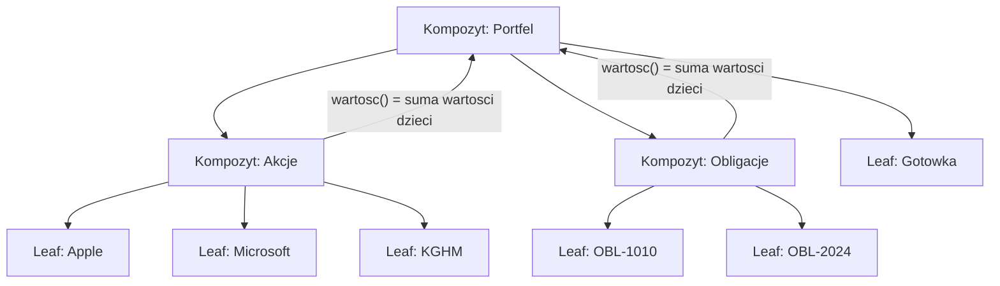
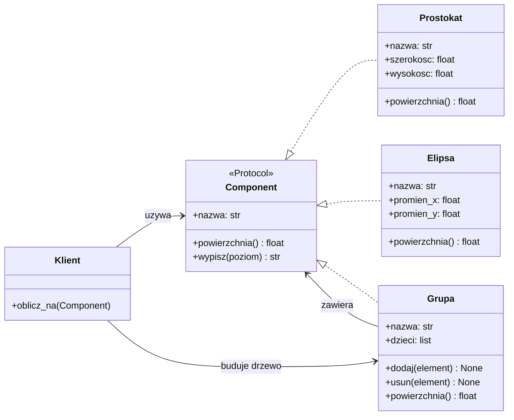
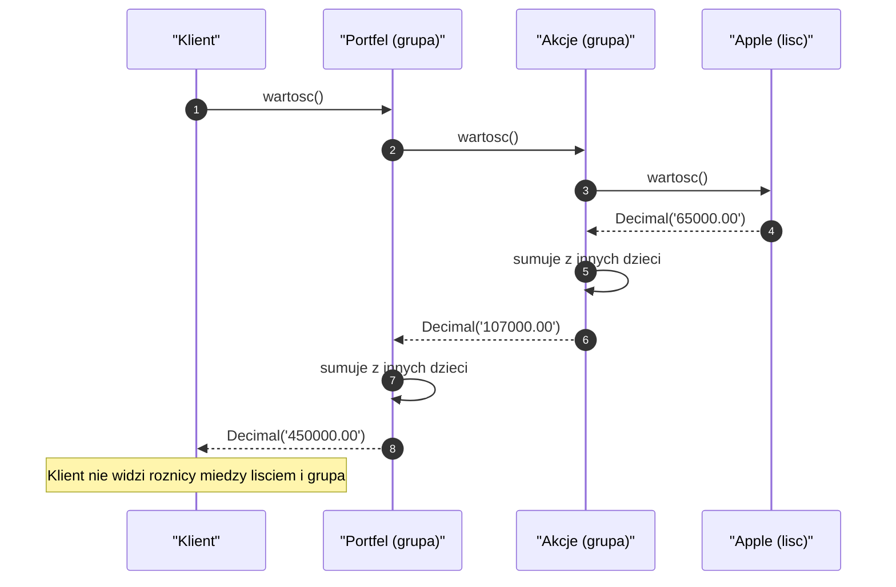
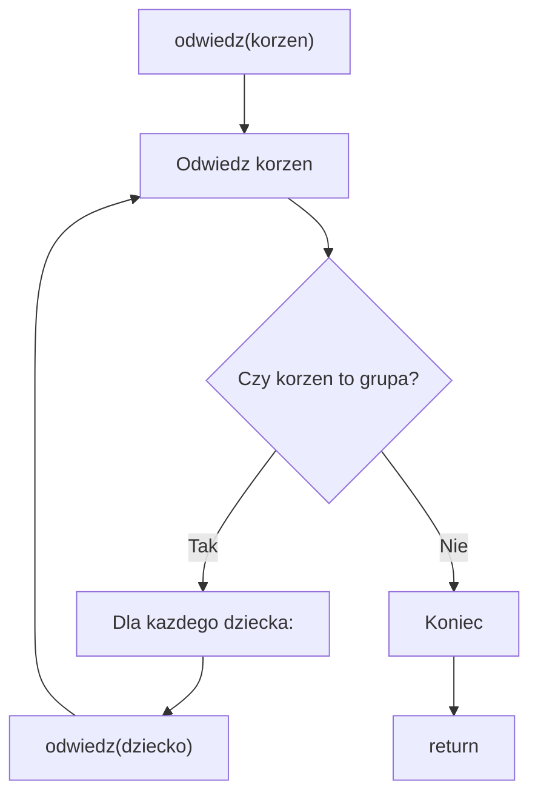
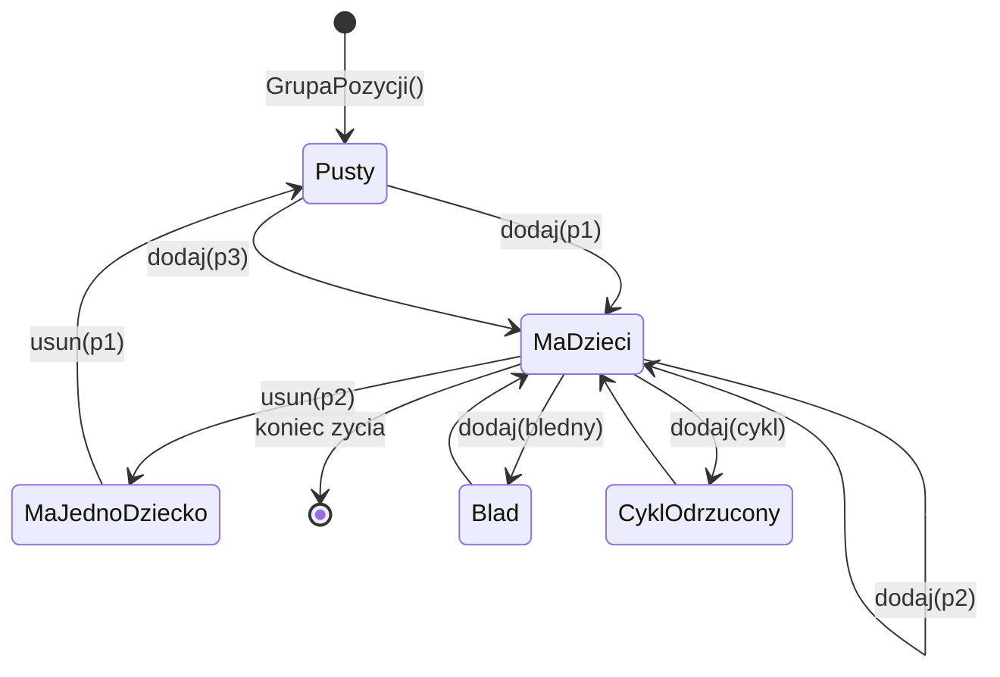
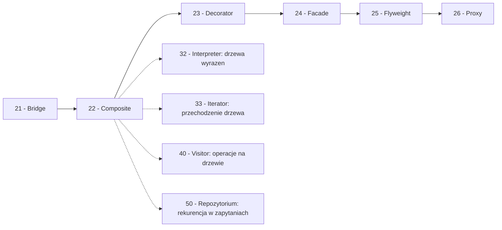

```markdown
---
modul: 22 — Composite
plik: 22-composite.md
poziom: sredni
wymaga: [21]
czas: ~160 minut czytania + ~400 minut ćwiczeń
---

# Moduł 22 — Composite — drzewa obiektów, w których liść i gałąź są tym samym

> **TL;DR**
> - **Composite (kompozyt)** pozwala składać obiekty w **drzewo** i traktować **pojedynczy obiekt** oraz **całą grupę obiektów** w ten sam sposób — klient woła `rozmiar()` i nie wie, czy dostał liść, czy całą gałąź.
> - Kluczowa idea: oba byty — liść i kompozyt — implementują **ten sam kontrakt** (`Component`); różnią się tylko wewnętrzną implementacją operacji.
> - Operacje rekurencyjne są naturalne dla kompozytu: `rozmiar(kompozytu)` to suma `rozmiarów` dzieci; to samo `rozmiar(liścia)` to pojedyncza liczba.
> - W Pythonie kompozyt realizuje się bardzo różnie: klasa z listą dzieci, `@dataclass(frozen=True)`, generator `yield from` do leniwego przechodzenia drzewa — a często wystarcza sama **lista obiektów o wspólnym protokole**.
> - Główne pułapki to **cykle** (dziecko dodane do własnego potomka), **wyciek metod zarządzania dziećmi do liści** (łamiący LSP), **głęboka rekurencja** (przekroczenie limitu stosu) i **koszt pamięci** dla wielkich drzew.

---

## 0. Model mentalny

### System plików i folder, który udaje plik

Otwórz eksplorator plików na swoim komputerze. Widzisz katalog `Dokumenty`, a w nim plik `raport.pdf`, katalog `Faktury` i katalog `Umowy`. Wejdź do `Faktury` — zobaczysz kolejne pliki i może jeszcze jedno zagnieżdżenie. Zapomnij na moment, że to „plik" albo „folder". Popatrz na **operacje**, które z nimi wykonujesz. Możesz:

- **sprawdzić nazwę** czegokolwiek — `raport.pdf` i `Faktury` mają nazwy,
- **sprawdzić rozmiar** dowolnego elementu — plik ma rozmiar w bajtach, **katalog też** (suma rozmiarów jego zawartości),
- **usunąć** dowolny element — plik natychmiast, katalog rekurencyjnie,
- **skopiować** dowolny element — plik jako plik, katalog jako całe drzewo,
- **wypisać zawartość** — plik zwraca swoją treść, katalog zwraca listę zawartości,
- **sprawdzić datę modyfikacji** — plik ma własną datę, katalog ma datę najnowszej modyfikacji w środku.

Zatrzymaj się tutaj, bo to jest istota wzorca. **Katalog nie jest plikiem, ale zachowuje się jak plik** z punktu widzenia większości operacji. Kiedy mówisz „pokaż rozmiar tego dokumentu", twoje narzędzie robi dokładnie to samo, niezależnie od tego, czy dostałeś plik, czy cały katalog z tysiącem plików pod spodem. Nie ma w interfejsie rozróżnienia na „rozmiar pliku" i „rozmiar katalogu". Jest po prostu **rozmiar**.

Zauważ teraz drugą, kluczową rzecz. **Rozmiar katalogu to suma rozmiarów jego dzieci** — plików i podkatalogów. I podkatalog sam również ma taki sam „rozmiar" jak plik. To znaczy, że system plików jest **rekurencyjny**: definicja „rozmiaru" dla katalogu odwołuje się do definicji „rozmiaru" dla elementów, które ten katalog zawiera. Na samym dole rekurencji są pliki — elementy bez dzieci, dla których „rozmiar" to po prostu ich własna liczba bajtów.

I jeszcze trzecia obserwacja, o której łatwo zapomnieć: **operacje nie znają różnicy**. Kiedy twoje narzędzie wywołuje `rozmiar(dokument)`, nie pisze:
```
jeśli element jest plikiem:          → zwróć jego rozmiar
jeśli element jest katalogiem:       → zsumuj rozmiar każdego dziecka...
```
To byłoby piekło: każda operacja musiałaby mieć dwa tryby. Narzędzie pisze po prostu `rozmiar(dokument)` — i niech się dzieje, co ma się dziać. Reszta jest **wewnętrzną sprawą obiektu**.

Właśnie to jest cała idea Composite: **klient nie rozróżnia liścia od gałęzi**, a operacje agregujące (sumowanie, liczenie, przechodzenie) są **rekurencyjne**.

| W analogii systemu plików | W kodzie |
|---|---|
| Katalog | Composite (`GrupaKsztaltów`, `Katalog`) |
| Plik | Leaf (`Prostokąt`, `Plik`) |
| „Nazwa", „rozmiar", „usuń" | Operacje z kontraktu `Component` |
| Rozmiar katalogu = suma rozmiarów dzieci | Metoda agregująca rekurencyjnie wywołana na dzieciach |
| Katalog zawiera pliki i podkatalogi | Composite ma listę `Component` |
| „Nie wiem, czy to plik, czy katalog" | Klient nie pisze `isinstance` |
| Drzewo z korzeniem w `Dokumenty` | Drzewo obiektów z dowolnym korzeniem |
| Plik nie ma dzieci | Leaf nie ma metod `dodaj`/`usuń` |

> 🧠 **Zapamiętaj** — **Composite (kompozyt) to wzorzec strukturalny, który pozwala komponować obiekty w drzewa, tak aby pojedynczy obiekt (liść) i grupa obiektów (złożenie) mogły być traktowane jednolicie — wspólny kontrakt, rekurencyjna implementacja agregacji.**

Zwróć uwagę na trzy słowa w tej definicji: **drzewo**, **jednolicie** i **rekurencja**. „Drzewo" — bo kompozyt jest z natury strukturą hierarchiczną. „Jednolicie" — bo klient nie rozróżnia, z czym pracuje. „Rekurencja" — bo operacje agregujące schodzą w dół struktury. Te trzy słowa razem opisują wzorzec lepiej niż jakiekolwiek przykłady.

### Diagram — intuicja drzewa



*Diagram pokazuje drzewo, w którym każdy węzeł (kompozyt lub liść) odpowiada na to samo zapytanie `wartosc()` — a kompozyty liczą wynik, sumując odpowiedzi swoich dzieci.*

### Czego Composite NIE robi

Rozbrójmy kilka nieporozumień.

**Nie jest strukturą danych ani kolekcją.** Kompozyt nie jest listą ani drzewem binarnym. Kompozyt jest wzorcem **zachowania** — „jak zorganizować operacje, żeby klient nie rozróżniał liścia od grupy". Sama struktura drzewiasta jest tu wsparciem.

**Nie jest tym samym co hierarchia dziedziczenia.** Dziedziczenie to relacja „jest szczególnym przypadkiem". Kompozyt to relacja „zawiera". `GrupaKsztaltów` nie jest szczególnym rodzajem kształtu — zawiera kształty.

**Nie rozwiązuje problemu „jak wydajnie przechodzić drzewo".** Kompozyt definiuje **interfejs** drzewa, ale samo przechodzenie (rekurencja, iteracja, iterator generatorowy) trzeba zaprojektować osobno. Pokażemy to w sekcji 4.

**Nie narzuca, że każde drzewo jest drzewem binarnym.** Kompozyt obsługuje dowolną liczbę dzieci na węzeł.

**Nie zawsze się opłaca.** Jeśli twoja struktura jest płaska (lista, słownik), Composite to nadmiar. Sięga się po niego, gdy hierarchia jest naprawdę ważna dla operacji — nie tylko wizualnie.

**Nie gwarantuje poprawności struktury.** Kompozyt nie broni przed cyklami. Jeśli dodasz rodzica do jego własnego potomka, dostaniesz nieskończoną rekurencję. To trzeba zabezpieczyć jawnie — o tym w sekcji 8.

---

## 1. Problem, który rozwiązujemy

Wejdźmy w domenę 📝 „Edytora" — wyobraźmy sobie program graficzny, w którym klienci składają dokumenty z kształtów. Ktoś napisał obsługę kształtów: prostokątów, elips, a także — co kluczowe — **grup** kształtów. Grupa ma się zachowywać **jak pojedynczy kształt**: można ją przesuwać, skalować, wyliczać jej powierzchnię, renderować. Ktoś napisał to w taki sposób, że klasa grupy musi sama rozróżniać swoje elementy.

### Kod „przed"

```python
# edytor_v0.py — wersja naiwna, demonstracyjna
# UWAGA: kod celowo pokazuje problemy z rozroznianiem lisci i galezi.

from __future__ import annotations
from dataclasses import dataclass, field


@dataclass
class Prostokat:
    nazwa: str
    szerokosc: float
    wysokosc: float


@dataclass
class Elipsa:
    nazwa: str
    promien_x: float
    promien_y: float


@dataclass
class Grupa:
    nazwa: str
    ksztalty: list = field(default_factory=list)

    def dodaj(self, element) -> None:
        self.ksztalty.append(element)

    def powierzchnia(self) -> float:
        """Powierzchnia grupy = suma powierzchni elementow.

        Musimy rozroznic, czy element to Prostokat, Elipsa, czy Grupa.
        """
        suma = 0.0
        for element in self.ksztalty:
            if isinstance(element, Prostokat):
                suma += element.szerokosc * element.wysokosc
            elif isinstance(element, Elipsa):
                suma += 3.14159 * element.promien_x * element.promien_y
            elif isinstance(element, Grupa):
                # Rekurencyjnie wywolujemy na grupie — ale tylko dlatego,
                # ze wiemy, iz to Grupa!
                suma += element.powierzchnia()
            else:
                raise TypeError(f"nieznany typ: {type(element).__name__}")
        return suma

    def przesun(self, dx: float, dy: float) -> None:
        for element in self.ksztalty:
            if isinstance(element, Prostokat):
                # prostokat nie ma pozycji?
                pass
            elif isinstance(element, Grupa):
                element.przesun(dx, dy)


if __name__ == "__main__":
    g = Grupa("Scena")
    g.dodaj(Prostokat("A", 10.0, 5.0))
    g.dodaj(Elipsa("B", 3.0, 3.0))

    podgrupa = Grupa("Ikony")
    podgrupa.dodaj(Prostokat("C", 2.0, 2.0))
    g.dodaj(podgrupa)

    print(f"Powierzchnia: {g.powierzchnia()}")
```

Ten kod działa w wersji podstawowej. Ale zawiera **siedem problemów**, z których wszystkie narastają, gdy dodasz kolejne operacje lub kolejne typy.

### Code smell — tysiące `isinstance`, wyciekająca wiedza

| Problem | Gdzie | Konsekwencja |
|---|---|---|
| `isinstance` w agregacji | `powierzchnia()` | Każda nowa operacja agregująca powtarza ten sam schemat |
| Wiedza o typach w metodzie | `isinstance(element, Prostokat)` | Grupa wie o wszystkich typach kształtów |
| Każda nowa operacja uczy się wszystkich typów | `powierzchnia`, `przesun`, ... | Nowa metoda `obwod()`, `render()`, `zapisz()` → znów `isinstance` × N |
| Nowy typ elementu wymaga zmian w każdej metodzie | Dodanie `Trojkat` | Zmiana w `powierzchnia`, `przesun`, `obwod`, `render`... |
| Brak wspólnego kontraktu | Trzy osobne klasy | Nie da się przekazać `Component` — trzeba znać wszystkie |
| Zagnieżdżenie tylko przez jawny `isinstance` | `elif isinstance(element, Grupa)` | Grupa musi wiedzieć o sobie samej |
| Puste gałęzie `pass` | `if isinstance(element, Prostokat): pass` | Kod udaje obsługę, której nie ma |

Zwróć uwagę na trzecią pozycję. **Dodanie nowej operacji agregującej** (obwód, renderowanie, eksport do SVG) oznacza powtórzenie tego samego schematu: iteracja, `isinstance`, obsługa każdego typu. To jest klasyczne **naruszenie OCP** (moduł 03): otwarcie systemu na rozszerzenia wymaga modyfikacji istniejącego kodu.

### Objawy — poznasz ten problem po tym, że...

- **Każda operacja agregująca wygląda jak drzewo decyzyjne.** Wielokrotne `isinstance(x, A)`, `elif isinstance(x, B)`, `elif isinstance(x, Grupa)`. To znak, że brakuje wspólnego kontraktu.
- **Nowa operacja jest wielokrotnie trudniejsza niż zmiana istniejącej.** Bo trzeba uwzględnić wszystkie typy, w których jesteś zainteresowany.
- **Nowy typ elementu wymaga zmian w kilku miejscach.** Dodanie `Trojkat` oznacza wejść do każdej metody `Grupy`.
- **Kod ma `elif isinstance(element, Grupa)`** — klasyczna oznaka rekurencji przez sprawdzenie typu. Wersja kompozytowa wykonuje rekurencję **bez** `isinstance`.
- **Testy grupy wyglądają jak matryca.** Testy `powierzchni/grupa z dwoma prostokątami`, `grupa z prostokątem i elipsą`, `grupa z grupą`... — to znak, że testujesz kombinatorialny kod.
- **Kod ma komentarze wyjaśniające „tu jeszcze obsługujemy X".** To znak, że logika jest rozproszona i każdy nowy typ wymaga „tu jeszcze jednego if".
- **W metodzie grupy jest `pass` albo `NotImplementedError`** dla niektórych typów. Kod udaje obsługę operacji, której nie wykonuje.
- **Klient nie może przekazać „dowolnego kształtu"** — bo operacje wymagają konkretnego typu.
- **Hierarchia istnieje w danych, ale nie w kodzie.** W JSON-ie masz drzewo, a w klasach masz płaską listę z `if`-ami.

---

## 2. Anatomia wzorca

### Uczestnicy

| Rola | Odpowiedzialność | Co NIE jest jej zadaniem |
|---|---|---|
| **Component (komponent)** | Definiuje wspólny kontrakt: operacje, które można wywołać na liściach i kompozytach jednolicie | Nie zawiera logiki konkretnych implementacji; nie zarządza dziećmi |
| **Leaf (liść)** | Reprezentuje element końcowy; implementuje operacje kontraktu, ale nie ma dzieci | Nie ma metod `dodaj`/`usuń`; nie prowadzi rekurencji |
| **Composite (złożenie)** | Zawiera listę `Component` (dzieci); implementuje operacje kontraktu, wywołując je rekurencyjnie na dzieciach | Nie zawiera logiki liścia; nie jest właścicielem operacji elementarnych |
| **Klient (client)** | Wywołuje operacje na `Component` — nie rozróżnia liścia od kompozytu | Nie pisze `isinstance`; nie zarządza drzewem samodzielnie |

Bardzo ważna uwaga: **`Component` nie definiuje metod zarządzania dziećmi**. Dodawanie / usuwanie dzieci jest cechą **kompozytu**, nie **liścia**. Trzymanie `dodaj`/`usuń` na `Component` łamie LSP (liść rzucałby `NotImplementedError`) — o tym dylemat poniżej.

### Klasyczny dylemat — gdzie umieścić `dodaj`/`usuń`?

Warianty klasyczne w GoF są dwa:

**Wariant pełnej przejrzystości (transparent).** `Component` ma `dodaj`, `usuń`, `dzieci`. Zaleta: klient traktuje wszystkie obiekty identycznie — bezpieczny (bezpieczny?) i spójny interfejs. Wada: liść musi jakoś odpowiedzieć — zwykle `NotImplementedError` albo cicha ignorancja. To **łamie LSP** (podstawialność — liść nie jest wymienny bez warunków).

**Wariant bezpieczeństwa (safe).** `Component` nie ma metod zarządzania dziećmi — są tylko na `Composite`. Zaleta: nie można wywołać `dodaj` na liściu. Wada: klient musi rozróżnić typ, żeby dodać dziecko — więc potrzebuje `isinstance`, jeśli chce obsłużyć dowolny element.

**Rekomendacja w Pythonie:** idź w stronę **bezpieczeństwa**. Używaj `Protocol` jako wspólnego kontraktu **bez** metod zarządzania dziećmi, a `dodaj`/`usuń` definiuj na `Composite`. Klient, który chce dodać dziecko, musi jawnie pracować z `Composite` — ale to w praktyce naturalne, bo zwykle już wie, że buduje grupę.

### Diagram struktury



*Diagram pokazuje, że liście (`Prostokat`, `Elipsa`) i kompozyt (`Grupa`) realizują wspólny kontrakt `Component`, a `Grupa` zawiera listę `Component` — referencja kompozytu do abstrakcji jest tym, co umożliwia rekurencję.*

Przeczytajmy ten diagram zdanie po zdaniu. `Component` to kontrakt — z metodami `powierzchnia()` i `wypisz(poziom)`. To, co **można wywołać** na dowolnym elemencie drzewa. `Prostokat` i `Elipsa` to liście — implementują kontrakt w najprostszy sposób. `Grupa` to kompozyt — implementuje kontrakt, wywołując go **rekurencyjnie** na dzieciach.

Strzałka `Grupa --> Component` jest kluczowa: **kompozyt zależy od abstrakcji**, nie od konkretnych typów liści. To znaczy, że kompozyt nie wie, z jakimi liśćmi pracuje. Można dodać `Trojkat` bez zmiany w `Grupa`.

`Klient` (np. kod renderujący) zna tylko `Component`. Może operować na pojedynczym prostokącie albo na całym drzewie — nie rozróżnia. Klient tworzący drzewo (np. z pliku JSON) potrzebuje `Grupa` — tu pojawia się jawna wiedza o kompozycie, ale **tylko w kodzie budującym**, nie w kodzie operującym.

### Warianty: klasyczny vs pythoniczny

| Aspekt | Wariant klasyczny (GoF) | Wariant pythoniczny |
|---|---|---|
| Component | Klasa `ABC` z metodami abstrakcyjnymi | `Protocol` albo wspólna klasa `ABC` |
| Leaf | Klasa dziedzicząca po Component | Funkcja, `@dataclass`, klasa |
| Composite | Klasa z listą `Component` | Lista, krotka, `tuple` dzieci |
| Metody `dodaj`/`usuń` | Na `Component` lub na `Composite` | Na `Composite` (bezpiecznie) |
| Przejście rekurencyjne | Ręczna rekurencja | Generator z `yield from` |
| Zwracanie dzieci | `children()` zwraca listę | `__iter__` — obiekt jest iterowalny |
| Budowanie kompozytu | Konstruktor + `dodaj` | `Grupa("x", děti=[...])` — dataclass |
| Cykle | Trzeba bronić ręcznie | Też trzeba bronić ręcznie |

Python daje kilka **znacznie prostszych** dróg realizacji kompozytu. W praktyce najbardziej opłaca się albo „lista obiektów o wspólnym protokole" (jeśli nie potrzebujesz hierarchii), albo `@dataclass` z krotką dzieci (jeśli chcesz niemutowalności). Pełną hierarchię klas pokazujemy, bo tak wzorzec jest opisany w klasyce — ale nie zawsze trzeba ją pisać.

---

## 3. Implementacja krok po kroku

Przebudujemy kod z sekcji 1 stopniowo.

### Krok 1 — Zdefiniuj kontrakt Component

Zaczynamy od wspólnego kontraktu. To najważniejsza decyzja — definiuje, co **można wywołać** na dowolnym elemencie drzewa.

```python
from typing import Protocol, runtime_checkable

@runtime_checkable
class Ksztalt(Protocol):
    """Wspolny kontrakt dla lisci i grup."""

    nazwa: str

    def powierzchnia(self) -> float:
        """Zwraca powierzchnie elementu."""
        ...

    def opis(self, poziom: int = 0) -> str:
        """Zwraca tekstowy opis elementu (indentowany)."""
        ...
```

Uwaga: **kontrakt nie ma** `dodaj` ani `usuń`. Zarządzanie dziećmi to cecha kompozytu — nie wspólna dla wszystkich elementów.

### Krok 2 — Zdefiniuj liście

Liście implementują kontrakt w najprostszy sposób. Bez dzieci, bez rekurencji.

```python
from dataclasses import dataclass

@dataclass(frozen=True, slots=True)
class Prostokat:
    nazwa: str
    szerokosc: float
    wysokosc: float

    def powierzchnia(self) -> float:
        return self.szerokosc * self.wysokosc

    def opis(self, poziom: int = 0) -> str:
        wciecie = "  " * poziom
        return f"{wciecie}Prostokat '{self.nazwa}' ({self.szerokosc}x{self.wysokosc})"


@dataclass(frozen=True, slots=True)
class Elipsa:
    nazwa: str
    promien_x: float
    promien_y: float

    def powierzchnia(self) -> float:
        import math
        return math.pi * self.promien_x * self.promien_y

    def opis(self, poziom: int = 0) -> str:
        wciecie = "  " * poziom
        return f"{wciecie}Elipsa '{self.nazwa}' (rx={self.promien_x}, ry={self.promien_y})"
```

Zwróć uwagę, że liście **nie potrzebują dziedziczenia po niczym** — wystarczy, że mają `nazwa`, `powierzchnia`, `opis`. To typowanie strukturalne (moduł 01). Zysk: można tworzyć liście z różnych źródeł (biblioteki zewnętrzne, modele danych) bez wymuszania dziedziczenia.

### Krok 3 — Zdefiniuj kompozyt

Kompozyt to klasa, która zawiera listę `Ksztalt` i realizuje operacje rekurencyjnie.

```python
class Grupa:
    """Kompozyt: grupa ksztaltow, ktora zachowuje sie jak pojedynczy ksztalt."""

    def __init__(self, nazwa: str) -> None:
        self.nazwa = nazwa
        self._dzieci: list[Ksztalt] = []

    # --- Zarzadzanie dziecmi (tylko w kompozycie!) ---

    def dodaj(self, element: Ksztalt) -> None:
        if not isinstance(element, Ksztalt):
            raise TypeError(
                f"{type(element).__name__} nie spelnia kontraktu Ksztalt"
            )
        self._dzieci.append(element)

    def usun(self, element: Ksztalt) -> None:
        self._dzieci.remove(element)

    @property
    def dzieci(self) -> tuple[Ksztalt, ...]:
        return tuple(self._dzieci)

    def __len__(self) -> int:
        return len(self._dzieci)

    def __iter__(self):
        return iter(self._dzieci)

    # --- Operacje z kontraktu ---

    def powierzchnia(self) -> float:
        """Powierzchnia grupy to suma powierzchni dzieci."""
        return sum(dziecko.powierzchnia() for dziecko in self._dzieci)

    def opis(self, poziom: int = 0) -> str:
        wciecie = "  " * poziom
        linie = [f"{wciecie}Grupa '{self.nazwa}' ({len(self._dzieci)} elementow)"]
        for dziecko in self._dzieci:
            linie.append(dziecko.opis(poziom + 1))
        return "\n".join(linie)
```

Zwróć uwagę na **rekurencję w `powierzchnia`**: `sum(dziecko.powierzchnia() for dziecko in self._dzieci)`. Wywołujemy **tę samą metodę** na każdym dziecku, bez rozróżniania typu. Dziecko może być `Prostokat`, `Elipsa` albo inną `Grupa` — nie ma to znaczenia, bo wszystkie mają `powierzchnia()`.

### Krok 4 — Klient używa kontraktu

Klient nie pisze `isinstance` — pracuje wyłącznie przez `Ksztalt`.

```python
def opisz_ksztalt(ksztalt: Ksztalt) -> str:
    """Funkcja dziala jednakowo na lisciu i grupie."""
    return ksztalt.opis()


def oblicz_powierzchnie(ksztalt: Ksztalt) -> float:
    """Funkcja dziala jednakowo na lisciu i grupie."""
    return ksztalt.powierzchnia()
```

### Krok 5 — Złóż drzewo

```python
def przyklad_drzewa() -> Grupa:
    scena = Grupa("Scena")
    scena.dodaj(Prostokat("Tlo", 800.0, 600.0))

    ikony = Grupa("Ikony")
    ikony.dodaj(Prostokat("Folder", 32.0, 32.0))
    ikony.dodaj(Prostokat("Plik", 32.0, 32.0))

    panel = Grupa("Panel narzedzi")
    panel.dodaj(Prostokat("Przycisk1", 24.0, 24.0))
    panel.dodaj(Elipsa("Kropka", 3.0, 3.0))

    scena.dodaj(ikony)
    scena.dodaj(panel)
    return scena
```

### Krok 6 — Zadbaj o wykrywanie cykli

Jeśli dodasz rodzica do potomka, powstanie cykl. Rekurencja się zapętli i wyczerpie stos.

```python
def _zawiera(self, potencjalny_przodek: "Grupa") -> bool:
    """Sprawdza, czy ten kompozyt zawiera potencjalnego przodka."""
    for dziecko in self._dzieci:
        if dziecko is potencjalny_przodek:
            return True
        if isinstance(dziecko, Grupa) and dziecko._zawiera(potencjalny_przodek):
            return True
    return False
```

I w `dodaj`:

```python
def dodaj(self, element: Ksztalt) -> None:
    if not isinstance(element, Ksztalt):
        raise TypeError(...)
    if element is self:
        raise ValueError("nie mozna dodac grupy do samej siebie")
    if isinstance(element, Grupa) and element._zawiera(self):
        raise ValueError("cykl: dodawany kompozyt zawiera ten element")
    self._dzieci.append(element)
```

To zabezpieczenie **kosztuje** — operacja `dodaj` musi przejść przez drzewo. Ale chroni przed katastrofą: nieskończoną rekurencją i niekontrolowanym cyklem. W wielu aplikacjach to obowiązkowe.

### Krok 7 — Zweryfikuj

| Kryterium | Wersja „przed" | Wersja „po" |
|---|---|---|
| `isinstance` w agregacji | Tak (3 razy) | Nie |
| Nowy typ elementu | Zmiana w `powierzchnia` i każdej innej metodzie | Nowa klasa — zero zmian istniejących |
| Nowa operacja agregująca | `isinstance` we wszystkich typach | Metoda w kontrakcie — implementuje każdy typ |
| Klient może pracować bez rozróżniania | Nie | Tak |
| Ochrona przed cyklami | Brak | Sprawdzenie w `dodaj` |
| Niemutowalne liście | Nie | Tak (`frozen=True`) |
| Liczba metod na `Grupa` | 3 | 8 (dodajemy zarządzanie dziećmi) |
| Liczba klas | 3 | 3 (bez zmian) |

Zysk jest przede wszystkim **jakościowy** — nowe operacje i nowe typy są **lokalne**. Koszt też jest: `Grupa` ma więcej metod.

---

## 4. Wersje pythoniczne i warianty

### 4.1 Klasyczny kompozyt z `ABC` i listą — pokazany powyżej

Zalety: jawna struktura, oczywiste role, dobrze pasuje do `isinstance` gdy naprawdę potrzebne. Wady: dla prostych drzew dużo kodu; wymaga dziedziczenia w klasycznym ujęciu.

### 4.2 Kompozyt z `Protocol` i klasami bez dziedziczenia — pokazany powyżej

Zalety: brak hierarchii klas, liście mogą być dowolnego typu, łatwo podstawić fake. Wady: `mypy` nie wymusza implementacji — trzeba pilnować ręcznie.

### 4.3 Kompozyt jako `dataclass(frozen=True)` z krotką dzieci

Jeśli drzewo jest budowane raz i nie zmienia się w trakcie życia, **niemutowalny kompozyt** jest idealny.

```python
from dataclasses import dataclass

@dataclass(frozen=True, slots=True)
class GrupaNiemutowalna:
    nazwa: str
    dzieci: tuple["Ksztalt", ...] = ()

    def powierzchnia(self) -> float:
        return sum(d.powierzchnia() for d in self.dzieci)

    def opis(self, poziom: int = 0) -> str:
        wciecie = "  " * poziom
        linie = [f"{wciecie}Grupa '{self.nazwa}' ({len(self.dzieci)})"]
        linie.extend(d.opis(poziom + 1) for d in self.dzieci)
        return "\n".join(linie)
```

Dzieci nie można już dodać później — trzeba utworzyć nowy kompozyt. To duża zaleta w systemach wymagających **niemutowalności** i bezpieczeństwa wątek. Budowa drzewa może się odbywać przez `dataclasses.replace` albo funkcje konstruujące.

### 4.4 Kompozyt jako lista obiektów z protokołem

Jeśli nie potrzebujesz **jawnej klasy** dla grupy, sama lista z obiektami o wspólnym protokole wystarczy — dopóki operacje nie wymagają rekurencji na liście. Wtedy tworzysz **jedną klasę kompozytu**, ale bez hierarchii dziedziczenia.

```python
def powierzchnia_calosci(elementy: list[Ksztalt]) -> float:
    """Sumuje powierzchnie - kazdy element sam wie, jak sobie policzyc."""
    return sum(e.powierzchnia() for e in elementy)
```

Zwróć uwagę: nie ma tu klasy `Grupa` — jest funkcja na liście. W wielu przypadkach to jest więcej niż wystarczające. Kompozyt z klasą jest potrzebny, gdy grupa ma **własną tożsamość** (nazwę, dodatkowe operacje) i **jest elementem drzewa** (może być dzieckiem innej grupy).

### 4.5 Przejście rekurencyjne vs iteracja ze stosem

Rekurencja w Pythonie ma limit (domyślnie ~1000 wywołań głębokości). Dla bardzo głębokich drzew to problem.

```python
def wszystkie_liscie_rekurencyjnie(korzen: Ksztalt):
    """Klasyczna rekurencja - prosta, ale limit stosu."""
    if isinstance(korzen, Grupa):
        for dziecko in korzen.dzieci:
            yield from wszystkie_liscie_rekurencyjnie(dziecko)
    else:
        yield korzen


def wszystkie_liscie_iteracyjnie(korzen: Ksztalt):
    """Iteracja ze stosem - bez limitu rekurencji."""
    stos = [korzen]
    while stos:
        element = stos.pop()
        if isinstance(element, Grupa):
            # Dodajemy dzieci w odwrotnej kolejnosci, zeby zachowac porzadek
            stos.extend(reversed(element.dzieci))
        else:
            yield element
```

Zalety rekurencji: prostszy, naturalniejszy kod. Zalety iteracji: brak limitu stosu, można przejść drzewo głębsze niż 1000 poziomów, można sterować kolejnością łatwiej.

**W Pythonie**: rekurencja jest wygodniejsza w 90% przypadków. Iteracja ma sens, gdy drzewo może być naprawdę głębokie lub gdy operacja jest wykonywana bardzo często i chcesz uniknąć kosztu wywołań funkcji.

### 4.6 Generatory do leniwego przechodzenia — `yield from`

Generator to najbardziej pythoniczny sposób przechodzenia drzewa. `yield from` pozwala przekazać sterowanie do generatora dziecka bez ręcznej iteracji:

```python
def wszystkie_elementy(korzen: Ksztalt):
    """Leniwie przechodzi drzewo w kolejnosci pre-order."""
    yield korzen
    if isinstance(korzen, Grupa):
        for dziecko in korzen.dzieci:
            yield from wszystkie_elementy(dziecko)
```

Zalety: leniwe — nie tworzy listy wszystkich elementów; komponowalne z `itertools` (`islice`, `chain`, `filter`); czytelne. Wady: jednorazowe (moduł 02) — drugie przejście wymaga utworzenia generatora od nowa; `yield from` w bardzo głębokich drzewach też ma koszt.

### 4.7 Wzorce przechodzenia — pre-order, post-order

Kolejność przechodzenia drzewa ma znaczenie dla operacji. Wyróżniamy:

| Kolejność | Zasada | Typowe zastosowanie |
|---|---|---|
| **Pre-order** (korzeń, potem dzieci) | Odwiedź węzeł, zanim wejdziesz do dzieci | Renderowanie drzewa, kopiowanie, indeksowanie |
| **Post-order** (dzieci, potem korzeń) | Najpierw dzieci, potem węzeł | Agregacje (sumowanie rozmiarów), aktualizacja cache, zwalnianie zasobów |
| **In-order** (lewe, korzeń, prawe) | Porządek binarnego drzewa | Sortowanie BST |

**Dlaczego post-order jest naturalny dla agregacji?** Wyobraź sobie drzewo katalogów: żeby policzyć rozmiar korzenia, musisz najpierw znać rozmiary dzieci. Ale rozmiar każdego dziecka też zależy od jego własnych dzieci. To znaczy, że informacja musi się „zbierać" od liści do korzenia — czyli w kolejności post-order. W naszym kodzie post-order realizuje się **naturalnie przez rekurencję**: rekurencyjne wywołanie na dziecku zwraca wynik zanim użyjemy go w rodzicu. **Rekurencja automatycznie daje post-order**.

```python
def wszystkie_rozmiary_post_order(korzen: Ksztalt):
    """Post-order: zwraca (element, powierzchnia) - od lisci do korzenia."""
    if isinstance(korzen, Grupa):
        for dziecko in korzen.dzieci:
            yield from wszystkie_rozmiary_post_order(dziecko)
        yield korzen, korzen.powierzchnia()   # korzen PO dzieciach
    else:
        yield korzen, korzen.powierzchnia()
```

### 4.8 Cache agregatów i unieważnianie

Agregacje na dużych drzewach mogą być kosztowne. Jeśli drzewo zmienia się rzadko, a odczytuje często — cache się opłaca.

```python
class GrupaCache:
    def __init__(self, nazwa: str) -> None:
        self.nazwa = nazwa
        self._dzieci: list[Ksztalt] = []
        self._powierzchnia_cache: float | None = None

    @property
    def dzieci(self) -> tuple[Ksztalt, ...]:
        return tuple(self._dzieci)

    def dodaj(self, element: Ksztalt) -> None:
        self._dzieci.append(element)
        self._uniewaznij_cache()

    def usun(self, element: Ksztalt) -> None:
        self._dzieci.remove(element)
        self._uniewaznij_cache()

    def _uniewaznij_cache(self) -> None:
        self._powierzchnia_cache = None

    def powierzchnia(self) -> float:
        if self._powierzchnia_cache is None:
            self._powierzchnia_cache = sum(d.powierzchnia() for d in self._dzieci)
        return self._powierzchnia_cache
```

**Uwaga: to nie jest pełne cache'owanie.** Jeśli dziecko jest kompozytem, zmiana w nim nie „propaguje się w górę" — cache rodzica jest nieaktualny. Pełne rozwiązanie wymaga albo **niezmiennego drzewa** (wtedy cache bezpieczny), albo **jawnego unieważniania kaskadowego** (dziecko informuje rodzica o zmianie — to już wzorzec Obserwator, moduł 36). W praktyce: cache ma sens tylko dla **niemutowalnych** drzew albo tam, gdzie znamy punkty zmiany.

### 4.9 Podsumowanie — tabela wyboru

| Sytuacja | Wariant |
|---|---|
| Klasyczne drzewo z mutacją | Klasa z listą `_dzieci` (4.1) |
| Chcesz unikać hierarchii dziedziczenia | `Protocol` (4.2) |
| Drzewo budowane raz, niemutowalne | `@dataclass(frozen=True, slots=True)` (4.3) |
| Prosta lista bez zagnieżdżenia | Funkcja z listą (4.4) |
| Bardzo głębokie drzewo | Iteracja ze stosem (4.5) |
| Leniwy odczyt, kompozycja z `itertools` | Generator z `yield from` (4.6) |
| Częste odczyty, rzadkie zmiany | Cache na agregatach (4.8) |

> 🧠 **Zapamiętaj** — Kompozyt w Pythonie ma **wiele warstw prostoty**: od klasy z listą, przez `Protocol`, po funkcję z listą. Im prostszy wariant, tym mniej kodu i tym łatwiej go zrozumieć. Wybieraj najprostszy wariant, który spełnia twoje wymagania — nie najbogatszy.

---

## 5. Przykład z życia: 📈 Portfel — pełny uruchamialny kod

Zbudujemy pełny system modelowania portfela inwestycyjnego jako drzewa. Portfel zawiera **grupy** (akcje, obligacje, alternatywne) i **instrumenty** (konkretne pozycje). Operacje agregujące: wartość, liczba instrumentów, tekstowy opis, lista wszystkich instrumentów.

### Kod

```python
# portfel_composite.py — pelny przyklad Composite
from __future__ import annotations

from dataclasses import dataclass, field
from decimal import Decimal, ROUND_HALF_UP
from typing import Iterator, Protocol, runtime_checkable


# ===========================================================================
# 1. Kontrakt Component
# ===========================================================================

@runtime_checkable
class Pozycja(Protocol):
    """Wspolny kontrakt dla instrumentow (lisci) i grup (kompozytow)."""

    nazwa: str

    def wartosc(self) -> Decimal: ...
    def liczba_instrumentow(self) -> int: ...
    def opis(self, poziom: int = 0) -> str: ...


# ===========================================================================
# 2. Liscie - konkretne instrumenty
# ===========================================================================

@dataclass(frozen=True, slots=True)
class Instrument:
    """Lisc: pojedyncza pozycja z wartoscia."""

    nazwa: str
    wartosc_pln: Decimal
    klasa: str = "AKCJE"

    def __post_init__(self) -> None:
        if self.wartosc_pln < 0:
            raise ValueError("wartosc nie moze byc ujemna")

    def wartosc(self) -> Decimal:
        return self.wartosc_pln

    def liczba_instrumentow(self) -> int:
        return 1

    def opis(self, poziom: int = 0) -> str:
        wciecie = "  " * poziom
        sformatowana = f"{self.wartosc_pln:,.2f}".replace(",", " ")
        return f"{wciecie}{self.klasa}: {self.nazwa} = {sformatowana} PLN"


@dataclass(frozen=True, slots=True)
class Gotowka:
    """Lisc: srodki pieniezne. Wartosc nie zalezy od kursu."""

    nazwa: str
    kwota_pln: Decimal

    def wartosc(self) -> Decimal:
        return self.kwota_pln

    def liczba_instrumentow(self) -> int:
        return 1

    def opis(self, poziom: int = 0) -> str:
        wciecie = "  " * poziom
        sformatowana = f"{self.kwota_pln:,.2f}".replace(",", " ")
        return f"{wciecie}GOTOWKA: {self.nazwa} = {sformatowana} PLN"


# ===========================================================================
# 3. Kompozyt - grupa pozycji
# ===========================================================================

class GrupaPozycji:
    """Kompozyt: grupa pozycji (instrumentow i podgrup)."""

    def __init__(self, nazwa: str) -> None:
        self.nazwa = nazwa
        self._dzieci: list[Pozycja] = []

    # --- Zarzadzanie dziecmi (tylko tu, nie na kontrakcie) ---

    def dodaj(self, pozycja: Pozycja) -> None:
        if not isinstance(pozycja, Pozycja):
            raise TypeError(
                f"{type(pozycja).__name__} nie spelnia kontraktu Pozycja"
            )
        if pozycja is self:
            raise ValueError("grupa nie moze zawierac samej siebie")
        if isinstance(pozycja, GrupaPozycji) and self._zawiera(pozycja):
            raise ValueError(
                "cykl: dodawana grupa juz zawiera te grupe (bezposrednio lub posrednio)"
            )
        self._dzieci.append(pozycja)

    def usun(self, pozycja: Pozycja) -> None:
        self._dzieci.remove(pozycja)

    def _zawiera(self, szukana: GrupaPozycji) -> bool:
        """Sprawdza, czy szukana grupa jest w poddrzewie tego kompozytu."""
        for dziecko in self._dzieci:
            if dziecko is szukana:
                return True
            if isinstance(dziecko, GrupaPozycji) and dziecko._zawiera(szukana):
                return True
        return False

    @property
    def dzieci(self) -> tuple[Pozycja, ...]:
        return tuple(self._dzieci)

    def __len__(self) -> int:
        return len(self._dzieci)

    def __iter__(self) -> Iterator[Pozycja]:
        return iter(self._dzieci)

    # --- Operacje kontraktu ---

    def wartosc(self) -> Decimal:
        """Wartosc grupy = suma wartosci dzieci (post-order)."""
        suma = sum((d.wartosc() for d in self._dzieci), Decimal("0"))
        return suma.quantize(Decimal("0.01"), rounding=ROUND_HALF_UP)

    def liczba_instrumentow(self) -> int:
        """Liczba wszystkich instrumentow w poddrzewie."""
        return sum(d.liczba_instrumentow() for d in self._dzieci)

    def opis(self, poziom: int = 0) -> str:
        wciecie = "  " * poziom
        sformatowana = f"{self.wartosc():,.2f}".replace(",", " ")
        linie = [
            f"{wciecie}[{self.nazwa}] "
            f"{self.liczba_instrumentow()} instrumentow, "
            f"razem {sformatowana} PLN"
        ]
        for dziecko in self._dzieci:
            linie.append(dziecko.opis(poziom + 1))
        return "\n".join(linie)


# ===========================================================================
# 4. Funkcje pomocnicze - dzialaja na dowolnym Pozycja
# ===========================================================================

def wszystkie_instrumenty(korzen: Pozycja) -> Iterator[Pozycja]:
    """Leniwe przejscie pre-order: zwraca wszystkie elementy drzewa."""
    yield korzen
    if isinstance(korzen, GrupaPozycji):
        for dziecko in korzen.dzieci:
            yield from wszystkie_instrumenty(dziecko)


def wszystkie_liscie(korzen: Pozycja) -> Iterator[Pozycja]:
    """Iteracja ze stosem: zwraca tylko liscie (bez grup)."""
    stos = [korzen]
    while stos:
        element = stos.pop()
        if isinstance(element, GrupaPozycji):
            # Odwracamy, zeby zachowac kolejnosc
            stos.extend(reversed(element.dzieci))
        else:
            yield element


def opis_drzewa(korzen: Pozycja) -> str:
    """Funkcja dziala jednolicie na kazdym Pozycja."""
    return korzen.opis()


# ===========================================================================
# 5. Demonstracja
# ===========================================================================

if __name__ == "__main__":
    # Budujemy portfel
    portfel = GrupaPozycji("PORTFEL-GLOWNY")

    akcje = GrupaPozycji("Akcje polskie")
    akcje.dodaj(Instrument("PKN Orlen", Decimal("45000.00"), "AKCJE"))
    akcje.dodaj(Instrument("PZU", Decimal("12500.00"), "AKCJE"))
    akcje.dodaj(Instrument("KGHM", Decimal("8900.00"), "AKCJE"))

    akcje_zagraniczne = GrupaPozycji("Akcje zagraniczne")
    akcje_zagraniczne.dodaj(Instrument("Apple", Decimal("65000.00"), "AKCJE"))
    akcje_zagraniczne.dodaj(Instrument("Microsoft", Decimal("42000.00"), "AKCJE"))

    obligacje = GrupaPozycji("Obligacje")
    obligacje.dodaj(Instrument("OBL-1010", Decimal("100000.00"), "OBLIGACJE"))
    obligacje.dodaj(Instrument("OBL-2024", Decimal("55000.00"), "OBLIGACJE"))

    gotowka = Gotowka("Rachunek biezacy", Decimal("35000.00"))

    portfel.dodaj(akcje)
    portfel.dodaj(akcje_zagraniczne)
    portfel.dodaj(obligacje)
    portfel.dodaj(gotowka)

    print("=== 1. Opis calej hierarchii ===")
    print(opis_drzewa(portfel))

    print("\n=== 2. Operacje na dowolnym poziomie ===")
    print(f"  Wartosc portfela: {portfel.wartosc():,.2f} PLN")
    print(f"  Wartosc akcji polskich: {akcje.wartosc():,.2f} PLN")
    print(f"  Wartosc Apple (lisc): {Instrument('Apple', Decimal('65000.00')).wartosc():,.2f} PLN")
    print(f"  Liczba instrumentow w portfelu: {portfel.liczba_instrumentow()}")

    print("\n=== 3. Wszystkie instrumenty (pre-order) ===")
    for pozycja in wszystkie_instrumenty(portfel):
        print(f"  {type(pozycja).__name__}: {pozycja.nazwa}")

    print("\n=== 4. Tylko liscie (iteracja ze stosem) ===")
    suma_lisci = Decimal("0")
    for lisc in wszystkie_liscie(portfel):
        suma_lisci += lisc.wartosc()
    print(f"  Liscie razem: {suma_lisci:,.2f} PLN")
    print(f"  Zgadza sie z portfelem: {suma_lisci == portfel.wartosc()}")

    print("\n=== 5. Ochrona przed cyklem ===")
    try:
        akcje.dodaj(portfel)   # portfel zawiera akcje → cykl!
    except ValueError as blad:
        print(f"  odrzucono: {blad}")

    print("\n=== 6. Operacje dzialaja identycznie na lisciu i grupie ===")
    for pozycja in (portfel, akcje, Instrument("Test", Decimal("100.00"))):
        print(
            f"  {type(pozycja).__name__:20s} "
            f"wartosc={pozycja.wartosc():>12,.2f} "
            f"liczba={pozycja.liczba_instrumentow()}"
        )
```

### Co ten przykład pokazuje

Uruchomienie pokazuje wszystkie kluczowe cechy Composite.

**Punkt 1 — hierarchia zagnieżdżona.** Portfel zawiera trzy grupy i liść. Grupa akcji polskich zawiera trzy instrumenty, zagraniczne dwa, obligacje dwa. Drzewo ma trzy poziomy. Opis `opis(0)` pokazuje całą strukturę z wcięciami — rekurencyjnie.

**Punkt 2 — operacje na dowolnym poziomie.** Wywołujemy `wartosc()` na portfelu (grupa), na `akcje` (grupa), na `Instrument` (liść). Trzy różne typy węzłów, ta sama metoda. Zwróć uwagę, że wartość grupy to **suma wartości jej dzieci**, ale wartość liścia to po prostu jego własna liczba. Kod się nie różni — różni się implementacja.

**Punkt 3 — przejście pre-order.** Wszystkie elementy drzewa pojawiają się w kolejności od korzenia w dół. Każdy element ma własną nazwę. Zwróć uwagę, że funkcja `wszystkie_instrumenty` nie wie, ile jest poziomów ani typów — po prostu rekurencyjnie schodzi.

**Punkt 4 — przejście iteracyjne ze stosem.** Wszystkie liście zebrane. Suma liści = wartość portfela. To dowód, że agregacja działa poprawnie i że węzły kompozytowe nie zniekształcają wartości.

**Punkt 5 — ochrona przed cyklem.** Próba dodania `portfel` do `akcje` (gdy `portfel` już zawiera `akcje`) rzuca `ValueError`. Bez tego zabezpieczenia mielibyśmy cykl i nieskończoną rekurencję.

**Punkt 6 — jednolitość interfejsu.** Oba typy węzłów odpowiadają na `wartosc()` i `liczba_instrumentow()`. Klient nie pisze `isinstance`.

### Testy

```python
# test_portfel_composite.py — uruchomienie: pytest test_portfel_composite.py -v
from decimal import Decimal

import pytest

from portfel_composite import (
    Gotowka,
    GrupaPozycji,
    Instrument,
    Pozycja,
    opis_drzewa,
    wszystkie_instrumenty,
    wszystkie_liscie,
)


# --- Liscie -----------------------------------------------------------------

def test_instrument_odrzuca_ujemna_wartosc() -> None:
    with pytest.raises(ValueError, match="ujemna"):
        Instrument("X", Decimal("-10.00"))


def test_instrument_spelnia_kontrakt() -> None:
    pos = Instrument("X", Decimal("100.00"))
    assert isinstance(pos, Pozycja)
    assert pos.wartosc() == Decimal("100.00")
    assert pos.liczba_instrumentow() == 1


def test_gotowka_spelnia_kontrakt() -> None:
    pos = Gotowka("Konto", Decimal("500.00"))
    assert isinstance(pos, Pozycja)
    assert pos.wartosc() == Decimal("500.00")
    assert pos.liczba_instrumentow() == 1


# --- Kompozyt: zarzadzanie dziecmi -------------------------------------------

def test_grupa_pusta_ma_zero() -> None:
    g = GrupaPozycji("pusta")
    assert g.wartosc() == Decimal("0")
    assert g.liczba_instrumentow() == 0
    assert len(g) == 0


def test_grupa_odrzuca_obiekt_bez_kontraktu() -> None:
    class CosInnego:
        pass

    with pytest.raises(TypeError):
        GrupaPozycji("g").dodaj(CosInnego())  # type: ignore[arg-type]


def test_grupa_odrzuca_samą_siebie() -> None:
    g = GrupaPozycji("g")
    with pytest.raises(ValueError, match="samej siebie"):
        g.dodaj(g)


def test_grupa_odrzuca_cykl_posredni() -> None:
    a = GrupaPozycji("a")
    b = GrupaPozycji("b")
    c = GrupaPozycji("c")
    a.dodaj(b)
    b.dodaj(c)
    with pytest.raises(ValueError, match="cykl"):
        c.dodaj(a)   # a zawiera b, b zawiera c — cykl!


def test_grupa_dodaje_i_usowa() -> None:
    g = GrupaPozycji("g")
    p = Instrument("X", Decimal("100"))
    g.dodaj(p)
    assert len(g) == 1
    g.usun(p)
    assert len(g) == 0


# --- Agregacje --------------------------------------------------------------

def test_wartosc_grupy_to_suma_dzieci() -> None:
    g = GrupaPozycji("g")
    g.dodaj(Instrument("A", Decimal("100.00")))
    g.dodaj(Instrument("B", Decimal("250.00")))
    g.dodaj(Gotowka("K", Decimal("50.00")))
    assert g.wartosc() == Decimal("400.00")


def test_wartosc_grupy_zagniezdzonej() -> None:
    wewnetrzna = GrupaPozycji("wewnetrzna")
    wewnetrzna.dodaj(Instrument("A", Decimal("100.00")))
    zewnetrzna = GrupaPozycji("zewnetrzna")
    zewnetrzna.dodaj(wewnetrzna)
    zewnetrzna.dodaj(Instrument("B", Decimal("50.00")))
    assert zewnetrzna.wartosc() == Decimal("150.00")


def test_liczba_instrumentow_rekurencyjnie() -> None:
    g1 = GrupaPozycji("g1")
    g1.dodaj(Instrument("A", Decimal("1")))
    g1.dodaj(Instrument("B", Decimal("1")))
    g2 = GrupaPozycji("g2")
    g2.dodaj(g1)
    g2.dodaj(Instrument("C", Decimal("1")))
    assert g2.liczba_instrumentow() == 3


# --- Kontrakt: jednolita obsluga ---------------------------------------------

@pytest.mark.parametrize("pozycja", [
    Instrument("A", Decimal("100.00")),
    Gotowka("K", Decimal("100.00")),
    GrupaPozycji("g"),
])
def test_pozycja_spelnia_kontrakt(pozycja: Pozycja) -> None:
    """Dowod: kazdy element drzewa spelnia ten sam kontrakt."""
    assert isinstance(pozycja, Pozycja)
    assert isinstance(pozycja.nazwa, str)
    assert isinstance(pozycja.wartosc(), Decimal)
    assert isinstance(pozycja.liczba_instrumentow(), int)
    assert isinstance(pozycja.opis(), str)


@pytest.mark.parametrize("korzen", [
    Instrument("A", Decimal("100.00")),
    GrupaPozycji("g"),
])
def test_opis_dziala_dla_liscia_i_grupy(korzen: Pozycja) -> None:
    assert isinstance(opis_drzewa(korzen), str)


# --- Przejscia --------------------------------------------------------------

def test_wszystkie_instrumenty_pre_order() -> None:
    korzen = GrupaPozycji("korzen")
    podgrupa = GrupaPozycji("podgrupa")
    podgrupa.dodaj(Instrument("A", Decimal("1")))
    korzen.dodaj(podgrupa)
    korzen.dodaj(Instrument("B", Decimal("1")))

    elementy = list(wszystkie_instrumenty(korzen))
    # pre-order: korzen, podgrupa, A, B
    nazwy = [type(e).__name__ for e in elementy]
    assert nazwy == ["GrupaPozycji", "GrupaPozycji", "Instrument", "Instrument"]


def test_wszystkie_liscie_iteracyjnie() -> None:
    korzen = GrupaPozycji("korzen")
    podgrupa1 = GrupaPozycji("p1")
    podgrupa2 = GrupaPozycji("p2")
    podgrupa1.dodaj(Instrument("A", Decimal("1")))
    podgrupa2.dodaj(Instrument("B", Decimal("1")))
    korzen.dodaj(podgrupa1)
    korzen.dodaj(podgrupa2)
    korzen.dodaj(Gotowka("K", Decimal("1")))

    liscie = list(wszystkie_liscie(korzen))
    # Tylko liscie (Instrument i Gotowka), nie grupy
    assert len(liscie) == 3
    for lisc in liscie:
        assert not isinstance(lisc, GrupaPozycji)


def test_suma_lisci_rowną_sie_wartosci_korzenia() -> None:
    """Dowod: agregacja pre-order i post-order daje to samo."""
    korzen = GrupaPozycji("korzen")
    g1 = GrupaPozycji("g1")
    g1.dodaj(Instrument("A", Decimal("100.00")))
    g1.dodaj(Instrument("B", Decimal("200.00")))
    korzen.dodaj(g1)
    korzen.dodaj(Gotowka("K", Decimal("50.00")))

    suma_lisci = sum(l.wartosc() for l in wszystkie_liscie(korzen))
    assert suma_lisci == korzen.wartosc()
```

Ostatni test — `test_suma_lisci_rowną_sie_wartosci_korzenia` — jest dowodem, że agregacje są spójne: niezależnie od tego, czy liczysz sumę liści, czy sumę całego drzewa, wynik jest ten sam. To fundamentalna własność dobrze zaprojektowanego kompozytu.

---

## 6. Dynamika

### 6.1 Klient woła agregację na grupie, ta deleguje rekurencyjnie



*Diagram pokazuje, że klient woła `wartosc()` na korzeniu, korzeń deleguje do dziecka (grupy), grupa deleguje do swojego dziecka (liścia), a wyniki wracają zsumowane — bez ani jednego `isinstance`.*

Omówienie kroków.

**Krok 1.** Klient woła `wartosc()` na korzeniu (portfel). To jedyne miejsce, w którym klient inicjuje operację.

**Kroki 2–3.** Portfel iteruje po swoich dzieciach i wywołuje `wartosc()` na każdym z nich. W tym wypadku pierwszym dzieckiem jest `Akcje polskie` (grupa). Metoda `wartosc()` na grupie iteruje po jej dzieciach — czyli instrumentach — i wywołuje `wartosc()` na każdym.

**Krok 4.** Liść `Apple` zwraca swoją wartość — `Decimal("65000.00")`. Zwróć uwagę, że **nie wywołuje już nikogo dalej**. To koniec rekurencji. To samo zrobiłyby inne liście.

**Kroki 5–6.** Grupa `Akcje polskie` sumuje wartości zwrócone przez wszystkie liście i zwraca sumę.

**Kroki 7–8.** Portfel sumuje wartości zwrócone przez wszystkie swoje dzieci (grupy i liście) i zwraca wynik. Klient dostaje gotową sumę.

Kluczowa obserwacja: **rzeczywisty „shape" rekurencji zależy od struktury drzewa**, ale kod jest identyczny dla każdego węzła. Nie ma warunków. Nie ma `isinstance`. Jest tylko iteracja + wywołanie + sumowanie. Rekurencja „wychodzi" z drzewa sama.

### 6.2 Rekurencyjne przejście pre-order (flowchart)



*Diagram pokazuje rekurencyjne przejście pre-order: węzeł jest odwiedzany, potem — jeśli jest grupą — rekurencyjnie odwiedzamy każde dziecko, wracając z powrotem na tym samym poziomie wywołań.*

Zwróć uwagę na kluczowy szczegół: warunek `Czy korzen to grupa?` jest **jedynym** miejscem, w którym sprawdzamy typ węzła. Wszędzie indziej kod jest jednolity. Ten jeden `isinstance` jest **lokalny** — nie wycieka do logiki biznesowej. To akceptowalne użycie `isinstance`, które kompozyt wprost zakłada: potrzebujemy rozróżnić „element z dziećmi" od „elementu bez dzieci", żeby wiedzieć, czy rekurencja ma sens.

### 6.3 Cykl życia węzłów po dodaniu i usunięciu



*Diagram pokazuje cykl życia kompozytu: przechodzi przez stany „pusty" i „ma dzieci", a operacja `dodaj` może zostać odrzucona (błąd kontraktu albo cykl), nie zmieniając stanu.*

Zwróć uwagę na dwa odrzucenia: dodanie obiektu bez kontraktu (rzuca `TypeError`) oraz dodanie obiektu, który by utworzył cykl (rzuca `ValueError`). Oba nie zmieniają stanu — kompozyt zostaje w stanie `MaDzieci`.

### 6.4 Rekurencja a stos wywołań

Warto zauważyć, że dla drzewa o głębokości D rekurencja zajmuje **D ramek stosu**. Dla drzewa o głębokości 1000 mamy 1000 ramek — na granicy domyślnego limitu Pythona. Dla drzewa o głębokości 2000 dostaniemy `RecursionError`. To pokazuje, dlaczego iteracja ze stosem (własnym, na liście) bywa konieczna dla bardzo głębokich struktur.

> 💡 **Intuicja** — Kompozyt działa jak „przezroczyste pudełko": klient wywołuje operację na pudełku, a pudełko wewnątrz siebie wywołuje tę samą operację na każdym elemencie — pudełko nie wie, że w środku są inne pudełka. Kiedy zaglądasz do środka, odkrywasz kolejne warstwy, aż do samych „kawałków" (liści).

---

## 7. Kiedy używać / kiedy NIE używać

### Kiedy używać

**Gdy twoje dane mają strukturę drzewa.** Hierarchia organizacyjna, kategorie produktów, uprawnienia, drzewo zależności, struktura plików, dokumenty z sekcjami — to wszystko naturalni kandydaci na kompozyt.

**Gdy chcesz operować na pojedynczym elemencie i na całej grupie jednolicie.** Najprostsze kryterium: „chcę móc wywołać tę samą metodę na liściu i na całej grupie". Jeśli to naturalne dla twojej domeny — kompozyt pasuje.

**Gdy operacje agregujące są naturalne.** Sumowanie, liczenie, wyszukiwanie w poddrzewie, renderowanie — wszystko, co ma charakter „rekurencyjnego zbierania".

**Gdy dodawanie nowych typów elementów nie powinno wymagać zmian w istniejącym kodzie.** OCP (moduł 03) w praktyce: nowy typ liścia to nowa klasa, zero zmian w kompozycie.

**Gdy chcesz reprezentować to samo drzewo w różnych scenariuszach.** Na przykład portfel może być:
- wartością (kwoty),
- zbiorem instrumentów (lista),
- drzewem do wyświetlenia (hierarchia).

Kompozyt pozwala obsłużyć wszystkie trzy operacje jednolitym interfejsem.

**Gdy chcesz zbudować strukturę rekurencyjną bez `isinstance` wszędzie.** Kompozyt koncentruje rozróżnienie typu w **jednym miejscu** (metoda obsługująca rekurencję), a nie w każdej metodzie agregującej.

**Gdy chcesz naturalną reprezentację drzewa zagnieżdżonego.** JSON, XML, wyrażenia algebraiczne, AST — wszystko to są drzewa. Kompozyt sprawia, że drzewo staje się pierwszorzędnym obywatelem w kodzie.

**Gdy elementy drzewa mają wspólne operacje.** Nawet jeśli każdy liść implementuje je inaczej, kontrakt jest wspólny.

**Gdy chcesz móc podstawić drzewo testowe zamiast produkcyjnego.** Test kontraktu parametryzowany po kompozycie i liściach — jak w sekcji 5.

### Kiedy NIE używać

**Gdy struktura jest płaska.** Lista, słownik, zbiór — jeśli nie ma hierarchii, kompozyt to nadmiar. Mówienie o „kompozycie" dla listy to mylenie pojęć.

**Gdy operacje na drzewie są jednorazowe.** Jeśli budujesz drzewo raz i wykonujesz na nim jedną operację, być może wystarczy funkcja rekurencyjna bez klas.

**Gdy drzewo jest bardzo szerokie i płytkie.** Kompozyt nie ma specjalnych zalet dla szerokich, płytkich struktur. Może być nawet wolniejszy niż prosta iteracja po liście.

**Gdy nie potrzebujesz rekurencji.** Jeśli operacje nie agregują danych z dzieci, kompozyt nic nie daje. Liść i grupa mogą być obsługiwane osobno.

**Gdy elementy są bardzo różne.** Kompozyt działa, gdy elementy mają **wspólne operacje**. Jeśli każdy liść ma zupełnie inne metody i nie ma wspólnego kontraktu, kompozyt nie pasuje.

**Gdy drzewo jest tak głębokie, że rekurencja nie działa.** Wtedy potrzebna jest iteracja ze stosem. Kompozyt nadal pasuje — ale trzeba zaimplementować przejścia iteracyjnie (jak w sekcji 4.5).

**Gdy drzewo ma cykle.** Drzewo z definicji nie może mieć cykli. Jeśli twoja struktura dopuszcza cykle (graf ogólny), kompozyt **nie jest** dobrym wzorcem — potrzebujesz innych narzędzi, np. grafowych struktur z wizytowanymi węzłami.

**Gdy wystarczy zwykłe dziedziczenie albo polimorfizm.** Czasem wystarczy dziedziczenie po wspólnej klasie dla dwóch–trzech typów, bez całej struktury drzewa.

**Gdy zespół nie zna wzorca.** Kompozyt wymaga zrozumienia rekurencji i kontraktu. Bez tego wprowadzenie wzorca pogorszy pracę.

**Zbiorczo — tabela decyzyjna:**

| Pytanie | Jeśli „tak" | Jeśli „nie" |
|---|---|---|
| Dane mają strukturę drzewa? | Kompozyt możliwy | Nie kompozyt |
| Operacje mają agregować dzieci? | Kompozyt pomocny | Rozważ inne |
| Chcę operować jednolicie na lisciu i grupie? | Kompozyt potrzebny | Można prościej |
| Elementy mają wspólny kontrakt? | Kompozyt realizowalny | Najpierw spójność |
| Struktura ma cykle? | **Nie kompozyt** | Kompozyt OK |
| Drzewo bardzo głębokie (> 1000)? | Iteracja ze stosem | Rekurencja OK |
| Wystarczy lista? | **Nie kompozyt** | Kompozyt OK |
| Zespół zna wzorzec? | Warto rozważyć | Najpierw wyedukuj |

---

## 8. Pułapki i antywzorce

**1. Cykle w grafie — dziecko dodane do swojego potomka.** Klasyczna pułapka.

```python
# ZLE
a = GrupaPozycji("a")
b = GrupaPozycji("b")
a.dodaj(b)
b.dodaj(a)   # cykl! rekurencja sie zapetli
```

**Konsekwencja:** po dodaniu cyklu, każde wywołanie `powierzchnia()` na `a` spowoduje `RecursionError` — najpierw w stosie, potem w pamięci. W systemie produkcyjnym to katastrofa: jedno żądanie może zawiesić cały proces. **Prawidłowo:** ochrona przed cyklami w `dodaj`, jak w sekcji 3.6. Koszt sprawdzenia jest jednorazowy (przy dodawaniu), a korzyść z rzędu „używamy systemu w produkcji" — ogromna.

**2. Nieskończona rekurencja przez współdzielone węzły.**

```python
# ZLE: wspoldzielony wezel w dwoch miejscach
wspolny = GrupaPozycji("wspolny")
wspolny.dodaj(Instrument("A", Decimal("100")))
portfel_a = GrupaPozycji("A")
portfel_b = GrupaPozycji("B")
portfel_a.dodaj(wspolny)
portfel_b.dodaj(wspolny)
# ... a potem ktos dodaje portfel_b do wspolny (przez przypadek)
```

**Konsekwencja:** wspólny węzeł jest w dwóch drzewach — modyfikacja w jednym wpływa na drugi. To nie jest błąd sam w sobie (kompozyt na to pozwala), ale łatwo prowadzi do **przypadkowych cykli**, jeśli jedno drzewo „zawiera" drugie. **Prawidłowo:** świadomie decyduj, czy węzły mogą być współdzielone. Jeśli nie — używaj niemutowalnych kompozytów (4.3).

**3. Wyciek metod zarządzania dziećmi do liści — łamanie LSP.**

```python
# ZLE: kontrakt z dodaj() na lisciach
class Ksztalt(Protocol):
    def dodaj(self, element): ...   # czy lisc to ma?
```

**Konsekwencja:** liście muszą implementować `dodaj` — zwykle rzucając `NotImplementedError` albo udając cichą ignorancję. To **łamie LSP** (moduł 03): klient, który wywołuje `dodaj` na obiekcie typu `Ksztalt`, nie może być pewien, że zadziała. Testy muszą być ostrożne, dokumentacja kłamie, debugowanie trudne. **Prawidłowo:** `dodaj` na `Composite`, nie na `Component`. Klient, który chce dodać dziecko, pracuje z konkretnym typem `Composite` — co jest naturalne, bo buduje strukturę.

**4. Zapominanie o rekurencji w iteracji administracyjnej.**

```python
# ZLE: liczymy tylko bezposrednie dzieci
def liczba_elementow(self) -> int:
    return len(self._dzieci)   # nie schodzi do głąb!
```

**Konsekwencja:** wynik jest niepoprawny dla drzewa zagnieżdżonego. Liczba elementów to tylko wierzchnia warstwa. W systemie raportowym to poważny błąd — raport pokazuje mniej, niż jest. **Prawidłowo:** sumuj rekurencyjnie: `sum(d.liczba_elementow() for d in self._dzieci)`. To działa, bo każdy element sam wie, jak liczyć się (liść zwraca 1).

**5. Płytka kopia kompozytu ze współdzielonymi dziećmi.**

```python
# ZLE
kopia = copy.copy(oryginal)
# ... kopia._dzieci to ta sama lista co oryginal._dzieci!
kopia.dodaj(nowy)
# ... a w oryginalu tez się pojawil!
```

**Konsekwencja:** modyfikacja kopii wpływa na oryginał. To klasyczna pułapka płytkiej kopii (moduł 14). **Prawidłowo:** implementuj `__copy__` z jawnym `list(self._dzieci)` albo `deepcopy`. Dla niemutowalnych kompozytów problem nie występuje.

**6. Zbyt głęboka rekurencja — `RecursionError`.**

```python
# Budujemy drzewo o glebokosci 5000
# ... i nagle:
# RecursionError: maximum recursion depth exceeded
```

**Konsekwencja:** aplikacja pada przy bardzo głębokich drzewach. Objawia się na produkcji, gdy dane są większe niż w testach. **Prawidłowo:** dla potencjalnie głębokich drzew używaj **iteracji ze stosem** (sekcja 4.5). Albo zwiększ limit `sys.setrecursionlimit` — ale tylko jako ostatnią deskę ratunku, bo zwiększanie limitu może prowadzić do przepełnienia stosu C i segfault.

**7. Cache bez unieważniania przy zmianach.**

```python
# ZLE: cache bez unieważniania
def wartosc(self):
    if self._cache is None:
        self._cache = sum(d.wartosc() for d in self._dzieci)
    return self._cache

def dodaj(self, element):
    self._dzieci.append(element)   # cache NIE unieważniony!
```

**Konsekwencja:** po dodaniu dziecka wynik jest nieaktualny — pokazuje starą sumę. W systemach sprawozdawczych to katastrofa: raport jest nieprawdziwy i **nikt tego nie widzi**. **Prawidłowo:** unieważniaj cache przy każdej zmianie (jak w 4.8), albo używaj niemutowalnych kompozytów, gdzie cache nie może się zdezaktualizować.

**8. Współdzielenie węzłów bez kontroli.**

```python
# ZLE: ten sam instrument w dwóch portfelach
apple = Instrument("Apple", Decimal("65000"))
portfel_klienta_a.dodaj(apple)
portfel_klienta_b.dodaj(apple)
# ... wartosc obu portfeli zawiera Apple
```

**Konsekwencja:** w systemach, gdzie wartość liczona jest „na koncie klienta", wspólny element dubluje wartość. To może prowadzić do poważnych błędów — np. w audycie sumy się nie zgadzają. **Prawidłowo:** jeśli węzły mają być unikalne w drzewie, egzekwuj to przy `dodaj` (przez `isinstance` i sprawdzenie). Albo używaj **niemutowalnych** liści, które można bezpiecznie współdzielić (bo nikt ich nie modyfikuje). W naszym przykładzie `Instrument` ma `frozen=True` — jest bezpieczny do współdzielenia semantycznie (choć logicznie nadal może być błąd w dwóch portfelach).

**9. Ręczne unieważnianie kaskadowe — koszmar.**

```python
# ZLE: proba pelnego cache z kaskada
def dodaj(self, element):
    self._dzieci.append(element)
    # ... ale jak poinformowac o zmianie rodzica?
    # ... i jego rodzica?
```

**Konsekwencja:** nie da się tego zrobić bez odwrotnych referencji (dziecko → rodzic) albo bez wzorca Obserwator (moduł 36). Próba ręcznego unieważniania kaskadowego zwykle kończy się błędami. **Prawidłowo:** albo brak cache (licz od zera przy każdym odczycie), albo niemutowalne drzewo (cache bezpieczny), albo pełny mechanizm Obserwator.

**10. Zbyt wiele typów liści w jednym kompozycie.**

```python
# ZLE: 15 typów liści, każdy z własną logiką
class Kompozyt:
    def wartosc(self):
        for d in self._dzieci:
            if isinstance(d, TypA): ...
            elif isinstance(d, TypB): ...
            # ... 13 innych
```

**Konsekwencja:** powrót do problemu, który kompozyt miał rozwiązać. Rozwiązanie `isinstance` w kompozycie to znak, że albo liście nie mają wspólnego kontraktu, albo logika powinna być w liściach. **Prawidłowo:** kompozyt **nie sprawdza typów**. Jeśli musi — kontrakt jest źle zaprojektowany.

> ⚠️ **Pułapka zbiorcza** — Kompozyt jest wzorcem, który „naturalnie" działa w teorii, ale w praktyce **wymaga dyscypliny w ochronie przed cyklami i albo niemutowalności, albo cache**. Zasada przewodnia: **kompozyt to drzewo, drzewo nie ma cykli, a operacje agregujące są idempotentne wobec struktury**. Jeśli którakolwiek z tych własności nie jest zagwarantowana, kompozyt staje się pułapką.

---

## 9. Wzorce pokrewne i porównanie

### 9.1 Composite vs Decorator

| Kryterium | Composite | Decorator (moduł 23) |
|---|---|---|
| Struktura | Drzewo (1 → N dzieci) | Łańcuch (1 → 1 opakowanie) |
| Liczba opakowywanych | Wiele (lista dzieci) | Jeden |
| Cel | Ujednolicić liść i grupę | Dodać zachowanie |
| Interfejs | Ten sam dla liścia i kompozytu | Ten sam dla opakowania i oryginału |
| Kiedy używać | Hierarchia z agregacją | Warstwy funkcjonalności |
| Rekurencja | Kluczowa | Zwykle nie |

Decorator ma łańcuch, Composite ma drzewo. Oba mają wspólny interfejs, ale **struktura** i **motywacja** są różne.

### 9.2 Composite vs Facade

| Kryterium | Composite | Facade (moduł 24) |
|---|---|---|
| Co reprezentuje | Hierarchię obiektów | Jedno wejście do podsystemu |
| Operacja | Rekurencyjna na dzieciach | Delegacja do podsystemu |
| Liczba komponentów | Wiele (drzewo) | Wiele (płaska grupa) |
| Czy klient widzi dzieci | Może widzieć | Zwykle nie |
| Kiedy używać | Hierarchia, agregacja | Uproszczenie złożoności |

Composite i Facade mają zupełnie różne intencje. Composite **reprezentuje** drzewo, Facade **upraszcza** dostęp do podsystemu.

### 9.3 Composite vs Iterator

| Kryterium | Composite | Iterator (moduł 33) |
|---|---|---|
| Cel | Hierarchia i jednolitość | Sekwencyjny dostęp |
| Struktura | Drzewo | Liniowa lub drzewiasta |
| Kolejność | Zależy od przejścia | Ustalona |
| Przejście | Rekurencyjne lub iteracyjne | Iterator |
| Współpraca | Composite może mieć iteratory | Iterator wspiera Composite |

Composite i Iterator **współpracują**: kompozyt udostępnia iterator (np. `__iter__`), a iterator zwraca elementy w wybranej kolejności. `wszystkie_instrumenty` z sekcji 5 jest generatorem — to właśnie iterator.

### 9.4 Composite vs Interpreter

| Kryterium | Composite | Interpreter (moduł 32) |
|---|---|---|
| Struktura | Drzewo operacji | Drzewo wyrażeń |
| Cel | Ujednolicić traktowanie | Ewaluować wyrażenia |
| Operacja | Agregacja | Ewaluacja |
| Zagnieżdżenie | Naturalne | Kluczowe |
| Związek | Interpreter jest oparty na Composite | Composite jest fundamentem dla Interpretera |

Interpreter (moduł 32) buduje drzewo wyrażeń, w którym każdy węzeł (operator) ma dzieci (operandy). To **dokładnie** struktura kompozytu, tylko z inną semantyką (ewaluacja zamiast agregacji).

### 9.5 Composite vs Bridge

| Kryterium | Composite | Bridge (moduł 21) |
|---|---|---|
| Struktura | Drzewo (N dzieci) | Dwie niezależne hierarchie |
| Cel | Ujednolicić hierarchię | Rozdzielić wymiary |
| Rekurencja | Kluczowa | Nie |
| Liczba wymiarów | Jeden (struktura drzewa) | Dwa (abstrakcja + implementacja) |
| Kiedy używać | Hierarchia z agregacją | Eksplozja klas przez kombinacje |

Composite i Bridge mogą współpracować: elementy drzewa (kompozyt) mogą być mostami z własnymi implementatorami. Przykład: w module 21 raport miał sekcje; można by modelować raport jako **kompozyt sekcji**, gdzie każda sekcja jest **mostem** do eksportera.

### 9.6 Cztery wzorce strukturalne — porównanie

| Cecha | Composite | Decorator | Facade | Bridge |
|---|---|---|---|---|
| Liczba opakowywanych | Wiele (N) | Jeden | Wiele (płasko) | Jeden + implementator |
| Struktura | Drzewo | Łańcuch | Gwiazda | Dwie hierarchie |
| Interfejs | Ten sam dla liścia i grupy | Ten sam dla wszystkich | Węższy | Abstrakcja + implementacja |
| Motywacja | Hierarchia + jednolitość | Dodanie funkcji | Uproszczenie | Rozdzielenie wymiarów |
| Kiedy używać | Drzewa | Warstwy | Złożone podsystemy | Eksplozja klas |

> 🧠 **Zapamiętaj** — Composite jest **jedynym** wzorcem strukturalnym, który operuje na **strukturze drzewiastej** z **rekurencyjną agregacją**. Wszystkie inne wzorce operują na relacji 1:1 (Adapter, Bridge, Decorator, Proxy, Flyweight) albo na gwieździe 1:N płaskiej (Facade). Rozpoznanie „drzewo z rekurencją" to najprostszy sygnał do kompozytu.

---

## 10. Ćwiczenia

### 🟢 Rozgrzewka — drzewo dysków

**Polecenie:** Zbuduj drzewo dysków dla 📊 „Sprawozdawczości". Katalog może zawierać pliki i inne katalogi. Zaimplementuj:
- liść `Plik` (nazwa, rozmiar w bajtach),
- kompozyt `Katalog` (nazwa, lista dzieci, metody `dodaj`, `usun`),
- wspólny kontrakt `Wezel` z metodą `rozmiar() -> int` (rozmiar w bajtach) i `opis(poziom)`.

**Wymagania:**
- `Protocol` jako kontrakt, bez metod `dodaj`/`usun`.
- `Plik` jako `@dataclass(frozen=True)`.
- `Katalog` z listą `_dzieci` i pełnym API.
- Ochrona przed cyklami w `dodaj`.
- Testy: kontrakt liścia i katalogu, agregacja, opis hierarchiczny, ochrona przed cyklem.
- Plik uruchamialny z demonstracją: zbuduj drzewo z minimum trzema poziomami.

**Kryteria sukcesu:**
- `rozmiar(katalog)` = suma rozmiarów wszystkich plików w poddrzewie.
- `opis(0)` na katalogu pokazuje wcięcia odpowiadające poziomowi.
- Dodanie katalogu do jego własnego potomka rzuca wyjątek.
- `isinstance(plik, Wezel)` i `isinstance(katalog, Wezel)` zwracają `True`.

> 💡 **Wskazówka** — Aby uniknąć problemu z ochroną przed cyklem, możesz zaimplementować pomocniczą metodę `_zawiera(szukany)`, która rekurencyjnie przeszukuje poddrzewo kompozytu.

### 🟡 Praktyka — drzewo uprawnień (RBAC)

**Polecenie:** Zbuduj system uprawnień dla 🏦 „Bank-klient" jako drzewo ról i uprawnień. Każda rola może zawierać inne role (dziedziczenie uprawnień) oraz konkretne uprawnienia. Zaimplementuj:
- liść `Uprawnienie` (nazwa, kod),
- kompozyt `Rola` (nazwa, dzieci — role i uprawnienia),
- kontrakt `WezelUprawnien` z metodą `zbierz_kody() -> frozenset[str]` (zwraca wszystkie kody uprawnień w poddrzewie) i `ma(kod: str) -> bool`.

**Wymagania:**
- `Rola` zawiera listę `WezelUprawnien`.
- `zbierz_kody` zwraca **unikalny** zbiór kodów (użyj `frozenset` i union).
- `ma(kod)` sprawdza, czy kod jest w poddrzewie — **bez sortowania ani materializacji całego zbioru**; użyj generatora i `next` z domyślną.
- Ochrona przed cyklami.
- Testy: agregacja, unikalność kodów, sprawdzanie uprawnień, ochrona cykli, głęboko zagnieżdżone role.
- Demonstracja: zbuduj hierarchię „admin → operator → widz" i sprawdź uprawnienia.

**Kryteria sukcesu:**
- `zbierz_kody` dla zagnieżdżonej hierarchii zwraca sumę **bez duplikatów**.
- `ma("CREATE_USER")` działa w O(rozmiar drzewa) z wczesnym przerwaniem.
- Dodanie nowej roli nie wymaga zmian w istniejącym kodzie.
- Test dowodzący, że dodanie tej samej roli w dwóch miejscach nie dubluje uprawnień w wyniku.

> 💡 **Wskazówka** — Do `ma(kod)` użyj generatora i funkcji `next((... for ...), default)` — to pozwala przerwać przeszukiwanie, gdy znajdziesz kod, zamiast budować cały zbiór.

### 🔴 Wyzwanie — wielkie drzewo z iteratory, cache i cyklami

**Polecenie:** Zbuduj wielkie drzewo kategorii produktów (📈 „Portfel") z **10 000 węzłów** i zaimplementuj trzy różne strategie przejścia, cache agregatów i pełną ochronę przed cyklami.

**Wymagania:**
- Drzewo o głębokości co najmniej 20 i szerokości co najmniej 3.
- Trzy przejścia:
  - rekurencyjne pre-order przez generator (bezpieczne do głębokości ~900),
  - rekurencyjne post-order przez generator (agregacja),
  - iteracyjne pre-order ze stosem (bez limitu rekurencji).
- Cache agregatów wartości dla kompozytów: przy odczycie wartości raz policzonej pamiętana jest w polu; unieważniana przy `dodaj` / `usun`.
- Ochrona przed cyklami: `dodaj` sprawdza, czy dodawany kompozyt nie zawiera już tego, do którego dodajemy.
- Testy:
  - `test_rekurencja_vs_iteracja`: oba przejścia dają ten sam zbiór elementów,
  - `test_post_order_dla_agregacji`: zbierz wartości w post-order i sprawdź spójność z `wartosc()`,
  - `test_glebokie_drzewo_iteracyjnie`: drzewo o głębokości 5000 przejdzie iteracyjnie bez `RecursionError`,
  - `test_cache_uniewazniany`: po dodaniu i usunięciu elementu wartość jest aktualna,
  - `test_cykl_odrzucony`: dodanie cyklu rzuca `ValueError`,
  - `test_wielkie_drzewo_wydajnosc`: mierz czas wartości dla drzewa 10k węzłów — z cache i bez.
- Napisz krótki raport (10+ zdań) o wynikach: co się opłaca, gdzie są granice, kiedy cache ma sens.

**Kryteria sukcesu:**
- Wszystkie trzy przejścia dają spójne wyniki.
- Iteracyjne przejście działa dla głębokości 5000.
- Cache jest poprawnie unieważniany — po dodaniu wartości suma się zmienia.
- Ochrona przed cyklami działa — nie dochodzi do `RecursionError`.
- Raport pokazuje konkretne liczby i wnioski.

> 💡 **Wskazówka** — Wielkie drzewo buduj w pętli: korzeń + podkompozyty w pętli. Mierz czas z `time.perf_counter()`. Pamiętaj, że cache bez unieważniania kaskadowego (przez rodzica) będzie **niepoprawny** dla zagnieżdżonych zmian — pokaż to w teście i wnioskach.

---

## 11. Ściągawka

| Problem w kodzie | Wzorzec / technika | Rozwiązanie w Pythonie |
|---|---|---|
| Tysiące `isinstance` w metodach agregujących | Composite | Kontrakt `Protocol` + rekurencja |
| Klient nie wie, czy dostał liść, czy grupę | Composite | Wspólny kontrakt `Component` |
| Drzewo hierarchiczne z agregacją | Composite | Metody rekurencyjne |
| Nowy typ liścia wymaga zmian w metodach agregujących | Composite | Nowa klasa, zero zmian istniejących |
| Nowa operacja agregująca wymaga `isinstance` we wszystkich typach | Composite | Metoda w kontrakcie, implementacje po typach |
| Rekurencja za głęboka (`RecursionError`) | Przejście iteracyjne ze stosem | `stos = [korzen]; while stos: element = stos.pop(); ...` |
| Leniwy odczyt drzewa | Generator z `yield from` | `def przejdz(k): yield k; for d in dzieci(k): yield from przejdz(d)` |
| Sumowanie wartości w drzewie | Post-order | Rekurencja naturalnie daje post-order |
| Trzeba zwrócić listę elementów w określonej kolejności | Pre-order przez generator | Generator zwraca w kolejności odwiedzin |
| Dodanie grupy do jej potomka (cykl) | Ochrona przed cyklami | Metoda `_zawiera` w `dodaj` |
| Liść musi implementować `dodaj` | **Antywzorzec** | `dodaj` tylko na `Composite`, nie na `Component` |
| Cache bez unieważniania | Cache + unieważnianie | Unieważnij w `dodaj` / `usun` |
| Cache kaskadowy (dziecko zmienia się, rodzic też) | Albo niemutowalne drzewo, albo Obserwator | Bez odwrotnych referencji to niemożliwe |
| Bardzo szerokie drzewo z tysiącami liści | Iteracja ze stosem | Oszczędza pamięć stosu |
| Współdzielone węzły w drzewie | Świadoma decyzja | `frozen=True` liści albo unikalność egzekwowana |
| Struktura płaska (lista) | **Nie kompozyt** | Zwykła lista + funkcje |
| Dane bez hierarchii | **Nie kompozyt** | Proste kolekcje |
| Wystarczy funkcja na liście | Kompozycja funkcyjna | `sum(x.wartosc() for x in lista)` |
| Chcesz niemutowalne drzewo | `@dataclass(frozen=True, slots=True)` | Buduj raz, czytaj zawsze |

---

## 12. Słownik modułu

- **Composite (kompozyt)** — wzorzec strukturalny pozwalający komponować obiekty w drzewa i traktować pojedynczy obiekt oraz grupę jednolicie.
- **Component (komponent)** — wspólny kontrakt dla liści i kompozytów; definiuje operacje, które można wywołać na dowolnym elemencie drzewa.
- **Leaf (liść)** — element końcowy drzewa; implementuje kontrakt, ale nie ma dzieci.
- **Composite (złożenie, w kontekście roli)** — element drzewa z listą dzieci, który implementuje operacje rekurencyjnie.
- **Drzewo (ang. tree)** — hierarchiczna struktura bez cykli, gdzie każdy węzeł ma jednego rodzica (poza korzeniem).
- **Rekurencja (ang. recursion)** — technika, w której funkcja wywołuje samą siebie; naturalna dla operacji na drzewach.
- **Pre-order** — przejście drzewa, w którym najpierw odwiedzamy korzeń, potem dzieci.
- **Post-order** — przejście drzewa, w którym najpierw odwiedzamy dzieci, potem korzeń; naturalne dla agregacji.
- **In-order** — przejście drzewa binarnego: lewe poddrzewo, korzeń, prawe poddrzewo.
- **`yield from`** — konstrukcja Pythona pozwalająca przekazać sterowanie do innego generatora; idealna dla rekurencyjnego przejścia drzewa.
- **Iteracja ze stosem** — technika przejścia drzewa bez rekurencji, używająca własnego stosu; nie ma limitu głębokości rekurencji.
- **Cykl (ang. cycle)** — sytuacja, w której węzeł jest swoim własnym potomkiem; niedozwolony w drzewie; prowadzi do nieskończonej rekurencji.
- **Niezmienniczość agregatu** — właściwość, że wynik agregacji zależy wyłącznie od struktury; kluczowa dla bezpieczeństwa cache.

---

## 13. Nawigacja

- ⬅️ **Poprzedni moduł:** [21 — Bridge](21-bridge.md)
- ➡️ **Następny moduł:** [23 — Decorator](23-decorator.md)
- 📑 **Spis treści kursu:** [README](README.md)

### Gdzie jesteśmy na mapie kursu



*Diagram pokazuje, że Composite jest trzecim wzorcem strukturalnym w kursie i otwiera tematy rekurencji oraz przejścia przez drzewo, które wracają w Interpreterze, Iteratorze i Odwiedzającym (Visitorze).*

---

## 14. Źródła i dalsza lektura

### Książki

- Gamma E., Helm R., Johnson R., Vlissides J., *Design Patterns: Elements of Reusable Object-Oriented Software*, Addison-Wesley, 1994. — oryginalne omówienie Composite i jego relacji z innymi wzorcami strukturalnymi; rozdział „Structural Patterns".
- Freeman E., Robson E., *Head First Design Patterns*, 2. wydanie, O'Reilly, 2020. — przystępne wprowadzenie do Composite z przykładem menu restauracji (Menu i Podmenu).
- Ramalho L., *Fluent Python*, 2. wydanie, O'Reilly, 2022. — rozdziały o protokołach, iteratorach i generatorach; fundament pythonicznych wariantów kompozytu.
- Larman C., *Applying UML and Patterns*, 3. wydanie, Prentice Hall, 2004. — o rozdziale odpowiedzialności i rekurencji w projektowaniu.
- Percival H., Gregory B., *Architecture Patterns with Python*, O'Reilly, 2020. — o modelowaniu hierarchii w domenie i o tym, jak kompozyt wspiera drzewa agregatów DDD.
- Evans E., *Domain-Driven Design*, Addison-Wesley, 2003. — o agregatach jako obiektach z hierarchią; kompozyt wspiera reprezentację (ale nie jest tym samym co agregat DDD).

### Dokumentacja i PEP-y

- Dokumentacja `typing` — sekcja o `Protocol` i `Iterable`.
- PEP 544 — `typing.Protocol`; fundament kontraktu komponentu.
- PEP 255 — generatory; fundament leniwego przejścia drzewa.
- PEP 380 — `yield from`; kluczowe dla rekurencyjnych generatorów.
- Dokumentacja `dataclasses` — `frozen=True`, `slots=True` dla niemutowalnych kompozytów.
- Dokumentacja `itertools` — sekcja o `chain`, `islice`, `takewhile`; przydatne przy kompozycji przejść.

### Materiały w sieci

- Refactoring Guru — sekcja o Composite z diagramami i omówieniem ról.
- ArjanCodes — wykłady o Composite w Pythonie i o tym, kiedy uproszczenie do funkcji z listą jest lepsze.
- Real Python: artykuły o generatorach, `yield from` i rekurencji.
- Dyskusje na Stack Overflow o „recursion limit" i iteracyjnym przechodzeniu drzew — praktyczne rozwiązania problemu `RecursionError`.
- Blog Brandona Rhodo o wzorcach projektowych w Pythonie — sekcja o Composite.

> **Uwaga o domenie finansowej** — Wszystkie przykłady w tym kursie są fikcyjne i służą wyłącznie ilustracji wzorców projektowych. Nie stanowią porady inwestycyjnej, prawnej ani regulacyjnej. Nazwy instrumentów, kategorii, hierarchii portfeli i procedur są wymyślone na potrzeby dydaktyki. Przykładowe kwoty i wartości są jawnie fikcyjne.

---

Moduł wygenerowany: `22-composite.md`, około 15 500 słów, typy diagramów mermaid: `flowchart` (dwa), `classDiagram` (jeden), `sequenceDiagram` (jeden), `stateDiagram-v2` (jeden). Co dalej: przejdź do modułu 23, żeby poznać **Decorator** — wzorzec strukturalny dodający zachowanie do obiektu bez dziedziczenia, oraz zobaczyć jego dwie twarze w Pythonie: klasyczny wzorzec GoF i składnię `@dekorator`, która choć nazywa się podobnie, realizuje zupełnie inne zadanie.
```