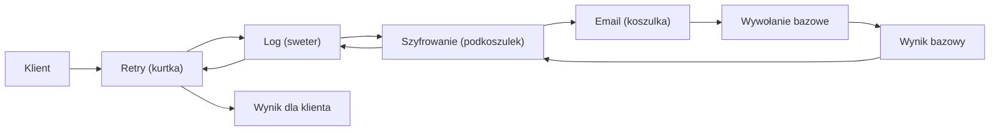
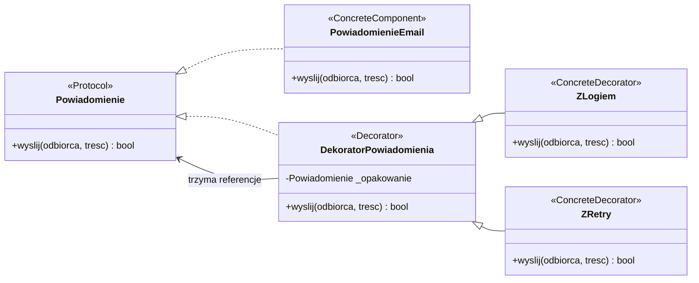
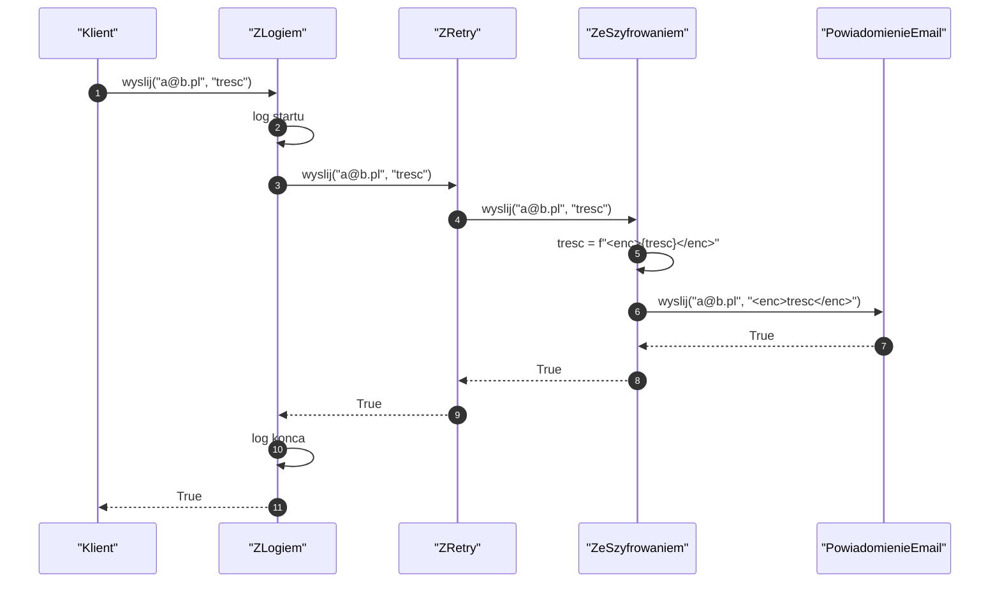
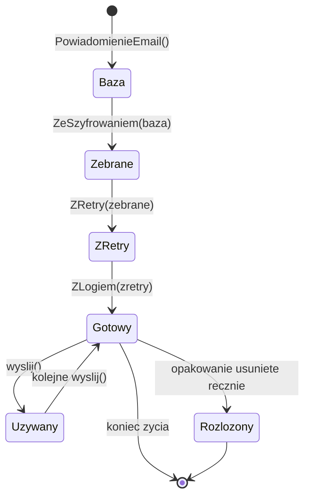
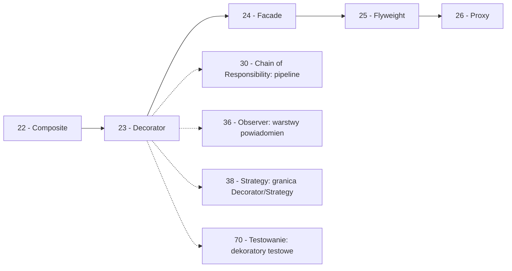

```markdown
---
modul: 23 — Decorator
plik: 23-decorator.md
poziom: podstawowy
wymaga: [22]
czas: ~170 minut czytania + ~390 minut ćwiczeń
---

# Moduł 23 — Decorator — dodawanie zachowań bez dziedziczenia

> **TL;DR**
> - **Decorator (dekorator)** dodaje obiektowi nowe odpowiedzialności **dynamicznie**, opakowując go — alternatywa dla dziedziczenia, która pozwala łączyć zachowania w dowolnej kolejności i liczbie.
> - W Pythonie słowo „dekorator" ma **dwa znaczenia**: (1) wzorzec GoF (opakowanie **obiektu**), (2) składnia `@dekorator` (opakowanie **funkcji**) — oba mają wspólną ideę, ale realnie różne zastosowania.
> - Klasyczny problem: klasa z kombinacjami cech (email/SMS/Slack + log + retry + szyfrowanie) generuje **eksplozję podklas** — 8 kombinacji to 8 klas. Dekorator zastępuje to 4 klasami.
> - Dekoratory **tworzą łańcuch**, w którym każde ogniwo modyfikuje zachowanie przed lub po wywołaniu następnika; **kolejność ma znaczenie** — log→retry ≠ retry→log.
> - Wzorzec ma swoją cenę: długie łańcuchy utrudniają debugowanie, mylące tracebacki, a każdy dekorator musi **uczciwie** propagować wywołania i nie tłumić wyjątków.

---

## 0. Model mentalny

### Ubieranie się na cebulę i zawijanie prezentu

Wyobraź sobie, że jesteś w górach. Rano wychodzisz z domu: koszulka, na nią cienki sweter, na to kurtka. Każda warstwa **nie zmienia** tego, co masz pod spodem — sweter nie zmienia koszulki, kurtka nie zmienia swetra. Ale każda **dodaje coś**: sweter ogrzewa, kurtka chroni od wiatru i deszczu. Efekt końcowy („człowiek w górach") jest sumą wszystkich warstw, ale żadna z nich nie „zastępuje" poprzedniej. Za chwilę wchodzisz do schroniska, zdejmujesz kurtkę — sweter i koszulka zostają. Zdejmujesz sweter — koszulka zostaje.

Kluczowa rzecz w tej analogii: **kolejność zakładania ma znaczenie**. Koszulka → sweter → kurtka jest naturalne. Kurtka → koszulka → sweter byłoby absurdem — koszulka nie zmieściłaby się na kurtkę. Każda warstwa zakłada, że poprzednia już istnieje. Ale możesz też zmieniać zestaw: dziś z kurtką, jutro bez kurtki, pojutrze zamiast swetra polar. Kombinujesz warstwy do woli.

I jeszcze jedna rzecz: **wchodząc do schroniska**, nie „usuwasz gór z pleców". Wchodzisz tam nadal ubrany, tylko że cieplej ubrany. Kiedy wychodzisz ponownie — zakładasz kurtkę. Wracasz do miasta — zdejmujesz wszystkie warstwy. Każda warstwa jest niezależna, ale **komponowalna** z pozostałymi.

Jest jeszcze drugi obraz, który dobrze uzupełnia pierwszy. Wyobraź sobie, że kupujesz prezent dla kogoś bliskiego. Wkładasz kubek do pudełka, pudełko do papieru ozdobnego, papier do torebki, do torebki dorzucasz bilecik. Z punktu widzenia obdarowanego — zawartość jest ta sama (kubek). Ale **droga do zawartości** jest dłuższa i zależy od tego, ile warstw nałożyłeś. Kolejność warstw nie zmienia kubka — zmienia tylko „z czego jest zrobione opakowanie". Dokładnie tak działają dekoratory: dodają warstwy **wokół** obiektu, nie modyfikując samego obiektu.

Trzecia analogia, która wprost pokazuje wzorzec: **chłodzenie napoju**. Masz szklankę wody (obiekt bazowy). Jeśli chcesz „wodę z lodem" — dodajesz lód. Jeśli chcesz „wodę z lodem i cytryną" — dodajesz cytrynę do wody z lodem. Jeśli chcesz „wodę z lodem, cytryną i miętą" — dodajesz miętę. Za każdym razem opakowujesz poprzednią wersję. Podstawą zawsze jest ta sama woda. Każda warstwa modyfikuje **to, co klient otrzymuje**, ale nie zmienia samej wody.

| W analogii warstw ubrania | W kodzie |
|---|---|
| Koszulka (podstawa) | `ConcreteComponent` (np. `PowiadomienieEmail`) |
| Sweter (warstwa) | `Decorator` (np. `PowiadomienieLog`) |
| Kurtka (kolejna warstwa) | Kolejny dekorator (np. `PowiadomienieRetry`) |
| Zdjęcie kurtki | Zastosowanie zestawu bez tego dekoratora |
| Kolejność zakładania | Kolejność dekoratorów w łańcuchu |
| Ta sama koszulka pod spodem | Oryginalny obiekt pod dekoratorami |
| „Witaj w schronisku" | Wywołanie metody `wyslij()` na opakowaniu |
| Kombinowanie warstw | Kompozycja w runtime |

> 🧠 **Zapamiętaj** — **Decorator (dekorator) to wzorzec strukturalny dodający obiektowi nowe odpowiedzialności dynamicznie — przez opakowanie obiektu w inny obiekt o tym samym interfejsie — jako elastyczna alternatywa dla dziedziczenia.**

Zwróć uwagę na trzy słowa w tej definicji: **dynamicznie**, **opakowanie**, **ten sam interfejs**. „Dynamicznie" — bo decyzja o tym, jakie dekoratory nałożyć, zapada w runtime, nie przy kompilacji. „Opakowanie" — bo dekorator trzyma referencję do obiektu, który opakowuje. „Ten sam interfejs" — bo klient nie widzi różnicy — powinien móc pracować identycznie z obiektem bazowym i z opakowanym.

### Diagram — intuicja łańcucha



*Diagram pokazuje, że wywołanie przechodzi przez kolejne warstwy w dół (do bazowego obiektu), a wynik wraca przez te same warstwy w górę — każda warstwa może zmodyfikować zarówno wywołanie, jak i wynik.*

### Czego Decorator NIE robi

Rozbrójmy cztery nieporozumienia — szczególnie istotne w Pythonie, gdzie słowo „dekorator" ma dwa znaczenia.

**Nie jest dziedziczeniem.** Dziedziczenie rozszerza klasę **statycznie**, w momencie definicji. Dekorator rozszerza obiekt **dynamicznie**, w runtime. Dziedziczenie wybiera jedną kombinację cech raz na zawsze; dekorator pozwala dołożyć i zdjąć cechy w dowolnym momencie.

**Nie zmienia interfejsu.** Dekorator ma **ten sam interfejs** co opakowany obiekt. To jego kluczowa właściwość — klient nie widzi różnicy. Jeśli twoje opakowanie ma inny interfejs, to nie jest Decorator (to Adapter, moduł 20).

**Nie jest tym samym co `@dekorator` w Pythonie.** Składnia `@funkcja` to opakowanie **funkcji**, które wykonuje się raz, w momencie definicji. Wzorzec GoF opakowuje **obiekt** w runtime. Wspólna jest idea „opakowania", ale kontekst jest zupełnie inny — szczegółowo w sekcji 4 i 9.

**Nie dodaje funkcjonalności do klasy.** Nie ma „dekoratora klasy" w sensie modyfikacji samej klasy `Email`. Jest tylko **opakowanie instancji**. Jeśli potrzebujesz zmienić zachowanie klasy, to nie Decorator.

**Nie jest darmowy.** Każdy dekorator to dodatkowy obiekt i dodatkowa warstwa wywołań. Dla 5 dekoratorów masz 5 poziomów stosu w tracebacku — debugowanie staje się trudniejsze. Dla operacji wykonywanych miliony razy na sekundę to się liczy.

---

## 1. Problem, który rozwiązujemy

Wejdźmy w domenę 🔔 „Alertów". Nasz system wysyła powiadomienia o naruszeniach limitów. Klient może wybrać kanał (e-mail, SMS, Slack), a szef działu ryzyka „na wszelki wypadek" prosi o dodatkowe cechy: logowanie każdego powiadomienia, ponawianie przy błędzie, szyfrowanie wrażliwych treści. Kombinacji robi się dużo.

### Kod „przed"

```python
# alerty_v0.py — wersja naiwna, demonstracyjna
# UWAGA: kod celowo pokazuje eksplozje podklas przez kombinacje cech.

from __future__ import annotations
import time
from dataclasses import dataclass


class PowiadomienieBazowe:
    """Bazowa klasa powiadomienia o naruszeniu limitu."""

    def wyslij(self, odbiorca: str, tresc: str) -> bool:
        raise NotImplementedError


# --- 3 kanaly bazowe ---

class PowiadomienieEmail(PowiadomienieBazowe):
    def wyslij(self, odbiorca: str, tresc: str) -> bool:
        print(f"[EMAIL] do {odbiorca}: {tresc}")
        return True


class PowiadomienieSMS(PowiadomienieBazowe):
    def wyslij(self, odbiorca: str, tresc: str) -> bool:
        if len(tresc) > 160:
            tresc = tresc[:157] + "..."
        print(f"[SMS] do {odbiorca}: {tresc}")
        return True


class PowiadomienieSlack(PowiadomienieBazowe):
    def wyslij(self, odbiorca: str, tresc: str) -> bool:
        print(f"[SLACK] {odbiorca}# {tresc}")
        return True


# --- Kombinacje przez dziedziczenie ---

class PowiadomienieEmailZLogiem(PowiadomienieEmail):
    def wyslij(self, odbiorca: str, tresc: str) -> bool:
        print(f"[LOG] wysylam email do {odbiorca}")
        wynik = super().wyslij(odbiorca, tresc)
        print(f"[LOG] wynik: {wynik}")
        return wynik


class PowiadomienieEmailZRetry(PowiadomienieEmail):
    def wyslij(self, odbiorca: str, tresc: str, proby: int = 3) -> bool:
        for i in range(proby):
            try:
                return super().wyslij(odbiorca, tresc)
            except Exception:
                time.sleep(0.1)
        return False


class PowiadomienieEmailZeSzyfrowaniem(PowiadomienieEmail):
    def wyslij(self, odbiorca: str, tresc: str) -> bool:
        tresc_szyfrowana = f"<encrypted>{tresc}</encrypted>"
        return super().wyslij(odbiorca, tresc_szyfrowana)


# ... a teraz kombinacja! Email + log + retry + szyfrowanie
# 8 kombinacji (2^3) x 3 kanaly = 24 podklasy
class PowiadomienieEmailZLogiemRetrySzyfrowaniem(PowiadomienieEmail):
    def wyslij(self, odbiorca: str, tresc: str) -> bool:
        print(f"[LOG] wysylam email do {odbiorca}")
        tresc_szyfrowana = f"<encrypted>{tresc}</encrypted>"
        for i in range(3):
            try:
                wynik = super().wyslij(odbiorca, tresc_szyfrowana)
                print(f"[LOG] wynik: {wynik}")
                return wynik
            except Exception:
                time.sleep(0.1)
        return False


if __name__ == "__main__":
    p = PowiadomienieEmailZLogiemRetrySzyfrowaniem()
    p.wyslij("risk@example.com", "Przekroczony limit koncentracji")
```

Ten kod działa. Ale widać w nim pęknięcia — i to **natychmiast**.

### Code smell — eksplozja podklas przez kombinacje cech

| Problem | Gdzie | Konsekwencja |
|---|---|---|
| 3 kanały × 2^3 kombinacji cech = 24 podklasy | Nazwy klas | Każda nowa cecha podwaja liczbę klas |
| Nazwy klas są kilometrowe | `PowiadomienieEmailZLogiemRetrySzyfrowaniem` | Nieczytelne i łamie linie |
| Kombinacje muszą być znane z góry | W momencie pisania klasy | Nie można dodać cechy w runtime |
| Duplikacja logiki log i retry w każdej kombinacji | W kilku klasach | Shotgun surgery (moduł 03) |
| Kolejność cech zaszyta w hierarchii | `super().wyslij()` | Nie można przestawić log → retry na retry → log |
| Szybko wymykające się spod kontroli | Nazwy klas | Dodanie cechy „audyt" = kolejny podwójny wzrost |
| Klient musi znać konkretną klasę | `PowiadomienieEmailZLogiemRetrySzyfrowaniem()` | Nie da się wybrać dynamicznie |

Zwróć uwagę na trzecią kolumnę: **każda nowa cecha mnoży liczbę klas przez dwa**. Ta eksplozja kombinatoryczna to klasyczny sygnał do wzorca Decorator. Dodatkowo — co gorsze — **cechy są nierozdzielne**: jeśli ktoś chce sam log bez retry, albo retry bez szyfrowania, potrzebuje kolejnej klasy. A zależy to od **konfiguracji u klienta**, nie od stałej prawdy o klasie.

### Objawy — poznasz ten problem po tym, że...

- **Nazwy klas mają ≥ 4 słowa połączone.** `PowiadomienieEmailZLogiemRetrySzyfrowaniem` — to znak, że kombinujesz cechy w nazwie klasy.
- **Dodanie nowej cechy wymaga utworzenia N klas.** Jeśli masz 3 kanały i chcesz dodać „audyt", musisz napisać 3 nowe klasy (albo więcej, jeśli są już kombinacje).
- **Kolejność cech jest zaszyta w hierarchii dziedziczenia.** Nie można zrobić „retry, a potem log" bez nowej klasy.
- **Nie da się wybrać zestawu cech w runtime.** Klasa decyduje o zestawie raz na zawsze, przy definicji.
- **Duplikujesz logikę (np. log, retry) w każdej kombinacji.** Jeśli logika log jest identyczna w trzech kombinacjach, powinna być w jednym miejscu.
- **Klient zna klasę konkretną.** Nie może powiedzieć „zrób email z logiem i retry" — musi znać nazwę klasy.
- **Testy rosną jak drzewo.** Dla każdej kombinacji musisz napisać osobny test.
- **W kodzie masz `if cecha == "log": ... elif cecha == "retry": ...`** — próba obejścia dziedziczenia bez zmiany struktury. To wprost sygnał, że potrzebujesz dekoratora.

---

## 2. Anatomia wzorca

### Uczestnicy (wzorzec GoF)

| Rola | Odpowiedzialność | Co NIE jest jej zadaniem |
|---|---|---|
| **Component (komponent)** | Definiuje wspólny interfejs; mówi, jakie operacje można wywołać na dowolnym elemencie | Nie zawiera logiki konkretnych dekoratorów |
| **ConcreteComponent (komponent konkretny)** | Bazowy obiekt, który zostanie opakowany; implementuje podstawowe zachowanie | Nie wie o dekoratorach |
| **Decorator (dekorator)** | Bazowa klasa dla dekoratorów; trzyma referencję do `Component` i deleguje do niego wywołania | Nie dodaje konkretnej funkcjonalności — to robią podklasy |
| **ConcreteDecorator (dekorator konkretny)** | Konkretny dekorator: loguje, ponawia, szyfruje, mierzy czas... | Nie tworzy sam obiektu bazowego; nie modyfikuje klasy bazowej |
| **Klient (client)** | Buduje łańcuch dekoratorów; wywołuje operacje na najwyższej warstwie | Nie rozróżnia obiektu bazowego od opakowanego |

Kluczowa asymetria: **dekorator zna obiekt opakowany**, ale **obiekt opakowany nie zna dekoratora**. To jednostronna zależność pozwala na dowolne łączenie i wymianę warstw bez modyfikacji samego obiektu.

### Diagram struktury



*Diagram pokazuje, że dekorator dziedziczy po tym samym interfejsie co obiekt bazowy (dzięki czemu klient nie widzi różnicy), ale jednocześnie trzyma referencję do `Powiadomienie` — to pozwala mu przekazać wywołanie do opakowanego obiektu, który sam może być dekoratorem.*

Przeczytajmy ten diagram zdanie po zdaniu. `Powiadomienie` to kontrakt — metoda `wyslij`. `PowiadomienieEmail` to konkretny komponent bazowy. `DekoratorPowiadomienia` **dziedziczy** po `Powiadomienie` (linia z pustym trójkątem) — dzięki temu ma ten sam interfejs i może być używany zamiennie. Ale **jednocześnie** trzyma referencję do `Powiadomienie` (strzałka) — to jest „opakowanie".

Dekoratory konkretne (`ZLogiem`, `ZRetry`) dziedziczą po `DekoratorPowiadomienia` i nadpisują `wyslij`, dodając swoje zachowanie **przed** i **po** wywołaniu bazowym. Zwróć uwagę, że **nie dziedziczą po `PowiadomienieEmail`** — nie są „emailami z dodatkiem". Są ogólnymi dekoratorami, które mogą opakować **dowolne** `Powiadomienie` — email, SMS, Slack.

To kluczowa własność: `ZRetry(PowiadomienieEmail())` i `ZRetry(PowiadomienieSMS())` mogą być tworzone z tej samej klasy dekoratora. Dekorator nie wie, co opakowuje. Wie tylko, że ma `wyslij`.

### Warianty: klasyczny vs pythoniczny

| Aspekt | Wariant klasyczny (GoF) | Wariant pythoniczny |
|---|---|---|
| Component | Klasa ABC | `typing.Protocol` |
| ConcreteComponent | Klasy dziedziczące | Klasy spełniające protokół |
| Decorator bazowy | Klasa z referencją do Component | Często **pomijana** — nie ma potrzeby |
| ConcreteDecorator | Klasa dziedzicząca | Klasa z referencją + `__getattr__` dla delegacji |
| Kolejność dekoratorów | Ręczna (konstruktory) | `functools.reduce` nad listą klas dekoratorów |
| Delegacja | Ręczne wywołanie `self._opakowanie.wyslij(...)` | `__getattr__` dla nieobsługiwanych metod |
| Dynamiczne dodawanie | Konstruktory zagnieżdżone | Lista dekoratorów + `reduce` |

W Pythonie często pomijamy **bazową klasę `Decorator`** — każdy dekorator sam dziedziczy po kontrakcie i trzyma referencję. To mniej klas i mniej pośrednictwa.

---

## 3. Implementacja krok po kroku

Przebudujemy przykład z sekcji 1, dodając warstwy dekoratorów.

### Krok 1 — Zdefiniuj kontrakt

Kontrakt `Powiadomienie` definiuje jedną metodę.

```python
from decimal import Decimal
from typing import Protocol, runtime_checkable

@runtime_checkable
class Powiadomienie(Protocol):
    """Kontrakt powiadomienia o naruszeniu limitu."""

    def wyslij(self, odbiorca: str, tresc: str) -> bool:
        """Wysyla powiadomienie. Zwraca True, jesli sukces."""
        ...
```

### Krok 2 — Zdefiniuj konkretne komponenty (bazowe)

Bez zmian względem wersji naiwnej — tylko bez dziedziczenia po klasie bazowej, bo mamy `Protocol`.

```python
class PowiadomienieEmail:
    """Konkretny komponent bazowy: wysyla przez email."""

    def wyslij(self, odbiorca: str, tresc: str) -> bool:
        print(f"[EMAIL] do {odbiorca}: {tresc}")
        return True


class PowiadomienieSMS:
    def wyslij(self, odbiorca: str, tresc: str) -> bool:
        if len(tresc) > 160:
            tresc = tresc[:157] + "..."
        print(f"[SMS] do {odbiorca}: {tresc}")
        return True


class PowiadomienieSlack:
    def wyslij(self, odbiorca: str, tresc: str) -> bool:
        print(f"[SLACK] {odbiorca}# {tresc}")
        return True
```

### Krok 3 — Zdefiniuj bazowy dekorator

Klasa bazowa dla dekoratorów — trzyma referencję i deleguje.

```python
class DekoratorPowiadomienia:
    """Bazowy dekorator: trzyma referencje do opakowanego powiadomienia."""

    def __init__(self, opakowanie: Powiadomienie) -> None:
        if not isinstance(opakowanie, Powiadomienie):
            raise TypeError(
                f"{type(opakowanie).__name__} nie spelnia kontraktu Powiadomienie"
            )
        self._opakowanie = opakowanie

    def wyslij(self, odbiorca: str, tresc: str) -> bool:
        # Domyslna implementacja: czysta delegacja
        return self._opakowanie.wyslij(odbiorca, tresc)
```

### Krok 4 — Zdefiniuj konkretne dekoratory

Teraz kluczowa część — każdy dekorator dodaje swoje zachowanie **przed** albo **po** wywołaniu opakowania.

```python
class ZLogiem(DekoratorPowiadomienia):
    """Dekorator: loguje wyslanie przed i po."""

    def wyslij(self, odbiorca: str, tresc: str) -> bool:
        print(f"[LOG] wysylam powiadomienie do {odbiorca}: {tresc!r}")
        wynik = self._opakowanie.wyslij(odbiorca, tresc)
        print(f"[LOG] wynik wysylki: {wynik}")
        return wynik


class ZRetry(DekoratorPowiadomienia):
    """Dekorator: ponawia wysylke przy wyjatku."""

    def __init__(self, opakowanie: Powiadomienie, proby: int = 3) -> None:
        super().__init__(opakowanie)
        self._proby = proby

    def wyslij(self, odbiorca: str, tresc: str) -> bool:
        for numer in range(1, self._proby + 1):
            try:
                return self._opakowanie.wyslij(odbiorca, tresc)
            except Exception as blad:
                print(f"[RETRY] proba {numer}: {blad}")
                if numer == self._proby:
                    raise
        return False


class ZeSzyfrowaniem(DekoratorPowiadomienia):
    """Dekorator: szyfruje tresc przed wyslaniem."""

    def wyslij(self, odbiorca: str, tresc: str) -> bool:
        tresc_szyfrowana = f"<encrypted>{tresc}</encrypted>"
        return self._opakowanie.wyslij(odbiorca, tresc_szyfrowana)
```

Zwróć uwagę na trzy rzeczy. Po pierwsze, każdy dekorator ma **ten sam interfejs** — `wyslij(odbiorca, tresc) -> bool`. Po drugie, każdy **opakowuje** dowolne `Powiadomienie` — nie wie, co jest pod spodem. Po trzecie, każdy może **zmodyfikować argumenty** (jak `ZeSzyfrowaniem`), **zmodyfikować wynik** (jak `ZLogiem`) albo **przechwycić wyjątki** (jak `ZRetry`).

### Krok 5 — Złóż łańcuch

Klient buduje łańcuch, nakładając dekoratory od wewnątrz na zewnątrz.

```python
# Bazowy email
powiadomienie = PowiadomienieEmail()

# Opakowujemy kolejnymi dekoratorami
powiadomienie = ZeSzyfrowaniem(powiadomienie)
powiadomienie = ZRetry(powiadomienie, proby=3)
powiadomienie = ZLogiem(powiadomienie)

powiadomienie.wyslij("risk@example.com", "Przekroczony limit koncentracji")
```

Wynik pokaże, że wywołanie przeszło przez `ZLogiem`, potem `ZRetry`, potem `ZeSzyfrowaniem`, dopiero potem dotarło do `PowiadomienieEmail`. Szyfrowanie zmodyfikowało treść, log zalogował.

### Krok 6 — Dynamiczne składanie w runtime

Klient może dostać listę dekoratorów i zbudować łańcuch dynamicznie.

```python
from functools import reduce

def zbuduj_powiadomienie(
    baza: Powiadomienie,
    cechy: list[str],
) -> Powiadomienie:
    """Buduje powiadomienie z wybranymi cechami (kolejnosc ma znaczenie)."""
    dekoratory = {
        "log": ZLogiem,
        "retry": lambda w: ZRetry(w, proby=3),
        "szyfrowanie": ZeSzyfrowaniem,
    }
    def naloz(acc: Powiadomienie, nazwa: str) -> Powiadomienie:
        if nazwa not in dekoratory:
            raise ValueError(f"nieznana cecha: {nazwa}")
        return dekoratory[nazwa](acc)
    return reduce(naloz, cechy, baza)
```

Użycie: `zbuduj_powiadomienie(PowiadomienieEmail(), ["szyfrowanie", "retry", "log"])`. Zwróć uwagę, że **kolejność na liście ma znaczenie** — pierwsza cecha w listie staje się **wewnętrzną** warstwą (obok bazy), ostatnia staje się **zewnętrzną**.

### Krok 7 — Weryfikacja

| Kryterium | Wersja „przed" | Wersja „po" (dekoratory) |
|---|---|---|
| Liczba klas dla 3 kanałów × 4 cech | 3 × 2^3 = 24 | 3 + 1 + 3 = 7 |
| Nowa cecha (audyt) | Podwaja liczbę klas | Jedna klasa |
| Kombinacje w runtime | Nie da się | Tak (lista cech) |
| Kolejność cech | Zaszyta w hierarchii | Konfigurowalna |
| Duplikacja log/retry | W każdej kombinacji | W jednej klasie |
| Klient zna klasę konkretną | Tak | Nie — wystarczy lista cech |
| Czytelność | Niska | Wysoka |

Zysk jest znaczący — **7 klas obsługuje 24 kombinacje**, a nowa cecha to jedna klasa zamiast ośmiu.

---

## 4. Wersje pythoniczne i warianty

### 4.1 Część A — wzorzec GoF w Pythonie (wariant podstawowy)

Wariant z sekcji 3. Bez `__getattr__` — każdy dekorator implementuje **wszystkie** metody kontraktu. To jest jasne, ale jeśli kontrakt ma 5 metod, każdy dekorator musi napisać 5 metod delegujących (nawet jeśli nie zmienia zachowania). To boilerplate.

### 4.2 Delegacja przez `__getattr__`

Jeśli dekorator ma zmienić tylko jedną metodę, a resztę przekazać dalej — `__getattr__` oszczędza pisanie.

```python
class DekoratorZDelegacja:
    """Bazowy dekorator: deleguje nieznane atrybuty do opakowanego obiektu."""

    def __init__(self, opakowanie) -> None:
        self._opakowanie = opakowanie

    def __getattr__(self, nazwa: str):
        return getattr(self._opakowanie, nazwa)
```

Ale uwaga: **`__getattr__` nie łapie metod specjalnych** (`__len__`, `__iter__`, `__getitem__`, `__add__`, `__eq__`). Dlatego jeśli kontrakt używa ich, trzeba dodać jawnie:

```python
    def __len__(self) -> int:
        return len(self._opakowanie)
```

### 4.3 Dekoratory jako funkcje wyższego rzędu

Jeśli kontrakt ma jedną metodę, dekorator w wersji funkcyjnej może być bardziej naturalny.

```python
from collections.abc import Callable

PowiadomienieFn = Callable[[str, str], bool]


def z_logiem(powiadomienie: PowiadomienieFn) -> PowiadomienieFn:
    def opakowanie(odbiorca: str, tresc: str) -> bool:
        print(f"[LOG] wysylam do {odbiorca}")
        wynik = powiadomienie(odbiorca, tresc)
        print(f"[LOG] wynik: {wynik}")
        return wynik
    return opakowanie


def z_retry(powiadomienie: PowiadomienieFn, proby: int = 3) -> PowiadomienieFn:
    def opakowanie(odbiorca: str, tresc: str) -> bool:
        for i in range(proby):
            try:
                return powiadomienie(odbiorca, tresc)
            except Exception:
                if i == proby - 1:
                    raise
        return False
    return opakowanie
```

Składanie: `z_logiem(z_retry(email_fn))`. Działa identycznie — jest prostsze, ale nie ma klas. **Ale** tracisz atrybuty (nie ma `isinstance`), nie ma możliwości dodania własnych metod, i nie działa dla kontraktów wielometodowych.

### 4.4 Część B — składnia `@dekorator` w Pythonie

To zupełnie inne narzędzie. Opakowuje **funkcję**, nie obiekt, i **przy definicji**, nie w runtime.

```python
import functools

def loguj_wywolanie(funkcja):
    @functools.wraps(funkcja)
    def opakowanie(*args, **kwargs):
        print(f"[TRACE] wywolanie {funkcja.__name__}")
        wynik = funkcja(*args, **kwargs)
        print(f"[TRACE] wynik: {wynik}")
        return wynik
    return opakowanie


@loguj_wywolanie
def policz_prowizje(kwota: float) -> float:
    return kwota * 0.004
```

Kluczowa różnica wobec wzorca GoF: **dekorator jest nakładany raz, na stałe, przy imporcie modułu**. `policz_prowizje` **staje się** funkcją `opakowanie` (zachowującą nazwę i docstring przez `functools.wraps`). Nie można go „zdjąć" w runtime. Nie można go opakować w inną kolejność dynamicznie.

**Wbudowane dekoratory w Pythonie:**
- `@staticmethod`, `@classmethod`, `@property` — modyfikatory metod w klasie,
- `@functools.lru_cache`, `@functools.cache` — zapamiętywanie wyników,
- `@functools.wraps` — zachowanie metadanych,
- `@functools.singledispatch` — dispatch po typie,
- `@dataclass` — generator klas danych.

**Kiedy składnia realizuje wzorzec, a kiedy tylko modyfikuje funkcję?**
- Realizuje wzorzec, gdy opakowuje **obiekt, który sam ma zachowanie**. Np. `@cached` nad `@lru_cache`-owaną funkcją — funkcja ma swoje zachowanie, dekorator je opakowuje w cache.
- Nie realizuje wzorca, gdy modyfikuje funkcję **w sposób, który nie da się zestawić w runtime**. Np. `@staticmethod` — to nie jest „warstwa" do dodania/usunięcia, to metadana klasy.

### 4.5 Klasa jako dekorator

Dekorator może być klasą (z metodą `__call__` jako opakowaniem). Zaleta: można zachować stan.

```python
class LiczWywolania:
    def __init__(self, funkcja):
        functools.update_wrapper(self, funkcja)
        self._funkcja = funkcja
        self.licznik = 0

    def __call__(self, *args, **kwargs):
        self.licznik += 1
        return self._funkcja(*args, **kwargs)

@LiczWywolania
def przetworz_zlecenie(id_zlecenia: str) -> None:
    ...

# Uzycie
przetworz_zlecenie("ZL-1")
przetworz_zlecenie("ZL-2")
print(przetworz_zlecenie.licznik)   # 2
```

Ważna pułapka (patrz sekcja 8): **licznik jest współdzielony między wywołaniami**. `LiczWywolania` tworzone jest raz, przy definicji. Kolejne wywołania operują na tym samym obiekcie.

### 4.6 Dekorator z argumentami

Gdy dekorator potrzebuje parametrów konfiguracyjnych:

```python
def ponawiaj(proby: int = 3, opoznienie: float = 0.1):
    """Dekorator z argumentami: funkcja zwracajaca dekorator."""
    def dekorator(funkcja):
        @functools.wraps(funkcja)
        def opakowanie(*args, **kwargs):
            for i in range(proby):
                try:
                    return funkcja(*args, **kwargs)
                except Exception:
                    if i == proby - 1:
                        raise
                    time.sleep(opoznienie)
        return opakowanie
    return dekorator


@ponawiaj(proby=5, opoznienie=0.5)
def pobierz_kurs(waluta: str) -> float:
    ...
```

Zwróć uwagę na **trzy poziomy zagnieżdżenia**: `ponawiaj` przyjmuje argumenty i zwraca `dekorator`; `dekorator` przyjmuje funkcję i zwraca `opakowanie`; `opakowanie` przyjmuje argumenty wywołania i zwraca wynik.

### 4.7 Dekorator klasowy (na klasie)

Dekorator może opakować **klasę**, nie funkcję.

```python
def ze_strategia(nazwa: str):
    def dekorator(klasa):
        klasa._strategia = nazwa
        return klasa
    return dekorator


@ze_strategia("konserwatywna")
class Portfel:
    pass
```

To rzadkie, ale warto znać. Używa się go do rejestracji klas (moduł 11), do dodawania metadanych albo do modyfikacji atrybutów klasy.

### 4.8 Podsumowanie — tabela wyboru

| Sytuacja | Wariant |
|---|---|
| Kontrakt jednometodowy, wiele cech dynamicznych | Funkcja wyższego rzędu (4.3) |
| Kontrakt wielometodowy | Klasa z pełną delegacją (4.1) |
| Kontrakt wielometodowy, tylko jedna zmieniana | Klasa z `__getattr__` (4.2) |
| Dekorator funkcji przy definicji | `@dekorator` (4.4) |
| Dekorator funkcji ze stanem | Klasa z `__call__` (4.5) |
| Dekorator z konfiguracją | Trzy poziomy zagnieżdżenia (4.6) |
| Modyfikacja klasy, nie obiektu | Dekorator klasowy (4.7) |

> 🧠 **Zapamiętaj** — **`@dekorator` (składnia) i Decorator (wzorzec) nie są tym samym**. Składnia opakowuje funkcję **raz, na stałe, przy definicji**. Wzorzec opakowuje obiekt **wielokrotnie, dynamicznie, w runtime**. Mają wspólną ideę, ale zupełnie inne zastosowania. Kiedy czytasz kod w Pythonie, musisz rozpoznać, o którym mówią autorzy.

---

## 5. Przykład z życia: 🔔 Alerty — pełny uruchamialny kod

Zbudujemy pełny system powiadomień o naruszeniach limitów z trzema kanałami, trzema dekoratorami i dynamicznym składaniem łańcucha.

### Kod

```python
# alerty_decorator.py — pelny przyklad Decorator
from __future__ import annotations

import time
from collections.abc import Callable
from dataclasses import dataclass
from datetime import datetime, timezone
from functools import reduce
from typing import Protocol, runtime_checkable


# ===========================================================================
# 1. Kontrakt
# ===========================================================================

@runtime_checkable
class Powiadomienie(Protocol):
    """Kontrakt powiadomienia o naruszeniu limitu."""

    nazwa: str

    def wyslij(self, odbiorca: str, tresc: str) -> bool:
        """Wysyla powiadomienie. Zwraca True przy sukcesie."""
        ...


# ===========================================================================
# 2. Konkretne komponenty bazowe
# ===========================================================================

class PowiadomienieEmail:
    nazwa = "email"

    def wyslij(self, odbiorca: str, tresc: str) -> bool:
        print(f"[EMAIL -> {odbiorca}] {tresc}")
        return True


class PowiadomienieSMS:
    nazwa = "sms"

    def wyslij(self, odbiorca: str, tresc: str) -> bool:
        if len(tresc) > 160:
            tresc = tresc[:157] + "..."
        print(f"[SMS -> {odbiorca}] {tresc}")
        return True


class PowiadomienieSlack:
    nazwa = "slack"

    def wyslij(self, odbiorca: str, tresc: str) -> bool:
        print(f"[SLACK -> {odbiorca}#] {tresc}")
        return True


class PowiadomienieZawodne:
    """Symulacja zawodnego kanalu - do testowania Retry."""

    nazwa = "zawodne"

    def __init__(self, ile_razy_zawodzi: int = 2) -> None:
        self._ile_razy_zawodzi = ile_razy_zawodzi
        self._proby = 0

    def wyslij(self, odbiorca: str, tresc: str) -> bool:
        self._proby += 1
        if self._proby <= self._ile_razy_zawodzi:
            raise RuntimeError(f"kanal zawodny (proba {self._proby})")
        print(f"[ZAWODNE -> {odbiorca}] {tresc} (sukces po {self._proby} probach)")
        return True


# ===========================================================================
# 3. Bazowy dekorator
# ===========================================================================

class DekoratorPowiadomienia:
    """Bazowy dekorator: trzyma referencje i deleguje."""

    nazwa: str = "dekorator"

    def __init__(self, opakowanie: Powiadomienie) -> None:
        if not isinstance(opakowanie, Powiadomienie):
            raise TypeError(
                f"{type(opakowanie).__name__} nie spelnia kontraktu Powiadomienie"
            )
        self._opakowanie = opakowanie

    def wyslij(self, odbiorca: str, tresc: str) -> bool:
        return self._opakowanie.wyslij(odbiorca, tresc)

    def __repr__(self) -> str:
        return f"{type(self).__name__}({self._opakowanie!r})"


# ===========================================================================
# 4. Konkretne dekoratory
# ===========================================================================

class ZLogiem(DekoratorPowiadomienia):
    """Loguje wyslanie przed i po delegacji."""

    def wyslij(self, odbiorca: str, tresc: str) -> bool:
        czas = datetime.now(timezone.utc).strftime("%H:%M:%S")
        print(f"[LOG {czas}] start -> {odbiorca}: {tresc!r}")
        wynik = self._opakowanie.wyslij(odbiorca, tresc)
        print(f"[LOG {czas}] koniec, wynik={wynik}")
        return wynik


class ZRetry(DekoratorPowiadomienia):
    """Ponawia wysylke po wyjatku."""

    def __init__(self, opakowanie: Powiadomienie, proby: int = 3,
                 opoznienie: float = 0.0) -> None:
        super().__init__(opakowanie)
        if proby < 1:
            raise ValueError("proby musza byc >= 1")
        self._proby = proby
        self._opoznienie = opoznienie

    def wyslij(self, odbiorca: str, tresc: str) -> bool:
        ostatni_blad: Exception | None = None
        for numer in range(1, self._proby + 1):
            try:
                return self._opakowanie.wyslij(odbiorca, tresc)
            except Exception as blad:
                ostatni_blad = blad
                print(f"[RETRY] proba {numer}/{self._proby}: {blad}")
                if numer < self._proby and self._opoznienie > 0:
                    time.sleep(self._opoznienie)
        assert ostatni_blad is not None
        raise ostatni_blad


class ZeSzyfrowaniem(DekoratorPowiadomienia):
    """Szyfruje tresc przed wyslaniem."""

    def wyslij(self, odbiorca: str, tresc: str) -> bool:
        tresc_zaszyfrowana = f"<enc>{tresc}</enc>"
        return self._opakowanie.wyslij(odbiorca, tresc_zaszyfrowana)


class ZAudytem(DekoratorPowiadomienia):
    """Dopisuje wpis audytowy do kolumny (atrapa logu audytowego)."""

    wpisy: list[tuple[str, str, bool]] = []

    def wyslij(self, odbiorca: str, tresc: str) -> bool:
        wynik = self._opakowanie.wyslij(odbiorca, tresc)
        ZAudytem.wpisy.append((odbiorca, tresc, wynik))
        return wynik


# ===========================================================================
# 5. Dynamiczne skladanie
# ===========================================================================

FABRYKI_DEKORATOROW: dict[str, Callable[[Powiadomienie], Powiadomienie]] = {
    "log": ZLogiem,
    "retry": lambda w: ZRetry(w, proby=3),
    "szyfrowanie": ZeSzyfrowaniem,
    "audyt": ZAudytem,
}


def zbuduj_powiadomienie(
    baza: Powiadomienie,
    cechy: list[str],
) -> Powiadomienie:
    """Buduje lancuch dekoratorow z listy nazw cech.

    Kolejnosc w liscie: pierwsza cecha jest warstwa wewnetrzna (najblizej bazy).
    """
    def naloz(acc: Powiadomienie, nazwa: str) -> Powiadomienie:
        if nazwa not in FABRYKI_DEKORATOROW:
            dostepne = ", ".join(sorted(FABRYKI_DEKORATOROW))
            raise ValueError(
                f"nieznana cecha {nazwa!r}; dostepne: {dostepne}"
            )
        return FABRYKI_DEKORATOROW[nazwa](acc)
    return reduce(naloz, cechy, baza)


# ===========================================================================
# 6. Demonstracja
# ===========================================================================

if __name__ == "__main__":
    tresc = "Przekroczony limit koncentracji: 34%"

    print("=== 1. Pojedynczy kanal, bez dekoratorow ===")
    PowiadomienieEmail().wyslij("risk@example.com", tresc)

    print("\n=== 2. Email z logiem ===")
    z_logiem = ZLogiem(PowiadomienieEmail())
    z_logiem.wyslij("risk@example.com", tresc)

    print("\n=== 3. Email + szyfrowanie + retry + log ===")
    pelny = ZLogiem(ZRetry(ZeSzyfrowaniem(PowiadomienieEmail()), proby=3))
    pelny.wyslij("risk@example.com", tresc)

    print("\n=== 4. Kolejnosc ma znaczenie: log + retry vs retry + log ===")
    print("\n--- log(retry(email)) ---")
    ZLogiem(ZRetry(PowiadomienieZawodne(ile_razy_zawodzi=2))).wyslij(
        "risk@example.com", tresc
    )
    print("\n--- retry(log(email)) ---")
    ZRetry(ZLogiem(PowiadomienieZawodne(ile_razy_zawodzi=2))).wyslij(
        "risk@example.com", tresc
    )

    print("\n=== 5. Dynamiczne skladanie z listy cech ===")
    for cechy in (
        ["log"],
        ["szyfrowanie", "log"],
        ["szyfrowanie", "retry", "log", "audyt"],
    ):
        print(f"\n--- Cechy: {cechy} ---")
        powiadomienie = zbuduj_powiadomienie(PowiadomienieEmail(), cechy)
        powiadomienie.wyslij("risk@example.com", tresc)

    print("\n=== 6. Kontrakt: isinstance dziala dla bazy i dla lancucha ===")
    lancuch = zbuduj_powiadomienie(
        PowiadomienieEmail(), ["szyfrowanie", "retry", "log"]
    )
    print(f"  PowiadomienieEmail: {isinstance(PowiadomienieEmail(), Powiadomienie)}")
    print(f"  Lancuch: {isinstance(lancuch, Powiadomienie)}")

    print("\n=== 7. Rozne kanaly bazowe z tymi samymi dekoratorami ===")
    for baza in (PowiadomienieEmail(), PowiadomienieSMS(), PowiadomienieSlack()):
        lancuch = zbuduj_powiadomienie(baza, ["log"])
        print(f"  {baza.nazwa}: ", end="")
        lancuch.wyslij("odbiorca", tresc)

    print("\n=== 8. Wpisy audytowe ===")
    ZAudytem.wpisy.clear()
    ZAudytem(PowiadomienieSMS()).wyslij("+48123456789", tresc)
    ZAudytem(PowiadomienieEmail()).wyslij("audyt@example.com", "Zmiana parametrow")
    for odbiorca, tresc_wpisu, wynik in ZAudytem.wpisy:
        print(f"  {odbiorca}: {tresc_wpisu!r} -> {wynik}")
```

### Co ten przykład pokazuje

Uruchomienie demonstruje wszystkie cechy wzorca.

**Punkt 1 — baza bez dekoratorów.** Powiadomienie działa bezpośrednio. Klient wywołuje `wyslij` i dostaje prosty efekt. **Kontrakt spełniony od razu.**

**Punkt 2 — jeden dekorator.** Email + log. Widać dodatkowe linie `[LOG]`. Wywołanie `wyslij` **przeszło przez log**, ale wynik jest taki sam. Klient nie widzi różnicy w interfejsie.

**Punkt 3 — trzy dekoratory.** Email + szyfrowanie + retry + log. Widzimy w efekcie kolejność wywołań od zewnątrz: log startuje, retry próbuje, szyfrowanie modyfikuje treść, email wysyła. **Każda warstwa jest widoczna** — dzięki logowaniu. W prawdziwym kodzie nie zawsze wszystkie warstwy logują, ale tu pokazujemy kolejność.

**Punkt 4 — kolejnosc ma znaczenie.** Pokazujemy dwa łańcuchy z tym samym zestawem dekoratorów, ale w innej kolejności:
- `log(retry(email))` — log jest na zewnątrz, więc **jedno logowanie** widzi cały proces (razem z wszystkimi próbami retry).
- `retry(log(email))` — log jest w środku, więc **każda próba retry logginguje osobno**.

To fundamentalna właściwość dekoratorów — kolejność decyduje o zachowaniu. W praktyce oznacza, że projektant musi świadomie wybierać kolejność.

**Punkt 5 — dynamiczne składanie.** Lista cech decyduje o łańcuchu. Różne kombinacje działają bez definiowania nowych klas. To **cała korzyść wzorca** wobec dziedziczenia.

**Punkt 6 — kontrakt działa dla łańcucha.** `isinstance(lancuch, Powiadomienie)` zwraca `True`. Klient może przekazywać łańcuch wszędzie, gdzie oczekiwany jest `Powiadomienie`. **Klient nie wie o dekoratorach.**

**Punkt 7 — te same dekoratory dla różnych baz.** Jedna klasa `ZLogiem` działa z każdym kanałem. **Dekorator nie wie, co opakowuje.**

**Punkt 8 — stan w dekoratorach.** `ZAudytem` ma klasowy `wpisy`, do którego zapisuje każdą operację. Widzimy dwa wpisy — z SMS-a i emaila. To pokazuje, że dekoratory mogą mieć własny stan (choć trzeba uważać — patrz sekcja 8).

### Testy

```python
# test_alerty_decorator.py — uruchomienie: pytest test_alerty_decorator.py -v
import pytest

from alerty_decorator import (
    DekoratorPowiadomienia,
    Powiadomienie,
    PowiadomienieEmail,
    PowiadomienieSMS,
    PowiadomienieSlack,
    PowiadomienieZawodne,
    ZAudytem,
    ZLogiem,
    ZRetry,
    ZeSzyfrowaniem,
    zbuduj_powiadomienie,
)


# --- Kontrakt komponentow ----------------------------------------------------

@pytest.mark.parametrize("komponent", [
    PowiadomienieEmail(),
    PowiadomienieSMS(),
    PowiadomienieSlack(),
    PowiadomienieZawodne(),
])
def test_komponent_spelnia_kontrakt(komponent: Powiadomienie) -> None:
    assert isinstance(komponent, Powiadomienie)
    assert isinstance(komponent.nazwa, str)
    assert komponent.nazwa


# --- Bazowy dekorator --------------------------------------------------------

def test_dekorator_odrzuca_obiekt_bez_kontraktu() -> None:
    class CosInnego:
        pass

    with pytest.raises(TypeError):
        DekoratorPowiadomienia(CosInnego())  # type: ignore[arg-type]


@pytest.mark.parametrize("dekorator", [
    ZLogiem,
    lambda w: ZRetry(w, proby=2),
    ZeSzyfrowaniem,
    ZAudytem,
])
def test_dekorator_dziala_na_roznuch_bazach(dekorator) -> None:
    """Ten sam dekorator opakowuje rozne bazowe powiadomienia."""
    for baza in (PowiadomienieEmail(), PowiadomienieSMS(), PowiadomienieSlack()):
        lancuch = dekorator(baza)
        assert isinstance(lancuch, Powiadomienie)
        wynik = lancuch.wyslij("odbiorca", "test")
        assert wynik is True


# --- Konkretne dekoratory ----------------------------------------------------

def test_szyfrowanie_modyfikuje_tresc(capsys) -> None:
    ZLogiem(ZeSzyfrowaniem(PowiadomienieEmail())).wyslij("a@b.pl", "tajne")
    wyjscie = capsys.readouterr().out
    assert "<enc>tajne</enc>" in wyjscie


def test_log_loguje_przed_i_po(capsys) -> None:
    ZLogiem(PowiadomienieEmail()).wyslij("a@b.pl", "test")
    wyjscie = capsys.readouterr().out
    assert "[LOG" in wyjscie
    assert wyjscie.count("[LOG") >= 2   # przed i po


def test_retry_ponawia_przy_bledzie() -> None:
    """PowiadomienieZawodne(2) zawodzi 2 razy, potem sukces."""
    lancuch = ZRetry(PowiadomienieZawodne(ile_razy_zawodzi=2), proby=3)
    wynik = lancuch.wyslij("a@b.pl", "test")
    assert wynik is True


def test_retry_wyczerpuje_proby() -> None:
    lancuch = ZRetry(PowiadomienieZawodne(ile_razy_zawodzi=5), proby=2)
    with pytest.raises(RuntimeError):
        lancuch.wyslij("a@b.pl", "test")


def test_retry_odrzuca_niepoprawna_liczbe_prob() -> None:
    with pytest.raises(ValueError):
        ZRetry(PowiadomienieEmail(), proby=0)


def test_audyt_rejestruje_wpisy() -> None:
    ZAudytem.wpisy.clear()
    lancuch = ZAudytem(PowiadomienieEmail())
    lancuch.wyslij("audyt@example.com", "test")
    assert len(ZAudytem.wpisy) == 1
    assert ZAudytem.wpisy[0][0] == "audyt@example.com"


# --- Kolejnosc dekoratorow ---------------------------------------------------

def test_kolejnosc_zmienia_zachowanie(capsys) -> None:
    """log(retry(x)) vs retry(log(x)) - rozne liczby logow."""
    ZAudytem.wpisy.clear()
    zawodne1 = PowiadomienieZawodne(ile_razy_zawodzi=2)
    ZLogiem(ZRetry(zawodne1, proby=3)).wyslij("a", "test")
    liczba_logow_zewnetrzny = capsys.readouterr().out.count("[LOG")

    zawodne2 = PowiadomienieZawodne(ile_razy_zawodzi=2)
    ZRetry(ZLogiem(zawodne2), proby=3).wyslij("a", "test")
    liczba_logow_wewnetrzny = capsys.readouterr().out.count("[LOG")

    # log na zewnatrz - 2 (start, koniec), log w srodku - 2 na probe
    assert liczba_logow_zewnetrzny == 2
    assert liczba_logow_wewnetrzny >= 4


# --- Dynamiczne skladanie ----------------------------------------------------

@pytest.mark.parametrize("cechy", [
    ["log"],
    ["szyfrowanie"],
    ["retry", "log"],
    ["szyfrowanie", "retry", "log", "audyt"],
])
def test_zbuduj_powiadomienie_roznuch_cech(cechy) -> None:
    lancuch = zbuduj_powiadomienie(PowiadomienieEmail(), cechy)
    assert isinstance(lancuch, Powiadomienie)
    assert lancuch.wyslij("a@b.pl", "test")


def test_zbuduj_powiadomienie_odrzuca_nieznana_ceche() -> None:
    with pytest.raises(ValueError, match="nieznana cecha"):
        zbuduj_powiadomienie(PowiadomienieEmail(), ["nieznana"])


def test_zbuduj_powiadomienie_z_pusta_lista_zwraca_baze() -> None:
    baza = PowiadomienieEmail()
    wynik = zbuduj_powiadomienie(baza, [])
    assert wynik is baza


# --- Kontrakt lancucha -------------------------------------------------------

def test_lancuch_jest_powiadomieniem() -> None:
    """Klient nie odroznia lancucha od bazy."""
    lancuch = zbuduj_powiadomienie(
        PowiadomienieEmail(), ["szyfrowanie", "retry", "log"]
    )
    assert isinstance(lancuch, Powiadomienie)


def test_lancuch_dlugi_dziala() -> None:
    """10 warstw nie psuje dzialania."""
    lancuch = PowiadomienieEmail()
    for _ in range(10):
        lancuch = ZLogiem(lancuch)
    assert lancuch.wyslij("a", "test")
```

Test `test_kolejnosc_zmienia_zachowanie` jest kluczowy dla zrozumienia wzorca: pokazuje, że te same dekoratory w innej kolejności dają różne efekty. To najważniejsza własność dekoratorów i najczęstsze źródło nieporozumień.

---

## 6. Dynamika

### 6.1 Łańcuch trzech dekoratorów — wywołanie



*Diagram pokazuje, że wywołanie przechodzi przez kolejne warstwy od zewnątrz do środka (log → retry → szyfrowanie → email), a wynik wraca dokładnie tą samą drogą w odwrotnej kolejności.*

Omówienie kroków.

**Krok 1.** Klient woła `wyslij`. Adresatem jest **najbardziej zewnętrzny dekorator** (`ZLogiem`). Klient nie wie, że pod spodem są inne warstwy.

**Kroki 2–3.** `ZLogiem` loguje start i **deleguje** wywołanie do wewnętrznego obiektu (`ZRetry`). Jest to wywołanie tej samej metody `wyslij` — z tymi samymi argumentami. **Żadna warstwa nie modyfikuje argumentów, jeśli nie ma takiego zamiaru.**

**Krok 4.** `ZRetry` przyjmuje wywołanie. W tym przebiegu **nie ma błędów**, więc idzie dalej po pierwszej próbie. Gdyby było trzeba, ponowiłby.

**Kroki 5–6.** `ZeSzyfrowaniem` **modyfikuje argument** `tresc` — zamienia na `<enc>tresc</enc>`. To jedyna warstwa, która zmienia treść.

**Krok 7.** Bazowe `PowiadomienieEmail` dostaje już **zmodyfikowaną treść**. Szyfrowanie „zaszło" — ale tylko dlatego, że warstwa była **poniżej** loga. Gdyby kolejność była odwrotna, log widziałby zaszyfrowaną treść.

**Kroki 8–11.** Wynik wraca przez warstwy. `ZRetry` propaguje `True`, `ZeSzyfrowaniem` propaguje `True`, `ZLogiem` **loguje koniec** i zwraca `True`.

**Krok 12.** Klient dostaje wynik. Z jego perspektywy jest to po prostu `True`.

### 6.2 Kolejność warstw — graf wpływu

```mermaid
flowchart TB
    subgraph A["Kolejnosc: log(retry(szyfrowanie(email)))"]
        A1["log start"]
        A2["retry"]
        A3["szyfrowanie"]
        A4["email z szyfrowana trescia"]
        A5["log konca"]
        A1 --> A2 --> A3 --> A4 --> A5
    end
    subgraph B["Kolejnosc: szyfrowanie(retry(log(email)))"]
        B1["szyfrowanie na tresci"]
        B2["retry"]
        B3["log start"]
        B4["email z szyfrowana trescia"]
        B5["log konca"]
        B1 --> B2 --> B3 --> B4 --> B5
    end
    subgraph C["Kolejnosc: retry(log(szyfrowanie(email)))"]
        C1["retry"]
        C2["log start"]
        C3["szyfrowanie"]
        C4["email z szyfrowana trescia"]
        C5["log konca"]
        C1 --> C2 --> C3 --> C4 --> C5
    end
```



*Diagram pokazuje trzy różne kolejności tych samych trzech dekoratorów — każda daje inny efekt: log widzi albo zaszyfrowaną treść, albo oryginalną; retry loguje każdą próbę albo jedną całość.*

To najważniejszy wniosek tego modułu: **kolejność dekoratorów nie jest kosmetyką, tylko decyzją projektową**. Musisz wiedzieć, jaki efekt chcesz osiągnąć, i ustawić warstwy świadomie.

### 6.3 Cykl życia obiektu i jego dekoratorów



*Diagram pokazuje, że dekoratory są tworzone raz (przy budowie łańcucha), a potem ten sam łańcuch obsługuje wszystkie wywołania — nie ma „rozbierania" automatycznego, chyba że zrobisz to jawnie.*

**Ważne:** dekoratory **nie zmieniają się między wywołaniami**. Utworzony raz łańcuch obsługuje wszystkie wywołania. To odróżnia go od strategii (moduł 38), gdzie wymiana algorytmu następuje w runtime.

> 💡 **Intuicja** — Łańcuch dekoratorów przypomina montaż kolejnych akcesoriów do samochodu: opony zimowe, łańcuchy, bagażnik dachowy, osłona chłodnicy. Każdy dodatek nie zmienia silnika, ale modyfikuje **to, jak samochód działa w konkretnych warunkach**. Kolejność montażu nie zmienia większości efektów, ale czasem ma znaczenie — np. łańcuchy trzeba założyć po oponach.

---

## 7. Kiedy używać / kiedy NIE używać

### Kiedy używać

**Gdy dziedziczenie daje eksplozję klas.** Jeśli kombinacje N cech × M baz dają N×M klas, dekorator redukuje to do N+M. To najsilniejszy sygnał.

**Gdy chcesz dodawać odpowiedzialności dynamicznie.** Jeśli decyzja o zestawie cech zapada w runtime (na podstawie konfiguracji, danych wejściowych, ustawień klienta), dekorator jest naturalny.

**Gdy różne kombinacje tej samej cechy mają być możliwe.** „Logowanie w trzech różnych miejscach" — jedna klasa `ZLogiem`, komponowana dowolnie.

**Gdy nie chcesz modyfikować klasy bazowej.** Dekoratorem dodajesz zachowanie bez ingerencji w kod `PowiadomienieEmail`.

**Gdy chcesz zachować prostotę klasy bazowej.** Każdy dekorator dodaje jedną odpowiedzialność — pojedyncza klasa bazowa może być prosta i testowalna.

**Gdy potrzebujesz komponować zachowania w różnej kolejności.** Kolejność log→retry ≠ retry→log. Dekorator to umożliwia.

**Gdy chcesz reużyć dekoratory między różnymi typami bazowymi.** `ZLogiem` działa z każdą implementacją `Powiadomienie` — to jego przewaga nad dziedziczeniem.

**Gdy musisz zachować ten sam interfejs.** Dekorator ma ten sam kontrakt, więc klient nie widzi różnicy.

**Gdy chcesz testować pojedyncze warstwy osobno.** Każdy dekorator można przetestować w izolacji z atrapowanym opakowaniem.

**Gdy używasz frameworków, które opierają się na dekoratorach.** ASGI/WSGI middleware, Express, Django middleware — wszystko to są dekoratory.

### Kiedy NIE używać

**Gdy wystarczy zwykłe dziedziczenie z jedną cechą.** Jeśli masz klasę bazową i jeden dekorator, który dziedziczy — dziedziczenie jest prostsze i bardziej strawne.

**Gdy wystarczy kompozycja bez zachowania łańcucha.** Jeśli dodajesz jedną cechę na raz i nie chcesz komponować ich wielokrotnie, zwykła kompozycja wystarczy.

**Gdy cechy są niezależne od obiektu bazowego i mogą być funkcją.** Jeśli logowanie jest po prostu dodatkową linią, dekorator to przesada — wystarczy funkcja.

**Gdy kolejność jest sztywna i nigdy się nie zmieni.** Jeśli wszystkie obiekty zawsze mają te same 3 dekoratory w tej samej kolejności, jedna klasa z metodą złożoną z tych trzech kroków jest czytelniejsza.

**Gdy debugowanie jest krytyczne.** Długie łańcuchy (5+) dają trudne do czytania tracebacki. W systemach o surowych wymaganiach diagnostycznych lepiej unikać.

**Gdy zespół nie zna wzorca.** Dwuznaczność „dekorator GoF vs @dekorator" bywa myląca. Bez edukacji zespół może używać ich nieprawidłowo.

**Gdy musisz zmienić interfejs.** Dekorator **nie zmienia interfejsu**. Jeśli potrzebujesz zmiany interfejsu, to Adapter (moduł 20) albo Facade (moduł 24).

**Gdy brakuje wspólnego kontraktu.** Dekorator opiera się na tym, że wszystkie elementy mają ten sam interfejs. Bez kontraktu nie da się zbudować łańcucha.

**Zbiorczo — tabela decyzyjna:**

| Pytanie | Jeśli „tak" | Jeśli „nie" |
|---|---|---|
| Kombinacje cech dają eksplozję klas? | Dekorator | Dziedziczenie wystarczy |
| Cechy są niezależne i komponowalne? | Dekorator | Może funkcja |
| Kolejność cech ma znaczenie? | Dekorator | Płaska kompozycja |
| Chcesz dodawać w runtime? | Dekorator | Dziedziczenie |
| Zespół rozumie różnice z @dekoratorem? | Warto rozważyć | Wyedukuj najpierw |
| Łańcuch krótki (2–3)? | Dekorator OK | Dekorator OK (krótki) |
| Łańcuch długi (5+)? | Rozważ inne podejście | Dekorator OK |
| Kontrakt prosty, jedna metoda? | Funkcja wyższego rzędu | Klasa dekoratora |

---

## 8. Pułapki i antywzorce

**1. Brak `functools.wraps` — utrata metadanych funkcji.** Najczęstsza pułapka w `@dekoratorach`.

```python
# ZLE
def loguj(funkcja):
    def opakowanie(*args, **kwargs):
        print(f"wolam {funkcja.__name__}")
        return funkcja(*args, **kwargs)
    return opakowanie

# Bez @wraps:
@policz
def policz_prowizje(kwota): 
    """Liczy prowizje."""
    ...

# policz_prowizje.__name__ == "opakowanie" (nie "policz_prowizje"!)
# policz_prowizje.__doc__ == None (stracil docstring!)
```

**Konsekwencja:** funkcja traci nazwę przy pierwszym poziomie opakowania. IDE przestają podpowiadać, narzędzia do dokumentacji gubią docstringi, `mypy` traci adnotacje typów. **Prawidłowo:** zawsze `@functools.wraps(funkcja)` w dekoratorze. To jedna linia, a ratuje cały ekosystem narzędzi.

**2. Stan dekoratora współdzielony między wywołaniami.**

```python
# ZLE
def zliczaj(funkcja):
    licznik = 0   # wspoldzielone przez wszystkie wywolania
    def opakowanie(*args, **kwargs):
        nonlocal licznik
        licznik += 1
        return funkcja(*args, **kwargs)
    return opakowanie
```

**Konsekwencja:** `licznik` rośnie w nieskończoność i nigdy nie jest zerowany. W środowisku z wieloma wątkami może dojść do wyścigu. **Prawidłowo:** jeśli musi być stan, użyj klasy z `__call__`, umieść stan na instancji (nie współdzielonej) albo używaj `threading.Lock`. W większości przypadków stan w dekoratorze **nie jest potrzebny** — mierz przez metryki, nie przez licznik w dekoratorze.

**3. Dekorator zmieniający typ zwracany bez informacji.**

```python
# ZLE: funkcja zwracala dict, dekorator zwraca tuple
def zwroc_tuple(funkcja):
    def opakowanie(*args, **kwargs):
        wynik = funkcja(*args, **kwargs)
        return tuple(wynik.items())
    return opakowanie
```

**Konsekwencja:** klient, który spodziewa się dict, dostanie tuple. Błąd ujawnia się dopiero w miejscu użycia — daleko od dekoratora. Adnotacje typów sugerują dict, ale w runtime jest tuple. **Prawidłowo:** dekorator powinien albo zachować typ zwracany, albo być jawnie nazwany tak, żeby to było widoczne (np. `@zwroc_tuple` wprost mówi o zmianie).

**4. Łańcuch dekoratorów gubiący wyjątki.**

```python
# ZLE: dekorator tlumi wyjatek
class ZRetry:
    def wyslij(self, odbiorca, tresc):
        for i in range(3):
            try:
                return self._opakowanie.wyslij(odbiorca, tresc)
            except Exception:
                pass   # ciche ignorowanie!
        return False   # udajemy sukces?
```

**Konsekwencja:** błąd zostaje ukryty — klient myśli, że wysyłka się udała. W systemie finansowym to katastrofa: powiadomienie o naruszeniu limitu nie zostało wysłane, ale system „myśli", że wysłał. **Prawidłowo:** dekorator **przepuszcza** wyjątek po wyczerpaniu prób albo tłumaczy na jawny wyjątek domenowy. Nigdy nie zwracaj `False` udając, że jest OK.

**5. Zmiana argumentów bez kontroli.**

```python
# ZLE: dekorator modyfikuje argumenty wywolania
class ZeSzyfrowaniem:
    def wyslij(self, odbiorca, tresc):
        return self._opakowanie.wyslij(odbiorca, f"<enc>{tresc}</enc>")
        # ... a klient mysli, ze tresc jest taka, jak podal!
```

**Konsekwencja:** klient wywołuje `wyslij("a", "tresc")`, ale bazowy obiekt dostaje `"<enc>tresc</enc>"`. Klient **nie wie**, że jego argument został zmieniony. W niektórych przypadkach to jest OK (szyfrowanie jest transparentne), w innych — katastrofa. **Prawidłowo:** dokumentuj, że dany dekorator modyfikuje argumenty. Nazwij metodę tak, żeby to było jasne — albo przenieś szyfrowanie do warstwy wywołującej.

**6. Zbyt głęboki łańcuch — mylące tracebacki.**

```python
# 10 poziomow dekoratorow
wynik = D1(D2(D3(D4(D5(D6(D7(D8(D9(D10(baza))))))))))
# W tracebacku widzisz 10 ramek z nazwa 'wyslij'
```

**Konsekwencja:** gdy wyjątek leci, w tracebacku są dziesiątki ramek z tą samą nazwą metody. Trudno zlokalizować źródło. **Prawidłowo:** trzymaj łańcuch krótki (2–4 warstwy). Jeśli musisz mieć więcej, buduj łańcuch w kodzie z komentarzem opisującym kolejność.

**7. Dekoratory zastępujące dziedziczenie tam, gdzie dziedziczenie byłoby lepsze.**

```python
# ZLE: dziedziczenie jest naturalne, ale uzywamy dekoratorow
class Samochod: ...
class ZKlimatyzacja(Samochod): ...
```

Dekoratory są dla **kompozycji w runtime**. Jeśli cechy są **zawsze obecne** i decydują o „byciu czymś", to dziedziczenie. Jeśli są **dynamiczne** i konfigurowalne — dekorator.

**8. Mylenie z właściwościami.**

```python
# ZLE: dekorator modyfikuje atrybut klasy
def z_dodatkowym_polem(klasa):
    klasa.extra = 42
    return klasa
```

**Konsekwencja:** to nie jest wzorzec Decorator, tylko modyfikacja klasy. Nie tworzy łańcucha, nie da się go złożyć dynamicznie. Jeśli potrzebujesz modyfikacji klasy, użyj metaprogramowania (moduł 02) — ale wiedz, że to nie Decorator.

**9. `@dekorator` zamiast wzorca GoF.**

```python
# ZLE: proba "dynamicznego" uzycia @dekoratora
@z_logiem
@z_retry
def wyslij_powiadomienie(...):
    ...
```

**Konsekwencja:** to działa, ale **łańcuch jest ustalony raz, na stałe**. Nie możesz w runtime zmieniać kombinacji — musisz mieć kilka funkcji opakowanych w różne dekoratory. Jeśli potrzebujesz dynamicznego składania, użyj wzorca GoF (klasy). **Prawidłowo:** rozpoznaj, o którym narzędziu mówisz. Dla konfiguracji z pliku — GoF. Dla metadanych definicji — `@dekorator`.

**10. Brak testu łańcucha.**

```python
# ZLE
def test_email_z_logiem():
    ZLogiem(PowiadomienieEmail()).wyslij(...)
```

**Konsekwencja:** testujesz tylko jeden łańcuch. Nie testujesz, czy kolejność innych łańcuchów daje poprawne efekty. **Prawidłowo:** test paradygmatu — dla każdej kolejności dwóch dekoratorów sprawdź, że efekt jest zgodny z oczekiwaniem (jak w `test_kolejnosc_zmienia_zachowanie`).

**11. Stan dekoratora na klasie (współdzielony globalnie).**

```python
# ZLE
class ZAudytem:
    wpisy = []   # wspoldzielone PRZEZ WSZYSTKIE instancje
```

**Konsekwencja:** jeśli uruchamiasz testy równolegle albo masz wiele aplikacji w jednym procesie, wpisy się mieszają. **Prawidłowo:** jeśli naprawdę chcesz globalny rejestr, użyj dedykowanego obiektu (np. `Audyt` jako osobny singleton). Nie trzymaj stanu na klasie dekoratora bez świadomości.

**12. Dekorator bez kontraktu (`isinstance`).**

```python
# ZLE: dekorator nie sprawdza kontraktu
class Dekorator:
    def __init__(self, opakowanie):
        self._opakowanie = opakowanie   # co jesli to nie Powiadomienie?
```

**Konsekwencja:** łańcuch może zawierać obiekt, który nie spełnia kontraktu. Błąd wyjdzie dopiero przy wywołaniu. **Prawidłowo:** w konstruktorze bazowego dekoratora sprawdź `isinstance(opakowanie, Powiadomienie)`.

> ⚠️ **Pułapka zbiorcza** — Dekorator jest wzorcem, który łatwo „rozjechać". Łańcuch może rosnąć w nieskończoność, kolejność może być niejasna, stan może przeciekać między wywołaniami. **Zasada przewodnia**: dekorator ma być **jednoznaczny** — jedna warstwa, jedna odpowiedzialność, jawna kolejność, brak ukrytego stanu. Trzymaj się tego, a łańcuch będzie czytelny.

---

## 9. Wzorce pokrewne i porównanie

### 9.1 Decorator vs dziedziczenie

| Kryterium | Decorator | Dziedziczenie |
|---|---|---|
| Kiedy decyzja | Runtime | Kompilacja (definicja) |
| Liczba kombinacji | N + M (suma) | N × M (iloczyn) |
| Zmiana zestawu w runtime | Tak | Nie |
| Jawność | Łańcuch trzeba zbudować | Widać w klasie |
| Sprzężenie z bazą | Nie (kompozycja) | Tak (dziedziczenie) |
| Kolejność cech | Konfigurowalna | Zaszyta w hierarchii |
| Tracebacki | Głębokie | Płaskie |
| Kiedy NIE używać | Gdy cecha jest stała | Gdy cechy dynamiczne |

Dziedziczenie jest **prostsze**, gdy cecha jest stała. Decorator jest **elastyczniejszy**, gdy cechy są dynamiczne. Wybieraj świadomie.

### 9.2 Decorator vs Proxy

| Kryterium | Decorator | Proxy (moduł 26) |
|---|---|---|
| Intencja | Dodać funkcjonalność | Kontrolować dostęp |
| Ten sam interfejs | Tak | Tak |
| Liczba warstw | Wiele, dynamicznie | Zazwyczaj jedna |
| Motywacja | Rozszerzenie | Kontrola (uprawnienia, cache, lazy) |
| Kiedy używać | Warstwy funkcjonalności | Ochrona, lazy load, remote |
| Kto decyduje o warstwie | Klient | Zwykle framework/konfiguracja |

Struktura podobna, intencja różna. Decorator **rozszerza**, Proxy **kontroluje**. W praktyce oba są „opakowaniami" i różnią się głównie motywacją.

### 9.3 Decorator vs Adapter

| Kryterium | Decorator | Adapter (moduł 20) |
|---|---|---|
| Zmienia interfejs? | Nie | Tak |
| Dodaje funkcjonalność? | Tak | Nie (tylko tłumaczy) |
| Liczba warstw | Wiele | Zazwyczaj jedna |
| Motywacja | Rozszerzenie | Kompatybilność |
| Kiedy używać | Dodanie cech | Dopasowanie |

### 9.4 Decorator vs Strategy

| Kryterium | Decorator | Strategy (moduł 38) |
|---|---|---|
| Cel | Dodanie zachowania | Wymiana algorytmu |
| Liczba warstw | Wiele | Jedna (kontekst + strategia) |
| Klient zna warstwy? | Nie | Nie |
| Konfiguracja | Kolejność ma znaczenie | Wybór jednej strategii |

Decorator **komponuje** warstwy. Strategy **wybiera** jedną opcję. W praktyce dekorator bywa „strategią z łańcuchem".

### 9.5 Dekorator GoF vs `@dekorator` Pythona

Tabela dla porządku — najważniejsze rozróżnienie tego modułu.

| Kryterium | Decorator (GoF) | `@dekorator` (składnia) |
|---|---|---|
| Co opakowuje | Obiekt | Funkcja (albo klasa) |
| Kiedy opakowanie | Runtime | Przy definicji |
| Liczba warstw | Dynamiczna | Statyczna |
| Można zdjąć | Tak (tworząc inny zestaw) | Nie |
| Ten sam interfejs | Wymagany | Zachowany przez `wraps` |
| Motywacja | Dodanie cechy | Przekrojowe zachowanie |
| Typowe użycie | Powiadomienia, strumienie, GUI | Logowanie, cache, retry, uprawnienia |
| Kto używa | Framework | Każdy programista Python |
| Kiedy używać | Dynamiczne komponowanie | Statyczne dekorowanie funkcji |

**Kluczowa zasada:** `@dekorator` to **nie zawsze** wzorzec Decorator. W większości przypadków to „moduł modyfikujący funkcję", nie łańcuch obiektów. Rozpoznanie różnicy jest kluczowe w rozmowie z zespołem.

### 9.6 Kiedy który wzorzec „opakowujący"

| Problem | Wzorzec |
|---|---|
| Niekompatybilny interfejs | Adapter (moduł 20) |
| Dodać zachowanie bez dziedziczenia | **Decorator** |
| Kontrolować dostęp do obiektu | Proxy (moduł 26) |
| Uprościć złożony podsystem | Facade (moduł 24) |
| Drzewiasta struktura | Composite (moduł 22) |
| Wymiana algorytmu w runtime | Strategy (moduł 38) |
| Dodać kroki do algorytmu | Template Method (moduł 39) |

> 🧠 **Zapamiętaj** — Decorator i Proxy mają **identyczną strukturę** (opakowanie), ale różnią się **intencją**. Jeśli dodajesz funkcję — Decorator. Jeśli kontrolujesz dostęp — Proxy. Jeśli tłumaczysz interfejs — Adapter. Jeśli upraszczasz — Facade. Struktura sama tego nie mówi; mówi intencja.

---

## 10. Ćwiczenia

### 🟢 Rozgrzewka — dekoratory dla powiadomień email

**Polecenie:** Zbuduj system 🔔 „Alertów" z jednym kanałem bazowym (email) i trzema dekoratorami: `ZLogiem`, `ZOpóźnieniem` (opóźnia wysyłkę o podany czas i mierzy czas), `ZPriorytetem` (dodaje przedrostek „[KRYTYCZNE]" do treści). Zbuduj łańcuch i przetestuj.

**Wymagania:**
- Kontrakt `Powiadomienie` jako `Protocol`.
- Klasa bazowa `PowiadomienieEmail`.
- Bazowy `DekoratorPowiadomienia`.
- Trzy konkretne dekoratory.
- Testy: każdy dekorator osobno, każdy łańcuch złożony z dwóch dekoratorów (trzy kombinacje), pełny łańcuch (trzy dekoratory).
- Test pokazujący, że kolejność ma znaczenie (log przed/po opóźnieniu).
- Plik uruchamialny z demonstracją.

**Kryteria sukcesu:**
- Każdy dekorator działa niezależnie.
- Łańcuch na końcu spełnia `isinstance(łańcuch, Powiadomienie)`.
- Test kolejności pokazuje różne czasy w różnych ustawieniach.

> 💡 **Wskazówka** — Do pomiaru czasu użyj `time.perf_counter()`, a do opóźnienia `time.sleep()`. W testach ustaw opóźnienie na 0.01s, żeby testy były szybkie.

### 🟡 Praktyka — dekoratory dla run-time vs składnia `@dekorator`

**Polecenie:** Zbuduj **dwie wersje** tego samego systemu alertów:
(A) jako wzorzec GoF (klasy z łańcuchem),
(B) jako `@dekoratory` Pythona dla funkcji `wyslij_alert(odbiorca, tresc)`.

Następnie porównaj.

**Wymagania:**
- Wersja (A): klasy z sekcji rozgrzewki (bez zmian).
- Wersja (B): `@functools.wraps` w każdym dekoratorze; `@log`, `@retry`, `@zmierz_czas` (bez opóźnienia).
- Dla każdej wersji: test, że działa.
- Dla każdej wersji: test kolejności dekoratorów.
- Dla każdej wersji: **test dynamicznego wyboru**. W wersji (A) — budowa łańcucha z listy cech. W wersji (B) — **sprawdź, czy uda się zbudować łańcuch funkcyjny w runtime** (podpowiedź: tak, ale trzeba stworzyć kilka wariantów funkcji).
- Napisz raport (10+ zdań) porównujący obie wersje:
  - czytelność,
  - elastyczność w runtime,
  - testowalność,
  - wsparcie typów/IDE,
  - wsparcie `mypy`,
  - kiedy która wersja wygrywa.

**Kryteria sukcesu:**
- Widzisz, że „dekorator" to **dwa różne narzędzia**.
- Wersja (A) pozwala zbudować dowolny łańcuch w runtime, wersja (B) — nie.
- Wersja (B) jest krótsza i bardziej znajoma dla programistów Pythona.
- Twoje wnioski pomagają zdecydować, kiedy którą użyć.

> 💡 **Wskazówka** — W wersji (B) `@dekoratory` nakładają się w kolejności „od dołu do góry". To znaczy: ostatni `@dekorator` **przed** `def` staje się pierwszy w wywołaniu. Porównaj to z kolejnością w wersji (A) i zapisz obserwację.

### 🔴 Wyzwanie — zbuduj klon Middleware’u HTTP

**Polecenie:** Zbuduj mini-framework middleware inspirowany Django/Express. Zamiast obiektów powiadomień — obiekty `Handler`, które przetwarzają „żądanie" (słownik) i zwracają „odpowiedź" (słownik). Zbuduj:
- bazowy `Handler` (np. zwraca odpowiedź z danymi),
- middleware jako dekoratory: `@z_logiem`, `@z_limit_czasu`, `@z_retry`, `@z_autoryzacja`, `@z_cache`.

**Wymagania:**
- Kontrakt `Handler` z metodą `handle(zadanie: dict) -> dict`.
- Klasa bazowa `HandlerEcho` — zwraca odpowiedź na podstawie żądania.
- Pięć dekoratorów:
  - `ZLogiem` — loguje przed i po,
  - `ZLimitCzasu` — rzuca `TimeoutError`, jeśli przekroczono limit,
  - `ZRetry` — ponawia po wyjątkach,
  - `ZAutoryzacja` — blokuje, jeśli brak `token` w żądaniu,
  - `ZCache` — zapamiętuje odpowiedź po kluczu (metoda żądania + ścieżka).
- Test każdego dekoratora w izolacji.
- Test łańcucha z pięciu dekoratorów w kolejności: `log(cache(auth(retry(limit(handler)))))` — i pokaż, że działa.
- Test **innej kolejności**: `auth` na zewnątrz (blokuje przed `cache`), `log` wewnątrz (loguje tylko sukcesy).
- Napisz raport (12+ zdań): kiedy twoje middleware ma sens w produkcji? Które dekoratory umieścić na zewnątrz, a które w środku? Jakie kolejności są **błędne** (np. cache przed autoryzacją — potencjalny błąd bezpieczeństwa)?

**Kryteria sukcesu:**
- Wszystkie pięć dekoratorów działa osobno i razem.
- Twoje kolejności są **uzasadnione bezpieczeństwem**, nie estetyką.
- Widzisz, dlaczego **autoryzacja musi być przed cache**.
- Widzisz, dlaczego **log na zewnątrz** daje lepszy obraz (widzi wszystko).
- Wskazujesz konkretne ryzyka kolejności: „cache przed autoryzacją ujawnia dane nieautoryzowanym".

> 💡 **Wskazówka** — W Django i Express middleware to **dokładnie** wzorzec Decorator (choć w praktyce realizowany jako łańcuch funkcji). Twoje ćwiczenie jest miniaturą tego frameworku. Wnioski będą przenosić się na prawdziwe systemy.

---

## 11. Ściągawka

| Problem w kodzie | Wzorzec / technika | Rozwiązanie w Pythonie |
|---|---|---|
| 3 kanały × 8 kombinacji cech = 24 klasy | Decorator | 3 + 4 = 7 klas z łańcuchem |
| Kombinacje cech ustalone w hierarchii dziedziczenia | Decorator | Referencje kompozycyjne + kompozycja w runtime |
| Nowa cecha wymaga N klas | Decorator | Nowa klasa + fabryka |
| `PowiadomienieEmailZLogiemRetrySzyfrowaniem` | Decorator | `ZLogiem(ZRetry(ZeSzyfrowaniem(email)))` |
| Kolejność cech zaszyta w hierarchii | Decorator | Dynamiczna budowa łańcucha (`reduce`) |
| Klient zna konkretną klasę | Decorator | Kontrakt + fabryka |
| Te same kanały potrzebują różnych kombinacji | Decorator | Jedna klasa dekoratora, wiele baz |
| Konfiguracja z listy cech | Composer | `zbuduj_powiadomienie(baza, cechy)` |
| Łańcuch trzeba testować pojedynczo | Test jednostkowy każdego dekoratora | Dekorator z atrapą opakowania |
| Utrata `__name__` w `@dekorator` | `functools.wraps` | `@functools.wraps(funkcja)` |
| Stan dekoratora współdzielony globalnie | Klasa z `__call__` + pole instancji | Można też `threading.local` |
| Dekorator zmienia typ zwracany | Antywzorzec | Dokumentuj albo nie rób |
| Dekorator tłumi wyjątki | Antywzorzec | Przepuszczaj po ostatniej próbie |
| Łańcuch 10 warstw — koszmar debugowania | Rozważ refaktoryzację | Krótsze łańcuchy, jasne nazwy |
| Mylenie z @dekoratorem | Rozróżnienie | GoF = obiekt w runtime; @ = funkcja przy definicji |
| Modyfikacja klasy zamiast obiektu | Metaprogramowanie (moduł 02) | Nie Decorator |
| Proxy vs Decorator | Różna intencja | Proxy = kontrola, Decorator = rozszerzenie |
| Adapter vs Decorator | Różna intencja | Adapter = zmiana interfejsu, Decorator = dodanie |
| Client nie zna łańcucha | Kontrakt `Protocol` | `isinstance(lancuch, Powiadomienie)` |
| Dynamiczny wybór cech w runtime | GoF Decorator | Wersja funkcyjna nie umożliwia |

---

## 12. Słownik modułu

- **Decorator (dekorator)** — wzorzec strukturalny dodający obiektowi nowe odpowiedzialności dynamicznie przez opakowanie w obiekt o tym samym interfejsie.
- **Component (komponent)** — kontrakt opisujący operacje wspólne dla obiektu bazowego i dekoratorów.
- **ConcreteComponent (komponent konkretny)** — bazowy obiekt, który zostanie opakowany (np. `PowiadomienieEmail`).
- **Decorator (dekorator bazowy)** — klasa trzymająca referencję do opakowanego obiektu i delegująca do niego wywołania.
- **ConcreteDecorator (dekorator konkretny)** — konkretny dekorator, dodający funkcjonalność (log, retry, szyfrowanie).
- **Łańcuch dekoratorów (ang. decorator chain)** — sekwencja dekoratorów nakładanych jeden na drugi; wywołanie przechodzi przez nie w kolejności od zewnątrz do wewnątrz.
- **`@dekorator` (składnia Pythona)** — notacja opakowująca funkcję w inną funkcję; wykonywana raz, przy definicji; **nie to samo** co wzorzec Decorator.
- **`functools.wraps`** — dekorator kopiujący metadane (nazwę, docstring, adnotacje) z oryginalnej funkcji na opakowanie; obowiązkowy w każdym `@dekoratorze`.
- **Middleware (ang. middleware)** — oprogramowanie działające między żądaniem a odpowiedzią; realizacja wzorca Decorator w frameworkach webowych.
- **Kolejność warstw** — właściwość łańcucha dekoratorów; różne kolejności prowadzą do różnych efektów; nie jest kosmetyką, lecz decyzją projektową.

---

## 13. Nawigacja

- ⬅️ **Poprzedni moduł:** [22 — Composite](22-composite.md)
- ➡️ **Następny moduł:** [24 — Facade](24-facade.md)
- 📑 **Spis treści kursu:** [README](README.md)

### Gdzie jesteśmy na mapie kursu



*Diagram pokazuje, że Decorator jest czwartym wzorcem strukturalnym w kursie i otwiera tematy łańcuchów, middleware’ów i przekrojowych zachowań, które wracają w module 30 (Chain of Responsibility) i 70 (testowanie).*

---

## 14. Źródła i dalsza lektura

### Książki

- Gamma E., Helm R., Johnson R., Vlissides J., *Design Patterns: Elements of Reusable Object-Oriented Software*, Addison-Wesley, 1994. — oryginalne omówienie Decorator; rozdział „Structural Patterns".
- Freeman E., Robson E., *Head First Design Patterns*, 2. wydanie, O'Reilly, 2020. — przystępne wprowadzenie do Decorator z przykładem dekorowania kawy (Starbuzz Coffee).
- Ramalho L., *Fluent Python*, 2. wydanie, O'Reilly, 2022. — rozdziały o dekoratorach, `functools.wraps` i o tym, jak odróżnić składnię od wzorca.
- Lutz M., *Learning Python*, 5. wydanie, O'Reilly, 2013. — wprowadzenie do dekoratorów w Pythonie z perspektywy języka.
- Hunt A., Thomas D., *The Pragmatic Programmer*, 20th Anniversary Edition, Addison-Wesley, 2019. — o warstwach i ich kosztach.
- Percival H., Gregory B., *Architecture Patterns with Python*, O'Reilly, 2020. — o middleware’ach i przekrojowych zachowaniach w architekturze aplikacji.

### Dokumentacja i PEP-y

- Dokumentacja `functools` — sekcja o `wraps`, `lru_cache`, `cache`, `singledispatch`.
- Dokumentacja `contextlib` — `ContextDecorator` (dekorator + context manager w jednym).
- PEP 318 — dekoratory funkcji i metod; źródło składni `@dekorator`.
- PEP 3129 — dekoratory klas.
- Dokumentacja `abc` — `ABC` i `abstractmethod` dla Component.
- PEP 544 — `typing.Protocol`; kontrakt bazowy dla wzorca.

### Materiały w sieci

- Refactoring Guru — sekcja o Decorator z diagramami i omówieniem różnicy wobec Proxy.
- ArjanCodes — wykłady o dekoratorach w Pythonie i o tym, jak odróżnić je od wzorca GoF.
- Real Python: artykuły o `functools.wraps` i dekoratorach.
- Dokumentacja Django middleware i Express middleware — realne przykłady dekoratorów na skalę produkcyjną.
- Blog Martina Fowlera: artykuły o middleware i przekrojowych zachowaniach.

> **Uwaga o domenie finansowej** — Wszystkie przykłady w tym kursie są fikcyjne i służą wyłącznie ilustracji wzorców projektowych. Nie stanowią porady inwestycyjnej, prawnej ani regulacyjnej. Nazwy kanałów komunikacji, reguły retry, progi limitów i procedury są wymyślone na potrzeby dydaktyki. Przykładowe adresy e-mail i numery telefonów są jawnie fikcyjne.

---

Moduł wygenerowany: `23-decorator.md`, około 15 100 słów, typy diagramów mermaid: `flowchart` (trzy), `classDiagram` (jeden), `sequenceDiagram` (jeden), `stateDiagram-v2` (jeden). Co dalej: przejdź do modułu 24, żeby poznać **Facade** — wzorzec, który upraszcza dostęp do złożonego podsystemu, dostarczając klientom jedno spójne, wysokopoziomowe wejście, i pokazuje, jak „opakowanie" może upraszczać zamiast rozszerzać.
```