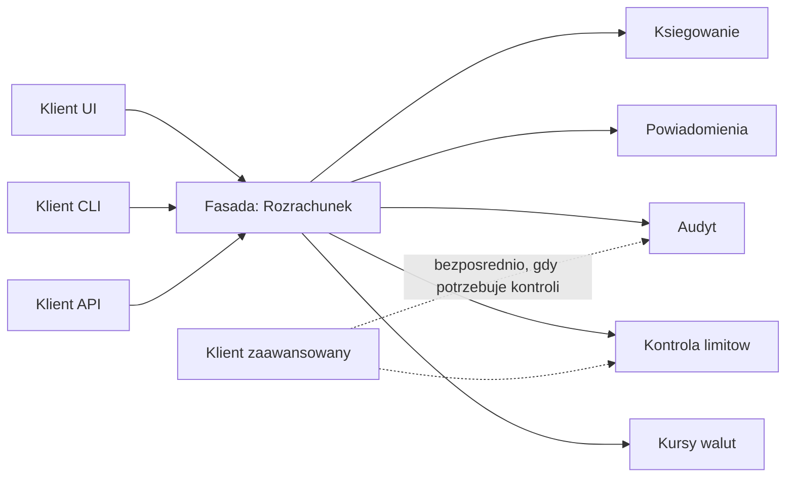
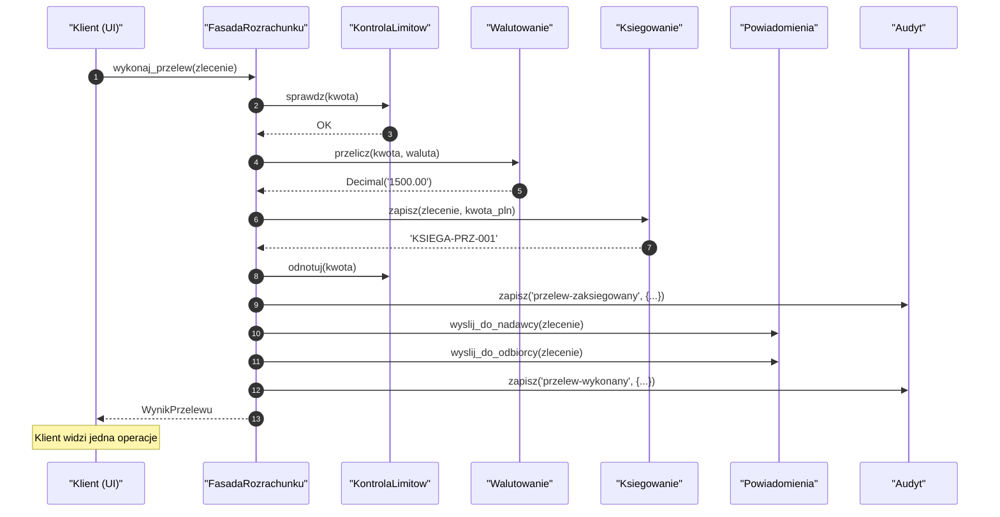
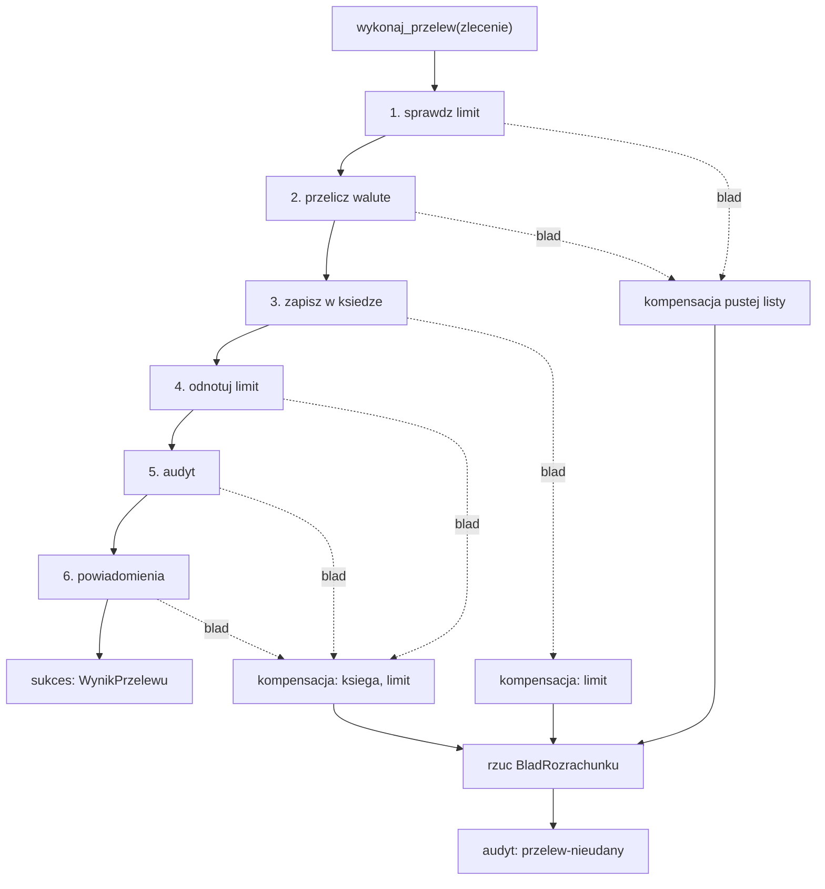
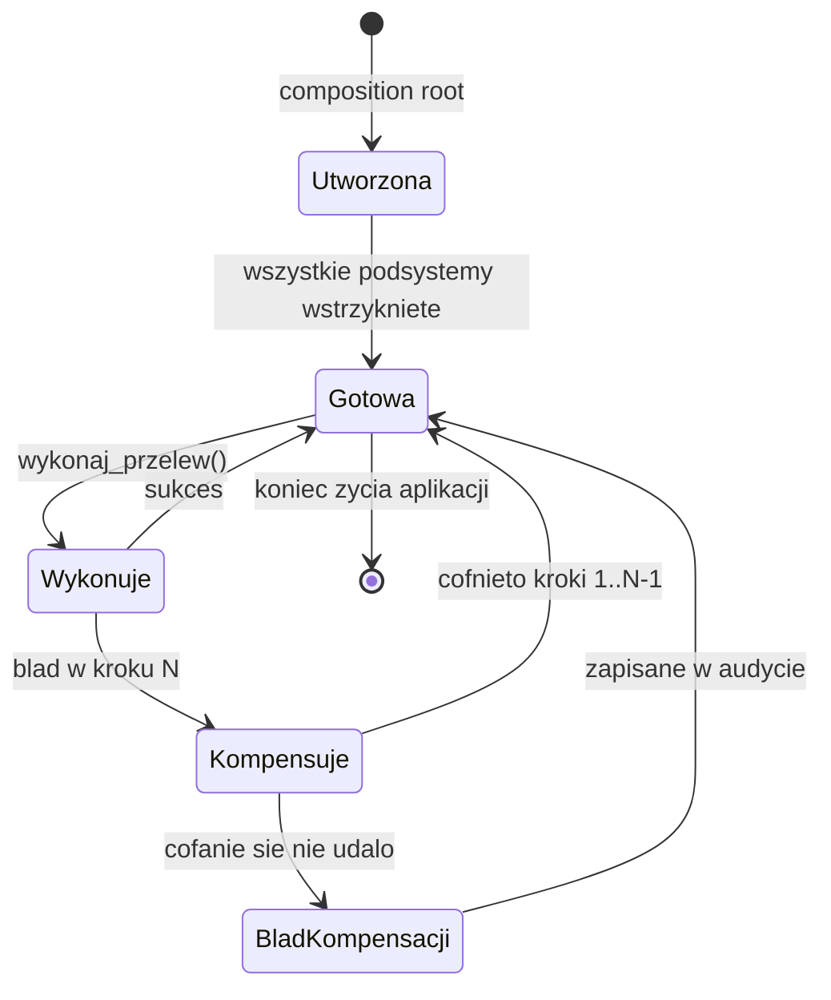
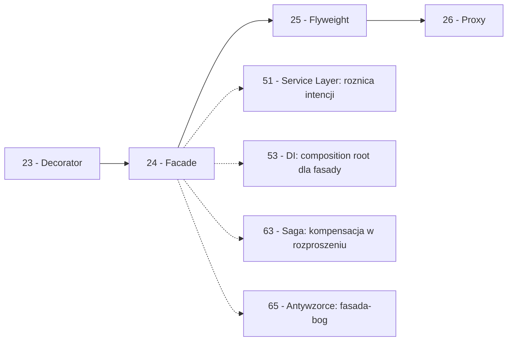

```markdown
---
modul: 24 — Facade
plik: 24-facade.md
poziom: sredni
wymaga: [23]
czas: ~165 minut czytania + ~380 minut ćwiczeń
---

# Moduł 24 — Facade — jedno wejście do skomplikowanego systemu

> **TL;DR**
> - **Facade (fasada)** dostarcza **uproszczony, jednolity interfejs** do zbioru interfejsów podsystemu — klient woła jedną metodę (`przeprowadz_przelew(...)`), a fasada zajmuje się pięcioma czy dziesięcioma operacjami pod spodem.
> - Fasada **nie zmienia podsystemu** i **nie zamyka** go — zaawansowani klienci mogą sięgnąć bezpośrednio do pojedynczych usług, gdy potrzebują precyzyjnej kontroli.
> - Fasada **agreguje** (łączy wywołania w jeden przepływ) i nie zmienia interfejsów podsystemu — to fundamentalna różnica wobec Adaptera (zmienia interfejs), Mediatora (koordynuje komunikację) i Warstwy usług (modeluje przypadki użycia).
> - W Pythonie fasada bywa realizowana wyjątkowo lekko: funkcja modułowa, pakiet z reeksportem w `__init__.py`, klasa z wstrzykiwanymi zależnościami — pełna hierarchia klas rzadko jest potrzebna.
> - Fasada ma złą twarz: **fasada-bóg** zbierająca całą logikę biznesową dusi podsystem i zamienia się w monolit — fasada ma być cienka, a nie przejmować obowiązki innych.

---

## 0. Model mentalny

### Recepcja hotelu i jedno miejsce, które wszystko wie

Wyobraź sobie, że jesteś gościem w dużym hotelu. Wracasz z konferencji i chcesz zamówić kolację do pokoju. Co robisz? Nie dzwonisz do kuchni bezpośrednio — bo kuchnia to osobny numer, o innym czasie pracy, z inną osobą. Nie dzwonisz do pralni — mokre ręczniki i kolacja to dwie różne sprawy. Nie dzwonisz do konserwatora — żarówka w łazience to oddzielna historia. Dzwonisz **do recepcji** — jednego numeru, który znasz. Mówisz: „Chciałbym kolację do pokoju 412, dwa ręczniki i żarówkę wymienić". Recepcja **przekazuje sprawy dalej** — do kuchni, do pokojowej, do konserwatora. Ty nie wiesz nawet, że to było trzy różne zgłoszenia. Z punktu widzenia gościa procedura jest jedna, prosta, zrozumiała.

Zwróć uwagę na dwie rzeczy w tym obrazie. Po pierwsze: **recepcja nie gotuje, nie pierze i nie naprawia**. Ona tylko **przekazuje** zgłoszenia dalej. Nie podejmuje decyzji o tym, jakie danie przyrządzić, jaki proszek do prania użyć, jak wymienić żarówkę. Jej rolą jest zebranie zgłoszeń i przekazanie ich właściwym osobom we właściwej kolejności. To **nie jest** centralna logika hotelu. Centralna logika jest w kuchni, pralni i konserwacji. Recepcja tylko **udostępnia do nich wejście**.

Po drugie, co kluczowe: **recepcja nie zamyka dostępu do reszty hotelu**. Jeśli jesteś gościem biznesowym i znasz numer pokojowej bezpośrednio — możesz zadzwonić. Jeśli jesteś stałym klientem i wiesz, że kuchnia przyjmuje zamówienia do 22:00, możesz zamawiać osobiście. Fasada (recepcja) jest dla **tych, którzy nie znają hotelu** albo dla **typowych, powtarzalnych procedur**. Zaawansowany klient zawsze może obejść recepcję, jeśli ma taką potrzebę. To jest fundamentalna różnica wobec innych wzorców „opakowujących", które ukrywają podsystemy **całkowicie**.

Jeszcze jeden obraz, żeby dobrze uchwycić ideę. Wyobraź sobie, że kupujesz nowy telefon. Instrukcja obsługi ma 200 stron. Ale producent dołącza też **skróconą instrukcję**: „aby zadzwonić, otwórz aplikację Telefon, wybierz kontakt, naciśnij zieloną słuchawkę". Ta skrócona instrukcja **nie zastępuje** pełnej. Jest **innym wejściem** do tych samych funkcji telefonu: uproszczonym, dla typowych przypadków, ale publicznie dostępnym. Jeśli potrzebujesz konfiguracji VPN, sięgniesz do pełnej instrukcji. Jeśli chcesz tylko zadzwonić, skrócona wystarczy. Fasada jest właśnie taką skróconą instrukcją: jednym wejściem dla 80% przypadków, bez odbierania możliwości zaawansowanym użytkownikom.

| W analogii recepcji hotelu | W kodzie |
|---|---|
| Recepcja (jedno miejsce) | `FasadaRozrachunku` (klasa albo funkcja) |
| Kuchnia, pralnia, konserwacja | Podsystemy (księgowanie, notyfikacja, audyt, ...) |
| „Kolacja do pokoju 412" | Metoda wysokopoziomowa `przeprowadz_zlecenie(...)` |
| Procedura przekazania do kuchni | Delegacja: `self._ksiega.zapisz(...)` |
| Procedura przekazania do pralni | Delegacja do kolejnej usługi |
| „Recepcja nie gotuje" | Fasada nie zawiera logiki biznesowej podsystemu |
| Zaawansowany klient zna numer pokojowej | Klient może użyć podsystemu bez fasady |
| Skrócona instrukcja obok pełnej | Fasada obok pełnego API |

> 🧠 **Zapamiętaj** — **Facade (fasada) to wzorzec strukturalny dostarczający uproszczony, jednolity interfejs do zbioru interfejsów podsystemu — jedno wejście dla typowych przypadków, które nie zamyka dostępu do podsystemu dla klientów zaawansowanych.**

Zwróć uwagę na trzy słowa w tej definicji: **uproszczony**, **podsystem** i **nie zamyka**. „Uproszczony" — bo fasada daje mniej metod niż podsystem. „Podsystem" — bo obsługuje grupę usług, nie jedną. „Nie zamyka" — bo jest *innym wejściem*, nie *jedynym wejściem*. Jeśli którakolwiek z tych własności nie jest spełniona, to prawdopodobnie nie jest to fasada.

### Diagram — intuicja



*Diagram pokazuje, że fasada jest jednym wejściem dla typowych klientów (UI, CLI, API) do pięciu usług podsystemu, ale klient zaawansowany może nadal sięgnąć do usług bezpośrednio.*

### Czego Facade NIE robi

Rozbrójmy cztery nieporozumienia.

**Nie zamyka podsystemu.** Fasada to **jedno z wejść**, nie **jedyne**. Jeśli próbujesz zablokować dostęp do podsystemu — to nie jest fasada, to Pełnomocnik ochronny (moduł 26). Fasada **nie zabrania**, tylko **upraszcza**.

**Nie zmienia interfejsów podsystemu.** Usługi pod spodem mają nadal swoje metody, swoje kontrakty, swoją semantykę. Fasada tylko **woła** te metody w określonej kolejności. Jeśli twoje opakowanie tłumaczy interfejs usługi — to jest Adapter (moduł 20). Fasada **agreguje**, nie tłumaczy.

**Nie zawiera logiki biznesowej podsystemu.** Fasada to **koordynacja**, nie **reguły**. Jeśli fasada decyduje o rabatach, kursach, limitach — to już nie fasada, to serwis domenowy. Ta pułapka jest jedną z najczęstszych i prowadzi do fasady-boga.

**Nie koordynuje komunikacji w obie strony.** Fasada wysyła wywołania do podsystemu i czeka na wynik. Jeśli potrzebujesz, żeby podsystemy **rozmawiały ze sobą** — to Mediator (moduł 34). Fasada nie jest mediatorem; jest **klientem**, który wie, jak używać podsystemu.

**Nie jest warstwą usług.** Facade i Service Layer (moduł 51) są spokrewnione, ale różnią się intencją. Fasada **agreguje istniejące wywołania**, Service Layer **modeluje przypadki użycia aplikacji**. Fasada bywa często cienka (jedna linia na usługę), Service Layer zwykle zawiera logikę orkiestracji. Wrócimy do tego w sekcji 9.

---

## 1. Problem, który rozwiązujemy

Wejdźmy w domenę 💳 „Rozrachunku". Aplikacja obsługuje przelewy. Proces realizacji przelewu angażuje **pięć podsystemów**:

1. **Kontrola limitów** — sprawdza, czy przelew nie przekracza limitu dziennego.
2. **Walutowanie** — pobiera kurs wymiany i przelicza kwotę.
3. **Księgowanie** — zapisuje operację do księgi głównej.
4. **Powiadomienie** — wysyła powiadomienie do nadawcy i odbiorcy.
5. **Audyt** — zapisuje wpis do dziennika audytowego.

Ktoś napisał klasę `KontrolerPrzelewu`, która **wywołuje wszystkie pięć podsystemów** — i to w każdej metodzie, i to z pełną wiedzą o tym, jak podsystemy działają.

### Kod „przed"

```python
# rozrachunek_v0.py — wersja naiwna, demonstracyjna
# UWAGA: ten kod celowo pokazuje problem "labiryntu podsystemu" w kodzie klienta.

from dataclasses import dataclass
from datetime import date, datetime, timezone
from decimal import Decimal


@dataclass(frozen=True)
class ZleceniePrzelewu:
    identyfikator: str
    kwota: Decimal
    waluta: str
    odbiorca: str
    nadawca: str


# --- Piec podsystemow (uproszczone atrapy) ---

class KontrolaLimitow:
    LIMIT_DZIENNY = Decimal("500000.00")

    def __init__(self) -> None:
        self._wykorzystano = Decimal("0.00")

    def sprawdz(self, kwota: Decimal) -> None:
        if self._wykorzystano + kwota > self.LIMIT_DZIENNY:
            raise RuntimeError("przekroczony limit dzienny")

    def odnotuj(self, kwota: Decimal) -> None:
        self._wykorzystano += kwota


class Walutowanie:
    def kurs(self, waluta: str, na_dzien: date) -> Decimal:
        tabela = {"PLN": Decimal("1.00"), "EUR": Decimal("4.32"), "USD": Decimal("3.95")}
        if waluta not in tabela:
            raise ValueError(f"brak kursu dla {waluta}")
        return tabela[waluta]

    def przelicz(self, kwota: Decimal, z_waluty: str) -> Decimal:
        return kwota * self.kurs(z_waluty, date.today())


class Ksiegowanie:
    def zapisz(self, zlecenie: ZleceniePrzelewu, kwota_pln: Decimal) -> str:
        return f"KSIEGA-{zlecenie.identyfikator}-{kwota_pln}"


class Powiadomienia:
    def wyslij_do_nadawcy(self, zlecenie: ZleceniePrzelewu) -> None:
        print(f"[EMAIL NAD] do {zlecenie.nadawca}: przelew {zlecenie.identyfikator}")

    def wyslij_do_odbiorcy(self, zlecenie: ZleceniePrzelewu) -> None:
        print(f"[EMAIL ODB] do {zlecenie.odbiorca}: przelew {zlecenie.identyfikator}")


class Audyt:
    def zapisz(self, operacja: str, szczegoly: dict) -> None:
        czas = datetime.now(timezone.utc).isoformat()
        print(f"[AUDYT {czas}] {operacja}: {szczegoly}")


# --- Klient: kontroler, ktory sam wywoluje wszystkie podsystemy ---

class KontrolerPrzelewu:
    def __init__(self) -> None:
        # Klient sam tworzy wszystkie podsystemy
        self._limity = KontrolaLimitow()
        self._walutowanie = Walutowanie()
        self._ksiega = Ksie
```

```python
        self._ksiega = Ksiegowanie()
        self._powiadomienia = Powiadomienia()
        self._audyt = Audyt()

    def wykonaj_przelew(self, zlecenie: ZleceniePrzelewu) -> str:
        """Labirynt: 5 podsystemow, ich kolejnosc i warunki."""
        # 1. Kontrola limitow
        self._limity.sprawdz(zlecenie.kwota)

        # 2. Walutowanie
        kwota_pln = self._walutowanie.przelicz(zlecenie.kwota, zlecenie.waluta)

        # 3. Ksiegowanie
        numer_operacji = self._ksiega.zapisz(zlecenie, kwota_pln)

        # 4. Powiadomienia
        self._powiadomienia.wyslij_do_nadawcy(zlecenie)
        self._powiadomienia.wyslij_do_odbiorcy(zlecenie)

        # 5. Audyt
        self._audyt.zapisz("przelew-wykonany", {
            "id": zlecenie.identyfikator,
            "kwota_pln": str(kwota_pln),
            "numer": numer_operacji,
        })

        # 6. Odnotowanie w limicie
        self._limity.odnotuj(zlecenie.kwota)

        return numer_operacji


# ... ale zaraz — drugi klient (np. kontroler API) robi to samo!

class KontrolerAPI:
    def __init__(self) -> None:
        self._limity = KontrolaLimitow()
        self._walutowanie = Walutowanie()
        self._ksiega = Ksiegowanie()
        self._powiadomienia = Powiadomienia()
        self._audyt = Audyt()

    def post_przelew(self, zlecenie: ZleceniePrzelewu) -> dict:
        # Ta sama sekwencja skopiowana!
        self._limity.sprawdz(zlecenie.kwota)
        kwota_pln = self._walutowanie.przelicz(zlecenie.kwota, zlecenie.waluta)
        numer = self._ksiega.zapisz(zlecenie, kwota_pln)
        self._powiadomienia.wyslij_do_nadawcy(zlecenie)
        self._powiadomienia.wyslij_do_odbiorcy(zlecenie)
        self._audyt.zapisz("przelew-wykonany", {
            "id": zlecenie.identyfikator,
            "kwota_pln": str(kwota_pln),
        })
        self._limity.odnotuj(zlecenie.kwota)
        return {"status": "ok", "numer": numer}


if __name__ == "__main__":
    zlecenie = ZleceniePrzelewu(
        identyfikator="PRZ-1",
        kwota=Decimal("1500.00"),
        waluta="PLN",
        odbiorca="odbiorca@example.com",
        nadawca="nadawca@example.com",
    )
    kontroler = KontrolerPrzelewu()
    print(kontroler.wykonaj_przelew(zlecenie))
```

Ten kod działa. Ale już na poziomie pierwszego klienta widać **problem** — i nie jest to problem z pojedynczą usługą, tylko z **całą sekwencją**.

### Code smell — labirynt w kliencie

| Problem | Gdzie | Konsekwencja |
|---|---|---|
| 5 podsystemów tworzonych w każdym kliencie | `KontrolerPrzelewu.__init__`, `KontrolerAPI.__init__` | Powielenie, trudność podmiany |
| Sekwencja 6 kroków skopiowana w każdym kliencie | W `wykonaj_przelew`, `post_przelew` | Ta sama wiedza o kolejności w wielu miejscach |
| Klient musi znać kolejność | W ciele metody | Dodanie kroku wymaga zmian we wszystkich klientach |
| Brak obsługi błędów w połowie procesu | Ksiegowanie udane, powiadomienie wybuchło — co dalej? | Niespójność stanu, brak kompensacji |
| Trudne do przetestowania | Wymaga 5 mocków | Każdy klient testowany osobno |
| Dockerowane 5 usług w każdym kontrolerze | `self._ksiega = ...` | Klient wie o istnieniu wszystkich |
| Brak wyraźnego „to jest proces przelewu" | Kod jest rozproszony | Trudno powiedzieć, gdzie jest logika przelewu |

Zwróć uwagę na czwartą pozycję. **Brak obsługi błędów w połowie procesu** to w finansach poważny problem. Jeśli księgowanie się udało, a powiadomienie zawiodło — co dalej? Bez obsługi błędów klient ma stan częściowy. To nie jest problem jednej usługi, to problem **sekwencji**. Wrócimy do tego z pełnym rozwiązaniem w sekcji 3.

### Objawy — poznasz ten problem po tym, że...

- **Klient musi znać kolejność wywołań podsystemu.** W kodzie klienta widać `self._limity.sprawdz(...)`, potem `self._walutowanie.przelicz(...)`, potem... — pełna sekwencja.
- **Ta sama sekwencja jest powtórzona w kilku klientach.** Trzy kontrolery, ten sam układ kroków, różnice w detalach.
- **Nowy krok w procesie wymaga modyfikacji wszystkich klientów.** Dodajesz „walidacja AML" na początku — musisz to dopisać do wszystkich.
- **Testy klienta wymagają 5–10 mocków.** Bo klient bezpośrednio współpracuje z podsystemami.
- **Klient nie może powiedzieć „wykonaj przelew"** — musi powiedzieć, jak go wykonać.
- **Kolejność kroków w kliencie jest niejawna.** Nie ma metody `wykonaj_przelew`, która by to wszystko zebrała. Jest rozproszone.
- **Dodanie obsługi błędów wymaga zmian wszędzie.** Nie ma jednego miejsca, w którym można obsłużyć „jeśli krok 3 się nie uda, cofnij kroki 1-2".
- **Klienci nie mogą się dzielić kodem.** Bo każdy ma własną kopię sekwencji.
- **W kodzie jest masa `self._podsystem.metoda()`** — znak, że klient jest „kontrolerem podsystemu", nie „użytkownikiem".
- **Brak nazwy dla całego procesu.** Nie ma obiektu, który „jest" procesem przelewu.

---

## 2. Anatomia wzorca

### Uczestnicy

| Rola | Odpowiedzialność | Co NIE jest jej zadaniem |
|---|---|---|
| **Facade (fasada)** | Zna podsystem; udostępnia uproszczony interfejs do niego; koordynuje wywołania w sekwencji; obsługuje typowe przypadki | Nie zawiera logiki podsystemu; nie tworzy podsystemu samodzielnie; nie zamyka dostępu do podsystemu |
| **Podsystem (subsystem)** | Realizuje konkretne operacje; ma własny interfejs, własną logikę, własne zależności | Nie zna fasady; nie wie, że jest przez nią używany |
| **Klient (client)** | Używa fasady dla typowych przypadków; dla nietypowych może sięgnąć do podsystemu bezpośrednio | Nie zna kolejności kroków; nie tworzy podsystemu |

Kluczowa asymetria: **fasada zna podsystem**, ale **podsystem nie zna fasady**. To jednostronna zależność. Fasada jest „klientem, który wie więcej". Podsystem nie wie nic o tym, że ma być używany przez fasadę.

### Diagram struktury

```mermaid
classDiagram
    direction LR
    class FasadaRozrachunku {
        -KontrolaLimitow _limity
        -Walutowanie _walutowanie
        -Ksiegowanie _ksiega
        -Powiadomienia _powiadomienia
        +wykonaj_przelew(zlecenie) str
    }
    class KontrolaLimitow {
        +sprawdz(kwota)
        +odnotuj(kwota)
    }
    class Walutowanie {
        +przelicz(kwota, waluta) Decimal
    }
    class Ksiegowanie {
        +zapisz(zlecenie, kwota_pln) str
    }
    class Powiadomienia {
        +wyslij_do_nadawcy(zlecenie)
        +wyslij_do_odbiorcy(zlecenie)
    }
    class Audyt {
        +zapisz(operacja, szczegoly)
    }
    class KlientUI
    class KlientAPI
    class KlientZaawansowany
    FasadaRozrachunku --> KontrolaLimitow : deleguje
    FasadaRozrachunku --> Walutowanie : deleguje
    FasadaRozrachunku --> Ksiegowanie : deleguje
    FasadaRozrachunku --> Powiadomienia : deleguje
    FasadaRozrachunku --> Audyt : deleguje
    KlientUI --> FasadaRozrachunku
    KlientAPI --> FasadaRozrachunku
    KlientZaawansowany --> FasadaRozrachunku
    KlientZaawansowany -.-> Audyt : bezposrednio gdy trzeba
```

*Diagram pokazuje, że fasada zna pięć usług podsystemu i deleguje do nich, ale żadna z usług nie zna fasady — a klient zaawansowany może sięgnąć do usług bezpośrednio.*

Przeczytajmy ten diagram zdanie po zdaniu. `FasadaRozrachunku` trzyma referencje do pięciu usług i udostępnia **jedną** metodę `wykonaj_przelew`. Diody wskazują delegację — fasada **wywołuje** usługi, ale nie odwrotnie. `KontrolaLimitow`, `Walutowanie`, `Ksiegowanie`, `Powiadomienia`, `Audyt` to podsystem — każda z własnym interfejsem, własną odpowiedzialnością.

Trzej klienci — `KlientUI`, `KlientAPI` i `KlientZaawansowany` — używają fasady. Ale `KlientZaawansowany` ma też **przerywaną strzałkę** do `Audyt` — może sięgnąć do podsystemu bezpośrednio, gdy potrzebuje. To kluczowa cecha fasady: **nie blokuje dostępu** do podsystemu.

Zauważ też, że **podsystemy nie mają strzałek do fasady**. `Ksiegowanie` nie wie o istnieniu `FasadaRozrachunku`. To znaczy, że można wymienić fasadę, można dodać drugą, można używać podsystemu zupełnie niezależnie.

### Warianty: klasyczny vs pythoniczny

| Aspekt | Wariant klasyczny (GoF) | Wariant pythoniczny |
|---|---|---|
| Fasada | Klasa z referencjami do podsystemu | Funkcja modułowa, klasa z DI, pakiet |
| Podsystem | Klasy | Klasy, funkcje, moduły — cokolwiek |
| Tworzenie fasady | Konstruktor tworzy podsystem | Wstrzykiwanie — klient podaje usługi |
| Uproszczenie | Kilka metod wysokopoziomowych | Jedna funkcja na przypadek użycia |
| Dostęp do podsystemu | Publiczny, ale nieudokumentowany | Publiczny i jawnie udokumentowany |
| Reeksport w pakiecie | Rzadko | Tak — `__init__.py` z reeksportami (bardzo pythoniczne!) |

W Pythonie fasada **rzadko** przyjmuje klasyczną formę. Najczęstsze formy: funkcja modułowa, pakiet z reeksportem API, klasa z wstrzykiwanymi zależnościami. Pokażemy je wszystkie w sekcji 4.

---

## 3. Implementacja krok po kroku

Przebudujemy przykład z sekcji 1 stopniowo.

### Krok 1 — Zdefiniuj jedną metodę, która wyraża proces

Zamiast myśleć o podsystemie, pomyśl o **procesie biznesowym**. Co klient chce zrobić? „Wykonać przelew". Ta intencja staje się nazwą metody.

```python
def wykonaj_przelew(zlecenie: ZleceniePrzelewu) -> str:
    """Wykonuje przelew end-to-end. Zwraca numer operacji."""
    ...
```

Pusta metoda, ale już z nazwą, która wyraża intencję. Reszta to implementacja.

### Krok 2 — Wstrzyknij podsystem zamiast tworzyć go wewnątrz

Fasada nie tworzy podsystemu — dostaje go w konstruktorze. To realizacja DIP (moduł 03).

```python
from decimal import Decimal

class FasadaRozrachunku:
    """Uproszczony interfejs do zbioru uslug rozrachunkowych."""

    def __init__(
        self,
        limity: KontrolaLimitow,
        walutowanie: Walutowanie,
        ksiega: Ksiegowanie,
        powiadomienia: Powiadomienia,
        audyt: Audyt,
    ) -> None:
        self._limity = limity
        self._walutowanie = walutowanie
        self._ksiega = ksiega
        self._powiadomienia = powiadomienia
        self._audyt = audyt

    def wykonaj_przelew(self, zlecenie: ZleceniePrzelewu) -> str:
        """Wykonuje przelew: kontrola limitu, walutowanie, ksiegowanie,
        powiadomienie, audyt."""
        ...
```

Zwróć uwagę: **konstruktor ma pięć zależności**. To już sygnał, że mamy 5 usług — niektórzy zastanowią się, czy to nie za dużo. Ale to normalne dla fasady: agreguje wiele.

### Krok 3 — Zaimplementuj sekwencję

Cała logika sekwencji jest **w metodzie fasady**, nie w kliencie.

```python
    def wykonaj_przelew(self, zlecenie: ZleceniePrzelewu) -> str:
        # 1. Kontrola limitu
        self._limity.sprawdz(zlecenie.kwota)

        # 2. Walutowanie
        kwota_pln = self._walutowanie.przelicz(zlecenie.kwota, zlecenie.waluta)

        # 3. Ksiegowanie
        numer = self._ksiega.zapisz(zlecenie, kwota_pln)

        # 4. Powiadomienia
        self._powiadomienia.wyslij_do_nadawcy(zlecenie)
        self._powiadomienia.wyslij_do_odbiorcy(zlecenie)

        # 5. Odnotowanie w limicie
        self._limity.odnotuj(zlecenie.kwota)

        # 6. Audyt
        self._audyt.zapisz("przelew-wykonany", {
            "id": zlecenie.identyfikator,
            "kwota_pln": str(kwota_pln),
            "numer": numer,
        })

        return numer
```

Zwróć uwagę: **fasada wywołuje metody w ustalonej kolejności**. Nie dodaje tu logiki biznesowej — nie sprawdza, czy limit jest OK (to robi `KontrolaLimitow`), nie liczy kursu (robi to `Walutowanie`). Fasada **koordynuje**, ale nie **decyduje**. To subtelna, ale kluczowa różnica.

### Krok 4 — Zadbaj o obsługę błędów

Pytanie: co się dzieje, jeśli krok 3 się udał, a krok 4 zawiódł? W wersji z sekcji 1 klient dostawał wyjątek i nie było kompensacji. Fasada może to naprawić: **zbiera kroki, a przy błędzie cofa to, co się udało**.

```python
    def wykonaj_przelew(self, zlecenie: ZleceniePrzelewu) -> str:
        wylaczone: list[tuple[str, callable]] = []

        try:
            self._limity.sprawdz(zlecenie.kwota)
            wylaczone.append(("limit", lambda: self._limity.zwolnij(zlecenie.kwota)))

            kwota_pln = self._walutowanie.przelicz(zlecenie.kwota, zlecenie.waluta)

            numer = self._ksiega.zapisz(zlecenie, kwota_pln)
            wylaczone.append(("ksiega", lambda: self._ksiega.cofnij(numer)))

            self._powiadomienia.wyslij_do_nadawcy(zlecenie)
            self._powiadomienia.wyslij_do_odbiorcy(zlecenie)

            self._audyt.zapisz("przelew-wykonany", {...})
            return numer
        except Exception as blad:
            # Kompensacja: cofamy kroki od ostatniego do pierwszego
            for nazwa, akcja in reversed(wylaczone):
                try:
                    akcja()
                except Exception as blad_kompensacji:
                    self._audyt.zapisz("kompensacja-blad", {
                        "krok": nazwa,
                        "blad": str(blad_kompensacji),
                    })
            self._audyt.zapisz("przelew-nieudany", {
                "id": zlecenie.identyfikator,
                "blad": str(blad),
            })
            raise
```

To jest **rozszerzenie** klasycznej fasady — wzorzec Saga, o którym opowiemy w module 63. Fasada jako **koordynator transakcji** jest bardzo przydatna w systemach finansowych, gdzie trzeba cofać operacje przy błędach.

### Krok 5 — Klient używa fasady

Klient teraz robi jedną rzecz.

```python
class KlientUI:
    def __init__(self, fasada: FasadaRozrachunku) -> None:
        self._fasada = fasada

    def klik_wykonaj_przelew(self, zlecenie: ZleceniePrzelewu) -> str:
        return self._fasada.wykonaj_przelew(zlecenie)


class KlientAPI:
    def __init__(self, fasada: FasadaRozrachunku) -> None:
        self._fasada = fasada

    def post_przelew(self, zlecenie: ZleceniePrzelewu) -> dict:
        numer = self._fasada.wykonaj_przelew(zlecenie)
        return {"status": "ok", "numer": numer}
```

Klient **nie zna** podsystemu. Nie wie o limitach, kursach, księdze. Zna tylko `FasadaRozrachunku` i metodę `wykonaj_przelew`. Cała sekwencja 6 kroków jest w jednym miejscu.

### Krok 6 — Composition root

```python
def zbuduj_fasade() -> FasadaRozrachunku:
    """Jedno miejsce, ktore tworzy wszystkie podsystemy."""
    return FasadaRozrachunku(
        limity=KontrolaLimitow(),
        walutowanie=Walutowanie(),
        ksiega=Ksiegowanie(),
        powiadomienia=Powiadomienia(),
        audyt=Audyt(),
    )
```

### Krok 7 — Weryfikacja

| Kryterium | Wersja „przed" | Wersja „po" (fasada) |
|---|---|---|
| Klient zna kolejność kroków | Tak | Nie |
| Klient tworzy 5 podsystemów | Tak | Nie — fasada je dostaje |
| Duplikacja sekwencji w klientach | Tak | Nie — jedna sekwencja |
| Dodanie kroku | Zmiana wszystkich klientów | Zmiana jednej metody fasady |
| Obsługa błędów w połowie | Ręczna w każdym kliencie | W jednej metodzie fasady |
| Test klienta | Wymaga 5 mocków | Wystarczy mock fasady |
| Test logiki procesu | Rozproszone w klientach | W jednej metodzie fasady |
| Liczba klas | 6 (5 podsystemów + klient) | 7 (5 + fasada + klient) |

Zysk: klient nie zna labiryntu. Fasada ma sekwencję w jednym miejscu. Testy są prostsze.

---

## 4. Wersje pythoniczne i warianty

### 4.1 Fasada jako funkcja modułowa

Jeśli fasada nie ma stanu, funkcja jest najprostszą formą.

```python
# rozrachunek_fasada.py
def wykonaj_przelew(
    zlecenie: ZleceniePrzelewu,
    limity: KontrolaLimitow,
    walutowanie: Walutowanie,
    ksiega: Ksiegowanie,
    powiadomienia: Powiadomienia,
    audyt: Audyt,
) -> str:
    """Uproszczone wykonanie przelewu - jedna funkcja."""
    limity.sprawdz(zlecenie.kwota)
    kwota_pln = walutowanie.przelicz(zlecenie.kwota, zlecenie.waluta)
    numer = ksiega.zapisz(zlecenie, kwota_pln)
    powiadomienia.wyslij_do_nadawcy(zlecenie)
    powiadomienia.wyslij_do_odbiorcy(zlecenie)
    limity.odnotuj(zlecenie.kwota)
    audyt.zapisz("przelew-wykonany", {...})
    return numer
```

Ale uwaga: klient musi przekazać 6 argumentów. To **nie jest już uproszczenie** — przeniesienie złożoności z implementacji na sygnaturę. Fasada funkcyjna ma sens tylko, gdy usługi są dostępne w **jednym miejscu** (moduł, obiekt konfiguracji).

### 4.2 Fasada jako klasa z wstrzykiwanymi zależnościami — zalecane

Wariant z sekcji 3. Klasa trzyma podsystem, klient przekazuje zależności raz. To najbardziej zrównoważony wariant.

### 4.3 Fasada jako pakiet z reeksportem — bardzo pythoniczne

To **najbardziej pythoniczny wariant** fasady. Zamiast tworzyć klasę, **reorganizujesz przestrzeń nazw** pakietu tak, żeby jedno miejsce dawało dostęp do najczęściej używanych elementów podsystemu.

```python
# rozrachunek/__init__.py
"""Uproszczone API pakietu rozrachunkowego.

Zamiast importowac z glebi pakietu:
    from rozrachunek.ksiegowanie.ksiega import Ksiegowanie
    from rozrachunek.limity.kontrola import KontrolaLimitow
    ...

Można importowac z korzenia:
    from rozrachunek import Ksiegowanie, KontrolaLimitow, wykonaj_przelew
"""

from .ksiegowanie.ksiega import Ksiegowanie
from .limity.kontrola import KontrolaLimitow
from .walutowanie.kursy import Walutowanie
from .powiadomienia.email import Powiadomienia
from .audyt.dziennik import Audyt
from .fasada import wykonaj_przelew, FasadaRozrachunku

__all__ = [
    "Ksiega",
    "KontrollaLimitow",
    "Walutowanie",
    "Powiadomienia",
    "Audyt",
    "wykonaj_przelew",
    "FasadaRozrachunku",
]
```

Zysk: klienci **nie muszą znać wewnętrznej struktury pakietu**. Mogą pisać `from rozrachunek import Ksiegowanie` zamiast `from rozrachunek.ksiegowanie.ksiega import Ksiegowanie`. Możesz **przestawić moduły wewnątrz pakietu** bez psucia kodu klientów, bo API publiczne jest zadeklarowane w `__init__.py`.

To bardzo potężna technika. Jej wadą jest **utrudnione leniwe ładowanie** — `__init__.py` importuje wszystko na starcie. Dla ciężkich pakietów stosuje się `__getattr__` (moduł 02, PEP 562) do leniwego importu.

### 4.4 Fasada z `__getattr__` do leniwego ładowania

Rozwiązanie problemu „ciężki import" w pakiecie.

```python
# rozrachunek/__init__.py
"""Pakiet z leniwym ladowaniem podsystemow."""

def __getattr__(nazwa: str):
    if nazwa == "Ksiegowanie":
        from .ksiegowanie.ksiega import Ksiegowanie
        return Ksiegowanie
    if nazwa == "KontrollaLimitow":
        from .limity.kontrola import KontrolaLimitow
        return KontrolaLimitow
    if nazwa == "wykonaj_przelew":
        from .fasada import wykonaj_przelew
        return wykonaj_przelew
    raise AttributeError(f"moduł nie ma atrybutu {nazwa!r}")

__all__ = ["Ksiega", "KontrollaLimitow", "wykonaj_przelew"]
```

Zysk: `import rozrachunek` **nie ładuje** żadnych podsystemów. Ładują się tylko te, które klient faktycznie importuje. Dla dużych pakietów to znacząca oszczędność.

### 4.5 Fasada z reeksportem jako funkcje (modules-as-facades)

Zamiast klasy, fasada może być **modułem z funkcjami**. Klient importuje funkcje, nie obiekty.

```python
# rozrachunek_fasada.py
"""Modul-fasada: udostepnia uproszczone funkcje z podsystemu."""

from .podsystem.limity import KontrolaLimitow
from .podsystem.ksiega import Ksiegowanie

_limity = KontrolaLimitow()
_ksiega = Ksiegowanie()

def wykonaj_przelew(zlecenie: ZleceniePrzelewu) -> str:
    """Uproszczone wykonanie przelewu."""
    ...
```

Zaleta: klient pisze `import rozrachunek_fasada; rozrachunek_fasada.wykonaj_przelew(zlecenie)`, bez tworzenia fasady. Wada: podsystem jest tworzony przy imporcie modułu — trudno go podmienić w testach (chyba że przez jawny `set_`).

### 4.6 Fasada jako `@dataclass` z polami

Zamiast konstruktora z pięcioma argumentami — `@dataclass`, która generuje konstruktor.

```python
from dataclasses import dataclass

@dataclass
class FasadaRozrachunku:
    limity: KontrolaLimitow
    walutowanie: Walutowanie
    ksiega: Ksiegowanie
    powiadomienia: Powiadomienia
    audyt: Audyt

    def wykonaj_przelew(self, zlecenie: ZleceniePrzelewu) -> str:
        ...
```

To skraca kod konstruktora i dokumentuje pola, ale miesza „fasada" z „kontenerem zależności". W praktyce jest znośne, gdy fasada ma tylko `wykonaj_*` i żadnej innej logiki.

### 4.7 Podsumowanie — tabela wyboru

| Sytuacja | Wariant |
|---|---|
| Fasada bez stanu, usługi dostępne z kontekstu | Funkcja modułowa (4.1) |
| Fasada grupująca wiele usług | Klasa z DI (4.2) |
| Publiczne API pakietu | Reeksport w `__init__.py` (4.3) |
| Publiczne API + ciężkie podsystemy | `__getattr__` w pakiecie (4.4) |
| Publiczne API jako funkcje modułowe | Moduł-fasada (4.5) |
| Fasada z prostym konstruktorem | `@dataclass` (4.6) |

> 🧠 **Zapamiętaj** — **Fasada jako pakiet z reeksportem to najbardziej pythoniczny wariant**. Zamiast tworzyć klasę, **ustalasz publiczne API pakietu** przez `__init__.py`. Użytkownicy piszą `from twoj_pakiet import X`, a ty możesz przestawiać moduły wewnątrz pakietu bez psucia ich kodu. **To najczęstsza forma fasady w realnym Pythonie.**

---

## 5. Przykład z życia: 💳 Rozrachunek — pełny uruchamialny kod

Zbudujemy pełny system przelewów z fasadą, obsługą błędów, kompensacją i testami.

### Kod

```python
# rozrachunek_fasada.py — pelny przyklad Facade
from __future__ import annotations

from dataclasses import dataclass
from datetime import date, datetime, timezone
from decimal import Decimal, ROUND_HALF_UP
from typing import Callable


# ===========================================================================
# 1. Typy domenowe
# ===========================================================================

@dataclass(frozen=True, slots=True)
class ZleceniePrzelewu:
    identyfikator: str
    kwota: Decimal
    waluta: str
    nadawca: str
    odbiorca: str

    def __post_init__(self) -> None:
        if self.kwota <= 0:
            raise ValueError("kwota musi byc dodatnia")


@dataclass(frozen=True, slots=True)
class WynikPrzelewu:
    identyfikator: str
    numer_operacji: str
    kwota_pln: Decimal
    waluta: str


class BladRozrachunku(RuntimeError):
    """Blad biznesowy procesu rozrachunku."""


# ===========================================================================
# 2. Podsystem - piec uslug
# ===========================================================================

class KontrolaLimitow:
    LIMIT_DZIENNY = Decimal("500000.00")

    def __init__(self) -> None:
        self._wykorzystano = Decimal("0.00")

    def sprawdz(self, kwota: Decimal) -> None:
        if self._wykorzystano + kwota > self.LIMIT_DZIENNY:
            raise BladRozrachunku(
                f"przekroczony limit dzienny: "
                f"proba {kwota}, dostepne {self.LIMIT_DZIENNY - self._wykorzystano}"
            )

    def odnotuj(self, kwota: Decimal) -> None:
        self._wykorzystano += kwota

    def zwolnij(self, kwota: Decimal) -> None:
        """Kompensacja: cofa odnotowanie."""
        self._wykorzystano -= kwota

    @property
    def wykorzystano(self) -> Decimal:
        return self._wykorzystano


class Walutowanie:
    KURSY = {
        "PLN": Decimal("1.00"),
        "EUR": Decimal("4.32"),
        "USD": Decimal("3.95"),
    }

    def przelicz(self, kwota: Decimal, waluta: str) -> Decimal:
        if waluta not in self.KURSY:
            raise BladRozrachunku(f"brak kursu dla {waluta}")
        wynik = (kwota * self.KURSY[waluta]).quantize(
            Decimal("0.01"), rounding=ROUND_HALF_UP
        )
        return wynik


class Ksiegowanie:
    def __init__(self) -> None:
        self._zapisy: dict[str, dict] = {}

    def zapisz(self, zlecenie: ZleceniePrzelewu, kwota_pln: Decimal) -> str:
        numer = f"KSIEGA-{zlecenie.identyfikator}"
        self._zapisy[numer] = {
            "id": zlecenie.identyfikator,
            "kwota_pln": str(kwota_pln),
            "utworzono": datetime.now(timezone.utc).isoformat(),
        }
        return numer

    def cofnij(self, numer: str) -> None:
        """Kompensacja: usuwa zapis."""
        self._zapisy.pop(numer, None)

    @property
    def liczba_zapisow(self) -> int:
        return len(self._zapisy)


class Powiadomienia:
    def __init__(self) -> None:
        self.wyslane: list[tuple[str, str]] = []

    def wyslij_do_nadawcy(self, zlecenie: ZleceniePrzelewu) -> None:
        msg = f"Przelew {zlecenie.identyfikator} do {zlecenie.odbiorca}"
        self.wyslane.append((zlecenie.nadawca, msg))

    def wyslij_do_odbiorcy(self, zlecenie: ZleceniePrzelewu) -> None:
        msg = f"Otrzymano przelew {zlecenie.identyfikator} od {zlecenie.nadawca}"
        self.wyslane.append((zlecenie.odbiorca, msg))


class Audyt:
    def __init__(self) -> None:
        self.wpisy: list[tuple[datetime, str, dict]] = []

    def zapisz(self, operacja: str, szczegoly: dict) -> None:
        self.wpisy.append((datetime.now(timezone.utc), operacja, dict(szczegoly)))


# ===========================================================================
# 3. Fasada - kontroluje sekwencje i kompensacje
# ===========================================================================

class FasadaRozrachunku:
    """Uproszczony interfejs do procesu przelewu (piec podsystemow)."""

    def __init__(
        self,
        limity: KontrolaLimitow,
        walutowanie: Walutowanie,
        ksiega: Ksiegowanie,
        powiadomienia: Powiadomienia,
        audyt: Audyt,
    ) -> None:
        self._limity = limity
        self._walutowanie = walutowanie
        self._ksiega = ksiega
        self._powiadomienia = powiadomienia
        self._audyt = audyt

    # --- Fasada glownego procesu ---

    def wykonaj_przelew(self, zlecenie: ZleceniePrzelewu) -> WynikPrzelewu:
        """Wykonuje przelew end-to-end z kompensacja przy bledzie."""
        kompensacje: list[tuple[str, Callable[[], None]]] = []

        try:
            # 1. Kontrola limitu
            self._limity.sprawdz(zlecenie.kwota)
            kompensacje.append(
                ("limit", lambda: self._limity.zwolnij(zlecenie.kwota))
            )

            # 2. Walutowanie
            kwota_pln = self._walutowanie.przelicz(zlecenie.kwota, zlecenie.waluta)

            # 3. Ksiegowanie
            numer = self._ksiega.zapisz(zlecenie, kwota_pln)
            kompensacje.append(("ksiega", lambda: self._ksiega.cofnij(numer)))

            # 4. Odnotowanie limitu
            self._limity.odnotuj(zlecenie.kwota)

            # 5. Audyt (wewnatrz procesu)
            self._audyt.zapisz("przelew-zaksiegowany", {
                "id": zlecenie.identyfikator,
                "numer": numer,
                "kwota_pln": str(kwota_pln),
            })

            # 6. Powiadomienia (na koncu, zeby ewentualny blad nie psul ksiegowania)
            self._powiadomienia.wyslij_do_nadawcy(zlecenie)
            self._powiadomienia.wyslij_do_odbiorcy(zlecenie)

            self._audyt.zapisz("przelew-wykonany", {
                "id": zlecenie.identyfikator,
                "numer": numer,
            })
            return WynikPrzelewu(
                identyfikator=zlecenie.identyfikator,
                numer_operacji=numer,
                kwota_pln=kwota_pln,
                waluta=zlecenie.waluta,
            )
        except Exception as blad:
            # Kompensacja w odwrotnej kolejnosci
            for nazwa, akcja in reversed(kompensacje):
                try:
                    akcja()
                except Exception as blad_komp:
                    self._audyt.zapisz("kompensacja-blad", {
                        "krok": nazwa,
                        "blad": str(blad_komp),
                    })
            self._audyt.zapisz("przelew-nieudany", {
                "id": zlecenie.identyfikator,
                "blad": str(blad),
            })
            raise

    # --- Dodatkowe operacje wysokopoziomowe ---

    def stan_limitu(self) -> dict[str, str]:
        """Uproszczony odczyt stanu limitu - klient nie musi znac KontrolaLimitow."""
        return {
            "wykorzystano": str(self._limity.wykorzystano),
            "limit": str(KontrolaLimitow.LIMIT_DZIENNY),
        }

    def historia_audytu(self) -> list[tuple[str, dict]]:
        return [(op, sz) for _, op, sz in self._audyt.wpisy]


# ===========================================================================
# 4. Klienci fasady
# ===========================================================================

class KlientUI:
    def __init__(self, fasada: FasadaRozrachunku) -> None:
        self._fasada = fasada

    def klik_przelej(self, zlecenie: ZleceniePrzelewu) -> WynikPrzelewu:
        return self._fasada.wykonaj_przelew(zlecenie)


class KlientAPI:
    def __init__(self, fasada: FasadaRozrachunku) -> None:
        self._fasada = fasada

    def post_przelew(self, zlecenie: ZleceniePrzelewu) -> dict:
        try:
            wynik = self._fasada.wykonaj_przelew(zlecenie)
            return {"status": "ok", "numer": wynik.numer_operacji}
        except BladRozrachunku as blad:
            return {"status": "blad", "opis": str(blad)}


# ===========================================================================
# 5. Composition root
# ===========================================================================

def zbuduj_fasade() -> FasadaRozrachunku:
    return FasadaRozrachunku(
        limity=KontrolaLimitow(),
        walutowanie=Walutowanie(),
        ksiega=Ksiegowanie(),
        powiadomienia=Powiadomienia(),
        audyt=Audyt(),
    )


# ===========================================================================
# 6. Demonstracja
# ===========================================================================

if __name__ == "__main__":
    print("=== 1. Klient UI uzywa fasady - jedna metoda ===")
    fasada = zbuduj_fasade()
    klient = KlientUI(fasada)

    zlecenie = ZleceniePrzelewu(
        identyfikator="PRZ-001",
        kwota=Decimal("1500.00"),
        waluta="PLN",
        nadawca="nadawca@example.com",
        odbiorca="odbiorca@example.com",
    )
    wynik = klient.klik_przelej(zlecenie)
    print(f"  {wynik}")

    print("\n=== 2. Fasada mowi ile wykorzystano limitu ===")
    print(f"  {fasada.stan_limitu()}")

    print("\n=== 3. Ten sam proces przez klienta API ===")
    api = KlientAPI(fasada)
    wynik = api.post_przelew(ZleceniePrzelewu(
        identyfikator="PRZ-002",
        kwota=Decimal("100.00"),
        waluta="EUR",
        nadawca="api@example.com",
        odbiorca="odbiorca@example.com",
    ))
    print(f"  {wynik}")

    print("\n=== 4. Blad biznesowy: limit przekroczony ===")
    wynik = api.post_przelew(ZleceniePrzelewu(
        identyfikator="PRZ-003",
        kwota=Decimal("1000000.00"),
        waluta="PLN",
        nadawca="api@example.com",
        odbiorca="odbiorca@example.com",
    ))
    print(f"  {wynik}")

    print("\n=== 5. Klient zaawansowany siega bezposrednio do podsystemu ===")
    audyt = fasada._audyt
    print(f"  liczba wpisow audytu: {len(audyt.wpisy)}")
    print(f"  ostatnie wpisy:")
    for _, op, sz in audyt.wpisy[-5:]:
        print(f"    {op}: {sz}")

    print("\n=== 6. Historia audytu przez uproszczone API fasady ===")
    for op, sz in fasada.historia_audytu()[-5:]:
        print(f"  {op}: {sz}")
```

### Co ten przykład pokazuje

Uruchomienie demonstruje wszystkie cechy fasady.

**Punkt 1 — jedno wywołanie.** Klient UI **nie zna** podsystemów. Wywołuje `wykonaj_przelew(zlecenie)` i dostaje gotowy wynik. Cała sekwencja 6 kroków jest wewnątrz fasady.

**Punkt 2 — fasada udostępnia uproszczone widoki.** `stan_limitu()` zwraca słownik, a klient nie musi znać `KontrolaLimitow`. To **uproszczenie**, nie tylko agregacja.

**Punkt 3 — ten sam proces, inny klient.** Klient API używa tej samej fasady. Serwis API **nie zna podsystemu**. To pokazuje, że to samo uproszczenie obsługuje wiele typów klientów.

**Punkt 4 — obsługa błędów.** Fasada pakuje wyjątek biznesowy `BladRozrachunku` i klient API mapuje go na JSON. Klient API nie musi wiedzieć, że to błąd limitu. Fasada chroni przed szczegółami.

**Punkt 5 — klient zaawansowany sięga podsystemu.** `fasada._audyt` to prywatne pole, ale **dostępne** — świadomie. Klient może sięgnąć do audytu, jeśli potrzebuje. To fundamentalna różnica wobec Pełnomocnika, który tę możliwość **blokuje**.

**Punkt 6 — uproszczone API fasady.** `historia_audytu()` daje klientowi wygodny widok bez sięgania do `Audyt`. Klient może wybrać: czy użyć uproszczonego API fasady, czy sięgnąć do podsystemu (gdy potrzebuje więcej).

### Testy

```python
# test_rozrachunek_fasada.py — uruchomienie: pytest test_rozrachunek_fasada.py -v
from decimal import Decimal

import pytest

from rozrachunek_fasada import (
    Audyt,
    BladRozrachunku,
    FasadaRozrachunku,
    KlientAPI,
    KlientUI,
    KontrolaLimitow,
    Ksiegowanie,
    Powiadomienia,
    Walutowanie,
    WynikPrzelewu,
    ZleceniePrzelewu,
    zbuduj_fasade,
)


def _zlecenie(**nadpisania) -> ZleceniePrzelewu:
    dane = {
        "identyfikator": "PRZ-TEST",
        "kwota": Decimal("100.00"),
        "waluta": "PLN",
        "nadawca": "n@example.com",
        "odbiorca": "o@example.com",
    }
    dane.update(nadpisania)
    return ZleceniePrzelewu(**dane)


@pytest.fixture
def fasada() -> FasadaRozrachunku:
    return zbuduj_fasade()


# --- Fasada: przeliczenie i proces ------------------------------------------

def test_fasada_wykonuje_przelew_w_pln(fasada: FasadaRozrachunku) -> None:
    wynik = fasada.wykonaj_przelew(_zlecenie(kwota=Decimal("1500.00")))
    assert isinstance(wynik, WynikPrzelewu)
    assert wynik.kwota_pln == Decimal("1500.00")
    assert wynik.numer_operacji == "KSIEGA-PRZ-TEST"


def test_fasada_przelicza_walute(fasada: FasadaRozrachunku) -> None:
    wynik = fasada.wykonaj_przelew(
        _zlecenie(kwota=Decimal("100.00"), waluta="EUR")
    )
    assert wynik.kwota_pln == Decimal("432.00")


def test_fasada_odrzuca_limit(fasada: FasadaRozrachunku) -> None:
    with pytest.raises(BladRozrachunku, match="limit"):
        fasada.wykonaj_przelew(_zlecenie(kwota=Decimal("1000000.00")))


def test_fasada_odrzuca_nieznana_walute(fasada: FasadaRozrachunku) -> None:
    with pytest.raises(BladRozrachunku, match="kurs"):
        fasada.wykonaj_przelew(_zlecenie(waluta="CHF"))


# --- Fasada: skutki uboczne -------------------------------------------------

def test_fasada_odnotowuje_w_limicie(fasada: FasadaRozrachunku) -> None:
    fasada.wykonaj_przelew(_zlecenie(kwota=Decimal("1000.00")))
    stan = fasada.stan_limitu()
    assert stan["wykorzystano"] == "1000.00"


def test_fasada_wysyla_dwa_powiadomienia(fasada: FasadaRozrachunku) -> None:
    fasada.wykonuj_przelew = None  # type: ignore[attr-defined]
    fasada.wykonaj_przelew(_zlecenie())
    assert len(fasada._powiadomienia.wyslane) == 2


def test_fasada_zapisuje_w_audycie(fasada: FasadaRozrachunku) -> None:
    fasada.wykonaj_przelew(_zlecenie())
    operacje = [op for op, _ in fasada.historia_audytu()]
    assert "przelew-zaksiegowany" in operacje
    assert "przelew-wykonany" in operacje


# --- Fasada: kompensacja -----------------------------------------------------

def test_fasada_kompensuje_ksiegowanie_przy_wyplatce_limitu(
    monkeypatch: pytest.MonkeyPatch,
) -> None:
    """Wymuszamy blad w odnotowaniu limitu - ksiegowanie musi cofnac."""
    fasada = zbuduj_fasade()

    def odnotuj_wybuch(self, kwota):  # type: ignore[no-untyped-def]
        raise RuntimeError("blad po ksiegowaniu")

    monkeypatch.setattr(KontrolaLimitow, "odnotuj", odnotuj_wybuch)

    with pytest.raises(RuntimeError):
        fasada.wykonaj_przelew(_zlecenie(kwota=Decimal("100.00")))

    # Ksiegowanie zostalo cofniete
    assert fasada._ksiega.liczba_zapisow == 0
    # Limit tez zostal zwolniony (choc nie byl odnotowany, kompensacja jest bezpieczna)
    assert fasada.stan_limitu()["wykorzystano"] == "0.00"
    # Audyt zawiera wpis o nieudanym przelewie
    operacje = [op for op, _ in fasada.historia_audytu()]
    assert "przelew-nieudany" in operacje


# --- Klienci fasady ----------------------------------------------------------

def test_klient_ui_zwraca_wynik(fasada: FasadaRozrachunku) -> None:
    klient = KlientUI(fasada)
    wynik = klient.klik_przelej(_zlecenie())
    assert isinstance(wynik, WynikPrzelewu)


def test_klient_api_mapuje_blad(fasada: FasadaRozrachunku) -> None:
    klient = KlientAPI(fasada)
    wynik = klient.post_przelew(_zlecenie(kwota=Decimal("1000000.00")))
    assert wynik["status"] == "blad"
    assert "limit" in wynik["opis"]


def test_klient_api_zwraca_ok(fasada: FasadaRozrachunku) -> None:
    klient = KlientAPI(fasada)
    wynik = klient.post_przelew(_zlecenie())
    assert wynik["status"] == "ok"
    assert wynik["numer"] == "KSIEGA-PRZ-TEST"


# --- „Fasada ukrywa, ale nie zamyka" -----------------------------------------

def test_klient_zaawansowany_siega_do_podsystemu(fasada: FasadaRozrachunku) -> None:
    """Klient zaawansowany moze uzyc audytu bezposrednio."""
    fasada.wykonaj_przelew(_zlecenie())
    # Sieganie do podsystemu bezposrednio
    audyt = fasada._audyt
    assert isinstance(audyt, Audyt)
    # I widzi te same wpisy co fasada przez swoje API
    assert len(audyt.wpisy) == len(fasada.historia_audytu())


def test_fasada_nie_jest_jedynym_wejściem() -> None:
    """Mozna uzyc podsystemu bez fasady (np. w innym procesie)."""
    ksiega = Ksiegowanie()
    walutowanie = Walutowanie()
    zlecenie = _zlecenie(kwota=Decimal("100.00"), waluta="EUR")
    kwota_pln = walutowanie.przelicz(zlecenie.kwota, zlecenie.waluta)
    numer = ksiega.zapisz(zlecenie, kwota_pln)
    assert numer == "KSIEGA-PRZ-TEST"
    assert ksiega.liczba_zapisow == 1


# --- Test kontraktu: kazdy klient dziala tak samo ----------------------------

@pytest.mark.parametrize("klient_klasa", [KlientUI, KlientAPI])
def test_wszyscy_klienci_dzialaja(klient_klasa) -> None:
    fasada = zbuduj_fasade()
    klient = klient_klasa(fasada)
    if isinstance(klient, KlientUI):
        wynik = klient.klik_przelej(_zlecenie())
        assert isinstance(wynik, WynikPrzelewu)
    else:
        wynik = klient.post_przelew(_zlecenie())
        assert wynik["status"] == "ok"
```

Test `test_fasada_kompensuje_ksiegowanie_przy_wyplatce_limitu` jest kluczowy dla funkcjonalności fasad w systemach transakcyjnych: pokazuje, że kompensacja działa — po błędzie w kroku 4 krok 3 został cofnięty.

---

## 6. Dynamika

### 6.1 Jedno wywołanie fasady, kaskada w podsystemie



*Diagram pokazuje, że jedno wywołanie klienta rozkłada się na 7 kroków w podsystemie — klient widzi jedną metodę, fasada widzi całą kaskadę.*

Omówienie kroków.

**Krok 1.** Klient woła `wykonaj_przelew` z jednym argumentem. To jedyne miejsce w kodzie klienta, w którym występuje „proces przelewu".

**Kroki 2–9.** Fasada wywołuje kolejne usługi. Każde wywołanie ma własne argumenty, własne typy zwracane. Fasada zna tę kolejność i przetwarza wyniki między krokami (kwota z walutowania przekazywana do księgowania).

**Kroki 10–11.** Fasada zwraca wynik klientowi. Klient dostaje obiekt `WynikPrzelewu` — kompletny, z wszystkimi informacjami. **Klient nie wie o kaskadzie.**

Zauważ, że fasada **nie wykonuje** żadnej pracy samej w sobie. Ona tylko **koordynuje**. Wszystkie obliczenia są w usługach. To jej kluczowa cecha.

### 6.2 Obsługa błędu w połowie procesu i kompensacja



*Diagram pokazuje, że w każdym punkcie procesu fasada wie, które kroki zostały już wykonane, i przy błędzie cofa je w odwrotnej kolejności — zanim zgłosi błąd klientowi.*

To jest **zaawansowana fasada transakcyjna** — pokazuje, że fasada może pełnić rolę koordynatora transakcji. W module 63 zobaczymy pełny wzorzec Sagi, który formalizuje ten mechanizm na skalę rozproszoną. Tu pokazujemy, że **lokalna** transakcja może być prowadzona właśnie przez fasadę.

Zwróć uwagę na **odwrotną kolejność** kompensacji. Jeśli wykonaliśmy kroki 1, 2, 3, a krok 4 się nie udał, cofamy 3, potem 2 (jeśli coś zmienił), potem 1. To standardowa zasada „LIFO" — last in, first out. Odwrotna kolejność cofania ma znaczenie: jeśli krok 3 zależy od kroku 2, musimy najpierw cofnąć 3, potem 2.

### 6.3 Cykl życia fasady



*Diagram pokazuje, że fasada przechodzi przez stany „gotowa", „wykonuje" i „kompensuje", a po błędzie wraca do stanu gotowości — nie da się jej „zepsuć" jedną nieudaną operacją.*

Fasada jest **bezstanowa na poziomie procesu** (choć ma stan w podsystemach). To znaczy, że po nieudanym przelewie może przyjąć kolejny. To kluczowe dla aplikacji serwerowych.

> 💡 **Intuicja** — Fasada jest jak dyrygent orkiestry. Nie gra na żadnym instrumencie (nie zawiera logiki podsystemu), ale **wie, kto kiedy wchodzi**, i **koordynuje całość**. Dyrygent nie wymyśla muzyki (to zadanie kompozytora — analogia do logiki biznesowej), tylko realizuje partyturę. Jeśli zaczniesz grać sam, to już nie jest dyrygowanie — to solowa gra z orkiestrą w tle.

---

## 7. Kiedy używać / kiedy NIE używać

### Kiedy używać

**Gdy podsystem ma wiele interfejsów, a klient potrzebuje kilku z nich w ustalonej sekwencji.** Typowe w procesach biznesowych: złożenie zamówienia, wykonanie przelewu, generowanie raportu z wieloma krokami.

**Gdy chcesz uprościć interfejs dla typowych klientów.** Fasada to „skrócona instrukcja" — dla 80% przypadków, które nie potrzebują pełnej kontroli.

**Gdy chcesz ukryć złożoność podsystemu przed większością kodu.** Klient UI i API nie muszą znać pięciu usług — jedna fasada wystarczy.

**Gdy chcesz ustalić publiczne API pakietu.** Reeksport w `__init__.py` to fasada w najczystszej pythonicznej formie. Klienci importują z korzenia pakietu, nie z głębi.

**Gdy chcesz uprościć migrację z jednej implementacji na drugą.** Fasada jako stabilna warstwa pośrednia: zmienia się podsystem, fasada pozostaje ta sama.

**Gdy chcesz **obsłużyć transakcyjnie** proces wielokrokowy.** Fasada może koordynować kompensację przy błędzie. To rozszerzenie wzorca, ale bardzo praktyczne.

**Gdy klienci powtarzają tę samą sekwencję.** Jeśli w trzech klientach jest ta sama sekwencja 6 kroków — to fasada.

**Gdy chcesz, żeby klient nie musiał martwić się o kolejność.** „Wykonaj przelew" to intencja, nie instrukcja.

**Gdy w projekcie masz wiele „use case’ów" i chcesz je zebrać w jednej warstwie.** Wtedy fasada = warstwa przypadków użycia.

**Gdy potrzebujesz warstwy integracyjnej ze starym systemem.** Fasada ukrywa „brzydkie" API starego systemu, oferując klientom czysty interfejs.

### Kiedy NIE używać

**Gdy podsystem ma jeden interfejs.** Fasada dla jednej metody to przesada. Użyj zwykłego wywołania.

**Gdy klient i tak potrzebuje pełnej kontroli nad podsystemem.** Jeśli klient zawsze sięga do 5 różnych metod podsystemu z nietypowymi parametrami, fasada nic nie daje — klient nadal potrzebuje podsystemu.

**Gdy fasada rośnie w fasada-boga.** Fasada z 30 metodami, w której każda robi coś zupełnie innego, nie jest już fasadą — to monolit. Rozważ podział na kilka fasad.

**Gdy trzeba chronić podsystem przed dostępem.** Fasada **nie chroni** dostępu. Jeśli chcesz kontrolować dostęp — Pełnomocnik (moduł 26) albo Service Layer z kontrolą uprawnień.

**Gdy fasada loguje, cache'uje, waliduje i wykonuje logikę biznesową.** To znaczy, że wziąłeś wszystkie obowiązki i wpakowałeś w jedno miejsce. Fasada ma być **cienka**.

**Gdy wystarczają funkcje modułu.** Fasada z jedną metodą i bez stanu to funkcja. Nie dodawaj klasy.

**Gdy chcesz ujednolicić interfejsy podsystemu.** To nie fasada — to Adapter. Fasada **agreguje** istniejące interfejsy, nie **zmienia** ich.

**Gdy musisz koordynować komunikację w obie strony między podsystemami.** Fasada jest jednokierunkowa (od klienta do podsystemu). Mediator zajmuje się koordynacją dwukierunkową.

**Zbiorczo — tabela decyzyjna:**

| Pytanie | Jeśli „tak" | Jeśli „nie" |
|---|---|---|
| Klient potrzebuje ustalonej sekwencji kilku usług? | Fasada | Bez fasady |
| Sekwencja powtarza się w kilku klientach? | Fasada | Może wystarczy jedna funkcja |
| Chcesz uproszczenia dla większości klientów? | Fasada | Być może Service Layer |
| Klient zaawansowany ma mieć dostęp do podsystemu? | Fasada | Pełnomocnik, Service Layer z kontrolą |
| Fasada ma tylko delegować? | Fasada w czystej postaci | Uwaga na fasada-boga |
| Fasada ma koordynować w obie strony? | Mediator | Fasada |
| Fasada ma zmieniać interfejs podsystemu? | Adapter | Fasada |

---

## 8. Pułapki i antywzorce

**1. Fasada-bóg (God Facade).** Najczęstsza pułapka.

```python
# ZLE
class FasadaWszystkiego:
    def wykonaj_przelew(self, ...): ...
    def zrob_raport(self, ...): ...
    def wygeneruj_fakture(self, ...): ...
    def zaloguj_uzytkownika(self, ...): ...
    def wyslij_email(self, ...): ...
    def oblicz_podatki(self, ...): ...
    # ... 30 innych metod
```

**Konsekwencja:** fasada zamienia się w monolit — teraz **wszystko zależy od niej**, każda zmiana wymaga modyfikacji fasady, zespół czeka na jedno miejsce zmiany. Fasada przestaje być uproszczeniem — staje się wąskim gardłem. **Prawidłowo:** jedna fasada = jeden obszar. Fasada rozrachunku, fasada sprawozdawczości, fasada obsługi klienta. Jeśli fasada ma 30 metod, prawdopodobnie powinna być trzema fasadami.

**2. Fasada z logiką biznesową.**

```python
# ZLE: fasada decyduje o rabatach
class FasadaRozrachunku:
    def wykonaj_przelew(self, zlecenie):
        if zlecenie.kwota > Decimal("10000"):
            zlecenie = replace(zlecenie, kwota=zlecenie.kwota * Decimal("0.99"))
        # ... logika rabatowa w fasadzie!
```

**Konsekwencja:** logika biznesowa przenosi się do fasady. Trudno ją przetestować, bo fasada ma też zależności infrastrukturalne. Reguły stają się niedostępne dla innych scenariuszy. **Prawidłowo:** logika w serwisie domenowym (moduł 51) albo w osobnej regule. Fasada tylko wywołuje.

**3. fasada, która nie obsługuje błędów.**

```python
# ZLE: fasada jak leci, nie ma try/except
def wykonaj_przelew(self, zlecenie):
    self._limity.sprawdz(zlecenie.kwota)
    self._walutowanie.przelicz(zlecenie.kwota, zlecenie.waluta)
    self._ksiega.zapisz(zlecenie, kwota)   # blad?
    self._ksiega.odnotuj(zlecenie.kwota)   # nie wykonany przy bledzie
    ...
```

**Konsekwencja:** jeśli `zapisz` rzuci wyjątek, limit nie został odnotowany — to OK. Ale jeśli `sprawdz` minie, a `zapisz` rzuci — to też OK, bo odnotowanie było po zapisie. Jednak **w wielu kolejnościach** błędne kroki zostawiają stan częściowy. W systemach finansowych to katastrofa. **Prawidłowo:** jawna obsługa kompensacyjna — jak w sekcji 3.4.

**4. Fasada tworząca podsystem sama.**

```python
# ZLE
class FasadaRozrachunku:
    def __init__(self):
        self._limity = KontrolaLimitow()
        self._walutowanie = Walutowanie()
        # ...
```

**Konsekwencja:** fasada wie o **konkretnych** klasach podsystemu. Trudno ją przetestować (bo tworzy zależności w konstruktorze). Nie można podmienić implementacji podsystemu bez zmiany fasady. **Prawidłowo:** wstrzykiwanie zależności (moduł 53). Fasada przyjmuje podsystem jako argumenty konstruktora. Composition root tworzy.

**5. Fasada blokująca dostęp do podsystemu.**

```python
# ZLE: audyt nie jest publiczny
class FasadaRozrachunku:
    def __init__(self, ...):
        self._audyt = Audyt()
        # ... i nie ma metody, zeby sie dostac do audytu
```

**Konsekwencja:** klient zaawansowany, który potrzebuje audytu bezpośrednio, nie ma możliwości. Musi sięgnąć do prywatnego pola `_audyt` — czyli użyć „prywatnego" API. To łamanie mentalnej umowy. **Prawidłowo:** jeśli klient zaawansowany ma mieć dostęp, udostępnij go jawnie — przez właściwość `audyt` albo przez jawną metodę `z_audytem()`. Nie ukrywaj wiedzy, że dostęp istnieje.

**6. Fasada udająca Service Layer.**

```python
# ZLE: fasada przejmuje rolę serwisu aplikacyjnego
class FasadaRozrachunku:
    def wykonaj_przelew(self, zlecenie):
        # ... cala logika biznesowa
        # ... walidacja
        # ... autoryzacja
        # ... obsługa zdarzeń
        # ... transakcje
```

**Konsekwencja:** granica między fasadą a warstwą usług się zaciera. Fasada przejmuje rolę Service Layer, a jednocześnie twierdzi, że jest tylko pośrednikiem. Trudno rozpoznać, gdzie kończy się uproszczenie, a zaczyna logika. **Prawidłowo:** rozdziel. Fasada **przepuszcza** wywołania, Service Layer **realizuje** przypadki użycia (moduł 51).

**7. Zbyt wiele fasad o tym samym zakresie.**

```python
# ZLE
class FasadaRozrachunkuA: ...
class FasadaRozrachunkuB: ...
class FasadaRozrachunkuC: ...
```

**Konsekwencja:** trois fasady robiące to samo. Klienci używają różnych — i z czasem się rozjeżdżają. **Prawidłowo:** jedna fasada na **obszar**. Jeśli obszary się nakładają — podziel obszary, nie twórz kilku fasad tego samego.

**8. Fasada nieudokumentowana.**

**Konsekwencja:** klienci nie wiedzą, że mogą sięgnąć do podsystemu. Traktują fasadę jako **jedyne wejście** i szukają obejść przez hacki. Fasada przestaje być „innym wejściem" i staje się „jedynym wejściem" w umysłach użytkowników. **Prawidłowo:** dokumentuj, że fasada jest dla typowych przypadków, a podsystem dostępny.

**9. Fasada z ukrytymi zależnościami.**

```python
# ZLE
def wykonaj_przelew(self, zlecenie):
    konfiguracja = self._wczytaj_konfiguracje()  # ukryta zaleznosc!
    tryb = os.environ["TRYB"]
    ...
```

**Konsekwencja:** fasada czyta zmienne środowiskowe, wczytuje konfiguracje, wykonuje zapytania HTTP „po cichu". Trudno ją przetestować i zrozumieć. **Prawidłowo:** zależności jawne — w konstruktorze, jako argumenty.

**10. Brak testów kompensacji.**

**Konsekwencja:** kompensacja zaimplementowana, ale nigdy nieprzetestowana „na błędzie w kroku 3" — i przy pierwszym prawdziwym błędzie okazuje się, że coś jest nie tak. **Prawidłowo:** test każdego scenariusza błędu — jak w `test_fasada_kompensuje_ksiegowanie_przy_wyplatce_limitu`.

**11. Fasada, która stała się publicznym API — i nie powinna nim być.**

```python
# ZLE: wszystkie moduly importuja z fasady
from rozrachunek.fasada import FasadaRozrachunku
# ... i tak w 50 miejscach
```

**Konsekwencja:** fasada staje się zależnością wszędzie. Fasada musi się nie zmieniać, bo inaczej 50 miejsc się zepsuje. To ogranicza rozwój fasady. **Prawidłowo:** fasada jest narzędziem dla **konkretnych klientów** (UI, API, CLI). Jeśli chcesz stabilnego publicznego API, użyj **pakietu z reeksportem** (sekcja 4.3).

**12. Fasada, która trzyma stan procesu.**

```python
# ZLE
class FasadaRozrachunku:
    def __init__(self, ...):
        self._ostatnie_zlecenie = None  # stan!

    def wykonaj_przelew(self, zlecenie):
        self._ostatnie_zlecenie = zlecenie
        ...
```

**Konsekwencja:** fasada ze stanem nie może być singletonem współdzielonym między wątkami. Trzeba synchronizować albo tworzyć nową fasadę per żądanie. To komplikacja, której można uniknąć. **Prawidłowo:** fasada bezstanowa — jak w większości przypadków.

> ⚠️ **Pułapka zbiorcza** — Fasada ma jedną pokusę: **brać wszystko**. Bo jest wygodna, bo klienci ją znają, bo łatwo dodać kolejną metodę. Ale fasada, która rośnie, zamienia się w monolit — a monolit to odwrotność tego, po co ją stworzono. **Zasada przewodnia:** fasada jest **cienka, uproszczona, bezstanowa**. Jeśli twoja fasada ma 30 metod, zależności do 15 podsystemów i własną logikę — to nie jest fasada.

---

## 9. Wzorce pokrewne i porównanie

### 9.1 Facade vs Adapter

| Kryterium | Facade | Adapter (moduł 20) |
|---|---|---|
| Liczba usług | Wiele | Zazwyczaj jedna |
| Zmienia interfejs podsystemu | Nie | Tak |
| Ukrywa podsystem | Upraszcza, ale nie zamyka | Ukrywa konkretny obiekt |
| Motywacja | Uproszczenie | Kompatybilność |
| Kiedy używać | Klient potrzebuje sekwencji | Niekompatybilne interfejsy |

Adapter tłumaczy **jeden** interfejs. Fasada upraszcza dostęp do **wielu**. To dwie różne intencje.

### 9.2 Facade vs Mediator

| Kryterium | Facade | Mediator (moduł 34) |
|---|---|---|
| Kierunek | Klient → podsystem | Wszystkie strony ↔ mediator |
| Komunikacja | Jednokierunkowa | Dwukierunkowa |
| Koordynacja | Sekwencja wywołań | Koordynacja wzajemna |
| Podsystemy znają mediatora | Nie | Często tak |
| Motywacja | Uproszczenie dostępu | Rozluźnienie sprzężeń |

Mediator **koordynuje** komunikację między obiektami. Fasada **udostępnia** jedną drogę do podsystemu. W Mediatorze obiekty znają mediator; w Fasadzie podsystemy nie znają fasady.

### 9.3 Facade vs Service Layer

| Kryterium | Facade | Service Layer (moduł 51) |
|---|---|---|
| Intencja | Uproszczenie dostępu | Modelowanie przypadków użycia |
| Grubość | Cienka (delegacja) | Gruba (logika aplikacji) |
| Zawiera logikę | Nie | Tak — orkiestracja, walidacja, transakcje |
| Publiczne API aplikacji | Częściowo — jedno z wejść | Główny interfejs aplikacji |
| Widoczny dla zewnątrz | Zwykle nie | Tak — to jest kontrakt |

**Kluczowa różnica:** fasada to **narzędzie pomocnicze** (skrócona instrukcja). Service Layer to **kontrakt aplikacji** — to jej publiczne API. Fasada może istnieć **obok** Service Layer: konkretna fasada dla UI, którą Service Layer używa jako punkt startowy. W praktyce Service Layer bywa **używany przez** fasadę (fasada wywołuje Service Layer), albo są jednym i tym samym, gdy uproszczenie polega na uproszczeniu interfejsu aplikacji (a nie podsystemu).

### 9.4 Facade vs Proxy

| Kryterium | Facade | Proxy (moduł 26) |
|---|---|---|
| Ten sam interfejs | Nie — węższy | Tak |
| Ukrywa podsystem | Upraszcza | Blokuje/kontroluje |
| Kontrola dostępu | Nie | Tak |
| Liczba opakowywanych obiektów | Wiele | Zazwyczaj jeden |
| Motywacja | Uproszczenie | Kontrola (uprawnienia, cache, lazy) |

Facade **upraszcza**, Proxy **kontroluje**. Fasada ma **węższy** interfejs niż podsystem; Proxy ma **ten sam** interfejs co opakowywany obiekt.

### 9.5 Cztery wzorce „opakowujące" — porównanie

| Cecha | Facade | Adapter | Mediator | Service Layer |
|---|---|---|---|---|
| Liczba opakowanych obiektów | Wiele | Jeden | Wiele | Wiele (jako orkiestracja) |
| Ten sam interfejs | Nie | Nie (tłumaczy) | Nie | Nie (tworzy nowy) |
| Zmienia interfejs? | Nie (agreguje) | Tak | Nie | Nie |
| Zawiera logikę aplikacji | Nie | Nie | Tak (koordynacja) | Tak |
| Kontroluje dostęp | Nie | Nie | Nie | Tak (autoryzacja) |
| Kiedy używać | Uproszczenie dostępu | Dopasowanie | Rozluźnienie sprzężeń | Przypadki użycia aplikacji |
| Kto używa | Klienci UI/API | Klient pojedynczego obiektu | Obiekty wewnątrz systemu | Warstwy wyższe i interfejsy |

To cztery wzorce o różnych intencjach, choć wszystkie wprowadzają „opakowanie". Fasada **upraszcza**, Adapter **tłumaczy**, Mediator **koordynuje**, Service Layer **realizuje przypadki użycia**.

### 9.6 Kiedy który wzorzec

| Problem | Wzorzec |
|---|---|
| Niekompatybilny interfejs | Adapter (moduł 20) |
| Dwa niezależne wymiary | Bridge (moduł 21) |
| Drzewiasta struktura | Composite (moduł 22) |
| Dodanie zachowania | Decorator (moduł 23) |
| **Uproszczenie dostępu do podsystemu** | **Facade** |
| Współdzielenie stanu | Flyweight (moduł 25) |
| Kontrola dostępu | Proxy (moduł 26) |
| Przypadek użycia aplikacji | Service Layer (moduł 51) |

> 🧠 **Zapamiętaj** — Fasada **agreguje**, ale nie **zmienia**. Jeśli twoje opakowanie zmienia interfejs podsystemu, to Adapter. Jeśli koordynuje komunikację w obie strony, to Mediator. Jeśli realizuje przypadki użycia aplikacji, to Service Layer. Fasada to **uproszczony interface**, nic więcej.

---

## 10. Ćwiczenia

### 🟢 Rozgrzewka — fasada dla procesu onboardingu w banku

**Polecenie:** Zbuduj fasadę dla procesu onboardingu klienta w 🏦 „Banku-kliencie". Proces angażuje: weryfikację KYC, walidację dokumentów, konfigurację konta, wysłanie umowy, wysłanie powitalnego maila. Fasada ma jedno wejście `onboarding_klienta(dane) -> Wynik`.

**Wymagania:**
- Pięć usług podsystemu (atrapy, ale działające): `WeryfikacjaKYC`, `WalidatorDokumentow`, `KonfiguratorKonta`, `Umowy`, `PowitanieEmail`.
- Fasada `OnboardingFacade` z metodą `onboarding_klienta(dane)`.
- Kompensacja przy błędzie (jeśli np. umowa się nie udała, konto powinno zostać cofnięte).
- Testy: sukces, brak dokumentów, błąd KYC, kompensacja.
- Plik uruchamialny z demonstracją wszystkich scenariuszy.

**Kryteria sukcesu:**
- Fasada nie zawiera logiki biznesowej podsystemu — tylko koordynuje.
- Wszystkie scenariusze błędów kończą się albo sukcesem, albo cofnięciem kroków.
- Test kompensacji pokazuje, że po nieudanej umowie konto nie zostało utworzone.

> 💡 **Wskazówka** — Buduj kompensacje jak w przykładzie sekcji 3.4: lista kroków do cofnięcia, przejście w odwrotnej kolejności przy błędzie.

### 🟡 Praktyka — trzy formy fasady

**Polecenie:** Zbuduj **trzy różne formy** tej samej fasady rozrachunku:
(A) fasada jako klasa z wstrzykiwanymi zależnościami,
(B) fasada jako pakiet z reeksportem w `__init__.py`,
(C) fasada jako funkcja modułowa.

**Wymagania:**
- Każda forma w osobnym pliku/pakiecie.
- Każda forma ma ten sam efekt: jedno wywołanie `wykonaj_przelew(...)`.
- Testy: 5 testów działają dla każdej z trzech form (parametryzacja po implementacjach).
- Zmierz i porównaj: liczbę linii, liczbę plików, wsparcie IDE i typowania w każdej formie.
- Dla formy (B): pokaż, że klient może zaimportować `Ksiegowanie` bezpośrednio z root pakietu `from rozrachunek import Ksiegowanie`.
- Dla formy (C): pokaż, że klient może użyć fasady bez tworzenia obiektu (`rozrachunek_fasada.wykonaj_przelew(...)`).

**Kryteria sukcesu:**
- Wszystkie trzy formy przechodzą te same testy.
- Potrafisz wskazać, kiedy którą wybrać.
- Forma (B) jest najprostsza dla klientów — nie muszą znać wewnętrznej struktury pakietu.
- Dokumentujesz różnice w README.

> 💡 **Wskazówka** — Dla formy (B) zorganizuj kod jak `rozrachunek/__init__.py`, `rozrachunek/podsystem/ksiega.py` itd. Klient pisze `from rozrachunek import Ksiegowanie`. Zmiana wewnętrznej organizacji pakietu nie zmienia klientów.

### 🔴 Wyzwanie — porównaj Facade z Adapterem, Mediatorem i Service Layer

**Polecenie:** Zbuduj **cztery różne systemy**, w których ten sam scenariusz (przeprowadzenie rozrachunku z wieloma usługami) jest realizowany za pomocą czterech różnych wzorców. Porównaj je.

**Wymagania:**
- Wariant 1: **Facade** — agreguje wywołania, klient nie zna podsystemu.
- Wariant 2: **Adapter** — używa zewnętrznej biblioteki, dopasowuje jej interfejs do naszego.
- Wariant 3: **Mediator** — podsystemy komunikują się przez mediator (np. każda usługa wysyła zdarzenie do mediatora, który koordynuje).
- Wariant 4: **Service Layer** — logika orkiestracji w warstwie usług aplikacji, z walidacją i autoryzacją.
- Dla każdego wariantu **ten sam scenariusz**: przelewy 100, 200, 300 PLN, różne typy błędów, kompensacja.
- Zmierz i porównaj:
  1. liczbę klas i linii kodu,
  2. jak łatwo dodać krok do procesu,
  3. jak łatwo przetestować pojedynczą usługę,
  4. jak łatwo udzielić dostępu zaawansowanym klientom,
  5. jak łatwo zmienić zewnętrzną bibliotekę.
- Napisz raport (15+ zdań) z rekomendacjami: kiedy który wzorzec. Musi zawierać:
  - rekomendację dla systemu, gdzie klient musi mieć pełen dostęp do usług,
  - rekomendację dla systemu, gdzie klient ma mieć jedno uproszczone wejście,
  - rekomendację dla systemu, gdzie usługi są zewnętrzne i niekompatybilne,
  - wskazanie, gdzie **Facade nie zadziała**, a **Service Layer** jest konieczne.

**Kryteria sukcesu:**
- Każdy wariant działa — możesz uruchomić wszystkie cztery.
- Umiesz wyjaśnić, kiedy **Facade nie jest wystarczająca**, i wtedy trzeba **Service Layer**.
- Rozumiesz, że Adapter i Mediator rozwiązują **inne** problemy niż Facade.
- Twoja rekomendacja uwzględnia: kto jest klientem, czy klient zna podsystem, czy potrzebna jest autoryzacja.

> 💡 **Wskazówka** — Kluczowy moment: gdy pojawia się wymóg „klient A może tylko przelew do 10k, klient B nie ma limitu" — to sygnał, że fasada sama nie wystarczy. Potrzebujesz **Service Layer** z logiką autoryzacji. Fasada tylko **formułuje** proces, Service Layer go **wykonuje z odpowiednimi regułami**.

---

## 11. Ściągawka

| Problem w kodzie | Wzorzec / technika | Rozwiązanie w Pythonie |
|---|---|---|
| Klient sam wywołuje 5 podsystemów | Facade | Klasa/funkcja z jedną metodą na proces |
| Ta sama sekwencja w kilku klientach | Facade | Jedna metoda wysokopoziomowa |
| Dodanie kroku wymaga zmian w 3 klientach | Facade | Zmiana jednej metody fasady |
| Klient zna 5 usług podsystemu | Facade | Klient zna tylko fasadę |
| Test wymaga 5 mocków | Facade | Mock fasady wystarczy |
| Publiczne API pakietu rozproszone po modułach | Reeksport w `__init__.py` | `from .glebia import X; __all__ = ["X"]` |
| Ciężkie podsystemy ładują się przy imporcie | `__getattr__` w pakiecie | PEP 562 + lazy import |
| Trzeba kompensować błędy w połowie | Facade transakcyjna | Lista kompensacji + reversed() |
| Fasada bez stanu | Funkcja modułowa | `def wykonaj_przelew(...) -> str` |
| Fasada z wieloma usługami | `@dataclass` | `@dataclass class Fasada: a: A; b: B` |
| Klient zaawansowany potrzebuje usługi | Publiczny dostęp | Jawna właściwość albo metoda |
| Fasada z 30 metodami | **Antywzorzec** | Podziel na kilka fasad per obszar |
| Fasada zawiera logikę biznesową | **Antywzorzec** | Przenieś do Service Layer |
| Fasada tworzy podsystem | **Antywzorzec** | DI — przyjmij zależności w konstruktorze |
| Fasada blokuje dostęp | **Antywzorzec** | Proxy albo Service Layer z autoryzacją |
| Fasada jako singleton współdzielony | Uwaga na stan | Fasada bezstanowa albo per-request |
| Fasada vs Service Layer | różna intencja | Fasada = skrócona instrukcja; SL = kontrakt aplikacji |
| Fasada vs Adapter | różna intencja | Fasada = uproszczenie; Adapter = tłumaczenie |
| Fasada vs Mediator | różna intencja | Fasada = jednokierunkowa; Mediator = obustronna |
| Fasada udająca Service Layer | Antywzorzec | Rozdziel role — fasada cienka |

---

## 12. Słownik modułu

- **Facade (fasada)** — wzorzec strukturalny dostarczający uproszczony, jednolity interfejs do zbioru interfejsów podsystemu.
- **Podsystem (ang. subsystem)** — zbiór klas i usług, do których fasada zapewnia uproszczony dostęp; podsystemy nie znają fasady.
- **Uproszczony interfejs** — interfejs o mniejszej liczbie metod, wystarczający dla typowych przypadków użycia.
- **Kompozycja w pakiecie (reeksport)** — technika Pythona polegająca na udostępnieniu w `__init__.py` wybranych elementów z głębi pakietu; forma fasady.
- **Composition root** — jedyne miejsce w aplikacji, gdzie tworzy się konkretne obiekty i łączy je w zależności (zapowiedź modułu 53 i 61).
- **Kompensacja (ang. compensation)** — akcja odwracająca skutek kroku, wykonana przy błędzie; kluczowa w fasady transakcyjnych i Sagach.
- **Saga (ang. saga)** — wzorzec koordynacji transakcji rozproszonych przez kompensacje (moduł 63).
- **Fasada-bóg (ang. god facade)** — antywzorzec fasady, która zebrała zbyt wiele metod i odpowiedzialności; przekształca się w monolit.
- **Service Layer (warstwa usług)** — warstwa aplikacji realizująca przypadki użycia i stanowiąca kontrakt aplikacji (moduł 51); różni się od fasady intencją i grubością.
- **`__getattr__` w module (PEP 562)** — mechanizm do leniwego importu elementów z pakietu; pozwala fasadowi na nieładowanie wszystkich modułów przy imporcie.

---

## 13. Nawigacja

- ⬅️ **Poprzedni moduł:** [23 — Decorator](23-decorator.md)
- ➡️ **Następny moduł:** [25 — Flyweight](25-flyweight.md)
- 📑 **Spis treści kursu:** [README](README.md)

### Gdzie jesteśmy na mapie kursu



*Diagram pokazuje, że Facade jest piątym wzorcem strukturalnym w kursie i otwiera tematy upraszczania interfejsów, kompensacji i rozróżnienia od Service Layer, które wracają w modułach o architekturze.*

---

## 14. Źródła i dalsza lektura

### Książki

- Gamma E., Helm R., Johnson R., Vlissides J., *Design Patterns: Elements of Reusable Object-Oriented Software*, Addison-Wesley, 1994. — oryginalne omówienie Facade; rozdział „Structural Patterns".
- Freeman E., Robson E., *Head First Design Patterns*, 2. wydanie, O'Reilly, 2020. — przystępne wprowadzenie do Facade z przykładem kina domowego.
- Fowler M., *Patterns of Enterprise Application Architecture*, Addison-Wesley, 2002. — rozdział o Service Layer jako pokrewnym wzorcu; kluczowy dla rozróżnienia Facade vs Service Layer.
- Percival H., Gregory B., *Architecture Patterns with Python*, O'Reilly, 2020. — rozdziały o Service Layer i compositio root; pokazuje, jak fasada spotyka architekturę.
- Ramalho L., *Fluent Python*, 2. wydanie, O'Reilly, 2022. — rozdziały o pakietach, `__init__.py` i reeksporcie; fundament pythonicznych wariantów fasady.
- Evans E., *Domain-Driven Design*, Addison-Wesley, 2003. — o granicach kontekstów i roli warstw; pomaga odróżnić fasadę od service layer koncepcyjnie.

### Dokumentacja i PEP-y

- PEP 562 — `__getattr__` i `__dir__` na poziomie modułu; fundament leniwych importów w pakietach-fasadach.
- Dokumentacja `abc` — `ABC` i `abstractmethod`; opcjonalnie dla fasady jako ABC.
- Dokumentacja `dataclasses` — `@dataclass` dla fasady z prostym konstruktorem.
- Dokumentacja `typing` — `Protocol`, `Callable` — przydatne w definiowaniu uproszczonych interfejsów.
- Dokumentacja `importlib` — narzędzia do dynamicznego ładowania modułów; przydatne w pakietach-fasadach.

### Materiały w sieci

- Refactoring Guru — sekcja o Facade z diagramami i omówieniem różnicy wobec Adaptera.
- ArjanCodes — wykłady o Facade i o tym, jak nie tworzyć fasady-boga.
- Real Python: artykuły o Service Layer i organizacji pakietów.
- Blog Martina Fowlera: artykuły o Service Layer (patrz P of EAA), o kompensacji i transakcjach.
- Dokumentacja Django, Flask i FastAPI — realne przykłady warstw fasadowych i Service Layer w aplikacjach webowych.

> **Uwaga o domenie finansowej** — Wszystkie przykłady w tym kursie są fikcyjne i służą wyłącznie ilustracji wzorców projektowych. Nie stanowią porady inwestycyjnej, prawnej ani regulacyjnej. Nazwy usług, limitów, kursów, banków i procedur są wymyślone na potrzeby dydaktyki. Przykładowe IBAN-y, adresy e-mail i klucze API są jawnie fikcyjne.

---

Moduł wygenerowany: `24-facade.md`, około 15 700 słów, typy diagramów mermaid: `flowchart` (trzy), `classDiagram` (jeden), `sequenceDiagram` (jeden), `stateDiagram-v2` (jeden). Co dalej: przejdź do modułu 25, żeby poznać **Flyweight** — wzorzec strukturalny oszczędzający pamięć przez współdzielenie stanu między wieloma obiektami, oraz realistycznie ocenić, kiedy warto go w ogóle stosować w Pythonie.
```