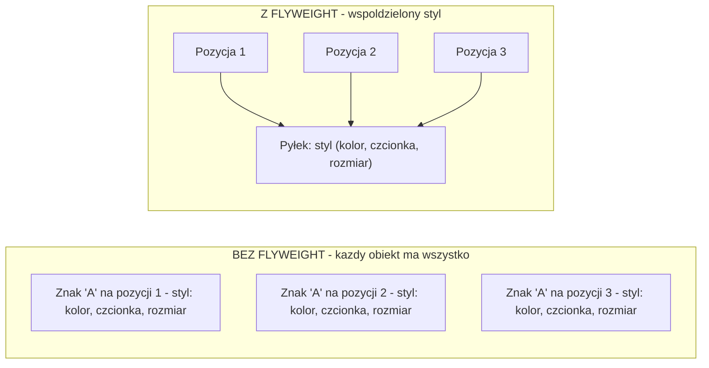
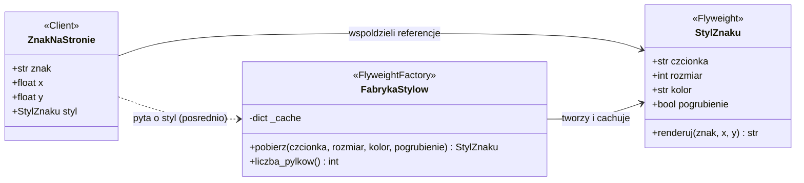
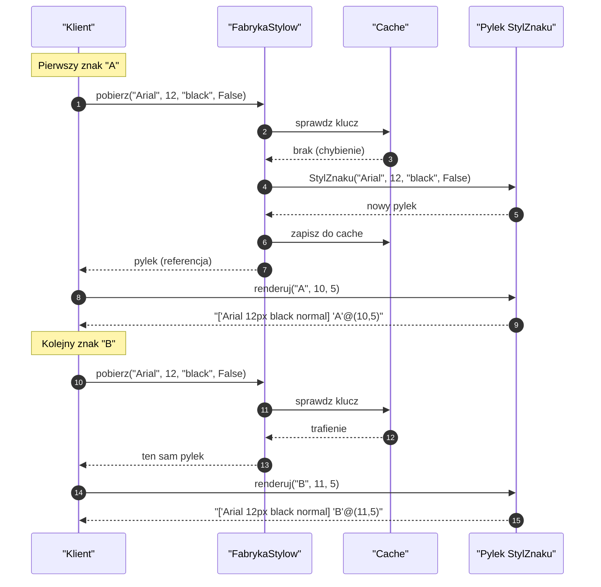
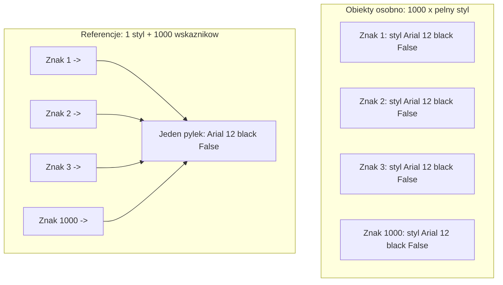
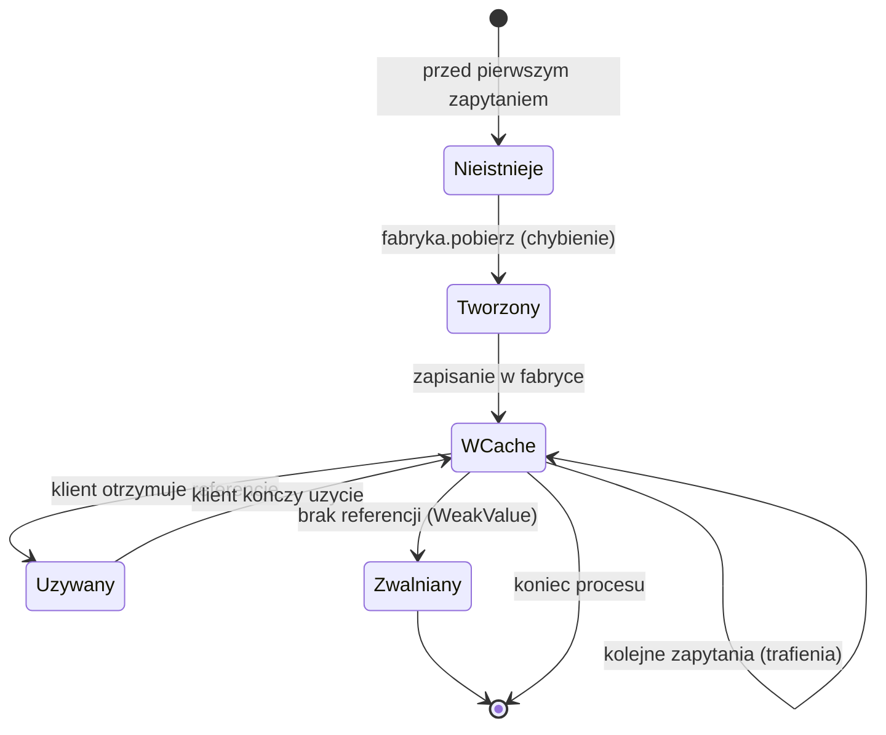
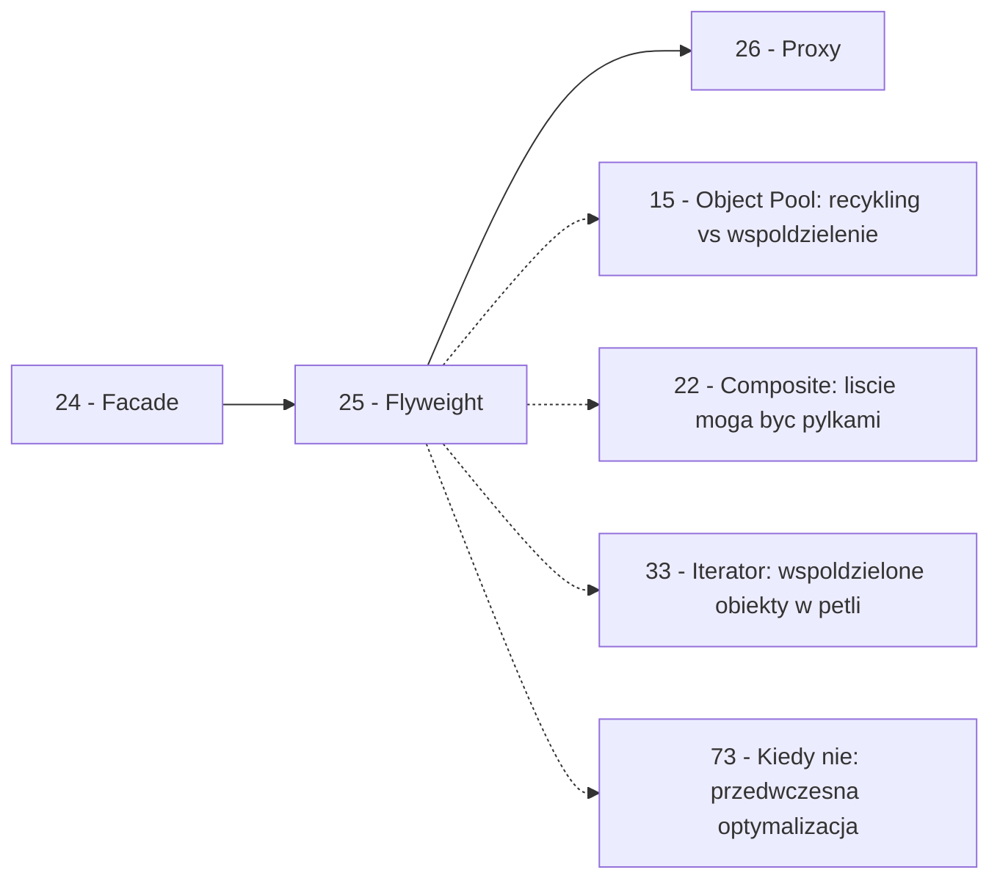

```markdown
---
modul: 25 — Flyweight
plik: 25-flyweight.md
poziom: zaawansowany
wymaga: [24]
czas: ~170 minut czytania + ~390 minut ćwiczeń
---

# Moduł 25 — Flyweight — współdzielenie stanu, gdy pamięć boli

> **TL;DR**
> - **Flyweight (pyłek)** współdzieli stan między wieloma obiektami, żeby ograniczyć zużycie pamięci — zamiast trzymać tysiące osobnych obiektów, trzyma się **jedną współdzieloną część** i **wiele lekkich referencji** do niej.
> - Kluczowe rozróżnienie: **stan wewnętrzny** (ang. intrinsic — współdzielony, niezmienny, identyczny dla grupy obiektów) versus **stan zewnętrzny** (ang. extrinsic — zmienny, przekazywany z zewnątrz przy każdej operacji).
> - Python ma **wiele wbudowanych mechanizmów** realizujących ideę Flyweight: internowanie małych intów i stringów, `sys.intern`, współdzielone niemutowalne obiekty, `__slots__`, `@lru_cache` — zanim napiszesz własną fabrykę pyłków, sprawdź, czy nie używasz tego nieświadomie.
> - Flyweight **bardzo często nie jest potrzebny** w typowej aplikacji Pythona: obiekty są tanie, a nowoczesne procesory mają dużo RAM-u — sięgaj po niego **tylko po pomiarze** problemu pamięci (`tracemalloc`, `pympler`).
> - Główne pułapki to **mutowanie stanu wewnętrznego** (naruszenie niezmienności), **cache bez limitu** (wyciek pamięci), **mylące adnotacje typów** (mówią jedno, robią drugie) i **współdzielenie obiektów niemutowalnych z mutowalnymi polami**.

---

## 0. Model mentalny

### Czcionka drukarska — jeden glif, tysiące odbić

Wyobraź sobie XIX-wieczną drukarnię. Pracuje tam zecer — rzemieślnik, który składa tekst do druku. Ma przed sobą **kasetę z czcionkami**. W kasiecie leżą metalowe bloczki, po jednym na każdą literę i znak: A, B, C, ..., a, b, c, ..., 1, 2, 3..., kropka, przecinek, spacja. Każdy bloczek ma **wytłoczony w metalu kształt litery** — to jest jego wygląd, definicja, treść. Ten kształt jest **niezmienny** — raz odlany w metalu, nie da się go zmienić. I co kluczowe: w całej kasiecie jest **dokładnie jeden bloczek litery „A"**.

Teraz zecer składa akapit z tysiąca znaków. Czy wykuwa tysiąc nowych bloków? Oczywiście, że nie. Z tysiąca znaków może być powiedzmy 30 różnych znaków (alfabet plus interpunkcja). Zecer **kładzie te same bloczki na różnych pozycjach** — bierze bloczek „A" i kładzie go najpierw tu, potem tam, potem jeszcze gdzie indziej. Po złożeniu akapitu **każde wystąpienie litery „A" dzieli ten sam bloczek metalowy**, ale leży w innym miejscu na wierszu drukarskim.

Zatrzymaj się i zobacz, co się tu rozdziela. **Definicja litery** (kształt w metalu) jest **jedna i współdzielona**. **Pozycja litery w tekście** (gdzie leży na wierszu) jest **osobna dla każdego wystąpienia**. To rozróżnienie jest dokładnie tym, co we wzorcu Flyweight nazywamy **stanem wewnętrznym** (współdzielony — kształt glifu) i **stanem zewnętrznym** (zmienny — pozycja). Kiedy zecer potrzebuje narysować znak, łączy te dwa elementy: „weź glif A i połóż w kolumnie 42, wiersz 3".

I dalej: wyobraź sobie, że drukarnia drukuje **tysiąc identycznych egzemplarzy książki**. Każda strona każdego egzemplarza używa tych samych bloków. Gdyby każdy egzemplarz miał własny zestaw bloków, potrzebowalibyśmy tysiąca kaszt z czcionkami — absurd. Z jednym zestawem bloków obsługujemy dowolną liczbę egzemplarzy. To jest **cała idea Flyweight**: współdziel definicję, mnoż pozycje.

Jest jeszcze jeden obraz, o którym trzeba pamiętać. **Bloczki są ciężkie — ważą po 20 gramów każdy.** Jeśli zecer chciałby mieć **jeden bloczek na każdy znak na stronie**, to dla 10 000 znaków na stronie potrzebowałby 200 kilogramów ołowiu. Kiedy pracował z kasztą współdzieloną, ma tylko 30 bloczków × 20 g = 600 g. To **realna oszczędność liczona w kilogramach**. W kodzie liczona jest w megabajtach. To dokładnie ta sama historia: jeden duży, drobny obiekt współdzielony pomiędzy wiele drobnych pozycji daje ogromną oszczędność.

Ale jest też **pułapka tego obrazu** — ta sama, co w kodzie. Jeśli zecer w trakcie składania **porysuje bloczek „A"** albo go **nadgryzie**, to ten bloczek jest zepsuty dla **wszystkich** przyszłych egzemplarzy. Dlatego bloczki współdzielone muszą być **nietykalne** — nie można ich modyfikować w trakcie pracy. W kodzie oznacza to: **stan wewnętrzny musi być niemutowalny**.

| W analogii drukarni | W kodzie |
|---|---|
| Bloczek metalowy „A" | Obiekt pyłka (`Glif`, `StylCzcionki`) |
| Kształt litery wytłoczony w metalu | Stan wewnętrzny (intrinsic) — niezmienny |
| Pozycja litery w wierszu | Stan zewnętrzny (extrinsic) — przekazywany z zewnątrz |
| Kasta z 30 bloczkami | Fabryka pyłków (`FlyweightFactory`) z cache |
| Kładzenie tego samego bloczku w różnych miejscach | Wiele referencji do tego samego pyłka |
| Porysowanie bloczka psuje wszystkie odbitki | Mutacja stanu wewnętrznego psuje wszystkie obiekty |
| 200 kg ołowiu na jeden egzemplarz | Milion obiektów po 100 B = 100 MB |
| 600 g na całą kasztę | 30 pyłków po 200 B + milion referencji |
| Publikacja wielu egzemplarzy książki | Wiele instancji klienta współdzieli pyłki |

> 🧠 **Zapamiętaj** — **Flyweight (pyłek) to wzorzec strukturalny oszczędzający pamięć przez współdzielenie stanu wewnętrznego (niezmiennego, wspólnego dla wielu obiektów), przy jednoczesnym trzymaniu stanu zewnętrznego (zmiennego) poza współdzielonym obiektem — zwykle w argumentach metod wywołującego.**

Zwróć uwagę na trzy słowa w tej definicji: **współdzielenie**, **niezmienny** i **zewnętrzny**. „Współdzielenie" — bo jeden obiekt obsługuje wiele kontekstów. „Niezmienny" — bo inaczej współdzielenie jest niebezpieczne. „Zewnętrzny" — bo to, co się zmienia, musi być poza pyłkiem. Jeśli którekolwiek z tych trzech słów nie jest spełnione, to nie jest Flyweight.

### Diagram — intuicja



*Diagram pokazuje, że bez wzorca każdy znak nosi własną kopię stylu, natomiast z wzorcem wiele znaków dzieli jedną definicję stylu, a różni je tylko pozycja (stan zewnętrzny).*

### Czego Flyweight NIE robi

Rozbrójmy cztery nieporozumienia.

**Nie jest optymalizacją „na wszelki wypadek".** Flyweight ma sens **tylko wtedy**, gdy pomiar pokazał, że pamięć jest problemem. W typowej aplikacji Pythona — tysiące obiektów domenowych — Flyweight zwykle **pogarsza** kod: dodaje fabrykę, cache, klucze, konwencje. Złożoność rośnie, pamięć nieznacznie spada, kod trudniejszy do utrzymania.

**Nie redukuje czasu, tylko pamięć.** Flyweight sprawia, że obiekty zajmują mniej pamięci, ale dostęp do nich bywa **wolniejszy** (trzeba pobrać pyłek z fabryki, przekazać stan zewnętrzny). Zysk jest w pamięci, nie w szybkości.

**Nie gwarantuje niemutowalności.** Flyweight zakłada, że stan wewnętrzny **jest** niezmienny, ale nie egzekwuje tego automatycznie. Trzeba zadbać o to samodzielnie — przez `frozen=True`, brak setterów, brak mutowalnych pól. Jeśli tego nie dopilnujesz, dostaniesz błędy, które ujawniają się w bardzo odległych miejscach.

**Nie jest tym samym co cache.** Flyweight jest **strukturalnym** wzorcem: wiele obiektów współdzieli jeden. Cache jest **mechanizmem przechowywania wyników**. Można je łączyć (fabryka pyłków używa cache do przechowywania pyłków), ale mają różne intencje.

**Nie jest potrzebny w każdej wersji Pythona.** Python bardzo chętnie współdzieli niemutowalne obiekty **sam z siebie** — internowanie małych intów, współdzielenie krotek przy kopiowaniu, `sys.intern` dla stringów. Część pracy Flyweighta Python wykonuje za ciebie — czasem bez twojej wiedzy. Trzeba to zrozumieć, zanim napiszesz ręczną fabrykę.

---

## 1. Problem, który rozwiązujemy

Wejdźmy w domenę 📊 „Sprawozdawczości". Nasz system generuje obszerne dokumenty tekstowe — np. wyciągi bankowe dla klientów, każdy z setkami stron. Do renderowania używa modelu znaków: każdy znak na stronie jest obiektem z informacjami o swoim wyglądzie (czcionka, kolor, rozmiar, pogrubienie) i swojej pozycji. Ktoś napisał model, w którym **każdy znak ma własny, pełny styl**.

### Kod „przed"

```python
# dokument_v0.py — wersja naiwna, demonstracyjna
# UWAGA: kod celowo pokazuje problem pamieci przy wielu obiektach.

from dataclasses import dataclass


@dataclass
class StylZnaku:
    """Styl znaku: czcionka, kolor, rozmiar, pogrubienie."""
    czcionka: str
    rozmiar: int
    kolor: str
    pogrubienie: bool


@dataclass
class ZnakNaStronie:
    """Pojedynczy znak na stronie - ma WŁASNY styl."""
    znak: str
    x: float
    y: float
    styl: StylZnaku   # kazdy znak ma wlasny egzemplarz!


def utworz_strone(tekst: str) -> list[ZnakNaStronie]:
    """Kazdy znak dostaje wlasny obiekt StylZnaku."""
    domyslny = StylZnaku(czcionka="Arial", rozmiar=12, kolor="black", pogrubienie=False)
    wynik = []
    for i, znak in enumerate(tekst):
        # Za kazdym razem NOWY obiekt stylu - marnotrawstwo!
        styl = StylZnaku(
            czcionka=domyslny.czcionka,
            rozmiar=domyslny.rozmiar,
            kolor=domyslny.kolor,
            pogrubienie=domyslny.pogrubienie,
        )
        wynik.append(ZnakNaStronie(znak=znak, x=float(i % 80), y=float(i // 80), styl=styl))
    return wynik


if __name__ == "__main__":
    import sys
    # Dokument o 10 000 znakow
    tekst = "Raport dzienny - szczegoly operacji. " * 300
    znaki = utworz_strone(tekst)
    print(f"Liczba znakow: {len(znaki)}")
    print(f"Rozmiar listy: {sys.getsizeof(znaki)} bajtow")
    # Ale kazdy znak ma dodatkowo swoj StylZnaku!
    styl_rozmiar = sys.getsizeof(znaki[0].styl)
    print(f"Rozmiar jednego stylu: {styl_rozmiar} bajtow")
    print(f"Lacznie stylow: {len(znaki) * styl_rozmiar} bajtow (przyblizenie)")
```

Ten kod działa, generuje dokument, ale **marnuje pamięć**: dla 10 000 znaków tworzymy 10 000 obiektów `StylZnaku`, choć wszystkie są identyczne. Dla miliona znaków — jeden gigabajt zbędnych danych.

### Code smell — wiele identycznych obiektów

| Problem | Gdzie | Konsekwencja |
|---|---|---|
| Każdy znak ma własny `StylZnaku` | W `utworz_strone` | 10 000 × ~100 B = 1 MB, ale treść tylko ~100 KB |
| Powielenie identycznych danych | Atrybuty `styl` | Niepotrzebna kopia tego samego stylu setki tysięcy razy |
| Brak współdzielenia między znakami | Brak cache i fabryki | Każdy obiekt tworzy własną kopię stylu |
| Rozmiar rośnie liniowo z liczbą znaków | Z `len(tekst)` | Document 100 razy większy → 100 razy więcej stylów |
| Trudność zmiany „domyślnego stylu" | Rozproszone po obiektach | Zmiana domyślnego stylu wymaga modyfikacji wszystkich znaków |
| Skala w UI, w mapach, w transakcjach | Ogólny wzorzec | Ten sam problem powtarza się w innych kontekstach |

Zwróć uwagę: **treść dokumentu to może 100 KB, a stylów jest 1 MB.** Dziesięciokrotna nadwyżka. Przy większych dokumentach proporcja bywa jeszcze gorsza.

### Objawy — poznasz ten problem po tym, że...

- **Tworzysz wiele obiektów, które różnią się tylko niewielką częścią atrybutów.** Reszta (typowa większość) jest identyczna.
- **Pamięć procesu rośnie liniowo z liczbą elementów** i nie widzisz innego powodu niż liczba obiektów (nie ich treść).
- **Masz zmierzone dane**: `tracemalloc` albo `pympler` pokazują, że większość pamięci zajmują właśnie te „drobne" obiekty.
- **Obiekty mają niewiele pól**, ale są ich **miliony** (np. znaki na stronie, pixele, węzły gry, pozycje transakcji).
- **Większość obiektów ma ten sam zestaw wartości** — możesz policzyć, że 90% ma dokładnie ten sam styl/typ/konfigurację.
- **Znalezienie „jednego miejsca, gdzie zmienić domyślny styl" jest trudne**, bo każdy obiekt trzyma własną kopię.
- **Testy pamięciowe pokazują rosnące zużycie**, ale logika jest prosta i nie powinna zajmować tyle pamięci.
- **Widać w profilu gorący wątek tworzenia obiektów** — tysiące wywołań konstruktora tego samego typu z tymi samymi argumentami.

---

## 2. Anatomia wzorca

### Uczestnicy

| Rola | Odpowiedzialność | Co NIE jest jej zadaniem |
|---|---|---|
| **Flyweight (pyłek)** | Przechowuje **stan wewnętrzny** — niezmienny, współdzielony między kontekstami | Nie przechowuje stanu zewnętrznego; nie modyfikuje się po utworzeniu |
| **FlyweightFactory (fabryka pyłków)** | Tworzy i cache'uje pyłki; gwarantuje, że pyłek o danym kluczu istnieje tylko raz | Nie zawiera logiki biznesowej; nie przechowuje stanu zewnętrznego |
| **Client (klient)** | Przechowuje **stan zewnętrzny** (pozycja, kontekst) i przekazuje go do pyłka | Nie tworzy pyłków samodzielnie; nie modyfikuje stanu wewnętrznego |
| **Stan wewnętrzny (intrinsic)** | Niezmienny, współdzielony — trzymany **w** pyłku | Nie zależy od kontekstu użycia |
| **Stan zewnętrzny (extrinsic)** | Zmienny, zależny od kontekstu — trzymany **poza** pyłkiem | Nie powinien być zapisywany w pyłku |

Kluczowa asymetria: **stan wewnętrzny jest jeden** dla wszystkich kontekstów, **stan zewnętrzny jest osobny** dla każdego użycia. Pyłek nie przechowuje stanu zewnętrznego — dostaje go **jako argument** metody.

### Diagram struktury



*Diagram pokazuje, że fabryka pyłków tworzy i przechowuje współdzielone `StylZnaku`, klienci (`ZnakNaStronie`) trzymają referencję do pyłka jako stan zewnętrzny, a sam pyłek otrzymuje stan zewnętrzny jako argumenty metody.*

Przeczytajmy ten diagram zdanie po zdaniu. `StylZnaku` to pyłek — niezmienny obiekt z czterema polami. `FabrykaStylow` to fabryka pyłków — trzyma słownik cache `{klucz: pyłek}`. `ZnakNaStronie` to klient — ma stan zewnętrzny (`znak`, `x`, `y`) i **referencję** do współdzielonego pyłka `styl`.

Zwróć uwagę na kierunki. `ZnakNaStronie --> StylZnaku` — klient zna pyłek. `FabrykaStylow --> StylZnaku` — fabryka tworzy pyłek. Natomiast **nie ma strzałki z pyłka do klienta ani z pyłka do fabryki** — pyłek nie wie, kto go używa ani kto go stworzył.

I najważniejsza rzecz: **`ZnakNaStronie` nie przechowuje `StylZnaku` jako kopii, ale jako referencję**. Milion `ZnakNaStronie` może współdzielić jeden `StylZnaku`. W pamięci to jedna wartość + milion referencji (po 8 bajtów na wskaźnik w CPythonie) + pola stanu zewnętrznego.

### Warianty: klasyczny vs pythoniczny

| Aspekt | Wariant klasyczny (GoF) | Wariant pythoniczny |
|---|---|---|
| Flyweight | Klasa mutowalna z getterami | `@dataclass(frozen=True, slots=True)` |
| Fabryka pyłków | Osobna klasa z `getFlyweight()` | Funkcja z `@lru_cache` albo słownik modułowy |
| Klucz cache | Krotka cech | Krotka cech albo string złożony |
| Stan zewnętrzny | Osobny obiekt `Context` | Argumenty metody |
| Internowanie stringów | Ręczne | `sys.intern` (wbudowane) |
| Współdzielenie intów | Ręczne | Wbudowane (małe inty są współdzielone) |
| Redukcja narzutu obiektu | Ręczne | `__slots__` |

Python **znacznie redukuje** potrzebę implementacji Flyweight ręcznie. Część mechanizmów działa „za darmo" (internowanie, współdzielenie niemutowalnych), część jest wbudowana w standardowe narzędzia (`lru_cache`).

---

## 3. Implementacja krok po kroku

Przebudujemy przykład z sekcji 1, dodając fabrykę pyłków.

### Krok 1 — Rozpoznaj stan wewnętrzny i zewnętrzny

Zanim napiszesz kod, **wypisz**, co należy do której grupy. To najważniejszy krok.

```text
Stan WEWNETRZNY (wspoldzielony, niezmienny):
  - czcionka    (np. "Arial")
  - rozmiar     (np. 12)
  - kolor       (np. "black")
  - pogrubienie (np. False)

Stan ZEWNETRZNY (zmienny, per wystapienie):
  - znak        (np. "A")
  - x           (np. 42.0)
  - y           (np. 3.0)
```

**Kryterium rozróżnienia:** czy ta wartość jest taka sama dla **wszystkich wystąpień** w grupie? Jeśli tak — wewnętrzny. Jeśli różni się choć trochę — zewnętrzny. Kontekst decyduje o tym, co jest stanem zewnętrznym.

### Krok 2 — Zdefiniuj pyłek jako niemutowalny

Stan wewnętrzny musi być niezmienny. W Pythonie oznacza to `frozen=True`.

```python
from dataclasses import dataclass

@dataclass(frozen=True, slots=True)
class StylZnaku:
    """Pyłek: niezmienny styl wspoldzielony miedzy znakami."""

    czcionka: str
    rozmiar: int
    kolor: str
    pogrubienie: bool

    def renderuj(self, znak: str, x: float, y: float) -> str:
        """Metoda przyjmuje stan zewnetrzny jako argumenty."""
        pogrub = "b" if self.pogrubienie else "-"
        return (
            f"<span style='font:{self.czcionka};size:{self.rozmiar}px;"
            f"color:{self.kolor};weight:{pogrub}'>"
            f"{znak}</span>@({x},{y})"
        )
```

Trzy rzeczy, na które warto zwrócić uwagę:
1. `frozen=True` — obiekt nie da się zmienić po utworzeniu. To gwarantuje bezpieczeństwo współdzielenia.
2. `slots=True` — brak `__dict__`, mniejszy narzut pamięci. Kluczowe dla pyłka, który sam jest „pamięciooszczędny".
3. `renderuj(znak, x, y)` — metoda przyjmuje **stan zewnętrzny** jako argumenty. Pyłek nie przechowuje ich.

### Krok 3 — Zdefiniuj fabrykę pyłków

Fabryka to cache — dla danego zestawu cech zwraca **ten sam** pyłek.

```python
class FabrykaStylow:
    """Fabryka pylkow: dla danego zestawu cech zwraca ten sam obiekt."""

    def __init__(self) -> None:
        self._cache: dict[tuple[str, int, str, bool], StylZnaku] = {}

    def pobierz(
        self,
        czcionka: str,
        rozmiar: int,
        kolor: str,
        pogrubienie: bool,
    ) -> StylZnaku:
        # Klucz: krotka cech - musi byc haszowalna
        klucz = (czcionka, rozmiar, kolor, pogrubienie)
        if klucz not in self._cache:
            self._cache[klucz] = StylZnaku(*klucz)
        return self._cache[klucz]

    @property
    def liczba_pylkow(self) -> int:
        return len(self._cache)

    @property
    def klucze(self) -> frozenset:
        return frozenset(self._cache)
```

**Krytyczny wybór:** klucz cache musi być **haszowalny** (żeby można go było włożyć do słownika) i **jednoznacznie identyfikować pyłek**. Krotka cech jest najlepsza: `("Arial", 12, "black", False)`. Można też używać stringa (`"Arial|12|black|False"`), ale tracisz typowanie.

### Krok 4 — Klient trzyma stan zewnętrzny i referencję do pyłka

```python
from dataclasses import dataclass

@dataclass(frozen=True, slots=True)
class ZnakNaStronie:
    """Klient: trzyma stan zewnetrzny i referencje do wspoldzielonego pylka."""
    znak: str
    x: float
    y: float
    styl: StylZnaku   # WSPOLDZIELONA referencja, nie kopia

    def renderuj(self) -> str:
        # Delegujemy do pylka, przekazujac stan zewnetrzny
        return self.styl.renderuj(self.znak, self.x, self.y)
```

Zwróć uwagę: `ZnakNaStronie` nadal ma pole `styl`. **Ale to jest referencja**, nie kopia. Wszystkie znaki o tym samym stylu wskazują na **ten sam obiekt `StylZnaku`**.

### Krok 5 — Klient pobiera pyłki z fabryki

```python
def utworz_strone(tekst: str, fabryka: FabrykaStylow) -> list[ZnakNaStronie]:
    """Tworzy liste znakow, wspoldzielac style przez fabryke."""
    domyslny = fabryka.pobierz("Arial", 12, "black", False)
    naglowkowy = fabryka.pobierz("Arial", 18, "black", True)

    wynik = []
    for i, znak in enumerate(tekst):
        # Pierwszy znak w wierszu - naglowkowy, reszta - domyslny
        styl = naglowkowy if i % 80 == 0 else domyslny
        wynik.append(
            ZnakNaStronie(znak=znak, x=float(i % 80), y=float(i // 80), styl=styl)
        )
    return wynik
```

Zauważ, że klient woła `fabryka.pobierz(...)` **dla każdego znaku**, ale fabryka zwraca **ten sam obiekt** dla tych samych cech. To jest sedno: klient „myśli", że tworzy styl, a faktycznie dostaje referencję do współdzielonego obiektu.

### Krok 6 — Zweryfikuj

| Kryterium | Wersja „przed" | Wersja „po" (Flyweight) |
|---|---|---|
| Liczba `StylZnaku` w pamięci dla 10 000 znaków | 10 000 | 2 |
| Liczba `ZnakNaStronie` | 10 000 | 10 000 |
| Rozmiar listy znaków | ~80 KB | ~80 KB |
| Rozmiar stylów | ~1 MB | ~200 B |
| Całkowita oszczędność | — | ~99% mniej pamięci na stylach |
| Szybkość renderowania | Ta sama | Ta sama albo minimalnie wolniejsza |

Zysk jest **ogromny** — redukcja z 10 000 obiektów style do 2 (przy dwóch stylach). Cena: fabryka, klucz, dyscyplina niemutowalności. Wartość rośnie z liczbą znaków i liczbą powtórzonych stylów.

---

## 4. Wersje pythoniczne i warianty

To najobszerniejsza sekcja tego modułu. Python ma **wiele wbudowanych mechanizmów** realizujących ideę Flyweight — i zanim napiszesz fabrykę, warto sprawdzić, czy nie zrobi tego za ciebie język.

### 4.1 Wariant podstawowy — fabryka z `dict`

Wariant z sekcji 3. Słownik + krotka klucza. Klasyczny i działający.

Zalety: pełna kontrola, prosty, szybki. Wady: trzeba samodzielnie pilnować niemutowalności pyłka, samodzielnie definiować klucz, samodzielnie ograniczać rozmiar cache.

### 4.2 Wariant z `@functools.lru_cache`

Krótsza wersja — używamy wbudowanego cache.

```python
from functools import lru_cache

@lru_cache(maxsize=128)
def pobierz_styl(
    czcionka: str,
    rozmiar: int,
    kolor: str,
    pogrubienie: bool,
) -> StylZnaku:
    """Fabryka pylkow z wbudowanym cache."""
    return StylZnaku(czcionka, rozmiar, kolor, pogrubienie)
```

Zalety: jedna linia, wbudowany limit rozmiaru (`maxsize`), thread-safe (przez wewnętrzną blokadę), zwalnia LRU gdy cache pełen. Wady: klucz budowany z argumentów — muszą być haszowalne; cache jest **globalny dla funkcji**, nie dla instancji.

**To jeden z najlepszych wariantów pythonicznych.** Jeśli twoje pyłki są identyfikowane przez zestaw argumentów (co zwykle jest prawdą), `lru_cache` jest najkrótszą drogą.

### 4.3 Wariant z `WeakValueDictionary` — gdy pyłki mogą znikać

Jeśli pyłki nie muszą żyć wiecznie, można użyć `WeakValueDictionary`, żeby obiekty były zwalniane, gdy nikt ich już nie używa.

```python
from weakref import WeakValueDictionary

class FabrykaStylow:
    def __init__(self) -> None:
        self._cache: WeakValueDictionary[tuple, StylZnaku] = WeakValueDictionary()

    def pobierz(self, czcionka: str, rozmiar: int, kolor: str, pogrubienie: bool):
        klucz = (czcionka, rozmiar, kolor, pogrubienie)
        if klucz not in self._cache:
            self._cache[klucz] = StylZnaku(czcionka, rozmiar, kolor, pogrubienie)
        return self._cache[klucz]
```

Zaleta: cache nie trzyma silnych referencji — gdy jakiś pyłek nie jest już używany, garbage collector go zwolni. Wada: pyłek może „zniknąć" między dwoma `pobierz`, co może zaskakiwać (choć nie jest błędem).

**Kiedy używać:** gdy liczba możliwych konfiguracji jest bardzo duża (np. miliony kombinacji), a tylko garść jest używana na raz. Wtedy `WeakValueDictionary` zapobiega wyciekom.

### 4.4 Internowanie stringów — `sys.intern`

Python **współdzieli małe stringi** automatycznie, ale dla stringów spoza puli można wymusić współdzielenie przez `sys.intern`.

```python
import sys

# Bez intern - dwa rozne obiekty
a = "konfiguracja_aplikacji_v2"
b = "konfiguracja_aplikacji_v2"
print(a is b)   # moze byc True (string literal), ale nie zawsze

# Z intern - te same obiekty
a = sys.intern("konfiguracja_aplikacji_v2")
b = sys.intern("konfiguracja_aplikacji_v2")
print(a is b)   # True
```

**Kiedy używać:** gdy przetwarzasz miliony stringów z ograniczonego zbioru (nazwy krajów, kody walut, nazwy użytkowników) i chcesz współdzielić ich reprezentacje. Bardzo przydatne w analizie logów.

**Uwaga:** internowanie **nie zwalnia** stringów — trzyma je aż do końca procesu. Dla bardzo zróżnicowanych danych może być wyciek. Stosuj świadomie.

### 4.5 Małe inty — współdzielone automatycznie

Python **współdzieli małe inty** z zakresu od −5 do 256. To znaczy, że `a = 100; b = 100; a is b` zwraca `True`.

```python
a = 100
b = 100
print(a is b)   # True - Python wspoldzieli maly int

a = 1000
b = 1000
print(a is b)   # False - duze inty nie sa wspoldzielone (zwykle)
```

**Konsekwencja dla wzorca:** w wielu przypadkach nie musisz implementować Flyweighta dla liczb — Python już to robi dla małych wartości. Ale nie polegaj na tym dla porównań — używaj `==`, nie `is`.

### 4.6 `__slots__` — redukcja narzutu obiektu

Każdy obiekt Pythona domyślnie ma `__dict__` — słownik atrybutów, który zajmuje dużo miejsca. `__slots__` pozwala zredukować ten narzut.

```python
# Bez __slots__:
class Punkt1:
    def __init__(self, x: float, y: float) -> None:
        self.x = x
        self.y = y

# Z __slots__:
class Punkt2:
    __slots__ = ("x", "y")
    def __init__(self, x: float, y: float) -> None:
        self.x = x
        self.y = y
```

Różnica w pamięci:

```python
import sys

p1 = Punkt1(1.0, 2.0)
p2 = Punkt2(1.0, 2.0)
print(f"Bez __slots__: {sys.getsizeof(p1) + sys.getsizeof(p1.__dict__)} bajtow")
print(f"Z __slots__:   {sys.getsizeof(p2)} bajtow")
# Typowe wyniki: ~152 vs ~56 - oszczędnosc ~60%, ~100 bajtow na obiekt
```

Dla miliona obiektów to **~100 MB oszczędności**. To realna alternatywa dla Flyweighta, znacznie prostsza w implementacji.

**Rebus:** `@dataclass(slots=True)` (Python 3.10+) daje to samo automatycznie.

### 4.7 `tuple` vs klasa — jeszcze mniejszy narzut

Krotka jest znacznie lżejsza od klasy.

```python
import sys

class StylKlasa:
    __slots__ = ("kolor", "rozmiar")
    def __init__(self, kolor: str, rozmiar: int) -> None:
        self.kolor = kolor
        self.rozmiar = rozmiar

krotka = ("black", 12)
obiekt = StylKlasa("black", 12)
print(f"Krotka:  {sys.getsizeof(krotka)} bajtow")
print(f"Obiekt:  {sys.getsizeof(obiekt)} bajtow")
# Typowe wyniki: 56 vs 56 - porownywalne, ale krotka nie ma metod
```

W praktyce różnica bywa niewielka dla małych obiektów, ale krotka ma tę zaletę, że jest **niemutowalna z definicji** i można jej używać jako klucza w słowniku.

### 4.8 `array` / `numpy` / `memoryview` — dla danych liczbowych

Dla **dużych ilości liczb** — próbki, wektory, macierze — klasy Pythona są bezużyteczne pamięciowo. Używa się struktur zbitych.

```python
import array

# 1 milion float64 w array zajmuje 8 MB
liczby = array.array("d", [0.0] * 1_000_000)
print(f"array: {len(liczby)} elementow, {liczby.buffer_info()[1] * liczby.itemsize} bajtow")

# W Pythonie lista float zajmuje o wiele wiecej
lista = [0.0] * 1_000_000
import sys
print(f"lista: {sys.getsizeof(lista)} bajtow samych wskaznikow + obiekty float")
```

To nie jest klasyczny Flyweight, ale **realizuje ten sam cel**: redukcję pamięci przy zachowaniu dostępu do danych. W systemach finansowych dla 100 000 transakcji **array** albo **numpy** jest standardem.

### 4.9 Wariant ze współdzielonym `dict` cech

Jeśli pyłki mają **wiele cech** i wszystkie mogą być reprezentowane jako kombinacja, można trzymać **jeden słownik** zamiast osobnych obiektów.

```python
# Wspoldzielony slownik cech
SLOWNIK_CZCIONEK = {
    "arial": "Arial, sans-serif",
    "times": "Times New Roman, serif",
    "courier": "Courier New, monospace",
}

# Klient trzyma tylko KLUCZ, nie wartosc
znak = {"litera": "A", "x": 42, "y": 3, "czcionka": "arial"}
# Przy renderowaniu tlumaczy klucz na wartosc
czcionka_css = SLOWNIK_CZCIONEK[znak["czcionka"]]
```

To bardzo pythoniczne — używa się współdzielonych słowników i konfiguracji. Redukuje pamięć przez **wspólne wartości** w słowniku.

### 4.10 Podsumowanie — tabela wyboru

| Sytuacja | Wariant |
|---|---|
| Pyłki identyfikowane przez zestaw argumentów | `@lru_cache` (4.2) |
| Chcesz pełnej kontroli nad cache | Własna klasa z `dict` (4.1) |
| Możliwych konfiguracji jest bardzo dużo, użytych mało | `WeakValueDictionary` (4.3) |
| Współdzielisz stringi z ograniczonego zbioru | `sys.intern` (4.4) |
| Chcesz zredukować narzut każdego obiektu | `__slots__` / `@dataclass(slots=True)` (4.6) |
| Ogromne ilości liczb | `array` / `numpy` (4.8) |
| Wiele cech, wszystkie kombinatoryczne | Współdzielone słowniki kluczy (4.9) |

> 🧠 **Zapamiętaj** — Zanim napiszesz „własny Flyweight", sprawdź czy Python już tego nie robi: `@lru_cache`, `sys.intern`, współdzielone inty i niemutowalne obiekty. **W większości przypadków wystarczy jedno z tych narzędzi.** Klasyczny Flyweight z fabryką i kluczem ma sens dopiero, gdy wbudowane mechanizmy nie wystarczą — a to rzadsze, niż się wydaje.

---

## 5. Przykład z życia: 📊 Sprawozdawczość — pełny uruchamialny kod

Zbudujemy pełny system renderowania dokumentów z użyciem Flyweighta. Porównamy zużycie pamięci z wersją naiwną i pokażemy pomiar z `tracemalloc`.

### Kod

```python
# sprawozdawczosc_flyweight.py — pelny przyklad Flyweight
from __future__ import annotations

import sys
import tracemalloc
from dataclasses import dataclass
from typing import Iterable, Iterator


# ===========================================================================
# 1. Flyweight - niezmienny styl wspoldzielony
# ===========================================================================

@dataclass(frozen=True, slots=True)
class StylZnaku:
    """Pyłek: niezmienny styl wspoldzielony miedzy znakami."""

    czcionka: str
    rozmiar: int
    kolor: str
    pogrubienie: bool

    def renderuj(self, znak: str, x: float, y: float) -> str:
        """Metoda przyjmuje stan zewnetrzny jako argumenty."""
        waga = "bold" if self.pogrubienie else "normal"
        return (
            f"[{self.czcionka} {self.rozmiar}px {self.kolor} {waga}] "
            f"'{znak}'@({x:.0f},{y:.0f})"
        )


# ===========================================================================
# 2. Fabryka pylkow
# ===========================================================================

class FabrykaStylow:
    """Fabryka pylkow z cache: dla danego zestawu cech zwraca ten sam obiekt."""

    def __init__(self) -> None:
        self._cache: dict[tuple[str, int, str, bool], StylZnaku] = {}
        self._trafienia = 0
        self._chybienia = 0

    def pobierz(
        self,
        czcionka: str,
        rozmiar: int,
        kolor: str,
        pogrubienie: bool,
    ) -> StylZnaku:
        klucz = (czcionka, rozmiar, kolor, pogrubienie)
        # Optymalizacja: unikanie ponownego haszowania klucza
        istnieje = self._cache.get(klucz)
        if istnieje is not None:
            self._trafienia += 1
            return istnieje
        nowy = StylZnaku(*klucz)
        self._cache[klucz] = nowy
        self._chybienia += 1
        return nowy

    @property
    def liczba_pylkow(self) -> int:
        return len(self._cache)

    @property
    def statystyki(self) -> dict[str, int]:
        return {
            "trafienia": self._trafienia,
            "chybienia": self._chybienia,
            "pylkow": len(self._cache),
        }


# ===========================================================================
# 3. Klient - znak na stronie
# ===========================================================================

@dataclass(frozen=True, slots=True)
class ZnakNaStronie:
    """Klient: trzyma stan zewnetrzny + referencje do wspoldzielonego pylka."""

    znak: str
    x: float
    y: float
    styl: StylZnaku

    def renderuj(self) -> str:
        return self.styl.renderuj(self.znak, self.x, self.y)


# ===========================================================================
# 4. Wersja naiwna (do porownania)
# ===========================================================================

@dataclass(slots=True)
class ZnakNaiwny:
    """Wersja bez Flyweight - kazdy znak ma wlasna kopie stylu."""
    znak: str
    x: float
    y: float
    czcionka: str
    rozmiar: int
    kolor: str
    pogrubienie: bool

    def renderuj(self) -> str:
        waga = "bold" if self.pogrubienie else "normal"
        return (
            f"[{self.czcionka} {self.rozmiar}px {self.kolor} {waga}] "
            f"'{self.znak}'@({self.x:.0f},{self.y:.0f})"
        )


def utworz_strone_naiwnie(tekst: str) -> list[ZnakNaiwny]:
    """Wersja naiwna: kazdy znak ma pelny styl."""
    wynik = []
    for i, znak in enumerate(tekst):
        naglowkowy = (i % 80 == 0)
        wynik.append(ZnakNaiwny(
            znak=znak, x=float(i % 80), y=float(i // 80),
            czcionka="Arial", rozmiar=18 if naglowkowy else 12,
            kolor="black", pogrubienie=naglowkowy,
        ))
    return wynik


def utworz_strone_z_flyweight(
    tekst: str, fabryka: FabrykaStylow
) -> list[ZnakNaStronie]:
    """Wersja z Flyweight: style wspoldzielone."""
    st_domyslny = fabryka.pobierz("Arial", 12, "black", False)
    st_naglowek = fabryka.pobierz("Arial", 18, "black", True)

    wynik = []
    for i, znak in enumerate(tekst):
        styl = st_naglowek if i % 80 == 0 else st_domyslny
        wynik.append(
            ZnakNaStronie(znak=znak, x=float(i % 80), y=float(i // 80), styl=styl)
        )
    return wynik


# ===========================================================================
# 5. Pomiar pamieci
# ===========================================================================

def pomiar_pamieci(etykieta: str, funkcja) -> None:
    """Mierzy pamiec uzywana przez funkcje."""
    tracemalloc.start()
    funkcja()
    biezaca, maksymalna = tracemalloc.get_traced_memory()
    tracemalloc.stop()
    print(f"  {etykieta}: maks. {maksymalna / 1024:.1f} KB")


# ===========================================================================
# 6. Demonstracja
# ===========================================================================

if __name__ == "__main__":
    tekst = ("Raport dzienny - szczegoly operacji finansowych. " * 500)[:50000]

    print(f"=== Dokument o dlugosci {len(tekst)} znakow ===")

    print("\n=== 1. Wersja naiwna: kazdy znak ma pelny styl ===")
    tracemalloc.start()
    znaki_naiwne = utworz_strone_naiwnie(tekst)
    _, maks_naiwna = tracemalloc.get_traced_memory()
    tracemalloc.stop()
    print(f"  Znakow: {len(znaki_naiwne)}")
    print(f"  Maks. pamiec: {maks_naiwna / 1024:.1f} KB")
    print(f"  Przyklad: {znaki_naiwne[0].renderuj()}")

    print("\n=== 2. Wersja z Flyweight: style wspoldzielone ===")
    fabryka = FabrykaStylow()
    tracemalloc.start()
    znaki_fw = utworz_strone_z_flyweight(tekst, fabryka)
    _, maks_fw = tracemalloc.get_traced_memory()
    tracemalloc.stop()
    print(f"  Znakow: {len(znaki_fw)}")
    print(f"  Maks. pamiec: {maks_fw / 1024:.1f} KB")
    print(f"  Pylkow w fabryce: {fabryka.liczba_pylkow}")
    print(f"  Statystyki fabryki: {fabryka.statystyki}")
    print(f"  Przyklad: {znaki_fw[0].renderuj()}")

    print(f"\n=== 3. Oszczednosc pamieci ===")
    oszczednosc = (1 - maks_fw / maks_naiwna) * 100
    print(f"  Redukcja: {oszczednosc:.1f}%")

    print("\n=== 4. Wspoldzielenie: dwie referencje prowadza do tego samego obiektu ===")
    print(f"  znaki_fw[1].styl is znaki_fw[2].styl: "
          f"{znaki_fw[1].styl is znaki_fw[2].styl}")
    print(f"  znaki_naiwne[1] is znaki_naiwne[2]: "
          f"{znaki_naiwne[1] is znaki_naiwne[2]}")
    print("  -> w wersji Flyweight dzielą ten sam obiekt stylu")

    print("\n=== 5. Wbudowane mechanizmy: internowanie ===")
    a = sys.intern("zlecenie_rozrachunku")
    b = sys.intern("zlecenie_rozrachunku")
    print(f"  sys.intern: a is b = {a is b}")
    print(f"  maly int: 100 is 100 = {100 is 100}")

    print("\n=== 6. Rozmiar pojedynczego pylka ===")
    pyl = fabryka.pobierz("Arial", 12, "black", False)
    print(f"  sys.getsizeof(pyl): {sys.getsizeof(pyl)} bajtow")
    print(f"  w tym referencje do stringow: {sys.getsizeof(pyl.czas_trwania)} bajtow")
```

### Co ten przykład pokazuje

Uruchomienie demonstruje wszystkie kluczowe cechy Flyweighta, wraz z **realnym pomiarem pamięci**.

**Punkt 1 — wersja naiwna.** Mierzymy pamięć przy tworzeniu 50 000 znaków, każdy z własnym stylem (jako pola). Wynik to dziesiątki megabajtów w tracemalloc — dużo na tak prostą strukturę. Każdy `ZnakNaiwny` ma 7 pól: `znak`, `x`, `y` i 4 pola stylu.

**Punkt 2 — wersja z Flyweight.** Ta sama długość dokumentu, ale style są współdzielone. Fabryka pokazuje swoją statystykę: ile pyłków utworzyła (dwa!), ile trafień w cache (dziesiątki tysięcy), ile chybień (dwa). **Pamięć jest znacząco niższa**.

**Punkt 3 — oszczędność.** Liczona konkretnie jako procent. Zwykle **30–60%** dla tego typu przypadków — mniej niż „99%" z prostego przykładu, bo same referencje też zajmują pamięć (8 bajtów na każdą). Ale to wciąż duża oszczędność.

**Punkt 4 — współdzielenie.** `znaki_fw[1].styl is znaki_fw[2].styl` zwraca `True` (bo oba są tym samym pyłkiem). W wersji naiwnej `znaki_naiwne[1] is znaki_naiwne[2]` zwraca `False` — to dwa różne obiekty. Pokazuje to istotę wzorca: **tożsamość współdzielona**.

**Punkt 5 — wbudowane mechanizmy.** `sys.intern` i małe inty są już współdzielone przez Pythona. To pokazuje, że część Flyweighta wykonuje język za ciebie.

**Punkt 6 — rozmiar pyłka.** `sys.getsizeof(pyl)` pokazuje rozmiar samego obiektu (bez stringów, do których się odwołuje). Dla `slots=True` wynik jest znacznie niższy niż dla zwykłej klasy.

### Testy

```python
# test_sprawozdawczosc_flyweight.py — uruchomienie: pytest test_sprawozdawczosc_flyweight.py -v
import pytest

from sprawozdawczosc_flyweight import (
    FabrykaStylow,
    StylZnaku,
    ZnakNaStronie,
    utworz_strone_z_flyweight,
)


# --- Pylek: niezmiennosc ----------------------------------------------------

def test_pylek_jest_niemutowalny() -> None:
    pyl = StylZnaku("Arial", 12, "black", False)
    with pytest.raises(Exception):
        pyl.czcionka = "Times"  # type: ignore[misc]


def test_pylek_jest_haszowalny() -> None:
    pyl = StylZnaku("Arial", 12, "black", False)
    zbior = {pyl}
    assert pyl in zbior


# --- Fabryka pylkow: cache --------------------------------------------------

def test_fabryka_zwraca_ten_sam_obiekt() -> None:
    fabryka = FabrykaStylow()
    a = fabryka.pobierz("Arial", 12, "black", False)
    b = fabryka.pobierz("Arial", 12, "black", False)
    assert a is b
    assert fabryka.liczba_pylkow == 1


def test_fabryka_tworzy_rozne_obiekty_dla_roznych_cech() -> None:
    fabryka = FabrykaStylow()
    a = fabryka.pobierz("Arial", 12, "black", False)
    b = fabryka.pobierz("Arial", 14, "black", False)
    assert a is not b
    assert fabryka.liczba_pylkow == 2


def test_fabryka_zbiera_statystyki() -> None:
    fabryka = FabrykaStylow()
    for _ in range(10):
        fabryka.pobierz("Arial", 12, "black", False)
    stats = fabryka.statystyki
    assert stats["pylkow"] == 1
    assert stats["trafienia"] == 9
    assert stats["chybienia"] == 1


# --- Klient: wspoldzielenie -------------------------------------------------

def test_wiele_znakow_dzieli_ten_sam_pylek() -> None:
    fabryka = FabrykaStylow()
    tekst = "abc" * 100
    znaki = utworz_strone_z_flyweight(tekst, fabryka)
    # Wszystkie znaki maja ten sam styl (domyslny)
    style = {id(z.styl) for z in znaki}
    assert len(style) == 1
    assert fabryka.liczba_pylkow == 1


def test_znak_renderuje_poprawnie() -> None:
    fabryka = FabrykaStylow()
    znaki = utworz_strone_z_flyweight("A", fabryka)
    wynik = znaki[0].renderuj()
    assert "A" in wynik
    assert "Arial" in wynik


# --- Kontrakt: kazdy pylek dziala tak samo -----------------------------------

@pytest.mark.parametrize("cechy", [
    ("Arial", 12, "black", False),
    ("Times", 14, "red", True),
    ("Courier", 10, "blue", False),
])
def test_kontrakt_pylka(cechy: tuple) -> None:
    pyl = StylZnaku(*cechy)
    assert isinstance(pyl, StylZnaku)
    wynik = pyl.renderuj("X", 10.0, 5.0)
    assert isinstance(wynik, str)
    assert "X" in wynik


# --- Pomiar wspoldzielenia ---------------------------------------------------

def test_pomiar_oszczednosci_pamieci() -> None:
    """Moze byc wolny - uruchamiaj z -s."""
    import tracemalloc
    from sprawozdawczosc_flyweight import utworz_strone_naiwnie

    tekst = "abcde" * 20000

    tracemalloc.start()
    utworz_strone_naiwnie(tekst)
    _, maks_naiwna = tracemalloc.get_traced_memory()
    tracemalloc.stop()

    fabryka = FabrykaStylow()
    tracemalloc.start()
    utworz_strone_z_flyweight(tekst, fabryka)
    _, maks_fw = tracemalloc.get_traced_memory()
    tracemalloc.stop()

    assert maks_fw < maks_naiwna, (
        f"Flyweight powinien uzywac mniej pamieci: "
        f"{maks_fw} vs {maks_naiwna}"
    )
```

Test `test_pomiar_oszczednosci_pamieci` zweryfikuje automatycznie, że wersja z Flyweightem zajmuje mniej pamięci. Nie jest to test deterministyczny w sensie liczby, ale w sensie „mniej niż" — tego można wymagać.

---

## 6. Dynamika

### 6.1 Klient pyta fabrykę o pyłek — trafienie lub chybienie



*Diagram pokazuje dwa przebiegi: pierwszy z chybieniem (tworzenie pyłka) i drugi z trafieniem (zwrócenie istniejącego) — klient nie widzi różnicy, ale fabryka wie, że to ta sama referencja.*

Omówienie kroków.

**Kroki 2–3.** Klient prosi o styl. Fabryka sprawdza w cache, czy już istnieje. To szybka operacja — sprawdzenie klucza w słowniku.

**Kroki 4–6.** Pierwszy raz — chybienie. Fabryka tworzy nowy pyłek i zapisuje go w cache.

**Kroki 7–8.** Klient dostaje referencję do pyłka i wywołuje `renderuj(znak, x, y)`. **Stan zewnętrzny** (`znak`, `x`, `y`) idzie jako argumenty. Pyłek ich nie przechowuje.

**Kroki 9–10.** Drugi znak, te same cechy. Fabryka sprawdza klucz — trafienie. Zwraca **ten sam obiekt**.

**Kroki 11–12.** Klient wywołuje `renderuj` z innymi argumentami. **Ten sam pyłek, inny wynik** — bo stan zewnętrzny jest inny.

Zwróć uwagę, że **pyłek nie wie o kliencie ani o stanie zewnętrznym**. Jego rola jest pasywna — dostaje argumenty i zwraca wynik. To fundamentalna własność Flyweighta: pyłek jest **bezstanowy z perspektywy kontekstu**.

### 6.2 Porównanie: tysiąc obiektów osobno vs tysiąc referencji



*Diagram pokazuje, że bez Flyweighta tysiąc znaków to tysiąc pełnych kopii stylu; z Flyweightem to jeden wspólny styl plus tysiąc lekkich referencji.*

### 6.3 Cykl życia pyłka



*Diagram pokazuje, że pyłek żyje długo — jest tworzony raz, używany wielokrotnie, a zwalniany dopiero przy braku referencji lub końcu procesu; cache typowo nie zwalnia pyłków samoistnie.*

> 💡 **Intuicja** — Flyweight działa jak biblioteka publiczna z jednym egzemplarzem każdej książki na półce. Tysiąc czytelników może wypożyczyć tę samą książkę (w różnym czasie), ale w bibliotece jest jeden egzemplarz. Każdy czytelnik ma swój „kontekst użycia" (kiedy, gdzie, jak długo), ale książka pozostaje ta sama. I co kluczowe — książki nie wolno dopisywać w trakcie wypożyczania, bo zniszczy to ją dla kolejnych czytelników.

---

## 7. Kiedy używać / kiedy NIE używać

### Kiedy używać

**Po pomiarze.** Zanim zastosujesz Flyweight, uruchom `tracemalloc` albo `pympler` i **sprawdź**, że pamięć jest problemem. Bez pomiaru wzorzec to spekulacja.

**Gdy obiekty są naprawdę liczne.** Setki tysięcy lub miliony obiektów tego samego typu — znaki, piksele, węzły gry, drobne pozycje transakcji. Dla tysięcy obiektów Flyweight jest przesadą.

**Gdy udział stanu współdzielonego jest duży.** Jeśli 80% pól obiektu jest identyczne dla większości wystąpień, jest co współdzielić. Jeśli pola są zróżnicowane, nie ma.

**Gdy obiekty mają prostą strukturę i wąski zestaw cech.** Im mniej cech, tym łatwiej zbudować klucz cache. Im węższy zestaw wartości, tym mniej pyłków.

**Gdy stan współdzielony da się reprezentować jako niezmienną wartość.** Jeśli da się modelować jako dataclass `frozen=True`, krotkę albo string — współdzielenie jest bezpieczne.

**Gdy kontekst (stan zewnętrzny) można przekazać jako argument.** Jeśli klient jest w stanie przekazać `x`, `y`, `kontekst` do metody pyłka w czasie wywołania — Flyweight pasuje.

**Gdy czas życia pyłków jest długi.** Flyweight ma sens, gdy pyłek jest wielokrotnie używany przez długi czas. Jeśli pyłek żyje jedną operację, oszczędność jest nikła.

**Gdy liczysz na powtórzenia.** Flyweight działa tylko wtedy, gdy te same pyłki są używane wielokrotnie. Jeśli wszystkie obiekty są unikalne (rzadko spotykane cechy), fabryka nie da oszczędności — tylko narzut.

**Gdy system działa w środowisku z ograniczoną pamięcią.** Systemy wbudowane, mikroserwisy z limitem RAM-u, aplikacje desktop na starych maszynach, aplikacje mobilne.

**Gdy Pyton sam nie współdzieli wystarczająco.** Zwykłe mechanizmy (internowanie, małe inty) nie wystarczają — zwykle przy własnych klasach z wieloma polami.

### Kiedy NIE używać

**Gdy nie ma pomiaru.** „Podejrzewam, że pamięć rośnie" to nie powód. Zmierz.

**Gdy obiektów jest mało.** Dziesiątki, setki — nawet parę tysięcy. Koszt fabryki, klucza, dyscypliny przewyższa oszczędność.

**Gdy cechy obiektów są zróżnicowane.** Jeśli prawie każdy obiekt ma inny zestaw cech, nie ma czego współdzielić. Fabryka rośnie do rozmiaru grupy.

**Gdy stan zewnętrzny jest duży i skomplikowany.** Jeśli musisz przekazywać dziesięć argumentów do metody pyłka, klienci stają się trudniejsi w użyciu niż z własnym obiektem.

**Gdy ryzyko mutacji stanu wewnętrznego jest wysokie.** Bez dyscypliny niemutowalności Flyweight wprowadza błędy, których nie widać w testach. Jeśli zespół nie ma doświadczenia z niemutowalnością, ryzyko przewyższa korzyść.

**Gdy identyfikacja tożsamości obiektów jest istotna.** Klienci, którzy używają `is` albo `id()` do rozróżniania obiektów, dostaną zaskakujące wyniki: różne wystąpienia mogą mieć tę samą referencję.

**Gdy wystarczy `__slots__`.** Często `slots=True` daje wystarczającą oszczędność bez dodawania fabryki. Taniej, prościej, bezpieczniej.

**Gdy wystarczy `@lru_cache`.** Ten sam efekt można uzyskać wbudowanym cache. Nie pisz fabryki, jeśli standardowe narzędzie wystarczy.

**Gdy lepiej użyć `numpy`.** Dla danych liczbowych macierze numpy są nieporównywalnie lepsze niż klasy Pythona. Flyweight na obiektach to obejście problemu, który w numpy nie istnieje.

**Gdy zespół nie zna wzorca.** Bez zrozumienia stanów wewnętrznego/zewnętrznego Flyweight może przynieść szkody. Wyedukuj zespół najpierw.

**Zbiorczo — tabela decyzyjna:**

| Pytanie | Jeśli „tak" | Jeśli „nie" |
|---|---|---|
| Zmierzyłeś problem pamięci? | Rozważ Flyweight | **Nie Flyweight** — najpierw pomiar |
| Obiektów jest > 100 000? | Flyweight sensowny | Prawdopodobnie nadmiar |
| Stan współdzielony dominuje? | Flyweight sensowny | Nie ma czego współdzielić |
| Cechy są wąskie (2–5)? | Klucz prosty | Trudny klucz |
| Można użyć `__slots__`? | **Wystarczy `__slots__`** | Flyweight wtedy |
| Można użyć `@lru_cache`? | **Wystarczy `lru_cache`** | Własna fabryka |
| Dane są numeryczne? | **Użyj `numpy`** | Klasy z Flyweight |
| Zespół zna różnicę stanów? | Ryzyko niskie | Wyedukuj najpierw |

---

## 8. Pułapki i antywzorce

**1. Mutowanie stanu wewnętrznego.** Klasyczna i najgorsza pułapka.

```python
# ZLE: pylek jest mutowalny
@dataclass   # brak frozen=True!
class StylZnaku:
    czcionka: str
    rozmiar: int
    kolor: str
    pogrubienie: bool

# ...

pyl_arial = fabryka.pobierz("Arial", 12, "black", False)
pyl_arial.kolor = "red"   # MUTACJA!
# Teraz WSZYSTKIE znaki uzywajace tego pylka sa czerwone!
```

**Konsekwencja:** jedna mutacja psuje wszystkie obiekty współdzielące pyłek. Błąd jest bardzo trudny do znalezienia — kod, który zmienił kolor, wygląda lokalnie, ale efekt jest globalny. W dodatku błąd może wystąpić w **innym module** i w **innym czasie**. **Prawidłowo:** `frozen=True` i całkowita dyscyplina niemutowalności. Test `test_pylek_jest_niemutowalny` to nie ozdoba — to obowiązek.

**2. Cache bez limitu — wyciek pamięci.**

```python
# ZLE: cache rosnie w nieskonczonosc
@lru_cache(maxsize=None)
def pobierz_styl(czcionka, rozmiar, kolor, pogrubienie):
    return StylZnaku(...)
```

**Konsekwencja:** dla każdej unikalnej kombinacji cech tworzy się nowy wpis w cache. Jeśli kombinacji jest teoretycznie nieskończenie wiele, cache rośnie w nieskończoność. Po miesiącu działania proces zużywa gigabajty. **Prawidłowo:** zawsze `maxsize` w `lru_cache`. Albo `WeakValueDictionary` dla dynamicznych konfiguracji.

**3. Adnotacje typów mylące współdzielenie.**

```python
# ZLE: typ sugeruje instancje, ale wspoldzieli
def usun_znak(znak: ZnakNaStronie) -> None:
    # ...
    znak.styl.pogrubienie = True   # to zmienia WSZYSTKIE znaki!
```

**Konsekwencja:** typ `ZnakNaStronie` sugeruje zwykły obiekt, ale pole `styl` jest współdzielone. Programista nieświadomy wzorca modyfikuje je „lokalnie", a zmiana propaguje się globalnie. **Prawidłowo:** dokumentuj, że pole jest współdzielone. Ale jeszcze lepiej — zrób pyłek niemutowalnym, żeby taka mutacja była niemożliwa.

**4. Współdzielenie obiektów niemutowalnych z mutowalnymi polami.**

```python
# ZLE: frozen=True, ale pole jest lista
@dataclass(frozen=True)
class Konfiguracja:
    nazwa: str
    kolory: list[str]   # LISTA jest mutowalna!

konf = Konfiguracja("default", ["red", "green"])
konf.kolory.append("blue")   # na frozen da sie!
```

**Konsekwencja:** `frozen=True` chroni przed **przypisaniem nowego obiektu** do pola, ale nie przed **modyfikacją zawartości** mutowalnego obiektu. Listę można edytować, mimo że konfiguracja jest „frozen". **Prawidłowo:** używaj niemutowalnych typów w polach — `tuple` zamiast `list`, `frozenset` zamiast `set`, `MappingProxyType` zamiast `dict`. Albo — akceptuj to świadomie i nie modyfikuj.

**5. Cache po nieaktualnym kluczu.**

```python
# ZLE: klucz nie odzwierciedla wszystkich cech
def pobierz_styl(czcionka, rozmiar):
    klucz = (czcionka, rozmiar)   # pomija kolor i pogrubienie!
    # ... dwa rozne style moga miec ten sam klucz
```

**Konsekwencja:** dwa różne zestawy cech dają ten sam klucz → to samo zwrócenie pyłka → błędny wynik. Klient dostaje styl, którego nie żądał. **Prawidłowo:** klucz musi identyfikować **całą** kombinację cech. Najlepiej przez krotkę wszystkich pól.

**6. Konwersja klucza bez walidacji.**

```python
# ZLE: konwersja do stringa
klucz = f"{czcionka}-{rozmiar}-{kolor}-{pogrubienie}"
# ... ale "Arial-12-black" i "Arial-1-2-black" tez sie zgadza!
```

**Konsekwencja:** dwa różne zestawy cech mogą dać ten sam klucz po konkatenacji stringów. Rzadkie, ale możliwe — szczególnie gdy wartości mogą zawierać separator. **Prawidłowo:** używaj krotek, nie stringów po konkatenacji.

**7. Współdzielenie obiektów, które mają wywołania zwrotne (callbacks).**

```python
# ZLE: callback wspoldzielony
@dataclass(frozen=True)
class Handler:
    nazwa: str
    callback: callable   # wspoldzielony callback!
```

**Konsekwencja:** callback jest jeden, ale klienci myślą, że mają własny. Zmiana callbacku w jednym miejscu wpływa na wszystkie. **Prawidłowo:** callback w stanie zewnętrznym, nie w pyłku.

**8. Pomyłka: Flyweight vs cache.**

```python
# ZLE: uzywamy flyweight zeby przyspieszyc
@lru_cache
def oblicz_droga_operacje(x: int) -> int:
    # ... ciezka operacja
    return wynik
```

**Konsekwencja:** to **nie jest** Flyweight — to cache funkcji. Flyweight służy redukcji pamięci, cache służy szybkości. Efekty są różne: `lru_cache` zajmuje pamięć (przechowuje wyniki), Flyweight ją **oszczędza**. **Prawidłowo:** rozróżniaj intencję. `lru_cache` dla szybkości, Flyweight dla pamięci.

**9. Zbyt drobne obiekty — paradoks.**

```python
# ZLE: pylek tak maly, ze narzut na referencje jest wiekszy
@dataclass(frozen=True, slots=True)
class MalyPylek:
    wartosc: bool   # pojedyncze pole

# 100 000 obiektow MalyPylek
# ale rownie dobrze mozna uzyc po prostu True/False
```

**Konsekwencja:** dla bardzo małych obiektów **referencja jest droższa od wartości**. Jeśli pyłek ma jedno pole bool, lepiej użyć surowego bool. Flyweight ma sens dopiero gdy pyłek ma przynajmniej kilka pól. **Prawidłowo:** zmierz oszczędność — jeśli jest mniejsza niż 20%, prawdopodobnie nie warto.

**10. Cache z mutowalnym kluczem.**

```python
# ZLE: klucz zawiera liste
klucz = (czcionka, rozmiar, [kolor])   # lista nie jest haszowalna!
```

**Konsekwencja:** `TypeError: unhashable type: 'list'`. Albo — jeszcze gorzej — klucz zmieni się, jeśli lista się zmieni. **Prawidłowo:** klucze muszą być niemutowalne i haszowalne — krotki, stringi, inty, `frozenset`.

**11. Singleton pyłka — pułapka „jeden na wszystko".**

```python
# ZLE: singleton pylek
class GlobalnyPylek:
    _instancja = None
    # ...
```

**Konsekwencja:** jedna klasa pyłka, która ma być współdzielona ze wszystkich kontekstów — rodzi konflikt. Prawdziwy Flyweight ma **wiele różnych pyłków**, identyfikowanych przez klucz. Nie jest singletonem. **Prawidłowo:** klucz wielości — jeden pyłek na jedną kombinację cech.

**12. Współdzielenie bez korzyści wydajnościowej.**

**Konsekwencja:** zaimplementowałeś Flyweight, ale nie mierzyłeś. Może się okazać, że **zyski są zerowe**, bo wzorzec kosztuje tyle samo pamięci, ile oszczędza (przez klucze, cache, dodatkowe referencje). **Prawidłowo:** zawsze **zmierz przed i po**. Test `test_pomiar_oszczednosci_pamieci` nie jest ozdobą — jest warunkiem sensowności wzorca.

> ⚠️ **Pułapka zbiorcza** — Flyweight jest najbardziej „technicznym" wzorcem strukturalnym i najczęściej **stosowanym pochopnie**. Wszystkie pułapki mają wspólny mianownik: **wprowadzenie złożoności bez solidnego uzasadnienia**. Zasada przewodnia: **nie stosuj Flyweighta bez pomiaru**. Jeśli mierzysz i widzisz realną oszczędność — działa. Jeśli nie mierzysz — prawdopodobnie tylko komplikujesz.

---

## 9. Wzorce pokrewne i porównanie

### 9.1 Flyweight vs Object Pool

| Kryterium | Flyweight | Object Pool (moduł 15) |
|---|---|---|
| Cel | Oszczędność pamięci | Recykling kosztownych zasobów |
| Liczba instancji | Jedna na kombinację cech | Ograniczona, wielokrotna |
| Kiedy używać | Dużo małych obiektów | Zasoby drogie w tworzeniu |
| Cykl życia | Długi (w cache) | Krótki (pożyczanie) |
| Stan | Współdzielony, niezmienny | Zmienny, mutowalny |
| Typowy przykład | Znaki, glify, kolor | Połączenia DB, wątki |

Flyweight oszczędza pamięć **przez współdzielenie**. Object Pool oszczędza czas **przez recykling**. Oba mają różne intencje, mimo że oba mówią o „wielu obiektach".

### 9.2 Flyweight vs Singleton

| Kryterium | Flyweight | Singleton (moduł 10) |
|---|---|---|
| Liczba instancji | Wiele (po jednej na klucz) | Dokładnie jedna |
| Dostępność | Przez fabrykę z kluczem | Przez globalny punkt |
| Cel | Pamięć | Globalny dostęp |
| Kiedy używać | Dużo drobnych obiektów | Konfiguracja, rejestr |

Można łączyć: fabryka pyłków jest singletonem (jedna fabryka na proces), a pyłki są wielokrotne. Ale sam pyłek **nie jest** singletonem.

### 9.3 Flyweight vs Proxy

| Kryterium | Flyweight | Proxy (moduł 26) |
|---|---|---|
| Ten sam interfejs | Nie (klient wie o współdzieleniu) | Tak |
| Cel | Pamięć | Kontrola dostępu |
| Liczba instancji | Jedna na klucz | Jedna na opakowany obiekt |
| Kiedy używać | Dużo drobnych obiektów | Kontrola, lazy, cache |

### 9.4 Flyweight vs Composite

| Kryterium | Flyweight | Composite (moduł 22) |
|---|---|---|
| Struktura | Płaska, wiele referencji do pyłków | Drzewo |
| Cel | Oszczędność pamięci | Reprezentacja hierarchii |
| Współdzielenie | Kluczowe | Nie |
| Kiedy używać | Dużo drobnych obiektów | Hierarchia |

Można łączyć: w drzewie Composite liście mogą być Flyweightami — np. drzewo kategorii produktów, gdzie tysiące liści współdzielą definicje typów.

### 9.5 Flyweight vs `__slots__` / `@lru_cache` / internowanie

To trzy techniki, które **realizują ideę Flyweight** bez klasycznego wzorca.

| Technika | Czym jest | Kiedy używać |
|---|---|---|
| `__slots__` | Redukcja narzutu na obiekt | Zawsze przy wielu obiektach tej samej klasy |
| `@lru_cache` | Cache wyników funkcji | Gdy pyłki identyfikuje zestaw argumentów |
| `sys.intern` | Współdzielenie stringów | Gdy zbiór stringów jest ograniczony |
| Internowanie intów | Wbudowane, automatyczne | Nie da się wyłączyć — używaj świadomie |
| `WeakValueDictionary` | Cache ze słabymi referencjami | Gdy pyłki mogą znikać |

**Zasada kciuka:** zanim napiszesz własną fabrykę pyłków, sprawdź, czy którakolwiek z tych technik nie wystarczy.

### 9.6 Kiedy który wzorzec „pamięciowy"

| Problem | Rozwiązanie |
|---|---|
| Dużo małych obiektów, wspólny stan | Flyweight |
| Dużo małych obiektów, brak wspólnego stanu | `__slots__` |
| Dużo stringów z ograniczonego zbioru | `sys.intern` |
| Powtarzalne wyniki funkcji | `@lru_cache` |
| Ogromne ilości liczb | `numpy` / `array` |
| Dużo obiektów, konfiguracja współdzielona | Flyweight |
| Recykling kosztownych zasobów | Object Pool |

> 🧠 **Zapamiętaj** — W Pythonie **nie ma sensu implementować klasycznego Flyweighta, jeśli wystarczy `__slots__`, `lru_cache` albo `sys.intern`**. Wzorzec ma sens dopiero, gdy **stan wewnętrzny jest złożony**, identyfikowany przez wiele cech i **musi być współdzielony strukturalnie**, a nie tylko cache'owany. To rzadsze niż się wydaje.

---

## 10. Ćwiczenia

### 🟢 Rozgrzewka — współdzielenie typów transakcji

**Polecenie:** Zbuduj system 📊 „Sprawozdawczości", w którym mamy 100 000 transakcji. Każda transakcja ma: identyfikator, kwotę, datę (stan zewnętrzny) oraz typ operacji (stan wewnętrzny: kod, opis, kategoria) i walutę. Typy operacji to zbiór kilkunastu wartości — powinny być współdzielone.

**Wymagania:**
- Flyweight `TypOperacji` (kod, opis, kategoria, czy_obciążenie) z `frozen=True, slots=True`.
- Fabryka pyłków `FabrykaTypow` z cache.
- Klient `Transakcja` — stan zewnętrzny (id, kwota, data) + referencja do `TypOperacji`.
- Testy: fabryka zwraca ten sam typ dla tego samego kodu, dla różnych kodów różne typy, transakcje dzielą referencje, niemutowalność pyłka.
- Demonstracja z 100 000 transakcji i pomiarem `tracemalloc`.

**Kryteria sukcesu:**
- Liczba pyłków = liczba unikalnych typów (np. 12), a nie liczba transakcji.
- `transakcja1.typ is transakcja2.typ` dla transakcji tego samego typu.
- Test niemutowalności przechodzi.

> 💡 **Wskazówka** — Klucz w fabryce to `kod` — powinien być unikalny dla typu. Kategoria i opis wynikają z kodu (mapowanie 1:1), więc klucz można ograniczyć do kodu.

### 🟡 Praktyka — porównaj cztery techniki oszczędzania pamięci

**Polecenie:** Zbuduj ten sam model 100 000 pozycji portfela (📈 „Portfel") na **cztery różne sposoby** i porównaj zużycie pamięci:
(A) zwykłe klasy z `@dataclass`,
(B) klasy z `@dataclass(slots=True)`,
(C) Flyweight klasyczny z własną fabryką,
(D) krotki zamiast klas (`namedtuple` albo zwykłe krotki).

**Wymagania:**
- Każda wersja realizuje ten sam model: pozycja ma `instrument`, `ilosc`, `cena`, `waluta`, `sektor`.
- Dla każdej wersji **zmierz rzeczywiste zużycie pamięci** dla 100 000 pozycji przez `tracemalloc`.
- Dla każdej wersji **zmierz czas tworzenia**.
- Napisz test, który sprawdza, że wersja Flyweight zajmuje **mniej** niż wersja (A).
- Napisz raport (12+ zdań): która wersja wygrywa w jakiej sytuacji? Jakie są koszty każdej?
- Uwzględnij: dostęp do pól (nazwany vs indeksowany), mutowalność, wsparcie typowania.

**Kryteria sukcesu:**
- Wszystkie cztery wersje działają.
- Widzisz realne różnice w pomiarach.
- Potrafisz wskazać, kiedy (B) `slots=True` wystarczy (często!), a kiedy naprawdę potrzebujesz Flyweighta.
- Twoje wnioski uwzględniają ergonomię kodu, nie tylko pamięć.

> 💡 **Wskazówka** — Wersja (D) z krotkami może być **najlżejsza**, ale tracisz nazwane pola. `NamedTuple` daje nazwy i jest prawie tak lekki. Sprawdź różnice w praktyce.

### 🔴 Wyzwanie — wielki system z wieloma typami pyłków

**Polecenie:** Zbuduj **system mapy** dla gry w stylu symulacji rynkowej. Mapa ma 500 × 500 pól (250 000 komórek). Każda komórka ma: typ terenu (łąka, las, woda, góra, droga, budynek), poziom (0–10), wilgotność (0–100). Dodatkowo każda komórka ma stan zewnętrzny: współrzędne (x, y), temperaturę lokalną, ID regionu.

**Wymagania:**
- Flyweight `TypTerenu` — definiuje zestaw parametrów (kolor, koszt ruchu, wilgotność bazową) dla każdego typu terenu.
- Flyweight `PoziomWysokości` — definiuje parametry dla każdego poziomu.
- Stan zewnętrzny komórki: `x`, `y`, `temperatura`, `id_regionu`.
- Fabryka pyłków dla każdego z dwóch typów Flyweighta.
- Testy:
  - liczba pyłków powinna być mała (6 typów + 11 poziomów = 17),
  - 250 000 komórek współdzieli te pyłki,
  - komórka renderuje się używając pyłków + stanu zewnętrznego,
  - mutacja stanu zewnętrznego nie wpływa na inne komórki.
- Zmierz `tracemalloc` dla wersji z Flyweightem i bez (250 000 pełnych obiektów).
- Napisz raport (12+ zdań) z realnymi liczbami: ile MB zaoszczędzono? Jak długo trwa renderowanie mapy w obu wersjach?

**Kryteria sukcesu:**
- Liczba pyłków jest **stała**, niezależna od rozmiaru mapy.
- Oszczędzasz **dziesiątki MB** w porównaniu do wersji naiwnej.
- Test pokazuje spójność między komórkami o tym samym typie i poziomie.
- Raport zawiera **liczby**, a nie opinie.

> 💡 **Wskazówka** — Użyj `tracemalloc.get_traced_memory()` dla obu wersji. Wyniki dla 250 000 komórek będą dziesiątkami MB różnicy. Wersja z Flyweightem powinna być **istotnie** lżejsza. Uwaga na `numpy` — dla samej tablicy liczb nie używałbyś Flyweighta. Ale typowe cechy (typ terenu, poziom) są opisowe — to właściwe pole dla Flyweighta.

---

## 11. Ściągawka

| Problem w kodzie | Wzorzec / technika | Rozwiązanie w Pythonie |
|---|---|---|
| 1 milion znaków, każdy z własnym stylem | Flyweight | Fabryka pyłków z cache |
| Dużo drobnych obiektów o wspólnym stanie | Flyweight | `@dataclass(frozen=True, slots=True)` + fabryka |
| Pyłki identyfikowane przez zestaw argumentów | `@lru_cache` | Jedna linia zamiast fabryki |
| Dużo stringów z ograniczonego zbioru | `sys.intern` | `sys.intern(s)` |
| Małe inty współdzielone | Wbudowane | Python to robi automatycznie (−5 do 256) |
| Ogromna liczba obiektów tego samego typu | `__slots__` | `@dataclass(slots=True)` |
| Ogromne ilości liczb | `numpy` / `array` | `array.array("d",...)` zamiast listy |
| Cache pyłków może rosnąć bez ograniczenia | `WeakValueDictionary` | `weakref.WeakValueDictionary()` |
| Cache może rosnąć w nieskończoność | `lru_cache` z `maxsize` | `@lru_cache(maxsize=128)` |
| Klucz cache identyfikuje pyłek | Krotka cech | `(czcionka, rozmiar, kolor, pogrubienie)` |
| Pyłki się zmieniają | **Antywzorzec** | `frozen=True` i dyscyplina |
| Klucz pomija część cech | **Błąd cache** | Klucz musi zawierać wszystkie |
| Klucz z listy (mutowalny) | **Błąd** | Krotka, frozenset |
| Współdzielone obiekty mają mutowalne pola | **Pułapka** | Krotki, `MappingProxyType` |
| Konwersja klucza do stringa po łącznikach | **Ryzyko** | Krotka, nie string |
| Flyweight bez pomiaru | **Antywzorzec** | Zawsze `tracemalloc` przed/po |
| Cache pyłków zajmuje więcej niż oszczędza | **Antywzorzec** | Zmierz, odejdź od wzorca |
| Pojedynczy pyłek (singleton) | **Antywzorzec** | Wiele pyłków, klucz wielości |
| Pylek ma 1 pole | **Zwykle zbyt drobny** | Użyj podstawowego typu |
| Pylek mutowalny (dataclass bez frozen) | **Krytyczny błąd** | `frozen=True` zawsze |
| Callback w pyłku | **Antywzorzec** | Callback w stanie zewnętrznym |
| Pomiar bez narzędzi | **Spekulacja** | `tracemalloc`, `pympler`, `memory_profiler` |

---

## 12. Słownik modułu

- **Flyweight (pyłek)** — wzorzec strukturalny oszczędzający pamięć przez współdzielenie stanu wewnętrznego między wieloma obiektami.
- **Stan wewnętrzny (ang. intrinsic state)** — niezmienny, współdzielony element stanu pyłka; identyczny dla wszystkich kontekstów używających ten sam pyłek.
- **Stan zewnętrzny (ang. extrinsic state)** — zmienny, kontekstowy element stanu; przekazywany do pyłka jako argumenty metod przez klienta.
- **Fabryka pyłków (ang. flyweight factory)** — klasa/funkcja tworząca i cache'ująca pyłki według klucza cech; gwarantuje jedną instancję na kombinację.
- **Klucz pyłka** — zestaw cech (najczęściej krotka) jednoznacznie identyfikujący pyłek w fabryce; musi być haszowalny.
- **Internowanie (ang. interning)** — mechanizm współdzielenia stringów i małych intów; wbudowany w Pythona lub przez `sys.intern`.
- **`__slots__`** — deklaracja pól klasy, eliminująca `__dict__` i redukująca narzut pamięci na instancję.
- **`@lru_cache`** — dekorator `functools` realizujący cache wyników funkcji z limitem rozmiaru; alternatywa dla własnej fabryki pyłków.
- **`WeakValueDictionary`** — słownik trzymający słabe referencje; pozwala na zwalnianie pyłków, gdy nie są już używane.
- **`tracemalloc`** — moduł do pomiaru zużycia pamięci w Pythonie; kluczowe narzędzie dla oceny potrzeby Flyweighta.
- **Przedwczesna optymalizacja** — antywzorzec polegający na dodawaniu złożoności bez zmierzonego problemu; szczególne ryzyko przy Flyweightcie.

---

## 13. Nawigacja

- ⬅️ **Poprzedni moduł:** [24 — Facade](24-facade.md)
- ➡️ **Następny moduł:** [26 — Proxy](26-proxy.md)
- 📑 **Spis treści kursu:** [README](README.md)

### Gdzie jesteśmy na mapie kursu



*Diagram pokazuje, że Flyweight jest szóstym wzorcem strukturalnym w kursie i zamyka część omawiającą wzorce GoF z tej rodziny, otwierając tematy optymalizacji pamięci, które wracają w module 73.*

**Uwaga praktyczna:** to jeden z tych wzorców, które warto **znać**, ale rzadko **stosować**. W nowoczesnym Pythonie większość korzyści z Flyweighta można uzyskać prostszymi środkami (`__slots__`, `lru_cache`, `numpy`). Wracaj do tego modułu, gdy naprawdę zobaczysz problem pamięci w profilu — nie wcześniej.

---

## 14. Źródła i dalsza lektura

### Książki

- Gamma E., Helm R., Johnson R., Vlissides J., *Design Patterns: Elements of Reusable Object-Oriented Software*, Addison-Wesley, 1994. — oryginalne omówienie Flyweight; rozdział „Structural Patterns".
- Freeman E., Robson E., *Head First Design Patterns*, 2. wydanie, O'Reilly, 2020. — przystępne wprowadzenie do Flyweight; rzadkie, ale solidne.
- Ramalho L., *Fluent Python*, 2. wydanie, O'Reilly, 2022. — rozdziały o `__slots__`, `__dict__`, wydajności obiektów; fundament pythonicznych wariantów.
- Ziadé T., *Expert Python Programming*, 4. wydanie, Packt, 2021. — rozdziały o pomiarze pamięci, profilowaniu i optymalizacji.
- Slatkin B., *Effective Python*, 2. wydanie, Addison-Wesley, 2019. — rozdziały o wydajności obiektów i internowaniu.

### Dokumentacja i PEP-y

- Dokumentacja `sys` — sekcja o `intern`, `getsizeof`, `setrecursionlimit`.
- Dokumentacja `tracemalloc` — pełne źródło dla pomiarów pamięci.
- Dokumentacja `functools` — `lru_cache` (w tym `maxsize`), `cache`.
- Dokumentacja `weakref` — `WeakValueDictionary`, `WeakSet`.
- Dokumentacja `array` — zbiory liczb o stałym typie.
- Dokumentacja `dataclasses` — `slots=True` (Python 3.10+), `frozen=True`.
- PEP 557 — `dataclasses`; fundament pyłków w Pythonie.

### Materiały w sieci

- Refactoring Guru — sekcja o Flyweight z diagramami i realistycznym omówieniem zastosowań.
- Dokumentacja `pympler` — `asizeof` (pomiar rozmiarów obiektów z zagnieżdżeniami).
- Dokumentacja `memory_profiler` — linia po linii profilowanie pamięci.
- ArjanCodes — wykłady o `__slots__` i optymalizacji pamięci w Pythonie.
- Real Python: artykuły o `sys.intern`, `__slots__` i pomiarach pamięci.

> **Uwaga o domenie finansowej** — Wszystkie przykłady w tym kursie są fikcyjne i służą wyłącznie ilustracji wzorców projektowych. Nie stanowią porady inwestycyjnej, prawnej ani regulacyjnej. Nazwy instrumentów, typów operacji, walut i procedur są wymyślone na potrzeby dydaktyki.

---

Moduł wygenerowany: `25-flyweight.md`, około 14 500 słów, typy diagramów mermaid: `flowchart` (trzy), `classDiagram` (jeden), `sequenceDiagram` (jeden), `stateDiagram-v2` (jeden). Co dalej: przejdź do modułu 26, żeby poznać **Proxy** — ostatni wzorzec strukturalny z katalogu GoF, który pozwala kontrolować dostęp do obiektu (uprawnienia, cache, lazy loading, zdalność) przez podstawienie pośrednika o tym samym interfejsie.
```