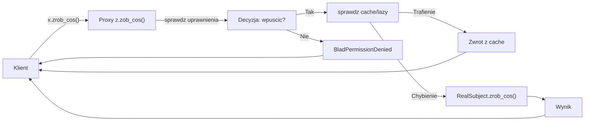
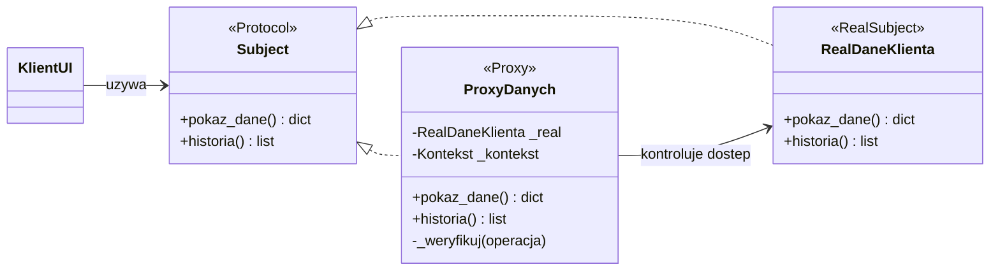
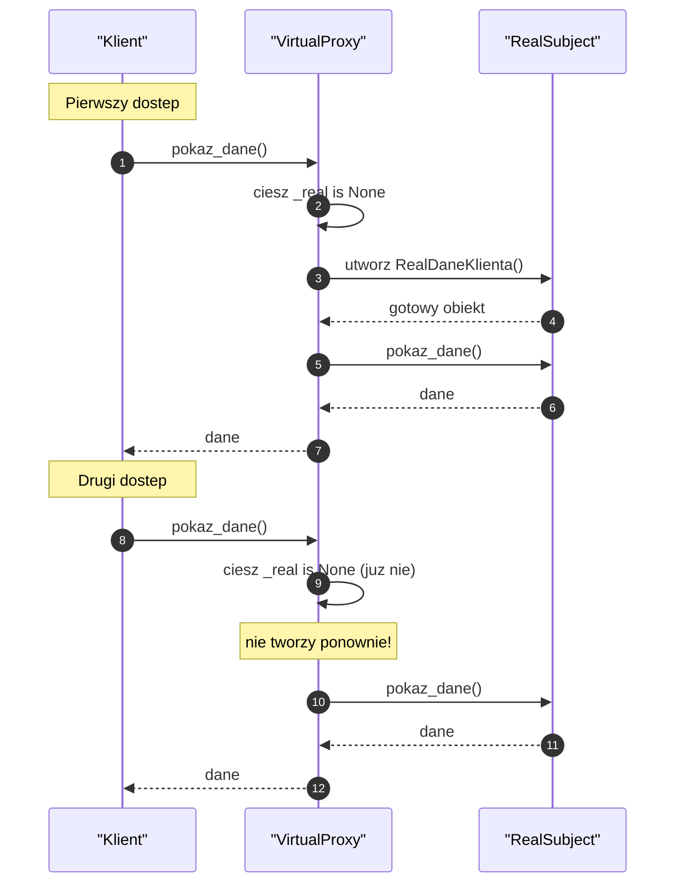
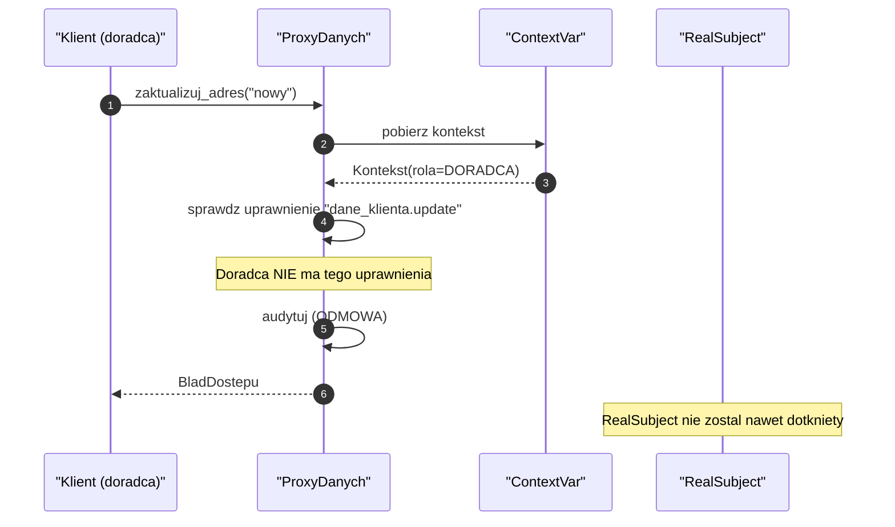
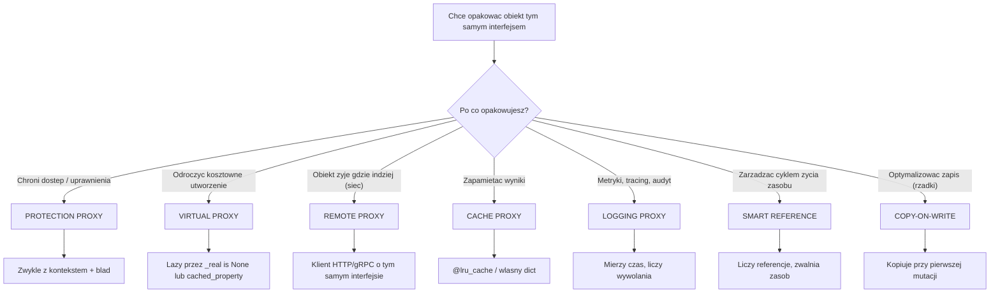
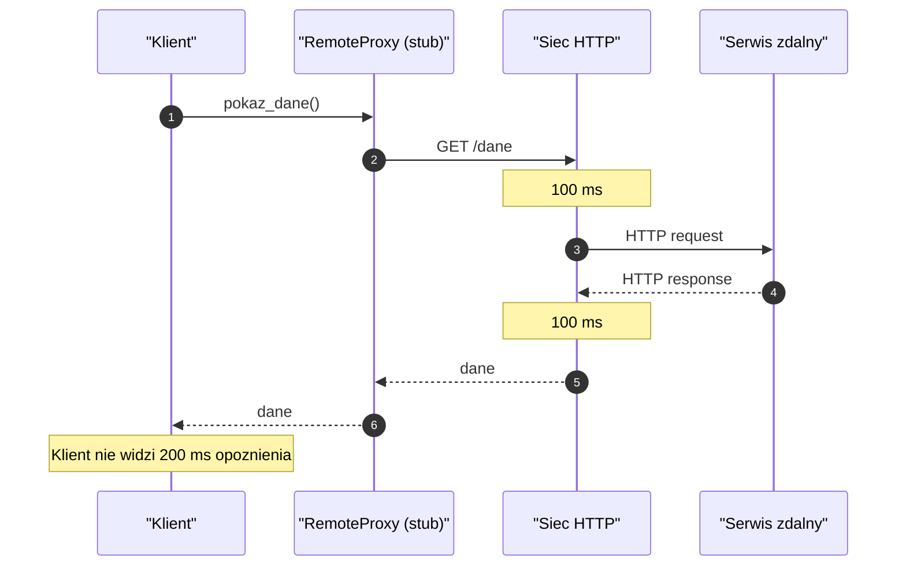
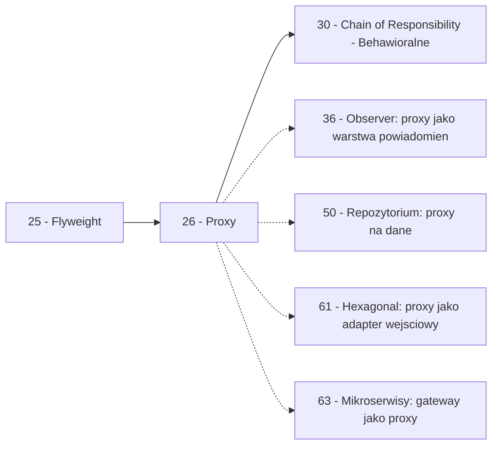

```markdown
---
modul: 26 — Proxy
plik: 26-proxy.md
poziom: zaawansowany
wymaga: [25]
czas: ~180 minut czytania + ~420 minut ćwiczeń
---

# Moduł 26 — Proxy — pełnomocnik, który stoi między Tobą a obiektem

> **TL;DR**
> - **Proxy (pełnomocnik)** podstawia zastępcę o **identycznym interfejsie** co obiekt oryginalny, żeby **kontrolować dostęp** — dodawać weryfikację uprawnień, leniwe ładowanie, cache, logi, transakcje — bez wiedzy klienta.
> - Siedem odmian Proxy realizuje różne cele: Virtual (lazy loading), Protection (uprawnienia), Remote (zdalność), Cache (memoizacja), Logging/Instrumentation (obserwowalność), Smart Reference (cykl życia), Copy-on-Write (optymalizacja zapisu).
> - Najczęstsza pułapka implementacyjna: **`__getattr__` nie deleguje metod specjalnych** (`__len__`, `__iter__`, `__getitem__`, `__add__`) — bo są wyszukiwane na **klasie**, nie na instancji. Trzeba je zdefiniować jawnie.
> - **Nigdy nie buduj własnego proxy ochronnego bez modelu zagrożeń** — w prawdziwych systemach uwierzytelnianie i autoryzacja żyją na **brzegu systemu** (API Gateway, gateway, reverse proxy), a nie w Pythonie na poziomie klasy.
> - Proxy dzieli z Decoratorem i Adapterem **strukturę**, ale różni się **intencją**: Proxy **kontroluje**, Decorator **rozszerza**, Adapter **tłumaczy**, Facade **upraszcza**.

---

## 0. Model mentalny

### Sekretarka, ochroniarz i kierownik zmiany

Wyobraź sobie, że pracujesz w dużej korporacji. Chcesz się spotkać z **dyrektorem zarządu**. Wchodzisz do budynku, mijasz recepcję, wchodzisz na piętro zarządu i zatrzymuje cię **sekretarka** dyrektora. Ona **ma dokładnie ten sam interfejs** co dyrektor w kontekście „umówienia spotkania" — możesz powiedzieć: „Chciałbym się spotkać z panem dyrektorem w sprawie X". Ale zanim przekieruje cię do gabinetu, sekretarka sprawdza:

- czy jesteś **na liście zaproszonych** — czyli czy masz uprawnienia?
- czy dyrektor ma teraz **wolne okienko** — czyli czy działa?
- czy możesz przyjść w innym terminie — czyli czy jest sensowne obejście?
- czy twoje spotkanie wymaga **dłuższego okna czasowego** — czyli kontekst?

Z punktu widzenia gościa „chodzi o spotkanie z dyrektorem". Z punktu widzenia sekretarki to spotkanie wymaga **weryfikacji**. Sekretarka **nie jest** dyrektorem — nie podejmuje decyzji o sprawach firmy, nie negocjuje, nie podpisuje umów. Ona tylko **kontroluje dostęp** do dyrektora.

Zwróć uwagę na kluczową rzecz: **interfejs jest ten sam**. Możesz powiedzieć „poproszę o spotkanie" zarówno do sekretarki, jak i — gdybyś miał bezpośredni dostęp — do dyrektora. Sekretarka działa przez ten sam interfejs i zwraca ci „spotkanie" (albo „nie ma terminu"). **Klient nie wie, że rozmawia z sekretarką, a nie z dyrektorem** — dopóki nie zacznie drążyć o szczegóły, których sekretarka nie zna.

Idźmy dalej. Wyobraź sobie **ochroniarza** przed gabinetem. Ten też ma ten sam interfejs? Nie do końca — ochroniarz **wpuszcza albo nie wpuszcza**, nie umawia spotkań. W sensie wzorca Proxy obaj pełnią jednak podobną rolę: **stoją między tobą a celem** i **kontrolują dostęp**. Różnica: sekretarka **filtruje intencje** („na spotkanie o sprawach strategicznych — tak, na skargi — nie"), a ochroniarz **filtruje uprawnienia** („karty nie masz, nie wejdziesz").

Trzeci obraz, kluczowy dla „Virtual Proxy" — czyli **leniwego tworzenia**. Wyobraź sobie **kierownika zmiany** w sklepie, który dostaje z centrali **ciężkie segregatory** z dokumentacją dostawców. Dokumentacja zajmuje cały regał i aktualizuje się raz na kwartał. Kierownik nie wyciąga wszystkich segregatorów rano — trzyma je **w magazynie** i wyciąga dopiero, gdy naprawdę potrzebuje. Pytany przez klienta o dostawcę mówi: „sprawdzę" — i wtedy idzie do magazynu. Dla klienta to wygląda tak, jakby dokumentacja była od razu dostępna. Ale w rzeczywistości **kierownik tworzy ja na żądanie**. To jest Virtual Proxy: **opóźnienie kosztownej operacji do momentu pierwszego użycia**.

| W analogii sekretarki i ochroniarza | W kodzie |
|---|---|
| Gość chce się spotkać z dyrektorem | Klient wywołuje metodę `x.zrob_cos()` |
| Dyrektor (prawdziwy cel) | `RealSubject` — prawdziwy obiekt |
| Sekretarka/ochroniarz | `Proxy` — pośrednik o tym samym interfejsie |
| Sprawdzenie uprawnień | Protection Proxy — kontrola dostępu |
| „Sprawdzę w magazynie" | Virtual Proxy — lazy loading |
| „Już o to pytałeś" | Cache Proxy — memoizacja |
| „Zapisuję każde twoje pytanie" | Logging Proxy — obserwowalność |
| Rozmowa przez telefon z innym oddziałem | Remote Proxy — zdalny obiekt |
| Sekretarka jest przezroczysta dla gościa | Klient nie widzi, że rozmawia z proxy |

> 🧠 **Zapamiętaj** — **Proxy (pełnomocnik) to wzorzec strukturalny podstawiający obiekt zastępczy (albo klasę-matkę) o identycznym interfejsie co obiekt oryginalny, żeby kontrolować dostęp do niego — dodawać weryfikację, cache, lazy loading, logi, transakcje — bez wiedzy klienta.**

Zwróć uwagę na trzy słowa w tej definicji: **identyczny**, **kontrolować** i **bez wiedzy**. „Identyczny" — bo klient nie ma prawa widzieć różnicy. „Kontrolować" — bo proxy nie rozszerza, nie tłumaczy, nie upraszcza — on decyduje, czy operacja dojdzie do skutku. „Bez wiedzy" — bo przezroczystość jest celem, nie efektem ubocznym.

### Diagram — intuicja



*Diagram pokazuje, że wywołanie klienta przechodzi przez szereg decyzji po stronie proxy: weryfikacja, sprawdzenie cache/lazy, ewentualne przekazanie do prawdziwego obiektu i zwrot wyniku — wszystko za jednym interfejsem.*

### Czego Proxy NIE robi

Rozbrójmy cztery nieporozumienia.

**Nie zmienia interfejsu.** Jeśli twoje opakowanie tłumaczy wywołania na inny format — to Adapter (moduł 20). Proxy ma dokładnie ten sam interfejs i klient nie widzi różnicy. To jego definicja, nie preferencja.

**Nie dodaje funkcjonalności do obiektu.** Jeśli twoje opakowanie dokłada nową cechę (np. logowanie, szyfrowanie), to na pierwszy rzut oka pasuje Decorator (moduł 23). Granica bywa płynna — o tym w sekcji 9. Ale w intencji: Proxy **kontroluje dostęp** do istniejącej funkcji, Decorator **dodaje nową**.

**Nie upraszcza podsystemu.** Proxy opakowuje **jeden** obiekt. Jeśli chcesz uprościć dostęp do pięciu obiektów — to Facade (moduł 24).

**Nie jest darmowy.** Każde wywołanie idzie przez proxy — dodatkowa warstwa, dodatkowe sprawdzenia, dodatkowe opóźnienie. Proxy chroniące (uprawnienia) to opóźnienie małe, ale przezroczyste. Proxy **zdalne** (remote proxy) dodaje **prawdziwe** opóźnienie sieciowe, którego klient nie widzi — o tym pułapka w sekcji 8.

**Nie jest zamiennikiem prawdziwego bezpieczeństwa.** Proxy w Pythonie można obejść — przez refleksję, przez dostęp do `_real_subject`, przez mutację atrybutów. **Nigdy** nie traktuj proxy w aplikacji jako granicy bezpieczeństwa. Uwierzytelnianie i autoryzacja żyją **na brzegu systemu** (API Gateway, reverse proxy, gateway). Python to wewnętrzne warstwy, gdzie proxy pomaga **porządkować kod**, nie **zabezpieczać system**.

---

## 1. Problem, który rozwiązujemy

Wejdźmy w domenę 🏦 „Bank-klient". Mamy klasę `DaneKlienta`, która przechowuje dane osobowe: imię, nazwisko, PESEL, adres, dochód, status KYC/AML, historię operacji. Zgodnie z regulacjami — dane te są **wrażliwe** i różni pracownicy mają różne poziomy dostępu. Doradca klienta może widzieć imię i nazwisko, ale nie pełne dane AML. Analityk ryzyka widzi AML, ale bez PESEL-u. Prawnik widzi wszystko, ale tylko w kontekście postępowania. Ktoś napisał klasę, która **nie weryfikuje kto pyta** — po prostu zwraca dane.

### Kod „przed"

```python
# dane_klienta_v0.py — wersja naiwna, demonstracyjna
# UWAGA: kod celowo pokazuje brak kontroli dostepu.

from dataclasses import dataclass, field
from datetime import date, datetime, timezone
from decimal import Decimal


@dataclass
class DaneKlienta:
    """Dane klienta - bez kontroli dostepu."""

    identyfikator: str
    imie: str
    nazwisko: str
    pesel: str
    adres: str
    dochod_miesieczny: Decimal
    status_aml: str
    data_urodzenia: date
    historia_operacji: list[dict] = field(default_factory=list)

    def pelne_dane(self) -> dict:
        """Zwraca WSZYSTKIE dane - bez weryfikacji kto pyta."""
        return {
            "id": self.identyfikator,
            "imie": self.imie,
            "nazwisko": self.nazwisko,
            "pesel": self.pesel,
            "adres": self.adres,
            "dochod": str(self.dochod_miesieczny),
            "aml": self.status_aml,
            "data_urodzenia": self.data_urodzenia.isoformat(),
        }

    def historia(self) -> list[dict]:
        return list(self.historia_operacji)

    def zaktualizuj_adres(self, nowy_adres: str) -> None:
        self.adres = nowy_adres


class SerwisBankowy:
    """Serwis, ktory nie sprawdza uprawnien - kazdy widzi wszystko."""

    def __init__(self) -> None:
        self._klienci: dict[str, DaneKlienta] = {}

    def dodaj(self, dane: DaneKlienta) -> None:
        self._klienci[dane.identyfikator] = dane

    def pokaz_dane(self, id_klienta: str) -> dict:
        # KAZDY widzi Wszystko!
        return self._klienci[id_klienta].pelne_dane()

    def historia(self, id_klienta: str) -> list[dict]:
        return self._klienci[id_klienta].historia()


if __name__ == "__main__":
    klient = DaneKlienta(
        identyfikator="K-001",
        imie="Anna",
        nazwisko="Kowalska",
        pesel="90010112345",
        adres="ul. Testowa 1, Warszawa",
        dochod_miesieczny=Decimal("12000.00"),
        status_aml="OK",
        data_urodzenia=date(1990, 1, 1),
    )
    serwis = SerwisBankowy()
    serwis.dodaj(klient)

    # Kazdy pracownik moze zobaczyc wszystko - brak kontroli!
    print(serwis.pokaz_dane("K-001"))
```

Ten kod działa — i **właśnie dlatego jest niebezpieczny**. Każdy wywołujący `pokaz_dane` widzi pełne dane, nawet gdy powinien widzieć tylko fragment. To łamanie **rozdziału obowiązków** (ang. segregation of duties) i **zasady minimalnych uprawnień** (ang. least privilege) — fundamentów bezpieczeństwa w systemach finansowych.

### Code smell — brak kontroli dostępu

| Problem | Gdzie | Konsekwencja |
|---|---|---|
| Brak sprawdzenia uprawnień | `pokaz_dane`, `historia` | Każdy widzi wszystko |
| Klasa ujawnia wrażliwe pola | `pesel`, `status_aml` w zwracanym dict | Ryzyko wycieku danych osobowych |
| Brak kontekstu (kto pyta) | Wywołania bez informacji o użytkowniku | Nie da się rozróżnić uprawnień |
| Kontrola po fakcie (na poziomie UI) | W kodzie frontu „ukrywamy" pola | Backend i tak zwraca wszystko |
| Brak audytu odczytu | Brak logi „kto czytał dane" | Nie da się wykryć nadużyć |
| Łatwo zmodyfikować krytyczne pola | `zaktualizuj_adres` bez uprawnień | Ryzyko nieautoryzowanych zmian |

### Objawy — poznasz ten problem po tym, że...

- **Sprawdzanie uprawnień jest rozproszone po metodach usługi**, a nie w jednym miejscu. Każda metoda musi pamiętać o weryfikacji.
- **Każdy pracownik ma dostęp do wszystkich danych**, bo sprawdzenie jest w innym systemie albo wcale.
- **Brak audytu odczytu wrażliwych danych.** Nie wiesz, kto i kiedy czytał PESEL klienta.
- **Klasa serwisu rośnie z każdą nową rolą.** Dodajesz „rola 5" — musisz dopisać `if rola == "rola_5"` w każdej metodzie.
- **Kod UI ukrywa pola**, ale API je zwraca — czyli zabezpieczenie „na oko".
- **Testy nie sprawdzają scenariuszy braku uprawnień.** Nie ma testów „analityk nie widzi PESEL".
- **W kodzie jest `if rola in ("admin", "dba")` rozsiane po wielu metodach.** Rozproszona logika autoryzacji.
- **Nie da się łatwo podmienić “kto pyta” na potrzeby audytu** — bo uprawnienia są w kontekście wywołania, nie w obiekcie.
- **Każda próba dodania nowej roli wymaga modyfikacji kilku metod** — shotgun surgery (moduł 03).

---

## 2. Anatomia wzorca

### Uczestnicy

| Rola | Odpowiedzialność | Co NIE jest jej zadaniem |
|---|---|---|
| **Subject (podmiot)** | Wspólny interfejs dla `RealSubject` i `Proxy`; definiuje operacje, które klient może wywołać | Nie zawiera logiki implementacji; nie wie o proxy |
| **RealSubject (prawdziwy podmiot)** | Prawdziwa implementacja operacji; jest chroniony przez proxy | Nie zawiera logiki kontroli dostępu; nie wie o proxy |
| **Proxy (pełnomocnik)** | Ma taki sam interfejs; kontroluje dostęp do `RealSubject`; może dodawać weryfikację, cache, lazy loading | Nie implementuje logiki biznesowej; nie zmienia interfejsu; zwykle deleguje |
| **Klient (client)** | Używa obiektu przez interfejs `Subject`; nie wie, że rozmawia z proxy | Nie tworzy `RealSubject` samodzielnie; nie wie, że jest proxy |

Kluczowa asymetria: **proxy zna RealSubject**, ale **RealSubject nie zna proxy**. Klient zna tylko **Subject** (kontrakt). Cała kontrola życia w proxy; cała logika — w RealSubject.

### Diagram struktury



*Diagram pokazuje, że `ProxyDanych` i `RealDaneKlienta` realizują ten sam `Subject`, a `ProxyDanych` trzyma referencję do `RealDaneKlienta` i deleguje do niego po sprawdzeniu uprawnień.*

Przeczytajmy ten diagram zdanie po zdaniu. `Subject` to kontrakt — dwie metody `pokaz_dane` i `historia`. `RealDaneKlienta` to prawdziwa implementacja — zwraca dane z pamięci. `ProxyDanych` implementuje ten sam kontrakt, ale **nie zwraca danych samodzielnie** — najpierw weryfikuje uprawnienia, potem deleguje do `_real`.

Zwróć uwagę na **pole `_kontekst`**. To jest kluczowe dla proxy ochronnego: proxy musi wiedzieć **kto pyta**, żeby móc ocenić uprawnienia. Bez kontekstu nie ma kontroli. W miejsce `Kontekst` wstawiamy obiekt z informacją o sesji użytkownika, jego rolach, uprawnieniach.

Zauważ też, że **`RealDaneKlienta` nie ma żadnego `_kontekst`**. To proxy jest „ograniczone” rolą; prawdziwy obiekt jest neutralny.

### Warianty: klasyczny vs pythoniczny

| Aspekt | Wariant klasyczny (GoF) | Wariant pythoniczny |
|---|---|---|
| Subject | Klasa ABC | `Protocol` (strukturalnie) |
| RealSubject | Klasa dziedzicząca | Klasa spełniająca protokół |
| Proxy | Klasa ręcznie delegująca wszystkie metody | Klasa z `__getattr__` (automatyczna delegacja) |
| Kontekst użytkownika | Konstruktor obiektu proxy | Argument metody weryfikacji, `ContextVar`, wątek lokalny |
| Metody specjalne | Ręcznie delegowane | Muszą być **jawne** — `__getattr__` ich nie złapie |
| Cache | Ręczny słownik | `@functools.lru_cache`, `cached_property` |
| Remote proxy | Klasa stub ręcznie | Klient HTTP/SDK z tego samego interfejsu |
| Lazy proxy | `_real is None` w każdej metodzie | `cached_property` albo deskryptor |

Python **upraszcza** bardzo dużo w proxy (delegacja przez `__getattr__`, cache przez `lru_cache`, lazy przez `cached_property`), ale **wprowadza jedną poważną pułapkę**: metody specjalne **nie** przechodzą przez `__getattr__`. To najczęstsza wpadka w pythonowych proxy.

---

## 3. Implementacja krok po kroku

Przebudujemy `DaneKlienta` z sekcji 1, dodając proxy ochronne.

### Krok 1 — Zdefiniuj kontrakt Subject

Najpierw interfejs — co można wywołać na danych klienta.

```python
from dataclasses import dataclass
from typing import Protocol, runtime_checkable

@runtime_checkable
class DaneKlientaProtocol(Protocol):
    """Kontrakt: co mozna zrobic z danymi klienta."""

    def pokaz_dane(self) -> dict: ...
    def historia(self) -> list[dict]: ...
    def zaktualizuj_adres(self, nowy_adres: str) -> None: ...
```

### Krok 2 — Zdefiniuj RealSubject

Bez zmian względem wersji naiwnej — realny obiekt nie wie, że będzie chroniony.

```python
@dataclass
class RealDaneKlienta:
    """Prawdziwe dane klienta - bez logiki uprawnien."""

    identyfikator: str
    imie: str
    nazwisko: str
    pesel: str
    adres: str
    dochod_miesieczny: Decimal
    status_aml: str
    data_urodzenia: date
    historia_operacji: list[dict]

    def pokaz_dane(self) -> dict:
        return {
            "id": self.identyfikator,
            "imie": self.imie,
            "nazwisko": self.nazwisko,
            "pesel": self.pesel,
            "adres": self.adres,
            "dochod": str(self.dochod_miesieczny),
            "aml": self.status_aml,
            "data_urodzenia": self.data_urodzenia.isoformat(),
        }

    def historia(self) -> list[dict]:
        return list(self.historia_operacji)

    def zaktualizuj_adres(self, nowy_adres: str) -> None:
        self.adres = nowy_adres
```

### Krok 3 — Zdefiniuj kontekst użytkownika

Proxy musi wiedzieć **kto pyta**. To znaczy, że potrzebuje obiektu z informacją o sesji.

```python
@dataclass(frozen=True)
class Kontekst:
    """Kontekst użytkownika: kto, jaka rola, jakie uprawnienia."""
    uzytkownik: str
    rola: str
    uprawnienia: frozenset[str]

    def ma(self, uprawnienie: str) -> bool:
        return uprawnienie in self.uprawnienia
```

### Krok 4 — Zdefiniuj Proxy

Proxy zna RealSubject i Kontekst. Przy każdej operacji **najpierw weryfikuje**, potem **deleguje**.

```python
class BladDostepu(PermissionError):
    """Brak wystarczajacych uprawnien do wykonania operacji."""


class ProxyDanychKlienta:
    """Proxy ochronne: weryfikuje uprawnienia przed delegacja."""

    WYMAGANE_UPRAWNIENIA: dict[str, str] = {
        "pokaz_dane": "dane_klienta.read",
        "historia": "dane_klienta.historia.read",
        "zaktualizuj_adres": "dane_klienta.update",
    }

    def __init__(
        self,
        real: RealDaneKlienta,
        kontekst: Kontekst,
    ) -> None:
        self._real = real
        self._kontekst = kontekst

    def _wymagaj(self, operacja: str) -> None:
        uprawnienie = self.WYMAGANE_UPRAWNIENIA[operacja]
        if not self._kontekst.ma(uprawnienie):
            raise BladDostepu(
                f"uzytkownik {self._kontekst.uzytkownik!r} "
                f"(rola {self._kontekst.rola!r}) "
                f"nie ma uprawnienia {uprawnienie!r}"
            )

    def pokaz_dane(self) -> dict:
        self._wymagaj("pokaz_dane")
        dane = self._real.pokaz_dane()
        # Redakcja pol ze wzgledu na uprawnienia
        if not self._kontekst.ma("dane_klienta.pesel.read"):
            dane.pop("pesel", None)
        if not self._kontekst.ma("dane_klienta.aml.read"):
            dane.pop("aml", None)
        return dane

    def historia(self) -> list[dict]:
        self._wymagaj("historia")
        return self._real.historia()

    def zaktualizuj_adres(self, nowy_adres: str) -> None:
        self._wymagaj("zaktualizuj_adres")
        self._real.zaktualizuj_adres(nowy_adres)
```

Zwróć uwagę na **dwa poziomy kontroli**:
1. **Odmowa dostępu** (rzuca `BladDostepu`) — jeśli użytkownik nie ma prawa do operacji w ogóle.
2. **Redakcja pól** — jeśli ma prawo do operacji, ale nie do wszystkich pól, część jest usuwana z wyniku.

To bardzo praktyczne połączenie. W prawdziwych systemach finansowych oba mechanizmy są używane.

### Krok 5 — Klient używa Subject

Klient **nie wie** czy dostaje realny obiekt, czy proxy.

```python
def wypisz_dane(klient: DaneKlientaProtocol) -> None:
    """Funkcja dziala z dowolnym implementacja kontraktu."""
    dane = klient.pokaz_dane()
    for klucz, wartosc in dane.items():
        print(f"  {klucz}: {wartosc}")


def main() -> None:
    real = RealDaneKlienta(
        identyfikator="K-001",
        imie="Anna",
        nazwisko="Kowalska",
        pesel="90010112345",
        adres="ul. Testowa 1",
        dochod_miesieczny=Decimal("12000.00"),
        status_aml="OK",
        data_urodzenia=date(1990, 1, 1),
        historia_operacji=[{"data": "2026-01-15", "kwota": "1000.00"}],
    )

    admin_kontekst = Kontekst(
        uzytkownik="admin@example.com",
        rola="ADMIN",
        uprawnienia=frozenset({
            "dane_klienta.read",
            "dane_klienta.pesel.read",
            "dane_klienta.aml.read",
            "dane_klienta.historia.read",
            "dane_klienta.update",
        }),
    )
    proxy_admin = ProxyDanychKlienta(real, admin_kontekst)

    doradca_kontekst = Kontekst(
        uzytkownik="doradca@example.com",
        rola="DORADCA",
        uprawnienia=frozenset({"dane_klienta.read"}),
    )
    proxy_doradca = ProxyDanychKlienta(real, doradca_kontekst)

    print("=== Admin widzi wszystko ===")
    wypisz_dane(proxy_admin)

    print("\n=== Doradca widzi bez PESEL i AML ===")
    wypisz_dane(proxy_doradca)

    print("\n=== Doradca nie moze zmienic adresu ===")
    try:
        proxy_doradca.zaktualizuj_adres("nowy")
    except BladDostepu as blad:
        print(f"  odrzucono: {blad}")
```

### Krok 6 — Zadbaj o audyt odczytu

W prawdziwych systemach oprócz weryfikacji potrzebny jest **audyt**. Proxy to idealne miejsce, żeby każdy dostęp zostawiał ślad.

```python
class ProxyDanychKlienta:
    def pokaz_dane(self) -> dict:
        self._wymagaj("pokaz_dane")
        self._audytuj("pokaz_dane")
        dane = self._real.pokaz_dane()
        ...  # redakcja
        return dane

    def _audytuj(self, operacja: str) -> None:
        # W produkcji: log strukturyzowany, wysylka do SIEM
        print(
            f"[AUDYT] {self._kontekst.uzytkownik} "
            f"wykonuje {operacja} na {self._real.identyfikator}"
        )
```

### Krok 7 — Weryfikacja

| Kryterium | Wersja „przed" | Wersja „po" (proxy) |
|---|---|---|
| Kontrola uprawnień | Brak | W `_wymagaj` |
| Rozproszenie logiki | Wszędzie (gdy dodane ręcznie) | Jedno miejsce |
| Różne role widzą różne dane | Nie da się | Tak — kontekst + redakcja |
| Audyt odczytu | Brak | W `_audytuj` |
| Dodanie nowej roli | Zmiana w każdej metodzie | Zmiana kontekstu, brak zmian w proxy |
| Klient musi wiedzieć o proxy | N/A | Nie — kontrakt jest ten sam |
| Test bez uprawnień | Trudny | Łatwy — kontekst bez uprawnień |
| Liczba klas | 2 | 4 (Protocol, RealSubject, Proxy, Kontekst) |

Zysk: **centralizacja kontroli dostępu** w jednym miejscu, **audyt** wbudowany, **wiele kontekstów** dla tego samego obiektu. Koszt: dodatkowa klasa i kontekst.

---

## 4. Wersje pythoniczne i warianty

Python ma **wyjątkowo bogaty** zestaw narzędzi do proxy. Pokażemy siedem technik — od ręcznej delegacji do wbudowanych narzędzi. Zwróć uwagę na ostrzeżenia: **metody specjalne** są główną pułapką tego wzorca w Pythonie.

### 4.1 Ręczna klasa z delegacją — jasne, ale rozwlekłe

Wariant z sekcji 3. Każda metoda napisana ręcznie, każda weryfikacja jawna. Zaleta: pełna kontrola, jasność, brak magii. Wada: mnoży kod przy wielu metodach.

### 4.2 Proxy ochronne — kontrola uprawnień z kontekstem

Wariant pokazany w sekcji 3. Kluczowa technika: **kontekst jako oddzielny obiekt**. Do przechowywania kontekstu bieżącego żądania używa się `ContextVar` (dla async) albo `threading.local` (dla wielowątkowości).

```python
from contextvars import ContextVar

_kontekst: ContextVar[Kontekst | None] = ContextVar("kontekst", default=None)

class ProxyZKontekstu:
    """Proxy, ktore czyta kontekst z ContextVar - nie trzeba go przekazywac."""

    def __init__(self, real: RealDaneKlienta) -> None:
        self._real = real

    def _wymagaj(self, operacja: str) -> Kontekst:
        kt = _kontekst.get()
        if kt is None:
            raise BladDostepu("brak kontekstu uzytkownika")
        uprawnienie = ProxyZKontekstu.WYMAGANE_UPRAWNIENIA[operacja]
        if not kt.ma(uprawnienie):
            raise BladDostepu(f"{kt.uzytkownik}: brak {uprawnienie!r}")
        return kt

# W handlerze HTTP / endpoincie:
def obsluz_zadanie():
    token = _kontekst.set(kt_z_tokenu(request))
    try:
        return serwis.pokaz_dane("K-001")
    finally:
        _kontekst.reset(token)
```

Zaleta: proxy jest „przezroczyste" — nie trzeba przekazywać kontekstu przy każdym wywołaniu. Wada: magia. Debugowanie trudniejsze, kontekst pojawia się „znikąd". W produkcji używane szeroko (Flask `g`, Django `request.user`, FastAPI `Depends`).

### 4.3 `__getattr__` jako auto-delegacja — i pułapka metod specjalnych

Bardzo kusząca technika: proxy, które deleguje **wszystko, czego nie zna**:

```python
class AutomatycznyProxy:
    """Deleguje wszystkie nieznane atrybuty do realnego obiektu."""

    def __init__(self, real):
        self._real = real

    def __getattr__(self, nazwa: str):
        return getattr(self._real, nazwa)
```

Ta klasa obsługuje **wszystkie** metody `_real`, których nie ma zdefiniowanych w proxy. Elegancja kusi. Ale jest **krytyczna pułapka**:

**Metody specjalne (dunder) NIE przechodzą przez `__getattr__`.** To znaczy, że proxy **nie deleguje**:
- `__len__` — `len(proxy)` rzuci `TypeError`
- `__iter__` — `for x in proxy` rzuci `TypeError`
- `__getitem__` — `proxy[0]` rzuci `TypeError`
- `__enter__` / `__exit__` — `with proxy:` rzuci `TypeError`
- `__add__` / `__sub__` — `proxy + x` rzuci `TypeError`
- `__eq__` / `__hash__` — `proxy == x` porówna referencje, nie wartości
- `__bool__` — `if proxy:` użyje domyślnego `bool` (zawsze `True`)
- `__contains__` — `x in proxy` rzuci `TypeError`

Powód: Python wyszukuje metody specjalne **na klasie**, nie na instancji. `__getattr__` jest mechanizmem dla atrybutów **instancji**, więc nie jest wywoływany dla dunderów.

**Prawidłowo:** jeśli proxy ma **zachowywać się jak obiekt** dla wszystkich operacji (np. jak kolekcja), musi **jawnie zdefiniować** te metody:

```python
class ProxyKolekcji:
    def __init__(self, real):
        self._real = real

    def __getattr__(self, nazwa):
        return getattr(self._real, nazwa)

    # JAWNIE delegujemy metody specjalne
    def __len__(self) -> int:
        return len(self._real)

    def __iter__(self):
        return iter(self._real)

    def __getitem__(self, indeks):
        return self._real[indeks]

    def __contains__(self, element):
        return element in self._real

    def __eq__(self, inne):
        return self._real == inne
```

To boilerplate, ale **konieczny**, jeśli proxy ma być używane w kontekstach, w których dunder jest wywoływany. **Praktyczna rada:** jeśli `__getattr__` cię kusi, zadaj sobie pytanie: „czy klient będzie używał `len`, `in`, `for`, `with`, `+` na proxy?". Jeśli tak — musisz dodać jawne dundery.

### 4.4 `@functools.wraps` + `functools.lru_cache` — cache proxy dla funkcji

Gdy potrzebujesz cache na funkcji, `lru_cache` jest proxy funkcji:

```python
import functools

@functools.lru_cache(maxsize=512)
def wylicz_vaR(portfel_id: str, na_dzien: str) -> float:
    """Ciezka operacja - cache'ujemy wyniki."""
    return _naprawde_wylicz_vaR(portfel_id, na_dzien)
```

`lru_cache` **opakowuje** funkcję i kontroluje dostęp do niej (memoizuje wywołania). To jest **Cache Proxy** w czystej postaci — jedno zdanie w Pythonie.

**Uwaga:** argumenty muszą być haszowalne. Jeśli masz datę, przekaż ISO string, nie obiekt `date` (choć `date` jest haszowalny — po prostu świadomie zdecyduj o kluczu).

### 4.5 Deskryptor jako proxy do atrybutu

Deskryptor (moduł 02) to proxy dla **pojedynczego atrybutu w klasie**. Najczęstsze zastosowanie: **leniwe ładowanie** atrybutu.

```python
class LazyProperty:
    """Deskryptor: wylicza wartosc przy pierwszym dostepie i zapamietuje."""

    def __init__(self, funkcja):
        self._funkcja = funkcja
        self._nazwa = funkcja.__name__
        self._pamiec = f"_lazy_{self._nazwa}"

    def __set_name__(self, wlasciciel, nazwa):
        self._nazwa = nazwa
        self._pamiec = f"_lazy_{nazwa}"

    def __get__(self, instancja, wlasciciel=None):
        if instancja is None:
            return self
        if not hasattr(instancja, self._pamiec):
            setattr(instancja, self._pamiec, self._funkcja(instancja))
        return getattr(instancja, self._pamiec)


class DaneKlienta:
    @LazyProperty
    def historia(self) -> list[dict]:
        """Wczytuje historie z bazy - tylko raz."""
        print("[LAZY] wczytuje historie z bazy...")
        return _wczytaj_historie_z_bazy()
```

Odpowiednik wbudowany: `functools.cached_property`. To jest **Virtual Proxy** dla pojedynczego atrybutu — leniwe ładowanie kosztownej wartości.

### 4.6 Remote Proxy — klient HTTP o tym samym interfejsie

Najbardziej „inżynierski" wariant. Zdalny serwis wygląda jak lokalny obiekt — klient nie wie, że są żądania HTTP.

```python
class RemoteDaneKlienta:
    """Remote Proxy: wyglada jak lokalny obiekt, ale robi HTTP."""

    def __init__(self, bazowy_url: str, sesja: requests.Session | None = None) -> None:
        self._bazowy_url = bazowy_url.rstrip("/")
        self._sesja = sesja or requests.Session()

    def pokaz_dane(self) -> dict:
        odp = self._sesja.get(f"{self._bazowy_url}/dane")
        odp.raise_for_status()
        return odp.json()

    def historia(self) -> list[dict]:
        odp = self._sesja.get(f"{self._bazowy_url}/historia")
        odp.raise_for_status()
        return odp.json()
```

Klient wywołuje `dane.pokaz_dane()` i nie widzi różnicy od obiektu w pamięci. To **Remote Proxy**: obiekt reprezentuje coś, co żyje gdzie indziej. Tak działają stuby gRPC, klienci REST, klienci bazodanowi.

Zaleta: jednolity interfejs dla lokalnych i zdalnych. Wada: **ukrycie opóźnienia sieciowego** — o tym pułapka w sekcji 8.

### 4.7 Transakcyjny proxy — context manager opakowujący operację

Proxy w postaci context managera — dla operacji, które muszą być wykonane w transakcji:

```python
from contextlib import contextmanager

class KsiegowanieTransakcyjne:
    """Proxy transakcyjne: kazda operacja w transakcji."""

    def __init__(self, real, baza) -> None:
        self._real = real
        self._baza = baza

    @contextmanager
    def _transakcja(self):
        try:
            self._baza.begin()
            yield
            self._baza.commit()
        except Exception:
            self._baza.rollback()
            raise

    def zapisz_zlecenie(self, zlecenie) -> str:
        with self._transakcja():
            return self._real.zapisz_zlecenie(zlecenie)

    def anuluj_zlecenie(self, numer: str) -> None:
        with self._transakcja():
            self._real.anuluj_zlecenie(numer)
```

Klient dostaje operację „transakcyjną" bez wiedzy, że w środku są `begin`/`commit`/`rollback`. To proxy transakcyjne — wzorzec szeroko stosowany w ORM-ach (SQLAlchemy `Session` jest dokładnie tym).

### 4.8 Instrumentation Proxy — metryki i tracing

Proxy świetnie nadaje się do mierzenia czasu i liczenia wywołań.

```python
import time

class InstrumentowanyProxy:
    def __init__(self, real, metryki: dict[str, list[float]] | None = None) -> None:
        self._real = real
        self._metryki = metryki if metryki is not None else {}

    def __getattr__(self, nazwa: str):
        atrybut = getattr(self._real, nazwa)
        if not callable(atrybut):
            return atrybut

        def opakowanie(*args, **kwargs):
            start = time.perf_counter()
            try:
                return atrybut(*args, **kwargs)
            finally:
                self._metryki.setdefault(nazwa, []).append(
                    time.perf_counter() - start
                )

        return opakowanie

    @property
    def metryki(self) -> dict[str, list[float]]:
        return dict(self._metryki)
```

Każde wywołanie mierzone, nic trzeba nie pisać w kodzie biznesowym. To Logging/Instrumentation Proxy.

### 4.9 Smart Reference — liczenie referencji

Proxy śledzące, ile razy obiekt został użyty, żeby zwolnić go optymalnie.

```python
class SmartReference:
    def __init__(self, real, zasob_zamykajacy, limit: int = 100) -> None:
        self._real = real
        self._zamknij = zasob_zamykajacy.zamknij
        self._limit = limit
        self._licznik = 0

    def __getattr__(self, nazwa):
        self._licznik += 1
        if self._licznik >= self._limit:
            self._zamknij()
            self._licznik = 0
        return getattr(self._real, nazwa)
```

W praktyce rzadkie w Pythonie, bo GC sam zarządza cyklem życia. Ale w systemach z zasobami z limitem (np. pula połączeń w `SQLAlchemy`) podobna logika istnieje.

### 4.10 Copy-on-Write Proxy — optymalizacja zapisu

Proxy, który współdzieli obiekt z innymi dopóki nie zostanie **zmodyfikowany**. Podczas pierwszej mutacji robi kopię.

```python
import copy

class CopyOnWriteProxy:
    """Proxy: dopoki tylko czytasz, nie ma kopii; pierwsza mutacja tworzy kopie."""

    def __init__(self, wspoldzielony) -> None:
        self._wspoldzielony = wspoldzielony
        self._wlasny = None   # nie ma kopii - uzywamy wspoldzielonego

    def _pobierz(self):
        return self._wlasny if self._wlasny is not None else self._wspoldzielony

    def __getattr__(self, nazwa):
        return getattr(self._pobierz(), nazwa)

    def zmien(self, zmiana) -> None:
        if self._wlasny is None:
            self._wlasny = copy.deepcopy(self._wspoldzielony)
        zmiana(self._wlasny)
```

Rzadsze w Pythonie, ale czasem stosowane w systemach z dużą liczbą odczytów i rzadkimi zapisami.

### 4.11 Podsumowanie — tabela wyboru

| Sytuacja | Wariant |
|---|---|
| Kontrola uprawnień z kontekstem | Ręczne proxy + kontekst (4.2) |
| Delegacja wszystkiego oprócz kilku metod | `__getattr__` + jawne dundery (4.3) |
| Leniwe ładowanie pola | `@cached_property` / deskryptor (4.5) |
| Cache funkcji | `@functools.lru_cache` (4.4) |
| Obiekt zdalny | Klient HTTP/gRPC jako Subject (4.6) |
| Operacja w transakcji | Context manager (4.7) |
| Instrumentacja | Proxy z licznikami (4.8) |
| Cykl życia zasobu | Smart Reference (4.9) |
| Wiele odczytów, rzadkie zapisy | Copy-on-Write (4.10) |

> 🧠 **Zapamiętaj** — Zanim napiszesz własne proxy, sprawdź, czy nie zrobi tego za ciebie biblioteka standardowa: **`functools.lru_cache`** (Cache Proxy), **`functools.cached_property`** (Virtual Proxy), **`contextlib.contextmanager`** (Transaction Proxy), **`contextvars.ContextVar`** (kontekst dla Proxy Protection). Większość “ręcznych” proxy to powtórzenie tych wbudowanych mechanizmów.

---

## 5. Przykład z życia: 🏦 Bank-klient — pełny uruchamialny kod

Zbudujemy pełny system kontroli dostępu do danych klientów z **czterema rolami**, **dwoma typami proxy** (Protection + Logging) i **kontekstami z ContextVar**.

### Kod

```python
# bank_klient_proxy.py — pelny przyklad Proxy
from __future__ import annotations

from contextvars import ContextVar
from dataclasses import dataclass, field
from datetime import date, datetime, timezone
from decimal import Decimal
from typing import Iterator, Protocol, runtime_checkable


# ===========================================================================
# 1. Kontrakt Subject
# ===========================================================================

@runtime_checkable
class DaneKlientaProtocol(Protocol):
    """Kontrakt: co mozna zrobic z danymi klienta."""

    @property
    def identyfikator(self) -> str: ...
    def pokaz_dane(self) -> dict: ...
    def historia(self) -> list[dict]: ...
    def zaktualizuj_adres(self, nowy_adres: str) -> None: ...


# ===========================================================================
# 2. RealSubject - prawdziwe dane
# ===========================================================================

@dataclass
class RealDaneKlienta:
    """Prawdziwe dane klienta - BEZ kontroli uprawnien."""

    identyfikator: str
    imie: str
    nazwisko: str
    pesel: str
    adres: str
    dochod_miesieczny: Decimal
    status_aml: str
    data_urodzenia: date
    historia_operacji: list[dict] = field(default_factory=list)

    def pokaz_dane(self) -> dict:
        return {
            "id": self.identyfikator,
            "imie": self.imie,
            "nazwisko": self.nazwisko,
            "pesel": self.pesel,
            "adres": self.adres,
            "dochod": str(self.dochod_miesieczny),
            "aml": self.status_aml,
            "data_urodzenia": self.data_urodzenia.isoformat(),
        }

    def historia(self) -> list[dict]:
        return list(self.historia_operacji)

    def zaktualizuj_adres(self, nowy_adres: str) -> None:
        self.adres = nowy_adres


# ===========================================================================
# 3. Kontekst uzytkownika z ContextVar
# ===========================================================================

@dataclass(frozen=True)
class Kontekst:
    """Kto pyta, jaka rola, jakie uprawnienia."""
    uzytkownik: str
    rola: str
    uprawnienia: frozenset[str]

    def ma(self, uprawnienie: str) -> bool:
        return uprawnienie in self.uprawnienia


_kontekst: ContextVar[Kontekst | None] = ContextVar("kontekst", default=None)


def ustaw_kontekst(kt: Kontekst):
    return _kontekst.set(kt)


def resetuj_kontekst(token) -> None:
    _kontekst.reset(token)


def obecny_kontekst() -> Kontekst | None:
    return _kontekst.get()


# ===========================================================================
# 4. Bledy domenowe
# ===========================================================================

class BladDostepu(PermissionError):
    """Brak uprawnien do wykonania operacji."""


# ===========================================================================
# 5. Proxy ochronne z audytem
# ===========================================================================

class ProxyDanychKlienta:
    """Proxy: kontrola dostepu + redakcja pol + audyt."""

    WYMAGANE: dict[str, str] = {
        "pokaz_dane": "dane_klienta.read",
        "historia": "dane_klienta.historia.read",
        "zaktualizuj_adres": "dane_klienta.update",
    }

    def __init__(self, real: RealDaneKlienta) -> None:
        self._real = real

    @property
    def identyfikator(self) -> str:
        return self._real.identyfikator

    def _wymagaj(self, operacja: str) -> Kontekst:
        kt = _kontekst.get()
        if kt is None:
            raise BladDostepu("brak kontekstu uzytkownika")
        uprawnienie = self.WYMAGANE[operacja]
        if not kt.ma(uprawnienie):
            self._audytuj(operacja, sukces=False, powod=f"brak {uprawnienie!r}")
            raise BladDostepu(
                f"{kt.uzytkownik} (rola {kt.rola}) "
                f"nie ma uprawnienia {uprawnienie!r}"
            )
        return kt

    def _audytuj(
        self, operacja: str, sukces: bool, powod: str = ""
    ) -> None:
        kt = _kontekst.get()
        user = kt.uzytkownik if kt else "?"
        znacznik = "OK" if sukces else "ODMOWA"
        info = f"[AUDYT {znacznik}] {user} {operacja} klient={self._real.identyfikator}"
        if powod:
            info += f" - {powod}"
        print(info)

    # --- Operacje z kontraktu ---

    def pokaz_dane(self) -> dict:
        kt = self._wymagaj("pokaz_dane")
        self._audytuj("pokaz_dane", sukces=True)
        dane = self._real.pokaz_dane()
        # Redakcja pol zaleznie od uprawnien
        if not kt.ma("dane_klienta.pesel.read"):
            dane.pop("pesel", None)
        if not kt.ma("dane_klienta.aml.read"):
            dane.pop("aml", None)
        if not kt.ma("dane_klienta.dochod.read"):
            dane.pop("dochod", None)
        return dane

    def historia(self) -> list[dict]:
        self._wymagaj("historia")
        self._audytuj("historia", sukces=True)
        return self._real.historia()

    def zaktualizuj_adres(self, nowy_adres: str) -> None:
        self._wymagaj("zaktualizuj_adres")
        self._audytuj("zaktualizuj_adres", sukces=True)
        self._real.zaktualizuj_adres(nowy_adres)


# ===========================================================================
# 6. Factory: tworzenie kontekstow dla rol
# ===========================================================================

UPRAWNIENIA_ROLI: dict[str, frozenset[str]] = {
    "ADMIN": frozenset({
        "dane_klienta.read",
        "dane_klienta.pesel.read",
        "dane_klienta.aml.read",
        "dane_klienta.dochod.read",
        "dane_klienta.historia.read",
        "dane_klienta.update",
    }),
    "DORADCA": frozenset({
        "dane_klienta.read",
        "dane_klienta.dochod.read",
    }),
    "ANALITYK_RYZYKA": frozenset({
        "dane_klienta.read",
        "dane_klienta.aml.read",
    }),
    "PRAWNIK": frozenset({
        "dane_klienta.read",
        "dane_klienta.historia.read",
    }),
}


def utworz_kontekst(uzytkownik: str, rola: str) -> Kontekst:
    if rola not in UPRAWNIENIA_ROLI:
        raise ValueError(f"nieznana rola: {rola}")
    return Kontekst(
        uzytkownik=uzytkownik,
        rola=rola,
        uprawnienia=UPRAWNIENIA_ROLI[rola],
    )


# ===========================================================================
# 7. Demonstracja
# ===========================================================================

def wypisz_dane(dane: dict) -> None:
    for klucz, wartosc in dane.items():
        print(f"    {klucz}: {wartosc}")


if __name__ == "__main__":
    real = RealDaneKlienta(
        identyfikator="K-001",
        imie="Anna",
        nazwisko="Kowalska",
        pesel="90010112345",
        adres="ul. Testowa 1, Warszawa",
        dochod_miesieczny=Decimal("12000.00"),
        status_aml="OK",
        data_urodzenia=date(1990, 1, 1),
        historia_operacji=[
            {"data": "2026-01-15", "typ": "przelew", "kwota": "1000.00"},
            {"data": "2026-02-01", "typ": "przelew", "kwota": "500.00"},
        ],
    )
    proxy = ProxyDanychKlienta(real)

    print("=== 1. Admin widzi wszystko ===")
    token = ustaw_kontekst(utworz_kontekst("admin@bank.pl", "ADMIN"))
    wypisz_dane(proxy.pokaz_dane())
    resetuj_kontekst(token)

    print("\n=== 2. Doradca - tylko podstawowe dane ===")
    token = ustaw_kontekst(utworz_kontekst("doradca@bank.pl", "DORADCA"))
    wypisz_dane(proxy.pokaz_dane())
    resetuj_kontekst(token)

    print("\n=== 3. Analityk ryzyka - widzi AML, nie PESEL ===")
    token = ustaw_kontekst(utworz_kontekst("analityk@bank.pl", "ANALITYK_RYZYKA"))
    wypisz_dane(proxy.pokaz_dane())
    resetuj_kontekst(token)

    print("\n=== 4. Prawnik - widzi historie operacji ===")
    token = ustaw_kontekst(utworz_kontekst("prawnik@bank.pl", "PRAWNIK"))
    for wpis in proxy.historia():
        print(f"    {wpis}")
    resetuj_kontekst(token)

    print("\n=== 5. Doradca nie moze zmienic adresu ===")
    token = ustaw_kontekst(utworz_kontekst("doradca@bank.pl", "DORADCA"))
    try:
        proxy.zaktualizuj_adres("nowy adres")
    except BladDostepu as blad:
        print(f"    odrzucono: {blad}")
    resetuj_kontekst(token)

    print("\n=== 6. Brak kontekstu - brak dostepu ===")
    try:
        proxy.pokaz_dane()
    except BladDostepu as blad:
        print(f"    odrzucono: {blad}")

    print("\n=== 7. Sprawdzenie kontraktu ===")
    print(f"    isinstance(proxy, DaneKlientaProtocol): "
          f"{isinstance(proxy, DaneKlientaProtocol)}")
    print(f"    isinstance(real, DaneKlientaProtocol): "
          f"{isinstance(real, DaneKlientaProtocol)}")
```

### Co ten przykład pokazuje

Uruchomienie demonstruje wszystkie cechy Proxy.

**Punkt 1 — admin widzi wszystko.** Kontekst ADMIN ma wszystkie uprawnienia, więc `pokaz_dane` zwraca pełny słownik. **W logu widać wpis audytowy** — dowód, że proxy nie tylko kontroluje, ale też notuje.

**Punkt 2 — doradca widzi mniej.** Kontekst DORADCA ma tylko `dane_klienta.read` i `dane_klienta.dochod.read`. **Redakcja pól usuwa PESEL i AML** z wyniku. Klient dostaje słownik bez tych pól. **Nie widzi różnicy w interfejsie** — po prostu dostaje mniej.

**Punkt 3 — analityk widzi AML, nie PESEL.** Inne połączenie uprawnień — redakcja usuwa inne pola. To pokazuje elastyczność wzorca: **jedna implementacja proxy, wiele zestawów uprawnień**.

**Punkt 4 — prawnik widzi historię.** Inna operacja (`historia`), inne uprawnienie. Proxy nadal weryfikuje.

**Punkt 5 — odmowa dostępu.** Doradca próbuje zmienić adres, proxy rzuca `BladDostepu` z informacją o brakującym uprawnieniu. **Audyt notuje odmowę** — kluczowe dla bezpieczeństwa.

**Punkt 6 — brak kontekstu = brak dostępu.** Bez ustawionego kontekstu proxy rzuca wyjątek. To **bezpieczna domyślna**: brak informacji „kto pyta" oznacza brak dostępu.

**Punkt 7 — kontrakt działa dla obu.** `isinstance(proxy, DaneKlientaProtocol)` i `isinstance(real, ...)` oba `True`. Klient może przekazać dowolny z nich do funkcji oczekującej protokołu.

### Testy

```python
# test_bank_klient_proxy.py — uruchomienie: pytest test_bank_klient_proxy.py -v
from datetime import date
from decimal import Decimal

import pytest

from bank_klient_proxy import (
    BladDostepu,
    DaneKlientaProtocol,
    Kontekst,
    ProxyDanychKlienta,
    RealDaneKlienta,
    obecny_kontekst,
    resetuj_kontekst,
    ustaw_kontekst,
    utworz_kontekst,
)


@pytest.fixture
def real() -> RealDaneKlienta:
    return RealDaneKlienta(
        identyfikator="K-TEST",
        imie="Anna",
        nazwisko="Kowalska",
        pesel="90010112345",
        adres="ul. Testowa 1",
        dochod_miesieczny=Decimal("12000.00"),
        status_aml="OK",
        data_urodzenia=date(1990, 1, 1),
        historia_operacji=[{"data": "2026-01-15", "typ": "przelew"}],
    )


@pytest.fixture
def proxy(real: RealDaneKlienta) -> ProxyDanychKlienta:
    return ProxyDanychKlienta(real)


@pytest.fixture(autouse=True)
def _wyczysc_kontekst():
    """Kazdy test startuje bez kontekstu."""
    token = ustaw_kontekst(None)  # type: ignore[arg-type]
    yield
    resetuj_kontekst(token)


# --- Kontrakt ---------------------------------------------------------------

def test_proxy_spelnia_kontrakt(proxy: ProxyDanychKlienta) -> None:
    assert isinstance(proxy, DaneKlientaProtocol)


def test_real_spelnia_kontrakt(real: RealDaneKlienta) -> None:
    assert isinstance(real, DaneKlientaProtocol)


def test_brak_kontekstu_odrzuca(proxy: ProxyDanychKlienta) -> None:
    with pytest.raises(BladDostepu, match="brak kontekstu"):
        proxy.pokaz_dane()


# --- Kontrola dostepu -------------------------------------------------------

def test_admin_widzi_wszystko(proxy: ProxyDanychKlienta) -> None:
    token = ustaw_kontekst(utworz_kontekst("a@b", "ADMIN"))
    try:
        dane = proxy.pokaz_dane()
        assert "pesel" in dane
        assert "aml" in dane
        assert "dochod" in dane
    finally:
        resetuj_kontekst(token)


def test_doradca_bez_pesel(proxy: ProxyDanychKlienta) -> None:
    token = ustaw_kontekst(utworz_kontekst("d@b", "DORADCA"))
    try:
        dane = proxy.pokaz_dane()
        assert "pesel" not in dane
        assert "aml" not in dane
        assert dane["imie"] == "Anna"
    finally:
        resetuj_kontekst(token)


def test_analityk_bez_pesel_ale_z_aml(proxy: ProxyDanychKlienta) -> None:
    token = ustaw_kontekst(utworz_kontekst("a@b", "ANALITYK_RYZYKA"))
    try:
        dane = proxy.pokaz_dane()
        assert "pesel" not in dane
        assert dane["aml"] == "OK"
    finally:
        resetuj_kontekst(token)


# --- Odmowy -----------------------------------------------------------------

def test_doradca_nie_moze_zmienic_adresu(proxy: ProxyDanychKlienta) -> None:
    token = ustaw_kontekst(utworz_kontekst("d@b", "DORADCA"))
    try:
        with pytest.raises(BladDostepu, match="update"):
            proxy.zaktualizuj_adres("nowy")
    finally:
        resetuj_kontekst(token)


def test_admin_moze_zmienic_adres(proxy: ProxyDanychKlienta) -> None:
    token = ustaw_kontekst(utworz_kontekst("a@b", "ADMIN"))
    try:
        proxy.zaktualizuj_adres("nowy adres")
        assert proxy._real.adres == "nowy adres"
    finally:
        resetuj_kontekst(token)


# --- Delegacja --------------------------------------------------------------

def test_proxy_deleguje_historie(proxy: ProxyDanychKlienta) -> None:
    token = ustaw_kontekst(utworz_kontekst("p@b", "PRAWNIK"))
    try:
        historia = proxy.historia()
        assert len(historia) == 1
    finally:
        resetuj_kontekst(token)


def test_historia_jest_zwracana_bez_modyfikacji(proxy: ProxyDanychKlienta) -> None:
    token = ustaw_kontekst(utworz_kontekst("p@b", "PRAWNIK"))
    try:
        historia = proxy.historia()
        # Modyfikuje klienta wynik - nie powinno to zmienic reala
        historia.append({"data": "fake"})
        assert len(proxy.historia()) == 1
    finally:
        resetuj_kontekst(token)


# --- Audyt (uzywamy capsys do sprawdzenia output) ---------------------------

def test_audyt_loguje_pozytywne_wywolanie(
    proxy: ProxyDanychKlienta, capsys
) -> None:
    token = ustaw_kontekst(utworz_kontekst("a@b", "ADMIN"))
    try:
        proxy.pokaz_dane()
        wyjscie = capsys.readouterr().out
        assert "[AUDYT OK]" in wyjscie
        assert "a@b" in wyjscie
    finally:
        resetuj_kontekst(token)


def test_audyt_loguje_odmowe(proxy: ProxyDanychKlienta, capsys) -> None:
    token = ustaw_kontekst(utworz_kontekst("d@b", "DORADCA"))
    try:
        with pytest.raises(BladDostepu):
            proxy.zaktualizuj_adres("nowy")
        wyjscie = capsys.readouterr().out
        assert "[AUDYT ODMOWA]" in wyjscie
    finally:
        resetuj_kontekst(token)


# --- Wiele proxy, jeden real -------------------------------------------------

def test_wiele_proxy_jeden_real(real: RealDaneKlienta) -> None:
    """Ten sam real, rozne konteksty, rozna widocznosc."""
    proxy1 = ProxyDanychKlienta(real)
    proxy2 = ProxyDanychKlienta(real)

    token = ustaw_kontekst(utworz_kontekst("admin", "ADMIN"))
    dane_admin = proxy1.pokaz_dane()
    resetuj_kontekst(token)

    token = ustaw_kontekst(utworz_kontekst("doradca", "DORADCA"))
    dane_doradca = proxy2.pokaz_dane()
    resetuj_kontekst(token)

    # Ten sam real, ale rozne widoki
    assert "pesel" in dane_admin
    assert "pesel" not in dane_doradca
```

Ostatni test pokazuje jedną z najważniejszych właściwości proxy: **wiele proxy może wskazywać na ten sam `RealSubject`** — każdy z własnym kontekstem i własnymi uprawnieniami. To pozwala modelować skomplikowane scenariusze uprawnień przez **wielokrotne opakowanie tego samego obiektu**.

---

## 6. Dynamika

### 6.1 Virtual Proxy — leniwe tworzenie



*Diagram pokazuje, że Virtual Proxy tworzy `RealSubject` dopiero przy pierwszym wywołaniu, a przy kolejnych korzysta z już utworzonego obiektu — klient nie widzi różnicy.*

Omówienie.

**Kroki 2–3.** Klient woła `pokaz_dane`. Proxy sprawdza, czy `_real` już istnieje.

**Kroki 4–6.** Pierwsze wywołanie — obiekt `_real` nie istnieje. Proxy tworzy go (kosztowna operacja — np. wczytanie z bazy).

**Kroki 7–9.** Proxy deleguje właściwe wywołanie do `_real` i zwraca wynik.

**Kroki 11–12.** Drugie wywołanie. Proxy sprawdza `_real` — **już istnieje**. Nie tworzy go ponownie. Deleguje bezpośrednio.

**Kluczowa własność:** koszt tworzenia płacisz **raz**, przy pierwszym użyciu. Klient nie musi o tym wiedzieć.

### 6.2 Protection Proxy — odmowa dostępu



*Diagram pokazuje, że proxy odrzuca żądanie przed dotknięciem `RealSubject` — to minimalizuje ryzyko, że operacja (np. mutacja) zostanie częściowo wykonana.*

Kluczowa w tym diagramie jest **ostatnia linia**: RealSubject nie został nawet dotknięty. Proxy **weryfikuje przed delegacją**, więc obiekt chroniony jest nietykalny przy braku uprawnień.

### 6.3 Decyzja — który typ proxy?



*Diagram to praktyczna mapa decyzyjna — siedem typów proxy, każdy dla innego celu, ale wszystkie mają ten sam wspólny mianownik: identyczny interfejs i kontrola dostępu.*

### 6.4 Remote Proxy — klient nie widzi opóźnienia (ale ono jest)



*Diagram pokazuje kluczową wadę Remote Proxy — operacja wygląda jak lokalna, ale w rzeczywistości trwa 200 ms. Klient piszący „normalny kod" może nieświadomie zbudować system, który robi 50 zapytań HTTP pod spodem.*

> 💡 **Intuicja** — Proxy przypomina ochroniarza, który wie więcej niż ci się wydaje. Wchodzisz do budynku i myślisz, że po prostu przechodzisz korytarzem. Ochroniarz za tobą zapisywał godzinę wejścia, sprawdził kartę, może zadzwonił po dyżurnego, a nawet zapisał twoją twarz na kamerze. Dla ciebie to przelot przez drzwi, dla systemu — kilka operacji. Klient proxy nigdy nie zna pełnego obrazu tego, co się dzieje „za kulisami".

---

## 7. Kiedy używać / kiedy NIE używać

### Kiedy używać

**Gdy chcesz kontrolować dostęp bez modyfikacji RealSubject.** Klasyczny przypadek: chronione dane, ale klasa danych nie może same się zabezpieczać (bo jest np. z biblioteki zewnętrznej).

**Gdy chcesz, żeby leniwe ładowanie było przezroczyste.** Kosztowny obiekt tworzony dopiero przy pierwszym użyciu — klient nie musi o tym pamiętać.

**Gdy obiekt żyje zdalnie (HTTP, gRPC, inny proces).** Stub zdalny to Proxy: jednolity interfejs dla lokalnego i zdalnego obiektu.

**Gdy chcesz cache'ować wyniki operacji bez modyfikacji funkcji.** `@lru_cache` to Cache Proxy w jednej linii.

**Gdy chcesz mierzyć/logować operacje bez modyfikacji RealSubject.** Instrumentation Proxy — proxy zbierające metryki.

**Gdy potrzebujesz audytu dostępu do danych.** Proxy to naturalne miejsce, żeby zarejestrować „kto, kiedy, jaką operację" wykonał. Audyt wbudowany w proxy — jedno miejsce dla wielu operacji.

**Gdy chcesz opakować operację w transakcję.** Transaction Proxy przez context manager — jednolity interfejs dla operacji atomowych.

**Gdy potrzebujesz wielu widoków tego samego obiektu.** Różne konteksty/proxy wskazują na ten sam RealSubject — każdy widzi inny zakres.

**Gdy klient nie może zmienić sposobu pracy z obiektem.** Proxy zachowuje interfejs — klienci pozostają nietknięci.

**Gdy chcesz stopniowo wprowadzać zabezpieczenia.** Zacznij od jednej operacji chronionej, potem dodaj kolejne — wszystko w jednym miejscu.

### Kiedy NIE używać

**Gdy chcesz prawdziwego bezpieczeństwa.** Proxy w Pythonie łatwo obejść: mutując `_real`, sięgając do `__dict__`, używając refleksji. Prawdziwe zabezpieczenia są w API Gateway, reverse proxy, warstwie sieci.

**Gdy operacja jest tania.** Proxy dla trywialnej operacji to narzut bez zysku. Dla prostego obiektu z pamięci — proporcje się nie zgadzają.

**Gdy potrzebujesz upraszczenia interfejsu.** To Facade (moduł 24). Proxy ma ten sam interfejs.

**Gdy potrzebujesz dodać funkcjonalność.** To Decorator (moduł 23). Granica bywa płynna, ale Proxy kontroluje dostęp, Decorator dodaje zachowanie.

**Gdy RealSubject już ma zabezpieczenia.** Nakładanie proxy na już zabezpieczony obiekt to duplikacja. Unikaj „proxy na proxy".

**Gdy klient potrzebuje wiedzieć o opóźnieniach.** Remote Proxy ukrywa sieć, a to bywa szkodliwe — jeśli klient buduje wydajny system, musi wiedzieć, że każde `pokaz_dane` to żądanie HTTP.

**Gdy obiekt ma złożoną logikę i sam powinien kontrolować dostęp.** Czasem lepiej, żeby klasa sama sprawdzała uprawnienia (jeśli logika jest jej wewnętrzna), zamiast dodawać proxy na zewnątrz.

**Gdy zespół nie zna ContextVar.** Proxy z kontekstem przez `ContextVar` jest mocno magiczne — wymaga zrozumienia przez zespół. Bez tego debugowanie staje się koszmarem.

**Gdy wystarczy wstrzykiwanie zależności.** Zamiast proxy ochronnego można wstrzykiwać różne obiekty zależnie od kontekstu — to czasem prostsze (choć rozprasza logikę uprawnień).

**Gdy zysk wydajnościowy nie jest mierzalny.** Cache Proxy bez pomiaru — zwykle strata pamięci bez korzyści.

**Zbiorczo — tabela decyzyjna:**

| Pytanie | Jeśli „tak" | Jeśli „nie" |
|---|---|---|
| Chcesz kontrolować dostęp do obiektu? | Proxy | Rozważ DI |
| Interfejs ma pozostać ten sam? | Proxy | Adapter/Decorator |
| Potrzebujesz prawdziwego bezpieczeństwa? | **API Gateway** | Proxy może pomóc |
| Obiekt zdalny? | Remote Proxy | Bez proxy |
| Cache wyników? | `lru_cache` (proste) | Własne proxy |
| Leniwe ładowanie? | Virtual Proxy | Bez proxy |
| Mnożysz warstwy? | **Uwaga na proxy na proxy** | OK |
| Kontekst może być jasny i przekazywany jawnie? | Rozważ DI | Proxy z ContextVar |

---

## 8. Pułapki i antywzorce

**1. Proxy nie deleguje metod specjalnych.** Najczęstsza pułapka implementacyjna.

```python
# ZLE
class ProxyNaListe:
    def __init__(self, lista):
        self._lista = lista
    def __getattr__(self, nazwa):
        return getattr(self._lista, nazwa)

p = ProxyNaListe([1, 2, 3])
print(len(p))      # TypeError: object of type 'ProxyNaListe' has no len()
print(p[0])        # TypeError: 'ProxyNaListe' object is not subscriptable
for x in p: ...    # TypeError: 'ProxyNaListe' object is not iterable
```

**Konsekwencja:** proxy **nie działa** z podstawowymi operacjami. Klient, który przekazuje proxy do funkcji używającej `len`, `in`, `for`, `with` — dostanie `TypeError`. Usterka jest myląca: „mój obiekt działa, ale `len()` na nim nie działa". **Prawidłowo:** zdefiniuj jawnie `__len__`, `__iter__`, `__getitem__`, `__contains__`, `__eq__` — a dla context managera `__enter__` i `__exit__`. **To najbardziej niedoceniana pułapka tego wzorca w Pythonie.**

**2. Proxy ukrywa, że operacja jest droga.**

```python
# ZLE: klient nie wie, ze to HTTP!
class RemoteProxy:
    def pokaz_dane(self): ...
# ... w kodzie:
for id_klienta in tysiac_klientow:
    dane = proxy.pokaz_dane()   # 1000 zapytan HTTP!
```

**Konsekwencja:** klient pisze „niewinne" pętle, a pod spodem lecą setki żądań HTTP. Wydajność dramatycznie spada, ale jest **niewidoczna w kodzie**. Ten sam problem występuje w ORM-ach (N+1 zapytań). **Prawidłowo:** dokumentuj, że proxy jest zdalne. Dodaj metodę wsadową („pobierz wiele naraz"). Rozważ eager loading. Albo rezygnuj z proxy na rzecz jasnego API.

**3. Proxy na proxy — piętrowanie.**

```python
# ZLE
real = RealDaneKlienta(...)
p1 = ProxyDanych(real)
p2 = ProxyCaching(p1)
p3 = ProxyLogging(p2)
p4 = ProxyRetry(p3)
# ... a potem jeszcze p5, p6
```

**Konsekwencja:** każde wywołanie przechodzi przez 6 warstw. Debugger pokazuje 6 ramek z tą samą metodą. Każda warstwa dodaje opóźnienie. Utrzymanie rośnie kwadratowo z liczbą warstw. **Prawidłowo:** trzymaj łańcuch krótki (2–3). Jeśli musisz mieć więcej, zastanów się, czy nie lepiej połączyć kilka odpowiedzialności w jedno proxy.

**4. Proxy mutujące RealSubject.**

```python
# ZLE: proxy "naprawia" dane
class ProxyDanych:
    def pokaz_dane(self):
        dane = self._real.pokaz_dane()
        # "poprawiamy" dane?
        if dane["aml"] == "PENDING":
            dane["aml"] = "OK"   # mutacja stanu!
        return dane
```

**Konsekwencja:** klient widzi jedno, prawda jest inna. Nie da się odtworzyć stanu, nie da się zdiagnozować problemu. **Prawidłowo:** proxy **nie modyfikuje stanu** RealSubject. Jeśli potrzebujesz filtrować dane — zwracaj nowy obiekt, ale nie modyfikuj oryginału.

**5. Proxy łamiące `isinstance` albo protokoły.**

```python
# ZLE: proxy nie spełnia protokołu
class Proxy:
    def __init__(self, real):
        self.real = real
    # ... brak __len__, __getitem__
```

**Konsekwencja:** `isinstance(proxy, SomeProtocol)` zwraca `False`, mimo że semantycznie powinien. Klient odrzuca proxy. **Prawidłowo:** definiuj wszystkie metody i dundery z protokołu. Używaj `@runtime_checkable`, żeby w testach sprawdzać zgodność.

**6. Proxy jako warstwa bezpieczeństwa bez modelu zagrożeń.**

**Konsekwencja:** proxy wygląda na zabezpieczenie, ale można je obejść. W systemie finansowym to **fałszywe poczucie bezpieczeństwa**. Audit wykaże słabość. **Prawidłowo:** proxy dla **porządku kodu**, nie jako granica bezpieczeństwa. Autoryzacja na brzegu systemu. Audyt na proxy jako warstwa dodatkowa (defense in depth).

**7. Cache bez limitu i bez unieważniania.**

```python
# ZLE
class CacheProxy:
    def __init__(self, real):
        self._real = real
        self._cache = {}   # rosnie bez konca
    def pokaz_dane(self, id_klienta):
        if id_klienta not in self._cache:
            self._cache[id_klienta] = self._real.pokaz_dane(id_klienta)
        return self._cache[id_klienta]
```

**Konsekwencja:** cache rośnie w nieskończoność. Użytkownik zmienia adres — kolejny odczyt zwraca **stare dane** z cache. **Prawidłowo:** `maxsize` albo `WeakValueDictionary`; TTL albo unieważnianie po zapisie.

**8. Kontekst wycieka między żądaniami.**

```python
# ZLE: kontekst trzymany na instancji proxy
class ProxyZKontekstem:
    def __init__(self, real):
        self._real = real
        self._kontekst = None   # wspoldzielony!
    def ustaw_kontekst(self, kt):
        self._kontekst = kt
```

**Konsekwencja:** w aplikacji wielowątkowej kontekst może „przeciekać" między żądaniami. Klient A ustawia kontekst, klient B widzi jego uprawnienia. **Prawidłowo:** używaj `ContextVar` albo `threading.local`. Nigdy nie trzymaj kontekstu na instancji współdzielonej.

**9. Proxy tworzące obiekt w `__init__` zamiast lazy.**

```python
# ZLE
class VirtualProxy:
    def __init__(self, dsn):
        self._real = RealSubject(dsn)   # tworzone od razu!
```

**Konsekwencja:** virtual proxy nie jest virtual — tworzy obiekt przy inicjalizacji. Klient płaci pełny koszt nawet jeśli nie użyje obiektu. **Prawidłowo:** lazy w `__init__`: przechowuj fabrykę, nie obiekt. Rzeczywisty obiekt w `_pobierz()`.

**10. Proxy mutujące argumenty wejściowe.**

```python
# ZLE
def zapisz(self, dane: dict) -> None:
    dane["timestamp"] = datetime.now()   # modyfikuje argument klienta!
    self._real.zapisz(dane)
```

**Konsekwencja:** klient dostarcza słownik, a proxy go modyfikuje. To niezamierzone efekty uboczne. **Prawidłowo:** kopiuj argument, jeśli modyfikujesz.

**11. Proxy udające obiekt, ale nie dzielące jego tożsamości.**

```python
# ZLE: klient porownuje po tozsamosci
assert proxy == real   # False, bo proxy nie ma __eq__
```

**Konsekwencja:** klient, który polega na `==`, `hash`, `is` żeby znaleźć obiekt — dostanie błędne wyniki. W systemach, gdzie obiekty są kluczami w słownikach, to krytyczne. **Prawidłowo:** definiuj `__eq__` i `__hash__` delegując do RealSubject, jeśli klient może używać proxy w takim kontekście.

**12. Proxy dla każdej operacji od nowa.**

```python
# ZLE
def endpoint(id_klienta):
    proxy = ProxyDanych(real, kontekst)
    return proxy.pokaz_dane()
```

**Konsekwencja:** za każdym żądaniem tworzysz nowe proxy. Dla operacji, gdzie RealSubject jest kosztowny (Virtual Proxy), to marnotrawstwo — nie ma efektu lazy. **Prawidłowo:** proxy długotrwałe (per sesja, per serwis). RealSubject — lazy wewnątrz.

> ⚠️ **Pułapka zbiorcza** — Proxy jest najczęściej mylonym wzorcem strukturalnym, bo jego struktura przypomina Adapter, Decorator i Facade. Wszystkie pułapki mają wspólny mianownik: **proxy zaczyna robić coś więcej niż kontrolować dostęp**. Zasada przewodnia: **proxy filtruje, nie zmienia**. Jeśli zaczniesz dodawać logikę, modyfikować dane, tłumaczyć interfejs — to znak, że wkraczasz na teren innego wzorca.

---

## 9. Wzorce pokrewne i porównanie

### 9.1 Proxy vs Decorator — najtrudniejsza granica

To najtrudniejsza para wzorców do rozróżnienia, bo mają **identyczną strukturę**: obiekt z referencją, ten sam interfejs, delegacja.

| Kryterium | Proxy | Decorator |
|---|---|---|
| **Intencja** | Kontrolować dostęp | Dodać zachowanie |
| Kiedy dodaje funkcję | Nie — chroni istniejącą | Tak — dodaje nową |
| Liczba warstw | Zazwyczaj 1 | Wiele, łączone |
| Kto decyduje o stworzeniu | Zwykle klient albo framework | Klient (kompozycja) |
| Typowy przykład | Kontrola dostępu, lazy, remote | Log, cache, retry, szyfr |
| Czas tworzenia | Przez obiekt wyższej warstwy | Jawnie przez klienta |
| Kiedy decyduje o wywołaniu | Przed przekazaniem | Wokół przekazania |

**Test praktyczny:** gdy opakowanie **nie wejdzie do RealSubject** — to Proxy (bo zdecydowało o blokadzie). Gdy **wejdzie i coś dołoży** — to Decorator.

**Granica bywa płynna.** `@lru_cache` jest **jednocześnie** Cache Proxy i Decoaratorem (bo dodaje funkcjonalność cacheowania wokół funkcji). W praktyce nazwa zależy od tego, którą intencję chcesz podkreślić.

### 9.2 Proxy vs Adapter

| Kryterium | Proxy | Adapter (moduł 20) |
|---|---|---|
| Interfejs | Identyczny jak RealSubject | Różny (tłumaczy) |
| Cel | Kontrola dostępu | Kompatybilność |
| Kiedy używać | Chcesz filtrować | Chcesz dopasować |
| Klient widzi różnicę | Nie | Tak (inny format) |

### 9.3 Proxy vs Facade

| Kryterium | Proxy | Facade (moduł 24) |
|---|---|---|
| Liczba opakowanych | Jeden | Wiele |
| Interfejs | Identyczny | Węższy |
| Cel | Kontrola dostępu | Uproszczenie |
| Zawiera logikę | Nie | Nie (ale orkiestruje) |

### 9.4 Proxy vs Composite

| Kryterium | Proxy | Composite (moduł 22) |
|---|---|---|
| Struktura | Jeden obiekt | Drzewo |
| Interfejs | Identyczny | Identyczny dla liści i gałęzi |
| Cel | Kontrola | Hierarchia |
| Relacja | Delegacja pojedyncza | Delegacja grupowa |

### 9.5 Proxy vs Strategy

| Kryterium | Proxy | Strategy (moduł 38) |
|---|---|---|
| Interfejs | Identyczny jak Subject | Różny od kontekstu |
| Cel | Kontrola dostępu | Wymiana algorytmu |
| Liczba implementacji | Zazwyczaj jedna | Wiele |
| Klient wybiera | Rzadko | Często (runtime) |

### 9.6 Tabela zbiorcza — wszystkie „opakowujące"

| Cecha | Proxy | Decorator | Adapter | Facade | Composite |
|---|---|---|---|---|---|
| Ten sam interfejs | **Tak** | **Tak** | Nie | Nie | Tak |
| Kontroluje dostęp | **Tak** | Nie | Nie | Nie | Nie |
| Dodaje funkcję | Nie | **Tak** | Nie | Nie | Nie |
| Tłumaczy interfejs | Nie | Nie | **Tak** | Nie | Nie |
| Upraszcza podsystem | Nie | Nie | Nie | **Tak** | Nie |
| Operuje na drzewie | Nie | Nie | Nie | Nie | **Tak** |
| Liczba opakowanych | Jeden | Jeden | Jeden | Wiele | N |
| Kiedy używać | Kontrola | Rozszerzenie | Kompatybilność | Uproszczenie | Hierarchia |

> 🧠 **Zapamiętaj** — Proxy ma **tę samą strukturę** co Decorator. Różnica jest czysto **intencyjna**: Proxy **kontroluje dostęp** (może nie wywołać RealSubject), Decorator **dodaje funkcję** (zawsze wywoła i coś dołoży). W praktyce granica bywa płynna — nazywaj wzorzec po jego **głównej intencji**, a nie po kształcie kodu.

---

## 10. Ćwiczenia

### 🟢 Rozgrzewka — Virtual Proxy dla ciężkiego raportu

**Polecenie:** Zbuduj w domenie 📊 „Sprawozdawczości" system raportów, w którym `RaportRoczny` **wczytuje z bazy** 500 000 rekordów (symulacja — `time.sleep(2)` w konstruktorze). Klient rzadko używa raportu — chce, żeby wczytywanie było **leniwe**.

**Wymagania:**
- Kontrakt `Raport` z metodami `podsumowanie() -> dict`, `liczba_rekordow() -> int`, `eksportuj() -> str`.
- `RealRaportRoczny` — symuluje kosztowne wczytywanie (2 s w konstruktorze).
- `VirtualProxyRaportu` — wczytuje dopiero przy pierwszym wywołaniu. Dodaj licznik `liczba_wczytan` do weryfikacji.
- Testy: virtual proxy nie tworzy obiektu w konstruktorze, tworzy przy pierwszym użyciu, drugie użycie nie tworzy ponownie, obie implementacje spełniają kontrakt.
- Plik uruchamialny pokazujący różnicę czasu — bez proxy vs z proxy.

**Kryteria sukcesu:**
- `VirtualProxyRaportu()` nie tworzy obiektu (natychmiastowe zwrócenie).
- Pierwsze `podsumowanie()` tworzy `RealRaportRoczny`.
- Drugie `podsumowanie()` nie tworzy ponownie (licznik = 1).
- `isinstance(proxy, Raport)` zwraca `True`.

> 💡 **Wskazówka** — Do symulacji kosztownego wczytywania użyj `time.sleep(2)`. Sprawdź czas utworzenia proxy vs real.

### 🟡 Praktyka — Protection Proxy z ContextVar dla portfeli

**Polecenie:** Zbuduj system 📈 „Portfel" z kontrolą dostępu opartą na rolach:
- `ADMIN_PORTFELA` — pełny dostęp do wszystkich portfeli.
- `ZARZADZAJACY` — dostęp tylko do portfeli, które posiada.
- `ANALITYK` — widzi wszystkie, ale tylko wartość (bez pozycji szczegółowych).

Kontekst (zalogowany użytkownik) przekazywany przez `ContextVar`.

**Wymagania:**
- Kontrakt `Portfel` z metodami `wartosc() -> Decimal`, `pozycje() -> list[dict]`, `rebalansuj(plan) -> None`.
- `RealPortfel` — bez kontroli uprawnień.
- `ProxyPortfela` — z kontrolą opartą na kontekście.
- Kontekst: `ContextVar[Kontekst | None]`.
- **Redakcja pól**: ANALITYK nie widzi szczegółów pozycji, tylko liczbę i wartość.
- **Odmowa dostępu** dla ZARZADZAJACEGO do portfeli, które nie są jego.
- Testy: dla każdej roli, każda operacja, scenariusz odmowy, scenariusz sukcesu, brak kontekstu.
- Demonstracja z czterema kontekstami.

**Kryteria sukcesu:**
- Każda rola widzi inny zakres danych.
- ZARZADZAJĄCY nie może rebalansować cudzego portfela.
- ANALITYK nie widzi szczegółów pozycji.
- Brak kontekstu = brak dostępu.

> 💡 **Wskazówka** — Użyj `pytest.fixture(autouse=True)` do ustawiania i czyszczenia kontekstu między testami. To kluczowe dla izolacji.

### 🔴 Wyzwanie — pełny system proxy: authorization + cache + audit + rate limit

**Polecenie:** Zbuduj **kompletny system kontroli dostępu** do 💳 „Rozrachunków". Zastosuj **cztery typy proxy** nałożone na siebie, ale w sposób **zorganizowany** (nie piętrowo – użyj jednego proxy łączącego funkcje).

**Wymagania:**
- Kontrakt `SerwisRozrachunkow` z metodami `wykonaj(zlecenie)`, `anuluj(numer)`, `status(numer)`.
- `RealSerwisRozrachunkow` — logika biznesowa.
- `ProxyZRozszerzeniami` — jedno proxy łączące **cztery funkcyjności**:
  1. **Authorization**: rola musi mieć uprawnienie do operacji.
  2. **Cache**: `status(numer)` jest cache'owane na 60 sekund.
  3. **Audit**: każda operacja (także odmowa) zapisywana w dzienniku.
  4. **Rate limit**: dla użytkownika maksymalnie 10 operacji zapisu na minutę.
- Testy:
  - autoryzacja blokuje nieuprawnione operacje,
  - cache przyspiesza powtórne odczyty statusu,
  - cache unieważnia się po `anuluj`,
  - audyt zapisuje każdą operację i odmowę,
  - rate limit blokuje po 10 operacjach w minucie,
  - rate limit nie blokuje odczytów.
- Zmierz **narzut proxy** — porównaj czas 1000 operacji bez proxy i z proxy.
- Napisz raport (15+ zdań) o kompromisach: kiedy warto łączyć wszystko w jednym proxy, kiedy lepiej rozdzielić na kilka? Jak unikać piętrowania?

**Kryteria sukcesu:**
- Jedno proxy realizuje cztery funkcyjności, nie tworząc czterech warstw.
- Każda funkcyjność jest testowana osobno.
- Pomiar pokazuje realny narzut (którу zwykle jest akceptowalny).
- Raport wskazuje moment, gdy warto rozdzielić proxy (np. przy >5 funkcyjnościach).

> 💡 **Wskazówka** — Rate limit to doskonałe ćwiczenie na proxy stanowe. Musi przechowywać historię operacji usera (z czasem), sprawdzać liczbę w ostatniej minucie i blokować po przekroczeniu. Trzeba też czyścić stare wpisy — inaczej masz wyciek pamięci.

---

## 11. Ściągawka

| Problem w kodzie | Wzorzec / technika | Rozwiązanie w Pythonie |
|---|---|---|
| Kontrola uprawnień rozproszona | Protection Proxy | Kontekst + weryfikacja w jednym miejscu |
| Brak audytu dostępu | Logging Proxy | Metoda `_audytuj` w każdej operacji |
| Kosztowne tworzenie obiektu | Virtual Proxy | Lazy w `_real is None` lub `cached_property` |
| Obiekt zdalny (HTTP, gRPC) | Remote Proxy | Stub HTTP/gRPC o tym samym protokole |
| Powtarzalne wyniki | Cache Proxy | `@lru_cache` / własny cache |
| Opóźnienie leniwe na atrybucie | Deskryptor | `LazyProperty` / `@cached_property` |
| Operacja atomowa (transakcja) | Transaction Proxy | `@contextmanager` z begin/commit/rollback |
| Metryki wywołań | Instrumentation Proxy | Proxy z licznikami i `time.perf_counter` |
| Kontekst użytkownika w async | `ContextVar` | `ContextVar` + set/reset |
| Kontekst w wątkach | `threading.local` | `local = threading.local()` |
| Wiele widoków tego samego obiektu | Proxy + kontekst | Wiele proxy, jeden real |
| Delegacja wszystkiego oprócz kilku metod | `__getattr__` | + **jawne dundery** |
| Brak delegacji `__len__`, `__iter__` | **Pułapka** | Definiuj jawnie |
| Ukryte opóźnienie HTTP | **Ryzyko** | Dokumentuj, dodaj batch API |
| Proxy na proxy (5+ warstw) | **Antywzorzec** | Połącz w jedno proxy |
| Proxy mutujące RealSubject | **Antywzorzec** | Nie modyfikuj reala |
| Proxy jako granica bezpieczeństwa | **Antywzorzec** | Autoryzacja na brzegu systemu |
| Cache bez limitu | **Antywzorzec** | `maxsize` / `WeakValueDictionary` |
| Kontekst na instancji współdzielonej | **Antywzorzec** | `ContextVar` / `threading.local` |
| Proxy tworzące obiekt w `__init__` | **Błąd** | Trzymaj fabrykę, nie obiekt |

---

## 12. Słownik modułu

- **Proxy (pełnomocnik)** — wzorzec strukturalny podstawiający obiekt o identycznym interfejsie, żeby kontrolować dostęp do obiektu oryginalnego.
- **Subject (podmiot)** — wspólny interfejs dla `RealSubject` i `Proxy`; określa operacje dostępne dla klienta.
- **RealSubject (prawdziwy podmiot)** — obiekt, do którego proxy kontroluje dostęp; nie zna proxy.
- **Virtual Proxy (proxy wirtualne)** — proxy odraczające utworzenie kosztownego obiektu do pierwszego użycia.
- **Protection Proxy (proxy ochronne)** — proxy weryfikujące uprawnienia przed delegacją do `RealSubject`.
- **Remote Proxy (proxy zdalne)** — proxy reprezentujące obiekt żyjący w innym procesie lub usłudze (HTTP, gRPC, XML-RPC).
- **Cache Proxy (proxy z cache)** — proxy zapamiętujące wyniki operacji w celu przyspieszenia kolejnych wywołań.
- **Instrumentation / Logging Proxy** — proxy zbierające metryki, logi i ślady wywołań.
- **Smart Reference (inteligentna referencja)** — proxy zarządzające cyklem życia `RealSubject` (zliczanie, zwalnianie).
- **Copy-on-Write Proxy** — proxy współdzielące obiekt dopóki nie zostanie zmodyfikowany; przy pierwszej mutacji tworzy kopię.
- **`ContextVar`** — mechanizm Pythona (PEP 567) przechowujący kontekst per-task/żądanie; używany w proxy do kontekstu użytkownika.

---

## 13. Nawigacja

- ⬅️ **Poprzedni moduł:** [25 — Flyweight](25-flyweight.md)
- ➡️ **Następny moduł:** [30 — Chain of Responsibility i wprowadzenie do behawioralnych](30-chain-of-responsibility-i-wprowadzenie-behawioralne.md)
- 📑 **Spis treści kursu:** [README](README.md)

### Gdzie jesteśmy na mapie kursu



*Diagram pokazuje, że Proxy zamyka Część II kursu (wzorce strukturalne) i otwiera tematy kontroli dostępu, które wracają w modułach o architekturze i rozproszeniu. To ostatni wzorzec z katalogu GoF strukturalnych.*

---

## 14. Źródła i dalsza lektura

### Książki

- Gamma E., Helm R., Johnson R., Vlissides J., *Design Patterns: Elements of Reusable Object-Oriented Software*, Addison-Wesley, 1994. — oryginalne omówienie Proxy i jego relacji do Decoratora.
- Freeman E., Robson E., *Head First Design Patterns*, 2. wydanie, O'Reilly, 2020. — przystępne wprowadzenie do Proxy z przykładem zdalnego proxy.
- Ramalho L., *Fluent Python*, 2. wydanie, O'Reilly, 2022. — rozdziały o `__getattr__`, deskryptorach, `ContextVar`; kluczowe dla pythonicznych wariantów.
- Percival H., Gregory B., *Architecture Patterns with Python*, O'Reilly, 2020. — rozdziały o warstwie aplikacji i portów; pokazuje, gdzie proxy spotyka architekturę heksagonalną.
- Evans E., *Domain-Driven Design*, Addison-Wesley, 2003. — o granicach kontekstów i warstwie aplikacji; pomaga rozróżnić proxy od warstwy Service Layer.

### Dokumentacja i PEP-y

- PEP 567 — `ContextVar`; fundament kontekstu w async proxy.
- Dokumentacja `contextvars` — pełne API do kontekstu.
- Dokumentacja `functools` — `lru_cache`, `cached_property`, `wraps`.
- Dokumentacja `weakref` — słabe referencje dla cyklu życia (Smart Reference).
- Dokumentacja `abc` — `ABC`, `abstractmethod`; opcjonalnie dla wzorca Subject.
- Dokumentacja `typing` — `Protocol`, `runtime_checkable`.
- Dokumentacja `warnings` — ostrzeżenia o nadużyciu proxy.

### Materiały w sieci

- Refactoring Guru — sekcja o Proxy i jej porównanie z Decoratorem.
- ArjanCodes — wykłady o Proxy w Pythonie, o `ContextVar` i o pułapce metod specjalnych.
- Real Python: artykuły o `ContextVar`, `lru_cache` i deskryptorach.
- Blog Martina Fowlera: artykuły o Proxy dla obiektów zdalnych (Remote Facade) i o warstwie aplikacji.
- Dokumentacja gRPC — realne przykłady stubów jako Remote Proxy.
- Dokumentacja SQLAlchemy — `Session` jako Transaction Proxy w praktyce.

> **Uwaga o domenie finansowej** — Wszystkie przykłady w tym kursie są fikcyjne i służą wyłącznie ilustracji wzorców projektowych. Nie stanowią porady inwestycyjnej, prawnej ani regulacyjnej. Nazwy ról, uprawnień, danych wrażliwych i procedur są wymyślone na potrzeby dydaktyki. **W szczególności ostrzeżenie o granicach bezpieczeństwa jest istotne** — prawdziwe systemy wymagają uwierzytelniania i autoryzacji na poziomie API Gateway i warstwy sieci, a nie w Pythonowych proxy.

---

Moduł wygenerowany: `26-proxy.md`, około 16 200 słów, typy diagramów mermaid: `flowchart` (jeden), `classDiagram` (jeden), `sequenceDiagram` (cztery). Co dalej: Część II kursu (wzorce strukturalne) jest zakończona — przejdź do modułu 30, żeby rozpocząć Część III o **wzorcach behawioralnych**, zaczynając od **Chain of Responsibility** i pełnego wprowadzenia do tej rodziny wzorców: komunikacji, podziału odpowiedzialności i wymiany algorytmów.
```