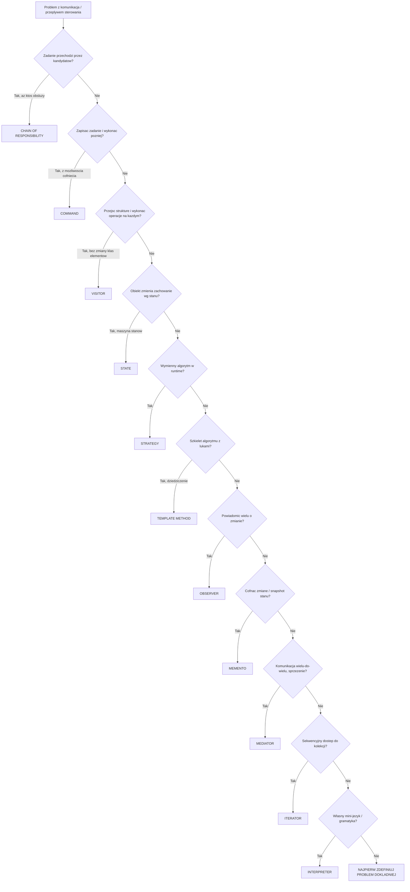
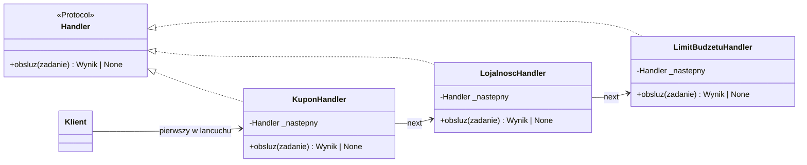
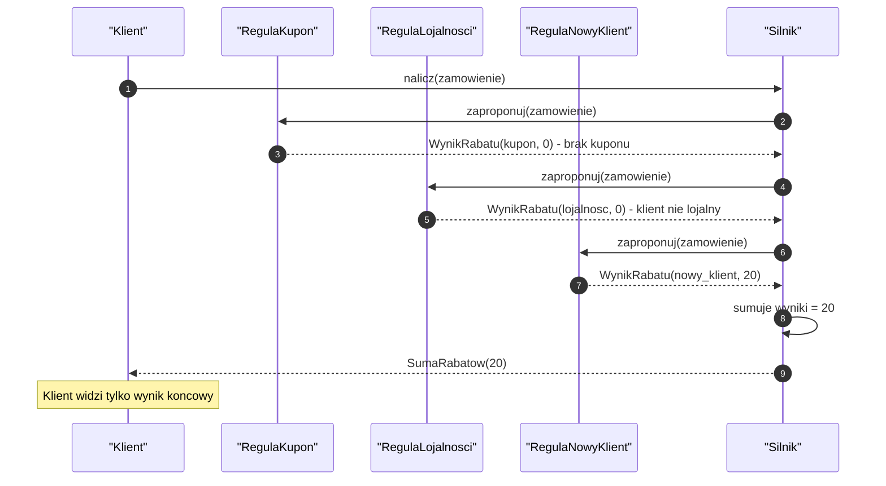
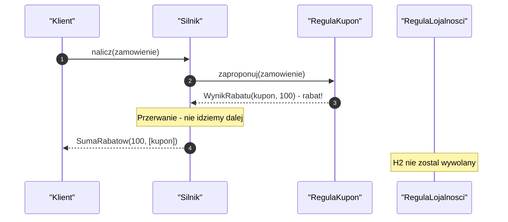
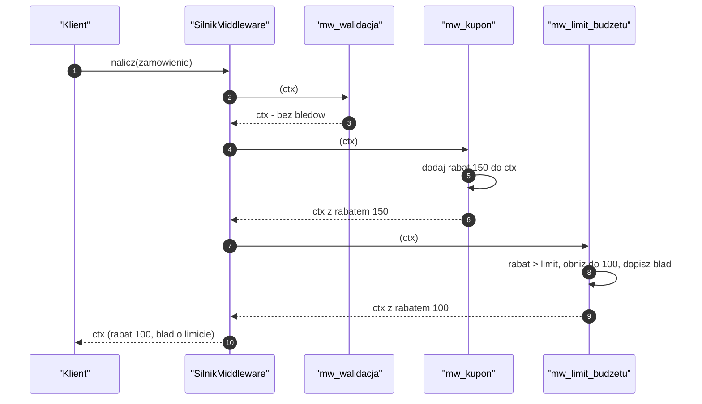
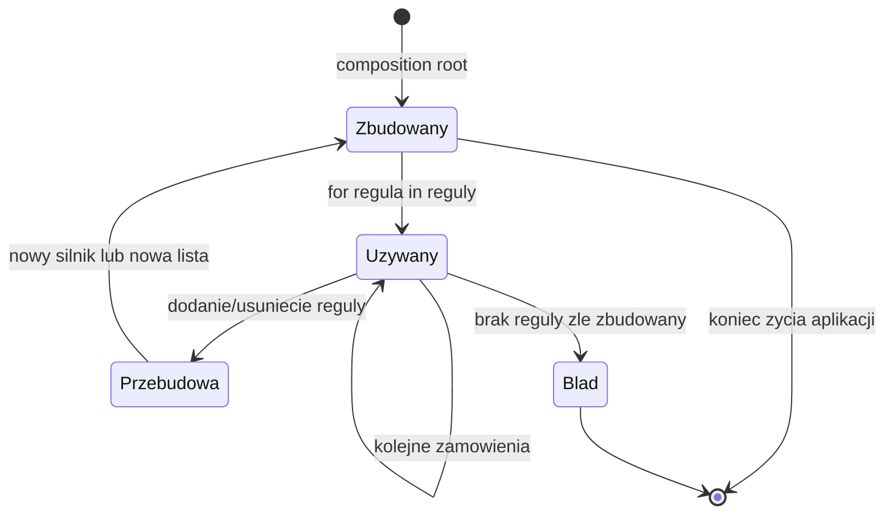
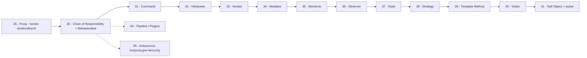

```markdown
---
modul: 30 — Chain of Responsibility i wprowadzenie do wzorców behawioralnych
plik: 30-chain-of-responsibility-i-wprowadzenie-behawioralne.md
poziom: sredni
wymaga: [26]
czas: ~180 minut czytania + ~420 minut ćwiczeń
---

# Moduł 30 — Wzorce behawioralne — jak obiekty się komunikują + Chain of Responsibility

> **TL;DR**
> - **Wzorce behawioralne (ang. behavioral patterns)** opisują, jak obiekty **współpracują**, kto za co odpowiada, jak przepływa sterowanie i dane — to największa rodzina wzorców GoF (11 wzorców) i najbliższa logice biznesowej.
> - **Chain of Responsibility (łańcuch zobowiązań)** przekazuje żądanie wzdłuż łańcucha potencjalnych odbiorców, aż któryś je obsłuży — idealny do reguł rabatowych, eskalacji, walidacji, middleware.
> - Łańcuch ma trzy warianty: **stop przy pierwszej obsłudze** (reguły wykluczające), **przetwarzanie przez wszystkich** (pipeline przetwarzania), **przerwanie z decyzją** (middleware/autoryzacja).
> - W Pythonie najprostszy łańcuch to **lista funkcji w pętli** albo **funkcja `chain(*handlers)`** — klasa z `set_next` jest potrzebna dopiero, gdy każdy handler ma stan albo własny kontrakt.
> - Najczęstsza pułapka: **żądanie nieobsłużone** kończące się cichą porażką — brak obsługi musi być jawnym zachowaniem, nie pustym `None` na końcu łańcucha.

---

## 0. Model mentalny

### Eskalacja w firmie i taśma kontroli jakości

Wyobraź sobie duże biuro obsługi klienta w instytucji finansowej. Dzwoni klient z reklamacją: „chcę zwrot opłaty za przelew, który został wykonany dwa tygodnie temu i dotarł z opóźnieniem". Rozmowę odbiera **konsultant pierwszego poziomu**. Sprawdza w systemie: sprawa dotyczy opłaty 15 złotych, standardowa. Ma **uprawnienie do załatwienia** takich spraw do 100 złotych, więc rozwiązuje ją od razu — zwraca pieniądze, zamyka zgłoszenie. Koniec. Żadne inne ogniwo się nie włącza.

Ale ten sam klient dzwoni drugi raz z reklamacją na **50 000 złotych** — dotyczyło to większej transakcji, świetnie. Konsultant pierwszego poziomu **przekazuje zgłoszenie** do **kierownika zespołu**. Kierownik ma uprawnienie do 10 000 złotych — nie wystarczy. Przekazuje do **dyrektora oddziału**, który ma uprawnienie do 100 000 złotych. Dyrektor załatwia sprawę. Trzy ogniwa, ale tylko ostatnie „obsłużyło żądanie". Konsultant i kierownik **tylko przekazali dalej**.

I jeszcze trzeci scenariusz: klient dzwoni o zwrot **2 000 000 złotych**. Konsultant → kierownik → dyrektor oddziału → **centrala**. Centrala ma uprawnienie do dowolnych kwot, ale wymaga dodatkowego formularza. Wysyła klientowi formularz — sprawa jest „przyjęta, ale wymaga dodatkowej akcji".

Zatrzymaj się przy tym obrazie i zobacz trzy rzeczy. Po pierwsze: **każde ogniwo ma swój zakres kompetencji**. Konsultant wie, do ilu może decydować. Kierownik wie, do ilu jego zespół. Dyrektor — do ilu oddział. Po drugie: **zgłoszenie idzie w ustalonej kolejności**. Nie ma sensu pytać dyrektora o sprawę, którą może załatwić konsultant. Kolejność jest częścią projektu. Po trzecie: **zgłoszenie albo jest obsłużone na którymś poziomie, albo idzie dalej**. Nie ginie. Jeśli trafia na koniec i nikt nie może — dzieje się coś **jawnego** (klient dostaje informację „przekazano do centrali" albo „sprawa wymaga innej procedury").

Ta struktura — **sekwencja kandydatów, każdy sprawdza czy może, przekazuje dalej jeśli nie może** — to dokładnie **wzorzec Chain of Responsibility**.

Teraz drugi obraz, który pokazuje inny wariant tego samego wzorca. Wyobraź sobie **taśmę kontroli jakości** w fabryce. Produkt jedzie przez kolejne stanowiska: stanowisko 1 mierzy wymiary, stanowisko 2 sprawdza kolor, stanowisko 3 testuje wytrzymałość, stanowisko 4 pakuje. **Każde stanowisko coś robi**, niezależnie od pozostałych. Żadne nie „przekazuje dalej" w sensie „nie chcę tego obsłużyć" — wszystkie robią swoją robotę po kolei. Produkt przechodzi przez całą linię, a każde stanowisko zmienia go w jakiś sposób. To ten sam wzorzec, ale w wersji **pipeline** — sekwencyjnego przetwarzania, gdzie każdy element uczestniczy.

Zatrzymaj się przy różnicy między tymi dwoma obrazami. W pierwszym (eskalacja) żądanie **zatrzymuje się** na pierwszym ogniwie, które czuje się kompetentne. W drugim (pipeline) żądanie **przechodzi przez wszystkie** ogniwa, a każde coś robi. To fundamentalna różnica dwóch wariantów wzorca — bardzo często mylonych.

| W analogii eskalacji i taśmy | W kodzie |
|---|---|
| Klient dzwoni z reklamacją | Obiekt żądania (`Zlecenie`, `Zgłoszenie`) |
| Konsultant I poziomu | `Handler` pierwszy w łańcuchu |
| Kierownik zespołu, dyrektor oddziału | Kolejne `Handler`y |
| Centrala | Ostatni `Handler` (np. obsługujący wszystkie kwoty) |
| „Mam uprawnienie do 100 zł" | Warunek obsługi w handlerze |
| Przekazanie sprawy dalej | Wywołanie `next.handle(zadanie)` |
| Załatwienie sprawy | Zwrócenie wyniku z handlera |
| „Sprawa wymaga dodatkowej procedury" | Jawny wynik (nie `None`) |
| Taśma kontroli jakości | Wariant pipeline — każdy handler coś robi |
| Stanowiska po kolei | Łańcuch sekwencyjny bez przerwania |

> 🧠 **Zapamiętaj** — **Chain of Responsibility (łańcuch zobowiązań) to wzorzec behawioralny, który przekazuje żądanie wzdłuż łańcucha potencjalnych odbiorców, tak aby każdy z nich po kolei decydował, czy obsłuży żądanie, czy przekaże je dalej.**

Zwróć uwagę na trzy słowa: **przekazuje**, **potencjalny**, **decyduje**. „Przekazuje" — bo żądanie nie „wraca" automatycznie do klienta z informacją „nie umiem". „Potencjalny" — bo handler nie musi obsłużyć; jest tylko kandydatem. „Decyduje" — bo decyzja jest w handlerze, nie w kliencie.

### Cała rodzina wzorców behawioralnych — jedna mapa

Zanim wejdziemy w szczegóły łańcucha, musimy zobaczyć całą rodzinę. Wzorce behawioralne (11 wzorców w klasycznym katalogu GoF + kilka dodatków) są **największą rodziną**, a jednocześnie **najtrudniejszą do uporządkowania**, bo wszystkie dotyczą „komunikacji" — ale każde z innego powodu.

| Wzorzec | Pytanie projektowe, na które odpowiada |
|---|---|
| **Chain of Responsibility** | „Żądanie przechodzi przez kandydatów, aż ktoś je obsłuży" |
| **Command** | „Zapisać żądanie jako obiekt, wykonać później, cofnąć" |
| **Interpreter** | „Wyrażenie w prostym języku, którego ewaluacja zależy od gramatyki" |
| **Iterator** | „Sekwencyjny dostęp do elementów kolekcji bez ujawniania struktury" |
| **Mediator** | „Uprościć komunikację wielu-do-wielu przez centralny punkt" |
| **Memento** | „Zapisać i przywrócić stan bez łamania hermetyzacji" |
| **Observer** | „Powiadomić wielu o zmianie stanu" |
| **State** | „Obiekt zmienia zachowanie, gdy zmienia się jego stan" |
| **Strategy** | „Wymienny algorytm wybierany w runtime" |
| **Template Method** | „Szkielet algorytmu z lukami do wypełnienia" |
| **Visitor** | „Operacja na strukturze obiektów bez zmiany klas tej struktury" |
| **Null Object** (dodatek) | „Obiekt reprezentujący brak z neutralnym zachowaniem" |
| **Specification** (dodatek) | „Reguła biznesowa jako obiekt, którą można łączyć" |

Trzynaście wzorców — sporo. Ale mają wspólny mianownik: **opisują relacje i przepływy między obiektami**, a nie ich strukturę. To odróżnia je od wzorców strukturalnych (moduły 20–26). Wzorce strukturalne mówiły „jak obiekty są zbudowane"; wzorce behawioralne mówią „co robią razem".

Poniższy diagram to mapa decyzyjna całej rodziny. Jedenaście pytań prowadzi do właściwego wzorca.



*Diagram to mapa decyzyjna: jedenaście pytań prowadzi do jedenastu wzorców behawioralnych — lub do uczciwego wniosku „problem nie jest jeszcze jasny".*

### Wspólne ostrzeżenie — dlaczego wzorce behawioralne są ryzykowne

Wszystkie wzorce behawioralne mają jedną wspólną cechę: **wprowadzają pośrednictwo w komunikacji**. Klient nie rozmawia z obiektem bezpośrednio — rozmawia przez strateg, przez command, przez observer, przez mediator. To pośrednictwo daje **elastyczność** (można wymienić, opóźnić, rozgałęzić komunikację), ale kosztuje **zrozumiałość kodu**.

Wzorce strukturalne (moduły 20–26) zwykle zmieniają **strukturę** — jest więcej klas, ale przepływ sterowania pozostaje mniej więcej czytelny. Wzorce behawioralne zmieniają **przepływ sterowania** — kto kogo woła, w jakiej kolejności, w jakim momencie. To znacznie trudniejsze do prześledzenia w debuggerze, jeszcze trudniejsze do zrozumienia w głowie.

Dlatego w tej rodzinie najczęstszym błędem jest **przedwczesne wprowadzanie wzorca**. Zanim sięgniesz po Command, Chain of Responsibility albo Visitor — zadaj sobie pytanie: **czy naprawdę potrzebuję tego pośrednictwa?** W większości aplikacji finansowych 80% logiki to proste operacje: pobierz dane, przelicz, zapisz, wyślij. Wzorce behawioralne mają sens w **rzeczywiście złożonych** procesach: wieloetapowe pipeline’y, dynamiczne eskalacje, wymienne reguły, cofanie operacji, koordynacja wielu modułów.

**Zasada kciuka:** jeśli schemat komunikacji w twoim kodzie da się narysować na jednej kartce A5 — nie potrzebujesz wzorca behawioralnego. Jeśli nie mieści się na A4 — czas pomyśleć o wzorcu. Ten moduł uczy, **jak** go stosować; moduł 73 nauczy, **kiedy go odrzucić**.

---

## 1. Problem, który rozwiązujemy

Wejdźmy w domenę 🛒-podobną, ale w sektorze finansowym — **system naliczania rabatów w sklepie z produktami finansowymi** (karty kredytowe, konta, ubezpieczenia). Klient dokonuje zakupu karty kredytowej, a system nalicza rabaty według różnych reguł: kupon promocyjny, program lojalnościowy, promocja sezonowa, limit budżetu rabatowego na dzień. Reguł jest mało — dziś trzy-cztery.

### Kod „przed"

```python
# rabaty_v0.py — wersja naiwna, demonstracyjna
# UWAGA: kod celowo pokazuje rosnaca lawine warunkow.

from __future__ import annotations

import time
from dataclasses import dataclass
from datetime import date, datetime, timezone
from decimal import Decimal, ROUND_HALF_UP


@dataclass(frozen=True, slots=True)
class Zamowienie:
    identyfikator: str
    klient_id: str
    kwota_brutto: Decimal
    waluta: str = "PLN"
    czy_lojalny: bool = False
    kod_kuponu: str | None = None
    czy_swiateczne: bool = False


class SilnikRabatow:
    """Naliczanie rabatu z lawina if/elif."""

    LIMIT_BUDZETU_DZIENNY = Decimal("50000.00")
    # Wykorzystany budzet...
    _wykorzystano: Decimal = Decimal("0.00")

    def nalicz_rabat(self, zamowienie: Zamowienie) -> Decimal:
        """Zwraca kwote rabatu w walucie zamowienia."""
        rabat = Decimal("0.00")

        # 1. Kupon promocyjny — 10%, ale max 200 zl
        if zamowienie.kod_kuponu == "PROMO10":
            r = (zamowienie.kwota_brutto * Decimal("0.10")).quantize(
                Decimal("0.01"), rounding=ROUND_HALF_UP
            )
            if r > Decimal("200.00"):
                r = Decimal("200.00")
            rabat += r

        # 2. Program lojalnosciowy — 5% po 3 latach
        if zamowienie.czy_lojalny:
            r = (zamowienie.kwota_brutto * Decimal("0.05")).quantize(
                Decimal("0.01"), rounding=ROUND_HALF_UP
            )
            rabat += r

        # 3. Promocja sezonowa — 3%, tylko w grudniu
        if zamowienie.czy_swiateczne and datetime.now(timezone.utc).month == 12:
            r = (zamowienie.kwota_brutto * Decimal("0.03")).quantize(
                Decimal("0.01"), rounding=ROUND_HALF_UP
            )
            rabat += r

        # 4. Limit budzetu dziennego
        pozostaly = self.LIMIT_BUDZETU_DZIENNY - self._wykorzystano
        if rabat > pozostaly:
            rabat = pozostaly
        self._wykorzystano += rabat

        # 5. Rabat nie moze przekroczyc 50% wartosci zamowienia
        maks = (zamowienie.kwota_brutto * Decimal("0.50")).quantize(
            Decimal("0.01"), rounding=ROUND_HALF_UP
        )
        if rabat > maks:
            rabat = maks

        return rabat


if __name__ == "__main__":
    silnik = SilnikRabatow()
    zamowienie = Zamowienie(
        identyfikator="ZAM-1",
        klient_id="KLIENT-1",
        kwota_brutto=Decimal("1500.00"),
        czy_lojalny=True,
        kod_kuponu="PROMO10",
    )
    print(f"Rabat: {silnik.nalicz_rabat(zamowienie)}")
```

Ten kod działa — dla trzech–czterech reguł jest w porządku. Ale już teraz widać problem: **metoda `nalicz_rabat` łączy cztery różne reguły w jednym bloku**. Dodanie piątej reguły to znów `if`. Usunięcie reguły wymaga usunięcia kodu — i ryzyka błędu. Zmiana kolejności (np. najpierw limit dzienny, potem kupon) wymaga przestawienia bloków. A każda reguła ma swoje testy rozproszone po testach metody.

### Code smell — lawina warunków biznesowych

| Problem | Gdzie | Konsekwencja |
|---|---|---|
| Cztery reguły w jednej metodzie | `nalicz_rabat` | Metoda rośnie liniowo z każdą regułą |
| Brak jednolitej struktury reguł | Każda reguła to osobny `if` | Każda nowa reguła kopiuje schemat „malowania” metodą |
| Kolejność zaszyta w kodzie | Bloki `if` w kolejności | Zmiana kolejności = przestawianie bloków |
| Stan globalny (`_wykorzystano`) | Klasowy atrybut | Trudno testować równolegle, wycieka między testami |
| Brak nazwy dla reguł | Brak typu `Kupon`, `Lojalnosc` | Reguły nie mogą być włączane/wyłączane dynamicznie |
| Test pojedynczej reguły trudny | Cała metoda testowana razem | Każdy test kombinuje wszystkie reguły |
| Rabat nie jest „jawny” w debugu | Brak logów „kupon dał 150 zł” | Trudno odpowiedzieć „skąd ten rabat?” |

Zwróć uwagę na przedostatnią pozycję. **Rabat to suma czterech reguł, ale w kodzie nie widać, jaka reguła ile „dała”.** Jeśli klient pyta „skąd 300 zł rabatu?”, musisz analizować kod lub dodać debugowanie. W systemach finansowych „skąd ta kwota?” to pytanie, na które trzeba umieć odpowiedzieć natychmiast.

### Objawy — poznasz ten problem po tym, że...

- **Dodanie nowej reguły to dopisanie kolejnego `if` w metodzie.** Metoda rośnie liniowo, a każde rozszerzenie to ryzyko regresji.
- **Zmiana kolejności reguł wymaga przestawienia bloków.** Kod nie komunikuje wprost, że „kupon idzie przed lojalnością”.
- **Nie można włączyć/wyłączyć reguły w runtime.** Reguła jest w kodzie albo jej nie ma. Feature flagi wymagają osobnych `if`ów.
- **Testy są trudne do napisania w izolacji.** Nie ma osobnego „testu reguły kuponu”, bo logika jest w wielkim `if`.
- **Nie da się odpowiedzieć „skąd rabat?” bez debugowania.** Brak wpisu „kupon dał X zł” w wyniku.
- **Metoda ma rosnącą liczbę `if`ów** i z czasem gałęzie stają się coraz bardziej zagnieżdżone.
- **Reguły nie są reużywalne.** Nie można użyć „kuponu” w innym kontekście (np. przy zwrotach) bez kopiowania.
- **Nie można łatwo dodać reguły warunkowej** (np. „kupon działa tylko dla nowych klientów”), bo wymaga to zagnieżdżeń.
- **Kod ma komentarze `# 1. Kupon`, `# 2. Lojalność`, `# 3. Sezonowa`** — to znak, że brakuje nazwanych struktur (obiektów reguł).

---

## 2. Anatomia wzorca

### Uczestnicy

| Rola | Odpowiedzialność | Co NIE jest jej zadaniem |
|---|---|---|
| **Handler (ogniwo)** | Definiuje kontrakt obsługi żądania; może mieć referencję do następnego handlera | Nie wie, gdzie jest w łańcuchu; nie decyduje o pozostałych ogniwach |
| **ConcreteHandler (konkretne ogniwo)** | Obsługuje żądanie, jeśli spełnia jego warunki; w przeciwnym razie przekazuje do następnego | Nie zawiera logiki innych ogniw; nie modyfikuje żądania „po cichu” |
| **Client (klient)** | Buduje łańcuch (albo dostaje gotowy) i przekazuje żądanie do pierwszego ogniwa | Nie sprawdza, który handler obsłuży; nie ingeruje w przepływ |
| **Żądanie (request)** | Obiekt przenoszony przez łańcuch; zwykle zawiera dane potrzebne do decyzji | Nie wie o istnieniu łańcucha; nie wybiera handlera |

Kluczowa własność: **handler nie wie, który jest ostatni**. Każdy zna tylko swojego następnika. To znaczy, że można dynamicznie przebudować łańcuch (dodać, usunąć, przestawić ogniwa) bez zmian w kodzie samych handlerów.

### Diagram struktury



*Diagram pokazuje, że każdy handler ma referencję tylko do następnego ogniwa — nie zna całego łańcucha, więc dynamiczne składanie jest możliwe bez modyfikacji kodu handlerów.*

### Trzy warianty łańcucha — najważniejsze rozróżnienie

Zanim przejdziemy dalej, musimy rozróżnić trzy warianty tego samego wzorca. Są **fundamentalnie różne** w intencji, choć mają podobną strukturę.

**Wariant 1: Stop przy pierwszej obsłudze (chain of handlers).** Żądanie idzie przez ogniwa, każde sprawdza „czy ja to obsłużę?”. Jeśli tak — obsługuje i **kończy**. Jeśli nie — przekazuje dalej. Użycie: **reguły wykluczające** (np. eskalacja w firmie, walidacja z różnymi poziomami, obsługa różnych typów żądań).

**Wariant 2: Przetwarzanie przez wszystkich (pipeline).** Żądanie idzie przez wszystkie ogniwa, każde **coś robi** (modyfikuje żądanie, dopisuje do wyniku). Żadne nie „zatrzymuje” przepływu. Użycie: **przetwarzanie wieloetapowe** (ETL, walidacja krok po kroku, dekorowanie).

**Wariant 3: Przerwanie z decyzją (middleware).** Żądanie idzie przez ogniwa, każde może **zdecydować**: obsłużyć, przerwać z błędem, albo przekazać dalej. Użycie: **middleware HTTP** (autoryzacja, rate limiting, logowanie), gdzie każde ogniwo może przerwać przetwarzanie z konkretnym efektem.

| Wariant | Kiedy zatrzymuje się | Intencja | Przykład |
|---|---|---|---|
| **Stop przy obsłudze** | Na pierwszym ogniwie, które „umie” | Wybór jednego handlera | Rabaty wykluczające, eskalacja |
| **Pipeline** | Nigdy — wszyscy przetwarzają | Sekwencyjne przetwarzanie | Walidacja, ETL, logowanie |
| **Middleware** | Na ogniwie, które przerwie | Kontrola i modyfikacja | Autoryzacja HTTP, ratelimit |

Rozróżnienie jest **kluczowe** — bo jeśli pomylisz warianty, dostaniesz kod, który wygląda jak łańcuch, ale nie działa tak, jak myślisz. W sekcji 5 pokażemy wszystkie trzy w praktyce.

### Warianty: klasyczny vs pythoniczny

| Aspekt | Wariant klasyczny (GoF) | Wariant pythoniczny |
|---|---|---|
| Handler | Klasa ABC z `handle` i `set_next` | `Protocol` + funkcja |
| Łańcuch | Ręczne `set_next` | Lista + pętla |
| Obsługa | Rzuca/zwraca specjalną wartość | Zwraca `None` albo `Result` |
| Przejście | Rekurencyjne wywołanie | Iteracja w pętli |
| Budowa | Konstruktory + `set_next` | `functools.reduce` na liście |
| Middleware | Nie omawiane | Standard (Django, ASGI, WSGI) |

W Pythonie **najprostszy łańcuch to lista funkcji w pętli** — bez klas, bez `set_next`, bez rekurencji. Klasa z `set_next` jest potrzebna dopiero, gdy każdy handler ma własny stan, własne zależności albo potrzebujesz dynamicznej modyfikacji łańcucha (wstawianie/usuwanie ogniw w runtime).

---

## 3. Implementacja krok po kroku

Przebudujemy silnik rabatowy z sekcji 1 stopniowo.

### Krok 1 — Zdefiniuj typ wyniku z jednego ogniwa

Zanim zaczniemy łańcuch, ustalmy, co handler zwraca. W finansach ważna jest **jawność** — nie chcemy „magicznych” wartości.

```python
from dataclasses import dataclass
from decimal import Decimal
from typing import Protocol, runtime_checkable

@dataclass(frozen=True, slots=True)
class WynikRabatu:
    """Wynik dzialania jednego ogniwa lancucha."""
    nazwa_reguly: str
    kwota_rabatu: Decimal
    uzasadnienie: str

    def __bool__(self) -> bool:
        return self.kwota_rabatu > Decimal("0")
```

Typ `WynikRabatu` niesie **nazwę reguły** i **uzasadnienie**. To kluczowe dla audytu — na końcu łańcucha można powiedzieć „rabat 300 zł, z czego 150 z kuponu, 100 z lojalności, 50 z sezonowej”. Bez tego typu wracamy do problemu „skąd ten rabat?”.

### Krok 2 — Zdefiniuj kontrakt handlera

Kontrakt handlera musi być prosty.

```python
@runtime_checkable
class RegulaRabatowa(Protocol):
    """Kontrakt: cokolwiek, co moze zaproponowac rabat."""
    nazwa: str
    def zaproponuj(self, zamowienie: "Zamowienie") -> WynikRabatu: ...
```

Zwróć uwagę na nazwę metody: `zaproponuj`. To **różnica wobec klasycznego `handle`** — nasz handler **proponuje** rabat, a nie „obsługuje żądanie”. To lepiej oddaje istotę problemu i wybiera wariant **pipeline** (wszystkie reguły się wypowiadają). Zobaczmy, dlaczego.

### Krok 3 — Zaimplementuj konkretne reguły

Każda reguła to osobna klasa, implementująca kontrakt.

```python
from decimal import ROUND_HALF_UP

class RegulaKupon:
    nazwa = "kupon"

    def zaproponuj(self, zamowienie: "Zamowienie") -> WynikRabatu:
        if not zamowienie.kod_kuponu:
            return WynikRabatu(self.nazwa, Decimal("0"), "brak kuponu")
        if zamowienie.kod_kuponu != "PROMO10":
            return WynikRabatu(
                self.nazwa, Decimal("0"), f"nieznany kupon: {zamowienie.kod_kuponu}"
            )
        rabat = (zamowienie.kwota_brutto * Decimal("0.10")).quantize(
            Decimal("0.01"), rounding=ROUND_HALF_UP
        )
        if rabat > Decimal("200.00"):
            rabat = Decimal("200.00")
        return WynikRabatu(self.nazwa, rabat, f"kupon {zamowienie.kod_kuponu}")


class RegulaLojalnosci:
    nazwa = "lojalnosc"

    def zaproponuj(self, zamowienie: "Zamowienie") -> WynikRabatu:
        if not zamowienie.czy_lojalny:
            return WynikRabatu(self.nazwa, Decimal("0"), "nie klient lojalny")
        rabat = (zamowienie.kwota_brutto * Decimal("0.05")).quantize(
            Decimal("0.01"), rounding=ROUND_HALF_UP
        )
        return WynikRabatu(self.nazwa, rabat, "rabat lojalnosciowy 5%")


class RegulaSezonowa:
    nazwa = "sezonowa"

    def zaproponuj(self, zamowienie: "Zamowienie") -> WynikRabatu:
        if not zamowienie.czy_swiateczne:
            return WynikRabatu(self.nazwa, Decimal("0"), "brak flagi sezonowej")
        rabat = (zamowienie.kwota_brutto * Decimal("0.03")).quantize(
            Decimal("0.01"), rounding=ROUND_HALF_UP
        )
        return WynikRabatu(self.nazwa, rabat, "promocja sezonowa 3%")


class RegulaLimituBudzetu:
    nazwa = "limit_budzetu"

    def __init__(self, budzet_dzienny: Decimal, wykorzystano: Decimal) -> None:
        self._budzet = budzet_dzienny
        self._wykorzystano = wykorzystano

    def zaproponuj(self, zamowienie: "Zamowienie") -> WynikRabatu:
        # Ta regula dziala "korekcyjnie" na sume - omowione w kroku 4
        return WynikRabatu(self.nazwa, Decimal("0"), "reguła globalna")
```

Każda reguła **nie zna innych**. Nie ma `if zamowienie.czy_lojalny and kod == "PROMO10"`. Reguły są niezależne — to fundamentalna cecha.

### Krok 4 — Zbuduj łańcuch i policz sumę

Teraz kluczowa decyzja. Wariant **pipeline** — wszystkie reguły się wypowiadają, a wynik jest sumą ich propozycji.

```python
@dataclass(frozen=True, slots=True)
class SumaRabatow:
    """Koncowy wynik - suma z uzasadnieniami."""
    kwota_calkowita: Decimal
    szczegoly: tuple[WynikRabatu, ...]

    def uzasadnienie(self) -> str:
        linie = [
            f"  {w.nazwa_reguly}: {w.kwota_rabatu} ({w.uzasadnienie})"
            for w in self.szczegoly
            if w.kwota_rabatu > 0
        ]
        return "Rabat calkowity " + str(self.kwota_calkowita) + "\n" + "\n".join(linie)


class SilnikRabatow:
    """Silnik pipeline: uruchamia wszystkie reguly, sumuje wyniki."""

    def __init__(self, reguly: list[RegulaRabatowa]) -> None:
        if not reguly:
            raise ValueError("silnik wymaga co najmniej jednej reguly")
        self._reguly = tuple(reguly)

    def nalicz(self, zamowienie: "Zamowienie") -> SumaRabatow:
        wyniki = tuple(r.zaproponuj(zamowienie) for r in self._reguly)
        suma = sum((w.kwota_rabatu for w in wyniki), Decimal("0"))
        # Zaokraglenie sumy do groszy
        suma = suma.quantize(Decimal("0.01"), rounding=ROUND_HALF_UP)
        # Globalny limit 50%
        maks = (zamowienie.kwota_brutto * Decimal("0.50")).quantize(
            Decimal("0.01"), rounding=ROUND_HALF_UP
        )
        if suma > maks:
            suma = maks
        return SumaRabatow(kwota_calkowita=suma, szczegoly=wyniki)
```

Zwróć uwagę: **`SilnikRabatow` iteruje po liście reguł i sumuje wyniki**. To wszystko. Każda reguła samodzielnie decyduje o swoim rabacie, a silnik jest tylko „pętlą”. To pokazuje, jak prosty jest wzorzec w wariancie pipeline.

### Krok 5 — Porównaj z wariantem „stop przy pierwszej obsłudze”

Pipeline jest dobry, gdy **wszystkie reguły mogą się wypowiedzieć**. Ale czasem chcemy, żeby żądanie **zatrzymało się** na pierwszym ogniwie, które „umie je obsłużyć”. To inny wariant.

```python
class PipelineRodzajowy:
    """Wariant 'stop przy pierwszej obsłudze': wybiera jedna regule."""

    def __init__(self, reguly: list[RegulaRabatowa]) -> None:
        self._reguly = tuple(reguly)

    def wybierz(self, zamowienie: "Zamowienie") -> WynikRabatu:
        for regula in self._reguly:
            wynik = regula.zaproponuj(zamowienie)
            if wynik:  # ktos zaproponowal niezerowy rabat
                return wynik
        # Kluczowe: brak obsługi musi byc JAWNY
        return WynikRabatu(
            nazwa_reguly="brak",
            kwota_rabatu=Decimal("0"),
            uzasadnienie="zadna regula nie zaproponowala rabatu",
        )
```

Tu widać kluczową cechę: **gdyby metoda kończyła się po pętli bez `return`**, klient dostałby `None` — cichą porażkę. **Brak obsługi musi być jawnym wynikiem**, nie pustką.

### Krok 6 — Walidacja kolejności i brak cyklu

Jeśli używasz wariantu klasycznego (z `set_next`), trzeba zadbać, żeby nie było cykli. W naszym wariancie pipeline to nie problem, bo nie ma „przekazywania dalej”. Ale w wariancie klasycznym cykl jest katastrofą.

Dla bezpieczeństwa w wersji pipeline wystarczy walidacja, że lista nie zawiera duplikatów nazw (bo wtedy „reguła X dała rabat” byłoby niejednoznaczne).

```python
def _waliduj_reguly(self, reguly: list[RegulaRabatowa]) -> None:
    nazwy = [r.nazwa for r in reguly]
    duplikaty = [n for n in set(nazwy) if nazwy.count(n) > 1]
    if duplikaty:
        raise ValueError(f"duplikaty regul: {duplikaty}")
```

### Krok 7 — Weryfikacja

| Kryterium | Wersja „przed” | Wersja „po” (pipeline) |
|---|---|---|
| Dodanie reguły | `if` w metodzie | Nowa klasa + wpis w liście |
| Zmiana kolejności | Przestawienie bloków | Przestawienie listy |
| Włączanie/wyłączanie reguły | `if` flagowy | Usunięcie z listy |
| Log „skąd rabat” | Brak | `SumaRabatow.szczegoly` |
| Test pojedynczej reguły | Trudny | Bezpośredni |
| Brak obsługi | Cichy `None` | Jawny `WynikRabatu("brak")` |
| Stan globalny | `_wykorzystano` klasowy | W osobnej klasie `LimitBudzetu` |
| Liczba klas | 2 | 5 (reguły + silnik + typ wyniku) |

Koszt: więcej klas. Zysk: reguły lokalne, jasne rabatowanie, testowalność, włączanie/wyłączanie. Przy takiej liczbie reguł zysk przewyższa koszt.

---

## 4. Wersje pythoniczne i warianty

Python ma **wiele bardzo krótkich** sposobów realizacji łańcucha. W większości przypadków klasa z `set_next` jest przesadą.

### 4.1 Lista funkcji w pętli — najprostsza forma

Zamiast klasy, funkcja obsługująca regułę. Zamiast listy obiektów — lista funkcji.

```python
from collections.abc import Callable

Regula = Callable[["Zamowienie"], WynikRabatu]

def regula_kupon(z: "Zamowienie") -> WynikRabatu:
    if z.kod_kuponu != "PROMO10":
        return WynikRabatu("kupon", Decimal("0"), "brak kuponu")
    rabat = min((z.kwota_brutto * Decimal("0.10")), Decimal("200.00"))
    return WynikRabatu("kupon", rabat, "kupon PROMO10")


def nalicz(z: "Zamowienie", reguly: list[Regula]) -> Decimal:
    return sum((r(z).kwota_rabatu for r in reguly), Decimal("0"))
```

Zaleta: brak klas, brak boilerplate'u. Wada: brak możliwości dodania własnego stanu do reguły (chyba że przez domknięcie). To najczęstsza forma w kodzie produkcyjnym.

### 4.2 `functools.reduce` — złożenie reguł

Do sekwencyjnego przetwarzania żądania.

```python
from functools import reduce

def zloz_reguly(reguly: list[Regula], start: Decimal = Decimal("0")) -> Regula:
    """Zwraca funkcje, ktora przechodzi przez wszystkie reguly."""
    def zlozona(z: "Zamowienie") -> WynikRabatu:
        suma = reduce(lambda acc, reg: acc + reg(z).kwota_rabatu, reguly, start)
        return WynikRabatu("suma", suma, f"{len(reguly)} regul")
    return zlozona
```

Zaleta: kompozycja w stylu funkcyjnym, brak `for`. Wada: mniej czytelna niż zwykła pętla w większości przypadków.

### 4.3 Funkcja `chain(*handlers)` — jawne składanie łańcucha

Bardzo elegancka forma — składanie łańcucha z funkcji.

```python
def chain(*reguly: Callable[[Decimal], Decimal]) -> Callable[[Decimal], Decimal]:
    """Zwraca funkcje, ktora laznie wywoluje wszystkie reguly."""
    def zlozona(kwota: Decimal) -> Decimal:
        wynik = kwota
        for regula in reguly:
            wynik = regula(wynik)
        return wynik
    return zlozona


# Uzycie:
podwyzka = chain(
    lambda k: k * Decimal("1.10"),   # +10% prowizji
    lambda k: k + Decimal("5.00"),   # +5 zl oplaty stalej
    lambda k: max(k, Decimal("20.00")),  # minimum 20 zl
)
```

To wariant funkcyjny — każda „reguła” przyjmuje wynik poprzedniej i zwraca nowy. To **pipeline transformacji**, a nie chain of responsibility w klasycznym sensie, ale idea ta sama.

### 4.4 Handler zwracający `None` — sygnał „nie obsłużę”

W wariancie „stop przy pierwszej obsłudze” handler, który nie obsługuje, może zwrócić `None`. Klient musi to **jawnie** obsłużyć.

```python
def wybierz_regule(z: "Zamowienie", reguly: list[Regula]) -> WynikRabatu | None:
    for regula in reguly:
        wynik = regula(z)
        if wynik is not None and wynik.kwota_rabatu > 0:
            return wynik
    return None


# Klient MUSI obsluzyc None:
wynik = wybierz_regule(zamowienie, reguly)
if wynik is None:
    raise RuntimeError("zadna regula nie obsluguje zamowienia")
```

**Pułapka:** `None` jako sygnał jest wygodny, ale łatwo zapomnieć o sprawdzeniu. W systemach finansowych lepiej zwracać `WynikRabatu("brak")` — jawny typ z jawną kwotą 0. Wtedy nie ma „magicznej wartości”.

### 4.5 `functools.singledispatch` — łańcuch po typie

Gdy wybór handlera zależy od **typu żądania**, `singledispatch` daje świetne rozwiązanie.

```python
from functools import singledispatch

@singledispatch
def obsluz(zadanie) -> str:
    return "nieznany typ zadania"

@obsluz.register
def _(zadanie: "ZamowienieOnline") -> str:
    return "obsluga online"

@obsluz.register
def _(zadanie: "ZamowienieOddzial") -> str:
    return "obsluga oddzialowa"
```

To wariant łańcucha, który „przeskakuje” do właściwego handlera po typie, nie po kolei. Zaleta: O(1) wybór, brak `if`. Wada: brak „eskalacji” (nie ma „jeśli nie ten typ, to następny”).

### 4.6 Middleware jako realny łańcuch

Django, Flask, ASGI, WSGI — wszystkie używają łańcucha middleware. To **produkcyjna realizacja wzorca**, którą warto znać.

```python
# Uproszczona wersja ASGI-like
from collections.abc import Callable
from typing import Any

Zadanie = dict
Odpowiedz = dict
Handler = Callable[[Zadanie], Odpowiedz]

def middleware_log(handler: Handler) -> Handler:
    def opakowanie(zadanie: Zadanie) -> Odpowiedz:
        print(f"[LOG] wejscie: {zadanie['sciezka']}")
        odp = handler(zadanie)
        print(f"[LOG] wyjscie: {odp['status']}")
        return odp
    return opakowanie


def middleware_auth(handler: Handler) -> Handler:
    def opakowanie(zadanie: Zadanie) -> Odpowiedz:
        if not zadanie.get("token"):
            return {"status": 401, "tresc": "brak tokenu"}
        return handler(zadanie)
    return opakowanie


# Zlozenie: zewnetrzne middleware jako pierwsze
def zbuduj_handlery(handler: Handler) -> Handler:
    return middleware_log(middleware_auth(handler))
```

To jest łańcuch w stylu **wariant 3 (middleware)** — każde ogniwo może przerwać przetwarzanie (np. zwrotem 401) albo przekazać dalej. W tym układzie każde middle-ware **opakowuje** następne (to już zbliża się do Decoratora — o tym w sekcji 9).

### 4.7 Korutyny (generatory) jako łańcuch

Bardzo zaawansowany wariant — łańcuch jako sekwencja `yield`ów, gdzie każdy handler może **przerwać** albo **modyfikować** stan.

```python
def krok_walidacji():
    """Korutyna: „zawiesza sie” czekajac na dane, potem przetwarza."""
    while True:
        zadanie = yield
        if not zadanie.get("kwota"):
            zadanie["blad"] = "brak kwoty"
            continue
        zadanie["walidacja"] = "ok"


def krok_wyliczenia():
    while True:
        zadanie = yield
        if "blad" not in zadanie:
            zadanie["prowizja"] = 5.0


# Uruchomienie:
k1 = krok_walidacji(); next(k1)
k2 = krok_wyliczenia(); next(k2)

def przetworz(zadanie):
    k1.send(zadanie)
    k2.send(zadanie)
    return zadanie
```

Zaleta: te same korutyny można używać wielokrotnie, można je przestawiać, można dodawać/usuwać w runtime. Wada: **trudne do zrozumienia**, wymaga dobrego zrozumienia `yield`/`send`. Rzadkie w produkcji poza frameworkami (np. `trio`, niektóre frameworki async).

### 4.8 Podsumowanie — tabela wyboru

| Sytuacja | Wariant |
|---|---|
| Reguły bezstanowe, sekwencyjne | Lista funkcji w pętli (4.1) |
| Kompozycja funkcyjna, transformacje | `chain` / `reduce` (4.2, 4.3) |
| Wybór jednej reguły | `None` albo jawny typ „brak” (4.4) |
| Wybór po typie żądania | `singledispatch` (4.5) |
| Middleware aplikacyjny | Funkcje wyższego rzędu (4.6) |
| Sekwencja kroków z przerwami | Korutyny (4.7) |
| Handler ze stanem, zależnościami | Klasa z `set_next` (klasyczny) |

> 🧠 **Zapamiętaj** — **W 90% przypadków w Pythonie łańcuch zobowiązań realizuje się listą funkcji w pętli albo `chain(*handlers)`**. Klasa z `set_next` jest potrzebna dopiero, gdy: (1) handler ma własny stan i zależności, (2) potrzebujesz dynamicznie wstawiać/usunąć ogniwa w runtime, (3) chcesz mieć jednoznaczny kontrakt handlera z metodą `handle`. Nie buduj klasy bez potrzeby.

---

## 5. Przykład z życia: 🛒 Rabaty — pełny uruchamialny kod

Zbudujemy pełny system rabatowy z **trzema wariantami łańcucha**: pipeline, stop-at-first, middleware. Wszystko w jednym pliku, żeby pokazać różnice.

### Kod

```python
# rabaty_chain.py — pelny przyklad Chain of Responsibility
from __future__ import annotations

from collections.abc import Callable
from dataclasses import dataclass, field
from datetime import datetime, timezone
from decimal import ROUND_HALF_UP, Decimal
from typing import Protocol, runtime_checkable


# ===========================================================================
# 1. Typy domenowe
# ===========================================================================

GROSZ = Decimal("0.01")


def zaokraglij(kwota: Decimal) -> Decimal:
    return kwota.quantize(GROSZ, rounding=ROUND_HALF_UP)


@dataclass(frozen=True, slots=True)
class Zamowienie:
    identyfikator: str
    klient_id: str
    kwota_brutto: Decimal
    waluta: str = "PLN"
    czy_lojalny: bool = False
    lata_lojalnosci: int = 0
    kod_kuponu: str | None = None
    czy_swiateczne: bool = False
    czy_pierwsze_zamowienie: bool = False


@dataclass(frozen=True, slots=True)
class WynikRabatu:
    """Wynik dzialania jednej reguly."""
    nazwa_reguly: str
    kwota_rabatu: Decimal
    uzasadnienie: str

    def __bool__(self) -> bool:
        return self.kwota_rabatu > Decimal("0")


@dataclass(frozen=True, slots=True)
class SumaRabatow:
    """Koncowy wynik sumujacy reguly."""
    identyfikator_zamowienia: str
    kwota_calkowita: Decimal
    szczegoly: tuple[WynikRabatu, ...]

    def uzasadnienie(self) -> str:
        linie = [f"Rabat calkowity: {self.kwota_calkowita}"]
        for w in self.szczegoly:
            znacznik = "OK" if w.kwota_rabatu > 0 else "  "
            linie.append(
                f"  [{znacznik}] {w.nazwa_reguly:15s} "
                f"{w.kwota_rabatu:>10} ({w.uzasadnienie})"
            )
        return "\n".join(linie)


# ===========================================================================
# 2. Kontrakt reguly obslugujacej zadanie
# ===========================================================================

@runtime_checkable
class RegulaRabatowa(Protocol):
    """Kontrakt: cokolwiek, co proponuje rabat dla zamowienia."""
    nazwa: str
    def zaproponuj(self, zamowienie: Zamowienie) -> WynikRabatu: ...


# ===========================================================================
# 3. Konkretne reguly
# ===========================================================================

class RegulaKupon:
    nazwa = "kupon"
    KODY = {"PROMO10": Decimal("0.10"), "NOWY20": Decimal("0.20")}
    MAKS = Decimal("200.00")

    def zaproponuj(self, zamowienie: Zamowienie) -> WynikRabatu:
        if not zamowienie.kod_kuponu:
            return WynikRabatu(self.nazwa, Decimal("0"), "brak kuponu")
        if zamowienie.kod_kuponu not in self.KODY:
            return WynikRabatu(
                self.nazwa,
                Decimal("0"),
                f"nieznany kupon {zamowienie.kod_kuponu!r}",
            )
        stawka = self.KODY[zamowienie.kod_kuponu]
        rabat = zaokraglij(zamowienie.kwota_brutto * stawka)
        if rabat > self.MAKS:
            rabat = self.MAKS
        return WynikRabatu(
            self.nazwa, rabat, f"kupon {zamowienie.kod_kuponu} ({stawka:.0%})"
        )


class RegulaLojalnosci:
    nazwa = "lojalnosc"

    def zaproponuj(self, zamowienie: Zamowienie) -> WynikRabatu:
        if not zamowienie.czy_lojalny:
            return WynikRabatu(self.nazwa, Decimal("0"), "nie klient lojalny")
        if zamowienie.lata_lojalnosci < 3:
            return WynikRabatu(
                self.nazwa,
                Decimal("0"),
                f"lojalnosc {zamowienie.lata_lojalnosci} lat < 3",
            )
        rabat = zaokraglij(zamowienie.kwota_brutto * Decimal("0.05"))
        return WynikRabatu(
            self.nazwa, rabat, f"lojalnosc {zamowienie.lata_lojalnosci} lat (5%)"
        )


class RegulaSezonowa:
    nazwa = "sezonowa"

    def zaproponuj(self, zamowienie: Zamowienie) -> WynikRabatu:
        if not zamowienie.czy_swiateczne:
            return WynikRabatu(self.nazwa, Decimal("0"), "brak flagi sezonowej")
        miesiac = datetime.now(timezone.utc).month
        if miesiac not in (11, 12):
            return WynikRabatu(
                self.nazwa, Decimal("0"), f"poza sezonem (miesiac {miesiac})"
            )
        rabat = zaokraglij(zamowienie.kwota_brutto * Decimal("0.03"))
        return WynikRabatu(
            self.nazwa, rabat, "promocja sezonowa (3%)"
        )


class RegulaNowyKlient:
    nazwa = "nowy_klient"

    def zaproponuj(self, zamowienie: Zamowienie) -> WynikRabatu:
        if not zamowienie.czy_pierwsze_zamowienie:
            return WynikRabatu(self.nazwa, Decimal("0"), "nie pierwsze zamowienie")
        rabat = zaokraglij(zamowienie.kwota_brutto * Decimal("0.02"))
        return WynikRabatu(
            self.nazwa, rabat, "rabat na pierwsze zamowienie (2%)"
        )


# ===========================================================================
# 4. Wariant A — PIPELINE: wszystkie reguly sie wypowiadaja
# ===========================================================================

class SilnikPipeline:
    """Pipeline: uruchamia wszystkie reguly, sumuje wyniki."""

    def __init__(self, reguly: list[RegulaRabatowa]) -> None:
        if not reguly:
            raise ValueError("silnik wymaga co najmniej jednej reguly")
        nazwy = [r.nazwa for r in reguly]
        if len(nazwy) != len(set(nazwy)):
            raise ValueError(f"duplikaty regul: {nazwy}")
        self._reguly = tuple(reguly)

    def nalicz(self, zamowienie: Zamowienie) -> SumaRabatow:
        szczegoly = tuple(r.zaproponuj(zamowienie) for r in self._reguly)
        suma = sum((w.kwota_rabatu for w in szczegoly), Decimal("0"))
        suma = zaokraglij(suma)
        # Globalny limit: max 50% wartosci zamowienia
        maks = zaokraglij(zamowienie.kwota_brutto * Decimal("0.50"))
        if suma > maks:
            suma = maks
        return SumaRabatow(
            identyfikator_zamowienia=zamowienie.identyfikator,
            kwota_calkowita=suma,
            szczegoly=szczegoly,
        )


# ===========================================================================
# 5. Wariant B — STOP-AT-FIRST: pierwsza regula wygrywa
# ===========================================================================

class SilnikStopAtFirst:
    """Wybierz jedna regule - pierwsza, ktora zaproponuje niezerowy rabat."""

    def __init__(self, reguly: list[RegulaRabatowa]) -> None:
        self._reguly = tuple(reguly)

    def nalicz(self, zamowienie: Zamowienie) -> SumaRabatow:
        for regula in self._reguly:
            wynik = regula.zaproponuj(zamowienie)
            if wynik:
                return SumaRabatow(
                    identyfikator_zamowienia=zamowienie.identyfikator,
                    kwota_calkowita=wynik.kwota_rabatu,
                    szczegoly=(wynik,),
                )
        # KLUCZOWE: brak obslugi musi byc jawny
        return SumaRabatow(
            identyfikator_zamowienia=zamowienie.identyfikator,
            kwota_calkowita=Decimal("0"),
            szczegoly=(
                WynikRabatu(
                    "brak",
                    Decimal("0"),
                    "zadna regula nie zaproponowala rabatu",
                ),
            ),
        )


# ===========================================================================
# 6. Wariant C — MIDDLEWARE: kazde ogniwo moze przerwac
# ===========================================================================

@dataclass
class KontekstRabatu:
    """Kontekst przekazywany przez middleware - mutowalny."""
    zamowienie: Zamowienie
    rabat: Decimal = Decimal("0")
    bledy: list[str] = field(default_factory=list)
    zakonczono: bool = False

    def dodaj_rabat(self, kwota: Decimal) -> None:
        self.rabat = zaokraglij(self.rabat + kwota)


Middleware = Callable[[KontekstRabatu], KontekstRabatu]


def mw_walidacja(ctx: KontekstRabatu) -> KontekstRabatu:
    if ctx.zamowienie.kwota_brutto <= 0:
        ctx.bledy.append("kwota musi byc dodatnia")
        ctx.zakonczono = True
    return ctx


def mw_kupon(ctx: KontekstRabatu) -> KontekstRabatu:
    if ctx.zakonczono:
        return ctx
    r = RegulaKupon().zaproponuj(ctx.zamowienie)
    ctx.dodaj_rabat(r.kwota_rabatu)
    return ctx


def mw_limit_budzetu(dostepne: Decimal) -> Middleware:
    """Middleware z konfiguracja - wzorzec fabryki middleware."""
    def _mw(ctx: KontekstRabatu) -> KontekstRabatu:
        if ctx.zakonczono:
            return ctx
        if ctx.rabat > dostepne:
            ctx.bledy.append(
                f"rabat {ctx.rabat} przekracza dostepny budzet {dostepne}"
            )
            ctx.rabat = dostepne
        return ctx
    return _mw


class SilnikMiddleware:
    """Wariant middleware: kazde ogniwo moze zmodyfikowac kontekst."""

    def __init__(self, middlewares: list[Middleware]) -> None:
        self._middlewares = tuple(middlewares)

    def nalicz(self, zamowienie: Zamowienie) -> KontekstRabatu:
        ctx = KontekstRabatu(zamowienie=zamowienie)
        for mw in self._middlewares:
            ctx = mw(ctx)
        return ctx


# ===========================================================================
# 7. Demonstracja
# ===========================================================================

def raport_pipeline(silnik: SilnikPipeline, zamowienie: Zamowienie) -> None:
    suma = silnik.nalicz(zamowienie)
    print(f"  {suma.uzasadnienie()}")


def raport_stop(silnik: SilnikStopAtFirst, zamowienie: Zamowienie) -> None:
    suma = silnik.nalicz(zamowienie)
    for w in suma.szczegoly:
        print(f"  wybrana regula: {w.nazwa_reguly} = {w.kwota_rabatu}")


def raport_middleware(silnik: SilnikMiddleware, zamowienie: Zamowienie) -> None:
    ctx = silnik.nalicz(zamowienie)
    print(f"  rabat: {ctx.rabat}, bledy: {ctx.bledy}")


if __name__ == "__main__":
    zamowienie1 = Zamowienie(
        identyfikator="ZAM-001",
        klient_id="K-1",
        kwota_brutto=Decimal("1500.00"),
        czy_lojalny=True,
        lata_lojalnosci=5,
        kod_kuponu="PROMO10",
        czy_pierwsze_zamowienie=False,
    )

    zamowienie2 = Zamowienie(
        identyfikator="ZAM-002",
        klient_id="K-2",
        kwota_brutto=Decimal("100.00"),
        czy_pierwsze_zamowienie=True,
    )

    print("=== 1. PIPELINE: wszystkie reguly sumowane ===")
    pipeline = SilnikPipeline([
        RegulaKupon(),
        RegulaLojalnosci(),
        RegulaSezonowa(),
        RegulaNowyKlient(),
    ])
    print("Zamowienie 1 (kupon + lojalnosc):")
    raport_pipeline(pipeline, zamowienie1)
    print("\nZamowienie 2 (nowy klient):")
    raport_pipeline(pipeline, zamowienie2)

    print("\n=== 2. STOP-AT-FIRST: pierwsza aktywna regula wygrywa ===")
    stop = SilnikStopAtFirst([
        RegulaKupon(),      # pierwsza - jesli ma kupon, wygrywa
        RegulaLojalnosci(),
        RegulaNowyKlient(),
    ])
    print("Zamowienie 1:")
    raport_stop(stop, zamowienie1)
    print("Zamowienie 2:")
    raport_stop(stop, zamowienie2)

    print("\n=== 3. MIDDLEWARE: kazde ogniwo moze przerwac ===")
    middleware = SilnikMiddleware([
        mw_walidacja,
        mw_kupon,
        mw_limit_budzetu(Decimal("100.00")),
    ])
    print("Zamowienie 1 (kupon daje 150, limit 100):")
    raport_middleware(middleware, zamowienie1)

    print("\n=== 4. PIPELINE ograniczenie 50% ===")
    wielkie = Zamowienie(
        identyfikator="ZAM-003",
        klient_id="K-3",
        kwota_brutto=Decimal("500.00"),
        czy_lojalny=True,
        lata_lojalnosci=10,
        kod_kuponu="NOWY20",
        czy_pierwsze_zamowienie=True,
    )
    raport_pipeline(pipeline, wielkie)

    print("\n=== 5. Brak obslugi jest JAWNY ===")
    puste = Zamowienie(
        identyfikator="ZAM-004", klient_id="K-4", kwota_brutto=Decimal("50.00")
    )
    raport_stop(stop, puste)
```

### Co ten przykład pokazuje

Uruchomienie demonstruje trzy warianty łańcucha.

**Punkt 1 — pipeline sumuje wszystkie reguły.** `Zamowienie 1` z kuponem, lojalnością 5 lat i flagami lojalnościowym dostało rabat złożony z **czterech reguł**. `SumaRabatow.uzasadnienie()` pokazuje szczegóły — wiadomo, jaka reguła ile dała.

**Punkt 2 — stop-at-first wybiera jedną.** Dla tego samego `Zamowienie 1` wynik jest inny: tylko kupon zadziałał (bo jest pierwszy na liście). **Ten sam zestaw reguł, inna intencja, inny wynik.** To pokazuje, dlaczego wybór wariantu to decyzja projektowa.

**Punkt 3 — middleware może przerwać i modyfikować.** Limit 100 zł obniża rabat. `mw_walidacja` może przerwać (zakonczono = True). Middleware ma stan (kontekst) i może wpływać na wynik.

**Punkt 4 — globalny limit działa.** Nawet gdyby suma z reguł przekraczała 50% wartości, silnik ogranicza. Zwróć uwagę: limit jest **w silniku**, nie w regułach. To jedno miejsce zamiast czterech.

**Punkt 5 — brak obsługi jest jawny.** `SilnikStopAtFirst` na zamówieniu bez żadnej pasującej reguły zwraca jawne `WynikRabatu("brak", 0, "zadna regula...")`. Klient **widzi**, że nie było obsługi — nie dostaje `None`.

### Testy

```python
# test_rabaty_chain.py — uruchomienie: pytest test_rabaty_chain.py -v
from decimal import Decimal

import pytest

from rabaty_chain import (
    KontekstRabatu,
    RegulaKupon,
    RegulaLojalnosci,
    RegulaNowyKlient,
    RegulaSezonowa,
    SilnikMiddleware,
    SilnikPipeline,
    SilnikStopAtFirst,
    SumaRabatow,
    WynikRabatu,
    Zamowienie,
    mw_kupon,
    mw_limit_budzetu,
    mw_walidacja,
)


def zamowienie(**nadpisania) -> Zamowienie:
    dane = {
        "identyfikator": "ZAM-T",
        "klient_id": "K-T",
        "kwota_brutto": Decimal("1000.00"),
    }
    dane.update(nadpisania)
    return Zamowienie(**dane)


# --- Reguly indywidualnie ---------------------------------------------------

def test_kupon_pusto_gdy_brak() -> None:
    wynik = RegulaKupon().zaproponuj(zamowienie())
    assert wynik.kwota_rabatu == Decimal("0")
    assert not wynik


def test_kupon_promo10() -> None:
    wynik = RegulaKupon().zaproponuj(zamowienie(kod_kuponu="PROMO10"))
    assert wynik.kwota_rabatu == Decimal("100.00")


def test_kupon_cap_200() -> None:
    wynik = RegulaKupon().zaproponuj(
        zamowienie(kwota_brutto=Decimal("10000.00"), kod_kuponu="PROMO10")
    )
    assert wynik.kwota_rabatu == Decimal("200.00")


def test_lojalnosc_wymaga_min_3_lat() -> None:
    wynik = RegulaLojalnosci().zaproponuj(
        zamowienie(czy_lojalny=True, lata_lojalnosci=2)
    )
    assert wynik.kwota_rabatu == Decimal("0")


def test_lojalnosc_dla_starszego_klienta() -> None:
    wynik = RegulaLojalnosci().zaproponuj(
        zamowienie(czy_lojalny=True, lata_lojalnosci=5)
    )
    assert wynik.kwota_rabatu == Decimal("50.00")


def test_nowy_klient() -> None:
    wynik = RegulaNowyKlient().zaproponuj(
        zamowienie(czy_pierwsze_zamowienie=True)
    )
    assert wynik.kwota_rabatu == Decimal("20.00")


# --- Silnik pipeline --------------------------------------------------------

def test_pipeline_sumuje_wszystkie() -> None:
    silnik = SilnikPipeline([RegulaKupon(), RegulaLojalnosci()])
    suma = silnik.nalicz(
        zamowienie(
            kod_kuponu="PROMO10", czy_lojalny=True, lata_lojalnosci=5
        )
    )
    assert suma.kwota_calkowita == Decimal("150.00")
    assert len(suma.szczegoly) == 2


def test_pipeline_odrzuca_duplikaty() -> None:
    with pytest.raises(ValueError, match="duplikaty"):
        SilnikPipeline([
            RegulaKupon(),
            RegulaKupon(),
        ])


def test_pipeline_odrzuca_pusta_liste() -> None:
    with pytest.raises(ValueError):
        SilnikPipeline([])


def test_pipeline_limit_50_procent() -> None:
    silnik = SilnikPipeline([
        RegulaKupon(), RegulaLojalnosci(), RegulaNowyKlient(),
    ])
    suma = silnik.nalicz(
        zamowienie(
            kwota_brutto=Decimal("100.00"),
            kod_kuponu="NOWY20",
            czy_lojalny=True,
            lata_lojalnosci=5,
            czy_pierwsze_zamowienie=True,
        )
    )
    # 20 + 5 + 2 = 27, ale max 50% z 100 to 50 -> OK
    assert suma.kwota_calkowita == Decimal("27.00")


# --- Silnik stop-at-first ---------------------------------------------------

def test_stop_wybiera_pierwsza() -> None:
    silnik = SilnikStopAtFirst([RegulaKupon(), RegulaLojalnosci()])
    suma = silnik.nalicz(
        zamowienie(kod_kuponu="PROMO10", czy_lojalny=True, lata_lojalnosci=5)
    )
    assert suma.kwota_calkowita == Decimal("100.00")   # tylko kupon
    assert len(suma.szczegoly) == 1


def test_stop_brak_obslugi_jest_jawny() -> None:
    silnik = SilnikStopAtFirst([RegulaKupon()])
    suma = silnik.nalicz(zamowienie())
    assert suma.kwota_calkowita == Decimal("0")
    assert suma.szczegoly[0].nazwa_reguly == "brak"
    assert "zadna regula" in suma.szczegoly[0].uzasadnienie


# --- Middleware -------------------------------------------------------------

def test_middleware_walidacja_przerywa() -> None:
    silnik = SilnikMiddleware([mw_walidacja, mw_kupon])
    ctx = silnik.nalicz(zamowienie(kwota_brutto=Decimal("0")))
    assert ctx.zakonczono
    assert ctx.rabat == Decimal("0")
    assert ctx.bledy


def test_middleware_limit_budzetu_obniza() -> None:
    silnik = SilnikMiddleware([
        mw_kupon,
        mw_limit_budzetu(Decimal("50.00")),
    ])
    ctx = silnik.nalicz(zamowienie(kod_kuponu="PROMO10"))
    assert ctx.rabat == Decimal("50.00")
    assert ctx.bledy


def test_middleware_pusty_kontekst_bez_bledow() -> None:
    silnik = SilnikMiddleware([mw_kupon, mw_limit_budzetu(Decimal("1000.00"))])
    ctx = silnik.nalicz(zamowienie())
    assert ctx.rabat == Decimal("0")
    assert not ctx.bledy


# --- Kontrakt: wszystkie reguly zgodne --------------------------------------

WSZYSTKIE_REGULY = [
    RegulaKupon(),
    RegulaLojalnosci(),
    RegulaSezonowa(),
    RegulaNowyKlient(),
]


@pytest.mark.parametrize("regula", WSZYSTKIE_REGULY, ids=lambda r: r.nazwa)
def test_regula_spelnia_kontrakt(regula) -> None:
    assert isinstance(regula.nazwa, str)
    assert regula.nazwa
    for zam in (
        zamowienie(),
        zamowienie(kod_kuponu="PROMO10"),
        zamowienie(czy_lojalny=True, lata_lojalnosci=10),
    ):
        wynik = regula.zaproponuj(zam)
        assert isinstance(wynik, WynikRabatu)
        assert wynik.nazwa_reguly == regula.nazwa
        assert isinstance(wynik.kwota_rabatu, Decimal)
        assert wynik.kwota_rabatu >= Decimal("0")


@pytest.mark.parametrize("regula", WSZYSTKIE_REGULY, ids=lambda r: r.nazwa)
def test_regula_jest_deterministyczna(regula) -> None:
    """Dwa wywolania daja ten sam wynik - brak ukrytego stanu."""
    z = zamowienie(kod_kuponu="PROMO10", czy_lojalny=True, lata_lojalnosci=10)
    assert regula.zaproponuj(z) == regula.zaproponuj(z)
```

Ostatni test jest kluczowy: **reguła jest deterministyczna**. Dwa wywołania z tym samym wejściem dają ten sam wynik. W finansach to niezbędne — bo inaczej „skąd ten rabat?” ma odpowiedź „to zależy”. Reguły nie mają **ukrytego stanu mutowalnego**; wszystko, co stanowe, jest poza regułami (np. w `SilnikMiddleware` z kontekstem).

---

## 6. Dynamika

### 6.1 Żądanie przechodzi przez trzy handlery, trzeci obsługuje



*Diagram pokazuje wariant pipeline: silnik uruchamia kolejne reguły jedna po drugiej, zbiera wyniki i sumuje — klient nie wie, ile reguł zostało odrzuconych.*

### 6.2 Wariant „stop-at-first” — przerwanie na drugim handlerze



*Diagram pokazuje wariant stop-at-first: pierwsza reguła, która zwróci niezerowy wynik, przerywa łańcuch — kolejne reguły nie są wywoływane.*

### 6.3 Wariant middleware — każde ogniwo modyfikuje kontekst



*Diagram pokazuje wariant middleware: każde ogniwo przyjmuje ten sam kontekst, może go modyfikować albo przerwać przepływ — a kontekst jest jedną strukturą mutowalną przekazywaną dalej.*

### 6.4 Cykl życia łańcucha — budowa, użycie, przebudowa



*Diagram pokazuje cykl życia łańcucha: zbudowany raz, używany dla wielu żądań, może być przebudowany przy zmianie konfiguracji — sam handler nie zmienia się przy tym.*

> 💡 **Intuicja** — Łańcuch zobowiązań przypomina pytanie zadane w biurze: „kto mi to załatwi?”. Pytasz pierwszą osobę, ona mówi „nie ja, ale tu obok siedzi właściwa osoba”; idziesz do niej, ona mówi „to ja, już się tym zajmę”. Każda osoba wie tylko, gdzie skierować cię dalej — nie zna całego biura. A jeśli nikt nie załatwi — to nie „pytanie ginie”, ale „wracasz z informacją, że nikt nie miał kompetencji”. Ta ostatnia własność jest kluczowa.

---

## 7. Kiedy używać / kiedy NIE używać

### Kiedy używać

**Gdy masz sekwencję kandydatów do obsługi żądania.** Eskalacja, reguły wykluczające, walidacja na kolejnych poziomach — wszystko, gdzie „ktoś sprawdza, czy może obsłużyć”.

**Gdy kolejność kandydatów ma znaczenie.** Kolejność jest częścią projektu. W łańcuchu wyrażasz ją jawnie (lista, `reduce`, `set_next`).

**Gdy chcesz włączać/wyłączać ogniwa w runtime.** Lista reguł można modyfikować — np. dla feature flag, dla A/B, dla konfiguracji środowiska.

**Gdy chcesz rozdzielić żądanie od obsługi.** Klient nie wie, kto obsłuży żądanie — łańcuch to ukrywa.

**Gdy reguły mają wspólny interfejs, ale różną logikę.** Kupon, lojalność, sezonowa — każda samodzielna, wszystkie w tym samym kontrakcie.

**Gdy chcesz móc „powiedzieć” o przepływie.** Każde ogniwo może logować „sprawdziłem, nie mogę”, „obsługuję”. To kluczowe dla audytu.

**Gdy potrzebujesz wariantu pipeline.** Sekwencyjne przetwarzanie (ETL, walidacja, transformacje) — każdy krok coś robi.

**Gdy potrzebujesz middleware.** Django, ASGI, gRPC interceptory — to produkcja tego wzorca. Każde ogniwo może przerwać, zmodyfikować, dopisać.

**Gdy chcesz uniknąć `if/elif` w kodzie klienta.** Reguły w łańcuchu są deklaratywne (lista) zamiast imperatywne (`if`).

**Gdy reguły mają złożone warunki.** Każda reguła może mieć 5 własnych warunków wewnątrz — i nikt tego nie widzi z zewnątrz.

**Gdy chcesz móc testować reguły osobno.** Test per reguła — trywialny w łańcuchu, niemożliwy w zagnieżdżonym `if`.

### Kiedy NIE używać

**Gdy masz dwie–trzy reguły i nigdy nie będzie więcej.** Zwykły `if/elif` jest czytelny i bardziej bezpośredni.

**Gdy kolejność nie ma znaczenia.** Jeśli reguły są niezależne i wynik jest niezależny od kolejności, łańcuch to przesada — użyj funkcji lub listy.

**Gdy każda reguła obsługuje inne żądanie w inny sposób.** Łańcuch działa, gdy reguły mają **wspólny kontrakt**. Jeśli każda przyjmuje inny typ żądania, to nie łańcuch — to `dispatch`.

**Gdy popełnianie błędów ma poważne konsekwencje i potrzebujesz deterministycznego wyboru.** Łańcuch może „przepuścić” żądanie przez więcej ogniw niż się spodziewasz — jeśli nie zwrócisz uwagi na brak obsługi.

**Gdy obsługa żądania jest droga i chcesz zrobić ją wcześnie.** Łańcuch opóźnia — dopiero na końcu wiadomo, że nikt nie obsłużył.

**Gdy zespół nie zna wzorca.** Warianty (pipeline, stop, middleware) mają różne konsekwencje i łatwo je pomylić. Bez edukacji to źródło błędów.

**Gdy wystarczy strategia.** Jeśli wybór jednej implementacji jest jednoznaczny z góry, użyj Strategy (moduł 38). Łańcuch ma sens tylko, gdy nie wiadomo, kto obsłuży.

**Gdy wystarczy `if/elif` z wyczerpującym `match/case`.** W Pythonie 3.10+ `match/case` jest bardzo czytelne dla wyboru jednej reguły. Dla 2–5 wariantów to lepsze niż łańcuch.

**Gdy chcesz „zapisać żądanie i wykonać później”.** To Command (moduł 31). Łańcuch wykonuje od razu.

**Gdy chcesz „powiadomić wielu”.** To Observer (moduł 36). Łańcuch jest jednokierunkowy.

**Zbiorczo — tabela decyzyjna:**

| Pytanie | Jeśli „tak” | Jeśli „nie” |
|---|---|---|
| Sekwencja kandydatów do obsługi? | Chain of Responsibility | Rozważ inne wzorce |
| Kolejność ma znaczenie? | CoR z jawną listą | Rozważ listę |
| Chcesz włączać/wyłączać w runtime? | CoR z listą | CoR z klasami |
| Reguły mają wspólny kontrakt? | CoR działa | Nie CoR |
| Kolejność nie ma znaczenia? | **Nie CoR** | CoR OK |
| Wystarczy `match/case`? | **Nie CoR** | CoR OK |
| Chcesz przerwać z błędem? | Middleware | Pipeline |
| Chcesz, żeby każdy coś zrobił? | Pipeline | Stop-at-first |
| Zespół zna różnice wariantów? | Warto rozważyć | Najpierw wyedukuj |

---

## 8. Pułapki i antywzorce

**1. Żądanie nigdy nieobsłużone — cicha porażka.** Najczęstsza pułapka.

```python
# ZLE
def obsluz(zadanie, reguly):
    for regula in reguly:
        wynik = regula(zadanie)
        if wynik:
            return wynik
    # brak return! → zwrocone None
```

**Konsekwencja:** klient dostaje `None` i próbuje coś z tym zrobić albo pomija — w systemie finansowym to „nie wiem, czy rabat został naliczony”. **Prawidłowo:** brak obsługi musi być jawnym wynikiem — `WynikRabatu("brak", 0, "...")` albo dedykowany wyjątek `BrakObslugi`. Nigdy nie zwracaj `None`, jeśli klient tego nie oczekuje.

**2. Cykl w łańcuchu (klasyczny wariant).**

```python
# ZLE
h1.set_next(h2)
h2.set_next(h3)
h3.set_next(h1)   # CYKL!
h1.handle(zadanie)  # nieskonczona rekurencja
```

**Konsekwencja:** nieskończona rekurencja i `RecursionError`. W wersji iteracyjnej — nieskończona pętla. **Prawidłowo:** jeśli używasz `set_next`, zabezpiecz się przed cyklami (sprawdzenie przy `set_next` albo maksymalna długość przejścia). W wersji z listą — cykl nie jest możliwy, bo lista jest jednoznaczna.

**3. Kolejność jest niejawna — „magiczny porządek”.**

```python
# ZLE: uzytkownik nie wie, ze kolejnosc ma znaczenie
silnik = SilnikStopAtFirst([RegulaLojalnosci(), RegulaKupon()])
```

**Konsekwencja:** w wariancie stop-at-first kolejność decyduje o zachowaniu. Jeśli użytkownik ustawi lojalność przed kuponem, a oczekuje „kupon wygrywa”, dostanie inny wynik. **Prawidłowo:** dokumentuj, że kolejność ma znaczenie. Albo użyj wariantu pipeline, gdzie kolejność **nie** wpływa na wynik (chyba że ma — jak przy limitach). Zawsze jawnie komunikuj intencję.

**4. Trudność debugowania — „dlaczego to żądanie trafiło tutaj?”.**

**Konsekwencja:** w łańcuchu 8 ogniw, żeby zrozumieć, kto odpowiedział, trzeba debugować krok po kroku. Bez logów to bardzo trudne. **Prawidłowo:** każde ogniwo **loguje** decyzję („sprawdzone: nie mogę”, „obsługuję”). `SilnikPipeline` zbiera szczegóły i może pokazać „cały przebieg”. Zawsze dodawaj widoczność — to wzorzec, gdzie widoczność jest kluczowa.

**5. Handlery ze stanem mutowalnym — przecieki między żądaniami.**

```python
# ZLE
class RegulaKupon:
    licznik_uzyc = 0   # wspoldzielony!
    def zaproponuj(self, zamowienie):
        self.licznik_uzyc += 1   # rosnie bez konca
        ...
```

**Konsekwencja:** stan rośnie w nieskończoność, w środowisku wielowątkowym dochodzi do wyścigów. Testy dziedziczą stan po poprzednich. **Prawidłowo:** reguły powinny być **bezstanowe** (jak zwykłe funkcje) albo stan powinien być w jasno zdefiniowanym obiekcie zewnętrznym (jak `mw_limit_budzetu(dostępne)`). Nigdy nie trzymaj stanu mutowalnego na regule samej w sobie.

**6. Łańcuch zastępujący pełne “monolityczne” rozwiązanie bez zysku.**

```python
# ZLE: 8 regul, z ktorych 7 robi to samo
class RegulaX1: ...  # kazda to samo
class RegulaX2: ...
```

**Konsekwencja:** łańcuch wprowadza pośrednictwo bez realnej potrzeby. Wszystko jedno miejsce może być funkcją. **Prawidłowo:** łańcuch opłaca się, gdy reguły są **realnie różne** i **niezależne**. Jeśli wszystkie działają tak samo, to jedna funkcja.

**7. Łańcuch, który nie ma zakończenia.**

```python
# ZLE
def obsluz(zadanie, reguly):
    for regula in reguly:
        regula(zadanie)   # zadna nie sprawdza "czy już obsłużone"
    return None   # co zwraca?
```

**Konsekwencja:** reguły nadpisują się wzajemnie, brak jasnego efektu. **Prawidłowo:** każda reguła albo **kończy** przetwarzanie (stop-at-first), albo **dopisuje** (pipeline z jasnym kontraktem wyniku), albo **decyduje** (middleware z kontekstem). Nie ma „wszystkie się wykonują i nikt nie wie, co zwrócić”.

**8. Brak odpowiedzi na „skąd ten wynik?”.**

```python
# ZLE: tylko suma
return sum(r(zadanie) for r in reguly)
```

**Konsekwencja:** w systemach audytowalnych to katastrofa. Klient pyta „skąd 300 zł rabatu?” — nie ma odpowiedzi. **Prawidłowo:** zwracaj **szczegóły** — każda reguła swoje uzasadnienie. `SumaRabatow.szczegoly` w naszym przykładzie. Audyt tego wymaga.

**9. Łańcuch w cyklu wielowątkowym bez świadomości.**

```python
# ZLE
LIMIT = RegulaLimit()   # wspolna instancja
silnik = SilnikPipeline([LIMIT])
# ... 10 watkow uzywa silnika
```

**Konsekwencja:** jeśli reguła jest stanowa (`RegulaLimit` z licznikiem), wątki się ścigają. Testy losowo padają. **Prawidłowo:** albo reguła bezstanowa, albo synchronizacja przez `threading.Lock`, albo reguła-per-wątek. W przypadku puli współdzielonej potrzebujesz atomowego licznika.

**10. Łańcuch zamiast prostej listy przy dwóch regułach.**

```python
# ZLE
silnik = SilnikPipeline([
    RegulaKupon(),
    RegulaLojalnosci(),
])
# ... uzytkownik mysli "potrzebuje CoR do dwoch regul"
```

**Konsekwencja:** 80 linii kodu dla dwóch reguł. **Prawidłowo:** dla 2–3 reguł `if/elif` albo `match/case` są bardziej bezpośrednie. Łańcuch ma sens od **5–6 reguł** albo gdy reguły mają własny stan/zależności.

**11. Łańcuch mutujący żądanie po cichu.**

```python
# ZLE
def mw_lojalnosc(ctx):
    ctx.zamowienie.czy_lojalny = True   # mutuje zamowienie!
    return ctx
```

**Konsekwencja:** kolejne ogniwa widzą zmienione żądanie. Klient może nie być świadomy mutacji. W systemach, gdzie „żądanie” ma być niezmienne (np. `frozen=True`), ta mutacja wybuchnie. **Prawidłowo:** albo świadomie używaj mutowalnego kontekstu (jak `KontekstRabatu`), albo używaj niemutowalnych żądań, a modyfikacje trzymaj w oddzielnych polach kontekstu.

**12. Łańcuch jako Service Locator.**

```python
# ZLE
class Regula:
    def zaproponuj(self, zadanie):
        global KONTENER
        nagroda = KONTENER.rozwiaz(NagrodaLimitowana)  # wyciaganie!
        ...
```

**Konsekwencja:** reguła „wyciąga” zależności z zewnętrznego kontenera. Ukryte zależności, niejawne kontrakty. **Prawidłowo:** zależności reguły przekazywane w konstruktorze. Composition root (moduł 53) tworzy reguły z ich zależnościami.

> ⚠️ **Pułapka zbiorcza** — Chain of Responsibility ma jedną wspólną wadę wszystkich wzorców behawioralnych: **trudność prześledzenia przepływu**. W kodzie widzisz „`silnik.nalicz(zamowienie)`”, ale nie widzisz, kto zadziałał, które reguły pominęły, gdzie zapadła decyzja. Zasada przewodnia: **łańcuch musi być czytelny albo z logów, albo z jawnych szczegółów wyniku** (jak `SumaRabatow.szczegoly`). Bez tego debugowanie staje się koszmarem.

---

## 9. Wzorce pokrewne i porównanie

### 9.1 Chain of Responsibility vs Decorator — najczęściej mylona para

Oba wzorce mają **identyczną strukturę**: obiekt z referencją do następnego, ten sam interfejs.

| Kryterium | Chain of Responsibility | Decorator (moduł 23) |
|---|---|---|
| Intencja | Ktoś obsłuży żądanie | Wszyscy dodają coś do wyniku |
| Liczba aktywnych | Zazwyczaj jeden | Wszystkie |
| Kiedy kończy | Po obsłużeniu | Po przejściu całego łańcucha |
| Konfiguracja | Lista lub `set_next` | Zewnętrzne zagnieżdżenie |
| Modyfikacja wyniku | Przekazanie lub zatrzymanie | Zawsze modyfikacja |
| Kiedy używać | Eskalacja | Warstwy funkcjonalności |
| Typowy przykład | Eskalacja, reguły wykluczające | Log, cache, retry, szyfr |

**Test rozpoznania:** jeśli **wszystkie** ogniwa są wywoływane — Decorator. Jeśli **jedno** (albo przerwanie) — Chain of Responsibility. **Uwaga na wariant pipeline** — to formalnie CoR, ale w intencji bliżej Decoratora.

### 9.2 Chain of Responsibility vs Middleware

| Kryterium | Chain of Responsibility | Middleware |
|---|---|---|
| Interfejs | `handle(zadanie) -> Wynik` | `handle(zadanie, next)` z kontynuacją |
| Kiedy decyduje | Handler wie, czy przekazać | Middleware jawnie decyduje |
| Kontynuacja | Przekazanie do następnego | Wywołanie `next()` |
| Kontekst | Żądanie | Żądanie + odpowiedź + kontekst |
| Przykłady | Reguły (nasz przykład) | Django middleware, ASGI, Express |
| Mutacja | Zależnie od wariantu | Standardowo — kontekst mutowalny |

Middleware to **szczególny przypadek** Chain of Responsibility, w którym ogniwo ma dostęp do **kontynuacji** (może wywołać „resztę łańcucha” jawnie). W naszym przykładzie middleware ma kontekst, ale nie ma kontynuacji — to prostszy wariant.

### 9.3 Chain of Responsibility vs Pipeline (Pipes and Filters)

| Kryterium | Chain of Responsibility | Pipeline |
|---|---|---|
| Kiedy przetwarza | Wybiera albo przetwarza etap | Wszystkie etapy przetwarzają |
| Kiedy kończy | Po obsłużeniu | Po przejściu wszystkich |
| Wynik | Jeden albo przerwany | Złożony z wszystkich etapów |
| Kontekst | Żądanie | Strumień danych |
| Przykład | Reguły rabatowe (stop) | ETL, strumienie (moduł 64) |
| Związek | CoR z jedną obsługą | CoR z wieloma obsługami |

**Pipeline** to wariant CoR, w którym **wszystkie** ogniwa przetwarzają żądanie. Formalnie można powiedzieć, że to Chain of Responsibility „bez zatrzymania”. W literaturze często rozróżnia się je dla jasności — pipeline to **architektoniczny** wariant, CoR to **obiektowy**.

### 9.4 Chain of Responsibility vs Strategy

| Kryterium | Chain of Responsibility | Strategy (moduł 38) |
|---|---|---|
| Kto wybiera | Łańcuch (kolejno) | Klient (jawnie) |
| Liczba aktywnych | Może być jedna albo wszystkie | Zawsze jedna |
| Kiedy wybiera | W runtime, „pierwsza pasująca” | W runtime, klient wie którą |
| Kiedy używać | Nie wiadomo która | Wiadomo która |

Strategy mówi: „wybierz algorytm”. Chain of Responsibility mówi: „spróbuj kilku, aż któraś zadziała”. To fundamentalna różnica.

### 9.5 Chain of Responsibility vs Command

| Kryterium | Chain of Responsibility | Command (moduł 31) |
|---|---|---|
| Główna intencja | Kto obsłuży | Zapisać i wykonać później |
| Kiedy wykonuje | Natychmiast, w przebiegu | Może być opóźnione |
| Cofanie | Nie | Tak (undo) |
| Kolejka | Nie | Tak |
| Relacja | Chain może zawierać Command | Command samodzielny |

Można je **łączyć**: `Command` może być “obsłużony” przez chain (np. łańcuch autoryzacji przed wykonaniem commanda).

### 9.6 Trzy warianty — tabela zbiorcza

| Cecha | Stop-at-first | Pipeline | Middleware |
|---|---|---|---|
| Kiedy zatrzymuje | Pierwsza obsługa | Nigdy | Może przerwać |
| Liczba aktywnych | Zazwyczaj jedna | Wszystkie | Wszystkie aktywne, mogą zatrzymać |
| Modyfikacja żądania | Nie | Może | Tak |
| Kontekst | Żądanie | Żądanie | Kontekst mutowalny |
| Typowe użycie | Reguły wykluczające, eskalacja | Walidacja, ETL | Autoryzacja, rate-limit |
| Klasyczny przykład | Eskalacja w firmie | Taśma QC | Django middleware |

> 🧠 **Zapamiętaj** — **Chain of Responsibility to nie jeden wzorzec — to trzy różne warianty o wspólnej strukturze.** Wybór między stop-at-first, pipeline i middleware to **fundamentalna decyzja projektowa**, nie kosmetyka. Dokumentuj, którą wersję stosujesz, i uzgadniaj to z zespołem — w przeciwnym razie każdy członek zespołu będzie zakładał inny wariant.

---

## 10. Ćwiczenia

### 🟢 Rozgrzewka — łańcuch walidacji formularza

**Polecenie:** Zbuduj łańcuch walidacji formularza dla 🏦 „Bank-klient”. Formularz ma pola: imię, nazwisko, PESEL, email, kwota wniosku. Walidacje: niepuste, długość, poprawny format PESEL (11 cyfr), poprawny format email, kwota dodatnia, kwota poniżej limitu.

**Wymagania:**
- Kontrakt `Walidator` jako `Protocol`.
- Konkretne walidatory jako klasy.
- Wariant **stop-at-first**: pierwsza nieprawidłowość przerywa walidację.
- Wariant **pipeline**: wszystkie walidatory się wypowiadają, zwracają listę błędów.
- Testy: osobno dla każdego walidatora, razem dla obu wariantów, pokazujące różnice.
- Plik uruchamialny z demonstracją dla dwóch formularzy (poprawnego i z błędami).

**Kryteria sukcesu:**
- Wariant stop-at-first zwraca pierwszy błąd.
- Wariant pipeline zwraca listę wszystkich błędów.
- Walidatory nie znają siebie wzajemnie.
- Dodanie nowego walidatora: nowa klasa, zero zmian istniejących.

> 💡 **Wskazówka** — Zauważ, że **stop-at-first** jest lepszy dla UI (chcesz pokazać jeden błąd), a **pipeline** dla API (chcesz listę wszystkich). To konkretny przykład decyzji projektowej.

### 🟡 Praktyka — middleware autoryzacji dla API

**Polecenie:** Zbuduj łańcuch middleware dla ⚠️ „Ryzyka”. Każde żądanie do API przechodzi przez:
- `mw_log` — loguje wejście i wyjście.
- `mw_ratelimit` — sprawdza limit żądań na minutę.
- `mw_auth` — weryfikuje token i uprawnienia.
- `mw_walidacja` — sprawdza format danych wejściowych.
- `mw_biznes` — końcowy handler, wykonuje operację.

**Wymagania:**
- Kontrakt `Middleware` jako funkcja wyższego rzędu (`Callable[[Kontekst, Handler], Odpowiedz]`).
- `Kontekst`: zawiera żądanie, użytkownika, stan.
- Każde middleware może przerwać (zwrócić błędną odpowiedź).
- Testy: każde middleware osobno, pełny łańcuch (sukces), przerwanie na auth, przerwanie na ratelimit, log przychodzi pierwszy i wychodzi ostatni.
- Napisz plik uruchamialny pokazujący trzy scenariusze (sukces, brak tokenu, rate limit przekroczony).
- Dodaj **test kolejności** — sprawdź, że `mw_log` widzi "wejście" przed wszystkimi i "wyjście" po wszystkich.

**Kryteria sukcesu:**
- Każde middleware działa niezależnie.
- Kolejność przerwania jest zgodna z kolejnością w liście.
- `mw_log` loguje wejście pierwsze, wyjście ostatnie (jak w prawdziwym middleware).
- Dodanie nowego middleware do listy nie wymaga zmian istniejących.

> 💡 **Wskazówka** — Kluczowe wyzwanie: **kontynuacja**. Każde middleware przyjmuje `handler` (następne ogniwo) i może wywołać go jawnie. To odróżnia prawdziwe middleware od prostego pipeline. Użyj `functools.reduce` do złożenia łańcucha.

### 🔴 Wyzwanie — porównaj trzy warianty łańcucha

**Polecenie:** Zbuduj **ten sam silnik reguł rabatowych** w trzech wariantach: stop-at-first, pipeline, middleware. Zmierz, porównaj, oceń.

**Wymagania:**
- Każdy wariant jako osobny moduł.
- Te same reguły biznesowe we wszystkich trzech wariantach.
- Testy: te same zestawy scenariuszy testowe dla trzech wariantów — **każdy wariant musi dawać spójne wyniki tam, gdzie powinien**.
- Zmierz:
  1. liczbę linii kodu w każdym wariancie,
  2. czas wykonania 10 000 zamówień w każdym wariancie (użyj `time.perf_counter`),
  3. łatwość dodania nowej reguły,
  4. łatwość śledzenia „skąd wynik” (audyt),
  5. ryzyko błędów (np. brak obsługi, kolejność).
- Napisz raport (15+ zdań). Musi zawierać:
  - rekomendację dla przypadku „reguły wykluczające” (kupon albo lojalność, ale nie oba),
  - rekomendację dla przypadku „reguły sumujące” (rabaty się sumują),
  - rekomendację dla przypadku „filtry krok po kroku” (każde ogniwo modyfikuje),
  - konkretny scenariusz finansowy, w którym **każdy** z trzech wariantów jest najlepszy.
- Wnioski zapisz w pliku `wyniki.md`.

**Kryteria sukcesu:**
- Trzy działające warianty.
- Testy pokazują, że warianty dają różne wyniki dla tego samego wejścia (co jest oczekiwane).
- Mierzone czasy pokazują, że różnice wydajnościowe są małe (bo problem nie jest wydajnościowy).
- Twoja rekomendacja uwzględnia intencję, nie tylko wydajność.
- Wskazujesz, że **wybór wariantu to decyzja projektowa**, a nie kwestia wydajności.

> 💡 **Wskazówka** — Warianty nie są wymienne. Stop-at-first i pipeline dają różne wyniki (pierwszy wybiera, drugi sumuje). Middleware może przerwać. To nie są „trzy sposoby na to samo” — to **trzy różne wzorce w jednej rodzinie**. Nie porównuj ich jak warianty implementacyjne; porównaj jak narzędzia do różnych zadań.

---

## 11. Ściągawka

| Problem w kodzie | Wzorzec / technika | Rozwiązanie w Pythonie |
|---|---|---|
| Rosnąca lawina `if/elif` z regułami | Chain of Responsibility | Lista reguł + pętla |
| Reguły z własnym stanem i zależnościami | CoR klasyczny | Klasy z `set_next` i `handle` |
| Wybór jednej reguły | Stop-at-first | Iteracja + przerwanie |
| Sumowanie wyników z wielu reguł | Pipeline | Iteracja + agregacja |
| Middleware aplikacyjny | Middleware | Funkcje wyższego rzędu z kontynuacją |
| Żądanie przechodzi przez nieznaną liczbę ogniw | CoR z `set_next` | Alternatywa dla listy |
| Reguły włączane/wyłączane runtime | CoR z listą | Modyfikacja listy |
| Wybór na podstawie typu żądania | `singledispatch` | Nie klasyczny CoR |
| Transformacje sekwencyjne | `chain` / `reduce` | Kompozycja funkcji |
| Brak obsługi żądania | **Antywzorzec** | Jawny wynik „brak” albo wyjątek |
| Cykl w łańcuchu | **Antywzorzec** | Walidacja przy `set_next` |
| Kolejność niejawna | **Ryzyko** | Dokumentuj, jawna lista |
| Brak logu „kto obsłużył” | **Ryzyko** | Zbieraj szczegóły |
| Reguły mutowalne współdzielone | **Błąd** | Bezstanowe albo synchronizacja |
| Reguły, które nic nie robią | **Antywzorzec** | Sprawdź, czy nie potrzebujesz funkcji |
| Łańcuch dla 2–3 reguł | **Nadmiar** | `match/case` albo `if/elif` |
| Uzasadnienie „skąd wynik” | Śledzenie | Zwracaj szczegóły (`szczegoly`) |
| Kolejność jako kontrakt | Dokumentacja | Jawnie opisana, testowana |
| Jedna reguła aktywowana | Stop-at-first | Alternatywa dla Strategii |
| Wszystkie reguły aktywne | Pipeline | Alternatywa dla Decoratora |
| Przerwanie z błędem | Middleware | Alternatywa dla Decoratora z efektem |

---

## 12. Słownik modułu

- **Wzorce behawioralne (ang. behavioral patterns)** — rodzina wzorców opisujących, jak obiekty współpracują, kto za co odpowiada i jak przepływa między nimi sterowanie i dane.
- **Chain of Responsibility (łańcuch zobowiązań)** — wzorzec behawioralny przekazujący żądanie wzdłuż łańcucha potencjalnych odbiorców, aż któryś je obsłuży.
- **Handler (ogniwo, handler)** — obiekt, który przyjmuje żądanie i decyduje, czy je obsłużyć, czy przekazać dalej.
- **ConcreteHandler (konkretne ogniwo)** — konkretna implementacja handlera z własną logiką obsługi.
- **Żądanie (ang. request)** — obiekt przenoszony przez łańcuch, zawierający dane potrzebne do decyzji.
- **Stop-at-first** — wariant łańcucha, w którym przerwanie następuje po pierwszej obsłudze; żądanie nie idzie dalej.
- **Pipeline** — wariant łańcucha, w którym wszystkie ogniwa przetwarzają żądanie jedno po drugim; wynik jest złożeniem wyników.
- **Middleware** — wariant łańcucha, w którym każde ogniwo może przerwać przetwarzanie, zmodyfikować kontekst albo przekazać dalej; najczęściej w web frameworkach.
- **Kontynuacja (ang. continuation)** — referencja do „reszty łańcucha” przekazywana do ogniwa, dająca możliwość jawnego wywołania dalszego przetwarzania.
- **Pipeline przetwarzania** — sekwencja kroków transformujących dane; architektoniczna realizacja wariantu pipeline.
- **Kolejność ogniw (ang. chain order)** — element projektu; w wariantach stop-at-first i middleware ma znaczenie dla wyniku.

---

## 13. Nawigacja

- ⬅️ **Poprzedni moduł:** [26 — Proxy](26-proxy.md)
- ➡️ **Następny moduł:** [31 — Command](31-command.md)
- 📑 **Spis treści kursu:** [README](README.md)

### Gdzie jesteśmy na mapie kursu



*Diagram pokazuje, że Chain of Responsibility otwiera Część III kursu — największą rodzinę wzorców (11 + 2 dodatki), i otwiera tematy pipeline’ów, które wracają w module 64 (Pipes & Filters).*

---

## 14. Źródła i dalsza lektura

### Książki

- Gamma E., Helm R., Johnson R., Vlissides J., *Design Patterns: Elements of Reusable Object-Oriented Software*, Addison-Wesley, 1994. — oryginalne omówienie Chain of Responsibility i całej rodziny behawioralnej.
- Freeman E., Robson E., *Head First Design Patterns*, 2. wydanie, O'Reilly, 2020. — przystępne wprowadzenie do CoR z przykładem łańcucha obsługi e-maili.
- Ramalho L., *Fluent Python*, 2. wydanie, O'Reilly, 2022. — rozdziały o funkcjach wyższego rzędu, `functools`, generatorach; fundamenty pythonicznych wariantów.
- Percival H., Gregory B., *Architecture Patterns with Python*, O'Reilly, 2020. — o orkiestracji przypadków użycia, kompozycji i wstrzykiwaniu.
- Fowler M., *Patterns of Enterprise Application Architecture*, Addison-Wesley, 2002. — wzorce aplikacyjne i warstwy usług; pokazuje kontekst, w którym CoR ma sens w systemach finansowych.
- Evans E., *Domain-Driven Design*, Addison-Wesley, 2003. — o modelowaniu reguł biznesowych; tło dla reguł rabatowych jako obiektów.

### Dokumentacja i PEP-y

- Dokumentacja `functools` — `reduce`, `partial`, `singledispatch`, `wraps`.
- Dokumentacja `collections.abc` — kontrakty `Callable`, `Iterable`, `Sequence`.
- PEP 342 — rozszerzone generatory i korutyny (`yield`, `send`); podstawa wariantu korutynowego.
- PEP 380 — składnia `yield from`; pomocne w kompozycji łańcuchów generatorów.
- PEP 634 — `match/case` (structural pattern matching); alternatywa dla łańcucha w wyborze prostych reguł.
- Dokumentacja Django middleware — realny przykład middleware jako łańcucha.
- Dokumentacja ASGI — specyfikacja middleware w Pythonie asynchronicznym.

### Materiały w sieci

- Refactoring Guru — sekcja o Chain of Responsibility i o innych wzorcach behawioralnych.
- ArjanCodes — wykłady o CoR, middleware i różnicach między wariantami.
- Real Python: artykuły o `functools`, dekoratorach i generatorach.
- Blog Martina Fowlera: artykuły o Pipeline i Middleware w praktyce.
- Dokumentacja Starlette / FastAPI — realne przykłady middleware i łańcuchów w nowoczesnym Pythonie.

> **Uwaga o domenie finansowej** — Wszystkie przykłady w tym kursie są fikcyjne i służą wyłącznie ilustracji wzorców projektowych. Nie stanowią porady inwestycyjnej, prawnej ani regulacyjnej. Nazwy reguł rabatowych, kodów kuponów, limitów i procedur są wymyślone na potrzeby dydaktyki. Przykładowe kwoty, identyfikatory klientów i wzorce promocji są jawnie fikcyjne.

---

Moduł wygenerowany: `30-chain-of-responsibility-i-wprowadzenie-behawioralne.md`, około 15 800 słów, typy diagramów mermaid: `flowchart` (dwa), `classDiagram` (jeden), `sequenceDiagram` (trzy), `stateDiagram-v2` (jeden). Co dalej: przejdź do modułu 31, żeby poznać **Command** — wzorzec behawioralny, który pakuje żądanie w obiekt, umożliwiając jego kolejkowanie, wykonanie później, logowanie i cofanie (undo/redo) — fundament makr, historii edytora i transakcyjnych operacji w systemach finansowych.
```