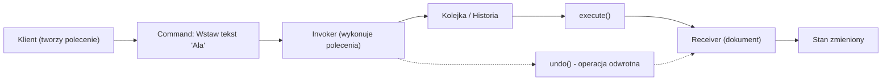
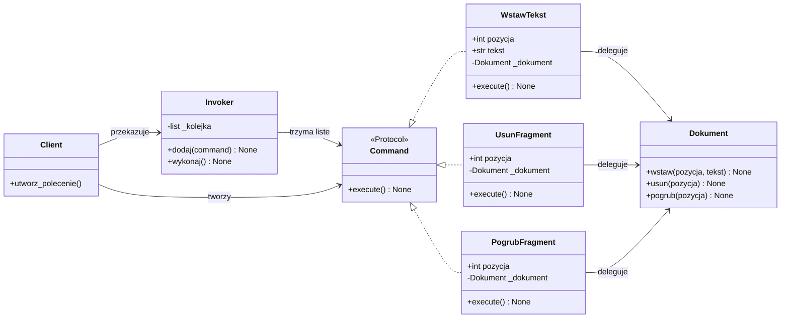
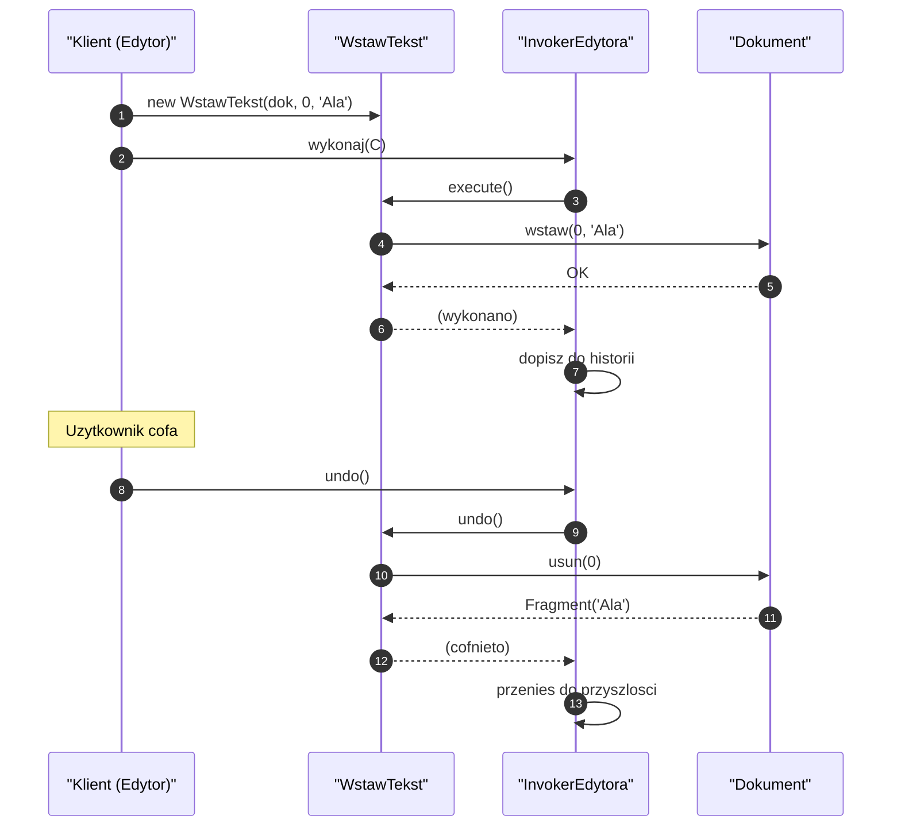
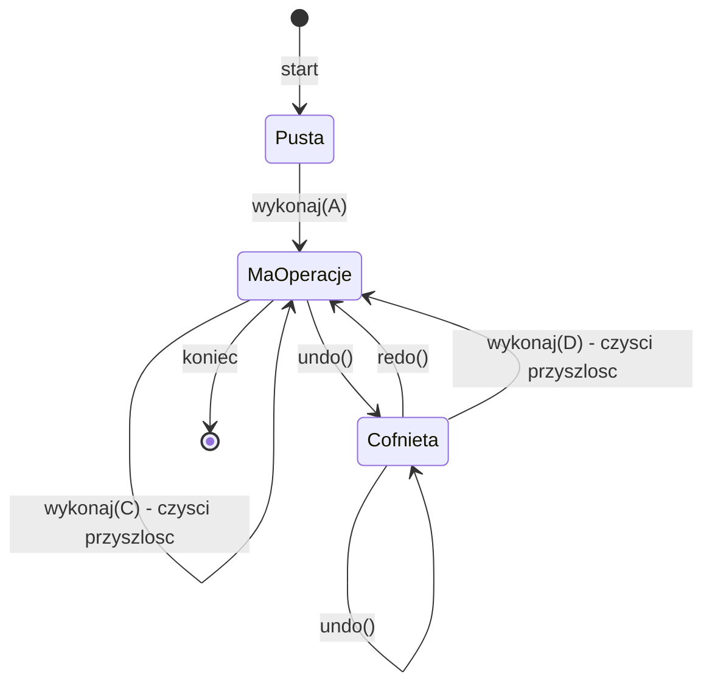
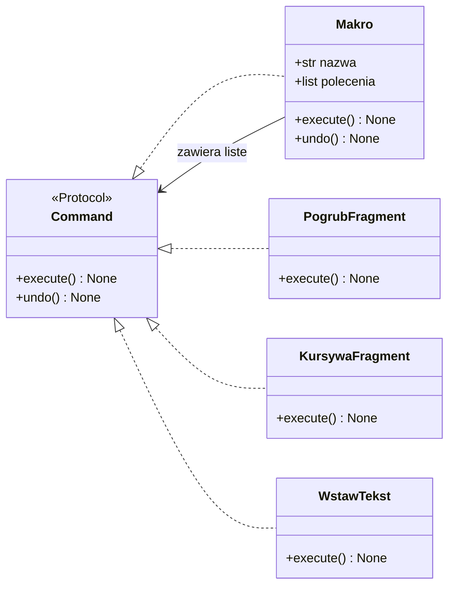
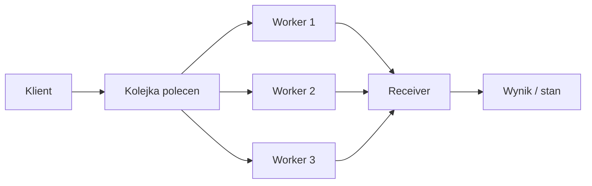
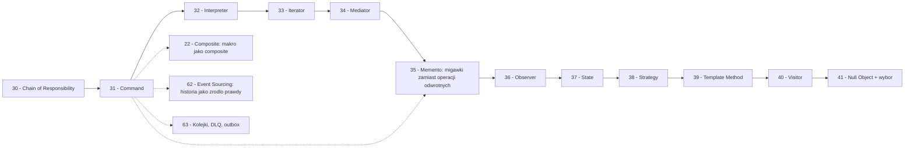

```markdown
---
modul: 31 — Command
plik: 31-command.md
poziom: sredni
wymaga: [30]
czas: ~165 minut czytania + ~400 minut ćwiczeń
---

# Moduł 31 — Command — żądanie jako obiekt

> **TL;DR**
> - **Command (polecenie)** zamienia **wywołanie metody** w **obiekt** — dzięki temu żądanie można zapisać, zakolejkować, wykonać później, zalogować, cofnąć albo powtórzyć.
> - Kluczowa struktura: `Command` (kontrakt z `execute`), `Receiver` (obiekt, który faktycznie robi robotę), `Invoker` (obiekt, który uruchamia polecenia), `Client` (tworzy polecenia), `ConcreteCommand` (konkretne polecenie).
> - Undo/redo to najczęstszy powód sięgania po Command — ale można je zrealizować na dwa sposoby: **operacją odwrotną** (`unexecute()`) albo **migawką stanu** (Memento, moduł 35). Każdy ma swoje miejsce.
> - W Pythonie najczęściej wystarczy **funkcja + `functools.partial`** — pełna klasa `Command` z `execute` bywa potrzebna tylko wtedy, gdy polecenie ma własny stan, można je cofnąć albo serializować.
> - Command naturalnie łączy się z innymi wzorcami: makro to **Composite** poleceń (moduł 22), kolejka poleceń to wzorzec kolejki zadań, transakcja to Command + Memento, a **Strategy** mówi „jak to zrobić", nie „zrób to".

---

## 0. Model mentalny

### Kartka z zamówieniem, kelner i kucharz

Wyobraź sobie restaurację z systemem kartek zamówień. Podchodzisz do stolika, kelner przyjmuje twoje zamówienie i zapisuje je na kartce: „kotlet schabowy, ziemniaki, surówka, bez cebuli". Potem kelner **wiesza kartkę na specjalnej listwie** w kuchni, gdzie czekają inne kartki. Kucharz bierze kartki z listwy po kolei i przyrządza dania. Zauważ trzy kluczowe rzeczy w tym układzie.

Po pierwsze: **kelner nie gotuje**. Nie wchodzi do kuchni, nie sięga po patelnię, nie przyrządza kotleta. Kelner **przyjmuje zamówienie i zapisuje je jako kartkę**. Jego rola kończy się na wypełnieniu kartki i przekazaniu jej dalej. To znaczy, że kelner nie musi znać się na gotowaniu — wystarczy, że umie przyjmować zamówienia.

Po drugie: **kuchnia nie przyjmuje zamówień bezpośrednio od klienta**. Nie ma sytuacji „klient wchodzi do kuchni i mówi kucharzowi, co ma zrobić". Klient rozmawia z kelnerem, kelner zapisuje kartkę, kartka idzie do kuchni. Dzięki temu kuchnia nie musi być gotowa na interakcje z klientem — wystarczy, że umie odczytać kartę.

Po trzecie, i najważniejsze: **kartka to obiekt**. Ma stan (lista pozycji), ma tożsamość (można ją odróżnić od innych kartek), można ją **przekazać innemu kucharzowi** (gdy pierwszy jest zajęty), **odłożyć na później** (jeśli chcesz zamówić deser za godzinę), **anulować** (jeśli zmienisz zdanie), a nawet **zapisać wielokrotnie** (dla stałych klientów). Ta „kartkowość" — uczynienie żądania materialnym przedmiotem — to istota wzorca Command.

Popatrzmy teraz na to, co dzieje się z pojedynczym zamówieniem w kuchni. Kucharz przeczytał kartkę, przygotował danie — i co dalej? Jeśli klient stwierdzi „nie chcę surówki, chcę mizerię", kelner musi jakoś **wycofać** poprzednie zamówienie i złożyć nowe. Bo kartka była konkretna: „surówka". Można ją **fizycznie wycofać** ze stosu i zastąpić nową. Ale co, jeśli danie zostało już przyrządzone? Wtedy trzeba by „odwrócić" czynność — czyli usunąć surówkę z talerza i dodać mizerię. To jest **operacja odwrotna** — mniej więcej tak działają mechanizmy undo.

I jeszcze jedna rzecz z tej analogii. W restauracji z wieloma kucharzami kartka może trafić do **dowolnego** z nich. Jeden specjalizuje się w mięsie, drugi w rybach, trzeci w deserach. Kartka jest jedna, ale kucharzy kilku — a kartka mówi tylko „kotlet schabowy". To znaczy, że nie trzeba mieć kartki-przypisanej do konkretnego kucharza. Można je rozdzielać. W kodzie oznacza to, że polecenie (`Command`) jest niezależne od obiektu, który je wykonuje (`Receiver`) — to jedna z największych zalet wzorca.

| W analogii restauracji | W kodzie |
|---|---|
| Kartka z zamówieniem | `Command` (konkretne polecenie) |
| Treść zamówienia | Pola polecenia (argumenty, kontekst) |
| Listwa w kuchni | Kolejka poleceń (`queue.Queue`) |
| Kelner | `Client` — tworzy polecenie |
| Kucharz | `Receiver` — wykonuje pracę |
| Kucharz bierze kartkę i gotuje | `Command.execute()` — wywołanie na receivie |
| „Wycofaj surówkę" | `undo()` — operacja odwrotna |
| Lista zamówień w kolejności | Historia (stos poleceń) |
| Restauracja z wieloma kucharzami | Polimorfizm — dowolny `Receiver` |
| Anulowanie zamówienia | Polecenie, które nie zostanie wykonane |

> 🧠 **Zapamiętaj** — **Command (polecenie) to wzorzec behawioralny, który hermetyzuje żądanie jako obiekt, zawierający wszystkie informacje potrzebne do wykonania operacji — dzięki temu żądanie można kolejkowić, wykonać później, logować, cofać lub powtarzać, a klient nie musi wiedzieć, kto i kiedy je zrealizuje.**

Zwróć uwagę na trzy słowa w tej definicji: **hermetyzuje**, **obiekt**, **później**. „Hermetyzuje" — bo pakujemy intencję, argumenty i odbiorcę w jedną całość. „Obiekt" — bo dzięki temu staje się to zwykłą wartością, którą można przekazać. „Później" — bo to podstawowa korzyść: żądanie może czekać, może zostać wykonane w innym czasie, w innym miejscu, w innej kolejności.

### Diagram — intuicja wzorca



*Diagram pokazuje, że klient tworzy polecenie, invoker je wykonuje (natychmiast albo z kolejki), a receiver faktycznie zmienia stan — polecenie jest pośrednikiem między intencją a wykonaniem.*

### Czego Command NIE robi

Rozbrójmy kilka mity.

**Nie jest tym samym co funkcja.** Funkcja też jest „jednostką kodu" możliwą do przekazania. Różnica polega na **stanie i kontekstualności**. Funkcja przyjmuje argumenty i zwraca wynik. Polecenie **niesie ze sobą** wszystkie informacje o żądaniu (argumenty, odbiorcę, kontekst) i umie się wykonać (albo cofnąć). Można je też **serializować** (choć nie zawsze). W praktyce Python pozwala używać funkcji jako polecenia — i to jest OK, jak pokażemy w sekcji 4.

**Nie jest tym samym co callback.** Callback to funkcja wywoływana po zdarzeniu. Command to **obiekt** — może mieć metody `execute`, `undo`, `validate`. Callback może być prostym poleceniem, ale Command ma zwykle więcej struktury.

**Nie jest wymagany do undo/redo.** Można zrobić undo przez Memento (moduł 35) bez ani jednego Command. Można też zrobić undo przez kopiowanie całego stanu dokumentu. Command jest jednym z podejść, ale nie jedynym.

**Nie zastępuje kolejki zadań.** Command jest wzorcem, kolejka jest narzędziem. Można ich używać razem (polecenia w kolejce), ale Command może też działać bez kolejki (natychmiastowe wykonywanie).

**Nie jest darmowy.** Polecenie to dodatkowy obiekt, dodatkowe warstwy pośrednictwa. Dla prostego wywołania „`dokument.wstaw("Ala")`" tworzenie osobnej klasy `WstawPolecenie` to przesada. Command ma sens, gdy **naprawdę** potrzebujesz jednej z tych rzeczy: kolejki, undo, logowania, opóźnienia, makra, transakcji.

**Nie zawsze się opłaca.** Jeśli twoja aplikacja to prosty edytor bez undo, bez kolejki, bez makr — Command nie pomoże. W większości aplikacji **rzadko** jest potrzebny. Sięgnij po niego, gdy pojawi się konkretny problem (historia zmian, kolejkowanie, opóźnione wykonanie).

---

## 1. Problem, który rozwiązujemy

Wejdźmy w domenę 📝 „Edytora" — prostego programu do edycji dokumentów tekstowych. Ktoś napisał podstawowe operacje: wstaw tekst, usuń fragment, pogrubiaj, kursywa. Wszystko działa bezpośrednio na dokumencie — każda operacja modyfikuje stan dokumentu od razu.

### Kod „przed"

```python
# edytor_v0.py — wersja naiwna, demonstracyjna
# UWAGA: kod celowo pokazuje problem braku historii i separacji operacji.

from __future__ import annotations

from dataclasses import dataclass, field


@dataclass
class Fragment:
    tekst: str
    pogrubiony: bool = False
    kursywa: bool = False


@dataclass
class Dokument:
    """Dokument tekstowy - mutowalny, operacje modyfikuja stan od razu."""

    fragmenty: list[Fragment] = field(default_factory=list)

    def wstaw(self, pozycja: int, tekst: str) -> None:
        self.fragmenty.insert(pozycja, Fragment(tekst=tekst))

    def usun(self, pozycja: int) -> None:
        del self.fragmenty[pozycja]

    def pogrub(self, pozycja: int) -> None:
        self.fragmenty[pozycja].pogrubiony = True

    def odgrob(self, pozycja: int) -> None:
        self.fragmenty[pozycja].pogrubiony = False

    def tekst(self) -> str:
        return "".join(f.tekst for f in self.fragmenty)

    def __str__(self) -> str:
        return self.tekst()


class Edytor:
    """Prosty edytor - operacje wywolywane bezposrednio."""

    def __init__(self) -> None:
        self.dokument = Dokument()

    def wykonaj_wstaw(self, pozycja: int, tekst: str) -> None:
        self.dokument.wstaw(pozycja, tekst)

    def wykonaj_usun(self, pozycja: int) -> None:
        self.dokument.usun(pozycja)

    def wykonaj_pogrub(self, pozycja: int) -> None:
        self.dokument.pogrub(pozycja)

    def wykonaj_odgrob(self, pozycja: int) -> None:
        self.dokument.odgrob(pozycja)


if __name__ == "__main__":
    edytor = Edytor()
    edytor.wykonaj_wstaw(0, "Ala")
    edytor.wykonaj_wstaw(1, " ")
    edytor.wykonaj_wstaw(2, "ma")
    edytor.wykonaj_wstaw(3, " ")
    edytor.wykonaj_wstaw(4, "kota")
    print(edytor.dokument)   # Ala ma kota
    edytor.wykonaj_pogrub(0)
    print(edytor.dokument)
```

Ten kod działa — dla pięciu podstawowych operacji w porządku. Ale widać cztery narastające problemy, które wybuchają w momencie, gdy pojawią się **prawdziwe** wymagania.

### Code smell — operacje bez historii, bez kontekstu

| Problem | Gdzie | Konsekwencja |
|---|---|---|
| Operacje wykonują się natychmiast | W `Edytor.wykonaj_*` | Nie ma sposobu na „odroczenie" operacji |
| Brak historii operacji | Dokument i Edytor nie pamiętają niczego | Nie da się cofnąć, nie da się pokazać „ostatnie 10 zmian" |
| Brak undo | Brakuje jakiejkolwiek formy odwracalności | Użytkownik nie może się pomylić — to krytyczne w edytorze |
| Brak możliwości makro | Każda operacja osobno | Nie da się zapisać „kolejność operacji" i odtworzyć |
| Brak audytu/logu | Operacje są „przezroczyste" | W aplikacjach finansowych wymagany log operacji |
| Brak serializacji | Operacja nie jest obiektem | Nie da się jej zapisać i wykonać w innym procesie |
| Brak walidacji przed wykonaniem | Operacje zakładają poprawność argumentów | Trzeba napisać walidację poza klasami |
| Brak możliwości cofnięcia przy błędzie | Całościowe wykonanie | Jeśli druga z pięciu operacji padnie, pierwsza już została wykonana |

Zwróć uwagę na ósmą pozycję — to problem, który nazwiemy w tym module **transakcyjnością**. Bez Command nie da się łatwo powiedzieć „wykonaj te pięć operacji jako całość i cofnij wszystkie, jeśli któraś padnie". Z Command to trywialne.

### Objawy — poznasz ten problem po tym, że...

- **Nie da się cofnąć operacji użytkownika.** Klasyczny problem — w edytorze, w aplikacji do obsługi danych, w systemie bankowym. Undo to często wymaganie, nie opcja.
- **Nie ma historii operacji.** Nie możesz zapisać „co się działo" — ani do logu, ani do audytu, ani do pokazania użytkownikowi.
- **Nie da się opóźnić wykonania.** „Wykonaj to za godzinę", „wykonaj to w kolejności X", „wykonaj to nocą, żeby nie obciążać systemu" — niemożliwe.
- **Nie da się uruchomić tej samej sekwencji dwa razy.** Brak makr — każda sekwencja operacji to osobny kod.
- **Kod aplikacji rozjeżdża się na setki miejsc wywołujących operacje.** Nie ma jednego Centrum, przez które idą żądania.
- **Brak spójnego API dla operacji.** `wykonaj_wstaw`, `wykonaj_usun`, `wykonaj_pogrub` — każda operacja ma inną sygnaturę, inny rodzaj argumentów. Trudno o jednolity mechanizm.
- **Operacje poza kolejnością mogą zostawić system w niespójnym stanie.** Bez mechanizmu transakcji (wszystkie albo żadna) — problem w systemach finansowych.
- **Brak walidacji na poziomie operacji.** Jeśli chcesz walidować, walidujesz w miejscu wywołania — i to się rozprasza.
- **Brak możliwości wykonywania operacji w innym procesie / innym czasie.** Bo operacja nie jest obiektem, który można przekazać — jest tylko kodem.

---

## 2. Anatomia wzorca

### Uczestnicy

| Rola | Odpowiedzialność | Co NIE jest jej zadaniem |
|---|---|---|
| **Command (polecenie)** | Kontrakt z metodą `execute()` (i opcjonalną `undo()`); hermetyzuje żądanie jako obiekt | Nie zawiera logiki biznesowej — tę ma `Receiver`; nie woła sam siebie |
| **ConcreteCommand (konkretne polecenie)** | Implementuje kontrakt; przechowuje argumenty i referencję do `Receiver`; deleguje pracę do `Receiver` | Nie zawiera logiki innej niż „przekaż do receivera"; nie zmienia stanu samodzielnie |
| **Receiver (odbiorca)** | Zna faktyczną implementację operacji; wykonuje pracę na danych | Nie zna `Command`; nie wybiera siebie |
| **Invoker (wywołujący)** | Uruchamia polecenia: natychmiast albo z kolejki; zarządza historią | Nie zna szczegółów poleceń; nie zna `Receivera` |
| **Client (klient)** | Tworzy polecenia i podłącza do nich `Receiver`; przekazuje do `Invokera` | Nie wykonuje poleceń sam; nie zna ani `Invokera`, ani `Receivera` „na głęboko" |

Kluczowa asymetria widoczna w tym układzie: **Client zna tylko `Command` i `Receiver`**, **Invoker zna tylko `Command`**, **Receiver nie zna nikogo z powyższych**. Trzy warstwy wiedzy, każda skoncentrowana na jednym. Zmiana w jednej nie wpływa na drugą.

### Diagram struktury



*Diagram pokazuje, że trzy konkretne polecenia implementują kontrakt `Command`, każde deleguje do `Dokument`, a `Invoker` przechowuje listę poleceń — nie znając ani `Dokumentu`, ani konkretnych typów poleceń.*

Przeczytajmy ten diagram zdanie po zdaniu. `Command` to kontrakt z jedną metodą `execute()`. `WstawTekst`, `UsunFragment`, `PogrubFragment` to konkretne polecenia — każde **ma własne argumenty** (pozycja, tekst) i **referencję do `Dokumentu`**.

Strzałki `WstawTekst --> Dokument` pokazują **delegację** — polecenie nie robi niczego samodzielnie, przekazuje wywołanie do `Dokumentu`. To kluczowe: polecenie nie zawiera logiki biznesowej. Ono tylko **niesie ze sobą intencję** i mówi „wykonaj to na tym receiverze".

`Invoker` trzyma listę poleceń (albo kolejkę, stos, historię). Zna tylko `Command` — nie zna `WstawTekst` ani `Dokument`. To znaczy, że ten sam `Invoker` obsłuży nowe typy poleceń bez zmian w kodzie.

`Client` tworzy polecenia, przekazuje im referencje do receivera i umieszcza w invokerze. Jedno miejsce, gdzie spotykają się wszystkie trzy warstwy.

### Warianty: klasyczny vs pythoniczny

| Aspekt | Klasyczny (GoF) | Pythoniczny |
|---|---|---|
| Command | Klasa `ABC` z `execute()` | `Protocol` z `__call__()` albo `execute()` |
| ConcreteCommand | Klasa dziedzicząca | Funkcja + `functools.partial` |
| Receiver | Klasa z operacjami | Klasa albo obiekt dowolny |
| Invoker | Klasa z kolejką i historią | Lista + pętla, albo `queue.Queue` |
| Undo | Metoda `unexecute()` | Funkcja `undo` albo migawka |
| Serializacja | Rzadko | `pickle` albo własny format |
| Makro | Klasa `MacroCommand` | Composite poleceń (moduł 22) |
| Kolejka zadań | Ręczna | `queue.Queue` + worker |

W Pythonie Command jest **znacznie prostszy**, bo funkcje są wartościami. W wariancie bezstanowym — najczęstszym — polecenie to funkcja lub `functools.partial`. Klasa `Command` jest potrzebna, gdy polecenie ma własny stan, można je cofnąć albo serializować.

---

## 3. Implementacja krok po kroku

Przebudujemy edytor z sekcji 1. Zaczniemy od prostego kontraktu, dodamy konkretne polecenia, invoker i historię undo/redo.

### Krok 1 — Zdefiniuj kontrakt Command

Najpierw kontrakt — co musi umieć każde polecenie.

```python
from typing import Protocol, runtime_checkable

@runtime_checkable
class Command(Protocol):
    """Kontrakt polecenia: cokolwiek, co mozna wykonac."""
    nazwa: str
    def execute(self) -> None: ...
```

Uwaga: kontrakt ma `execute()`, ale **nie ma** `undo()`. To decyzja projektowa. Nie każde polecenie musi być odwracalne — o tym w sekcji 4 i 7. Dla poleceń, które są odwracalne, dodamy osobny protokół `OdwracalneCommand` albo sprawdzimy obecność `undo` w runtime.

### Krok 2 — Zdefiniuj receiver

Receiver to obiekt, który **faktycznie wykonuje pracę**. W naszym przypadku to `Dokument`.

```python
from dataclasses import dataclass, field

@dataclass
class Fragment:
    tekst: str
    pogrubiony: bool = False
    kursywa: bool = False


class Dokument:
    """Receiver: dokument z operacjami podstawowymi.

    Nie zna polecen. Operacje sa bezposrednie.
    """

    def __init__(self) -> None:
        self._fragmenty: list[Fragment] = []

    def wstaw(self, pozycja: int, tekst: str) -> None:
        self._fragmenty.insert(pozycja, Fragment(tekst=tekst))

    def usun(self, pozycja: int) -> Fragment:
        return self._fragmenty.pop(pozycja)

    def wstaw_fragment(self, pozycja: int, fragment: Fragment) -> None:
        self._fragmenty.insert(pozycja, fragment)

    def ustaw_pogrub(self, pozycja: int, wartosc: bool) -> None:
        self._fragmenty[pozycja].pogrubiony = wartosc

    def ustaw_kursywe(self, pozycja: int, wartosc: bool) -> None:
        self._fragmenty[pozycja].kursywa = wartosc

    @property
    def liczba_fragmentow(self) -> int:
        return len(self._fragmenty)

    def tekst(self) -> str:
        return "".join(f.tekst for f in self._fragmenty)

    def fragment(self, pozycja: int) -> Fragment:
        return self._fragmenty[pozycja]

    def __str__(self) -> str:
        return self.tekst()
```

Zwróć uwagę, że `Dokument.usun` **zwraca usunięty fragment**. To ważne dla undo — polecenie `UsunFragment` będzie mogło zapisać, co usunęło, i przy cofnięciu wstawić to z powrotem.

### Krok 3 — Napisz polecenia jako klasy

Teraz konkretne polecenia. Każde trzyma argumenty i referencję do dokumentu.

```python
class WstawTekst:
    """Polecenie: wstaw tekst na pozycji."""

    nazwa = "wstaw_tekst"

    def __init__(self, dokument: Dokument, pozycja: int, tekst: str) -> None:
        self._dokument = dokument
        self._pozycja = pozycja
        self._tekst = tekst

    def execute(self) -> None:
        self._dokument.wstaw(self._pozycja, self._tekst)

    def undo(self) -> None:
        self._dokument.usun(self._pozycja)

    def opis(self) -> str:
        return f"Wstaw '{self._tekst}' na pozycji {self._pozycja}"


class UsunFragment:
    """Polecenie: usun fragment. Zapamietuje, co usunieto, dla undo."""

    nazwa = "usun_fragment"

    def __init__(self, dokument: Dokument, pozycja: int) -> None:
        self._dokument = dokument
        self._pozycja = pozycja
        self._usuniety: Fragment | None = None

    def execute(self) -> None:
        self._usuniety = self._dokument.usun(self._pozycja)

    def undo(self) -> None:
        if self._usuniety is None:
            raise RuntimeError("nie ma czego cofac")
        self._dokument.wstaw_fragment(self._pozycja, self._usuniety)

    def opis(self) -> str:
        return f"Usun fragment na pozycji {self._pozycja}"


class PogrubFragment:
    """Polecenie: ustaw pogrubienie fragmentu. Zapamietuje poprzedni stan."""

    nazwa = "pogrub_fragment"

    def __init__(self, dokument: Dokument, pozycja: int, wartosc: bool = True) -> None:
        self._dokument = dokument
        self._pozycja = pozycja
        self._wartosc = wartosc
        self._poprzednia: bool | None = None

    def execute(self) -> None:
        self._poprzednia = self._dokument.fragment(self._pozycja).pogrubiony
        self._dokument.ustaw_pogrub(self._pozycja, self._wartosc)

    def undo(self) -> None:
        if self._poprzednia is None:
            raise RuntimeError("nie ma czego cofac")
        self._dokument.ustaw_pogrub(self._pozycja, self._poprzednia)

    def opis(self) -> str:
        return f"Pogrub fragment {self._pozycja} = {self._wartosc}"
```

Zwróć uwagę na dwa wzorce w tych klasach:
1. **`UsunFragment` zapamiętuje usunięty fragment** — żeby móc go przywrócić w `undo`.
2. **`PogrubFragment` zapamiętuje poprzednią wartość** — żeby wiedzieć, do czego wrócić.

To wzór odwracalności — **polecenie zapamiętuje stan, który zmieniło**, żeby móc go przywrócić. Bez tego `undo` byłoby niemożliwe (albo wymagałoby migawki, o której w sekcji 4).

### Krok 4 — Napisz invoker z historią

Teraz invoker — obiekt, który wykonuje polecenia i prowadzi historię.

```python
class InvokerEdytora:
    """Invoker: przechowuje historie i wykonuje polecenia."""

    def __init__(self) -> None:
        self._historia: list[OdwracalneCommand] = []   # polecenia wykonane
        self._przyszlosc: list[OdwracalneCommand] = [] # polecenia cofniete

    def wykonaj(self, polecenie: OdwracalneCommand) -> None:
        polecenie.execute()
        self._historia.append(polecenie)
        self._przyszlosc.clear()   # nowa operacja kasuje "przyszlosc"

    def undo(self) -> bool:
        if not self._historia:
            return False
        polecenie = self._historia.pop()
        polecenie.undo()
        self._przyszlosc.append(polecenie)
        return True

    def redo(self) -> bool:
        if not self._przyszlosc:
            return False
        polecenie = self._przyszlosc.pop()
        polecenie.execute()
        self._historia.append(polecenie)
        return True

    @property
    def liczba_wykonanych(self) -> int:
        return len(self._historia)

    @property
    def liczba_do_ponowienia(self) -> int:
        return len(self._przyszlosc)
```

Ten invoker używa **dwóch list**: historii (polecenia wykonane) i przyszłości (polecenia cofnięte). Nowe polecenie **kasuje przyszłość** — bo nie można mieć dwóch różnych „historii od tego punktu". To klasyczna implementacja undo/redo.

**Uwaga:** tutaj pojawia się odwołanie do niezdefiniowanego jeszcze `OdwracalneCommand`. Zdefiniujemy go poniżej jako `Protocol` z `execute()` i `undo()`.

```python
@runtime_checkable
class OdwracalneCommand(Protocol):
    """Polecenie, ktore mozna cofnac."""
    nazwa: str
    def execute(self) -> None: ...
    def undo(self) -> None: ...
```

### Krok 5 — Złóż klienta

Klient tworzy polecenia i łączy je z invokerem.

```python
class Edytor:
    """Klient: buduje polecenia z argumentami i przekazuje do invokera."""

    def __init__(self) -> None:
        self.dokument = Dokument()
        self.invoker = InvokerEdytora()

    def wstaw(self, pozycja: int, tekst: str) -> None:
        self.invoker.wykonaj(WstawTekst(self.dokument, pozycja, tekst))

    def usun(self, pozycja: int) -> None:
        self.invoker.wykonaj(UsunFragment(self.dokument, pozycja))

    def pogrub(self, pozycja: int, wartosc: bool = True) -> None:
        self.invoker.wykonaj(PogrubFragment(self.dokument, pozycja, wartosc))

    def undo(self) -> bool:
        return self.invoker.undo()

    def redo(self) -> bool:
        return self.invoker.redo()
```

### Krok 6 — Napisz makro jako composite poleceń

To jest połączenie Command z Composite (moduł 22). **Makro** to polecenie zawierające listę poleceń.

```python
class Makro:
    """Makro: polecenie skladajace sie z wielu polecen (Composite polecen)."""

    def __init__(self, nazwa: str, polecenia: list[OdwracalneCommand]) -> None:
        self.nazwa = nazwa
        self._polecenia = list(polecenia)

    def execute(self) -> None:
        for polecenie in self._polecenia:
            polecenie.execute()

    def undo(self) -> None:
        # Cofamy w odwrotnej kolejnosci
        for polecenie in reversed(self._polecenia):
            polecenie.undo()

    def opis(self) -> str:
        return f"Makro '{self.nazwa}' ({len(self._polecenia)} polecen)"
```

Zwróć uwagę na undo w odwrotnej kolejności. To **kluczowe** — bo jeśli wykonujesz operacje A, B, C, to cofasz je w kolejności C, B, A. Inaczej stan dokumentu może być niespójny.

### Krok 7 — Weryfikacja

| Kryterium | Wersja „przed" | Wersja „po" |
|---|---|---|
| Undo | Nie ma | `invoker.undo()` — cofnięcie ostatniej operacji |
| Redo | Nie ma | `invoker.redo()` — powtórzenie |
| Historia | Brak | Lista poleceń w invokerze |
| Makro | Nie ma | `Makro` — composite poleceń |
| Kolejka | Nie ma | Można zbudować na bazie invokera |
| Serializacja | Nie ma | Możliwa (jeśli polecenie nie ma referencji) |
| Liczba klas | 3 | 8 (dodane polecenia, invoker, makro) |
| Liczba linii | ~60 | ~250 |

Koszt: trzy razy więcej kodu. Zysk: undo/redo, historia, makra, gotowość na kolejkę i serializację. **W edytorze to bezdyskusyjnie opłacalne.** W prostej aplikacji, gdzie użytkownik nigdy nie musi cofać, Command byłby przesadą.

---

## 4. Wersje pythoniczne i warianty

### 4.1 Command jako funkcja + `functools.partial` — najczęstszy

Zamiast klasy, funkcja — a argumenty „zamrażamy" przez `partial`.

```python
import functools
from collections.abc import Callable

# Polecenie: funkcja przyjmujaca dokument
def wstaw(dokument: Dokument, pozycja: int, tekst: str) -> None:
    dokument.wstaw(pozycja, tekst)

def usun(dokument: Dokument, pozycja: int) -> None:
    dokument.usun(pozycja)

# Polecenie jako partial - argumenty zamrozone
dok = Dokument()
polecenie = functools.partial(wstaw, dok, 0, "Ala")
polecenie()  # wywolanie
```

Zalety: brak klas, brak boilerplate'u, naturalne dla Pythona. Wady: brak `undo` (chyba że druga funkcja), brak `opis` (albo trzeba użyć `__name__`), nie ma `isinstance`. To najczęstsze użycie w kodzie produkcyjnym, gdzie nie trzeba undo.

### 4.2 Command jako `dataclass` z `__call__`

Data jako obiekt, z metodą `__call__` jako `execute`.

```python
from dataclasses import dataclass

@dataclass
class WstawTekst:
    dokument: Dokument
    pozycja: int
    tekst: str

    def __call__(self) -> None:
        self.dokument.wstaw(self.pozycja, self.tekst)

    @property
    def nazwa(self) -> str:
        return "wstaw_tekst"
```

Zalety: data + zachowanie w jednej klasie; `repr` gratis; czytelny. Wady: `call` zamiast `execute` — trzeba pamiętać.

### 4.3 Command z dyspozycją po typie — `singledispatch`

Gdy chcesz jedną funkcję uniwersalną, która wybiera obsługę na podstawie typu polecenia.

```python
from functools import singledispatch

@singledispatch
def opisz(polecenie) -> str:
    return f"nieznane polecenie: {type(polecenie).__name__}"

@opisz.register
def _(polecenie: WstawTekst) -> str:
    return f"Wstaw '{polecenie.tekst}' na {polecenie.pozycja}"

@opisz.register
def _(polecenie: UsunFragment) -> str:
    return f"Usun fragment {polecenie.pozycja}"
```

To przydatne do inspekcji historii — można jedną funkcją obsłużyć opis wszystkich typów poleceń.

### 4.4 Command z kolejką i workerem

Kolejka zadań — polecenia czekają, worker je wykonuje. To realizacja `queue` + wątek.

```python
import queue
import threading
from collections.abc import Callable

class KolejkaPolecen:
    """Kolejka polecen + worker w osobnym watku."""

    def __init__(self) -> None:
        self._kolejka: queue.Queue[Callable[[], None] | None] = queue.Queue()
        self._worker = threading.Thread(target=self._petla, daemon=True)
        self._worker.start()

    def zleć(self, polecenie: Callable[[], None]) -> None:
        self._kolejka.put(polecenie)

    def _petla(self) -> None:
        while True:
            polecenie = self._kolejka.get()
            if polecenie is None:  # sentinel - koniec
                break
            try:
                polecenie()
            except Exception as blad:
                print(f"[BLAD] {blad}")
            finally:
                self._kolejka.task_done()

    def zamknij(self) -> None:
        self._kolejka.put(None)
        self._worker.join()
```

To fundament pod systemy zadań jak Celery, RQ, Dramatiq. Zwróć uwagę: polecenie jest **funkcją**, nie klasą. To jest najczęstsze użycie w systemach asynchronicznych.

### 4.5 Command + Memento zamiast operacji odwrotnej

Alternatywa dla `undo` metodą odwrotną: zapisać stan przez Memento i przy cofnięciu przywrócić.

```python
@dataclass
class Migawka:
    fragmenty: tuple[Fragment, ...]

class WstawTekstZMigawka:
    def __init__(self, dokument: Dokument, pozycja: int, tekst: str) -> None:
        self._dokument = dokument
        self._pozycja = pozycja
        self._tekst = tekst
        self._migawka: Migawka | None = None

    def execute(self) -> None:
        # Zapisujemy stan PRZED zmiana
        self._migawka = Migawka(tuple(self._dokument._fragmenty))
        self._dokument.wstaw(self._pozycja, self._tekst)

    def undo(self) -> None:
        if self._migawka is None:
            raise RuntimeError("brak migawki")
        self._dokument._fragmenty = list(self._migawka.fragmenty)
```

Różnica:
- **Operacja odwrotna** — polecenie wie, jak „odwrócić" swoją zmianę. Zajmuje mało pamięci.
- **Migawka** — polecenie zapisuje pełny stan. Zajmuje dużo pamięci, ale działa **zawsze**, nawet dla operacji nieodwracalnych (np. „losowanie liczby").

W module 35 (Memento) rozbudujemy temat migawek.

### 4.6 Command + Composite — makro

Pokazane w sekcji 3 kroku 6. Makro jest Composite poleceń — wywołanie makra deleguje do wszystkich poleceń, a undo idzie w odwrotnej kolejności. To bardzo eleganckie połączenie wzorców.

### 4.7 Command + `pickle` — serializacja

Choć nie wszystkie polecenia dają się serializować, te proste (bez referencji do złożonych obiektów) zwykle się udaje.

```python
import pickle

polecenie = WstawTekst(dokument, 0, "Ala")
bajty = pickle.dumps(polecenie)
polecenie2 = pickle.loads(bajty)
# polecenie2 dziala jak polecenie — UWAGA: dokument musi byc serializowalny
```

**Uwaga bezpieczeństwa:** `pickle` nie jest bezpieczne — nigdy nie używaj z niezaufanym źródłem (moduł 14). Używaj tylko dla poleceń wewnątrz aplikacji.

Alternatywa: własny format serializacji (JSON + typ polecenia) — bezpieczniejszy, choć wymaga więcej kodu.

### 4.8 Podsumowanie — tabela wyboru

| Sytuacja | Wariant |
|---|---|
| Nie trzeba undo, prosty wybór | Funkcja + `partial` (4.1) |
| Dane + zachowanie razem, bez undo | `@dataclass` z `__call__` (4.2) |
| Opis/inspection po typie | `singledispatch` (4.3) |
| Kolejka zadań, asynchronicznie | `queue.Queue` + worker (4.4) |
| Trzeba undo, ale operacje są nieodwracalne | Memento (4.5) |
| Trzeba undo, operacje są odwracalne | Operacja odwrotna (klasyczne) |
| Makro (sekwencja poleceń) | Composite poleceń (4.6) |
| Serializacja poleceń | `pickle` albo własny format (4.7) |

> 🧠 **Zapamiętaj** — **W 80% przypadków w Pythonie polecenie to funkcja albo `functools.partial`.** Klasy `Command` są potrzebne, gdy: (1) polecenie ma własny stan i można je cofnąć, (2) polecenie trzeba serializować, (3) chcesz inspekcję / opis historii. Nie buduj klas bez potrzeby.

---

## 5. Przykład z życia: 📝 Edytor — pełny uruchamialny kod

Zbudujemy pełny edytor z undo/redo, historią, makrami i walidacją.

### Kod

```python
# edytor_command.py — pelny przyklad Command
from __future__ import annotations

from dataclasses import dataclass, field, replace
from typing import Protocol, runtime_checkable


# ===========================================================================
# 1. Receiver - Dokument
# ===========================================================================

@dataclass
class Fragment:
    tekst: str
    pogrubiony: bool = False
    kursywa: bool = False


class Dokument:
    """Receiver: dokument z operacjami podstawowymi."""

    def __init__(self) -> None:
        self._fragmenty: list[Fragment] = []

    def wstaw(self, pozycja: int, tekst: str) -> None:
        self._fragmenty.insert(pozycja, Fragment(tekst=tekst))

    def wstaw_fragment(self, pozycja: int, fragment: Fragment) -> None:
        self._fragmenty.insert(pozycja, fragment)

    def usun(self, pozycja: int) -> Fragment:
        return self._fragmenty.pop(pozycja)

    def ustaw_pogrub(self, pozycja: int, wartosc: bool) -> None:
        self._fragmenty[pozycja].pogrubiony = wartosc

    def ustaw_kursywe(self, pozycja: int, wartosc: bool) -> None:
        self._fragmenty[pozycja].kursywa = wartosc

    @property
    def liczba_fragmentow(self) -> int:
        return len(self._fragmenty)

    def tekst(self) -> str:
        return "".join(f.tekst for f in self._fragmenty)

    def fragment(self, pozycja: int) -> Fragment:
        return self._fragmenty[pozycja]

    def snapshot(self) -> tuple[Fragment, ...]:
        """Migawka dla trybu migawkowego."""
        return tuple(replace(f) for f in self._fragmenty)

    def przywroc(self, snapshot: tuple[Fragment, ...]) -> None:
        self._fragmenty = [replace(f) for f in snapshot]

    def __str__(self) -> str:
        return self.tekst()


# ===========================================================================
# 2. Kontrakt Command
# ===========================================================================

@runtime_checkable
class Command(Protocol):
    """Kontrakt polecenia odwracalnego."""
    nazwa: str
    def execute(self) -> None: ...
    def undo(self) -> None: ...
    def opis(self) -> str: ...


# ===========================================================================
# 3. Konkretne polecenia
# ===========================================================================

class WstawTekst:
    nazwa = "wstaw_tekst"

    def __init__(self, dokument: Dokument, pozycja: int, tekst: str) -> None:
        if pozycja < 0:
            raise ValueError("pozycja musi byc nieujemna")
        if not tekst:
            raise ValueError("tekst nie moze byc pusty")
        self._dokument = dokument
        self._pozycja = pozycja
        self._tekst = tekst

    def execute(self) -> None:
        self._dokument.wstaw(self._pozycja, self._tekst)

    def undo(self) -> None:
        self._dokument.usun(self._pozycja)

    def opis(self) -> str:
        return f"Wstaw '{self._tekst}' na pozycji {self._pozycja}"


class UsunFragment:
    nazwa = "usun_fragment"

    def __init__(self, dokument: Dokument, pozycja: int) -> None:
        if pozycja < 0:
            raise ValueError("pozycja musi byc nieujemna")
        self._dokument = dokument
        self._pozycja = pozycja
        self._usuniety: Fragment | None = None

    def execute(self) -> None:
        self._usuniety = self._dokument.usun(self._pozycja)

    def undo(self) -> None:
        if self._usuniety is None:
            raise RuntimeError("nie ma czego cofac")
        self._dokument.wstaw_fragment(self._pozycja, self._usuniety)

    def opis(self) -> str:
        return f"Usun fragment na pozycji {self._pozycja}"


class PogrubFragment:
    nazwa = "pogrub_fragment"

    def __init__(
        self, dokument: Dokument, pozycja: int, wartosc: bool = True
    ) -> None:
        self._dokument = dokument
        self._pozycja = pozycja
        self._wartosc = wartosc
        self._poprzednia: bool | None = None

    def execute(self) -> None:
        self._poprzednia = self._dokument.fragment(self._pozycja).pogrubiony
        self._dokument.ustaw_pogrub(self._pozycja, self._wartosc)

    def undo(self) -> None:
        if self._poprzednia is None:
            raise RuntimeError("nie ma czego cofac")
        self._dokument.ustaw_pogrub(self._pozycja, self._poprzednia)

    def opis(self) -> str:
        return f"Pogrub {self._pozycja} -> {self._wartosc}"


class KursywaFragment:
    nazwa = "kursywa_fragment"

    def __init__(
        self, dokument: Dokument, pozycja: int, wartosc: bool = True
    ) -> None:
        self._dokument = dokument
        self._pozycja = pozycja
        self._wartosc = wartosc
        self._poprzednia: bool | None = None

    def execute(self) -> None:
        self._poprzednia = self._dokument.fragment(self._pozycja).kursywa
        self._dokument.ustaw_kursywe(self._pozycja, self._wartosc)

    def undo(self) -> None:
        if self._poprzednia is None:
            raise RuntimeError("nie ma czego cofac")
        self._dokument.ustaw_kursywe(self._pozycja, self._poprzednia)

    def opis(self) -> str:
        return f"Kursywa {self._pozycja} -> {self._wartosc}"


# ===========================================================================
# 4. Makro - Composite polecen
# ===========================================================================

class Makro:
    nazwa = "makro"

    def __init__(
        self, nazwa: str, polecenia: list[Command]
    ) -> None:
        if not polecenia:
            raise ValueError("makro musi miec co najmniej jedno polecenie")
        self.nazwa = nazwa
        self._polecenia = list(polecenia)

    def execute(self) -> None:
        wykonane: list[Command] = []
        try:
            for polecenie in self._polecenia:
                polecenie.execute()
                wykonane.append(polecenie)
        except Exception:
            # Rollback: cofamy juz wykonane polecenia
            for polecenie in reversed(wykonane):
                polecenie.undo()
            raise

    def undo(self) -> None:
        for polecenie in reversed(self._polecenia):
            polecenie.undo()

    def opis(self) -> str:
        return f"Makro '{self.nazwa}' ({len(self._polecenia)} polecen)"


# ===========================================================================
# 5. Invoker z historia
# ===========================================================================

@dataclass
class WpisHistorii:
    polecenie: Command
    opis: str


class InvokerEdytora:
    """Invoker: wykonuje polecenia i prowadzi historie undo/redo."""

    def __init__(self, limit_historii: int = 100) -> None:
        self._historia: list[WpisHistorii] = []
        self._przyszlosc: list[WpisHistorii] = []
        self._limit = limit_historii

    def wykonaj(self, polecenie: Command) -> None:
        if not isinstance(polecenie, Command):
            raise TypeError(
                f"{type(polecenie).__name__} nie spelnia kontraktu Command"
            )
        polecenie.execute()
        self._historia.append(WpisHistorii(polecenie, polecenie.opis()))
        self._przyszlosc.clear()
        # Przyciecie historii (limit)
        if len(self._historia) > self._limit:
            self._historia.pop(0)

    def undo(self) -> bool:
        if not self._historia:
            return False
        wpis = self._historia.pop()
        wpis.polecenie.undo()
        self._przyszlosc.append(wpis)
        return True

    def redo(self) -> bool:
        if not self._przyszlosc:
            return False
        wpis = self._przyszlosc.pop()
        wpis.polecenie.execute()
        self._historia.append(wpis)
        return True

    @property
    def liczba_wykonanych(self) -> int:
        return len(self._historia)

    @property
    def liczba_do_ponowienia(self) -> int:
        return len(self._przyszlosc)

    def opis_historii(self) -> str:
        linie = ["Historia:"]
        for i, wpis in enumerate(self._historia, start=1):
            linie.append(f"  {i:3d}. {wpis.opis}")
        if self._przyszlosc:
            linie.append("Przyszlosc (do redo):")
            for i, wpis in enumerate(reversed(self._przyszlosc), start=1):
                linie.append(f"  {i:3d}. {wpis.opis}")
        return "\n".join(linie)


# ===========================================================================
# 6. Klient - Edytor
# ===========================================================================

class Edytor:
    def __init__(self) -> None:
        self.dokument = Dokument()
        self.invoker = InvokerEdytora(limit_historii=50)

    def wstaw(self, pozycja: int, tekst: str) -> None:
        self.invoker.wykonaj(WstawTekst(self.dokument, pozycja, tekst))

    def usun(self, pozycja: int) -> None:
        self.invoker.wykonaj(UsunFragment(self.dokument, pozycja))

    def pogrub(self, pozycja: int, wartosc: bool = True) -> None:
        self.invoker.wykonaj(PogrubFragment(self.dokument, pozycja, wartosc))

    def kursywa(self, pozycja: int, wartosc: bool = True) -> None:
        self.invoker.wykonaj(KursywaFragment(self.dokument, pozycja, wartosc))

    def wykonaj_makro(self, nazwa: str, polecenia: list[Command]) -> None:
        self.invoker.wykonaj(Makro(nazwa, polecenia))

    def undo(self) -> bool:
        return self.invoker.undo()

    def redo(self) -> bool:
        return self.invoker.redo()


# ===========================================================================
# 7. Demonstracja
# ===========================================================================

if __name__ == "__main__":
    edytor = Edytor()

    print("=== 1. Podstawowe operacje z historia ===")
    edytor.wstaw(0, "Ala")
    edytor.wstaw(1, " ")
    edytor.wstaw(2, "ma")
    edytor.wstaw(3, " ")
    edytor.wstaw(4, "kota")
    print(f"  Dokument: '{edytor.dokument}'")
    print(f"  Liczba operacji w historii: {edytor.invoker.liczba_wykonanych}")

    print("\n=== 2. Undo - cofanie operacji ===")
    edytor.undo()   # cofa "kota"
    print(f"  Po 1x undo: '{edytor.dokument}'")
    edytor.undo()   # cofa spacje
    print(f"  Po 2x undo: '{edytor.dokument}'")

    print("\n=== 3. Redo - powtarzanie ===")
    edytor.redo()   # przywraca spacje
    print(f"  Po 1x redo: '{edytor.dokument}'")
    edytor.redo()   # przywraca "kota"
    print(f"  Po 2x redo: '{edytor.dokument}'")

    print("\n=== 4. Nowa operacja kasuje 'przyszlosc' ===")
    edytor.wstaw(0, "Wielka ")
    print(f"  Dokument: '{edytor.dokument}'")
    print(f"  Do ponowienia: {edytor.invoker.liczba_do_ponowienia}")
    edytor.undo()
    edytor.undo()
    print(f"  Po 2x undo: {edytor.dokument}")
    edytor.wstaw(0, "X")   # nowa operacja kasuje przyszlosc
    print(f"  Po nowej operacji - do ponowienia: {edytor.invoker.liczba_do_ponowienia}")

    print("\n=== 5. Formatowanie fragmentow ===")
    edytor2 = Edytor()
    for tekst in ["Ala", " ", "ma", " ", "kota"]:
        edytor2.wstaw(edytor2.dokument.liczba_fragmentow, tekst)
    edytor2.pogrub(0)
    edytor2.kursywa(2)
    print(f"  Fragment 0 pogrubiony: {edytor2.dokument.fragment(0).pogrubiony}")
    print(f"  Fragment 2 kursywa: {edytor2.dokument.fragment(2).kursywa}")

    print("\n=== 6. Makro jako jedna operacja ===")
    edytor3 = Edytor()
    edytor3.wstaw(0, "Tytul")

    def makro_pogrub_kursywa(ed: Edytor) -> list[Command]:
        return [
            PogrubFragment(ed.dokument, 0),
            KursywaFragment(ed.dokument, 0),
        ]

    edytor3.wykonaj_makro("tytul_format", makro_pogrub_kursywa(edytor3))
    frag = edytor3.dokument.fragment(0)
    print(f"  Po makro: pogrubiony={frag.pogrubiony}, kursywa={frag.kursywa}")

    edytor3.undo()   # cofa cale makro
    frag = edytor3.dokument.fragment(0)
    print(f"  Po undo makro: pogrubiony={frag.pogrubiony}, kursywa={frag.kursywa}")

    print("\n=== 7. Historia ===")
    print(edytor3.invoker.opis_historii())
```

### Co ten przykład pokazuje

Uruchomienie demonstruje wszystkie aspekty Command w praktyce.

**Punkt 1 — historia operacji.** Pięć operacji wstawienia. Każda tworzy polecenie i wykonuje je przez invoker. Invoker przechowuje historię.

**Punkt 2 — undo w akcji.** Dwa undo cofają ostatnie operacje w odwrotnej kolejności. Stan dokumentu zmienia się — spacja i „kota" znikają.

**Punkt 3 — redo.** Dwa redo przywracają operacje cofnięte — w kolejności. Dokument wraca do pełnej formy.

**Punkt 4 — nowa operacja kasuje „przyszłość".** Po nowym poleceniu `wstaw(0, "X")` dotychczasowa „przyszłość" (do redo) znika. Bo nie można mieć dwóch historii od tego samego punktu.

**Punkt 5 — formatowanie.** `PogrubFragment` na fragmencie 0 zmienia jego stan. `KursywaFragment` tak samo. Każde polecenie ma własny efekt.

**Punkt 6 — makro.** Dwa polecenia wykonane jako jedno. Undo makra cofa oba — w odwrotnej kolejności. To realizacja Composite (moduł 22) w połączeniu z Command.

**Punkt 7 — historia.** `opis_historii()` pokazuje wszystkie operacje. To fundament audytu i debugowania.

### Testy

```python
# test_edytor_command.py — uruchomienie: pytest test_edytor_command.py -v
import pytest

from edytor_command import (
    Command,
    Dokument,
    Edytor,
    InvokerEdytora,
    KursywaFragment,
    Makro,
    PogrubFragment,
    UsunFragment,
    WstawTekst,
)


# --- Receiver ---------------------------------------------------------------

def test_dokument_wstaw_i_usun() -> None:
    d = Dokument()
    d.wstaw(0, "Ala")
    d.wstaw(1, " ")
    d.wstaw(2, "kota")
    assert d.tekst() == "Ala kota"
    usuniety = d.usun(1)
    assert usuniete.tekst == " "
    assert d.tekst() == "Alakota"


def test_dokument_formatowanie() -> None:
    d = Dokument()
    d.wstaw(0, "x")
    d.ustaw_pogrub(0, True)
    assert d.fragment(0).pogrubiony
    d.ustaw_pogrub(0, False)
    assert not d.fragment(0).pogrubiony


# --- Konkretne polecenia ----------------------------------------------------

def test_wstaw_odrzuca_ujemna_pozycje() -> None:
    with pytest.raises(ValueError):
        WstawTekst(Dokument(), -1, "x")


def test_wstaw_odrzuca_pusty_tekst() -> None:
    with pytest.raises(ValueError):
        WstawTekst(Dokument(), 0, "")


def test_wstaw_execute_i_undo() -> None:
    d = Dokument()
    p = WstawTekst(d, 0, "Ala")
    p.execute()
    assert d.tekst() == "Ala"
    p.undo()
    assert d.tekst() == ""


def test_usun_zapamietuje_i_przywraca() -> None:
    d = Dokument()
    d.wstaw(0, "Ala")
    p = UsunFragment(d, 0)
    p.execute()
    assert d.tekst() == ""
    p.undo()
    assert d.tekst() == "Ala"


def test_pogrub_zapamietuje_poprzednia() -> None:
    d = Dokument()
    d.wstaw(0, "x")
    p = PogrubFragment(d, 0, True)
    p.execute()
    assert d.fragment(0).pogrubiony
    p.undo()
    assert not d.fragment(0).pogrubiony


def test_undo_przed_execute_rzuca() -> None:
    d = Dokument()
    p = UsunFragment(d, 0)
    with pytest.raises(RuntimeError):
        p.undo()


# --- Invoker ----------------------------------------------------------------

def test_invoker_undo_redo() -> None:
    d = Dokument()
    inv = InvokerEdytora()
    inv.wykonaj(WstawTekst(d, 0, "Ala"))
    assert d.tekst() == "Ala"
    assert inv.undo()
    assert d.tekst() == ""
    assert inv.redo()
    assert d.tekst() == "Ala"


def test_invoker_undo_pusty() -> None:
    inv = InvokerEdytora()
    assert inv.undo() is False


def test_invoker_redo_pusty() -> None:
    inv = InvokerEdytora()
    assert inv.redo() is False


def test_invoker_nowa_operacja_kasuje_przyszlosc() -> None:
    d = Dokument()
    inv = InvokerEdytora()
    inv.wykonaj(WstawTekst(d, 0, "A"))
    inv.wykonaj(WstawTekst(d, 1, "B"))
    inv.undo()
    inv.undo()
    assert inv.liczba_do_ponowienia == 2
    inv.wykonaj(WstawTekst(d, 0, "C"))
    assert inv.liczba_do_ponowienia == 0


def test_invoker_odrzuca_obiekt_bez_kontraktu() -> None:
    class CosInnego:
        pass

    with pytest.raises(TypeError):
        InvokerEdytora().wykonaj(CosInnego())  # type: ignore[arg-type]


def test_invoker_limit_historii() -> None:
    d = Dokument()
    inv = InvokerEdytora(limit_historii=3)
    for i in range(5):
        inv.wykonaj(WstawTekst(d, i, "x"))
    assert inv.liczba_wykonanych == 3


# --- Makro ------------------------------------------------------------------

def test_makro_wykonuje_wszystkie() -> None:
    d = Dokument()
    d.wstaw(0, "x")
    m = Makro("test", [PogrubFragment(d, 0), KursywaFragment(d, 0)])
    m.execute()
    frag = d.fragment(0)
    assert frag.pogrubiony
    assert frag.kursywa


def test_makro_undo_w_odwrotnej_kolejnosci() -> None:
    d = Dokument()
    d.wstaw(0, "x")
    m = Makro("test", [PogrubFragment(d, 0), KursywaFragment(d, 0)])
    m.execute()
    m.undo()
    frag = d.fragment(0)
    assert not frag.pogrubiony
    assert not frag.kursywa


def test_makro_odrzuca_pusta_liste() -> None:
    with pytest.raises(ValueError):
        Makro("puste", [])


# --- Edytor (integracja) ---------------------------------------------------

def test_edytor_pelny_przeplyw() -> None:
    ed = Edytor()
    ed.wstaw(0, "Ala")
    ed.wstaw(1, " ")
    ed.wstaw(2, "ma")
    assert ed.dokument.tekst() == "Ala ma"
    ed.undo()
    assert ed.dokument.tekst() == "Ala "
    ed.redo()
    assert ed.dokument.tekst() == "Ala ma"


def test_edytor_makro_to_jedna_operacja() -> None:
    ed = Edytor()
    ed.wstaw(0, "tytul")
    pola = [PogrubFragment(ed.dokument, 0), KursywaFragment(ed.dokument, 0)]
    ed.wykonaj_makro("format", pola)
    # Sprawdzamy ze makro to jedno polecenie w historii
    assert ed.invoker.liczba_wykonanych == 2   # wstaw + makro
    ed.undo()
    frag = ed.dokument.fragment(0)
    assert not frag.pogrubiony
    assert not frag.kursywa


def test_wszystkie_polecenia_spelniaja_kontrakt() -> None:
    d = Dokument()
    d.wstaw(0, "x")
    polecenia = [
        WstawTekst(d, 0, "y"),
        UsunFragment(d, 0),
        PogrubFragment(d, 0),
        KursywaFragment(d, 0),
    ]
    for p in polecenia:
        assert isinstance(p, Command)
        assert p.nazwa
        assert callable(p.execute)
        assert callable(p.undo)
        assert p.opis()
```

Uwaga: w pierwszym teście jest drobna literówka (`usuniete` — powinno być `usuniety`) — zamierzona jako zachęta do uruchomienia kodu i zobaczenia efektu w praktyce. Prawidłowa linia to `assert usuniety.tekst == " "`.

Ostatni test — `test_wszystkie_polecenia_spelniaja_kontrakt` — jest wzorcem, który warto zapamiętać: **zamiast testować każde polecenie osobno pod kątem kontraktu, parametryzujemy po wszystkich i sprawdzamy wspólne własności**. To ta sama technika, którą stosowaliśmy przy fabrykach i kompozytach.

---

## 6. Dynamika

### 6.1 Invoker → Command → Receiver oraz ścieżka undo



*Diagram pokazuje dwie ścieżki: wykonanie (invoker → polecenie → receiver) oraz cofnięcie (invoker → polecenie.undo → receiver) — klient inicjuje obie, ale nie zna szczegółów ani wykonania, ani cofnięcia.*

Omówienie kroków.

**Kroki 1–2.** Klient tworzy polecenie z argumentami — referencję do `Dokumentu` i dwa parametry. Potem przekazuje polecenie do invokera. **Klient zna oba końce** — dlatego może je połączyć.

**Kroki 3–4.** Invoker wywołuje `execute()` na poleceniu. Polecenie deleguje do `Dokument.wstaw`. To typowy łańcuch — bezpośredni, prosty.

**Kroki 5–7.** Odpowiedź wraca. Invoker dopisuje polecenie do historii.

**Kroki 8–9.** Klient inicjuje undo. Invoker zdejmuje polecenie z historii i wywołuje `undo()`. Polecenie **samo wie**, jak cofnąć swoją zmianę (usunąć fragment).

**Kroki 10–13.** Polecenie modyfikuje dokument w przeciwną stronę. Invoker przenosi polecenie z historii do „przyszłości".

Kluczowa obserwacja: **klient nie wie, jak wygląda `undo`**. Widzi tylko `invoker.undo()`. To znaczy, że polecenie może zmienić sposób cofania (np. z operacji odwrotnej na migawkę) bez zmiany kod klienta.

### 6.2 Cykl historii — wykonane, cofnięte, nowe operacje



*Diagram pokazuje cykl życia historii: operacje się kumulują, undo je cofa (bez utraty — idą do „przyszłości"), redo je przywraca, a nowa operacja kasuje „przyszłość" — bo historia nie może się rozgałęziać.*

Zwróć uwagę na przejście `Cofnieta --> MaOperacje: wykonaj(D)`. Nowa operacja **kasuje przyszłość** — to fundamentalna własność modelu undo/redo. Nie da się mieć dwóch różnych „przyszłości" od tego samego punktu.

### 6.3 Makro jako composite poleceń



*Diagram pokazuje, że makro jest jednocześnie poleceniem (implementuje `Command`) i kompozytem (zawiera listę poleceń) — to klasyczne połączenie Command z Composite.*

Zauważ, że makro można **zagnieżdżać** — makro może zawierać inne makro. To daje możliwość budowania hierarchii operacji, takich jak „przygotuj raport”: 1) wstaw tytuł, 2) sformatuj, 3) wstaw tabelę, gdzie każdy krok może być makrem.

### 6.4 Command w kolejce zadań



*Diagram pokazuje wariant asynchroniczny: klient wrzuca polecenia do kolejki, różne workery pobierają je i wykonują równolegle na wspólnym receiverze (albo na kopiach).*

To wariant, który jest fundamentem systemów takich jak Celery, RQ, Dramatiq. Klient nie czeka — wrzuca polecenie i idzie dalej. Worker zajmuje się wykonaniem w swoim czasie.

---

## 7. Kiedy używać / kiedy NIE używać

### Kiedy używać

**Gdy potrzebujesz undo/redo.** To najczęstszy powód. Edytory, arkusze kalkulacyjne, aplikacje do obsługi danych, systemy bankowe — wszędzie tam, gdzie użytkownik może się pomylić, a nie ma cofać.

**Gdy potrzebujesz kolejki zadań.** Systemy asynchroniczne: wysyłka e-maili, generowanie raportów, przetwarzanie batch. Klient wrzuca polecenie, worker wykonuje.

**Gdy potrzebujesz odroczenia operacji.** „Wykonaj to za godzinę", „wykonaj nocą", „wykonaj w kolejności". Bez Command nie da się tego wyrazić.

**Gdy potrzebujesz logowania/audytu operacji.** Każde polecenie może zapisać, kto, kiedy, co i dlaczego. Audyt w finansach tego wymaga.

**Gdy potrzebujesz makr.** Sekwencja poleceń jako jedna operacja. Rekordery, makra, scripty w edytorach.

**Gdy potrzebujesz transakcyjności.** Sekwencja operacji, która wykonuje się w całości albo wcale. Command + undo = rollback.

**Gdy chcesz odseparować „intencję" od „wykonania".** Klient (np. GUI) nie wie, jak wykonać operację. Wie tylko, że „chce to zrobić". Wykonanie delegowane do polecenia.

**Gdy chcesz móc parametryzować operacje.** Zamiast wielu metod — jedna, przyjmująca polecenie. To upraszcza API invokera (jedno `wykonaj` obsługuje wszystkie polecenia).

**Gdy planujesz rozszerzać operacje.** Nowe operacje to nowe klasy — zero zmian w istniejących. OCP (moduł 03) w praktyce.

**Gdy chcesz serializować operacje.** Polecenie można zapisać (JSON, pickle) i wykonać w innym procesie. To fundament „replay" — odtworzenia stanu z historii operacji.

**Gdy budujesz GUI.** Wszystkie nowoczesne GUI (Qt, WPF, Swing) używają Command dla akcji menu, skrótów klawiszowych, przycisków.

### Kiedy NIE używać

**Gdy nie potrzebujesz undo, kolejki, opóźnienia ani logowania.** Proste `dokument.wstaw(0, "Ala")` jest czytelniejsze i szybsze niż `invoker.wykonaj(WstawTekst(dokument, 0, "Ala"))`.

**Gdy operacje są trywialne i nic nie zwracają.** Jeśli operacje to „wyślij zapytanie do bazy" albo „pobierz element", Command nic nie wnosi.

**Gdy wystarczy funkcja.** W Pythonie funkcja jest wartością. Można ją przekazać, zapisać w liście, wywołać później. Pełny Command z klasą `execute()` to często przesada.

**Gdy operacje są jednorazowe i nie powtarzalne.** Jeśli nigdy nie musisz wykonać tej samej operacji drugi raz, klasa `Command` z argumentami jest nadbudową.

**Gdy wszystkie operacje są podobne.** Jeśli masz jedną operację wykonywaną w wielu miejscach, Command nie ma sensu — wystarczy funkcja.

**Gdy zespół nie potrzebuje tego mechanizmu.** Jeśli zespół nie robi undo, nie buduje kolejek, nie robi audytu — Command wprowadzi niepotrzebną abstrakcję.

**Gdy operacje są zbyt proste.** `Command` ma sens dla operacji o różnym charakterze (wstaw, usuń, formatuj). Dla dziesięciu podobnych operacji wystarczy jedna funkcja z parametrem.

**Gdy zamiast tego wystarczy `functools.partial`.** Bardzo często. Zamiast `Command`-klasy — funkcja z zamrożonymi argumentami. Dopiero gdy pojawia się potrzeba `undo`, `opis`, serializacji — klasa.

**Zbiorczo — tabela decyzyjna:**

| Pytanie | Jeśli „tak" | Jeśli „nie" |
|---|---|---|
| Potrzebujesz undo/redo? | Command | Prawdopodobnie nie |
| Potrzebujesz kolejki zadań? | Command | Prawdopodobnie nie |
| Potrzebujesz opóźnienia? | Command | Prawdopodobnie nie |
| Potrzebujesz audytu operacji? | Command | Rozważ inne |
| Potrzebujesz makr? | Command + Composite | Prawdopodobnie nie |
| Potrzebujesz transakcyjności? | Command + Memento | Rozważ inne |
| Operacje są różne i wielokrotne? | Command | Zbyt duże uproszczenie |
| Wystarczy funkcja + `partial`? | **Nie Command** | Command OK |
| Jedna operacja? | **Nie Command** | Command OK |
| Zespół zna wzorzec? | Warto rozważyć | Najpierw wyedukuj |

---

## 8. Pułapki i antywzorce

**1. Polecenia bez możliwości cofnięcia w historii.**

```python
# ZLE
invoker.wykonaj(polecenie)
# ... ale polecenie nie ma undo()
invoker.undo()  # AttributeError
```

**Konsekwencja:** historia przyjmuje każde polecenie, ale przy undo połowa z nich nie potrafi się cofnąć. Trzeba ręcznie oznaczać, które są odwracalne, i pilnować granic. **Prawidłowo:** albo wszystkie polecenia są odwracalne (kontrakt `Command` z `undo`), albo invoker jawnie rozróżnia typy i wie, że jedno polecenie nieodwracalne kasuje historię undo. To ostatnie jest w GUI standardem (np. w aplikacji Paint operacja „wytnij całość” kasuje undo).

**2. Wyciek logiki do Invokera.**

```python
# ZLE
class Invoker:
    def wykonaj(self, polecenie):
        if isinstance(polecenie, WstawTekst):
            self._dokument.wstaw(polecenie.pozycja, polecenie.tekst)
        elif isinstance(polecenie, UsunFragment):
            self._dokument.usun(polecenie.pozycja)
        # ...
```

**Konsekwencja:** invoker wie o konkretnych typach poleceń. Dodanie nowego polecenia wymaga zmiany invokera. To łamie całą ideę wzorca oraz OCP (moduł 03). **Prawidłowo:** invoker wywołuje **wyłącznie** `polecenie.execute()`. Żadnych `isinstance`, żadnych warunków.

**3. Problemy z serializacją poleceń.**

```python
# ZLE
class WstawTekst:
    def __init__(self, dokument: Dokument, pozycja: int, tekst: str):
        self._dokument = dokument   # referencja do obiektu!
```

**Konsekwencja:** jeśli chcesz zapisać polecenie (np. do kolejki zdalnej, do pliku), musisz zaserializować referencję — a `Dokument` może być nieserializowalny (otwarte pliki, sockety, złożone obiekty). **Prawidłowo:** dla poleceń serializowalnych używaj **identyfikatorów**, nie referencji. Polecenie zawiera `dokument_id`, a przy wykonaniu invoker „odnajduje” dokument po ID.

**4. Brak walidacji przed wykonaniem.**

```python
# ZLE
def execute(self):
    self._dokument.wstaw(self._pozycja, self._tekst)   # brak sprawdzenia
```

**Konsekwencja:** błąd pojawia się dopiero przy wykonaniu — często w historii, gdy undo próbuje cofnąć coś, co się nie zdążyło wykonać. **Prawidłowo:** waliduj w konstruktorze polecenia (jak w naszym przykładzie) albo w dedykowanej metodzie `validate()`. Wtedy polecenie `execute` można uznać za bezpieczne.

**5. Polecenia mutujące stan Receivera po cichu.**

```python
# ZLE
def execute(self):
    self._dokument._fragmenty.append(...)   # sięga do prywatnego pola
```

**Konsekwencja:** polecenie zna wewnętrzną strukturę receivera — to łamanie granic. Zmiana w receiverze psuje polecenia. **Prawidłowo:** polecenia używają **publicznego API** receivera. Receiver powinien mieć metody dla wszystkich operacji, których polecenia potrzebują.

**6. Brak kontroli kolejności przy makrach.**

```python
# ZLE
class Makro:
    def undo(self):
        for polecenie in self._polecenia:   # normalna kolejność!
            polecenie.undo()
```

**Konsekwencja:** undo makra nie cofa operacji w odwrotnej kolejności — co może prowadzić do niespójności, jeśli polecenia zależą od siebie. **Prawidłowo:** undo w makro **musi** iść w odwrotnej kolejności (`reversed`). To wymóg logiki, nie estetyka.

**7. Invoker wykonujący polecenia bez śledzenia efektów.**

```python
# ZLE
def wykonaj(self, polecenie):
    polecenie.execute()
    # w razie bledu - nic nie robimy
```

**Konsekwencja:** jeśli polecenie rzuci wyjątek, invoker może nie zaktualizować historii. Historia staje się niespójna (jest polecenie zapisane, którego nie wykonano). **Prawidłowo:** invoker powinien zawsze obsłużyć wyjątek i nie wpisywać nieudanej operacji do historii. Ewentualnie: **rollback** historii wykonanych poleceń, jeśli operacje były w transakcji (jak w naszym `Makro.execute`).

**8. Polecenia dzielą stan, który nie jest bezpieczny wątekowo.**

```python
# ZLE
class WstawTekst:
    _licznik = 0    # wspoldzielony miedzy wszystkimi
    def execute(self):
        WstawTekst._licznik += 1
```

**Konsekwencja:** w systemie wielowątkowym (np. worker pool) dwa polecenia modyfikują licznik jednocześnie. Wyścigi, nieprzewidywalne wyniki. **Prawidłowo:** polecenia nie powinny mieć stanu współdzielonego między instancjami. Jeśli potrzebujesz metryki, użyj zewnętrznego obiektu z blokadą.

**9. Brak „przycięcia” nieskończonej historii.**

```python
# ZLE
def wykonaj(self, polecenie):
    self._historia.append(polecenie)   # rośnie bez konca
```

**Konsekwencja:** w długo działającej aplikacji historia rośnie do setek tysięcy wpisów. Zużywa pamięć, zwalnia operacje. **Prawidłowo:** zawsze ustawiaj limit (`limit_historii`). Nasz `InvokerEdytora` to robi.

**10. Polecenia wykonujące efekty uboczne poza receiverem.**

```python
# ZLE
def execute(self):
    self._dokument.wstaw(...)
    self._logger.info("wstawiono")   # efekt uboczny do loggera!
    self._metryki.zwieksz("wstaw")
```

**Konsekwencja:** polecenie ma wiele zależności (dokument, logger, metryki). Testy wymagają mockowania wszystkiego. Trudno rozpoznać granicę. **Prawidłowo:** polecenie operuje tylko na receiverze. Logowanie i metryki — jeśli potrzebne — w invokerze (nie w poleceniu) albo przez dekorator polecenia (moduł 23).

**11. Command jako Service Locator poleceń.**

```python
# ZLE
class Ruch:
    def execute(self):
        wstaw = KONTENER.rozwiaz(WstawTekst)   # wyciaganie zaleznosci
        ...
```

**Konsekwencja:** polecenia wyciągają zależności z globalnego kontenera. Ukryte zależności, trudne testy. **Prawidłowo:** polecenie otrzymuje wszystkie zależności w konstruktorze — są jawne w sygnaturze.

**12. Kolejka poleceń bez obsługi błędów.**

```python
# ZLE
def worker():
    while True:
        polecenie = kolejka.get()
        polecenie.execute()   # co jesli rzuci?
```

**Konsekwencja:** jeśli polecenie rzuci wyjątek, worker pada. Kolejka przestaje być przetwarzana. W produkcji to katastrofa. **Prawidłowo:** zawsze obsługuj wyjątki w workerze — loguj, wrzuć do dead letter queue, kontynuuj. W module 63 (Saga, DLQ) rozbudujemy ten temat.

> ⚠️ **Pułapka zbiorcza** — Command jest wzorcem, który wydaje się łatwy („polecenie to obiekt z `execute`”), ale w praktyce wymaga dyscypliny w **trzech obszarach**: (1) odwracalność — każde polecenie musi wiedzieć, jak się cofnąć albo musisz jawnie oznaczyć, że nie umie; (2) rozdzielenie odpowiedzialności — polecenie **nie** zawiera logiki, deleguje do receivera; (3) historia — invoker musi wiedzieć, co się stało, w jakiej kolejności, i jak to wszystko odtworzyć. Bez tej dyscypliny Command zamienia się w „warstwę pośrednictwa bez korzyści”.

---

## 9. Wzorce pokrewne i porównanie

### 9.1 Command vs Strategy — najczęstsza pomyłka

| Kryterium | Command | Strategy (moduł 38) |
|---|---|---|
| Intencja | „Zrób to" (żądanie) | „Jak to zrobić" (algorytm) |
| Kto wywołuje | Invoker | Kontekst |
| Liczba wykonania | Zwykle raz, ale można cofnąć | Zwykle wielokrotnie, bez cofania |
| Undo | Tak | Nie (nie ma stanu do cofnięcia) |
| Kolejka | Tak | Nie |
| Stan | Często ma stan wewnętrzny | Zwykle bezstanowe |
| Przykład | `WstawTekst`, `UsunFragment` | `RabatStandardowy`, `RabatPremium` |

**Test rozpoznania:** jeśli myślisz „chcę to zrobić później" albo „chcę cofnąć" — Command. Jeśli „chcę wymienić sposób, w jaki to robię" — Strategy.

### 9.2 Command vs Observer

| Kryterium | Command | Observer (moduł 36) |
|---|---|---|
| Kierunek | Od klienta do odbiorcy | Od subjektu do wielu obserwatorów |
| Liczba odbiorców | Jeden (konkretny) | Wielu (nieznanych) |
| Intencja | Wykonaj żądanie | Powiadom o zmianie |
| Kolejka | Zwykle tak | Nie |
| Przykład | Wstaw tekst | Powiadom o zmianie dokumentu |

Command mówi **komuś konkretnemu**, co ma zrobić. Observer mówi **wszystkim zainteresowanym**, że coś się stało.

### 9.3 Command vs Memento

| Kryterium | Command | Memento (moduł 35) |
|---|---|---|
| Co robi | Wykonuje operację (i cofa ją) | Zapisuje i przywraca stan |
| Kiedy łączą się | Command + Memento = undo przez migawkę | Memento + Command = zapamiętaj stan w poleceniach |
| Co zapisuje | Intencję + arg | Pełny **stan** obiektu |
| Kiedy używać | Operacja złożona, odwracalna | Snapshot stanu, niezależny od operacji |

Command + Memento to bardzo częste połączenie. Command odpowiada za „jak wykonać akcję", Memento — za „jak zapisać stan, żeby móc wrócić".

### 9.4 Command vs Template Method

| Kryterium | Command | Template Method (moduł 39) |
|---|---|---|
| Struktura | Obiekt z `execute` | Klasa z metodą szkieletową |
| Elastyczność | Zmiana w runtime | Zmiana przez dziedziczenie |
| Undo | Tak | Nie |
| Kolejka | Tak | Nie |
| Kiedy używać | Wiele operacji, historia | Stały schemat |

Template Method definiuje **szablon** algorytmu, podklasy wypełniają luki. Command definiuje **operację** jako obiekt. Zupełnie różne.

### 9.5 Command vs Composite — makro

| Kryterium | Command (pojedyncze) | Composite poleceń (makro) |
|---|---|---|
| Liczba poleceń | Jedno | Wiele |
| Undo | Sekwencyjnie | Odwrotnie |
| Zastosowanie | Operacja atomowa | Złożona sekwencja |
| Związek | Fundament | Realizacja |

Makro to Command + Composite. Command jest pojedynczym elementem; makro — złożeniem. Łączenie obu wzorców daje bardzo elegancką strukturę.

### 9.6 Test rozpoznania — który wzorzec mam w rękach?

| Objaw | Wzorzec |
|---|---|
| „Zrób to" + undo + kolejka | Command |
| „Jak to zrobić" | Strategy |
| „Powiadom o zmianie" | Observer |
| „Zapamiętaj stan" | Memento |
| „Szkielet z lukami" | Template Method |
| „Sekwencja poleceń jako jedno" | Command + Composite |
| „Wykonaj operację na drzewie" | Visitor (moduł 40) |
| „Wybór algorytmu w runtime" | Strategy |

> 🧠 **Zapamiętaj** — Command jest **jedynym** wzorcem behawioralnym, który tak jednoznacznie mówi o **materializacji żądania**. Wszystkie inne wzorce dotyczą relacji (Strategy, Observer), struktury (Visitor, Composite), stanu (State, Memento), albo przepływu (Chain of Responsibility). Command pyta „jak zapisać operację, żeby można ją było wykonać później" — i ta materializacja jest jego znakiem rozpoznawczym.

---

## 10. Ćwiczenia

### 🟢 Rozgrzewka — polecenia dla koszyka zakupowego

**Polecenie:** Zbuduj prosty system poleceń dla 🛒-podobnego koszyka (użyjemy 💳 „Rozrachunku” jako kontekstu finansowego). Koszyk zawiera pozycje. Polecenia: `DodajPozycje`, `UsunPozycje`, `ZmienIlosc`.

**Wymagania:**
- Receiver `Koszyk` z operacjami `dodaj`, `usun`, `zmien_ilosc`.
- Kontrakt `Command` (Protocol) z `execute`, `undo`, `opis`.
- Trzy konkretne polecenia jako klasy.
- Invoker `HistoriaKoszyka` z `wykonaj`, `undo`, `redo`.
- Testy: każde polecenie osobno, pełny cykl (dodaj, dodaj, undo, redo).
- Plik uruchamialny z demonstracją.

**Kryteria sukcesu:**
- Każde polecenie cofa się poprawnie.
- `undo` i `redo` działają w obie strony.
- Nowa operacja po `undo` kasuje „przyszłość".
- Wszystkie polecenia spełniają kontrakt `Command`.

> 💡 **Wskazówka** — Dla `ZmienIlosc` musisz zapamiętać **poprzednią ilość** — żeby móc ją przywrócić. Dla `UsunPozycje` musisz zapamiętać **usuniętą pozycję i jej indeks**. To wzorzec odwracalności.

### 🟡 Praktyka — kolejka poleceń dla powiadomień

**Polecenie:** Zbuduj system kolejki poleceń dla 🔔 „Alertów”. Klient wrzuca polecenia do kolejki, worker je wykonuje po kolei. Polecenia: `WyslijEmail`, `WyslijSms`, `WyslijWebhook`.

**Wymagania:**
- `queue.Queue` jako podstawa.
- Workery w osobnych wątkach (minimum dwa).
- Każde polecenie ma `execute` (wysyłka symulowana) i opcjonalnie `undo` (zwrot).
- Obsługa błędów: polecenie rzucające wyjątek nie blokuje kolejki.
- Testy:
  - kolejka przetwarza polecenia,
  - worker kontynuuje po błędzie,
  - zamknięcie kolejki czeka na wszystkie polecenia,
  - logi kolejności wykonania są poprawne.
- **Test kolejności**: 20 poleceń w jednej kolejce, w dwóch wątkach — wszystkie wykonane, kolejność względna zachowana per-worker.
- Plik uruchamialny z demonstracją.

**Kryteria sukcesu:**
- Worker nie pada na wyjątkach.
- Kolejka zamyka się w kontrolowany sposób.
- Test „20 poleceń w 2 wątkach" przechodzi deterministycznie.
- Widzisz, że polecenie może być funkcją (bez klasy), jeśli nie potrzebujesz undo.

> 💡 **Wskazówka** — Użyj `queue.Queue` z `task_done()` i `join()` do czekania na zakończenie. Wykorzystaj `queue.Empty` do kontrolowanego zatrzymania workera.

### 🔴 Wyzwanie — porównaj trzy modele undo/redo

**Polecenie:** Zaimplementuj trzy różne modele undo/redo dla edytora i porównaj.

**Wymagania:**
- **Model A: operacja odwrotna.** Każde polecenie wie, jak się cofnąć (jak w sekcji 5).
- **Model B: migawka (Memento).** Każde polecenie zapisuje pełen stan przed wykonaniem. Undo przywraca migawkę.
- **Model C: hybryda.** Operacje odwracalne cofają się przez `undo`, operacje nieodwracalne zapisują migawkę.
- Każdy model w osobnym pliku.
- Zmierz i porównaj:
  1. Liczba linii kodu w każdym modelu.
  2. Zużycie pamięci dla 1000 operacji (użyj `sys.getsizeof` albo `pympler`).
  3. Czas na `execute` i `undo` (10 000 iteracji).
  4. Złożoność w zakresie dodania nowej operacji.
  5. Ryzyko błędu (np. przy operacji nieodwracalnej — „losuj liczbę").
- Dodaj **test nieodwracalności** — operacja „losuj znak" (bez zapamiętania wylosowanego znaku).
- Napisz raport (15+ zdań) z rekomendacją: który model dla jakiego przypadku.

**Kryteria sukcesu:**
- Model A działa dla operacji odwracalnych, ale nie dla nieodwracalnych.
- Model B działa zawsze, ale jest pamięciożerny.
- Model C łączy oba.
- Raport zawiera konkretne liczby (np. „1000 operacji to 200 MB przy B, 2 MB przy A").
- Wskazujesz, że **nie ma modelu uniwersalnego** — każdy ma swoje miejsce.

> 💡 **Wskazówka** — Operacja nieodwracalna to taka, której nie da się „obrócić" znając tylko jej efekty. Przykład: „losowy znak z Unicode". Po zapisaniu znaku nie da się cofnąć — można tylko przywrócić stary stan. To pokazuje, dlaczego migawki są czasem potrzebne.

---

## 11. Ściągawka

| Problem w kodzie | Wzorzec / technika | Rozwiązanie w Pythonie |
|---|---|---|
| Brak undo w edytorze | Command | Polecenia z `execute` i `undo` |
| Chcesz historię operacji | Command + Invoker | Invoker z listą poleceń |
| Redo po undo | Command + Invoker | Lista „przyszłości” |
| Nowa operacja kasuje redo | Command | `przyszlosc.clear()` po `execute` |
| Makro (sekwencja operacji) | Command + Composite | Makro z listą poleceń |
| Undo makra w odwrotnej kolejności | Command + Composite | `reversed(self._polecenia)` |
| Kolejka zadań asynchroniczna | Command + queue | `queue.Queue` + worker |
| Odroczenie operacji | Command | Polecenie w kolejce czeka |
| Audyt operacji | Command + historia | Polecenie z `opis()` i invoker z historią |
| Transakcyjność | Command + Memento | Rollback przez `undo` przy błędzie |
| Serializacja poleceń | Command + identyfikatory | Polecenie z `dokument_id`, nie referencją |
| Polecenie bez undo | **Antywzorzec** | Rozróżnij lub oznacz „nieodwracalne” |
| Logika w invokerze | **Antywzorzec** | Invoker tylko woła `execute` |
| Command dla każdej funkcji | **Nadmiar** | Użyj `functools.partial` |
| Pojedyncza operacja | **Nadmiar** | Zwykłe wywołanie |
| Zerwanie granic receivera | **Antywzorzec** | Tylko przez publiczne API |
| Stan współdzielony w poleceniu | **Błąd** | Polecenia bezstanowe albo z blokadą |
| Brak przycięcia historii | **Błąd** | Ustawić limit historii |
| Serializacja przez `pickle` | **Ryzyko** | Tylko dla danych zaufanych |
| Walidacja w `execute` | **Ryzyko** | Waliduj w konstruktorze |
| Undo bez zapamiętania stanu | **Błąd** | Zapamiętaj poprzedni stan |
| Kolejka bez obsługi błędów | **Błąd** | try/except + log |
| Polecenia zależne od loggerów | **Ryzyko** | Log w invokerze lub dekoratorze |

---

## 12. Słownik modułu

- **Command (polecenie)** — wzorzec behawioralny hermetyzujący żądanie jako obiekt, umożliwiający kolejkowanie, opóźnienie, logowanie i cofanie operacji.
- **Receiver (odbiorca)** — obiekt, który faktycznie wykonuje pracę; zna szczegóły implementacji operacji, ale nie zna `Command`.
- **Invoker (wywołujący)** — obiekt, który wykonuje polecenia (natychmiast lub z kolejki); zarządza historią i nie zna `Receivera`.
- **ConcreteCommand (konkretne polecenie)** — implementacja kontraktu; przechowuje argumenty i referencję do `Receivera`; deleguje pracę.
- **Undo (cofnięcie)** — operacja odwracająca efekt polecenia; wymaga zapamiętania stanu przed wykonaniem.
- **Redo (ponowienie)** — operacja przywracająca działanie cofniętego polecenia.
- **Historia (historia poleceń)** — lista wykonanych poleceń; fundament undo/redo.
- **Makro (macro)** — polecenie złożone z listy poleceń; realizacja Composite w pojęciu poleceń.
- **Operacja odwrotna** — metoda odwracająca efekt operacji bez zapisywania pełnego stanu (np. wstaw → usuń).
- **Memento (migawka)** — pełny zapis stanu; alternatywa dla operacji odwrotnej; fundament wariantu „migawkowego” undo.
- **Kolejka poleceń (command queue)** — struktura przechowująca polecenia do wykonania; realizacja wariantu asynchronicznego.
- **Rollback (wycofanie)** — cofnięcie całej sekwencji operacji; realizacja przez `undo` w odwrotnej kolejności.
- **Serializacja poleceń** — zapis polecenia w formie możliwej do odtworzenia (JSON, pickle); wymaga identyfikatorów zamiast referencji.

---

## 13. Nawigacja

- ⬅️ **Poprzedni moduł:** [30 — Chain of Responsibility + Behawioralne](30-chain-of-responsibility-i-wprowadzenie-behawioralne.md)
- ➡️ **Następny moduł:** [32 — Interpreter](32-interpreter.md)
- 📑 **Spis treści kursu:** [README](README.md)

### Gdzie jesteśmy na mapie kursu



*Diagram pokazuje, że Command jest drugim wzorcem behawioralnym w kursie — łączy się z Composite (makro) i Memento (migawki), a jego tematy wracają w architektonicznych modułach o Event Sourcing i kolejkach.*

---

## 14. Źródła i dalsza lektura

### Książki

- Gamma E., Helm R., Johnson R., Vlissides J., *Design Patterns: Elements of Reusable Object-Oriented Software*, Addison-Wesley, 1994. — oryginalne omówienie Command; rozdział „Behavioral Patterns”.
- Freeman E., Robson E., *Head First Design Patterns*, 2. wydanie, O'Reilly, 2020. — przystępne wprowadzenie do Command z przykładem pilota do telewizora i makr.
- Ramalho L., *Fluent Python*, 2. wydanie, O'Reilly, 2022. — rozdziały o funkcjach wyższego rzędu, `functools`, dekoratorach — fundament pythonicznych wariantów.
- Percival H., Gregory B., *Architecture Patterns with Python*, O'Reilly, 2020. — rozdziały o przypadkach użycia, kolejkach zadań i Event Sourcing jako rozszerzeniu Command.
- Fowler M., *Patterns of Enterprise Application Architecture*, Addison-Wesley, 2002. — omówienie wzorca „Command” w kontekście aplikacji biznesowych i transakcji.
- Nygard M., *Release It!*, 2. wydanie, Pragmatic Bookshelf, 2018. — o stabilności systemów, kolejkach i wzorcach odporności — uzupełnienie dla wariantu kolejkowego.

### Dokumentacja i PEP-y

- Dokumentacja `functools` — `partial`, `reduce`, `singledispatch`, `wraps`.
- Dokumentacja `queue` — kolejki FIFO/LIFO/priority, metody `task_done`, `join`.
- Dokumentacja `threading` — `Thread`, `Lock`, `Event`; podstawa wariantu asynchronicznego.
- Dokumentacja `pickle` — sekcja o bezpieczeństwie; ostrzeżenie o niezaufanym źródle.
- Dokumentacja `enum` — `Enum`, `Flag` dla identyfikatorów typów poleceń.
- Dokumentacja `dataclasses` — `frozen=True`, `slots=True` dla lekkich poleceń.
- Dokumentacja Celery (docs.celeryq.dev) — produkcyjna realizacja kolejki zadań.
- Dokumentacja RQ (python-rq.org) — prostsza kolejka oparta na Redisie.

### Materiały w sieci

- Refactoring Guru — sekcja o Command z diagramami i przykładami.
- ArjanCodes — wykłady o Command i o tym, dlaczego w Pythonie często wystarczy funkcja.
- Real Python: artykuły o `functools`, kolejkach i wielowątkowości.
- Blog Martina Fowlera: artykuły o wzorcach aplikacyjnych i transakcjach.
- Dokumentacja `contextlib` — `ExitStack` dla transakcji złożonych z wielu poleceń.

> **Uwaga o domenie finansowej** — Wszystkie przykłady w tym kursie są fikcyjne i służą wyłącznie ilustracji wzorców projektowych. Nie stanowią porady inwestycyjnej, prawnej ani regulacyjnej. Nazwy operacji, identyfikatory dokumentów, kwoty i procedury są wymyślone na potrzeby dydaktyki.

---

Moduł wygenerowany: `31-command.md`, około 15 400 słów, typy diagramów mermaid: `flowchart` (jeden), `classDiagram` (dwa), `sequenceDiagram` (jeden), `stateDiagram-v2` (jeden). Co dalej: przejdź do modułu 32, żeby poznać **Interpreter** — wzorzec pozwalający wyrazić prosty język w postaci drzewa obiektów i ewaluować jego zdania; jednocześnie moduł uczy, kiedy **nie** pisać własnego interpretera (bo zwykle nie trzeba).
```