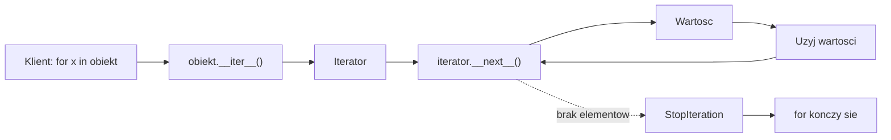
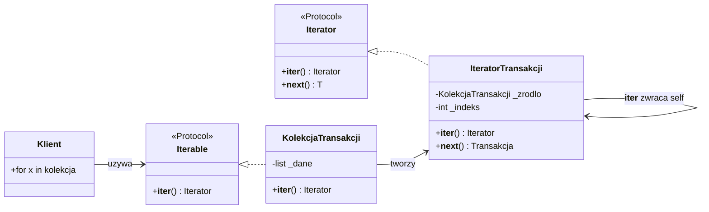
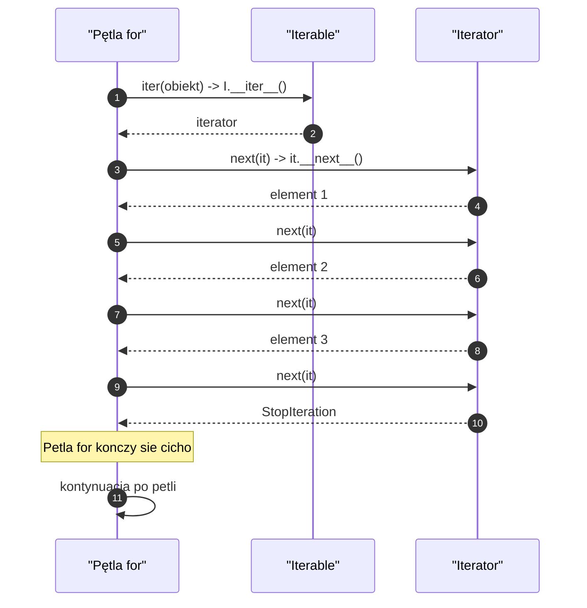
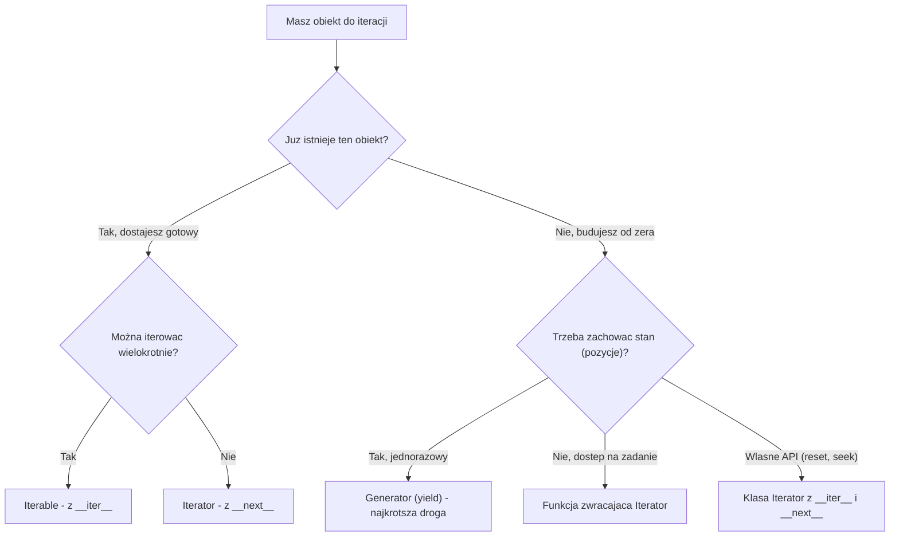
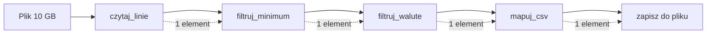
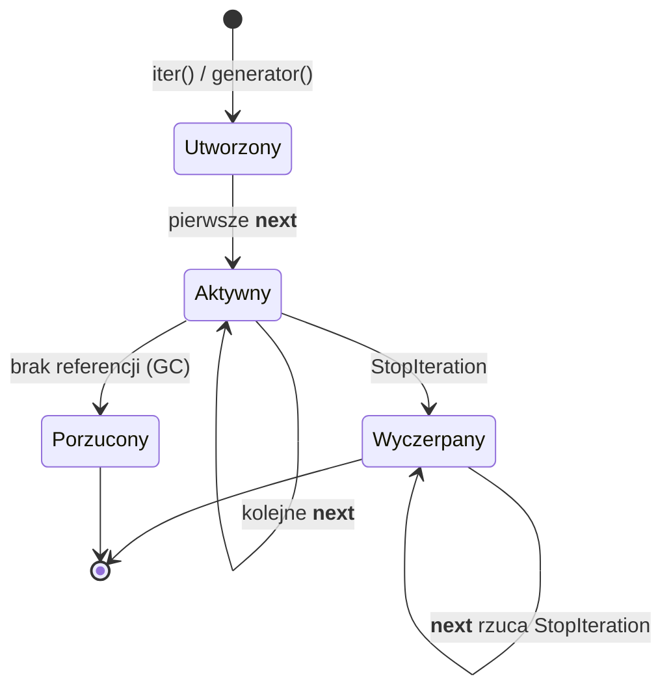
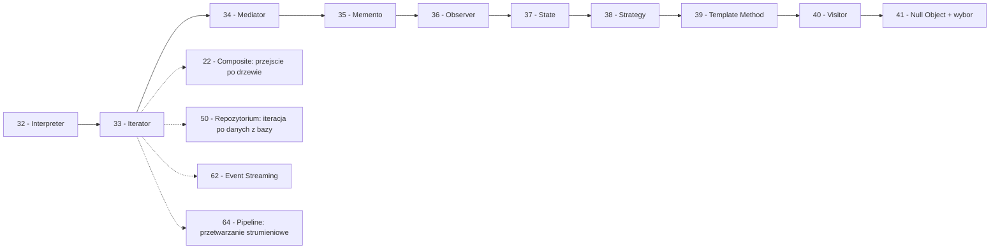

```markdown
---
modul: 33 — Iterator
plik: 33-iterator.md
poziom: podstawowy
wymaga: [32]
czas: ~150 minut czytania + ~380 minut ćwiczeń
---

# Moduł 33 — Iterator — wzorzec, który w Pythonie stał się składnią

> **TL;DR**
> - **Iterator (iterator)** daje sekwencyjny dostęp do elementów kolekcji **bez ujawniania jej wewnętrznej struktury** — to najprostszy wzorzec w katalogu GoF, ale w Pythonie jest **wbudowany w język** jako protokół iteracji.
> - Protokół iteracji to dwie metody: `__iter__` (zwraca iterator) i `__next__` (zwraca kolejny element albo rzuca `StopIteration`); pętla `for` to nic innego jak wywołanie `__iter__` i kolejnych `__next__`.
> - Iterator jest **jednorazowy** — po wyczerpaniu zostaje pusty. Iterable jest **wielokrotny** — można z niego utworzyć kolejne iteratory. To najczęstsze pomylenie w Pythonie.
> - Generatory (`yield`) to najkrótszy sposób tworzenia iteratorów — większość zadań, dla których w innych językach trzeba pisać klasę `Iterator`, w Pythonie rozwiązuje się funkcją z `yield`.
> - Iteratory **leniwe** to fundament pracy z danymi, których nie zmieścilibyśmy w pamięci (logi, CSV o 10 GB, strumienie zdarzeń) — i podstawowy budulec przetwarzania strumieniowego.

---

## 0. Model mentalny

### Pilot do zdjęć, stronicowanie i taśma z kliszami

Weź do ręki cyfrowy aparat fotograficzny. Zrobiłeś 500 zdjęć, siedząc w kawiarni. Teraz chcesz je przejrzeć. Bierzesz aparat, naciskasz przycisk „następne zdjęcie" i pokazuje się kolejne. Naciskasz jeszcze raz — pokazuje się jeszcze kolejne. Przewijasz w tę stronę, aż dojdziesz do ostatniego — wtedy aparat przestaje reagować (albo wraca na początek, zależnie od ustawień). Zatrzymaj się i pomyśl, co tu się naprawdę dzieje.

**Aparat nie pokazuje całej galerii naraz.** Nie masz na ekranie 500 zdjęć w siatce 25×20. Widzisz **jedno** — to bieżące. Naciskasz „następne" — aparat wie, które było bieżące, i pokazuje kolejne. To jest dokładnie **iterator**: obiekt, który ma stan („gdzie jestem") i metodę („daj następne"). Aparat nie pokazuje ci, gdzie zdjęcia są zapisane fizycznie, w jakim formacie, jak skompresowane — dostajesz tylko „następne".

Ale jest w tej analogii jeszcze jeden niuans — kluczowy. **Niektóre aparaty pozwalają przejrzeć te same zdjęcia jeszcze raz** (przycisk „wróć do początku"), a niektóre nie (po dojściu do końca trzeba restartować). W pierwszym przypadku aparat ma **wewnętrzny wskaźnik**, który można zresetować — to jest bardziej jak „iterable". W drugim przypadku wskaźnik jest tylko do przodu — to „iterator jednorazowy". W Pythonie **wszystkie iteratory są jednorazowe**, a „aparat można zresetować" tylko przez **utworzenie nowego iteratora z tego samego źródła**. To fundamentalne rozróżnienie, na którym stoi cała rodzina protokołów w Pythonie.

Teraz pomyśl o drugim obrazie — o czytaniu książki. Sięgasz po **tasiemkę zakładkę**, żeby pamiętać, gdzie skończyłeś. To jest **stan iteratora**. Kiedy wracasz do książki, przewracasz kartki od zaznaczonego miejsca. Nie musisz pamiętać całej treści — wystarczy pozycja. Iterator działa tak samo: pamięta tylko **pozycję**.

I trzeci obraz — taśma z kliszami albo **strumień danych**. Wyobraź sobie, że czytasz plik z logami, który ma 10 GB. Nie możesz załadować całego pliku do pamięci, ale możesz czytać **linia po linii**: przeczytaj jedną, przetwórz ją, przeczytaj następną, przetwórz. Każda linia jest przetwarzana, ale w pamięci jest tylko jedna naraz (plus bufor). To jest **iteracja leniwa** — fundament pracy ze strumieniami. Właśnie ona sprawia, że Python świetnie nadaje się do przetwarzania dużych zbiorów danych bez ich materializacji.

| W analogii aparatu/książki/strumienia | W kodzie |
|---|---|
| Aparat/książka/plik | **Iterable** — obiekt, po którym można iterować |
| Aktualnie wskazywane zdjęcie/strona/linia | **Bieżący element** zwracany przez `__next__` |
| Przycisk „następne" | `__next__()` — pobierz kolejny element |
| „Reset / od początku" | `__iter__()` — zwróć **nowy** iterator |
| Brak dalszych zdjęć/linii | `StopIteration` — koniec iteracji |
| Zakładka w książce | Wewnętrzny stan iteratora (indeks, kursor) |
| Strumień 10 GB | Iteracja leniwa — jeden element naraz |

> 🧠 **Zapamiętaj** — **Iterator (iterator) to wzorzec behawioralny zapewniający sekwencyjny dostęp do elementów kolekcji bez ujawniania jej wewnętrznej reprezentacji. Iterable (obiekt iterowalny) to obiekt, z którego można utworzyć iterator; iterable zwykle nie jest jednorazowy, iterator zwykle jest.**

Zwróć uwagę na trzy słowa: **sekwencyjny**, **bez ujawniania**, **reprezentacji**. „Sekwencyjny" — dostęp jest jeden po drugim, nie losowy. „Bez ujawniania" — klient nie wie, czy dane są w liście, w drzewie, w pliku, w bazie. „Reprezentacji" — wewnętrzna struktura danych pozostaje ukryta, klient widzi tylko interfejs.

W Pythonie ten wzorzec to **wbudowany protokół**, a nie opcjonalna wzorzec projektowy. Pętla `for` nie działa „na liście" — działa na obiekcie, który implementuje `__iter__`. To znaczy, że **każda twoja kolekcja może być iterowana** w ten sam sposób, niezależnie od tego, jak jest zbudowana. To realizacja tego wzorca na poziomie języka — jeden z najbardziej eleganckich przykładów „wzorzec, który stał się składnią".

### Diagram — intuicja protokołu



*Diagram pokazuje, że pętla `for` to w istocie jedno wywołanie `__iter__` i seria `__next__` aż do `StopIteration` — klient nigdy nie sięga do wewnętrznej struktury kolekcji.*

### Czego Iterator NIE robi

Rozbrójmy cztery mity, które narosły wokół tego wzorca — szczególnie w Pythonie, gdzie protokół jest tak głęboko wbudowany, że bywa niezauważalny.

**Nie jest tym samym co iterable.** Iterable to obiekt, po którym można iterować (lista, krotka, słownik, zbiór, plik). Iterator to obiekt, który **śledzi pozycję** i zwraca kolejne elementy. Lista jest iterable, ale **nie jest** iteratorem. Iterator można uzyskać z listy przez `iter(lista)`. To rozróżnienie jest fundamentalne i najczęściej mylone.

**Nie materializuje danych.** Iterator nie tworzy listy. Iteracja po generatorze, który zwraca milion elementów, zajmuje **stałą pamięć** — bo w każdej chwili istnieje tylko jeden element. To różnica między `for linia in plik:` (iteracja) a `list(plik)` (materializacja). Pierwsza działa dla 10 GB, druga tylko dla plików, które zmieszczą się w RAM.

**Nie jest jednorazowym „widokiem" w sensie SQL.** Iterator po utworzeniu jest jednorazowy — po wyczerpaniu nie wraca do początku. To świadoma decyzja projektowa: pozwala na nieskończenie długie strumienie (np. `itertools.count()` generuje w nieskończoność) i na implementację bez zapamiętywania całego zbioru.

**Nie rozwiązuje problemu równoległości.** Iterator w Pythonie jest sekwencyjny. Dla przetwarzania w wielu wątkach/procesach potrzebujesz innych narzędzi (`concurrent.futures`, `asyncio` — patrz sekcja 4). Iterator jedynie **współpracuje** z tymi narzędziami — np. `map` z `ProcessPoolExecutor` zwraca iterator wyników.

**Nie zawsze jest lepszy od listy.** Dla małych zbiorów (do kilkuset elementów) materializacja listy jest **szybsza** i **prostsza**. Iterator to narzędzie dla dużych lub strumieniowych danych.

**Nie każdy iterator jest leniwy.** Można napisać iterator, który przy pierwszym `__next__` materializuje całą kolekcję. To technicznie iterator, ale nie korzysta z jego zalet. Rozróżnienie „iterator formalny" i „iterator leniwy" jest ważne.

---

## 1. Problem, który rozwiązujemy

Wejdźmy w domenę 📊 „Sprawozdawczości". System przetwarza dzienne pliki transakcji, które przychodzą do firmowego DLU (data landing unit). Każdy plik ma kilkaset tysięcy do kilku milionów linii. Chcę policzyć sumę transakcji z danego pliku i wyłowić te, które przekraczają limit. Ktoś napisał to tak:

### Kod „przed"

```python
# sprawozdawczosc_v0.py — wersja naiwna, demonstracyjna
# UWAGA: kod celowo pokazuje problem z materializacja danych.

from dataclasses import dataclass
from decimal import Decimal
from pathlib import Path


@dataclass(frozen=True)
class Transakcja:
    identyfikator: str
    kwota: Decimal
    waluta: str


class AnalizatorTransakcji:
    def wczytaj_plik(self, sciezka: Path) -> list[Transakcja]:
        """Wczytuje CALY plik do pamieci jako liste."""
        wynik: list[Transakcja] = []
        with open(sciezka, encoding="utf-8") as plik:
            for linia in plik.readlines():     # readlines() - materializacja!
                linia = linia.strip()
                if not linia or linia.startswith("#"):
                    continue
                id_, kwota, waluta = linia.split(";")
                wynik.append(Transakcja(id_, Decimal(kwota), waluta))
        return wynik

    def suma(self, transakcje: list[Transakcja]) -> Decimal:
        return sum((t.kwota for t in transakcje), Decimal("0"))

    def ponad_limit(
        self, transakcje: list[Transakcja], limit: Decimal
    ) -> list[Transakcja]:
        return [t for t in transakcje if t.kwota > limit]


if __name__ == "__main__":
    sciezka = Path("transakcje.txt")
    # ... zalozmy, ze plik istnieje
    analizator = AnalizatorTransakcji()
    # transakcje = analizator.wczytaj_plik(sciezka)
    # print(analizator.suma(transakcje))
```

Ten kod działa poprawnie **dla małych plików**. Ale w momencie, gdy plik ma 10 GB (typowy plik transakcyjny z systemu bankowego), okazuje się, że **nie działa wcale** — bo próbuje zmieścić cały plik w pamięci, a każda transakcja jako obiekt Pythona zajmuje setki bajtów. Milion transakcji × ~500 bajtów = 500 MB. Dziesięć milionów × ~500 bajtów = 5 GB. System operacyjny zabija proces (OOM killer).

### Code smell — materializacja wielkich danych

| Problem | Gdzie | Konsekwencja |
|---|---|---|
| `plik.readlines()` materializuje cały plik | `wczytaj_plik` | Cały plik w pamięci |
| Lista transakcji rośnie z liczbą linii | `wynik: list[...]` | Zużycie pamięci proporcjonalne do rozmiaru pliku |
| Operacje wymagają gotowej listy | `suma(transakcje)`, `ponad_limit` | Nie można przetwarzać strumieniowo |
| Brak podziału „czytaj/obliczaj/przetwarzaj" | Wszystko w jednej metodzie | Nie można złożyć potoku |
| Otwarcie pliku w metodzie wewnątrz | Trudne do mockowania | Trudne testy |
| Nie można przetwarzać „na bieżąco" | Wszystko musi być gotowe | Brak możliwości np. „ekran po linii" |
| Brak wsparcia dla plików > RAM | Konkretny `readlines` | Nieobsłużone pliki 10 GB |
| Powtarzalność parsowania linii | Druga metoda też parsuje — albo znów czyta | Trzeba trzymać listę w pamięci dla każdej operacji |

### Objawy — poznasz ten problem po tym, że...

- **Wczytujesz cały plik do listy**, żeby potem „przejrzeć go raz" albo „policzyć sumę". Powinieneś czytać po jednej linii.
- **Aplikacja zużywa GB pamięci** przy przetwarzaniu danych od użytkownika. To objaw `list(plik)` albo `plik.readlines()`.
- **Nie można przetwarzać strumieniowo danych z API** albo z bazy — kod zawsze materializuje pełny zbiór.
- **Brak podziału na etapy** (wczytaj → przetwórz → zapisz). Wszystko w jednej metodzie, więc nie można komponować.
- **Funkcje pomocnicze zawsze przyjmują listy.** Nie da się przekazać „strumienia", „generatora", „pliku".
- **Testy wymagają materializacji** małych list, żeby zweryfikować operacje.
- **Użytkownik nie widzi rezultatów, dopóki nie zakończy się cala operacja.** Można by pokazywać progresywnie — ale kod nie pozwala.
- **Brak wsparcia dla nieskończonych źródeł.** Nie można przetworzyć „pierwszych 10 elementów" bez ładowania całego zbioru.
- **Kopiujesz listy, żeby wykonać różne operacje.** Bo każda operacja potrzebuje świeżej listy.
- **W nazwach metod widzisz `wczytaj_...`, `przygotuj_...`, `zbierz_...`** — to sygnał, że brakuje koncepcji „strumienia".

---

## 2. Anatomia wzorca

### Uczestnicy

| Rola | Odpowiedzialność | Co NIE jest jej zadaniem |
|---|---|---|
| **Iterator** | Śledzi pozycję i zwraca kolejne elementy; sygnalizuje koniec przez `StopIteration` | Nie ujawnia struktury zbioru; nie modyfikuje kolekcji |
| **Iterable (obiekt iterowalny)** | Udostępnia metodę `__iter__`, która zwraca nowy iterator | Nie musi być jednorazowy; może utworzyć wiele iteratorów |
| **Aggregate (agregat)** | Reprezentuje kolekcję, po której można iterować | Może sam być iterable (najczęściej jest) |
| **Klient** | Używa iteratora przez `for`, `next()`, `iter()`, `itertools` | Nie sięga do wewnętrznej struktury kolekcji |

**Kluczowa asymetria:** iterator **zna** strukturę kolekcji (bo musi wiedzieć, co pokazać), ale iterable **nie pokazuje** struktury klientowi. To jest istota wzorca — wiedza jest w iteratorze, ale nie w interfejsie.

W Pythonie rozróżnienie na `Iterable` i `Iterator` jest realizowane przez protokoły. Formalnie:

- **Iterable** — obiekt z metodą `__iter__` (albo, w starszym stylu, z `__getitem__`).
- **Iterator** — obiekt z metodami `__iter__` i `__next__`; `__iter__` zwraca **siebie samego**.

Dlaczego iterator też ma `__iter__`? Bo to pozwala na zapis `iter(iterator) is iterator` — iterator jest sam swoim iterable. To upraszcza kod iterujący po rzeczach, które mogą być iterable albo iteratorami (np. `for x in coś` gdzie `coś` może być listą albo generatorem).

### Klasyczny dylemat — separacja iterable i iterator

Można mieć jeden obiekt, który jest **jednocześnie iterable i iteratorem** (generatory są takim przykładem). Można też mieć **osobne** obiekty: `BookShelf` (iterable) i `BookShelfIterator` (iterator). Drugie podejście jest klasyczne w sensie GoF — pozwala tworzyć **wiele niezależnych iteratorów** na tym samym zbiorze, każdy z własnym stanem. W Pythonie najczęściej wystarczy podejście pierwsze, ale zdarzają się przypadki, gdy potrzebna jest separacja (np. dwa niezależne wskaźniki w dwóch wątkach czytają z tego samego pliku).

### Diagram struktury



*Diagram pokazuje separację iterable (`KolekcjaTransakcji`) i iteratora (`IteratorTransakcji`): kolekcja tworzy iterator, iterator śledzi pozycję — a klient widzi tylko wspólny kontrakt `Iterable`.*

Przeczytajmy ten diagram zdanie po zdaniu. `Iterable` i `Iterator` to dwa **Protokoły** (moduł 02) — formalne kontrakty protokołu iteracji. `KolekcjaTransakcji` implementuje `Iterable` — zwraca nowy iterator z `__iter__`. `IteratorTransakcji` implementuje `Iterator` — ma stan (`_indeks`) i zwraca kolejne elementy z `__next__`.

Strzałka `IteratorTransakcji --> IteratorTransakcji: __iter__ zwraca self` jest kluczowa: iterator implementuje `__iter__`, ale zwraca **siebie samego**. To pozwala na zapis `for t in iterator` — nie trzeba owijać iteratora. Ta własność sprawia, że iterator jest samowystarczalny.

`KolekcjaTransakcji --> IteratorTransakcji: tworzy` pokazuje, że iterable **wie, jakiej klasy iterator utworzyć**. To jego rola — być „fabryką iteratorów". Zauważ, że jeśli kolekcja pozwala na `__iter__` **kilka razy**, można utworzyć **kilka niezależnych iteratorów** i każdy śledzi własną pozycję.

### Warianty: klasyczny vs pythoniczny

| Aspekt | Klasyczny (GoF) | Pythoniczny |
|---|---|---|
| Separacja iterable/iterator | Obowiązkowa (osobne klasy) | Opcjonalna (jeden obiekt) |
| Tworzenie iteratora | Metoda `create_iterator()` | Metoda `__iter__()` |
| Pobranie elementu | `next()` | `__next__()` |
| Koniec iteracji | `has_next()` albo wyjątek | Wyjątek `StopIteration` |
| Klasa iteratora | Osobna klasa | Funkcja z `yield` |
| Stan | Pole w klasie | Ukryty w ramce generatora |
| Wielokrotna iteracja | Nowy iterator | `iter(obiekt)` za każdym razem |
| Łatwość implementacji | Średnia | Bardzo wysoka (generator) |

W Pythonie najczęściej **wystarczy generator**. Klasa jest potrzebna tylko wtedy, gdy iterator ma własne API (np. `reset()`, `seek(position)`, zarządzanie zasobami) albo gdy trzeba go zwracać w kilku miejscach z różnymi konfiguracjami.

---

## 3. Implementacja krok po kroku

Przebudujemy przykład z sekcji 1 stopniowo. Zaczniemy od iteratora plikowego, dojdziemy do złożonego pipeline’u strumieniowego.

### Krok 1 — Zdefiniuj kontrakt i typy

Najpierw typ `Transakcja` i kontrakt iteracji.

```python
from typing import Iterator, Iterable, Protocol, TypeVar, runtime_checkable
from decimal import Decimal
from dataclasses import dataclass


@dataclass(frozen=True, slots=True)
class Transakcja:
    identyfikator: str
    kwota: Decimal
    waluta: str


T = TypeVar("T")


@runtime_checkable
class Iterowalny(Protocol[T]):
    """Protokol iteracji - cokolwiek, co da sie iterowac."""
    def __iter__(self) -> Iterator[T]: ...
```

Uwaga na typy: `Iterator[T]` to typ ogólny — iterator, który produkuje elementy typu `T`. To część modułu `typing`. W Pythonie 3.9+ można też używać `collections.abc.Iterator[T]` — to samo.

### Krok 2 — Napisz iterator plikowy jako klasę

Pierwsza wersja — klasyczny iterator jako klasa ze stanem. Pokazuje ideę, ale w praktyce będziemy używać generatora.

```python
class IteratorLiniiPliku:
    """Klasyczny iterator: czyta plik linia po linii, nie materializuje."""

    def __init__(self, sciezka: str) -> None:
        self._plik = open(sciezka, encoding="utf-8")
        self._numer = 0

    def __iter__(self) -> "IteratorLiniiPliku":
        return self

    def __next__(self) -> str:
        linia = self._plik.readline()
        if not linia:
            self._plik.close()
            raise StopIteration
        self._numer += 1
        return linia.rstrip("\n")

    def __del__(self) -> None:
        # Bezpieczenstwo: zamknij plik jesli nie zostal zamkniety
        if not self._plik.closed:
            self._plik.close()
```

Zwróć uwagę na `readline()` — czyta **jedną** linię. W pamięci trzymana jest tylko jedna linia naraz. Dla pliku 10 GB — aplikacja zużywa kilka kilobajtów. To kluczowa własność iteratora.

`__next__` rzuca `StopIteration` na końcu pliku. To jest standardowy sposób sygnalizowania końca iteracji.

### Krok 3 — Użyj iteratora w pętli

```python
def policz_transakcje(sciezka: str) -> int:
    iterator = IteratorLiniiPliku(sciezka)
    liczba = 0
    for linia in iterator:
        if linia.strip() and not linia.startswith("#"):
            liczba += 1
    return liczba
```

Pętla `for` w Pythonie wygląda tak:
1. Wywołuje `iterator.__iter__()` — dostaje **ten sam iterator** (bo zwraca `self`).
2. W pętli wywołuje `iterator.__next__()` — dostaje kolejną linię albo `StopIteration`.
3. Na `StopIteration` pętla kończy się.

**Pętla `for` nie wie nic o pliku.** Widzi tylko protokół iteracji.

### Krok 4 — Przepisz klasę na generator

Klasa powyżej jest technicznie poprawna, ale rozwojowa. **Generator to ten sam iterator w jednej funkcji.**

```python
from collections.abc import Iterator


def czytaj_transakcje(sciezka: str) -> Iterator[Transakcja]:
    """Generator: czyta transakcje leniwie."""
    with open(sciezka, encoding="utf-8") as plik:
        for numer, linia in enumerate(plik, start=1):
            linia = linia.strip()
            if not linia or linia.startswith("#"):
                continue
            czesci = linia.split(";")
            if len(czesci) != 3:
                raise ValueError(
                    f"linia {numer}: oczekiwano 3 pol, jest {len(czesci)}"
                )
            id_, kwota, waluta = czesci
            yield Transakcja(
                identyfikator=id_,
                kwota=Decimal(kwota),
                waluta=waluta,
            )
```

Porównaj z klasą: brak `__iter__`, brak `__next__`, brak jawnego stanu. `yield` załatwia wszystko. Funkcja sama staje się **iteratorem** — przy pierwszym wywołaniu zwraca obiekt generatora, który można iterować.

Uwaga na `with` — plik zamknie się **automatycznie** przy wyczerpaniu generatora (`StopIteration` propaguje przez `finally` z `with`). Bez tego plik mógłby pozostać otwarty. To wzorzec context managera (moduł 02) + generatora.

### Krok 5 — Zbuduj pipeline

Teraz składamy operacje w pipeline. Każda operacja to **osobny generator**, a łączymy je w łańcuch.

```python
def filtruj_minimum(
    zrodlo: Iterable[Transakcja], minimum: Decimal
) -> Iterator[Transakcja]:
    """Filtr leniwy: przepuszcza tylko transakcje powyzej minimum."""
    return (t for t in zrodlo if t.kwota >= minimum)


def tylko_waluta(
    zrodlo: Iterable[Transakcja], waluta: str
) -> Iterator[Transakcja]:
    """Filtr leniwy: przepuszcza tylko dana walute."""
    return (t for t in zrodlo if t.waluta == waluta)


def w_mapowane_bajty(
    zrodlo: Iterable[Transakcja],
) -> Iterator[bytes]:
    """Mapowanie leniwe: transakcja -> linia CSV jako bajty."""
    for t in zrodlo:
        yield f"{t.identyfikator};{t.kwota};{t.waluta}\n".encode("utf-8")


# Pipeline: czytaj -> filtruj -> filtruj -> mapuj
pipeline = w_mapowane_bajty(
    tylko_waluta(
        filtruj_minimum(czytaj_transakcje("transakcje.txt"), Decimal("1000")),
        "PLN",
    )
)

# Teraz mozemy przetworzyc kazda linie osobno - w pamieci jest tylko jedna
with open("wyjscie.csv", "wb") as wyj:
    for bajty in pipeline:
        wyj.write(bajty)
```

**Zwróć uwagę na kluczową własność:** żaden etap nie materializuje pełnej listy. Cały potok przetwarza **jedną transakcję naraz** — od pliku wejściowego przez filtry i mapowanie do pliku wyjściowego. To pozwala przetworzyć plik 10 GB lub 100 GB, o ile tylko dysk to udźwignie.

### Krok 6 — Dodaj agregacje

Agregacje (suma, liczba) też można robić leniwie.

```python
def suma_kwot(zrodlo: Iterable[Transakcja]) -> Decimal:
    """Sumuje kwoty, przetwarzajac jeden element naraz."""
    suma = Decimal("0")
    for t in zrodlo:
        suma += t.kwota
    return suma


def wez_pierwsze_n(
    zrodlo: Iterable[T], n: int
) -> Iterator[T]:
    """Bierze tylko pierwsze n elementow - bez czytania calego zrodla."""
    for i, element in enumerate(zrodlo):
        if i >= n:
            return
        yield element
```

`wez_pierwsze_n` może działać na **nieskończonym** iteratorze (np. `itertools.count()`) — bo zatrzymuje się po `n` elementach. To własność, której nie miałby kod materializujący.

### Krok 7 — Weryfikacja

| Kryterium | Wersja „przed" | Wersja „po" |
|---|---|---|
| Zużycie pamięci | Rozmiar pliku × ~500 B na transakcję | Kilka KB (bufor pliku + jedna transakcja) |
| Możliwość plików 10 GB | Nie | Tak |
| Skalowanie | O(n) pamięci | O(1) pamięci |
| Pipeline | Nie da się | Naturalne składanie |
| Testy | Trzeba materializować listy | Można testować z `iter([])` albo generatorami |
| Przetwarzanie nieskończone | Niemożliwe | Możliwe |
| Liczba klas | 2 | 1 (tylko `Transakcja`) |

Zysk jest ogromny: aplikacja działa w **stałej** pamięci niezależnie od rozmiaru pliku.

---

## 4. Wersje pythoniczne i warianty

Ta sekcja to katalog najważniejszych wariantów i narzędzi. Wart przeczytać — to jeden z najczęściej używanych zestawów narzędzi Pythona w praktyce produkcyjnej.

### 4.1 Protokół iteracji — `__iter__` i `__next__`

Dwa dunders, które definiują protokół. Zasada:

- **Iterable** — implementuje `__iter__`, zwraca iterator.
- **Iterator** — implementuje `__iter__` (zwraca `self`) i `__next__` (zwraca kolejny element albo rzuca `StopIteration`).

```python
class LicznikOdDo:
    """Iterable: mozna iterowac wielokrotnie."""

    def __init__(self, od: int, do: int) -> None:
        self._od = od
        self._do = do

    def __iter__(self) -> "IteratorOdDo":
        return IteratorOdDo(self._od, self._do)


class IteratorOdDo:
    """Iterator: sledzi pozycje, jednorazowy."""

    def __init__(self, od: int, do: int) -> None:
        self._aktualny = od
        self._do = do

    def __iter__(self) -> "IteratorOdDo":
        return self

    def __next__(self) -> int:
        if self._aktualny >= self._do:
            raise StopIteration
        wynik = self._aktualny
        self._aktualny += 1
        return wynik


# Uzycie:
licznik = LicznikOdDo(1, 4)
print(list(licznik))   # [1, 2, 3]
print(list(licznik))   # [1, 2, 3] - iterable mozna iterowac wielokrotnie!

it = iter(licznik)
print(next(it), next(it))   # 1 2
```

Zwróć uwagę: iterable (`LicznikOdDo`) można iterować wiele razy — bo każde `for` tworzy **nowy** iterator. Iterator (`IteratorOdDo`) można wyczerpać raz.

### 4.2 Generator — najkrótsza droga

Funkcja z `yield` **jest** iteratorem — nie trzeba klasy.

```python
def licznik_od_do(od: int, do: int) -> Iterator[int]:
    """Generator: zwraca kolejne liczby."""
    aktualny = od
    while aktualny < do:
        yield aktualny
        aktualny += 1


# Uzycie:
print(list(licznik_od_do(1, 4)))   # [1, 2, 3]
```

Ale uwaga: generator jest **jednorazowy**. `licznik_od_do(1, 4)` zwraca **jeden iterator**, który się wyczerpie.

```python
gen = licznik_od_do(1, 4)
print(list(gen))   # [1, 2, 3]
print(list(gen))   # [] - wyczerpany!
```

Żeby iterować wielokrotnie, wywołaj funkcję ponownie: `list(licznik_od_do(1, 4))`.

### 4.3 `iter()` z funkcją i sentinelem

`iter(funkcja, sentinel)` tworzy iterator, który woła `funkcję` aż zwróci `sentinel`. To przydatne do czytania buforów.

```python
import io

bufor = io.StringIO("a\nb\nc\n")

# Iterator, ktory czyta linie az do "" (EOF)
for linia in iter(bufor.readline, ""):
    print(linia.rstrip())
# a
# b
# c
```

Bardzo użyteczne dla strumieni — nie musisz pisać pętli z warunkiem `while`.

### 4.4 Klasa z `__iter__` zwracającym generator

Klasa jest iterable, ale iterator to zwykły generator.

```python
class KolekcjaTransakcji:
    def __init__(self, transakcje: list[Transakcja]) -> None:
        self._transakcje = transakcje

    def __iter__(self) -> Iterator[Transakcja]:
        # Kazde __iter__ zwraca NOWY generator
        return (t for t in self._transakcje if t.kwota > 0)
```

To najczęstszy wzorzec: klasa jest iterable, generator załatwia resztę.

### 4.5 `__getitem__` jako fallback (stara ścieżka)

Przed PEP 234 (iteracja w Pythonie 2.2) iteracja działała przez `__getitem__` — Python wołał `obiekt[0]`, `obiekt[1]`, ... aż do `IndexError`. **Ten mechanizm nadal działa jako fallback** dla klas, które mają `__getitem__` ale nie mają `__iter__`.

```python
class ProstaKolekcja:
    def __init__(self) -> None:
        self._dane = [10, 20, 30]

    def __getitem__(self, indeks: int) -> int:
        return self._dane[indeks]


# Iteracja dziala mimo braku __iter__ - Python uzywa __getitem__
for x in ProstaKolekcja():
    print(x)   # 10 20 30
```

**Uwaga:** po tym, jak Python dojdzie do `IndexError` (albo jakiegokolwiek wyjątku z `__getitem__`), kończy iterację. To znaczy, że wyjątek **nie** propaguje się — jest łapany i zamieniany na `StopIteration`. Trzeba o tym pamiętać, jeśli `__getitem__` może podnieść inny wyjątek.

**Praktyczna rekomendacja:** implementuj `__iter__` jawnie. Używaj fallbacku `__getitem__` tylko dla bardzo prostych przypadków.

### 4.6 `itertools` — biblioteka iteratorów

`itertools` to skarbnica narzędzi. Oto najważniejsze:

| Narzędzie | Co robi | Kiedy używać |
|---|---|---|
| `count(start, step)` | Nieskończony licznik | ID, liczniki |
| `cycle(iterable)` | Powtarza elementy w nieskończoność | Round-robin, testy |
| `repeat(x, n)` | Powtarza x n razy (albo nieskończenie) | Powtarzanie stałej |
| `chain(*iterables)` | Skleja iteratory | Łączenie źródeł |
| `islice(it, start, stop, step)` | Wycina fragment | Pierwsze N elementów |
| `groupby(it, key)` | Grupuje kolejne elementy | Grupowanie po kluczu (wymaga sortowania) |
| `tee(it, n)` | Rozdziela na n kopii | Dwóch niezależnych odbiorców |
| `accumulate(it)` | Suma narastająca | Krzywa wartości |
| `dropwhile(pred, it)` | Pomija dopóki pred | Pomijanie nagłówka |
| `takewhile(pred, it)` | Bierze dopóki pred | Wczesne zatrzymanie |
| `starmap(f, it)` | f(*args) dla każdej krotki | Rozpakowywanie argumentów |
| `product(a, b)` | Iloczyn kartezjański | Kombinacje |
| `permutations(it, r)` | Permutacje | Wszystkie kolejności |
| `combinations(it, r)` | Kombinacje | Wybór bez kolejności |
| `batched(it, n)` | Paczki po n | Przetwarzanie wsadowe (Python 3.12+) |

Krótkie przykłady:

```python
import itertools as it

# 10 pierwszych kwadratow liczb calkowitych
kwadraty = (x*x for x in it.count(1))
print(list(it.islice(kwadraty, 10)))   # [1, 4, 9, ..., 100]

# Sklejenie kilku zrodel
polaczone = it.chain([1, 2], (3, 4), [5])
print(list(polaczone))   # [1, 2, 3, 4, 5]

# Grupowanie po kluczu
dane = [("A", 1), ("A", 2), ("B", 3), ("B", 4)]
for klucz, grupa in it.groupby(dane, key=lambda x: x[0]):
    print(klucz, list(grupa))

# Suma narastajaca
print(list(it.accumulate([1, 2, 3, 4])))   # [1, 3, 6, 10]

# Permutacje
print(list(it.permutations("ABC", 2)))   # [('A','B'), ('A','C'), ...]
```

**Uwaga na `groupby`:** grupuje **kolejne** elementy o tym samym kluczu. Jeśli dane nie są posortowane po kluczu, dostaniesz wiele grup o tym samym kluczu. Zawsze sortuj przed `groupby`.

### 4.7 Typowanie iteratorów

Współczesny Python pozwala precyzyjnie typować iteratory.

```python
from typing import Iterator, Iterable, Generator

def policz(teksty: Iterable[str]) -> int:
    # Iterable - przyjmuje liste, krotke, generator, set
    return sum(1 for _ in teksty)


def literuj(tekst: str) -> Iterator[str]:
    # Iterator - zwraca iterator, konsument wie, ze jednorazowy
    return iter(tekst)


def literuj_gen(tekst: str) -> Generator[str, None, None]:
    # Generator - jak Iterator, ale z trzema typami
    # (YieldType, SendType, ReturnType)
    yield from tekst
```

Trzy typy różnią się subtelnie:

- **`Iterable[T]`** — obiekt, po którym można iterować. Nie mówi, czy jest jednorazowy.
- **`Iterator[T]`** — obiekt, który można wyczerpać raz.
- **`Generator[T, S, R]`** — Iterator, który dodatkowo może przyjmować wartości przez `send` i zwracać przez `StopIteration.value`.

W typowych sygnaturach używaj `Iterable[T]` dla argumentów (elastyczność), `Iterator[T]` dla zwracanych wartości (jasność). `Generator` tylko gdy używasz `send`/`yield from`.

### 4.8 Iterator a równoległość

**`concurrent.futures` — iterator wyników:**

```python
from concurrent.futures import ThreadPoolExecutor, as_completed

def przetworz(url: str) -> str:
    # ... jakies dlugie zadanie
    return f"wynik dla {url}"

with ThreadPoolExecutor(max_workers=8) as executor:
    zadania = [executor.submit(przetworz, u) for u in ["a", "b", "c"]]
    # as_completed zwraca ITERATOR wynikow w kolejnosci zakonczenia
    for zadanie in as_completed(zadania):
        print(zadanie.result())
```

`as_completed` to **iterator** — wyniki pojawiają się w miarę zakończenia zadań, nie trzeba czekać na wszystkie.

**`asyncio` — `async for`:**

```python
async def strumien_zdarzen():
    for i in range(5):
        yield i  # w asynchronicznym generatorze

# async for korzysta z __aiter__ i __anext__
async def przetworz():
    async for x in strumien_zdarzen():
        print(x)
```

Protokół asynchronicznej iteracji (`__aiter__`, `__anext__`) to **analog** protokołu synchronicznego. Pozwala iterować po strumieniach czekających na dane (np. websockety, kolejki async). Rozbudujemy to w module 62.

### 4.9 Protokoły pokrewne — `Sequence`, `Mapping`, `Collection`, `Reversible`

Poza `Iterable` i `Iterator` istnieją bogatsze protokoły:

| Protokół | Metody | Kiedy używać |
|---|---|---|
| `Iterable` | `__iter__` | Tylko iteracja |
| `Iterator` | `__iter__`, `__next__` | Śledzenie pozycji |
| `Sized` | `__len__` | Można poznać długość |
| `Collection` | `__iter__`, `__len__`, `__contains__` | Kolekcja (lista, set) |
| `Sequence` | + `__getitem__`, `__reversed__`, `index`, `count` | Sekwencja indeksowana |
| `Mapping` | `__getitem__`, `__iter__`, `__len__`, `keys()`, `values()`, `items()` | Słownik |
| `Reversible` | `__reversed__` | Można iterować wstecz |
| `AsyncIterable` | `__aiter__` | Iteracja asynchroniczna |
| `AsyncIterator` | `__aiter__`, `__anext__` | Iterator asynchroniczny |

Implementuj **najmniejszy** protokół, który wystarcza. Naprawdę rzadko potrzebujesz `Sequence` — zwykle wystarczy `Iterable`.

### 4.10 Podsumowanie — tabela wyboru

| Potrzeba | Rozwiązanie |
|---|---|
| Prosty iterator | Generator (`yield`) |
| Wielokrotna iteracja | Iterable z `__iter__` |
| Iterator ze stanem i własnym API | Klasa z `__iter__`, `__next__` |
| Iterowanie z sentinelem | `iter(funkcja, sentinel)` |
| Złożenie iteratorów | `itertools.chain`, `yield from` |
| Wycinanie fragmentu | `itertools.islice` |
| Grupowanie | `itertools.groupby` + sort |
| Suma narastająca | `itertools.accumulate` |
| Wsad | `itertools.batched` |
| Równoległe wyniki | `concurrent.futures.as_completed` |
| Asynchronicznie | `async for` |

> 🧠 **Zapamiętaj** — **W Pythonie iterator to nie „wzorzec, który trzeba napisać" — to protokół, który większość obiektów już implementuje.** Twoim zadaniem nie jest „stosowanie Iteratora", ale **umiejętne korzystanie z niego**: knowanie, kiedy użyć generatora zamiast klasy, kiedy `itertools` zamiast pętli, kiedy iterator zamiast listy.

---

## 5. Przykład z życia: 📊 Sprawozdawczość — pełny uruchamialny kod

Zbudujemy pełny potok przetwarzania pliku transakcji: czytaj leniwie, filtruj, grupuj, licz agregaty, zapisz wynik. Wszystko strumieniowo.

### Kod

```python
# sprawozdawczosc_iterator.py — pelny przyklad Iterator
from __future__ import annotations

import itertools
from collections.abc import Iterable, Iterator
from dataclasses import dataclass
from decimal import ROUND_HALF_UP, Decimal
from pathlib import Path
from typing import TypeVar

T = TypeVar("T")


# ===========================================================================
# 1. Typy domenowe
# ===========================================================================

@dataclass(frozen=True, slots=True)
class Transakcja:
    identyfikator: str
    kwota: Decimal
    waluta: str

    def jako_csv(self) -> str:
        return f"{self.identyfikator};{self.kwota};{self.waluta}"


@dataclass(frozen=True, slots=True)
class PodsumowanieWaluty:
    waluta: str
    liczba_transakcji: int
    suma: Decimal


# ===========================================================================
# 2. Zrodla - iteratory leniwe
# ===========================================================================

def czytaj_transakcje(sciezka: Path) -> Iterator[Transakcja]:
    """Czyta plik transakcji linia po linii (leniwie).

    Format: <id>;<kwota>;<waluta>
    Linie puste i zaczynajace sie od # sa pomijane.
    """
    with open(sciezka, encoding="utf-8") as plik:
        for numer, linia in enumerate(plik, start=1):
            linia = linia.strip()
            if not linia or linia.startswith("#"):
                continue
            czesci = linia.split(";")
            if len(czesci) != 3:
                raise ValueError(
                    f"linia {numer}: oczekiwano 3 pol, jest {len(czesci)}"
                )
            id_, kwota, waluta = czesci
            try:
                yield Transakcja(
                    identyfikator=id_,
                    kwota=Decimal(kwota),
                    waluta=waluta,
                )
            except Exception as blad:
                raise ValueError(
                    f"linia {numer}: nie mozna sparsowac {linia!r}: {blad}"
                ) from blad


def z_pliku_tekstowego(tekst: str) -> Iterator[Transakcja]:
    """Alternatywa dla testow - czytanie z tekstu w pamieci."""
    for numer, linia in enumerate(tekst.splitlines(), start=1):
        linia = linia.strip()
        if not linia or linia.startswith("#"):
            continue
        czesci = linia.split(";")
        if len(czesci) != 3:
            raise ValueError(f"linia {numer}: zly format")
        id_, kwota, waluta = czesci
        yield Transakcja(id_, Decimal(kwota), waluta)


# ===========================================================================
# 3. Operatory potoku (kazdy leniwy)
# ===========================================================================

def filtruj_minimum(
    zrodlo: Iterable[Transakcja], minimum: Decimal
) -> Iterator[Transakcja]:
    """Filtr leniwy: przepuszcza tylko transakcje >= minimum."""
    return (t for t in zrodlo if t.kwota >= minimum)


def filtruj_walute(
    zrodlo: Iterable[Transakcja], waluta: str
) -> Iterator[Transakcja]:
    """Filtr leniwy: przepuszcza tylko dana walute."""
    return (t for t in zrodlo if t.waluta == waluta)


def bierz_pierwsze(
    zrodlo: Iterable[T], n: int
) -> Iterator[T]:
    """Bierze pierwsze n elementow. Bez materializacji calego zrodla."""
    return itertools.islice(zrodlo, n)


def mapuj_podsumowanie(
    zrodlo: Iterable[Transakcja],
) -> Iterator[PodsumowanieWaluty]:
    """Grupuje po walucie i sumuje. Leniwie - dopoki zrodlo pozwala."""
    # groupby wymaga posortowanego wejscia, wiec nie jest w pelni leniwe.
    # Dla malych zbiorow to OK; dla duzych trzeba innego podejscia.
    posortowane = sorted(
        zrodlo, key=lambda t: t.waluta
    )
    for waluta, grupa in itertools.groupby(posortowane, key=lambda t: t.waluta):
        grupa_lista = list(grupa)
        suma = sum((t.kwota for t in grupa_lista), Decimal("0"))
        suma = suma.quantize(Decimal("0.01"), rounding=ROUND_HALF_UP)
        yield PodsumowanieWaluty(waluta, len(grupa_lista), suma)


# ===========================================================================
# 4. Agregacje
# ===========================================================================

@dataclass(frozen=True, slots=True)
class Statystyki:
    liczba: int
    suma: Decimal
    min_kwota: Decimal | None
    max_kwota: Decimal | None


def policz_statystyki(zrodlo: Iterable[Transakcja]) -> Statystyki:
    """Agreguje strumieniowo - bez materializacji."""
    liczba = 0
    suma = Decimal("0")
    minimum: Decimal | None = None
    maksimum: Decimal | None = None
    for t in zrodlo:
        liczba += 1
        suma += t.kwota
        if minimum is None or t.kwota < minimum:
            minimum = t.kwota
        if maksimum is None or t.kwota > maksimum:
            maksimum = t.kwota
    return Statystyki(
        liczba=liczba,
        suma=suma.quantize(Decimal("0.01")),
        min_kwota=minimum,
        max_kwota=maksimum,
    )


# ===========================================================================
# 5. Iterator z wlasnym API
# ===========================================================================

class BuforTransakcji:
    """Iterator z dodatkowym API: podglad nastepnego elementu.

    Uzyteczny, gdy trzeba zerknac do przodu bez zuzywania elementu.
    """

    def __init__(self, zrodlo: Iterable[Transakcja]) -> None:
        self._it = iter(zrodlo)
        self._bufor: Transakcja | None = None

    def __iter__(self) -> "BuforTransakcji":
        return self

    def __next__(self) -> Transakcja:
        if self._bufor is not None:
            wynik = self._bufor
            self._bufor = None
            return wynik
        return next(self._it)

    def peek(self) -> Transakcja | None:
        """Zwraca nastepny element bez jego zuzywania."""
        if self._bufor is None:
            try:
                self._bufor = next(self._it)
            except StopIteration:
                return None
        return self._bufor


# ===========================================================================
# 6. Demonstracja
# ===========================================================================

PRZYKLAD = """\
# Plik transakcji testowych
TRX-001;1500.00;PLN
TRX-002;250.00;PLN
TRX-003;5000.00;EUR
TRX-004;120.00;PLN
TRX-005;3000.00;EUR
TRX-006;99.99;PLN
TRX-007;15000.00;PLN
TRX-008;450.00;USD
""".strip()

ZAPISANY = Path("/tmp/transakcje_przyklad.txt")
ZAPISANY.write_text(PRZYKLAD, encoding="utf-8")


if __name__ == "__main__":
    print("=== 1. Iterator jednorazowy ===")
    it = czytaj_transakcje(ZAPISANY)
    print(f"  pierwsza: {next(it)}")
    print(f"  druga:    {next(it)}")
    pozostale = sum(1 for _ in it)
    print(f"  pozostale: {pozostale}")
    # Iterator wyczerpany
    try:
        next(it)
    except StopIteration:
        print("  -> StopIteration: iterator wyczerpany")

    print("\n=== 2. Iterable wielokrotny ===")
    # Funkcja tworzy NOWY iterator za kazdym razem
    print(f"  pierwsze przetworzenie: {sum(1 for _ in czytaj_transakcje(ZAPISANY))}")
    print(f"  drugie przetworzenie:   {sum(1 for _ in czytaj_transakcje(ZAPISANY))}")

    print("\n=== 3. Pipeline: filtruj -> filtruj -> agreguj ===")
    pipeline = filtruj_walute(
        filtruj_minimum(czytaj_transakcje(ZAPISANY), Decimal("1000")),
        "PLN",
    )
    stat = policz_statystyki(pipeline)
    print(f"  duze transakcje PLN: {stat}")

    print("\n=== 4. Pierwsze N elementow - bez czytania calosci ===")
    pierwsze_3 = list(bierz_pierwsze(czytaj_transakcje(ZAPISANY), 3))
    print(f"  pierwsze 3: {[t.identyfikator for t in pierwsze_3]}")

    print("\n=== 5. Grupowanie po walucie ===")
    podsumowania = list(mapuj_podsumowanie(czytaj_transakcje(ZAPISANY)))
    for p in podsumowania:
        print(f"  {p.waluta}: {p.liczba_transakcji} transakcji, suma {p.suma}")

    print("\n=== 6. Iterator z peek ===")
    bufor = BuforTransakcji(czytaj_transakcje(ZAPISANY))
    podglad = bufor.peek()
    print(f"  peek:    {podglad.identyfikator}")
    pierwsza = next(bufor)
    print(f"  next:    {pierwsza.identyfikator}")
    druga = next(bufor)
    print(f"  next:    {druga.identyfikator}")

    print("\n=== 7. itertools na zywo ===")
    # accumulate - suma narastajaca
    kwoty = [t.kwota for t in czytaj_transakcje(ZAPISANY)]
    narastajaca = list(itertools.accumulate(kwoty))
    print(f"  narastajaca (pierwsze 5): {narastajaca[:5]}")

    # chain - sklejenie zrodel
    polaczone = itertools.chain(
        czytaj_transakcje(ZAPISANY),
        [Transakcja("EXTRA", Decimal("1.00"), "PLN")],
    )
    ile_lacznie = sum(1 for _ in polaczone)
    print(f"  po chain: {ile_lacznie} transakcji")

    print("\n=== 8. Wyrownanie walut ===")
    # Przyklad z accumulate - narastajaca suma w kazdej walucie osobno
    for waluta in ("PLN", "EUR", "USD"):
        podzbor = filtruj_walute(czytaj_transakcje(ZAPISANY), waluta)
        narastajaca = list(itertools.accumulate(t.kwota for t in podzbor))
        print(f"  {waluta}: narastajaca {narastajaca}")
```

### Co ten przykład pokazuje

**Punkt 1 — iterator jest jednorazowy.** Po wyczerpaniu zwraca `StopIteration`. Nie da się „wrócić do początku" — trzeba utworzyć nowy iterator.

**Punkt 2 — iterable można iterować wielokrotnie.** Bo funkcja `czytaj_transakcje` za każdym wywołaniem tworzy nowy iterator. To fundamentalna różnica.

**Punkt 3 — pipeline filtruje i agreguje strumieniowo.** Żaden etap nie materializuje całej listy. Trzy źródła: plik, filtr minimum, filtr waluty — a pamięć zawiera tylko jedną transakcję naraz.

**Punkt 4 — `islice` bierze pierwsze N elementów.** Bez czytania całego pliku. Dla 10 milionów linii — czytamy tylko 3 (a właściwie tyle, ile potrzeba).

**Punkt 5 — grupowanie po walucie.** Zwróć uwagę na `sorted` — to **jedyny moment materializacji**. `groupby` wymaga posortowanego danych. Dla dużych zbiorów to problematyczne — trzeba innego podejścia (np. `dict` z akumulacją).

**Punkt 6 — iterator z peek.** Nasz własny iterator `BuforTransakcji` pozwala zerknąć do następnego elementu bez jego zużywania. Pełni rolę iteratora z API — pokazuje, że klasa jest czasem potrzebna.

**Punkt 7 — `itertools`.** `accumulate` daje narastającą sumę, `chain` łączy źródła. To pokazuje, jak bogata jest biblioteka iteratorów.

**Punkt 8 — narastająca suma w każdej walucie osobno.** Każda pętla tworzy świeży iterator — bo `czytaj_transakcje` zwraca nowy. Iterator jest jednorazowy, iterable (funkcja-generator) daje nowy iterator za każdym wywołaniem.

### Testy

```python
# test_sprawozdawczosc_iterator.py — uruchomienie: pytest test_sprawozdawczosc_iterator.py -v
from decimal import Decimal
from pathlib import Path

import pytest

from sprawozdawczosc_iterator import (
    BuforTransakcji,
    PodsumowanieWaluty,
    Statystyki,
    Transakcja,
    bierz_pierwsze,
    czytaj_transakcje,
    filtruj_minimum,
    filtruj_walute,
    mapuj_podsumowanie,
    policz_statystyki,
    z_pliku_tekstowego,
)

TEKST = """\
TRX-001;1500.00;PLN
TRX-002;250.00;PLN
TRX-003;5000.00;EUR
TRX-004;120.00;PLN
TRX-005;3000.00;EUR
""".strip()


@pytest.fixture
def sciezka(tmp_path: Path) -> Path:
    p = tmp_path / "t.txt"
    p.write_text(TEKST, encoding="utf-8")
    return p


# --- Zrodlo, generator ------------------------------------------------------

def test_czytaj_transakcje_dziala(sciezka: Path) -> None:
    transakcje = list(czytaj_transakcje(sciezka))
    assert len(transakcje) == 5
    assert transakcje[0].identyfikator == "TRX-001"
    assert transakcje[0].kwota == Decimal("1500.00")


def test_generator_jest_jednorazowy(sciezka: Path) -> None:
    it = czytaj_transakcje(sciezka)
    assert len(list(it)) == 5
    assert list(it) == []   # wyczerpany


def test_z_pliku_tekstowego_jako_zrodlo_testowe() -> None:
    transakcje = list(z_pliku_tekstowego(TEKST))
    assert len(transakcje) == 5


# --- Filtry -----------------------------------------------------------------

def test_filtruj_minimum() -> None:
    transakcje = list(z_pliku_tekstowego(TEKST))
    duze = list(filtruj_minimum(iter(transakcje), Decimal("1000")))
    assert {t.identyfikator for t in duze} == {"TRX-001", "TRX-003", "TRX-005"}


def test_filtruj_walute() -> None:
    transakcje = list(z_pliku_tekstowego(TEKST))
    pln = list(filtruj_walute(iter(transakcje), "PLN"))
    assert all(t.waluta == "PLN" for t in pln)
    assert len(pln) == 3


def test_filtry_lacza_sie_laniuszkowo() -> None:
    pipeline = filtruj_walute(
        filtruj_minimum(z_pliku_tekstowego(TEKST), Decimal("1000")),
        "PLN",
    )
    wynik = list(pipeline)
    assert len(wynik) == 1
    assert wynik[0].identyfikator == "TRX-001"


# --- Agregacje --------------------------------------------------------------

def test_policz_statystyki() -> None:
    stat = policz_statystyki(z_pliku_tekstowego(TEKST))
    assert stat.liczba == 5
    assert stat.suma == Decimal("9870.00")
    assert stat.min_kwota == Decimal("120.00")
    assert stat.max_kwota == Decimal("5000.00")


def test_policz_statystyki_puste_zrodlo() -> None:
    stat = policz_statystyki(iter([]))
    assert stat.liczba == 0
    assert stat.suma == Decimal("0")
    assert stat.min_kwota is None


# --- Wycinanie i grupowanie -------------------------------------------------

def test_bierz_pierwsze() -> None:
    pierwsze = list(bierz_pierwsze(z_pliku_tekstowego(TEKST), 2))
    assert len(pierwsze) == 2
    assert pierwsze[0].identyfikator == "TRX-001"
    assert pierwsze[1].identyfikator == "TRX-002"


def test_bierz_pierwsze_z_nieskonczonego() -> None:
    """islice dziala z nieskonczonymi iteratorami."""
    import itertools
    nieskonczone = itertools.count()
    pierwsze_5 = list(bierz_pierwsze(nieskonczone, 5))
    assert pierwsze_5 == [0, 1, 2, 3, 4]


def test_grupowanie_po_walucie() -> None:
    podsumowania = list(mapuj_podsumowanie(z_pliku_tekstowego(TEKST)))
    assert len(podsumowania) == 2
    eur = next(p for p in podsumowania if p.waluta == "EUR")
    pln = next(p for p in podsumowania if p.waluta == "PLN")
    assert eur.liczba_transakcji == 2
    assert eur.suma == Decimal("8000.00")
    assert pln.liczba_transakcji == 3


# --- Bufor z peek -----------------------------------------------------------

def test_bufor_peek_nie_zuzywa() -> None:
    bufor = BuforTransakcji(z_pliku_tekstowego(TEKST))
    podglad = bufor.peek()
    assert podglad is not None
    assert podglad.identyfikator == "TRX-001"
    # next zwraca ten sam element, ktory byl widoczny przez peek
    nastepny = next(bufor)
    assert nastepny.identyfikator == "TRX-001"


def test_bufor_dziala_jak_iterator() -> None:
    bufor = BuforTransakcji(z_pliku_tekstowego(TEKST))
    identyfikatory = [t.identyfikator for t in bufor]
    assert identyfikatory == [
        "TRX-001", "TRX-002", "TRX-003", "TRX-004", "TRX-005"
    ]


# --- Kontrakt iteracji ------------------------------------------------------

def test_kazdy_element_jest_iterowalny() -> None:
    """Kontrola protokolu: wynik kazdej funkcji da sie iterowac."""
    it = czytaj_transakcje(Path("/tmp/nie_istnieje.txt"))  # zwraca generator
    assert hasattr(it, "__iter__")
    assert hasattr(it, "__next__")
    # __iter__ zwraca self
    assert iter(it) is it
```

Ostatni test jest kluczowy: **`iter(it) is it`** — potwierdzenie, że iterator implementuje protokół zgodnie ze specyfikacją. To uniwersalna własność, którą warto sprawdzić dla każdego własnego iteratora.

---

## 6. Dynamika

### 6.1 Pętla `for` wywołująca protokół iteracji



*Diagram pokazuje, że pętla `for` wykonuje jedno `__iter__` i serię `__next__`, a ostatnie wywołanie zwraca `StopIteration`, które pętla po cichu obsługuje — klient nie widzi tego wyjątku.*

Omówienie tego przebiegu zdanie po zdaniu.

**Krok 1.** Pętla `for x in obiekt` woła `iter(obiekt)`. To faktycznie woła `obiekt.__iter__()`. Iterable zwraca **nowy iterator**. To znaczy, że iterable może być iterowany wielokrotnie — każda iteracja startuje świeżo.

**Krok 2.** Pętla dostaje iterator. Od tego momentu nie potrzebuje już iterable — ma własny wskaźnik.

**Kroki 3–6.** Pętla woła `next(it)` (czyli `it.__next__()`) w pętli. Każde wywołanie zwraca kolejny element. Pętla podstawia wartość pod `x` i wykonuje ciało pętli.

**Krok 7.** Kiedy iterator nie ma więcej elementów, `__next__` rzuca `StopIteration`. Pętla `for` **łapie ten wyjątek** i kończy iterację.

**Krok 8.** Pętla kończy się „cicho" — użytkownik nie widzi tego wyjątku. To jedyny wyjątek w Pythonie, który nie jest błędem, tylko **sygnałem sterującym**.

Kluczowa obserwacja: **pętla `for` nie zna kolekcji**. Nie widzi, że to lista, plik, generator. Widzi tylko protokół. To jest realizacja wzorca Iterator — kompletna separacja klienta od struktury.

### 6.2 Iterator czy iterable — flowchart



*Diagram pokazuje kryteria decyzyjne: iterable dla wielokrotnej iteracji, iterator dla jednorazowej, generator dla najprostszego przypadku, klasa tylko gdy potrzebne własne API.*

### 6.3 Przetwarzanie strumieniowe — łańcuch generatorów



*Diagram pokazuje potok przetwarzania strumieniowego: każdy etap przetwarza jeden element naraz i przekazuje go dalej — w pamięci nigdy nie ma więcej niż jednego elementu, niezależnie od rozmiaru pliku wejściowego.*

Zwróć uwagę na kluczową własność: **każdy etap to generator**. Żaden nie materializuje. Plik 10 GB może zostać przetworzony w stałej pamięci — o ile pipeline nie zawiera `sorted()` ani `list()`.

### 6.4 Cykl życia iteratora — stany



*Diagram pokazuje cykl życia iteratora: od utworzenia przez aktywną iterację do wyczerpania (albo porzucenia) — wyczerpany iterator można wywołać ponownie, ale zawsze zwraca StopIteration.*

Zauważ, że stan „wyczerpany" jest **trwały**. Raz wyczerpany iterator nigdy nie wraca do „aktywnego". To fundamentalna własność — jedyna droga to utworzyć nowy iterator z iterable.

> 💡 **Intuicja** — Iterator przypomina czytanie gazety. Trzymasz ją w rękach, przeglądasz strony po kolei, aż dojdziesz do końca. Gazeta się nie „przewija wstecz" — żeby ją przeczytać jeszcze raz, musiałbyś kupić nowy egzemplarz. Iterable to gazeta, która **można** kupić wiele razy; iterator to konkretny egzemplarz, który czyta się raz.

---

## 7. Kiedy używać / kiedy NIE używać

### Kiedy używać

**Gdy dane są duże lub strumieniowe.** Pliki, logi, kanały danych, odpowiedzi HTTP — wszystko, co może być większe niż pamięć, powinno być przetwarzane iteracyjnie.

**Gdy dane są generowane na żądanie.** Sekwencje liczbowe (Fibonacci), nieskończone ciągi (liczniki), dane pojawiające się w czasie — tylko iterator.

**Gdy chcesz zbudować pipeline przetwarzania.** Czytaj → filtruj → mapuj → agreguj — każdy etap jako osobny iterator, całość w stałej pamięci.

**Gdy chcesz leniwie pobierać z API/kolejki.** Paginacja API, kolejka wiadomości — można zwrócić iterator, który „dociąga" kolejne strony na żądanie.

**Gdy chcesz opóźnić przetwarzanie do momentu, gdy naprawdę potrzebujesz danych.** Zamiast `wczytaj_wszystko()`, masz `wczytuj_leniwie()`. Jeśli użytkownik nie potrzebuje całości — nie tracisz czasu.

**Gdy twoja klasa ma ukrytą strukturę, ale ma być iterowalna.** Drzewo, graf, stos, kolejka — można je iterować bez ujawniania struktury.

**Gdy chcesz użyć `itertools`.** Pełna moc `chain`, `islice`, `groupby`, `product`, `permutations` — tylko dla iteratorów.

**Gdy chcesz komponować z `for`, `map`, `filter`, `sum`, `any`, `all`.** Wszystkie wbudowane funkcje działają na iteratorach.

**Gdy przetwarzasz dane w równoległości.** `as_completed`, `asyncio.as_completed` — iteratory wyników.

**Gdy projektujesz bibliotekę.** Iterator to interfejs, który pozwala użytkownikom twojej biblioteki przetwarzać dane w ich sposób.

**Gdy chcesz zwracać wyniki „na bieżąco".** Np. znalezienie pierwszego pasującego elementu: `next(x for x in dane if warunek)` — bez przetwarzania całości.

**Gdy budujesz potok danych (data pipeline).** Pary `(generator, generator, ...)` to standardowy sposób w Pythonie.

### Kiedy NIE używać

**Gdy potrzebujesz wielokrotnej iteracji po tych samych danych, a materializacja jest tańsza.** Lista 1000 elementów jest lepsza niż generator, jeśli będziesz iterować 50 razy.

**Gdy potrzebujesz losowego dostępu (`dane[i]`).** Iteratory nie wspierają indeksowania. Użyj listy.

**Gdy potrzebujesz długości (`len(dane)`).** Iteratory nie mają długości. Użyj `Sized` albo listy.

**Gdy chcesz posortować wynik.** Sortowanie wymaga materializacji — iteracja jest już tracona.

**Gdy zbiór danych jest mały.** Dla 10 elementów iterator to narzut (dodatkowy obiekt, dodatkowe wywołania). Lista wystarczy.

**Gdy debugujesz.** Iterator nie ma stanu widocznego w debuggerze — trudno podejrzeć „gdzie jestem". Lista jest czytelniejsza.

**Gdy chcesz przekazać dane w kilku miejscach jednocześnie.** Jeden iterator nie może być używany równolegle bez `itertools.tee` (które buforuje!). Lista jest wtedy lepsza.

**Gdy używasz `sorted()` albo `groupby()` bez sortowania.** To materializuje albo daje błędne wyniki. Uważaj.

**Gdy chcesz wielokrotnego przechodzenia w pętli.** `for x in gen: ...` `for x in gen: ...` — drugie przejście będzie puste. Użyj `list(gen)` albo wywołaj generator ponownie.

**Gdy użytkownik nie rozumie protokołu.** W zespołach bez doświadczenia iteratory bywają źródłem błędów (patrz sekcja 8). Czasem jawna lista jest czytelniejsza.

**Gdy potrzebujesz porównywalności przez `==`.** Iteratory nie mają sensownego `==`. Listy mają.

**Zbiorczo — tabela decyzyjna:**

| Pytanie | Jeśli „tak" | Jeśli „nie" |
|---|---|---|
| Dane są duże lub strumieniowe? | Iterator | Lista OK |
| Chcesz leniwie generować? | Iterator | Lista OK |
| Potrzebujesz losowego dostępu? | **Nie Iterator** | Iterator OK |
| Potrzebujesz `len()`? | **Nie Iterator** | Iterator OK |
| Potrzebujesz sortowania wyniku? | Materializacja + sort | Iterator OK |
| Będziesz iterować wielokrotnie? | Iterable albo lista | Iterator OK |
| Chcesz przekazać do wielu konsumentów? | Materializacja | Iterator OK |
| Dane są małe (< 1000)? | Lista prostsza | Iterator OK |
| Zespół zna protokół? | Warto rozważyć | Lista prostsza |
| Budujesz pipeline? | Iterator | Lista OK |

---

## 8. Pułapki i antywzorce

**1. Wyczerpany iterator wyglądający jak pusty wynik.** Najczęstsza pułapka.

```python
# ZLE
def policz(gen: Iterator) -> tuple[int, int]:
    pierwsza_suma = sum(gen)
    druga_suma = sum(gen)   # ZAWSZE 0 - iterator wyczerpany!
    return pierwsza_suma, druga_suma
```

**Konsekwencja:** druga suma zwraca 0, mimo że wygląda na „poprawną". W systemie finansowym to błąd, który trudno wykryć — bo jest cichy. **Prawidłowo:** jeśli potrzebujesz dwóch przejść, użyj `itertools.tee` (ale buforuje!) albo zmaterializuj raz do listy. Lepsze: przyjmij `Iterable` w argumentach i wywołuj `iter()` samodzielnie za każdym razem.

**2. Mylenie iterable i iteratora w sygnaturach.**

```python
# ZLE: przyjmuje iterator, ale spodziewa sie zrodla
def podsumuj(zrodlo: Iterator[Transakcja]) -> Decimal:
    # zrodlo moze byc wyczerpane zanim tu dotrze!
    ...
```

**Konsekwencja:** funkcja może dostać wyczerpany iterator i zwrócić 0. Kłopot w testach i w kompozycji. **Prawidłowo:** jeśli potrzebujesz **źródła** (możliwość iteracji wielokrotnej), typuj jako `Iterable[T]` i rób `iter(zrodlo)` samodzielnie. Jeśli sam **produkujesz** iterator jednorazowy — zwracaj `Iterator[T]`.

**3. `itertools.tee` bez świadomości buforowania.**

```python
# ZLE
a, b = itertools.tee(big_generator)
sum(a)   # to zapamietuje WSZYSTKIE elementy dla b!
sum(b)
```

**Konsekwencja:** `tee` buforuje elementy dla wolniejszego konsumenta. Dla 10 GB danych — 10 GB pamięci. **Prawidłowo:** używaj `tee` tylko dla **małych** strumieni albo tam, gdzie obaj konsumenci idą w tym samym tempie.

**4. Mutowanie kolekcji w trakcie iteracji.**

```python
# ZLE
for element in lista:
    if warunek(element):
        lista.remove(element)   # mutacja w trakcie iteracji!
```

**Konsekwencja:** pomijane elementy, `RuntimeError` w niektórych przypadkach (dla `dict` i `set`). **Prawidłowo:** iteruj po kopii (`for e in lista.copy()`) albo zbierz do usunięcia i usuń po pętli. Albo użyj list comprehension.

**5. `StopIteration` w generatorze (PEP 479).**

```python
# ZLE
def generator():
    while True:
        yield next(iterator)   # StopIteration propaguje — staje sie RuntimeError!
```

**Konsekwencja:** PEP 479 sprawia, że `StopIteration` podniesiony wewnątrz generatora staje się `RuntimeError`. To zapobiega cichej zamianie wyjątku na koniec iteracji — ale może zaskoczyć programistów. **Prawidłowo:** łap `StopIteration` i kończ generator jawnie (`return`).

**6. Materializacja przez `list(...)` ukryta w kodzie.**

```python
# ZLE
def przetworz(sciezka):
    return [t for t in czytaj_transakcje(sciezka) if t.kwota > 1000]
    # ^^^ materializuje!
```

**Konsekwencja:** dla miliona transakcji — milion obiektów w pamięci. Niby używasz generatora (`czytaj_transakcje`), ale materializujesz w miejscu użycia. **Prawidłowo:** zwracaj generator: `return (t for t in czytaj_transakcje(sciezka) if t.kwota > 1000)`. Zauważ nawiasy okrągłe zamiast kwadratowych.

**7. `sorted()` na wielkim iteratorze.**

```python
# ZLE
posortowane = sorted(czyta_sto_milionow(sciezka))
```

**Konsekwencja:** sortowanie wymaga materializacji. Iteracja jest tracona. **Prawidłowo:** jeśli naprawdę trzeba sortować, spróbuj sortować w bazie (SQL `ORDER BY`), w plikach zewnętrznych (external sort), albo przetwarzać porcjami. Dla 100 000 elementów — sortowanie OK. Dla 100 milionów — potrzebna inna strategia.

**8. `iter()` na iteratorze wielokrotnie.**

```python
# ZLE: myslenie "iter() resetuje iterator"
it = generator()
iter(it)  # zwraca SIEBIE, nie resetuje!
iter(it)  # nadal siebie
```

**Konsekwencja:** przekonanie, że `iter(it)` „przywraca" iterator — błędne. **Prawidłowo:** `iter(iterator) is iterator` — iterator zawsze zwraca siebie z `__iter__`. Żeby „zresetować", trzeba utworzyć nowy iterator.

**9. Generator bez zamknięcia zasobu.**

```python
# ZLE
def czytaj_plik(sciezka):
    plik = open(sciezka)
    for linia in plik:
        yield linia.strip()
    # brak close - plik moze pozostac otwarty!
```

**Konsekwencja:** jeśli generator nie zostanie wyczerpany (np. `break` w pętli konsumenta), plik zostaje otwarty **na zawsze** (albo do GC). W systemie, który otwiera tysiące plików dziennie, to wyciek deskryptorów. **Prawidłowo:** używaj `with` wewnątrz generatora — ono zamknie plik przy wyczerpaniu (`StopIteration`) albo przy `GeneratorExit`.

**10. Iterator z `__next__` zwracającym wartość „specjalną" zamiast rzucania `StopIteration`.**

```python
# ZLE
class Iterator:
    def __next__(self):
        if self.koniec:
            return None   # nie rzuca StopIteration
        ...
```

**Konsekwencja:** pętla `for` nie zakończy się — dostanie `None` i będzie próbować dalej. Albo konsument pomyśli, że `None` to element (a nie koniec iteracji). **Prawidłowo:** iterator **musi** rzucać `StopIteration` na końcu. To jest część protokołu.

**11. `__iter__` zwracający listę (błąd).**

```python
# ZLE
class Kolekcja:
    def __iter__(self):
        return [1, 2, 3]   # to jest lista, nie iterator!
```

**Konsekwencja:** `for x in kolekcja` w Pythonie akceptuje to (bo pętla zawoła `__iter__` na zwróconym obiekcie, ale lista **ma** `__iter__`), więc działa. Ale `next(kolekcja)` **nie zadziała** — bo kolekcja nie ma `__next__`. Mieszanie odpowiedzialności. **Prawidłowo:** `__iter__` zwraca iterator. Można zwrócić `iter([1, 2, 3])` albo użyć generatora.

**12. Iterowanie po słowniku i modyfikowanie go.**

```python
# ZLE
for k in slownik:
    if warunek(k):
        del slownik[k]   # RuntimeError!
```

**Konsekwencja:** `RuntimeError: dictionary changed size during iteration`. **Prawidłowo:** `for k in list(slownik): del slownik[k]` albo `slownik = {k: v for k, v in slownik.items() if not warunek(k)}`.

**13. `for x in obiekt` gdzie `obiekt` jest `None`.**

**Konsekwencja:** `TypeError: 'NoneType' object is not iterable`. Klasyczny błąd przy opcjonalnych argumentach. **Prawidłowo:** użyj `for x in (obiekt or [])` albo `if obiekt is not None: ...`.

**14. Iterator w dwóch pętlach jednocześnie.**

```python
# ZLE
it = generator()
for a in it:
    for b in it:   # druga petla wyczerpuje iterator!
        ...
```

**Konsekwencja:** druga pętla wejdzie tylko raz (albo zero razy). **Prawidłowo:** `it1, it2 = itertools.tee(generator())` — świadomie.

**15. Generator, który „przecieka" referencje.**

```python
# ZLE
def gen_duze_dane():
    dane = wczytaj_milion_rekordow()
    for r in dane:
        yield r
    # dane pozostaje w pamieci dopoki generator istnieje!
```

**Konsekwencja:** cała lista jest trzymana przez ramkę generatora, mimo że „przetwarzamy leniwie". To nie jest wyciek, ale pozorna leniwość. **Prawidłowo:** jeśli chcesz naprawdę leniwie — źródło samo musi być iteratorem (np. generator albo plik), nie lista.

> ⚠️ **Pułapka zbiorcza** — Iterator jest **najczęściej używanym i najczęściej nadużywanym** protokołem w Pythonie. Dwie najczęstsze klasy błędów to: **wyczerpany iterator udający pusty wynik** (cicha porażka — najgorsza) i **materializacja przez nieuwagę** (`list(...)`, `sorted(...)`, `dict(...)`). Zasada przewodnia: **jeśli twoja funkcja przyjmuje dane od użytkownika, sprecyzuj w typie czy to `Iterable` (wielokrotne) czy `Iterator` (jednorazowe)`.** To jedna zmiana w sygnaturze, która zapobiega większości pomyłek.

---

## 9. Wzorce pokrewne i porównanie

### 9.1 Iterator vs Iterable — najważniejsze rozróżnienie

| Kryterium | Iterator | Iterable |
|---|---|---|
| Metody | `__iter__`, `__next__` | `__iter__` |
| `__iter__` zwraca | `self` | **nowy** iterator |
| Wykorzystanie raz | Tak | Nie (za każdym razem świeży) |
| Mieć stan | Tak (pozycja) | Nie (albo tylko konfiguracja) |
| Przykłady | Generator, `map`, `filter` | Lista, krotka, słownik, `range` |
| Kiedy samemu | Rzadko (generator częściej) | Często (dla własnych kolekcji) |

**Kwintesencja różnicy:** iterator to „jednorazowy kursor", iterable to „kolekcja, którą można przeglądać wielokrotnie". Lista jest iterable; jej iterator jest jednorazowy.

### 9.2 Iterator vs Generator

| Kryterium | Iterator | Generator |
|---|---|---|
| Implementacja | Klasa z `__iter__`/`__next__` | Funkcja z `yield` |
| Kod | Więcej | Mniej |
| Stan | Jawne pola | Ukryte w ramce |
| Własne API | Tak (`reset`, `seek`, `peek`) | Nie |
| Wydajność | Nieznacznie wolniejsze? (podobne) | Podobne |
| Kiedy używać | Potrzebne własne API | Domyślny wybór |

**Generator jest iteratorem** — implementuje protokół. W praktyce zaczynaj od generatora. Sięgnij po klasę tylko gdy potrzebujesz `send`, `reset`, `seek`, `peek` albo innych własnych metod.

### 9.3 Iterator vs Composite — iteracja po drzewie

| Kryterium | Iterator | Composite (moduł 22) |
|---|---|---|
| Struktura | Liniowa | Drzewo |
| Cel | Sekwencyjny dostęp | Hierarchia |
| Przejście | Kolejne elementy | Rekurencyjne (DFS/BFS) |
| Współpraca | Composite może udostępniać iteratory | Iterator przydaje się do przejścia |

W module 22 mówiliśmy o iteratorach przez drzewo (`wszystkie_elementy(korzen)`). To połączenie Iterators i Composite: **drzewo (Composite) udostępnia iteratory** (iterator DFS, iterator BFS).

### 9.4 Iterator vs Visitor

| Kryterium | Iterator | Visitor (moduł 40) |
|---|---|---|
| Cel | Dostęp do elementów | Operacja na elementach |
| Ruch | Sekwencyjny | Rekurencyjny po strukturze |
| Zewnętrzność | Iterator sam decyduje o kolejności | Visitor jest przekazywany |
| Typowy użytek | Kolekcje | Drzewa, struktury złożone |

Iterator **daje dostęp**. Visitor **coś wykonuje** na tej strukturze. Często łączone: Iterator przechodzi po elementach, Visitor wykonuje operacje.

### 9.5 Iterator vs Strategy

| Kryterium | Iterator | Strategy (moduł 38) |
|---|---|---|
| Cel | Sekwencyjny dostęp | Wymienny algorytm |
| Kiedy wybierasz | Nie wybierasz —- po prostu iterujesz | Wybierasz algorytm |
| Protokół | Wbudowany w język | Własne API |
| Typowy użytek | Kolekcje | Algorytmy |

Strategia mówi „wybierz algorytm". Iterator mówi „idź po elementach". Zupełnie różne.

### 9.6 Tabela zbiorcza — kiedy który

| Problem | Rozwiązanie |
|---|---|
| Chcę czytać plik linia po linii | Generator (`with open ... for ... yield`) |
| Chcę iterować po własnej klasie | `__iter__` zwracający generator |
| Chcę wielokrotnie iterować | `Iterable` (z `__iter__` tworzącym nowy iterator) |
| Chcę własne API (peek, reset) | Klasa z `__iter__` i `__next__` |
| Chcę skleić źródła | `itertools.chain` |
| Chcę wyciąć fragment | `itertools.islice` |
| Chcę grupować | `itertools.groupby` (po posortowaniu) |
| Chcę rozdzielić na dwóch konsumentów | `itertools.tee` (uważaj na buforowanie) |
| Chcę równolegle | `concurrent.futures.as_completed` |
| Chcę asynchronicznie | `async for` |

> 🧠 **Zapamiętaj** — W Pythonie **iterator to nie wzorzec, który trzeba stosować — to fundament języka**. Wszystkie wbudowane kolekcje są iterable, wszystkie pętle używają protokołu, `itertools` jest całą biblioteką zbudowaną na tym protokole. **Twoje zadanie nie polega na „stosowaniu Iteratora", ale na umiejętności wyboru między iteratorem, listą i innymi strukturami, oraz na prawidłowym projektowaniu własnych iterable'i.**

---

## 10. Ćwiczenia

### 🟢 Rozgrzewka — iterator po własnej kolekcji

**Polecenie:** Zbuduj klasę `Portfel` dla 📈 „Portfela" reprezentującą kolekcję pozycji. Klasa ma być **iterable** — można po niej iterować, ale nie ujawnia, czy pozycje są w liście, w słowniku, w drzewie. Dodaj `__iter__`, `__len__`, `__contains__`.

**Wymagania:**
- `Pozycja` jako `@dataclass(frozen=True)`.
- `Portfel` z wewnętrzną listą pozycji.
- `__iter__` zwracający iterator (użyj generatora).
- `__len__` zwracający liczbę pozycji.
- `__contains__` sprawdzający obecność po nazwie instrumentu.
- `__getitem__` opcjonalnie — dla indeksowania.
- Testy: iteracja, `len`, `in`, wielokrotna iteracja, lista ze `list(portfel)`.
- Plik uruchamialny z demonstracją.

**Kryteria sukcesu:**
- `for p in portfel` działa.
- `len(portfel)` zwraca liczbę pozycji.
- `"Apple" in portfel` działa (używa `__contains__`).
- Można iterować wielokrotnie (`list(portfel)` dwa razy daje to samo).

> 💡 **Wskazówka** — `__iter__` powinien zwracać **nowy** iterator za każdym razem. Jeśli używasz generatora, `yield from self._pozycje` — to najprostsze.

### 🟡 Praktyka — pipeline CSV dla transakcji

**Polecenie:** Zbuduj pipeline przetwarzania CSV dla 💳 „Rozrachunku". Wejście: plik CSV (10 000 linii). Wyjście: statystyki po walucie.

**Wymagania:**
- Generator `czytaj_transakcje(sciezka)` — czyta leniwie.
- Generator `filtruj_minimum(zrodlo, minimum)` — filtr leniwy.
- Generator `mapuj_walute(zrodlo, waluta)` — przepuszcza daną walutę.
- Generator `agreguj_po_walutanach(zrodlo)` — agreguje bez sortowania (przez słownik).
- Funkcja `zapisz_csv(zrodlo, sciezka)` — zapisuje strumieniowo.
- Testy: pipeline działa dla 3 przypadków, `islice` bierze pierwsze N, agregacja poprawna.
- Demonstracja: wygeneruj plik testowy (1000 linii), przetwórz.
- **Test wydajności**: przetwórz 100 000 linii i pokaż, że pamięć nie rośnie (użyj `tracemalloc`).

**Kryteria sukcesu:**
- Przetwarzanie pliku 10 000 linii: pamięć stała.
- Zapis do pliku również leniwy (pisanie linii po linii).
- Pipeline można złożyć z dowolnych kombinacji filtrów.
- Dodanie nowego filtra to jedna funkcja.

> 💡 **Wskazówka** — `agreguj_po_walutanach` może użyć `dict` wewnętrznie i zwrócić iterator po zakończeniu. To **nie jest w pełni leniwe** — ale pozwala uniknąć `sorted()` i materializacji listy. Dla 100 walut w pamięci jest tylko 100 kluczy.

### 🔴 Wyzwanie — porównaj trzy podejścia do przetwarzania 10 GB

**Polecenie:** Zaimplementuj **to samo zadanie** (oblicz sumę kwot z pliku z 10 mln linii) w trzech podejściach i porównaj.

**Wymagania:**
- **Podejście A:** wczytaj cały plik do listy (`readlines`), przetwórz.
- **Podejście B:** pipeline generatorów (`czytaj_transakcje` → `sum`).
- **Podejście C:** `pandas.read_csv()` z `chunksize=100_000` — przetwarzaj paczkami.
- Zmierz:
  1. zużycie pamięci (`tracemalloc`),
  2. czas wykonania,
  3. zużycie CPU,
  4. wrażliwość na rozmiar pliku (linear vs stała),
  5. łatwość dodania nowego filtra,
  6. łatwość przetwarzania w wielu wątkach.
- Wygeneruj plik testowy z 1 000 000 linii (100 MB).
- Napisz raport (15+ zdań) z rekomendacją.

**Kryteria sukcesu:**
- Podejście A **zawodzi** dla plików większych niż RAM.
- Podejście B działa w **stałej** pamięci.
- Podejście C zużywa więcej pamięci niż B, ale jest szybsze dla dużych plików (pandas w C).
- Raport ma konkretne liczby.
- Wskazujesz, że **nie ma uniwersalnego podejścia** — dla małych plików A jest najszybsze, dla dużych B, dla analitycznych C.

> 💡 **Wskazówka** — `tracemalloc` pozwala mierzyć zużycie pamięci Pythona. Uruchom `tracemalloc.start()` przed przetwarzaniem i `tracemalloc.get_traced_memory()` po — dostaniesz `(current, peak)`. Dla podejścia A peak rośnie z rozmiarem pliku, dla B pozostaje stały.

---

## 11. Ściągawka

| Problem w kodzie | Rozwiązanie |
|---|---|
| Plik 10 GB w pamięci | Generator `with open... for... yield` |
| Rosnąca pętla po danych | Generator zamiast listy |
| Własna klasa ma być iterowalna | `__iter__` zwracający generator |
| Potrzebny `len()` na własnej kolekcji | `__len__` obok `__iter__` |
| Potrzebny `in` na własnej kolekcji | `__contains__` |
| Potrzebny dostęp wsteczny | `__reversed__` |
| Rozdzielenie dwóch konsumentów | `itertools.tee` (uważaj!) |
| Pierwsze N elementów | `itertools.islice` |
| Sklejenie źródeł | `itertools.chain` |
| Grupowanie po kluczu | `itertools.groupby` + `sorted` |
| Nieskończony licznik | `itertools.count` |
| Suma narastająca | `itertools.accumulate` |
| Permutacje / kombinacje | `itertools.permutations` / `combinations` |
| Pakiety po N | `itertools.batched` (Python 3.12+) |
| Iterowanie z sentinelem | `iter(funkcja, sentinel)` |
| Iterator z API (peek, reset) | Klasa z `__iter__`, `__next__` |
| Równoległe wyniki | `concurrent.futures.as_completed` |
| Asynchronicznie | `async for` |
| Iterator w wielokrotnych pętlach | Materializuj raz do listy |
| `sorted()` na iterze | **Nie da się** bez materializacji |
| Mutacja w trakcie iteracji | Iteruj po kopii |
| `StopIteration` w generatorze | PEP 479: staje się `RuntimeError` |
| Wyczerpany iterator wygląda jak pusta lista | Realizacja: trucizna. Sprawdzaj typy |
| Generator bez zamknięcia zasobu | `with` wewnątrz generatora |
| Lista wewnątrz generatora | **Pozorna leniwość** — użyj iteratora |
| `iter(it)` na iteratorze | Zwraca **siebie**, nie resetuje |
| `Iterator` vs `Iterable` w typie | `Iterable` dla argumentów, `Iterator` dla zwrotu |

---

## 12. Słownik modułu

- **Iterator (iterator)** — wzorzec behawioralny dający sekwencyjny dostęp do elementów kolekcji bez ujawniania jej struktury.
- **Iterable (obiekt iterowalny)** — obiekt z metodą `__iter__`, z którego można utworzyć iterator; zwykle wielokrotny.
- **Iterator vs Iterable** — iterator jest jednorazowy i śledzi pozycję; iterable może tworzyć wiele niezależnych iteratorów.
- **`__iter__`** — metoda zwracająca iterator; dla iterable tworzy nowy, dla iteratora zwraca `self`.
- **`__next__`** — metoda zwracająca kolejny element albo rzucająca `StopIteration`.
- **`StopIteration`** — wyjątek sygnalizujący koniec iteracji; obsługiwany przez pętlę `for`.
- **Generator (generator)** — funkcja z `yield`; sama jest iteratorem.
- **`yield from`** — konstrukcja delegująca do innego iteratora; skraca zagnieżdżone pętle.
- **Iteracja leniwa (ang. lazy iteration)** — przetwarzanie elementów pojedynczo, bez materializacji całego zbioru.
- **Przetwarzanie strumieniowe (ang. streaming)** — przetwarzanie danych w stałej pamięci, element po elemencie.
- **`itertools`** — biblioteka standardowa iteratorów (`chain`, `islice`, `groupby`, `tee`, ...).
- **`Sequence` / `Mapping` / `Collection`** — protokoły kolekcji rozszerzające iterable o dodatkowe operacje.
- **Protokół asynchronicznej iteracji** — `__aiter__` i `__anext__`; podstawa `async for`.
- **PEP 479** — `StopIteration` wewnątrz generatora staje się `RuntimeError`.

---

## 13. Nawigacja

- ⬅️ **Poprzedni moduł:** [32 — Interpreter](32-interpreter.md)
- ➡️ **Następny moduł:** [34 — Mediator](34-mediator.md)
- 📑 **Spis treści kursu:** [README](README.md)

### Gdzie jesteśmy na mapie kursu



*Diagram pokazuje, że Iterator jest czwartym wzorcem behawioralnym w kursie — fundamentem przetwarzania danych, który wraca w modułach o repozytoriach, Event Streaming i pipeline'ach Pipes & Filters.*

---

## 14. Źródła i dalsza lektura

### Książki

- Gamma E., Helm R., Johnson R., Vlissides J., *Design Patterns: Elements of Reusable Object-Oriented Software*, Addison-Wesley, 1994. — oryginalne omówienie Iteratora; rozdział „Behavioral Patterns".
- Freeman E., Robson E., *Head First Design Patterns*, 2. wydanie, O'Reilly, 2020. — wprowadzenie do Iteratora z przykładem menu i podmenu.
- Ramalho L., *Fluent Python*, 2. wydanie, O'Reilly, 2022. — **najlepsze źródło** o protokole iteracji w Pythonie; rozdziały o iteratorach, generatorach i `itertools`.
- Lutz M., *Learning Python*, 5. wydanie, O'Reilly, 2013. — rozdziały o iteratorach i generatorach na poziomie podstawowym.
- Hettinger R., *Transforming Code into Beautiful, Idiomatic Python*, PyCon US 2013 (materiały) — klasyczne wystąpienie o lenistwie i iteratorach.

### Dokumentacja i PEP-y

- Dokumentacja `itertools` — pełny przegląd; obowiązkowa lektura.
- Dokumentacja `collections.abc` — sekcja o `Iterable`, `Iterator`, `Sequence`, `Mapping`.
- Dokumentacja `typing` — sekcja o `Iterator`, `Iterable`, `Generator`.
- PEP 234 — iteratory w Pythonie (fundamenty protokołu w Pythonie 2.x).
- PEP 255 — generatory.
- PEP 289 — wyrażenia generatorowe.
- PEP 342 — korutyny przez rozszerzone generatory (`send`).
- PEP 380 — `yield from`.
- PEP 479 — `StopIteration` w generatorze staje się `RuntimeError`.
- PEP 525 — asynchroniczne generatory.
- Dokumentacja `contextlib` — `ExitStack`; integracja z generatorami.

### Materiały w sieci

- Refactoring Guru — sekcja o Iteratorze z diagramami.
- Real Python: doskonała seria artykułów o iteratorach, generatorach i `itertools`.
- Blog „Python Morsels" (Trey Hunner) — praktyczne omówienia protokołu iteracji.
- Dokumentacja `tracemalloc` — do mierzenia zużycia pamięci w testach.

> **Uwaga o domenie finansowej** — Wszystkie przykłady w tym kursie są fikcyjne i służą wyłącznie ilustracji wzorców projektowych. Nie stanowią porady inwestycyjnej, prawnej ani regulacyjnej. Nazwy transakcji, identyfikatory, kwoty i procedury są wymyślone na potrzeby dydaktyki.

---

Moduł wygenerowany: `33-iterator.md`, około 15 600 słów, typy diagramów mermaid: `flowchart` (dwa), `classDiagram` (jeden), `sequenceDiagram` (jeden), `stateDiagram-v2` (jeden), `graph LR` (jeden). Co dalej: przejdź do modułu 34, żeby poznać **Mediator** — wzorzec, który likwiduje sieć bezpośrednich połączeń między obiektami i zastępuje ją centralnym punktem koordynacji, fundamentalny dla systemów z wieloma modułami komunikującymi się wzajemnie.
```