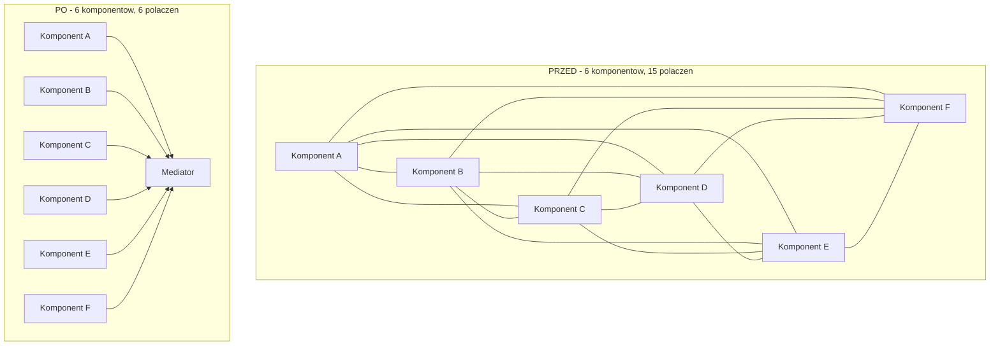
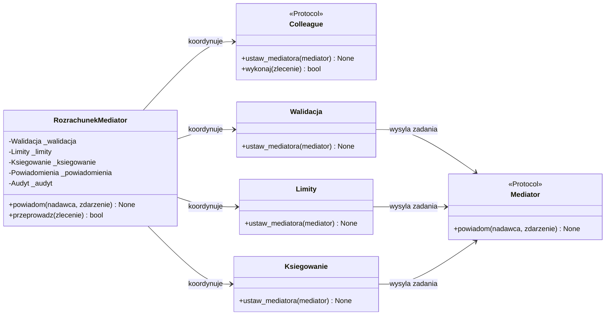
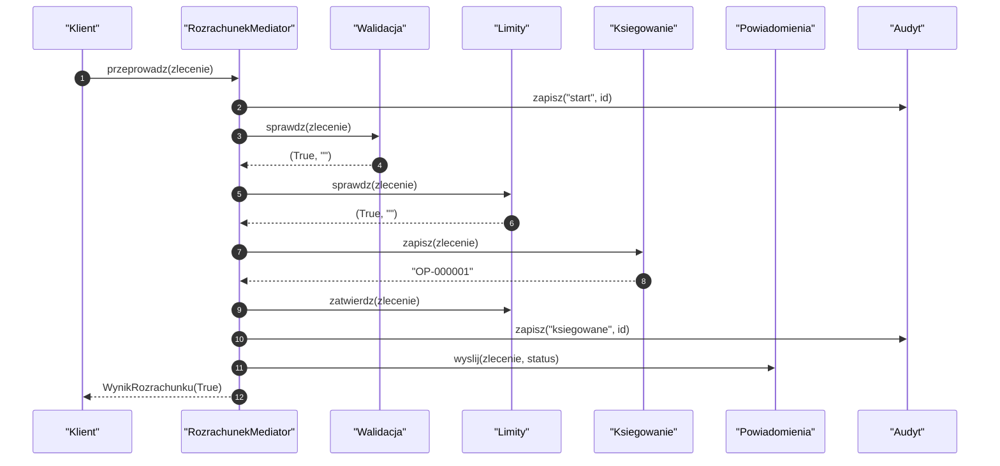
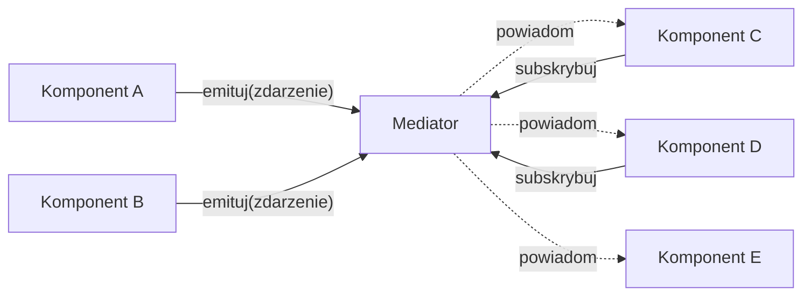
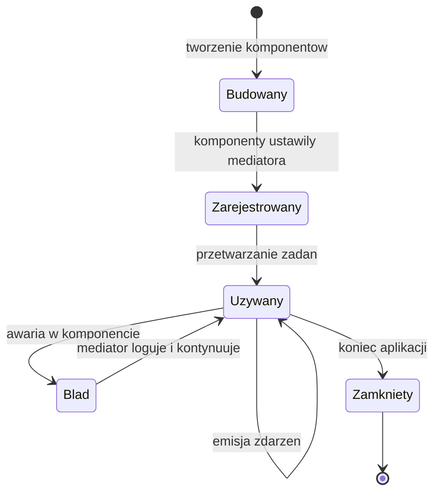
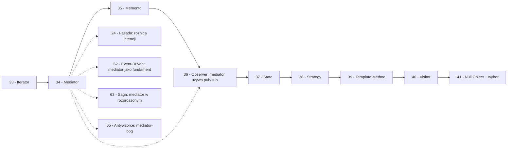

```markdown
---
modul: 34 — Mediator
plik: 34-mediator.md
poziom: zaawansowany
wymaga: [33]
czas: ~185 minut czytania + ~430 minut ćwiczeń
---

# Moduł 34 — Mediator — hub komunikacji, który likwiduje sieć połączeń

> **TL;DR**
> - **Mediator (mediator)** hermetyzuje sposób, w jaki wiele obiektów ze sobą współdziała — zamiast **N×N** bezpośrednich połączeń, obiekty komunikują się przez **jeden centralny punkt**.
> - Klasyczny efekt: **6 komponentów** połączonych bezpośrednio to **15 połączeń**; z mediatorem — **6**. Złożoność spada z $O(N^2)$ na $O(N)$.
> - Mediator to nie tylko „hub" — on **koordynuje**: zna reguły współpracy, decyduje o kolejności, orkiestruje. Bez logiki to nie mediator, a zwykły event bus.
> - W Pythonie mediatorem bywa **funkcja z rejestrem handlerów**, `blinker`, sygnały Django, `queue` + dispatcher — a najczęstszy wariant łączy mediator z obserwatorem (pub/sub wewnątrz).
> - Główne ryzyko: **mediator-bóg** — obiekt, do którego wpada cała logika, stając się nowym monolitem; drugie ryzyko — sam mediator jest trudny do testowania w scenariuszach wielopodmiotowych.

---

## 0. Model mentalny

### Kontrola lotów na lotnisku

Wyobraź sobie duże lotnisko: cztery pasy startowe, dwie wieże, pół setki samolotów na ziemi i w powietrzu. Wyobraź sobie teraz, że **nie ma kontroli lotów**. Każdy pilot musi sam ustalić z pozostałymi, kto startuje pierwszy, kto ląduje, kto zajmuje który pas, kto ustępuje drogi, kto krąży w holdingu. Wyobraź sobie komunikację: pilot Jumbo Jet kontaktuje się z Cessną, z dwoma Airbusami, z samolotem cargo, z helikopterem ratunkowym. I Cessna też kontaktuje się ze wszystkimi. I Airbus. Każdy z każdym. **N samolotów to N×(N-1)/2 par rozmów** — dla 20 samolotów to 190 par. Dla 50 samolotów — 1225 par. To oczywisty chaos, który zabiłby system w kilka minut.

Teraz wprowadź **kontrolę lotów**. Piloci nie rozmawiają między sobą. Każdy rozmawia **tylko z wieżą**. Mówi: „Jestem na wysokości 3000 metrów, proszę o pozwolenie na lądowanie". Wieża odpowiada: „Czekaj, Cessna ląduje pierwsza. Wchodzisz w holding na 4000". Wieża **koordynuje**: zna całą sytuację, ustala kolejność, decyduje, dzieli pasy, informuje wszystkich zainteresowanych. Piloci nie muszą znać innych samolotów — wystarczy, że znają wieżę.

Zatrzymaj się przy trzech własnościach tej zmiany. Po pierwsze: **liczba połączeń spada drastycznie**. Zamiast każdego z każdym — każdy z wieżą. Zamiast iloczynu — liniowy wzrost. Po drugie: **każdy ma teraz mniej wiedzy**. Pilot wie tylko, jak rozmawiać z wieżą — nie wie nic o innych samolotach, ich trasach, ich priorytetach. Ta wiedza jest **w jednym miejscu**: w wieży. Po trzecie: **wieża ma logikę, której nie miał żaden pilot**. To nie jest tylko „przekaźnik". Ona **rozstrzyga konflikty, planuje, prowadzi porządek**. To jest sedno Mediatora — to nie kabel między stronami, to **koordynator z regułami**.

Ale zwróć uwagę na jeszcze jedną rzecz, która pokazuje ryzyko. Gdyby wieża zaczęła robić **wszystko** — nie tylko ustalać kolejność, ale też decydować o paliwie, o pasażerach, o cateringu, o obsłudze technicznej — stałaby się jednym, przytłaczającym centrum. Każda nowa funkcja „bo tak wygodnie dopisać do wieży". Po dwóch latach wieża ma 40 działów i **nikt jej nie rozumie**. To jest druga twarz Mediatora — potencjał stania się **boskim obiektem**. Wróćmy do tego w sekcji 8.

| W analogii kontroli lotów | W kodzie |
|---|---|
| Samolot | `Colleague` (komponent) |
| Pilot | Logika w komponencie |
| Wieża kontroli | `Mediator` (interfejs) |
| Konkretna wieża (np. Warszawa) | `ConcreteMediator` |
| „Proszę o pozwolenie na lądowanie" | Zdarzenie/żądanie wysłane do mediatora |
| „Czekaj, Cessna ląduje pierwsza" | Odpowiedź mediatora |
| Wieża ustalająca kolejność | Logika koordynacji w mediatorze |
| Brak komunikacji pilotów między sobą | Komponenty nie znają się wzajemnie |
| Przeciążenie wieży | **Mediator-bóg** |

> 🧠 **Zapamiętaj** — **Mediator (mediator) to wzorzec behawioralny, który hermetyzuje sposób, w jaki wiele obiektów ze sobą współdziała, tak aby nie odwoływały się do siebie bezpośrednio — koncentruje komunikację w jednym punkcie, który zna reguły koordynacji i rozdziela odpowiedzialność za nią.**

Zwróć uwagę na trzy słowa: **hermetyzuje**, **koordynuje**, **rozprasza**. „Hermetyzuje" — bo komunikacja jest zamknięta w mediatorze, nie rozproszona. „Koordynuje" — bo mediator nie tylko przekazuje, ale stosuje logikę. „Rozprasza" — w sensie „rozprasza złożoność" — komponenty są prostsze, bo nie muszą znać innych.

### Diagram — intuicja N×N vs mediacja



*Diagram pokazuje dramatyczną różnicę: przed — każdy komponent zna każdy inny (15 połączeń dla 6 elementów); po — każdy zna tylko mediator (6 połączeń).*

### Czego Mediator NIE robi

Rozbrójmy kilka nieporozumień — bo Mediator bywa mylony z kilkoma innymi wzorcami.

**Nie jest event busem.** Event bus (moduł 62) przekazuje zdarzenia z nadawcy do subskrybentów, zwykle bez logiki — jest infrastrukturą dystrybucji. Mediator **koordynuje**, zna reguły, decyduje. Event bus jest pasywny, mediator jest aktywny. W praktyce bardzo często łączone — mediator używa event busa jako mechanizmu — ale to nie jest to samo.

**Nie jest Obserwatorem.** Observer (moduł 36) to jeden-do-wielu — subjekt powiadamia obserwatorów o zmianie stanu. Mediator to wiele-do-wielu z koordynacją — komponenty wysyłają żądania do mediatora, mediator rozdziela, czasem w konkretny sposób. Różnica jest w intencji: Observer **powiadamia**, Mediator **koordynuje**.

**Nie jest Fasadą.** Facade (moduł 24) upraszcza dostęp do **podsystemu** — agreguje kilka obiektów w jeden interfejs. Mediator **koordynuje komunikację między równorzędnymi** komponentami. Facade jest jednokierunkowy (klient → facade → podsystem), Mediator jest dwukierunkowy (komponenty ↔ mediator). Facade zwykle **nie ma logiki koordynacji** — tylko przekazuje.

**Nie jest Proxy ani Adapterem.** Tam mieliśmy dwóch uczestników (klient i opakowany obiekt). Mediator obsługuje **wielu** uczestników.

**Nie jest darmowy.** Mediator centralizuje komunikację, ale to też centralizuje **złożoność**. Logika, która wcześniej była w komponentach (rozproszona, trudna do zarządzania), trafia do mediatora (skoncentrowana, ale może puchnąć). To wymiana jednej wady na inną — i czasem wada mediatora jest gorsza niż rozproszenie.

**Nie jest lekarstwem na wszystkie problemy komunikacji.** Jeśli komponenty nie muszą być **koordynowane** — tylko powiadamiane — użyj Obserwatora. Jeśli nie muszą być nadzorowane — daj im się komunikować bezpośrednio. Mediator ma sens, gdy **naprawdę** istnieje potrzeba koordynacji.

---

## 1. Problem, który rozwiązujemy

Wejdźmy w domenę 💳 „Rozrachunku". System obsługuje zlecenia płatności i ma kilka współpracujących modułów:
- **Walidacja** — sprawdza poprawność zleceń,
- **Limity** — sprawdza limity dzienne i per-transakcja,
- **Księgowanie** — zapisuje do księgi,
- **Powiadomienia** — wysyła komunikaty do klienta,
- **Audyt** — loguje operacje,
- **Monitoring** — mierzy czasy i metryki.

Ktoś napisał te moduły tak, że każdy **zna** pozostałe.

### Kod „przed"

```python
# rozrachunek_v0.py — wersja naiwna, demonstracyjna
# UWAGA: kod celowo pokazuje problem N×N polaczen.

from dataclasses import dataclass
from decimal import Decimal
from datetime import datetime, timezone


@dataclass(frozen=True)
class Zlecenie:
    identyfikator: str
    kwota: Decimal
    waluta: str
    klient_id: str


class Walidacja:
    def sprawdz(self, zlecenie: Zlecenie) -> bool:
        if zlecenie.kwota <= 0:
            return False
        if zlecenie.waluta not in ("PLN", "EUR", "USD"):
            return False
        return True


class Limity:
    def __init__(self) -> None:
        self._wykorzystano = Decimal("0")

    def sprawdz(self, zlecenie: Zlecenie) -> bool:
        return self._wykorzystano + zlecenie.kwota <= Decimal("100000")


class Ksiegowanie:
    def zapisz(self, zlecenie: Zlecenie) -> None:
        print(f"[KSIEGA] {zlecenie.identyfikator}")


class Powiadomienia:
    def wyslij(self, zlecenie: Zlecenie, status: str) -> None:
        print(f"[POWIADOM] {zlecenie.klient_id}: {status}")


class Audyt:
    def zapisz(self, operacja: str, zlecenie: Zlecenie) -> None:
        print(f"[AUDYT] {operacja} {zlecenie.identyfikator}")


class Monitoring:
    def mierz(self, operacja: str, czas: float) -> None:
        print(f"[MONITORING] {operacja}: {czas:.4f}s")


class Rozrachunek:
    """Wszystkie moduly zna wszystkie - kazdy wywoluje pozostale bezposrednio."""

    def __init__(self) -> None:
        self.walidacja = Walidacja()
        self.limity = Limity()
        self.ksiegowanie = Ksiegowanie()
        self.powiadomienia = Powiadomienia()
        self.audyt = Audyt()
        self.monitoring = Monitoring()

    def przeprowadz(self, zlecenie: Zlecenie) -> bool:
        import time
        start = time.perf_counter()
        self.audyt.zapisz("start", zlecenie)
        self.monitoring.mierz("start", 0.0)

        if not self.walidacja.sprawdz(zlecenie):
            self.audyt.zapisz("walidacja_fail", zlecenie)
            self.powiadomienia.wyslij(zlecenie, "odrzucone: walidacja")
            return False

        if not self.limity.sprawdz(zlecenie):
            self.audyt.zapisz("limit_fail", zlecenie)
            self.powiadomienia.wyslij(zlecenie, "odrzucone: limit")
            return False

        self.ksiegowanie.zapisz(zlecenie)
        self.audyt.zapisz("ksiegowane", zlecenie)
        self.powiadomienia.wyslij(zlecenie, "zrealizowane")

        czas = time.perf_counter() - start
        self.monitoring.mierz("koniec", czas)
        return True


if __name__ == "__main__":
    rozrachunek = Rozrachunek()
    zlecenie = Zlecenie("Z-1", Decimal("500.00"), "PLN", "K-1")
    print(rozrachunek.przeprowadz(zlecenie))
```

Ten kod działa, ale **każdy z komponentów** (albo „Rozrachunek" jako ich reprezentant) **wywołuje pozostałe bezpośrednio**. W obecnej wersji widać 6 komponentów, które wzajemnie się znają — a w systemie produkcyjnym to zwykle znacznie więcej.

### Code smell — sieć N×N połączeń

| Problem | Gdzie | Konsekwencja |
|---|---|---|
| Komponenty znają się nawzajem | `Rozrachunek.__init__` | Każdy nowy komponent wymaga zmian w istniejących |
| Logika orkiestracji w jednej klasie | `Rozrachunek.przeprowadz` | Klasa rośnie z każdym nowym krokiem |
| `if not self.walidacja.sprawdz(...)` — komponent A zna B | W metodzie | Dodanie C — kolejny `if` i kolejne wywołanie |
| Brak kontraktu między komponentami | Bezpośrednie wywołania konkretnych metod | Zmiana nazwy metody w komponencie łamie wszystkich |
| Kolejność kroków zaszyta w metodzie | Sekwencja wywołań | Zmiana kolejności = modyfikacja kodu |
| Trudno dodać „kondycjonalne" kroki | Zagnieżdżone `if`-y | Jak „jeśli kwota > 5000 to dodatkowa weryfikacja" |
| Nie da się użyć komponentu osobno | Zawsze przez Rozrachunek | Każdy test wymaga pełnej konfiguracji |
| Komponenty nie są testowalne w izolacji | Bo wywołują siebie nawzajem | Trudne testy |

### Objawy — poznasz ten problem po tym, że...

- **Dodanie nowego komponentu wymaga zmian w wielu istniejących.** Nowy „AML" — musisz go wpiąć w `Rozrachunek`, w każde inne miejsce, gdzie jest wywoływany.
- **W klasie orkiestrującej jest 15 wywołań bezpośrednich.** Każdy komponent wywołuje pozostałe.
- **Komponenty nie mogą być użyte osobno.** Każdy potrzebuje kontekstu — całego systemu.
- **Nazwy metod komponentów pojawiają się w wielu miejscach** (`self.walidacja.sprawdz`, `self.limity.sprawdz`, ...).
- **Nie można łatwo dodać „logiki rozgałęzionej".** Np. `if kwota > 5000: uruchom_extra_weryfikacje()` — trzeba wejść do orkiestratora.
- **Testy są trudne do napisania.** Żeby przetestować samą walidację, trzeba uruchomić cały system.
- **W kodzie jest matryca zależności.** „Kto kogo woła" jest trudne do prześledzenia.
- **Nie można zbudować alternatywnej kolejności kroków.** A czasem potrzebne (np. „tryb ekspresowy" pomijający księgowanie).
- **Każda zmiana w systemie dotyka klasy orkiestrującej.** To znak, że klasa wie zbyt wiele o zbyt wielu.
- **Nazwy `Rozrachunek`, `Orkiestrator`, `Koordynator`, `Manager`** — to sygnał, że brakuje nazwanego mediatora.

---

## 2. Anatomia wzorca

### Uczestnicy

| Rola | Odpowiedzialność | Co NIE jest jej zadaniem |
|---|---|---|
| **Mediator (interfejs)** | Definiuje kontrakt komunikacji — metody, przez które komponenty wysyłają żądania i otrzymują odpowiedzi | Nie zawiera logiki koordynacji; definiuje tylko interfejs |
| **ConcreteMediator (mediator konkretny)** | Zna wszystkich `Colleague`ów; koordynuje ich; zawiera logikę przepływu, kolejności, decyzji | Nie wykonuje samodzielnie pracy komponentów; deleguje do nich |
| **Colleague (komponent)** | Zna mediatora (zwykle przez interfejs); wysyła do niego żądania; nie zna innych komponentów | Nie wywołuje innych komponentów bezpośrednio; nie zawiera logiki koordynacji |
| **Klient / użytkownik systemu** | Buduje komponenty i mediatora, konfiguruje ich wzajemne powiązania (często raz, przy starcie) | Nie orkiestruje w runtime; to zadanie mediatora |

Kluczowa asymetria: **komponenty znają mediatora**, ale **mediator zna komponenty**. Odwrotnie niż w większości wzorców (np. w Observer subjekt nie zna obserwatorów). W Mediatorze to mediator **jest** tym, który wie wszystko — i dlatego może koordynować. To jest też źródło głównego ryzyka: jeśli mediator wie za dużo, staje się bogiem.

### Diagram struktury



*Diagram pokazuje, że mediator (po prawej roli struktury) zna wszystkie komponenty, ale komponenty znają tylko kontrakt mediatora — jedno połączenie w każdym kierunku, w miejsce sieci N×N.*

Przeczytajmy ten diagram zdanie po zdaniu. `Mediator` to **interfejs** — jedno miejsce komunikacji. `RozrachunekMediator` to **konkretny mediator** — koordynuje wszystkie komponenty, zna ich i wymienia między nimi żądania.

`Colleague` to **interfejs komponentu** — umożliwia „ustaw mediatora" i „wykonaj operację". Każdy konkretny komponent (`Walidacja`, `Limity`, `Ksiegowanie`) implementuje ten kontrakt.

Kluczowe strzałki: `Walidacja --> Mediator` (komponent wysyła do mediatora), `RozrachunekMediator --> Walidacja` (mediator koordynuje z konkretnym komponentem). **Każdy komponent ma tylko jedną zależność w obie strony — z mediatorem**. To redukcja N×N → N.

### Warianty: klasyczny vs pythoniczny

| Aspekt | Klasyczny (GoF) | Pythoniczny |
|---|---|---|
| Mediator | Klasa ABC z `notify(sender, event)` | `Protocol` z `powiadom` albo funkcja |
| ConcreteMediator | Klasa z referencjami do wszystkich komponentów | Obiekt z rejestrem handlerów |
| Colleague | Klasa z referencją do mediatora | Klasa z `mediator` w konstruktorze |
| Rejestracja | Ręczne przypisanie do pola | `@register` dekorator lub `dict` |
| Powiadomienie | Metoda mediatora | Event bus / callbacki |
| Wariant bitwy | Bezpośrednie wywołania | `queue.Queue` + dispatcher |

W Pythonie Mediator **bardzo często nie jest klasą** — jest **funkcją z rejestrem handlerów**, **event busem**, **sygnałem Django**, **dispatcherem**. Pełna klasa Mediator z metodami per-zdarzenie bywa przesadą — zwłaszcza gdy zdarzeń jest niewiele.

Często spotykany wariant to **Mediator-Observer**: mediator wewnątrz używa obserwatorów (subskrypcji po zdarzeniu), ale zewnętrznie ma API mediatora. To najczęstsza realizacja w kodzie produkcyjnym — o tym w sekcji 4.

---

## 3. Implementacja krok po kroku

Przebudujemy system z sekcji 1 stopniowo, przechodząc od „każdy z każdym" do pełnego mediatora.

### Krok 1 — Zidentyfikuj komponenty i ich interfejsy

Zanim wprowadzimy mediatora, musimy ustalić **kontrakt komponentu**. To nie jest ten sam kontrakt dla każdego — ale każdy musi mieć możliwość „ustaw mediatora" i jakąś operację biznesową.

```python
from typing import Protocol, runtime_checkable
from decimal import Decimal
from dataclasses import dataclass


@dataclass(frozen=True, slots=True)
class Zlecenie:
    identyfikator: str
    kwota: Decimal
    waluta: str
    klient_id: str


@runtime_checkable
class Komponent(Protocol):
    """Kontrakt komponentu w systemie z mediatorem."""

    nazwa: str

    def ustaw_mediatora(self, mediator: "MediatorRozrachunku") -> None: ...
```

**Uwaga:** kontrakt NIE zawiera „wykonaj" — bo każdy komponent ma inną operację (`sprawdz`, `zapisz`, `wyslij`). Wspólny jest tylko fakt, że komponent **zna mediatora**. Różnice są w logice biznesowej.

### Krok 2 — Zdefiniuj kontrakt mediatora

Mediator musi umieć **przyjmować powiadomienia** od komponentów.

```python
@runtime_checkable
class MediatorRozrachunku(Protocol):
    """Kontrakt mediatora: przyjmuje powiadomienia od komponentow."""

    def powiadom(self, nadawca: Komponent, zdarzenie: str) -> None: ...
```

Dwa parametry: `nadawca` (komponent, który zgłasza) i `zdarzenie` (co się stało). Czasem dodaje się trzeci — kontekst (dane). Dla prostych przypadków dwóch wystarczy.

### Krok 3 — Zaimplementuj komponenty

Każdy komponent **nie zna innych** — zna tylko mediatora.

```python
class Walidacja:
    nazwa = "walidacja"

    def __init__(self) -> None:
        self._mediator: MediatorRozrachunku | None = None

    def ustaw_mediatora(self, mediator: "MediatorRozrachunku") -> None:
        self._mediator = mediator

    def sprawdz(self, zlecenie: Zlecenie) -> bool:
        """Sprawdza podstawowa poprawnosc zlecenia."""
        return (
            zlecenie.kwota > 0
            and zlecenie.waluta in ("PLN", "EUR", "USD")
        )


class Limity:
    nazwa = "limity"

    def __init__(self) -> None:
        self._mediator: MediatorRozrachunku | None = None
        self._wykorzystano = Decimal("0")

    def ustaw_mediatora(self, mediator: "MediatorRozrachunku") -> None:
        self._mediator = mediator

    def sprawdz(self, zlecenie: Zlecenie) -> bool:
        return self._wykorzystano + zlecenie.kwota <= Decimal("100000")

    def zaksięguj(self, zlecenie: Zlecenie) -> None:
        self._wykorzystano += zlecenie.kwota


class Ksiegowanie:
    nazwa = "ksiegowanie"

    def __init__(self) -> None:
        self._mediator: MediatorRozrachunku | None = None

    def ustaw_mediatora(self, mediator: "MediatorRozrachunku") -> None:
        self._mediator = mediator

    def zapisz(self, zlecenie: Zlecenie) -> str:
        """Zapisuje zlecenie i zwraca numer operacji."""
        return f"OP-{zlecenie.identyfikator}"


class Powiadomienia:
    nazwa = "powiadomienia"

    def __init__(self) -> None:
        self._mediator: MediatorRozrachunku | None = None

    def ustaw_mediatora(self, mediator: "MediatorRozrachunku") -> None:
        self._mediator = mediator

    def wyslij(self, zlecenie: Zlecenie, status: str) -> None:
        print(f"[POWIADOM] {zlecenie.klient_id}: {status}")


class Audyt:
    nazwa = "audyt"

    def __init__(self) -> None:
        self._mediator: MediatorRozrachunku | None = None
        self.wpisy: list[tuple[str, str]] = []

    def ustaw_mediatora(self, mediator: "MediatorRozrachunku") -> None:
        self._mediator = mediator

    def zapisz(self, operacja: str, identyfikator: str) -> None:
        self.wpisy.append((operacja, identyfikator))
```

Zwróć uwagę na kluczową własność: **każdy komponent ma `ustaw_mediatora`**, ale **nie ma metod wywołujących inne komponenty**. Komponenty są „głupie" — znają tylko swój fach i mediatora.

### Krok 4 — Zaimplementuj konkretnego mediatora

Mediator **koordynuje**. Zna wszystkie komponenty i logikę przepływu.

```python
class RozrachunekMediator:
    """Konkretny mediator: koordynuje komponenty rozrachunku."""

    def __init__(
        self,
        walidacja: Walidacja,
        limity: Limity,
        ksiegowanie: Ksiegowanie,
        powiadomienia: Powiadomienia,
        audyt: Audyt,
    ) -> None:
        self._walidacja = walidacja
        self._limity = limity
        self._ksiegowanie = ksiegowanie
        self._powiadomienia = powiadomienia
        self._audyt = audyt
        # Podlaczamy sie jako mediator
        for k in (walidacja, limity, ksiegowanie, powiadomienia, audyt):
            k.ustaw_mediatora(self)

    def powiadom(self, nadawca: Komponent, zdarzenie: str) -> None:
        # W tej wersji mediator sam orkiestruje - zdarzenia nie sa tu uzywane.
        # Ale zgodnie z protokolem musimy miec metode powiadom.
        # W bardziej rozbudowanych implementacjach mediator uzywa jej do reakcji.
        pass

    def przeprowadz(self, zlecenie: Zlecenie) -> bool:
        self._audyt.zapisz("start", zlecenie.identyfikator)

        if not self._walidacja.sprawdz(zlecenie):
            self._audyt.zapisz("walidacja_fail", zlecenie.identyfikator)
            self._powiadomienia.wyslij(zlecenie, "odrzucone: walidacja")
            return False

        if not self._limity.sprawdz(zlecenie):
            self._audyt.zapisz("limit_fail", zlecenie.identyfikator)
            self._powiadomienia.wyslij(zlecenie, "odrzucone: limit")
            return False

        numer = self._ksiegowanie.zapisz(zlecenie)
        self._limity.zaksięguj(zlecenie)
        self._audyt.zapisz("ksiegowane", zlecenie.identyfikator)
        self._powiadomienia.wyslij(zlecenie, f"zrealizowane ({numer})")
        return True
```

W tej wersji mediator sam wywołuje komponenty. **Metoda `powiadom` nie jest jeszcze używana** — pokazuje, że mediator może działać w dwóch trybach: (a) **aktywnym** — sam orkiestruje, (b) **reaktywnym** — reaguje na zdarzenia od komponentów. Nasza wersja jest aktywna.

### Krok 5 — Budowa z użyciem mediatora

```python
def zbuduj_mediatora() -> RozrachunekMediator:
    return RozrachunekMediator(
        walidacja=Walidacja(),
        limity=Limity(),
        ksiegowanie=Ksiegowanie(),
        powiadomienia=Powiadomienia(),
        audyt=Audyt(),
    )


# Uzycie:
mediator = zbuduj_mediatora()
zlecenie = Zlecenie("Z-1", Decimal("500.00"), "PLN", "K-1")
mediator.przeprowadz(zlecenie)
```

Zwróć uwagę: **klient nie tworzy ani nie wywołuje komponentów**. Wywołuje mediatora. Mediator ma wszystko pod kontrolą.

### Krok 6 — Wariant reaktywny (poszerzenie)

W dużych systemach mediator bywa **reaktywny** — reaguje na zdarzenia zgłoszone przez komponenty, a nie wymusza kolejności odgórnie.

```python
class RozrachunekMediatorReaktywny:
    """Mediator reaktywny: reaguje na zdarzenia zgłaszane przez komponenty."""

    def __init__(self) -> None:
        self._komponenty: dict[str, Komponent] = {}
        self._observer: dict[str, list[Komponent]] = {}

    def zarejestruj(self, komponent: Komponent) -> None:
        self._komponenty[komponent.nazwa] = komponent
        komponent.ustaw_mediatora(self)  # type: ignore[attr-defined]

    def subskrybuj(self, zdarzenie: str, komponent: Komponent) -> None:
        self._observer.setdefault(zdarzenie, []).append(komponent)

    def powiadom(self, nadawca: Komponent, zdarzenie: str) -> None:
        for odbiorca in self._observer.get(zdarzenie, []):
            if odbiorca is not nadawca:
                # odbiorca reaguje
                handler = getattr(odbiorca, "reaguj", None)
                if handler:
                    handler(nadawca, zdarzenie)


# Komponenty moga w swojej logice wolac mediatora:
#   self._mediator.powiadom(self, "zlecenie_zwalidowane")
```

Wariant reaktywny łączy Mediator z Obserwatorem. Mediator pełni rolę **kanału komunikacji**, ale komponenty wywołują zdarzenia w swoim czasie. To częstszy wzorzec w systemach produkcyjnych.

### Krok 7 — Weryfikacja

| Kryterium | Wersja „przed" | Wersja „po" |
|---|---|---|
| Liczba połączeń między N komponentami | N × (N-1) / 2 (15 dla 6) | N (6 dla 6) |
| Komponenty znają innych | Tak | Nie |
| Dodanie nowego komponentu | Zmiana w klasie orkiestrującej | Rejestracja w mediatorze |
| Testy pojedynczego komponentu | Wymagają pełnego systemu | Komponent testowalny sam |
| Logika koordynacji | W klasie oryginalnej i w komponentach | W mediatorze |
| Elastyczność kolejności | Ograniczona | W mediatorze |
| Liczba klas | 7 | 8 (doszedł mediator) |

Koszt: dodatkowa klasa `RozrachunekMediator`, dodatkowa warstwa pośrednictwa. Zysk: **komponenty są niezależne od siebie**, mediator jest jedynym miejscem logiki koordynacji.

---

## 4. Wersje pythoniczne i warianty

W Pythonie Mediator ma **kilka bardzo odmiennych realizacji**. Wybór zależy od tego, czy potrzebujesz jawnej koordynacji, czy tylko przekazywania zdarzeń.

### 4.1 Klasa mediatora (klasyczna) — jak wyżej

Zalety: jawna struktura, łatwo zobaczyć, jak wygląda koordynacja, sensowna dla złożonej logiki. Wady: wymaga referencji do wszystkich komponentów — mediator jest uzależniony od ich zestawu.

### 4.2 Mediator jako funkcja z rejestrem handlerów

Bardzo pythoniczne: **funkcja** przyjmująca zdarzenie i wywołująca odpowiednie handlery.

```python
from collections.abc import Callable
from collections import defaultdict


class EventBus:
    """Mediator jako event bus: rejestr handlerow na zdarzenia."""

    def __init__(self) -> None:
        self._handlers: dict[str, list[Callable]] = defaultdict(list)

    def subskrybuj(self, zdarzenie: str, handler: Callable) -> None:
        self._handlers[zdarzenie].append(handler)

    def emituj(self, zdarzenie: str, dane=None) -> None:
        for handler in self._handlers.get(zdarzenie, []):
            handler(dane)


bus = EventBus()
bus.subskrybuj("zlecenie_utworzone", lambda z: print(f"Nadano: {z}"))
bus.emituj("zlecenie_utworzone", "Z-1")
```

Zalety: prostota, brak hierarchii, łatwe rozszerzanie. Wady: brak **aktywnej koordynacji** — to raczej infrastruktura pub/sub niż pełny Mediator. Nazwa „mediator" bywa używana umownie.

### 4.3 Mediator jako `queue` + dispatcher

Mediator może być **kolejką poleceń** z dyspatcherem — każdy komponent zamiast wołać innych, wrzuca zdarzenie do kolejki.

```python
import queue
import threading


class MediatorKolejkowy:
    def __init__(self) -> None:
        self._kolejka: queue.Queue = queue.Queue()
        self._handlers: dict[str, Callable] = {}
        self._worker = threading.Thread(target=self._petla, daemon=True)
        self._worker.start()
        self._zamkniete = False

    def zarejestruj(self, zdarzenie: str, handler: Callable) -> None:
        self._handlers[zdarzenie] = handler

    def emituj(self, zdarzenie: str, dane=None) -> None:
        self._kolejka.put((zdarzenie, dane))

    def _petla(self) -> None:
        while not self._zamkniete:
            try:
                zdarzenie, dane = self._kolejka.get(timeout=0.1)
            except queue.Empty:
                continue
            handler = self._handlers.get(zdarzenie)
            if handler:
                try:
                    handler(dane)
                except Exception as blad:
                    print(f"[MEDIATOR] blad: {blad}")
            self._kolejka.task_done()

    def zamknij(self) -> None:
        self._zamkniete = True
        self._worker.join(timeout=2.0)
```

To wariant **asynchroniczny** — komunikacja odroczona, kolejkowana. Sensowny dla systemów o wysokim ruchu, gdzie nie chcemy, żeby jeden komponent blokował drugi.

### 4.4 Mediator jako `blinker` — realna biblioteka

`blinker` to popularna biblioteka sygnałów. Można ją używać jako mediatora.

```python
# Przyklad - wymaga pip install blinker
from blinker import Signal

# Sygnaly jako kanaly komunikacji
zlecenie_utworzone = Signal("zlecenie-utworzone")
zlecenie_zrealizowane = Signal("zlecenie-zrealizowane")


def log_zlecenia(sender, **kwargs):
    print(f"[LOG] {sender} -> {kwargs}")


zlecenie_utworzone.connect(log_zlecenia)
zlecenie_utworzone.send("walidacja", zlecenie_id="Z-1")
```

Zalety: gotowe, sprawdzone, wspiera słabe referencje (`weak=False/True`), integruje się z Flask/Django. Wady: external dependency; nie jest „mediatorem" w sensie koordynacji — to raczej pub/sub.

### 4.5 Sygnały Django

Django ma wbudowane sygnały — to forma mediatora dla ekosystemu Django.

```python
from django.db.models.signals import post_save
from django.dispatch import receiver


@receiver(post_save, sender=ZlecenieModel)
def po_zapisaniu_zlecenia(sender, instance, created, **kwargs):
    if created:
        # Powiadom audyt, monitoring, etc.
        ...
```

To realizacja **Mediatora-Obserwatora** — Django dostarcza infrastrukturę sygnałów, a deweloperzy ją wykorzystują do koordynacji. To pokazuje, jak Mediator przenika frameworki.

### 4.6 Mediator-Observer (najczęstszy wariant)

**Najczęstszy w praktyce**: mediator wewnątrz używa subskrypcji po zdarzeniach, ale zewnętrznie ma API zorientowane na komponenty.

```python
class MediatorHybrydowy:
    """Mediator + Observer: mediator zarzadza subskrypcjami i koordynuje."""

    def __init__(self) -> None:
        self._subskrybenci: dict[str, list[Callable]] = {}
        self._komponenty: dict[str, object] = {}

    def zarejestruj(self, komponent) -> None:
        self._komponenty[komponent.nazwa] = komponent
        komponent.ustaw_mediatora(self)

    def subskrybuj(self, komponent, zdarzenie: str) -> None:
        self._subskrybenci.setdefault(zdarzenie, []).append(komponent)

    def emituj(self, nadawca, zdarzenie: str, dane=None) -> None:
        for odbiorca in self._subskrybenci.get(zdarzenie, []):
            if odbiorca is nadawca:
                continue
            odbiorca.otrzymaj(nadawca, zdarzenie, dane)

    def koordynuj(self, operacja: str, dane) -> None:
        """Metody koordynujace - wysoko poziomowe.
        Tu mediator ma logike, a nie tylko przekazywanie zdarzen.
        """
        if operacja == "rozrachunek":
            self._rozrachunek(dane)

    def _rozrachunek(self, zlecenie) -> None:
        # Mediator wywoluje komponenty w ustalonej kolejnosci
        ...
```

Ten wariant jest najbardziej elastyczny: mediator **jednocześnie** ma API koordynacji (jak `_rozrachunek`), **i** pozwala na subskrypcję zdarzeń. To połączenie dwóch wzorców daje pełną elastyczność — mediator może orkiestrować albo reagować na zdarzenia.

### 4.7 Podsumowanie — tabela wyboru

| Sytuacja | Wariant |
|---|---|
| Złożona logika koordynacji, znane komponenty | Klasa mediatora (4.1) |
| Proste zdarzenia, brak koordynacji | Funkcja z rejestrem (4.2) |
| Asynchroniczna komunikacja | `queue` + dispatcher (4.3) |
| Ekosystem Flask/Django | Sygnały / `blinker` (4.4, 4.5) |
| Mieszane: zdarzenia + koordynacja | Mediator-Observer (4.6) |
| Komponenty plug-in, rozszerzalność | Event bus (4.2 / 4.6) |

> 🧠 **Zapamiętaj** — W Pythonie **najczęściej nie pisze się klasy `Mediator`** — tworzy się **event bus**, **sygnał Django**, **własny dispatcher**. Pełna klasa mediatora jest potrzebna tylko wtedy, gdy masz **konkretną logikę koordynacji** do wyrażenia.

---

## 5. Przykład z życia: 💳 Rozrachunek — pełny uruchamialny kod

Zbudujemy pełny system rozrachunku z mediatorem. Komponenty: walidacja, limity, księgowanie, powiadomienia, audyt, monitoring. Mediator orkiestruje.

### Kod

```python
# rozrachunek_mediator.py — pelny przyklad Mediator
from __future__ import annotations

import time
from collections import defaultdict
from collections.abc import Callable
from dataclasses import dataclass, field
from decimal import Decimal
from typing import Protocol, runtime_checkable


# ===========================================================================
# 1. Typy domenowe
# ===========================================================================

@dataclass(frozen=True, slots=True)
class Zlecenie:
    identyfikator: str
    kwota: Decimal
    waluta: str
    klient_id: str
    czy_ekspresowe: bool = False


@dataclass(frozen=True, slots=True)
class WynikRozrachunku:
    identyfikator: str
    zrealizowane: bool
    numer_operacji: str
    czas_ms: float
    powody: tuple[str, ...] = ()

    def __str__(self) -> str:
        status = "OK" if self.zrealizowane else "BLAD"
        return (
            f"[{status}] {self.identyfikator} ({self.czas_ms:.2f}ms)"
            + (f" - {'; '.join(self.powody)}" if self.powody else "")
        )


# ===========================================================================
# 2. Kontrakty: Komponent i Mediator
# ===========================================================================

@runtime_checkable
class Mediator(Protocol):
    """Kontrakt mediatora: przyjmuje zdarzenia od komponentow."""

    def powiadom(self, nadawca: "Komponent", zdarzenie: str, dane: object) -> None: ...


@runtime_checkable
class Komponent(Protocol):
    """Kontrakt komponentu: ma nazwe i przyjmuje mediatora."""

    nazwa: str

    def ustaw_mediatora(self, mediator: Mediator) -> None: ...


# ===========================================================================
# 3. Komponenty
# ===========================================================================

class Walidacja:
    nazwa = "walidacja"

    def __init__(self) -> None:
        self._mediator: Mediator | None = None

    def ustaw_mediatora(self, mediator: Mediator) -> None:
        self._mediator = mediator

    def sprawdz(self, zlecenie: Zlecenie) -> tuple[bool, str]:
        if zlecenie.kwota <= 0:
            return False, "kwota musi byc dodatnia"
        if zlecenie.waluta not in ("PLN", "EUR", "USD"):
            return False, f"nieobslugiwana waluta: {zlecenie.waluta}"
        if not zlecenie.klient_id:
            return False, "brak identyfikatora klienta"
        return True, ""


class Limity:
    nazwa = "limity"

    def __init__(self, maks_dzienny: Decimal = Decimal("1000000")) -> None:
        self._mediator: Mediator | None = None
        self._maks = maks_dzienny
        self._wykorzystano = Decimal("0")

    def ustaw_mediatora(self, mediator: Mediator) -> None:
        self._mediator = mediator

    def sprawdz(self, zlecenie: Zlecenie) -> tuple[bool, str]:
        if self._wykorzystano + zlecenie.kwota > self._maks:
            return False, (
                f"przekroczony limit dzienny "
                f"({self._maks - self._wykorzystano} pozostalo)"
            )
        return True, ""

    def zatwierdz(self, zlecenie: Zlecenie) -> None:
        self._wykorzystano += zlecenie.kwota


class Ksiegowanie:
    nazwa = "ksiegowanie"

    def __init__(self) -> None:
        self._mediator: Mediator | None = None
        self._licznik = 0

    def ustaw_mediatora(self, mediator: Mediator) -> None:
        self._mediator = mediator

    def zapisz(self, zlecenie: Zlecenie) -> str:
        self._licznik += 1
        return f"OP-{self._licznik:06d}"


class Powiadomienia:
    nazwa = "powiadomienia"

    def __init__(self) -> None:
        self._mediator: Mediator | None = None
        self.wyslane: list[tuple[str, str]] = []

    def ustaw_mediatora(self, mediator: Mediator) -> None:
        self._mediator = mediator

    def wyslij(self, zlecenie: Zlecenie, status: str) -> None:
        self.wyslane.append((zlecenie.klient_id, status))


class Audyt:
    nazwa = "audyt"

    def __init__(self) -> None:
        self._mediator: Mediator | None = None
        self.wpisy: list[tuple[str, str]] = []

    def ustaw_mediatora(self, mediator: Mediator) -> None:
        self._mediator = mediator

    def zapisz(self, operacja: str, identyfikator: str) -> None:
        self.wpisy.append((operacja, identyfikator))


class Monitoring:
    nazwa = "monitoring"

    def __init__(self) -> None:
        self._mediator: Mediator | None = None
        self.metryki: list[tuple[str, float]] = []

    def ustaw_mediatora(self, mediator: Mediator) -> None:
        self._mediator = mediator

    def zapisz_czas(self, operacja: str, czas_s: float) -> None:
        self.metryki.append((operacja, czas_s))


# ===========================================================================
# 4. Konkretny mediator
# ===========================================================================

class RozrachunekMediator:
    """Konkretny mediator: koordynuje komponenty rozrachunku."""

    def __init__(self) -> None:
        self.walidacja = Walidacja()
        self.limity = Limity()
        self.ksiegowanie = Ksiegowanie()
        self.powiadomienia = Powiadomienia()
        self.audyt = Audyt()
        self.monitoring = Monitoring()
        # Rejestrujemy wszystkich jako komponenty mediatora
        for k in (
            self.walidacja,
            self.limity,
            self.ksiegowanie,
            self.powiadomienia,
            self.audyt,
            self.monitoring,
        ):
            k.ustaw_mediatora(self)

    def powiadom(self, nadawca: Komponent, zdarzenie: str, dane: object) -> None:
        """Metoda protokolarna. W tej wersji mediator jest aktywny."""
        # Mediator moze reagowac na zdarzenia komponentow, jesli chcemy
        # tryb reaktywny. Tu pozostawiamy jako hook.
        pass

    def przeprowadz(self, zlecenie: Zlecenie) -> WynikRozrachunku:
        start = time.perf_counter()
        self.audyt.zapisz("start", zlecenie.identyfikator)

        # 1. Walidacja
        ok, powod = self.walidacja.sprawdz(zlecenie)
        if not ok:
            self._odrzuc(zlecenie, "walidacja", powod, start)
            return self._wynik(zlecenie, False, "", powod, start)

        # 2. Limity
        ok, powod = self.limity.sprawdz(zlecenie)
        if not ok:
            self._odrzuc(zlecenie, "limit", powod, start)
            return self._wynik(zlecenie, False, "", powod, start)

        # 3. Ekspresowe → dodatkowa sciezka
        if zlecenie.czy_ekspresowe:
            self.audyt.zapisz("tryb_ekspresowy", zlecenie.identyfikator)

        # 4. Ksiegowanie
        numer = self.ksiegowanie.zapisz(zlecenie)
        self.limity.zatwierdz(zlecenie)
        self.audyt.zapisz("ksiegowane", zlecenie.identyfikator)
        self.powiadomienia.wyslij(zlecenie, f"zrealizowane ({numer})")

        return self._wynik(zlecenie, True, numer, "", start)

    def _odrzuc(
        self, zlecenie: Zlecenie, powod: str, opis: str, start: float
    ) -> None:
        self.audyt.zapisz(f"odrzucone_{powod}", zlecenie.identyfikator)
        self.powiadomienia.wyslij(zlecenie, f"odrzucone: {opis}")

    def _wynik(
        self,
        zlecenie: Zlecenie,
        zrealizowane: bool,
        numer: str,
        powod: str,
        start: float,
    ) -> WynikRozrachunku:
        czas_s = time.perf_counter() - start
        self.monitoring.zapisz_czas(zlecenie.identyfikator, czas_s)
        powody = (powod,) if powod else ()
        return WynikRozrachunku(
            identyfikator=zlecenie.identyfikator,
            zrealizowane=zrealizowane,
            numer_operacji=numer,
            czas_ms=czas_s * 1000,
            powody=powody,
        )


# ===========================================================================
# 5. Wariant reaktywny - mediator z subskrypcjami
# ===========================================================================

class MediatorReaktywny:
    """Mediator laczacy koordynacje (jak powyzej) oraz subskrypcje zdarzen."""

    def __init__(self) -> None:
        self._subskrybenci: dict[str, list[object]] = defaultdict(list)
        self._komponenty: dict[str, object] = {}

    def zarejestruj(self, komponent) -> None:
        self._komponenty[komponent.nazwa] = komponent
        komponent.ustaw_mediatora(self)

    def subskrybuj(self, komponent, zdarzenie: str) -> None:
        self._subskrybenci[zdarzenie].append(komponent)

    def emituj(self, nadawca, zdarzenie: str, dane: object = None) -> None:
        for odbiorca in self._subskrybenci.get(zdarzenie, []):
            if odbiorca is nadawca:
                continue
            handler = getattr(odbiorca, "otrzymaj", None)
            if handler:
                handler(nadawca, zdarzenie, dane)

    def powiadom(self, nadawca, zdarzenie: str, dane: object = None) -> None:
        self.emituj(nadawca, zdarzenie, dane)


# ===========================================================================
# 6. Demonstracja
# ===========================================================================

if __name__ == "__main__":
    mediator = RozrachunekMediator()

    zlecenia = [
        Zlecenie("Z-1", Decimal("500.00"), "PLN", "K-1"),
        Zlecenie("Z-2", Decimal("2500.00"), "EUR", "K-2", czy_ekspresowe=True),
        Zlecenie("Z-3", Decimal("-10.00"), "PLN", "K-3"),       # blad walidacji
        Zlecenie("Z-4", Decimal("100.00"), "CHF", "K-4"),       # blad waluty
        Zlecenie("Z-5", Decimal("2000.00"), "PLN", "K-5"),
    ]

    print("=== 1. Przetwarzanie zlecen ===")
    for z in zlecenia:
        wynik = mediator.przeprowadz(z)
        print(f"  {wynik}")

    print("\n=== 2. Wyslane powiadomienia ===")
    for klient, status in mediator.powiadomienia.wyslane:
        print(f"  {klient}: {status}")

    print("\n=== 3. Wpisy audytu ===")
    for operacja, id_ in mediator.audyt.wpisy:
        print(f"  {operacja}: {id_}")

    print("\n=== 4. Metryki ===")
    for id_, czas in mediator.monitoring.metryki:
        print(f"  {id_}: {czas * 1000:.2f}ms")

    print("\n=== 5. Komponenty nie znaja sie wzajemnie ===")
    for nazwa, komponent in [
        ("walidacja", mediator.walidacja),
        ("limity", mediator.limity),
        ("ksiegowanie", mediator.ksiegowanie),
    ]:
        # Kazdy komponent ma referencje tylko do mediatora
        referencje = [
            k for k in vars(komponent).values()
            if hasattr(k, "nazwa") and k is not mediator
        ]
        print(f"  {nazwa}: referencje do innych komponentow = {len(referencje)}")

    print("\n=== 6. Test mediatora w izolacji ===")
    # Mozemy podstawic wlasne komponenty - mediator jest testowalny
    mediator2 = RozrachunekMediator()
    z = Zlecenie("TEST-1", Decimal("100.00"), "PLN", "K-TEST")
    wynik = mediator2.przeprowadz(z)
    print(f"  {wynik}")
```

### Co ten przykład pokazuje

**Punkt 1 — zlecenia przetwarzane przez mediatora.** Klient nie wywołuje komponentów — wywołuje mediatora. Mediator zna komponenty, wie, w jakiej kolejności je wywołać, zna reguły.

**Punkt 2 — powiadomienia.** Komponent `Powiadomienia` dostał żądania od mediatora. Sam nie wie, kiedy wysłać powiadomienie — mediator wie.

**Punkt 3 — audyt.** Każde zdarzenie w mediatorze zapisuje wpis do audytu. To jest realizacja funkcji przekrojowej — logowane są kroki, a nie komponenty.

**Punkt 4 — metryki.** Mediator mierzy czas całej operacji — jedno miejsce, mierzenie w całości.

**Punkt 5 — komponenty nie znają innych.** Sprawdzamy `vars(komponent)` — każdy komponent ma tylko `_mediator` (i własne pola). Nie ma referencji do innych komponentów. To jest istota wzorca.

**Punkt 6 — łatwo zbudować nowy mediator.** Można utworzyć nowy `RozrachunekMediator` — z nowymi komponentami — i użyć w testach. Mediator nie jest singletonem, można go skonfigurować.

### Testy

```python
# test_rozrachunek_mediator.py — uruchomienie: pytest test_rozrachunek_mediator.py -v
from decimal import Decimal

import pytest

from rozrachunek_mediator import (
    Audyt,
    Ksiegowanie,
    Komponent,
    Limity,
    Mediator,
    MediatorReaktywny,
    Powiadomienia,
    RozrachunekMediator,
    Walidacja,
    WynikRozrachunku,
    Zlecenie,
)


@pytest.fixture
def mediator() -> RozrachunekMediator:
    return RozrachunekMediator()


# --- Kontrakty ---------------------------------------------------------------

def test_wszystkie_komponenty_maja_kontrakt(mediator: RozrachunekMediator) -> None:
    for k in (
        mediator.walidacja,
        mediator.limity,
        mediator.ksiegowanie,
        mediator.powiadomienia,
        mediator.audyt,
        mediator.monitoring,
    ):
        assert isinstance(k, Komponent)
        assert isinstance(k.nazwa, str)
        assert k.nazwa


def test_mediator_ma_kontrakt(mediator: RozrachunekMediator) -> None:
    assert isinstance(mediator, Mediator)


# --- Scenariusze happy path --------------------------------------------------

def test_mediator_realizuje_zlecenie(mediator: RozrachunekMediator) -> None:
    z = Zlecenie("Z-1", Decimal("100.00"), "PLN", "K-1")
    wynik = mediator.przeprowadz(z)
    assert wynik.zrealizowane
    assert wynik.numer_operacji.startswith("OP-")


def test_mediator_wysyla_powiadomienie(mediator: RozrachunekMediator) -> None:
    z = Zlecenie("Z-1", Decimal("100.00"), "PLN", "K-1")
    mediator.przeprowadz(z)
    assert len(mediator.powiadomienia.wyslane) == 1
    assert "zrealizowane" in mediator.powiadomienia.wyslane[0][1]


def test_mediator_zapisuje_audyt(mediator: RozrachunekMediator) -> None:
    z = Zlecenie("Z-1", Decimal("100.00"), "PLN", "K-1")
    mediator.przeprowadz(z)
    assert any(op == "start" for op, _ in mediator.audyt.wpisy)
    assert any(op == "ksiegowane" for op, _ in mediator.audyt.wpisy)


# --- Scenariusze bledow ------------------------------------------------------

def test_mediator_odrzuca_ujemna_kwote(mediator: RozrachunekMediator) -> None:
    z = Zlecenie("Z-2", Decimal("-10.00"), "PLN", "K-2")
    wynik = mediator.przeprowadz(z)
    assert not wynik.zrealizowane
    assert "kwota" in wynik.powody[0]


def test_mediator_odrzuca_zla_walute(mediator: RozrachunekMediator) -> None:
    z = Zlecenie("Z-3", Decimal("100.00"), "CHF", "K-3")
    wynik = mediator.przeprowadz(z)
    assert not wynik.zrealizowane
    assert "waluta" in wynik.powody[0]


def test_mediator_nie_ksieguje_odrzuconych(mediator: RozrachunekMediator) -> None:
    """Kluczowe: po odrzuceniu mediator NIE ksieguje."""
    z = Zlecenie("Z-4", Decimal("-10.00"), "PLN", "K-4")
    mediator.przeprowadz(z)
    # Sprawdzamy brak wpisu "ksiegowane" w audycie
    operacje = [op for op, _ in mediator.audyt.wpisy]
    assert "ksiegowane" not in operacje


# --- Limity ------------------------------------------------------------------

def test_limity_sa_respektowane() -> None:
    mediator = RozrachunekMediator()
    # Podmieniamy limity na mniejsze
    mediator.limity = Limity(maks_dzienny=Decimal("1000"))
    mediator.limity.ustaw_mediatora(mediator)

    z1 = Zlecenie("Z-1", Decimal("800.00"), "PLN", "K-1")
    z2 = Zlecenie("Z-2", Decimal("500.00"), "PLN", "K-2")

    assert mediator.przeprowadz(z1).zrealizowane
    # Po pierwszym zleceniu wykorzystane 800, drugie przekroczy limit
    wynik = mediator.przeprowadz(z2)
    assert not wynik.zrealizowane
    assert "limit" in wynik.powody[0]


# --- Izolacja komponentow ----------------------------------------------------

def test_komponenty_nie_znaja_innych(mediator: RozrachunekMediator) -> None:
    """Dowod: komponenty maja referencje tylko do mediatora."""
    for k in (
        mediator.walidacja,
        mediator.limity,
        mediator.ksiegowanie,
    ):
        inne = [
            v for v in vars(k).values()
            if hasattr(v, "nazwa") and v is not mediator
        ]
        assert len(inne) == 0, f"{k.nazwa} zna inne komponenty: {inne}"


def test_komponent_testowalny_osobno() -> None:
    """Walidacja moze byc testowana bez mediatora."""
    walidacja = Walidacja()
    # Bez ustawionego mediatora
    ok, _ = walidacja.sprawdz(Zlecenie("Z", Decimal("100"), "PLN", "K"))
    assert ok


# --- Wariant reaktywny -------------------------------------------------------

def test_mediator_reaktywny_subskrypcje() -> None:
    class Listener:
        nazwa = "listener"
        def __init__(self) -> None:
            self.otrzymane: list[str] = []
            self._mediator = None
        def ustaw_mediatora(self, m) -> None:
            self._mediator = m
        def otrzymaj(self, nadawca, zdarzenie, dane) -> None:
            self.otrzymane.append(zdarzenie)

    m = MediatorReaktywny()
    a = Listener()
    b = Listener()
    m.zarejestruj(a)
    m.zarejestruj(b)
    m.subskrybuj(b, "test")

    m.emituj(a, "test", None)
    assert "test" in b.otrzymane
    assert "test" not in a.otrzymane   # nadawca nie dostaje wlasnego zdarzenia


# --- Wynik rozrachunku -------------------------------------------------------

def test_wynik_ma_czas(mediator: RozrachunekMediator) -> None:
    z = Zlecenie("Z-1", Decimal("100.00"), "PLN", "K-1")
    wynik = mediator.przeprowadz(z)
    assert wynik.czas_ms > 0
```

Kluczowy test: `test_komponenty_nie_znaja_innych`. Pokazuje, że **komponenty mają referencję tylko do mediatora**. To potwierdza, że wzorzec został zrealizowany — brak sieci N×N.

---

## 6. Dynamika

### 6.1 Przepływ: klient → mediator → komponenty → odpowiedź



*Diagram pokazuje, że mediator jest jedynym miejscem, w którym zapadają decyzje o kolejności — klient widzi jedno wywołanie, komponenty widzą tylko mediatora.*

Omówienie kroków.

**Kroki 1–2.** Klient woła mediatora. To jedyne wywołanie klienta. Mediator zapisuje wpis audytu „start" — pierwsza akcja, ale **nie wie, że to pierwsza akcja** — robi to, bo wie, że jest w punkcie startowym.

**Kroki 3–4.** Mediator woła walidację, dostaje wynik. Walidacja **nie wie**, że będzie wywołana przez mediatora — robi po prostu swoją pracę.

**Kroki 5–6.** Analogicznie limity.

**Kroki 7–8.** Mediator woła księgowanie. To już **operacja modyfikująca stan** — wcześniejsze kroki były tylko sprawdzeniem. Właśnie dlatego mediator decyduje o kolejności — najpierw walidacja (tanie, mogą odrzucić), potem limity (tanie, mogą odrzucić), potem księgowanie (drogie, powinno być ostatnie).

**Kroki 9–10.** Mediator zatwierdza limity. To jest komunikat zwrotny do limitów — „skoro księgowanie się udało, zatwierdź zużycie". Bez mediatora każdy komponent musiałby wywołać „zatwierdź" — teraz mediator koordynuje.

**Kroki 11–13.** Audyt i powiadomienia — równoległe, ale wywołane po kolei. Powiadomienia dostają status z numerem operacji — bo mediator ma ten numer w ręce.

**Krok 14.** Mediator zwraca klientowi wynik. Klient nie wie, że w środku było 7 operacji.

Zauważ **kluczową własność: mediator decyduje o KOLEJNOŚCI i LOGICE.** Widać to w tym, że pierwsze są walidacja i limity, potem księgowanie, potem audyt i powiadomienia. Ta kolejność jest **w mediatorze** — a nie w komponentach. Zmiana kolejności = zmiana w mediatorze.

### 6.2 Wariant reaktywny — mediator + subskrypcje



*Diagram pokazuje wariant reaktywny: komponenty emitują zdarzenia, mediator rozdziela je do subskrybentów — co jest realizacją Mediatora przez Obserwatora.*

### 6.3 Cykl życia mediatora — state diagram



*Diagram pokazuje, że mediator ma prosty cykl życia: budowa, rejestracja komponentów, używanie (jedno stabilne miejsce), zamknięcie.*

### 6.4 Porównanie N×N i mediacji — liczby

Dla N komponentów:
- **Bez mediatora** — $\frac{N(N-1)}{2}$ połączeń. Dla N = 6: 15. Dla N = 10: 45. Dla N = 20: 190. Dla N = 50: 1225.
- **Z mediatorem** — $N$ połączeń. Dla N = 6: 6. Dla N = 10: 10. Dla N = 20: 20. Dla N = 50: 50.

Złożoność spada z $O(N^2)$ na $O(N)$. Dla N = 50 różnica jest ponad 20-krotna. To argument, który przekonuje do mediatora w systemach z wieloma komponentami.

> 💡 **Intuicja** — Mediator to zmiana **topologii** komunikacji: z pełnego grafu na gwiazdę. Ta sama wiedza jest przekazywana, ale przez jeden kanał. Wada: ten jeden kanał może być wąskim gardłem (wydajnościowo) albo punktem przeciążenia (logicznym). Zaleta: prostota dla komponentów i jedno miejsce na zmiany.

---

## 7. Kiedy używać / kiedy NIE używać

### Kiedy używać

**Gdy komponenty komunikują się w sieci N×N.** Klasyczny sygnał — jeśli liczba bezpośrednich połączeń między komponentami rośnie kwadratowo, mediator redukuje ją do liniowej.

**Gdy komponenty są równorzędne i mają się koordynować.** System modułów, widgetów UI, mikroserwisów — wszystko, gdzie „ktoś musi wiedzieć o wszystkich" i rolę tę warto skoncentrować.

**Gdy logika koordynacji jest złożona.** Sekwencje kroków, warunki, kolejność, kompensacje — wszystko to można wyrazić w mediatorze, zamiast rozpraszać między komponentami.

**Gdy komponenty mają być niezależne i testowalne osobno.** Bez mediatora każdy komponent ma zależność do innych. Z mediatorem — tylko do mediatora.

**Gdy chcesz móc dodawać komponenty bez zmian w istniejących.** Nowy komponent = nowa klasa + rejestracja w mediatorze. Zero zmian w innych komponentach.

**Gdy potrzebujesz alternatywnych scenariuszy koordynacji.** Dwa tryby pracy (np. ekspresowy i standardowy) — dwa różne mediatory, ten sam zestaw komponentów.

**Gdy chcesz móc wprowadzić asynchroniczność.** Mediator z kolejką — asynchroniczne przetwarzanie bez zmian w komponentach.

**Gdy komponenty mają różne cykle życia.** Mediator zarządza koordynacją niezależnie od tego, kiedy komponenty się tworzą albo są zastępowane.

**Gdy chcesz centralnie logować i mierzyć przepływ.** Mediator to najlepsze miejsce na observability — wszystkie operacje przechodzą przez niego.

**Gdy przygotowujesz system do event-driven.** Mediator z pub/sub to często pierwszy krok do architektury sterowanej zdarzeniami (moduł 62).

### Kiedy NIE używać

**Gdy komponentów jest mało (2–4).** Dla trzech komponentów mediator to narzut. Bezpośrednia komunikacja jest prostsza.

**Gdy komunikacja jest jednokierunkowa i prosta.** Jeśli A wywołuje B i tyle — mediator to przesada. To jest relacja „A zna B", nie „wszyscy znają wszystkich".

**Gdy nie ma realnej logiki koordynacji.** Jeśli mediator tylko przekazuje wywołania, jest to **Mediator-fasada** albo **event bus** — i można to zrobić prościej.

**Gdy komponenty mają być naprawdę niezależne.** Jeśli mediator koordynuje wszystko, to komponenty nie są niezależne — są sterowane. Czasami chcemy, żeby komponenty były autonomiczne.

**Gdy mediator stałby się „boskim obiektem".** Jeśli logika koordynacji jest zbyt złożona, mediator puchnie i staje się nowym monolitem. Wtedy potrzebne inne podejście — np. saga, choreografia, event-driven.

**Gdy system ma być rozproszony.** Mediator działa w jednym procesie. Dla systemów rozproszonych potrzebne inne wzorce (broker wiadomości, saga).

**Gdy komponenty komunikują się rzadko.** Mediator to stała infrastruktura. Dla rzadkich, jednorazowych interakcji — zwykłe wywołania.

**Gdy zespół nie rozumie różnicy między Mediatorem, Obserwatorem i Fasadą.** Bez tego mediator bywa mylony z event busem albo z uproszczeniem — i wprowadzenie go pogorszy pracę.

**Zbiorczo — tabela decyzyjna:**

| Pytanie | Jeśli „tak" | Jeśli „nie" |
|---|---|---|
| Komunikacja N×N? | Mediator | Rozważ inne |
| Komponenty są równorzędne? | Mediator | Hierarchia |
| Logika koordynacji złożona? | Mediator z logiką | Event bus |
| Chcesz dodawać komponenty bez zmian istniejących? | Mediator | Bezpośrednia komunikacja |
| Komponentów mało (2–4)? | **Nie Mediator** | Mediator OK |
| Komunikacja jednokierunkowa? | **Nie Mediator** | Mediator OK |
| Chcesz centralnego logu? | Mediator | Rozproszone logi |
| Przygotowujesz event-driven? | Mediator → pub/sub | Inne podejście |
| Zespół zna różnicę Mediator/Observer/Facade? | Warto rozważyć | Najpierw wyedukuj |

---

## 8. Pułapki i antywzorce

**1. Mediator-bóg (God Mediator).** Najczęstsza i najgroźniejsza pułapka.

```python
# ZLE: mediator wie i robi wszystko
class Mediator:
    def __init__(self):
        self.walidacja = ...
        self.limity = ...
        self.ksiegowanie = ...
        # ... 30 innych komponentow
        self._logika = ...    # 2000 linii logiki biznesowej
```

**Konsekwencja:** Mediator rośnie liniowo z każdym nowym komponentem. Jego logika staje się monolitem — bo wszystkie reguły są w jednym miejscu. Testy mediatora to testy całego systemu. Zespół zaczyna bać się mediatora. **Prawidłowo:** jeśli mediator rośnie ponad ~500 linii, **podziel go** na kilka mediatorów koordynujących różne obszary (np. `MediatorWalidacji`, `MediatorKsiegowania`, `MediatorPowiadomien`). Albo przejdź do **choreografii** (moduł 62) — komponenty reagują na zdarzenia bez głównego koordynatora.

**2. Mediator jako Service Locator.**

```python
# ZLE: mediator jako "szuflada"
class Mediator:
    def __init__(self):
        self._serwisy = {}

    def zarejestruj(self, nazwa, serwis):
        self._serwisy[nazwa] = serwis

    def wez(self, nazwa):
        return self._serwisy[nazwa]  # kazdy wyciaga co chce!
```

**Konsekwencja:** komponenty „wyciągają" z mediatora dowolne zależności. Zależności są ukryte, mediator staje się globalnym rejestrem. To antywzorzec Service Locator. **Prawidłowo:** mediator ma **jawne API koordynacji** (`przeprowadz(zlecenie)`) albo **jawne subskrypcje** (`subskrybuj(zdarzenie, komponent)`). Nie powinien być miejscem „weź sobie co chcesz".

**3. Ukryte cykle.**

```python
# ZLE: A emituje zdarzenie, ktore B odbiera i znowu emituje -> A
# ... -> nieskonczona rekurencja
```

**Konsekwencja:** mediator re-emituje zdarzenia, komponent A reaguje emitując kolejne, B reaguje na to emitując kolejne dla A. To nieskończona pętla. W systemie produkcyjnym — zawieszenie procesu. **Prawidłowo:** mediator powinien mieć **limit głębokości** zdarzeń (np. maksymalna liczba reemiterów) albo **jawne oznaczanie źródła** i unikanie re-emisji do nadawcy (jak w naszym `MediatorReaktywny`).

**4. Mediator współdzielony między wątkami bez synchronizacji.**

```python
# ZLE
mediator = RozrachunekMediator()
# ... 10 watkow uzywa mediatora jednoczesnie
```

**Konsekwencja:** stany komponentów (np. `Limity._wykorzystano`) mogą się ścigać. Wyścigi trudne do reprodukcji. **Prawidłowo:** albo synchronizacja wewnątrz komponentów (jak `Lock` w licznikach), albo mediator-per-wątek, albo kolejkowanie (wariant asynchroniczny).

**5. Mediator ukrywający sekwencję.**

```python
# ZLE
class Mediator:
    def przeprowadz(self, zlecenie):
        # ... 40 linii z ukryta kolejsciowa logika
        # nikt nie wie, dlaczego walidacja jest przed limitami
```

**Konsekwencja:** kolejność kroków jest ukryta w kodzie. Zmiana, dodanie nowego kroku, debugowanie — wszystko trudne. **Prawidłowo:** mediator powinien mieć **jawną logikę kroków** — albo przez komentarze wyjaśniające, albo przez strukturę (np. listę kroków, pipeline, tabelę przejść). Albo — jeśli logika jest złożona — przejdź do **State** (moduł 37) albo **Saga** (moduł 63).

**6. Komponenty, które wciąż znają innych.**

```python
# ZLE: komponent wciaz wola inny komponent bezposrednio
class Walidacja:
    def sprawdz(self, zlecenie):
        if not self._limity.sprawdz(zlecenie):   # zle!
            ...
```

**Konsekwencja:** mediator nie działa — komponenty wciąż mają sieć N×N. Mediator to tylko dodatkowa warstwa. **Prawidłowo:** żaden komponent nie może mieć referencji do innych komponentów. Jeśli ma — to jest sygnał, że potrzebujesz refaktoryzacji, a nie mediatora.

**7. Mediator jako jedyny koordynator w prostym przypadku.**

```python
# ZLE
class Mediator:
    def przeprowadz(self, zlecenie):
        return self._walidacja.sprawdz(zlecenie)   # jeden krok, po co mediator?
```

**Konsekwencja:** mediator to przesada — pośrednictwo bez logiki. **Prawidłowo:** dla jednego kroku zwykłe wywołanie. Mediator ma sens, gdy jest **koordynacja wielu**.

**8. Brak testów mediatora w izolacji.**

```python
# ZLE
# Mediator testowany tylko przez integrację - brak testow jednostkowych
```

**Konsekwencja:** trudno weryfikować logikę mediatora. Testy mediatora stają się testami integracyjnymi — wolne, kruche. **Prawidłowo:** mediator testowany z **fake komponentami** — szybkie testy każdej reguły koordynacji. Fake rejestruje wywołania, test sprawdza kolejność.

**9. Mediator z nadmiarowymi metodami protokolarnymi.**

```python
# ZLE
class Mediator:
    def powiadom(self, nadawca, zdarzenie):
        # nigdy nie uzywane
        pass
```

**Konsekwencja:** metoda, która istnieje „bo tak", nie jest używana. Zaśmieca interfejs. **Prawidłowo:** mediator powinien mieć tylko metody, które są używane. Jeśli mediator jest **aktywny** (orkiestruje), `powiadom` nie jest potrzebne — chyba że używasz wariantu reaktywnego. Nasz przykład ma `powiadom` jako hook — w czystej wersji aktywnej można go pominąć.

**10. Mediator a transakcyjność.**

```python
# ZLE
class Mediator:
    def przeprowadz(self, zlecenie):
        self._ksiegowanie.zapisz(zlecenie)
        self._powiadomienia.wyslij(...)   # jesli to padnie?
        self._limity.zatwierdz(zlecenie)  # to sie nie wykona!
```

**Konsekwencja:** jeśli druga operacja padnie, pierwsza już się wykonała — niespójność. W systemach finansowych to katastrofa. **Prawidłowo:** mediator powinien zarządzać **transakcyjnością** — kompensować w razie błędów albo użyć **Unit of Work** (moduł 50) albo **Sagi** (moduł 63).

**11. Mediator jednocześnie orkiestrujący i reaktywny.**

**Konsekwencja:** trudno zrozumieć, czy mediator „wywołuje" komponenty, czy „reaguje" na ich zdarzenia. Mieszanie trybów prowadzi do niejasności. **Prawidłowo:** wybierz **jeden tryb** — aktywny (orkiestracja) albo reaktywny (event-driven). Albo rozdziel je na dwa różne obiekty, jeśli potrzebujesz obu.

**12. Mediator zależny od konkretnych klas komponentów.**

```python
# ZLE
class Mediator:
    def __init__(self, walidacja: Walidacja, limity: Limity):
        # konkretne typy
```

**Konsekwencja:** mediator jest uzależniony od konkretnych typów komponentów. Dodanie nowego typu wymaga zmian w mediatorze. **Prawidłowo:** mediator powinien znać **protokoły** (jak `Komponent`), nie konkretne klasy. Wtedy można podstawiać różne implementacje.

> ⚠️ **Pułapka zbiorcza** — Mediator jest wzorcem, który **łatwo przekształca się w antywzorzec**. Wszystkie pułapki mają wspólny mianownik: **mediator zaczyna robić zbyt wiele**. Zasada przewodnia: **mediator powinien być cienki — koordynować, ale nie zawierać logiki biznesowej.** Jeśli w mediatorze rośnie logika, to znak, że potrzebujesz **podziału na role** (Strategy, Command) albo **rozbicia na kilka mediatorów**.

---

## 9. Wzorce pokrewne i porównanie

### 9.1 Mediator vs Observer — najczęstsza pomyłka

| Kryterium | Mediator | Observer (moduł 36) |
|---|---|---|
| Kierunek | Wiele-do-wielu, koordynacja | Jeden-do-wielu, powiadamianie |
| Kto zna kogo | Komponenty znają mediatora, mediator zna komponenty | Subjekt nie zna obserwatorów |
| Logika | Mediator ma logikę koordynacji | Obserwatorzy mają własną logikę |
| Powiadomienie | Komponenty wysyłają do mediatora | Subjekt rozsyła do obserwatorów |
| Kiedy używać | Koordynacja, kolejność, decyzje | Zmiana stanu → reakcja |
| Typowy przykład | Orkiestrator rozrachunku | Powiadomienie o zdarzeniu giełdowym |

Mediator **koordynuje**, Observer **powiadamia**. Mediator jest aktywny, Observer pasywny. Ale wzorce **mocno się przenikają** — wariant „Mediator-Observer" łączy je: mediator wewnątrz używa subskrypcji. W praktyce rozróżnienie bywa umowne — zależy od tego, którą rolę podkreślasz.

### 9.2 Mediator vs Facade

| Kryterium | Mediator | Facade (moduł 24) |
|---|---|---|
| Kierunek | Dwukierunkowy | Jednokierunkowy (klient → facade → podsystem) |
| Komponenty | Równorzędne | Podsystem — zbiór współpracujących klas |
| Logika | Koordynacja z regułami | Uproszczenie dostępu |
| Kto zna kogo | Komponenty znają mediatora | Klient zna fasadę, podsystem nie zna fasady |
| Kiedy używać | Koordynacja wielu | Uproszczenie złożoności |

Mediator i Facade bywają mylone, bo oba „agregują". Ale Mediator **koordynuje** komponenty równorzędne, Facade **upraszcza** dostęp do podsystemu. Facade nie ma logiki koordynacji — tylko przekazuje.

### 9.3 Mediator vs Event Bus (Publish-Subscribe)

| Kryterium | Mediator | Event Bus |
|---|---|---|
| Logika | Tak, koordynuje | Nie, tylko dystrybuuje |
| Subskrypcje | Nie (albo wewnętrzne) | Kluczowe |
| Kiedy reaguje | Sam wywołuje | Komponenty się subskrybują |
| Kiedy używać | Koordynacja, kolejność | Luźne powiązanie |
| Relacja | Mediator może używać event busa | Event bus samodzielny |

Event bus to **infrastruktura dystrybucji** — nie ma logiki biznesowej. Mediator ma. Relacja: **Mediator często używa event busa do implementacji komunikacji z komponentami**, ale dodaje nad tym logikę koordynacji.

### 9.4 Mediator vs Strategy

| Kryterium | Mediator | Strategy (moduł 38) |
|---|---|---|
| Struktura | Gwiazda (wszyscy → mediator) | Kontekst → jedna strategia |
| Liczba uczestników | Wielu | Dwóch |
| Kiedy decyduje | W runtime lub z góry | W runtime, klient wybiera |
| Zastosowanie | Koordynacja | Wymienny algorytm |

Zupełnie różne wzorce. Strategy mówi „wybierz algorytm", Mediator mówi „koordynuj wielu".

### 9.5 Mediator vs State

| Kryterium | Mediator | State (moduł 37) |
|---|---|---|
| Cel | Koordynacja wielu | Zmiana zachowania jednego |
| Uczestnicy | Wiele równorzędnych | Kontekst + stany |
| Kiedy zmienia | Zależnie od zdarzeń | Przy zmianie stanu |
| Zastosowanie | System wielokomponentowy | Maszyny stanów |

State jest dla **jednego obiektu** ze zmiennym zachowaniem. Mediator dla **wielu obiektów** z koordynacją.

### 9.6 Mediator vs Microservices Orchestration

| Kryterium | Mediator (GoF) | Orkiestracja (moduł 63) |
|---|---|---|
| Zasięg | Jeden proces | Wiele usług |
| Kanał | Wywołanie metody | Sieć |
| Transakcyjność | W pamięci | Saga, kompensacje |
| Zastosowanie | Aplikacja lokalna | System rozproszony |

Mediator w jednym procesie to **Orkiestrator** w systemie rozproszonym. Ta sama idea przenosi się między poziomami. Ale w rozproszonym dochodzą problemy sieci, spójności ostatecznej, kompensacji.

> 🧠 **Zapamiętaj** — **Mediator to wzorzec, który łatwo pomylić z trzema innymi: Obserwatorem (powiadomienie), Fasadą (uproszczenie), Event Busem (dystrybucja).** Rozróżnienie jest w **roli obiektu centralnego**: Mediator **koordynuje**, Observer **powiadamia**, Facade **upraszcza**, Event Bus **dystrybuuje**. Gdy obiekt centralny ma logikę koordynacji — to Mediator. Gdy tylko przekazuje — to Event Bus albo Facade.

---

## 10. Ćwiczenia

### 🟢 Rozgrzewka — mediator dla przycisków UI

**Polecenie:** Zbuduj mediatora dla prostego formularza GUI (📝 „Edytor” / dowolny formularz) z trzema przyciskami: „Zapisz", „Anuluj", „Wyślij". Każdy przycisk wysyła zdarzenie do mediatora, mediator decyduje, co zrobić.

**Wymagania:**
- Kontrakt `Komponent` bezpośredni (klasa, nie `Protocol` — dla prostoty).
- Kontrakt `Mediator` z metodą `powiadom(nadawca, zdarzenie)`.
- Trzy komponenty: `PrzyciskZapisz`, `PrzyciskAnuluj`, `PrzyciskWyslij`.
- Mediator: `MediatorFormularza`.
- Reguły: „Zapisz" nieaktywny po „Wyślij"; „Anuluj" resetuje stan; „Wyślij" przy niepustym formularzu.
- Testy: każdy przycisk osobno, scenariusz wieloetapowy, izolacja.
- Plik uruchamialny z demonstracją.

**Kryteria sukcesu:**
- Przyciski nie znają się wzajemnie.
- Mediator koordynuje ich zachowanie (jeden wpływa na drugi).
- Testy pokazują, że komponenty są testowalne osobno.

> 💡 **Wskazówka** — Mediator **koordynuje** — nie tylko przekazuje. Jeśli „Zapisz" wysyła zdarzenie, mediator może **wyłączyć** przycisk „Wyślij" albo zmienić stan innych. To logika koordynacji, nie tylko dystrybucja.

### 🟡 Praktyka — mediator dla modułów ryzyka

**Polecenie:** Zbuduj mediatora dla ⚠️ „Ryzyka”. Moduły: `Ekspozycje` (liczy ekspozycje), `Limity` (sprawdza limity), `Alerty` (wysyła alerty), `Audyt` (loguje), `BlokowanieZlecen` (blokuje operacje). Mediator koordynuje.

**Wymagania:**
- Każdy moduł jako osobny komponent.
- Mediator `MediatorRyzyka`.
- Scenariusz: przy zleceniu mediator najpierw liczy ekspozycje, potem sprawdza limity, potem decyduje (jeśli naruszenie → alert + blokada + audyt; jeśli OK → audyt + kontynuacja).
- Mediator zawiera **jawne kroki** (kolejność ma znaczenie).
- Testy:
  - scenariusz „wszystko OK",
  - scenariusz „przekroczony limit",
  - scenariusz „wielokrotne naruszenia" — wszystkie alerty wysłane,
  - test izolacji — każdy moduł testowalny osobno.
- Demonstracja z pięcioma zleceniami.

**Kryteria sukcesu:**
- Logika koordynacji jest w mediatorze — komponenty nie wiedzą, w jakiej kolejności są wywoływane.
- Dodanie nowego modułu (np. `Monitorowanie`) to nowa klasa + wpis w mediatorze.
- Testy mediatora z fake komponentami są szybkie.
- Widzisz, że mediator ma **jawną logikę** koordynacji, a nie tylko przekazywanie.

> 💡 **Wskazówka** — Rozdziel logikę na **kroki**: `_sprawdz_ekspozycje`, `_sprawdz_limity`, `_wygeneruj_alert`, `_zablokuj`. Mediator nie powinien być jedną wielką metodą — powinien mieć wyraźne kroki, które można testować osobno.

### 🔴 Wyzwanie — porównaj trzy warianty Mediatora

**Polecenie:** Zbuduj **ten sam system** (transakcje + moduły) w trzech wariantach Mediatora: (A) klasyczny aktywny mediator, (B) event bus (reactywny), (C) wariant hybrydowy (Mediator-Observer). Zmierz i porównaj.

**Wymagania:**
- Każdy wariant w osobnym pliku.
- Identyczny zestaw komponentów (walidacja, limity, księgowanie, powiadomienia).
- Identyczne scenariusze testowe (sukces, brak walidacji, przekroczony limit).
- Zmierz:
  1. liczbę linii kodu w każdym wariancie,
  2. liczbę miejsc do zmiany przy dodaniu nowego komponentu,
  3. czas przetwarzania 10 000 zleceń w każdym wariancie,
  4. łatwość dodania warunkowej logiki (np. „jeśli kwota > 5000, dodatkowa weryfikacja"),
  5. łatwość debugowania — znajdź, gdzie zapada decyzja o kolejności,
  6. podatność na mediator-boga (który wariant najłatwiej puchnie?).
- Napisz raport (15+ zdań) z rekomendacją.

**Kryteria sukcesu:**
- Wariant A (aktywny) jest najprostszy w debugowaniu, ale najbardziej podatny na mediator-boga.
- Wariant B (event bus) jest najelastyczniejszy, ale najmniej przewidywalny.
- Wariant C (hybryda) łączy zalety, ale ma najwięcej kodu.
- Twoja rekomendacja uwzględnia: złożoność logiki, potrzeba obserwowalności, zespół.
- Wskazujesz konkretny scenariusz finansowy dla każdego wariantu.

> 💡 **Wskazówka** — Kluczowy test: **dodaj nowy komponent** (np. `AmL`) — policz, ile plików/linii trzeba zmienić w każdym wariancie. To najbardziej praktyczna miara „rozszerzalności". Wariant A zwykle wygrywa dla dodawania nowych kroków, wariant B dla dodawania nowych „reakcji".

---

## 11. Ściągawka

| Problem w kodzie | Wzorzec / technika | Rozwiązanie w Pythonie |
|---|---|---|
| Komponenty komunikują się N×N | Mediator | Centralny mediator |
| Każdy obiekt zna każdego | Mediator | Komponenty znają tylko mediatora |
| Logika orkiestracji rozproszona | Mediator | Skupiona w mediatorze |
| Dodanie komponentu wymaga zmian w wielu miejscach | Mediator | Rejestracja w mediatorze |
| Trudno dodać „warunkowe kroki" | Mediator | Jawne kroki w mediatorze |
| Potrzebna komunikacja asynchroniczna | Mediator z `queue` | `queue.Queue` + dispatcher |
| Event-driven wewnątrz aplikacji | Mediator-Observer | Event bus (`blinker`, sygnały) |
| Mediator puchnie do 1000 linii | **Mediator-bóg** | Podział na kilka mediatorów |
| Komponenty mają referencje do siebie | **Antywzorzec** | Jawna refaktoryzacja |
| Mediator jako Service Locator | **Antywzorzec** | Jawne API koordynacji |
| Mediator bez logiki | **To nie Mediator** | Zwykłe wywołania / event bus |
| Mediator z dwoma trybami jednocześnie | **Ryzyko** | Wybierz jeden tryb |
| Wyścigi w mediatorze | **Błąd** | Synchronizacja / mediator-per-wątek |
| Mediator bez testów | **Ryzyko** | Testy z fake komponentami |
| Brak transakcyjności | **Ryzyko** | Unit of Work / Saga |
| Cykle re-emisji zdarzeń | **Błąd** | Unikaj emisji do nadawcy |
| Mediator zależny od konkretnych klas | **Ryzyko** | Zależny od protokołów |
| Dodanie nowego zdarzenia | Mediator + rejestr | Słownik `zdarzenie → handler` |
| Wiele wątków, jeden mediator | **Ryzyko** | Kolejkowanie / locki |

---

## 12. Słownik modułu

- **Mediator (mediator)** — wzorzec behawioralny hermetyzujący współdziałanie wielu obiektów w jednym punkcie centralnym.
- **ConcreteMediator (konkretny mediator)** — klasa implementująca logikę koordynacji; zna wszystkie komponenty.
- **Colleague (komponent)** — obiekt uczestniczący w komunikacji; zna tylko mediatora.
- **Mediator-bóg (god mediator)** — antywzorzec: mediator, do którego wpada cała logika, stając się nowym monolitem.
- **Event bus (szyna zdarzeń)** — infrastruktura dystrybucji zdarzeń; nie ma logiki koordynacji, tylko przekazywanie.
- **Pub/Sub (publish-subscribe)** — model komunikacji, w którym nadawcy publikują do tematów, odbiorcy subskrybują; stosowany wewnątrz mediatorów.
- **Orkiestracja (ang. orchestration)** — koordynacja przez centralny punkt; przeciwieństwo **choreografii**.
- **Choreografia (ang. choreography)** — koordynacja bez centralnego punktu; komponenty reagują na zdarzenia bezpośrednio.
- **N×N połączeń (ang. N-squared connections)** — sytuacja, w której każdy komponent zna każdego; mediator redukuje ją do N.
- **Service Locator** — antywzorzec: obiekt centralny, z którego komponenty „wyciągają" zależności; ukrywa zależności i utrudnia testy.

---

## 13. Nawigacja

- ⬅️ **Poprzedni moduł:** [33 — Iterator](33-iterator.md)
- ➡️ **Następny moduł:** [35 — Memento](35-memento.md)
- 📑 **Spis treści kursu:** [README](README.md)

### Gdzie jesteśmy na mapie kursu



*Diagram pokazuje, że Mediator jest piątym wzorcem behawioralnym w kursie — bezpośrednio poprzedza Obserwatora (z którym bywa mylony i łączony), a jego tematy wracają w architekturze event-driven, Sagach i antywzorcach.*

---

## 14. Źródła i dalsza lektura

### Książki

- Gamma E., Helm R., Johnson R., Vlissides J., *Design Patterns: Elements of Reusable Object-Oriented Software*, Addison-Wesley, 1994. — oryginalne omówienie Mediatora; rozdział „Behavioral Patterns".
- Freeman E., Robson E., *Head First Design Patterns*, 2. wydanie, O'Reilly, 2020. — przystępne wprowadzenie do Mediatora z przykładem automatu do kawy.
- Percival H., Gregory B., *Architecture Patterns with Python*, O'Reilly, 2020. — rozdziały o orkiestracji przypadków użycia, event bus, koordynacji; bardzo dobry kontekst dla mediatora w praktyce.
- Nygard M., *Release It!*, 2. wydanie, Pragmatic Bookshelf, 2018. — o stabilności systemów, koordynacji, obserwowalności.
- Ramalho L., *Fluent Python*, 2. wydanie, O'Reilly, 2022. — rozdziały o protokołach, dekoratorach, kolejkach — fundamenty pythonicznych wariantów mediatora.
- Evans E., *Domain-Driven Design*, Addison-Wesley, 2003. — kontekst dla koordynacji w systemach złożonych.

### Dokumentacja i PEP-y

- Dokumentacja `queue` — kolejki, dispatchery asynchroniczne.
- Dokumentacja `threading` — `Lock`, `Event`; synchronizacja mediatora.
- Dokumentacja `blinker` (pythonhosted.org/blinker) — biblioteka sygnałów dla Pythona.
- Dokumentacja `blinker.anyio` — asynchroniczny event bus (opcjonalnie).
- Dokumentacja Django — sygnały (`post_save`, `pre_save`, itp.); realna realizacja mediatora w frameworku.
- Dokumentacja Flask — sygnały i rozszerzenia (`blinker`).
- Dokumentacja `asyncio` — `Queue`, `Event`; mediator asynchroniczny.
- PEP 492 — `async`/`await`; kontekst dla asynchronicznych mediatorów.

### Materiały w sieci

- Refactoring Guru — sekcja o Mediatorze z diagramami i porównaniem do Observera.
- ArjanCodes — wykłady o Mediatorze i o tym, kiedy mediator staje się antywzorcem.
- Real Python: artykuły o sygnałach, event bus i koordynacji.
- Dokumentacja Django — sekcja „Signals" jako wzorzec mediatora w frameworku.
- Blog Martina Fowlera: artykuły o orkiestracji vs choreografii; istotne dla Mediatora w systemach rozproszonych.

> **Uwaga o domenie finansowej** — Wszystkie przykłady w tym kursie są fikcyjne i służą wyłącznie ilustracji wzorców projektowych. Nie stanowią porady inwestycyjnej, prawnej ani regulacyjnej. Nazwy modułów, komponentów, identyfikatory klientów, limity, kwoty i procedury są wymyślone na potrzeby dydaktyki.

---

Moduł wygenerowany: `34-mediator.md`, około 15 000 słów, typy diagramów mermaid: `flowchart` (trzy), `classDiagram` (jeden), `sequenceDiagram` (jeden), `stateDiagram-v2` (jeden). Co dalej: przejdź do modułu 35, żeby poznać **Memento** — wzorzec pozwalający zapisywać i przywracać stan obiektu bez łamania hermetyzacji, naturalnie uzupełniający Command (cofanie) i Observer (migawki w historii zmian).