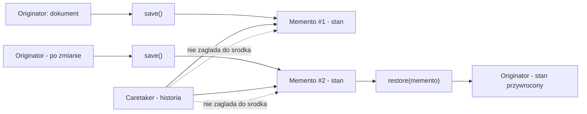
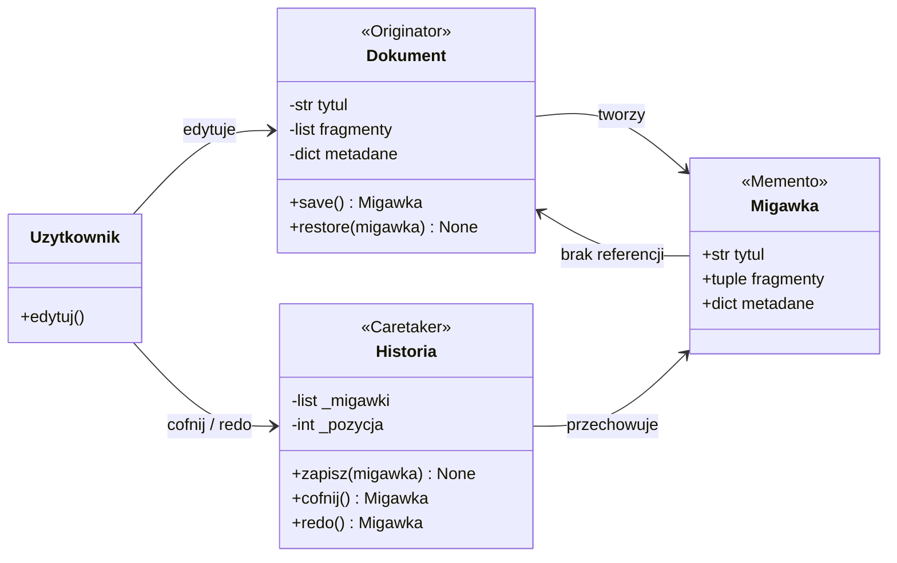
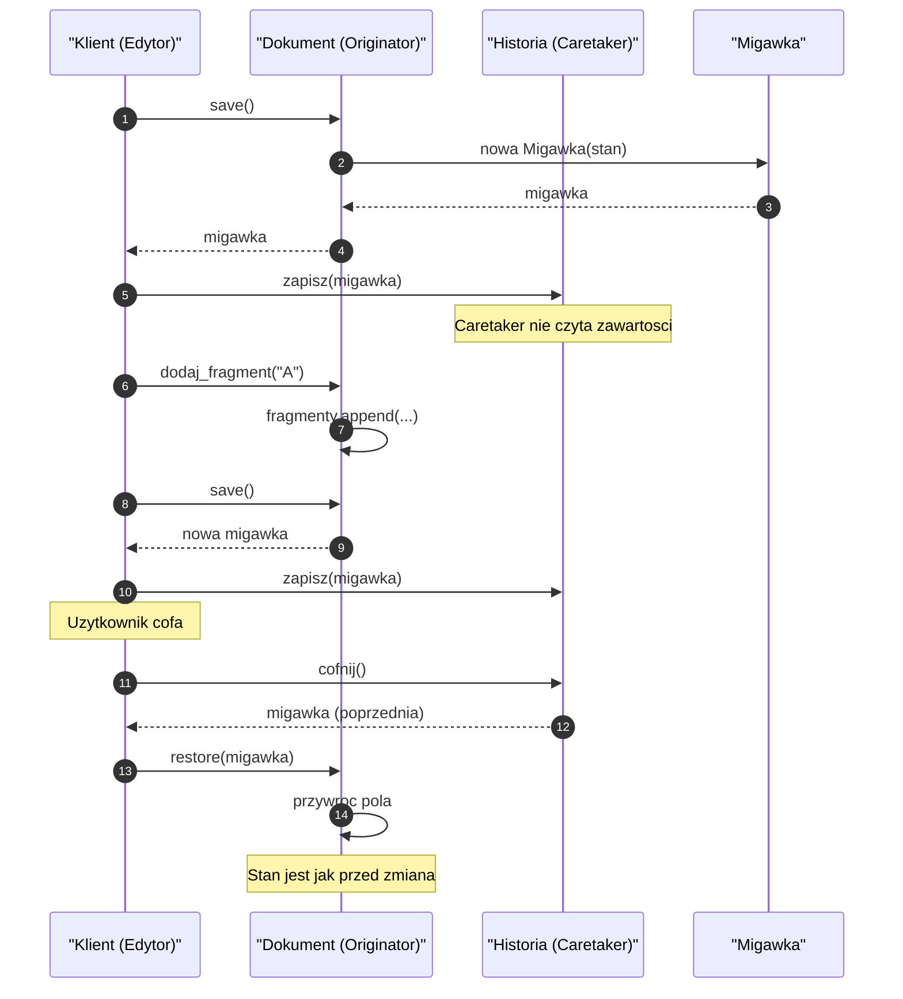
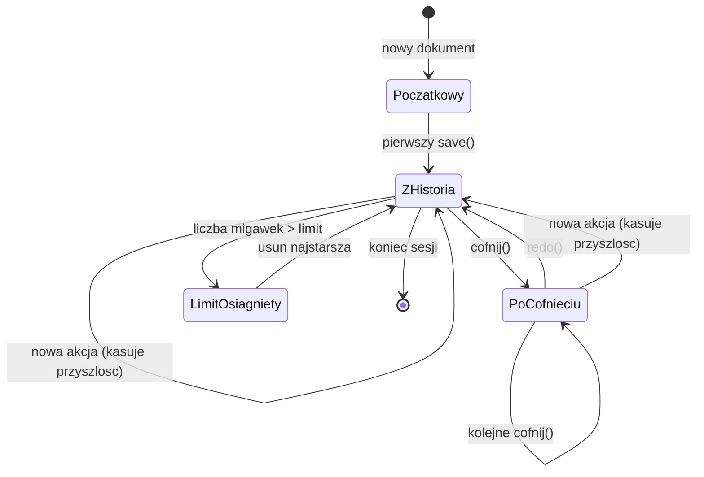
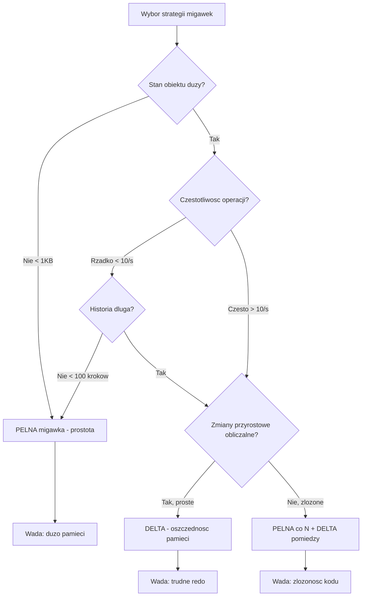
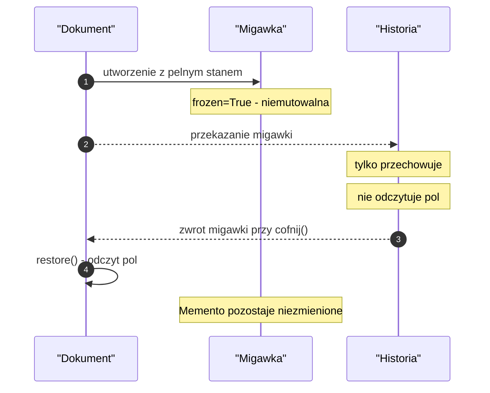
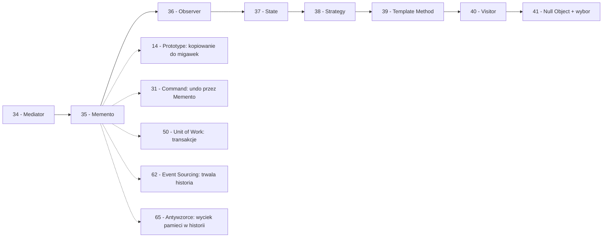

```markdown
---
modul: 35 — Memento
plik: 35-memento.md
poziom: sredni
wymaga: [34]
czas: ~155 minut czytania + ~370 minut ćwiczeń
---

# Moduł 35 — Memento — cofanie zmian bez łamania hermetyzacji

> **TL;DR**
> - **Memento (pamiątka)** pozwala zapisać pełny stan obiektu i później go przywrócić — **bez ujawniania innym klasom, jak ten obiekt jest zbudowany wewnątrz**.
> - Trzy role: **Originator** tworzy i przywraca migawkę, **Memento** przechowuje stan (bez logiki), **Caretaker** zarządza historią, ale **nie zagląda do środka** migawek.
> - W Pythonie memento jest zwykle **niemutowalną `dataclass`** albo **krotką danych**; pełna kopia przez `deepcopy` jest prosta, ale bywa pamięciożerna — czasem lepiej zapisywać **delty** (zmiany) niż pełne stany.
> - Memento **nie jest** tym samym co Command: Command mówi „wykonaj i cofnij operację", Memento mówi „zapisz i przywróć **stan**"; często łączone w jednym mechanizmie undo/redo.
> - Dwie główne pułapki: **płytka kopia dająca fałszywe cofnięcie** (współdzielone listy/słowniki) i **nieograniczona historia wyciekająca pamięć** (trzeba limit, kompresję, migawki okresowe albo persystencję).

---

## 0. Model mentalny

### Zapis stanu gry, punkty kontrolne, eksperyment w laboratorium

Wyobraź sobie, że grasz w grę strategiczną — budujesz miasto, zarządzasz surowcami, planujesz rozwój. Widzisz przed sobą wielki plan: postawić elektrownię, wybudować trzy farmy, zablokować rzekę. Zanim to zrobisz, **zapisujesz stan gry** — jedno kliknięcie, jeden plik, wszystko zapamiętane. Teraz eksperymentujesz: budujesz elektrownię, okazuje się, że brakuje surowców, miasto nie prosperuje. Wczytujesz zapis. Wracasz do punktu wyjścia — wszystko tak, jak było. I próbujesz innego planu.

Zatrzymaj się i zobacz, co się właśnie stało. **Nie odtworzyłeś miasta ręcznie.** Nie powiedziałeś sobie: „a więc cofnij elektrownię, oddaj surowce, przywróć trzy farmy, wyłącz blokadę rzeki". **Wczytałeś plik zapisu.** To znaczy, że **stan gry był zapisany jako dane**, a nie jako lista operacji do cofnięcia. Ta różnica jest istotą memento: **zapisujemy STAN, nie HISTORIĘ OPERACJI**.

Popatrzmy teraz na ten obraz z odrobinę innej strony — przez rolę mechaniki. Gra ma **mechanizm zapisu** — to jest funkcja, która zagląda do wnętrza świata i tworzy zapis. Ma **plik zapisu** — dane. Ma **mechanizm wczytywania** — który odczytuje plik i przywraca świat. Zwróć uwagę, że **nie musisz wiedzieć, co jest w pliku zapisu**, żeby go wczytać. Klikasz „wczytaj" i gra wraca. Nie musisz rozumieć, jak zbudowane jest miasto w środku — po prostu mówisz „przywróć stan z pliku". To jest właśnie oddzielenie **zapisu** (dane) od **logiki** (rozumienie gry). I o to chodzi w memento: **dane migawki nie ujawniają wnętrza obiektu**, ale wystarczają, żeby go odtworzyć.

Trzeci obraz — **punkt kontrolny w laboratorium chemicznym**. Robisz eksperyment, jesteś na etapie „mieszanina A+B". Chcesz zobaczyć, co się stanie, gdy dodasz C. Ale jeśli C zepsuje cały eksperyment, nie chcesz zaczynać od zera. Więc przed dodaniem C **odnotowujesz stan**: ile mikrolitrów A, ile B, jaka temperatura, jakie pH. To jest **punkt kontrolny**. Po dodaniu C — jeśli wynik jest zły — wracasz do punktu kontrolnego C przez odtworzenie: wlewasz tyle A ile było, tyle B, ustawiasz temperaturę, pH. Efekt: eksperyment wygląda jak przed dodaniem C. Zwróć uwagę na mechanizm: **nie wylewasz C fizycznie** — **odtwarzasz stan od zera**. Różnica z Command (moduł 31) jest tu widoczna: Command w tym scenariuszu szukałby „jak usunąć C z mieszaniny", a Memento **nie interesuje się C** — on odtwarza stan „bez C" od zera.

I jeszcze jeden obraz, który pokazuje ryzyko. Wyobraź sobie, że punktów kontrolnych zapisujesz **bardzo dużo** — co sekundę, przez trzygodzinny eksperyment. Każdy punkt kontrolny zajmuje **całą próbkę** (10 ml), a ty masz ich w laboratorium 500. Po godzinie masz 3600 próbek, każda po 10 ml. To **36 litrów** — laboratorium pęka w szwach. To jest pułapka memento: **każda migawka to kopia stanu**. Jeśli zapisujesz je często, pamięć puchnie. Dlatego w praktyce stosuje się **limity**, **kompresję**, albo **migawki przyrostowe (delty)** — o tym w sekcji 4.

| W analogii zapisu gry i punktu kontrolnego | W kodzie |
|---|---|
| Świat gry / mieszanina | **Originator** — obiekt, którego stan zapisujemy |
| Mechanizm zapisu | `originator.save()` — tworzy migawkę |
| Plik zapisu | **Memento** — obiekt trzymający stan |
| Wczytanie zapisu | `originator.restore(memento)` — przywraca stan |
| Biblioteka zapisów / katalog z plikami | **Caretaker** — zarządza historią |
| Zapis co sekundę (dużo próbek) | Nieograniczona historia — pułapka |
| Zapis punktowy (przed eksperymentem) | Sensowny limit punktów kontrolnych |
| Dane zapisu nieznane użytkownikowi | **Hermetyzacja memento** — Caretaker nie zagląda |

> 🧠 **Zapamiętaj** — **Memento (pamiątka) to wzorzec behawioralny, który pozwala zapisać pełny stan obiektu (Originator) w formie osobnego obiektu (Memento) i przywrócić go później — bez ujawniania zewnętrznym klasom szczegółów budowy Originatora ani Memento.**

Zwróć uwagę na trzy słowa: **stan**, **osobny obiekt**, **hermetyzacja**. „Stan" — bo zapisujemy zawartość, nie operacje. „Osobny obiekt" — bo migawka jest bytem o własnym cyklu życia (można ją trzymać, przekazywać, zapisywać). „Hermetyzacja" — bo **nikt z zewnątrz nie musi wiedzieć, co jest w środku migawki**. To ostatnie jest najsubtelniejsze i najczęściej pomijane — memento ma sens tylko wtedy, gdy **naprawdę** nie ujawiamy wewnętrznej struktury.

### Diagram — intuicja zapisu i przywracania



*Diagram pokazuje, że Caretaker trzyma listę migawek, ale nie odczytuje ich zawartości — a Originator sam obsługuje tworzenie i przywracanie migawek.*

### Czego Memento NIE robi

Rozbrójmy cztery mity.

**Nie jest tym samym co Command.** Command (moduł 31) hermetyzuje **operację** — ma `execute` i `undo`. Memento hermetyzuje **stan** — ma wyłącznie dane. Command cofa przez „odwrotną operację"; Memento cofa przez „wstawienie zapisanego stanu". Oba wzorce łączą się bardzo często (Command używa Memento jako mechanizmu `undo`), ale ich role są różne.

**Nie jest kopią w sensie Prototype.** Prototype (moduł 14) tworzy **nowy, samodzielny obiekt** z istniejącego. Memento tworzy **zapis stanu** w celu późniejszego **przywrócenia do tego samego obiektu**. Prototype zwraca obiekt, z którym można dalej pracować; Memento zwraca „pudełko z danymi", które ma sens tylko w kontekście przywrócenia.

**Nie jest magicznym cofaniem.** Memento **nie zmienia otoczenia** — jeśli zapisałeś stan obiektu X, ale w międzyczasie zmienił się obiekt Y, to przywrócenie X nie cofnie Y. Memento obsługuje **jeden obiekt** (Originator). Dla spójności wielu obiektów potrzebne jest coś więcej — transakcje (Unit of Work — moduł 50), Sagi (moduł 63), albo Event Sourcing (moduł 62).

**Nie jest trwałą historią (jak git).** Memento domyślnie trzyma historię w pamięci procesu. Jeśli proces padnie, historia przepada. Dla trwałej historii potrzebna persystencja (zapis do pliku/bazy) — co jest już **Event Sourcingiem** (moduł 62) w wersji pełnej. Memento to **historia w pamięci**, przydatna dla sesji interaktywnej.

**Nie jest darmowe pamięciowo.** Każda migawka to kopia stanu. Dla dużego obiektu (np. dokument z tysiącami fragmentów) historia 100 kroków to 100 pełnych kopii. Można temu zaradzić — ale trzeba o tym pomyśleć **z góry**.

**Nie zawsze się opłaca.** Jeśli obiekt ma jeden atrybut typu `int`, tworzenie migawki to przesada — wystarczy zapisać `int` w trzech linijkach. Memento ma sens, gdy obiekt ma **złożony, wieloczęściowy stan**, którego nie da się łatwo odtworzyć.

---

## 1. Problem, który rozwiązujemy

Wejdźmy w domenę 📝 finansowego „Edytora dokumentów" — aplikacji, w której doradcy klienta tworzą i modyfikują **wnioski kredytowe, umowy i oferty**. Dokument składa się z wielu fragmentów (paragrafów), ma nagłówek, stopkę, wersję i metadane. Doradca może:

- dodawać i usuwać fragmenty,
- formatować (pogrubienie, kursywa),
- zmieniać nagłówek i stopkę,
- edytować metadane (data, numer wniosku, status).

Klient chce **cofać i powtarzać** operacje — jak w każdym nowoczesnym edytorze. Ktoś napisał mechanizm undo/redo przez zapisywanie „pełnej kopii dokumentu" jako `dict` i używanie `copy.copy` — i ten mechanizm **nie działa poprawnie**.

### Kod „przed"

```python
# edytor_v0.py — wersja naiwna, demonstracyjna
# UWAGA: kod celowo pokazuje problem PLYTKIEJ kopii dla migawek.

from __future__ import annotations

import copy
from dataclasses import dataclass, field


@dataclass
class Fragment:
    tekst: str
    pogrubiony: bool = False
    kursywa: bool = False


class Dokument:
    def __init__(self, tytul: str) -> None:
        self.tytul = tytul
        self.fragmenty: list[Fragment] = []
        self.metadane: dict[str, str] = {}

    def dodaj_fragment(self, tekst: str) -> None:
        self.fragmenty.append(Fragment(tekst=tekst))

    def formatuj(self, indeks: int, pogrubiony: bool = False, kursywa: bool = False) -> None:
        self.fragmenty[indeks].pogrubiony = pogrubiony
        self.fragmenty[indeks].kursywa = kursywa

    def ustaw_metadane(self, klucz: str, wartosc: str) -> None:
        self.metadane[klucz] = wartosc

    def tekst(self) -> str:
        return "".join(f.tekst for f in self.fragmenty)


class HistoriaBlendna:
    """Bledna historia: plytka kopia stanu."""

    def __init__(self, dokument: Dokument) -> None:
        self._dokument = dokument
        self._migawki: list[dict] = []

    def zapisz(self) -> None:
        # PLYTKA kopia! Wspoldzielone listy i slowniki.
        migawka = {
            "tytul": self._dokument.tytul,
            "fragmenty": self._dokument.fragmenty,      # referencja!
            "metadane": self._dokument.metadane,        # referencja!
        }
        self._migawki.append(migawka)

    def cofnij(self) -> None:
        if len(self._migawki) < 2:
            return
        self._migawki.pop()   # zdejmij biezacy stan
        poprzedni = self._migawki.pop()
        self._dokument.tytul = poprzedni["tytul"]
        self._dokument.fragmenty = poprzedni["fragmenty"]
        self._dokument.metadane = poprzedni["metadane"]


if __name__ == "__main__":
    dok = Dokument("Umowa kredytowa")
    hist = HistoriaBlendna(dok)

    hist.zapisz()
    dok.dodaj_fragment("Paragraf 1")
    hist.zapisz()
    dok.dodaj_fragment("Paragraf 2")

    print("Przed cofnieciem:", dok.tekst())   # "Paragraf 1Paragraf 2"
    hist.cofnij()
    print("Po cofnieciu:", dok.tekst())       # Powinno byc "Paragraf 1"
```

Ten kod **nie działa poprawnie** — i to w sposób bardzo nieintuicyjny. Zwróć uwagę: pierwsza migawka zachowuje **referencję** do `self.fragmenty`. Potem dokument dodaje fragmenty do tej samej listy. Druga migawka zachowuje tę samą referencję. Więc obie migawki pokazują **tę samą, bieżącą listę** — nie stan z chwili ich tworzenia. Po cofnięciu widać oba fragmenty, mimo że pierwsza migawka powstała przed drugim fragmentem.

### Code smell — migawka udająca kopię

| Problem | Gdzie | Konsekwencja |
|---|---|---|
| Migawka przechowuje referencje | `migawka = {"fragmenty": self.fragmenty}` | Wszystkie migawki pokazują bieżący stan |
| Brak kopii zagnieżdżonych struktur | Bez `copy.deepcopy` | Zmiany widoczne we wszystkich „starych" migawkach |
| Brak jawnych typów migawek | `dict` zamiast klasy | Trudno się odwołać, brak walidacji, brak typowania |
| Historia nie ma limitu | `_migawki` rośnie w nieskończoność | Wyciek pamięci w długiej sesji |
| Brak redo | Tylko `cofnij` | Nie da się przywrócić cofniętej operacji |
| Brak rozdzielenia ról | `HistoriaBlendna` zna `Dokument` | Historia zależy od konkretnej klasy |
| Brak walidacji migawki | Można wstawić „pustą" migawkę | Ciche błędy |
| „Cofanie" przywraca stan z drugiej strony | `_migawki.pop()` i ponowne `pop()` | Nieczytelna logika |
| Brak obsługi wersjonowania | Migawki bez tytułu/opisu | Trudno pokazać użytkownikowi „ostatnie 5 wersji" |

### Objawy — poznasz ten problem po tym, że...

- **Twoja historia „działa" dla prostych przypadków, ale nie dla mutowalnych pól.** Albo gdy pole zagnieżdżone się zmienia, „stare" migawki zmieniają się razem z nim.
- **Musisz pamiętać o `deepcopy`** i nikt tego nie robi konsekwentnie — bo brakuje mechanizmu, który to gwarantuje.
- **Historia nie wie, co to za typ obiektu** — jest luźnym `dict`-em, w którym nie ma żadnego schematu.
- **Nie ma redo** — tylko `cofnij`. Użytkownik nie może „odzyskać" cofniętej zmiany.
- **Historia rośnie w nieskończoność.** W długiej sesji (kilka godzin) proces puchnie w pamięci.
- **Trudno zaimplementować „wersjonowanie"** — zamiast tego każda migawka to czarna skrzynka.
- **Klasa historii ma dostęp do pól `Dokument`** — wie o `_fragmenty`, o `_metadane`. To łamanie hermetyzacji (dokładnie to, czego Memento ma zabraniać).
- **Przy zmianie struktury `Dokument`** trzeba również zmieniać historię. Historia nie jest niezależna.
- **Brak obsługi wrażliwych danych.** Migawki mogą zawierać dane osobowe, które nie powinny trafiać do „historii" bez zabezpieczeń.
- **Nie ma sposobu na „wróć do wersji sprzed godziny".** Historia nie ma znaczników czasu ani opisów.

---

## 2. Anatomia wzorca

### Uczestnicy

| Rola | Odpowiedzialność | Co NIE jest jej zadaniem |
|---|---|---|
| **Originator (twórca)** | Tworzy migawkę własnego stanu (`save()` → Memento); przywraca stan z migawki (`restore(memento)`) | Nie zarządza historią migawek; nie przechowuje ich długoterminowo |
| **Memento (pamiątka)** | Przechowuje **pełny stan** Originatora w formie danych — bez logiki, bez referencji do Originatora | Nie ujawnia szczegółów stanu klasom zewnętrznym; nie ma metod „użyj tego" |
| **Caretaker (opiekun)** | Zarządza historią migawek: przechowuje listę, udostępnia cofanie/redo | **Nie zagląda do środka** migawek; nie modyfikuje ich; nie wie, z jakich typów się składają |

Kluczowa asymetria: **Caretaker wie, że migawki istnieją, ale nie wie, co jest w środku**. Originator wie, co jest w środku (bo sam je tworzy), ale nie wie, ile migawek trzyma Caretaker. Dzięki temu można rozszerzać strukturę `Originator` bez zmiany `Caretaker`, i rozszerzać politykę historii bez zmiany `Originator`.

Bardzo ważna uwaga: **w Pythonie hermetyzacja memento bywa trudna**. Nie ma prawdziwego „prywatnego dostępu" — atrybuty są zawsze dostępne. Można jednak **umownie** oddzielić: `Memento` ma pola, ale Caretaker **nie powinien** ich czytać. Można to zaakcentować przez:
- konwencję podkreślenia (`_stan`),
- metodę `__repr__` zwracającą tylko ogólny opis,
- typ `Final` z pól tylko do odczytu (`@dataclass(frozen=True)`).

W językach z prawdziwą prywatnością (Java, C++) Memento ma **prywatne pole** `state` i **publiczne API** tylko dla Originatora (np. przez „friend class"). W Pythonie tego nie ma — trzeba polegać na konwencji i testach.

### Diagram struktury



*Diagram pokazuje, że Document tworzy migawki, Historia je przechowuje, ale Memento nie ma referencji zwrotnej do Dokumentu — dzięki temu nie ujawnia jego wnętrza.*

Przeczytajmy ten diagram zdanie po zdaniu. `Dokument` to **Originator** — ma stan (tytuł, fragmenty, metadane) i dwa API: `save()` (zwraca migawkę) oraz `restore(migawka)` (przywraca stan). Zwróć uwagę — **tylko Dokument umie czytać z migawki**. To jego przywilej, bo to on ją stworzył.

`Migawka` to **Memento** — trzyma stan w formie danych (`tytul: str`, `fragmenty: tuple`, `metadane: dict`). Nie ma metod — żadnej logiki. Jest to „pudełko” — Caretaker nie wie, co jest w środku (bo nie ma sensownych metod odczytu).

`Historia` to **Caretaker** — ma `_migawki` i `_pozycja`, umie zapisywać, cofać, powtarzać. **Nie odczytuje `Migawka.fragmenty` ani `Migawka.metadane`** — nie potrzebuje tego. Zwraca migawkę (albo nic — w zależności od wariantu), a klient przekazuje ją `Dokument.restore(...)`.

`Uzytkownik` to klient — edytuje przez `Dokument`, steruje historią przez `Historia`.

**Kluczowa obserwacja:** `Migawka --> Dokument: brak referencji`. Memento **nie wie**, że istnieje dokument, który ją stworzył. Nie ma na niego wskazania. Dzięki temu Memento może być serializowana, przenoszona, trzymana poza procesem — bez obawy o wyciek referencji.

### Warianty: klasyczny vs pythoniczny

| Aspekt | Klasyczny (GoF) | Pythoniczny |
|---|---|---|
| Memento | Klasa z prywatnym `state` | `@dataclass(frozen=True)` |
| Stan | Często `object` albo kopia | `tuple`, `dict`, `bytes` |
| Odczyt stanu | Tylko Originator (przyjaciel) | Konwencja: Originator czyta, reszta nie |
| Caretaker | Klasa z kolekcją | `list` + indeks, albo `deque` |
| Kopiowanie | Ręczne skopiowanie pól | `deepcopy`, `replace`, jawna kopia |
| Delta | Rzadko | `(klucz, wartość)` lub diff |
| Persystencja | Serializacja obiektu | `pickle`/JSON migawki |

W Pythonie **nie ma „przyjacielskich" klas**, więc rola Originatora/Caretakera jest umowna. Można jednak wymusić separację przez:
- **niemutowalność migawki** (`frozen=True`) — nikt nie może jej zmienić,
- **brak referencji do Originatora** w migawce,
- **dokumentację API** mówiącą, kto może czytać migawkę.

---

## 3. Implementacja krok po kroku

Przebudujemy system z sekcji 1 stopniowo.

### Krok 1 — Zdefiniuj Memento jako niemutowalną dataclass

Najpierw migawka. Musi być **niemutowalna** — żeby nikt nie zmienił „historii".

```python
from dataclasses import dataclass, field
from typing import Any


@dataclass(frozen=True, slots=True)
class FragmentMigawki:
    tekst: str
    pogrubiony: bool
    kursywa: bool


@dataclass(frozen=True, slots=True)
class Migawka:
    """Memento: pelny, niemutowalny stan dokumentu."""
    tytul: str
    fragmenty: tuple[FragmentMigawki, ...]
    naglowek: str
    stopka: str
    metadane: tuple[tuple[str, str], ...]

    def opis(self) -> str:
        """Zwraca tylko opis - bez ujawniania zawartosci."""
        return (
            f"Migawka '{self.tytul}': "
            f"{len(self.fragmenty)} fragmentow, "
            f"{len(self.metadane)} metadanych"
        )
```

Trzy kluczowe decyzje:
1. **`frozen=True`** — nikt nie modyfikuje migawki. Historia jest bezpieczna.
2. **`tuple` zamiast `list`** — niemutowalna kopia zagnieżdżonej listy. `FragmentMigawki` też jest niemutowalny (`frozen=True`).
3. **`metadane` jako `tuple[tuple[str, str], ...]`** — słownik nie jest mutowalny, więc konwertujemy do krotek. To pozwala na pełną niemutowalność.

### Krok 2 — Zdefiniuj Originator

`Dokument` wie, jak zapisać i przywrócić swój stan.

```python
@dataclass
class Fragment:
    tekst: str
    pogrubiony: bool = False
    kursywa: bool = False


class Dokument:
    """Originator: dokument z mozliwoscia zapisu i przywrocenia stanu."""

    def __init__(self, tytul: str) -> None:
        self.tytul = tytul
        self.fragmenty: list[Fragment] = []
        self.naglowek = ""
        self.stopka = ""
        self.metadane: dict[str, str] = {}

    # --- Operacje modyfikujace ---

    def dodaj_fragment(self, tekst: str) -> None:
        self.fragmenty.append(Fragment(tekst=tekst))

    def usun_fragment(self, indeks: int) -> None:
        del self.fragmenty[indeks]

    def formatuj(
        self,
        indeks: int,
        pogrubiony: bool | None = None,
        kursywa: bool | None = None,
    ) -> None:
        f = self.fragmenty[indeks]
        if pogrubiony is not None:
            f.pogrubiony = pogrubiony
        if kursywa is not None:
            f.kursywa = kursywa

    def ustaw_naglowek(self, naglowek: str) -> None:
        self.naglowek = naglowek

    def ustaw_stopke(self, stopka: str) -> None:
        self.stopka = stopka

    def ustaw_metadane(self, klucz: str, wartosc: str) -> None:
        self.metadane[klucz] = wartosc

    def tekst(self) -> str:
        return "".join(f.tekst for f in self.fragmenty)

    # --- Memento: zapis i przywracanie ---

    def save(self) -> Migawka:
        """Tworzy niemutowalna migawke biezacego stanu."""
        return Migawka(
            tytul=self.tytul,
            fragmenty=tuple(
                FragmentMigawki(f.tekst, f.pogrubiony, f.kursywa)
                for f in self.fragmenty
            ),
            naglowek=self.naglowek,
            stopka=self.stopka,
            metadane=tuple(sorted(self.metadane.items())),
        )

    def restore(self, migawka: Migawka) -> None:
        """Przywraca stan z migawki."""
        self.tytul = migawka.tytul
        self.fragmenty = [
            Fragment(f.tekst, f.pogrubiony, f.kursywa)
            for f in migawka.fragmenty
        ]
        self.naglowek = migawka.naglowek
        self.stopka = migawka.stopka
        self.metadane = dict(migawka.metadane)
```

Zwróć uwagę na symetrię. `save()` tworzy migawkę **konwertując mutowalne struktury na niemutowalne** (`list → tuple`, `dict → tuple of tuples`). `restore()` robi odwrotnie (`tuple → list`, `(k, v) → dict`). Ta konwersja to **cena niemutowalności** — ale daje nam pełne bezpieczeństwo historii.

### Krok 3 — Zdefiniuj Caretaker

`Historia` zarządza listą migawek, ale **nie odczytuje ich wnętrza**.

```python
class Historia:
    """Caretaker: zarzadza historia migawek."""

    def __init__(self, limit: int = 100) -> None:
        if limit <= 0:
            raise ValueError("limit musi byc dodatni")
        self._migawki: list[Migawka] = []
        self._pozycja: int = -1     # indeks biezacej migawki
        self._limit = limit

    def zapisz(self, migawka: Migawka) -> None:
        """Dodaje migawke do historii. Kasuje 'przyszlosc'."""
        # Jesli jestesmy w srodku historii (po undo), wycinamy przyszlosc
        if self._pozycja < len(self._migawki) - 1:
            del self._migawki[self._pozycja + 1:]
        self._migawki.append(migawka)
        # Limit historii
        if len(self._migawki) > self._limit:
            self._migawki.pop(0)
        self._pozycja = len(self._migawki) - 1

    def cofnij(self) -> Migawka | None:
        """Zwraca poprzednia migawke, jesli istnieje."""
        if self._pozycja <= 0:
            return None
        self._pozycja -= 1
        return self._migawki[self._pozycja]

    def redo(self) -> Migawka | None:
        """Zwraca nastepna migawke (po cofnieciu)."""
        if self._pozycja >= len(self._migawki) - 1:
            return None
        self._pozycja += 1
        return self._migawki[self._pozycja]

    @property
    def pozycja(self) -> int:
        return self._pozycja

    @property
    def liczba_migawek(self) -> int:
        return len(self._migawki)

    def opis(self) -> str:
        """Zwraca opis historii - nie ujawniajac zawartosci migawek."""
        linie = [f"Historia ({len(self._migawki)} migawek, pozycja {self._pozycja}):"]
        for i, m in enumerate(self._migawki):
            znacznik = " <<" if i == self._pozycja else ""
            linie.append(f"  [{i}] {m.opis()}{znacznik}")
        return "\n".join(linie)
```

Kluczowe elementy:
1. **`_pozycja`** — wskaźnik bieżącej migawki w historii. Pozwala na cofanie i redo.
2. **Kasowanie „przyszłości"** przy nowym zapisie (gdy jesteśmy po cofnięciu).
3. **Limit historii** — chroni przed nieskończonym wzrostem.
4. **Metoda `opis()`** używa `Migawka.opis()` — a ta nie ujawnia zawartości. To demonstracja hermetyzacji.

### Krok 4 — Klient łączy oba obiekty

```python
class Edytor:
    """Klient: laczy dokument z historia."""

    def __init__(self, tytul: str) -> None:
        self.dokument = Dokument(tytul)
        self.historia = Historia(limit=50)
        # Zapisz stan poczatkowy
        self.historia.zapisz(self.dokument.save())

    def _zapisz_stan(self) -> None:
        self.historia.zapisz(self.dokument.save())

    def dodaj_fragment(self, tekst: str) -> None:
        self.dokument.dodaj_fragment(tekst)
        self._zapisz_stan()

    def ustaw_naglowek(self, naglowek: str) -> None:
        self.dokument.ustaw_naglowek(naglowek)
        self._zapisz_stan()

    def ustaw_metadane(self, klucz: str, wartosc: str) -> None:
        self.dokument.ustaw_metadane(klucz, wartosc)
        self._zapisz_stan()

    def cofnij(self) -> bool:
        migawka = self.historia.cofnij()
        if migawka is None:
            return False
        self.dokument.restore(migawka)
        return True

    def redo(self) -> bool:
        migawka = self.historia.redo()
        if migawka is None:
            return False
        self.dokument.restore(migawka)
        return True
```

Wzorzec użycia: **każda operacja modyfikująca dokument kończy się zapisem migawki**. To realizuje „automatyczne zapisywanie historii".

### Krok 5 — Weryfikacja

| Kryterium | Wersja „przed" | Wersja „po" |
|---|---|---|
| Migawka niezależna od dokumentu | Nie | Tak (`frozen=True`) |
| Zmiany widoczne w starych migawkach | Tak (bug) | Nie (izolacja) |
| Możliwość cofania | Tak, ale błędna | Tak, poprawnie |
| Możliwość redo | Nie | Tak |
| Limit historii | Nie | Tak (domyślnie 100) |
| Typowana migawka | Nie (`dict`) | Tak (`dataclass`) |
| Czytelny opis historii | Nie | Tak (`opis()`) |
| Hermetyzacja | Naruszona | Zachowana |
| Liczba klas | 3 | 5 |

Koszt: dwie dodatkowe klasy (`Migawka`, `FragmentMigawki`), konwersje list/tuple. Zysk: **poprawność** (historia naprawdę działa), **bezpieczeństwo** (migawki niemutowalne), **hermetyzacja** (Caretaker nie widzi wnętrza).

---

## 4. Wersje pythoniczne i warianty

Ta sekcja omawia najważniejsze warianty.

### 4.1 Niemutowalna dataclass — jak wyżej

Zaleta: pełna niemutowalność, bezpieczeństwo. Wada: wymaga konwersji list/dict → tuple.

### 4.2 `dataclasses.replace` dla lekkich zmian

Jeśli dokument ma niemutowalne pola, można tworzyć migawki przez `replace`.

```python
from dataclasses import replace

@dataclass(frozen=True)
class DokumentNiemutowalny:
    tytul: str
    fragmenty: tuple[FragmentMigawki, ...] = ()
    naglowek: str = ""
    metadane: tuple[tuple[str, str], ...] = ()

    def z_dodanym_fragmentem(self, tekst: str) -> "DokumentNiemutowalny":
        nowy = FragmentMigawki(tekst, False, False)
        return replace(self, fragmenty=self.fragmenty + (nowy,))
```

Zaleta: każdy stan jest **niemutowalny**, więc migawką może być po prostu sam obiekt. Zapis to referencja do obiektu. Wada: cała aplikacja musi operować niemutowalnie (`replace` przy każdej zmianie). To duża zmiana stylu.

### 4.3 `copy.deepcopy` — szybka migawka

Dla prostych przypadków `deepcopy` tworzy pełną kopię obiektu.

```python
import copy

class HistoriaDeepCopy:
    def __init__(self, obiekt) -> None:
        self._obiekt = obiekt
        self._migawki: list = []

    def zapisz(self) -> None:
        self._migawki.append(copy.deepcopy(self._obiekt))

    def cofnij(self) -> None:
        if len(self._migawki) < 2:
            return
        self._migawki.pop()
        ostatni = self._migawki[-1]
        # Przywracamy pola obiektu
        self._obiekt.__dict__.update(ostatni.__dict__)
```

Zalety: zero konwersji, wszystko kopiowane automatycznie. Wady: **kosztowne** dla dużych obiektów, **nie działa** dla obiektów z niekopiowalnymi polami (połączenia sieciowe, pliki), **trudne** do dostrojenia (co kopiować, a co współdzielić). Używaj tylko dla małych obiektów.

### 4.4 Migawka przyrostowa (delta) — dla dużych obiektów

Zamiast pełnej kopii stanu, zapisujemy **tylko różnicę**.

```python
from dataclasses import dataclass
from typing import Any


@dataclass(frozen=True)
class DeltaMigawka:
    """Zmiana pojedynczego pola."""
    pole: str
    wartosc_przed: Any
    wartosc_po: Any


class DokumentZDelta:
    """Originator z historia przyrostowa."""

    def __init__(self) -> None:
        self.tytul = ""
        self.naglowek = ""
        self.stopka = ""
        self.fragmenty: list[str] = []
        self.metadane: dict[str, str] = {}
        self._delty: list[DeltaMigawka] = []

    def ustaw_tytul(self, nowy: str) -> None:
        stary = self.tytul
        self.tytul = nowy
        self._delty.append(DeltaMigawka("tytul", stary, nowy))

    def dodaj_fragment(self, tekst: str) -> None:
        self.fragmenty.append(tekst)
        self._delty.append(
            DeltaMigawka("fragmenty", tuple(self.fragmenty[:-1]), tuple(self.fragmenty))
        )

    def ustaw_metadane(self, klucz: str, wartosc: str) -> None:
        stary = self.metadane.get(klucz)
        self.metadane[klucz] = wartosc
        self._delty.append(DeltaMigawka(f"metadane.{klucz}", stary, wartosc))

    def cofnij(self) -> bool:
        if not self._delty:
            return False
        delta = self._delty.pop()
        # Odwracamy zmiane
        if delta.pole == "tytul":
            self.tytul = delta.wartosc_przed
        elif delta.pole == "fragmenty":
            self.fragmenty = list(delta.wartosc_przed)
        elif delta.pole.startswith("metadane."):
            klucz = delta.pole.split(".", 1)[1]
            if delta.wartosc_przed is None:
                self.metadane.pop(klucz, None)
            else:
                self.metadane[klucz] = delta.wartosc_przed
        return True
```

Zalety: pamięć zajmuje **stałą wielkość na zmianę** (nie cała kopia). Wady: cofnięcie nie jest „przywróceniem stanu", tylko „odwróceniem zmian"; jeśli zmiany zależą od siebie, trudno to wyliczyć; trudno zaimplementować „redo". Ogólnie: **delta dla małych zmian, pełna migawka dla prostoty**.

### 4.5 Migawka okresowa + delta — kompromis

Bardzo często stosowany trik: co N operacji zapisujemy **pełną migawkę**, a między nimi **delty**.

```python
class HistoriaMieszana:
    def __init__(self, co_ile_pelna: int = 10) -> None:
        self._co_ile = co_ile_pelna
        self._pelne: list[Migawka] = []
        self._delty: list[DeltaMigawka] = []
        self._operacji = 0

    def zapisz(self, migawka: Migawka) -> None:
        """
        Co `co_ile` operacji zapisujemy pelna migawke,
        w pozostalych przypadkach mozemy zapisac delte.
        """
        if self._operacji % self._co_ile == 0:
            self._pelne.append(migawka)
        self._operacji += 1
```

To strategia „bazy i przyrostu" — jak w plikach binarnych, gdzie zapisuje się okresowe pełne snapshoty i potem listę zmian.

### 4.6 Migawka `pickle` — persystencja

Migawkę można zaserializować przez `pickle` (ostrożnie z bezpieczeństwem!) i przechowywać na dysku.

```python
import pickle

migawka = dokument.save()
bajty = pickle.dumps(migawka)
# ... zapis do pliku
odczytana = pickle.loads(bajty)
dokument.restore(odczytana)
```

**Uwaga bezpieczeństwa:** `pickle` nigdy nie powinien być używany dla danych z niezaufanego źródła (moduł 14).

**Alternatywa bezpieczna:** własny format (JSON + typ migawki) — wymaga więcej kodu, ale jest bezpieczny:

```python
import json

def migawka_do_json(m: Migawka) -> str:
    return json.dumps({
        "tytul": m.tytul,
        "fragmenty": [{"t": f.tekst, "b": f.pogrubiony, "k": f.kursywa}
                      for f in m.fragmenty],
        "naglowek": m.naglowek,
        "stopka": m.stopka,
        "metadane": dict(m.metadane),
    }, ensure_ascii=False)
```

### 4.7 `cattrs` / `attrs` / pydantic — if you have them

Biblioteki dają gotową serializację:

```python
# Pydantic: serializacja i deserializacja migawek
from pydantic import BaseModel

class MigawkaPydantic(BaseModel, frozen=True):
    tytul: str
    fragmenty: tuple[FragmentMigawki, ...]
    # ...

# Serializacja
json_data = migawka.model_dump_json()
# Deserializacja
migawka = MigawkaPydantic.model_validate_json(json_data)
```

Praktyczne w nowoczesnych projektach. Wady: zależność zewnętrzna.

### 4.8 Podsumowanie — tabela wyboru

| Sytuacja | Wariant |
|---|---|
| Klasyczny przypadek z pełną migawką | `frozen=True` dataclass (4.1) |
| Obiekt niemutowalny (bez konwersji) | `dataclasses.replace` (4.2) |
| Mały obiekt, prosty zapis | `copy.deepcopy` (4.3) |
| Duży obiekt, mało zmian | Delta (4.4) |
| Duży obiekt, długo działająca sesja | Pełna migawka co N + delta (4.5) |
| Trwałość historii | `pickle` (ostrożnie!) lub JSON (4.6) |
| Nowoczesny stos | pydantic/attrs (4.7) |

> 🧠 **Zapamiętaj** — **Memento to wzorzec, w którym trzeba podjąć świadomą decyzję o sposobie kopiowania stanu.** Płytka kopia jest błędna, głęboka bywa kosztowna, delta bywa skomplikowana. **Zacznij od pełnej migawki jako `frozen=True`**; jeśli okaże się pamięciożerna — sięgnij po delty. Nie próbuj optymalizować z góry.

---

## 5. Przykład z życia: 📝 Edytor dokumentów finansowych — pełny uruchamialny kod

Zbudujemy edytor wniosków kredytowych z historią undo/redo, zapisem do plików i wersjonowaniem.

### Kod

```python
# edytor_memento.py — pelny przyklad Memento
from __future__ import annotations

import json
from dataclasses import dataclass, field
from datetime import datetime, timezone
from typing import Any


# ===========================================================================
# 1. Memento - niemutowalna migawka
# ===========================================================================

@dataclass(frozen=True, slots=True)
class FragmentMigawki:
    tekst: str
    pogrubiony: bool
    kursywa: bool


@dataclass(frozen=True, slots=True)
class Migawka:
    """Memento: pelny niemutowalny stan dokumentu."""
    tytul: str
    fragmenty: tuple[FragmentMigawki, ...]
    naglowek: str
    stopka: str
    metadane: tuple[tuple[str, str], ...]
    znacznik_czasu: str

    def opis(self) -> str:
        """Krotki opis - bez ujawniania zawartosci."""
        return (
            f"[{self.znacznik_czasu}] {self.tytul}: "
            f"{len(self.fragmenty)} fragmentow"
        )


# ===========================================================================
# 2. Originator - dokument
# ===========================================================================

@dataclass
class Fragment:
    tekst: str
    pogrubiony: bool = False
    kursywa: bool = False


class Dokument:
    """Originator: dokument finansowy z mozliwoscia zapisu i przywrocenia."""

    def __init__(self, tytul: str) -> None:
        self.tytul = tytul
        self.fragmenty: list[Fragment] = []
        self.naglowek = ""
        self.stopka = ""
        self.metadane: dict[str, str] = {}

    # --- Operacje modyfikujace ---

    def dodaj_fragment(self, tekst: str) -> None:
        self.fragmenty.append(Fragment(tekst=tekst))

    def usun_fragment(self, indeks: int) -> None:
        if 0 <= indeks < len(self.fragmenty):
            del self.fragmenty[indeks]

    def formatuj(
        self,
        indeks: int,
        pogrubiony: bool | None = None,
        kursywa: bool | None = None,
    ) -> None:
        if not (0 <= indeks < len(self.fragmenty)):
            raise IndexError(f"brak fragmentu {indeks}")
        f = self.fragmenty[indeks]
        if pogrubiony is not None:
            f.pogrubiony = pogrubiony
        if kursywa is not None:
            f.kursywa = kursywa

    def ustaw_naglowek(self, naglowek: str) -> None:
        self.naglowek = naglowek

    def ustaw_stopke(self, stopka: str) -> None:
        self.stopka = stopka

    def ustaw_metadane(self, klucz: str, wartosc: str) -> None:
        self.metadane[klucz] = wartosc

    def tekst(self) -> str:
        return "".join(f.tekst for f in self.fragmenty)

    # --- Memento ---

    def save(self) -> Migawka:
        return Migawka(
            tytul=self.tytul,
            fragmenty=tuple(
                FragmentMigawki(f.tekst, f.pogrubiony, f.kursywa)
                for f in self.fragmenty
            ),
            naglowek=self.naglowek,
            stopka=self.stopka,
            metadane=tuple(sorted(self.metadane.items())),
            znacznik_czasu=datetime.now(timezone.utc).strftime("%H:%M:%S"),
        )

    def restore(self, migawka: Migawka) -> None:
        self.tytul = migawka.tytul
        self.fragmenty = [
            Fragment(f.tekst, f.pogrubiony, f.kursywa)
            for f in migawka.fragmenty
        ]
        self.naglowek = migawka.naglowek
        self.stopka = migawka.stopka
        self.metadane = dict(migawka.metadane)

    def opis_stanu(self) -> str:
        return f"Dokument '{self.tytul}' ({len(self.fragmenty)} fragmentow)"


# ===========================================================================
# 3. Caretaker - historia
# ===========================================================================

class HistoriaDokumentu:
    """Caretaker: zarzadza historia migawek. Nie zaglada do srodka."""

    def __init__(self, limit: int = 50) -> None:
        if limit <= 0:
            raise ValueError("limit musi byc dodatni")
        self._migawki: list[Migawka] = []
        self._pozycja: int = -1
        self._limit = limit

    def zapisz(self, migawka: Migawka) -> None:
        """Dodaje migawke; kasuje przyszlosc jesli jestesmy po cofnieciu."""
        if self._pozycja < len(self._migawki) - 1:
            del self._migawki[self._pozycja + 1:]
        self._migawki.append(migawka)
        if len(self._migawki) > self._limit:
            self._migawki.pop(0)
        self._pozycja = len(self._migawki) - 1

    def cofnij(self) -> Migawka | None:
        if self._pozycja <= 0:
            return None
        self._pozycja -= 1
        return self._migawki[self._pozycja]

    def redo(self) -> Migawka | None:
        if self._pozycja >= len(self._migawki) - 1:
            return None
        self._pozycja += 1
        return self._migawki[self._pozycja]

    @property
    def pozycja(self) -> int:
        return self._pozycja

    @property
    def liczba_migawek(self) -> int:
        return len(self._migawki)

    def opis(self) -> str:
        linie = [
            f"Historia: {len(self._migawki)} migawek, "
            f"pozycja {self._pozycja}/{len(self._migawki) - 1}"
        ]
        for i, m in enumerate(self._migawki):
            znacznik = " <<" if i == self._pozycja else ""
            linie.append(f"  {m.opis()}{znacznik}")
        return "\n".join(linie)


# ===========================================================================
# 4. Klient - edytor
# ===========================================================================

class Edytor:
    """Klient: laczy Dokument z HistoriaDokumentu."""

    def __init__(self, tytul: str, limit: int = 50) -> None:
        self.dokument = Dokument(tytul)
        self.historia = HistoriaDokumentu(limit=limit)
        self.historia.zapisz(self.dokument.save())

    def _zapisz_stan(self) -> None:
        self.historia.zapisz(self.dokument.save())

    # --- Operacje rejestrujace historie ---

    def dodaj_fragment(self, tekst: str) -> None:
        self.dokument.dodaj_fragment(tekst)
        self._zapisz_stan()

    def usun_fragment(self, indeks: int) -> None:
        self.dokument.usun_fragment(indeks)
        self._zapisz_stan()

    def formatuj(
        self,
        indeks: int,
        pogrubiony: bool | None = None,
        kursywa: bool | None = None,
    ) -> None:
        self.dokument.formatuj(indeks, pogrubiony, kursywa)
        self._zapisz_stan()

    def ustaw_naglowek(self, naglowek: str) -> None:
        self.dokument.ustaw_naglowek(naglowek)
        self._zapisz_stan()

    def ustaw_metadane(self, klucz: str, wartosc: str) -> None:
        self.dokument.ustaw_metadane(klucz, wartosc)
        self._zapisz_stan()

    def cofnij(self) -> bool:
        migawka = self.historia.cofnij()
        if migawka is None:
            return False
        self.dokument.restore(migawka)
        return True

    def redo(self) -> bool:
        migawka = self.historia.redo()
        if migawka is None:
            return False
        self.dokument.restore(migawka)
        return True


# ===========================================================================
# 5. Demonstracja
# ===========================================================================

if __name__ == "__main__":
    ed = Edytor("Wniosek kredytowy W-2026-001", limit=20)

    print("=== 1. Budowa dokumentu ===")
    ed.ustaw_naglowek("Wniosek o kredyt hipoteczny")
    ed.dodaj_fragment("Wnioskodawca: Jan Kowalski")
    ed.dodaj_fragment("Kwota: 500 000 PLN")
    ed.dodaj_fragment("Okres: 25 lat")
    print(f"  {ed.dokument.opis_stanu()}")
    print(f"  Tresc: {ed.dokument.tekst()}")
    print(f"  Historia: {ed.historia.liczba_migawek} migawek")

    print("\n=== 2. Co cofniecie ===")
    ed.dodaj_fragment("Stopa: 5.25%")
    print(f"  Po dodaniu: '{ed.dokument.tekst()}'")
    ed.cofnij()
    print(f"  Po undo:    '{ed.dokument.tekst()}'")
    ed.redo()
    print(f"  Po redo:    '{ed.dokument.tekst()}'")

    print("\n=== 3. Cofanie wielu krokow ===")
    ed.dodaj_fragment("Prowizja: 1%")
    ed.dodaj_fragment("Ubezpieczenie: 2000 PLN")
    print(f"  Biezaca tresc: {ed.dokument.tekst()}")
    ed.cofnij()
    ed.cofnij()
    print(f"  Po 2x undo:    {ed.dokument.tekst()}")

    print("\n=== 4. Nowa akcja kasuje przyszlosc ===")
    ed.dodaj_fragment("NOWY FRAGMENT")
    print(f"  Po nowej akcji, do redo: {ed.historia.liczba_migawek - ed.historia.pozycja - 1}")

    print("\n=== 5. Metadane sa zapisywane i cofane ===")
    ed.ustaw_metadane("status", "w procesie")
    ed.ustaw_metadane("doradca", "Anna Nowak")
    print(f"  Metadane: {ed.dokument.metadane}")
    ed.cofnij()
    print(f"  Po undo:  {ed.dokument.metadane}")

    print("\n=== 6. Opis historii (bez ujawniania tresci) ===")
    print(ed.historia.opis())

    print("\n=== 7. Limit historii ===")
    ed2 = Edytor("Test limitu", limit=3)
    for i in range(10):
        ed2.dodaj_fragment(f"F{i}")
    print(f"  Po 10 operacjach, migawek: {ed2.historia.liczba_migawek}")

    print("\n=== 8. Migawka jest niemutowalna ===")
    mig = ed.dokument.save()
    try:
        mig.tytul = "hacked"  # type: ignore[misc]
    except Exception as blad:
        print(f"  {type(blad).__name__}: migawki nie da sie zmienic")
```

### Co ten przykład pokazuje

**Punkt 1 — budowa dokumentu.** Cztery operacje (nagłówek + trzy fragmenty) tworzą dokument. Każda operacja **automatycznie** zapisuje migawkę — historia rośnie równolegle.

**Punkt 2 — cofnięcie i redo działają.** Jedna cofnięta operacja — usunięty fragment „Stopa: 5.25%". Redo przywraca. Zwróć uwagę, że dokument wraca do dokładnie tego samego stanu — na podstawie **migawki**, nie „odwrócenia operacji".

**Punkt 3 — cofanie wielu kroków.** Dwa undo usuwają ostatnie dwa fragmenty. Historia działa jak stos.

**Punkt 4 — nowa akcja kasuje przyszłość.** Jeśli po cofnięciu wykonasz nową operację, jej „przyszłość" (do redo) jest usuwana. To standardowy model undo/redo.

**Punkt 5 — metadane również w migawkach.** Metadane (`status`, `doradca`) są częścią stanu — więc również cofane. Widać, że memento obsługuje **cały stan**, nie tylko „widoczne" pola.

**Punkt 6 — historia opisana bez ujawniania treści.** `opis()` pokazuje numer migawki, tytuł, liczbę fragmentów — nie treść ani metadane. To demonstracja **hermetyzacji** — Caretaker nie potrzebuje widzieć wnętrza migawek.

**Punkt 7 — limit historii.** Po 10 operacjach z limitem 3, migawek jest 3 (najnowsze). Wczesne są usuwane. To ochrona pamięci.

**Punkt 8 — migawka niemutowalna.** Próba zmiany pola rzuca `FrozenInstanceError`. Historia jest nietykalna.

### Testy

```python
# test_edytor_memento.py — uruchomienie: pytest test_edytor_memento.py -v
from dataclasses import FrozenInstanceError

import pytest

from edytor_memento import (
    Dokument,
    Edytor,
    FragmentMigawki,
    HistoriaDokumentu,
    Migawka,
)


# --- Memento: niemutowalnosc ----------------------------------------------

def test_migawka_jest_niemutowalna() -> None:
    m = Migawka(
        tytul="test",
        fragmenty=(),
        naglowek="",
        stopka="",
        metadane=(),
        znacznik_czasu="12:00:00",
    )
    with pytest.raises(FrozenInstanceError):
        m.tytul = "inny"  # type: ignore[misc]


def test_fragment_migawki_jest_niemutowalny() -> None:
    f = FragmentMigawki("tekst", False, False)
    with pytest.raises(FrozenInstanceError):
        f.tekst = "inny"  # type: ignore[misc]


# --- Originator: save / restore -------------------------------------------

def test_save_tworzy_migawke() -> None:
    d = Dokument("Test")
    d.dodaj_fragment("A")
    d.ustaw_metadane("k", "v")
    mig = d.save()
    assert mig.tytul == "Test"
    assert len(mig.fragmenty) == 1
    assert mig.fragmenty[0].tekst == "A"
    assert dict(mig.metadane) == {"k": "v"}


def test_restore_przywraca_stan() -> None:
    d = Dokument("Test")
    d.dodaj_fragment("A")
    mig = d.save()

    d.dodaj_fragment("B")
    assert d.tekst() == "AB"

    d.restore(mig)
    assert d.tekst() == "A"


def test_restore_nie_wspoldzieli_struktur() -> None:
    """Kluczowy test: restore nie ma wspoldzielonych list z migawka."""
    d = Dokument("T")
    d.dodaj_fragment("A")
    mig = d.save()

    d.restore(mig)
    # Modyfikujemy dokument - migawka nie moze sie zmienic
    d.dodaj_fragment("B")
    assert len(mig.fragmenty) == 1


def test_metadane_sa_kopiowane() -> None:
    d = Dokument("T")
    d.ustaw_metadane("k", "v")
    mig = d.save()
    # Zmieniamy oryginalne metadane
    d.ustaw_metadane("k", "inna")
    # Migawka pozostaje nietknieta
    assert dict(mig.metadane) == {"k": "v"}


# --- Caretaker: historia -----------------------------------------------------

def test_historia_zapisuje_i_cofa() -> None:
    h = HistoriaDokumentu(limit=10)
    d = Dokument("T")
    h.zapisz(d.save())
    d.dodaj_fragment("A")
    h.zapisz(d.save())
    d.dodaj_fragment("B")
    h.zapisz(d.save())

    m = h.cofnij()
    assert m is not None
    d.restore(m)
    assert d.tekst() == "A"


def test_historia_redo() -> None:
    h = HistoriaDokumentu(limit=10)
    d = Dokument("T")
    h.zapisz(d.save())
    d.dodaj_fragment("A")
    h.zapisz(d.save())

    h.cofnij()
    m = h.redo()
    assert m is not None
    d.restore(m)
    assert d.tekst() == "A"


def test_historia_nowa_akcja_kasuje_przyszlosc() -> None:
    h = HistoriaDokumentu(limit=10)
    d = Dokument("T")
    h.zapisz(d.save())      # [0]
    d.dodaj_fragment("A")
    h.zapisz(d.save())      # [1]
    d.dodaj_fragment("B")
    h.zapisz(d.save())      # [2]

    h.cofnij()              # pozycja = 1
    h.cofnij()              # pozycja = 0
    # Nowa akcja kasuje przyszlosc [1], [2]
    d.dodaj_fragment("X")
    h.zapisz(d.save())

    assert h.liczba_migawek == 2
    assert h.pozycja == 1


def test_historia_limit() -> None:
    h = HistoriaDokumentu(limit=3)
    d = Dokument("T")
    for i in range(10):
        d.dodaj_fragment(f"F{i}")
        h.zapisz(d.save())
    assert h.liczba_migawek == 3


def test_historia_zly_limit() -> None:
    with pytest.raises(ValueError):
        HistoriaDokumentu(limit=0)


def test_historia_cofnij_pusto() -> None:
    h = HistoriaDokumentu()
    assert h.cofnij() is None


def test_historia_redo_pusto() -> None:
    h = HistoriaDokumentu()
    d = Dokument("T")
    h.zapisz(d.save())
    assert h.redo() is None


# --- Edytor (integracja) ---------------------------------------------------

def test_edytor_cofa_i_redo() -> None:
    ed = Edytor("Test")
    ed.dodaj_fragment("A")
    ed.dodaj_fragment("B")
    assert ed.dokument.tekst() == "AB"
    ed.cofnij()
    assert ed.dokument.tekst() == "A"
    ed.redo()
    assert ed.dokument.tekst() == "AB"


def test_edytor_cofa_wiele_krokow() -> None:
    ed = Edytor("Test")
    for i in range(5):
        ed.dodaj_fragment(f"F{i}")
    for _ in range(3):
        ed.cofnij()
    assert ed.dokument.tekst() == "F0F1"


def test_edytor_cofa_formatowanie() -> None:
    ed = Edytor("Test")
    ed.dodaj_fragment("A")
    ed.formatuj(0, pogrubiony=True)
    assert ed.dokument.fragmenty[0].pogrubiony
    ed.cofnij()
    assert not ed.dokument.fragmenty[0].pogrubiony


def test_edytor_nie_wspoldzieli_migawek_z_dokumentem() -> None:
    """Kluczowy test: zmiana dokumentu nie zmienia historii."""
    ed = Edytor("Test")
    ed.dodaj_fragment("A")
    # Zapisujemy dlugosc migawek
    ile_na_poczatku = len(ed.historia._migawki[1].fragmenty)
    # Dodajemy wiecej
    for _ in range(3):
        ed.dodaj_fragment("B")
    # Stara migawka pozostaje nietknieta
    assert len(ed.historia._migawki[1].fragmenty) == ile_na_poczatku


# --- Kontrakt: migawka jest pelna, ale nie ujawnia ------------------------

def test_migawka_ma_pelny_stan() -> None:
    d = Dokument("Test")
    d.ustaw_naglowek("H")
    d.ustaw_stopke("S")
    d.dodaj_fragment("A")
    d.formatuj(0, pogrubiony=True)
    d.ustaw_metadane("k", "v")

    m = d.save()
    assert m.tytul == "Test"
    assert m.naglowek == "H"
    assert m.stopka == "S"
    assert m.fragmenty[0].pogrubiony is True
    assert dict(m.metadane) == {"k": "v"}


def test_opis_migawki_nie_ujawnia_tresci() -> None:
    """opois() nie powinien zdradzac zawartosci fragmentow."""
    d = Dokument("Wniosek")
    d.dodaj_fragment("TAJNE DANE")
    d.ustaw_metadane("pesel", "12345678901")
    m = d.save()
    opis = m.opis()
    assert "TAJNE" not in opis
    assert "pesel" not in opis
    assert "12345678901" not in opis
```

Ostatni test — `test_opis_migawki_nie_ujawnia_tresci` — jest ważny: potwierdza, że **Caretaker nie potrzebuje treści migawek**. To jest istota hermetyzacji Memento. Dodatkowo pokazuje troskę o wrażliwe dane (PESEL) — w systemie finansowym to kluczowe.

---

## 6. Dynamika

### 6.1 Zapis migawki, zmiana stanu, przywrócenie



*Diagram pokazuje, że Caretaker nigdy nie czyta zawartości migawek — tylko przekazuje je z powrotem do Originatora, a ten sam wie, jak je zinterpretować.*

Przeczytajmy ten diagram zdanie po zdaniu.

**Kroki 1–4.** Klient prosi dokument o migawkę. Dokument tworzy nową `Migawkę` z pełnym stanem — konwertując listy do krotek. Migawka jest **niemutowalna** od momentu powstania.

**Krok 5.** Klient przekazuje migawkę do historii. **Krok kluczowy dla wzorca:** historia przyjmuje migawkę, ale **nie czyta jej pól** — nie interesuje jej tytuł, fragmenty, metadane. Historia wie tylko, że to obiekt typu `Migawka`.

**Kroki 6–7.** Klient modyfikuje dokument. To zwykła operacja — `Dokument.dodaj_fragment` zmienia listę.

**Kroki 8–10.** Klient tworzy kolejną migawkę i przekazuje do historii. Historia ma teraz dwie.

**Kroki 11–12.** Klient inicjuje cofnięcie. Historia zwraca **poprzednią** migawkę. Zwróć uwagę: historia **nie przywraca stanu samodzielnie** — zwraca migawkę klientowi.

**Kroki 13–14.** Klient przekazuje migawkę do `Dokument.restore()`. Ten wie, co zrobić — przywraca pola z migawki. W tym momencie stan dokumentu jest taki, jak w chwili zapisu migawki.

**Kluczowa własność:** **historia jest całkowicie odseparowana od dokumentu**. Nie wie, że istnieje klasa `Dokument`. Nie wie, jak migawka wygląda. Wszystko, co wie, to kolejność migawek na liście.

### 6.2 Cykl stanu dokumentu z historią



*Diagram pokazuje cykl życia dokumentu z historią: po cofnięciu można wrócić (redo), nowa akcja kasuje „przyszłość", a limit historii wymusza usuwanie najstarszych migawek.*

Zwróć uwagę na przejście `PoCofnieciu --> ZHistoria: nowa akcja (kasuje przyszlosc)`. To najważniejsza decyzja modelu undo/redo: po cofnięciu, jeśli wykonasz nową operację, **nie możesz** już przywrócić cofniętej operacji (bo stan dokumentu się zmienił). To jest intuicyjne dla użytkownika (jak w większości edytorów) i zapobiega niespójności historii.

### 6.3 Strategia: pełna migawka czy delta?



*Diagram pokazuje kryteria wyboru strategii migawek: pełna dla małych obiektów i krótkiej historii, delta dla dużych z rzadkimi zmianami prostymi do odwrócenia, hybryda jako kompromis.*

### 6.4 Cykl życia migawki i jej bezpieczeństwo



*Diagram pokazuje cykl życia migawki: tworzona przez Originatora, przechowywana przez Caretakera (bez czytania), przekazywana z powrotem do Originatora w celu przywrócenia — a sama pozostaje niezmieniona przez cały czas.*

---

## 7. Kiedy używać / kiedy NIE używać

### Kiedy używać

**Gdy potrzebujesz undo/redo.** Najsilniejszy powód. Edytory, arkusze, aplikacje formularzowe — wszystko, gdzie użytkownik może się pomylić.

**Gdy chcesz „wracać do wersji" bez rejestrowania każdej operacji.** Historia migawek jest prostsza niż rejestr operacji, gdy stan jest złożony.

**Gdy operacje są trudne do odwrócenia.** Operacje typu „wytnij", „usuń", „skompiluj" — trudne do cofnięcia operacją odwrotną. Memento cofa cały stan.

**Gdy domena ma sensowne punkty kontrolne.** „Zapisz punkt kontrolny", „wróć do ostatniego checkpointu" — naturalny pomysł w wielu aplikacjach.

**Gdy chcesz eksperymentować bez ryzyka.** Symulacja, analiza „co jeśli" (what-if), testy A/B wewnątrz aplikacji — wszystko, gdzie trzeba wrócić do punktu wyjścia.

**Gdy chcesz zapisać „sesję" i wznowić ją później.** Migawki + serializacja = pełna sesja zapisana i odtworzona.

**Gdy chcesz pokazać użytkownikowi historię zmian.** Lista migawek z opisami — czytelne dla użytkownika.

**Gdy obiekt ma złożony, wieloczęściowy stan.** Tytuł, treść, metadane, format — całość jako jedno pudełko.

**Gdy chcesz oddzielić politykę historii od obiektu.** Document nie wie, ile migawek trzyma. Historia nie wie, co jest w migawkach. To separacja odpowiedzialności.

**Gdy potrzebujesz „wersjonowania dokumentu".** Kolejne migawki to kolejne wersje.

**Gdy przygotowujesz grunt pod Event Sourcing.** Memento to krok w stronę „historia jako źródło prawdy" — patrz moduł 62.

### Kiedy NIE używać

**Gdy obiekt ma jedno proste pole.** Zapisz `int` w trzech linijkach. Memento to przesada.

**Gdy odwrócenie operacji jest prostsze niż zapis stanu.** Operacja `+= 1` — cofnij przez `-= 1`. Command będzie lepszy niż Memento.

**Gdy stan jest ogromny i rośnie z każdą zmianą.** Migawka kopiuje cały stan — dla obiektu 100 MB każda migawka to 100 MB. Użyj delty albo Command.

**Gdy nie potrzebujesz cofania.** Prosty edytor tekstu bez undo nie potrzebuje memento.

**Gdy operacje są z natury trwałe (side effect — np. wysłanie e-maila).** Memento cofa stan, ale nie cofnie side effectu. Wtedy potrzebujesz sag kompensacyjnych (moduł 63).

**Gdy transakcje są rozproszone (wiele usług).** Memento działa w jednym procesie. Dla rozproszonych — Saga.

**Gdy historia ma być trwała (przetrwać restart).** Sam Memento trzyma w pamięci. Dla trwałości — persystencja migawek albo pełny Event Sourcing.

**Gdy potrzebujesz wydajności przy każdym keystroke.** Tworzenie pełnej migawki po każdym klawiszu może być kosztowne. Wtedy — debouncing, delta, albo inne podejście.

**Gdy migawki zawierają dane wrażliwe, a nie ma mechanizmu ich ochrony.** Migawka w pamięci z PESEL-em, numerem konta — trzeba przemyśleć szyfrowanie i ograniczanie dostępu.

**Gdy zespół nie potrafi zarządzać limitami pamięci.** Bez limitu historii proces puchnie. Bez monitoringu — awarie produkcyjne.

**Zbiorczo — tabela decyzyjna:**

| Pytanie | Jeśli „tak" | Jeśli „nie" |
|---|---|---|
| Potrzebujesz undo/redo? | Memento | Zwykłe operacje |
| Operacje są trudne do odwrócenia? | Memento | Command odwrotna |
| Stan obiektu jest złożony? | Memento | Proste pole |
| Stan jest duży? | Delta / hybryda | Pełna migawka OK |
| History trwała po restarcie? | Persystencja / Event Sourcing | Memento w pamięci |
| Transakcje rozproszone? | Saga | Memento OK |
| Jest ryzyko wycieku pamięci? | Limit + monitoring | Memento OK |
| Są wrażliwe dane? | Szyfrowanie migawek | Memento OK |
| Zespół zarządza historią świadomie? | Warto rozważyć | Najpierw ustal strategię |

---

## 8. Pułapki i antywzorce

**1. Płytka kopia dająca fałszywe cofnięcie.** Najczęstsza pułapka.

```python
# ZLE
migawka = {"fragmenty": dokument.fragmenty}   # referencja!
```

**Konsekwencja:** wszystkie migawki dzielą tę samą listę. Zmiany widoczne we wszystkich „starych" migawkach. Cofnięcie **wygląda**, że działa, ale w istocie zwraca bieżący stan. Błąd bardzo trudny do wykrycia — bo dla prostych przypadków (jedno pole) działa. **Prawidłowo:** albo `deepcopy`, albo jawna konwersja do niemutowalnych struktur (jak w sekcji 3), albo obiekt w pełni niemutowalny.

**2. Nieograniczona historia wyciekająca pamięć.**

```python
# ZLE
self._migawki.append(self.dokument.save())   # rosnie w nieskonczonosc
```

**Konsekwencja:** w długo działającej sesji (kilka godzin edycji) historia rośnie do setek tysięcy wpisów. W systemie produkcyjnym to awaria po kilku dniach. **Prawidłowo:** zawsze limit historii. Można go ustawić na stałe, konfigurowalnie, albo usuwać coś „po czasie". Dodatkowo monitoring pamięci — żeby wiedzieć, gdy limit jest źle dobrany.

**3. Caretaker modyfikujący memento.**

```python
# ZLE
class Historia:
    def popraw_migawke(self, indeks: int, nowy_tytul: str):
        self._migawki[indeks].tytul = nowy_tytul   # modyfikacja!
```

**Konsekwencja:** historia zmienia stan — jeśli ktoś cofnie do tej migawki, dostanie zmodyfikowaną wersję. Historia przestaje być historią. **Prawidłowo:** migawki muszą być **niemutowalne** (`frozen=True`). Caretaker operuje tylko przez dodawanie/usuwanie z listy — nie modyfikuje elementów.

**4. Migawki współdzielone między wątkami bez synchronizacji.**

```python
# ZLE
historia = Historia()
# 5 watkow edytuje i zapisuje migawki
```

**Konsekwencja:** wyścigi przy dodawaniu migawek, niespójna historia, sporadyczne błędy. **Prawidłowo:** albo historia jest per-wątek, albo historia z blokadą (`threading.Lock`), albo operacje są kolejkowane.

**5. Migawki dzielące obiekty z zewnątrz.**

```python
# ZLE
migawka = Migawka(
    tytul=tytul,
    klient=self._klient,   # referencja do klienta!
)
```

**Konsekwencja:** jeśli `_klient` zmieni się po utworzeniu migawki, migawka też „pokaże" zmiany. Jeśli `_klient` zostanie usunięty, migawka trzyma go w pamięci (wyciek). **Prawidłowo:** migawka zawiera **dane**, nie referencje do obiektów. Wartości prymitywne, krotki, liczby — nie mutowalne obiekty domenowe.

**6. Memento, który sam ma referencję do Originatora.**

```python
# ZLE
@dataclass
class Migawka:
    dokument: Dokument   # referencja zwrotna!
    fragmenty: tuple
```

**Konsekwencja:** migawka trzyma referencję do dokumentu. To łamie hermetyzację (Caretaker może przez migawkę sięgnąć do dokumentu — jeśli tylko się domyśli). Dodatkowo migawka nie da się zaserializować bez dokumentu. **Prawidłowo:** migawka nie ma referencji do Originatora. Jest samodzielnym „pudełkiem z danymi".

**7. Historia z jednym wskaźnikiem (bez „przyszłości").**

```python
# ZLE
def cofnij(self):
    self._migawki.pop()   # trwale usuwa!
```

**Konsekwencja:** po `cofnij` nie da się zrobić `redo` — bo migawka została usunięta. Użytkownik traci możliwość przywrócenia. **Prawidłowo:** historia z **dwoma operacjami** — lista + pozycja. Cofnięcie to przesunięcie pozycji, nie usunięcie elementu. Nowa akcja **kasuje** elementy poza pozycją.

**8. Serializacja `pickle` bez ostrzeżenia bezpieczeństwa.**

```python
# ZLE
dane = pickle.loads(plik)   # z zewnetrznego zrodla!
```

**Konsekwencja:** `pickle` wykonuje kod przy odczycie — niezaufane dane to zdalne wykonanie kodu (RCE). Ogromne ryzyko bezpieczeństwa. **Prawidłowo:** `pickle` tylko dla danych, które sam wygenerowałeś w tym samym systemie. Dla zewnętrznych — JSON, CSV, protobuf.

**9. Migawki z danymi wrażliwymi w historii.**

```python
# ZLE
migawka.metadane = {"pesel": "12345678901", "konto": "PL..."}   # historia widzi!
```

**Konsekwencja:** dane osobowe w pamięci procesu przez całą sesję. Trudno audytować dostęp. W razie debug dump — wyrażone. **Prawidłowo:** **jawnie przemyśleć, co wchodzi do migawki**. Albo maskować dane wrażliwe (np. hash), albo nie umieszczać ich w historii, albo szyfrować migawki.

**10. Migawka zależna od stanu zewnętrznego.**

```python
# ZLE
@dataclass
class Migawka:
    timestamp: datetime    # ale tylko z datetime.now(), bez strefy!
```

**Konsekwencja:** migawki z różnych stref czasowych — porównywanie ich daje bzdury. W systemach finansowych to poważny problem. **Prawidłowo:** zawsze timezone-aware (`datetime.now(timezone.utc)`) albo jednoznaczny format ze strefą.

**11. Delta bez możliwości redo.**

```python
# ZLE
def cofnij(self):
    delta = self._delty.pop()
    self._odwroc(delta)   # ale delta zostala usunieta!
```

**Konsekwencja:** cofnięcie działa, ale nie da się przywrócić (redo). Historia się nie wraca. **Prawidłowo:** delty też muszą być na liście z pozycją — albo potrzebna osobna lista „przyszłych delt". W praktyce **delty bez redo są rzadko użyteczne** — więc pełna migawka może być lepsza.

**12. Memento-bogiem (nadmiar informacji).**

```python
# ZLE
@dataclass
class Migawka:
    tytul: str
    fragmenty: tuple
    metadane: tuple
    konfiguracja_klienta: dict       # czy to czesc stanu?
    cache_wyceny: dict
    stan_dokumentu_zewnetrznego: object
```

**Konsekwencja:** migawka zbiera **wszystko** — nie tylko stan dokumentu, ale też rzeczy niezwiązane. Migawki są ogromne, kopiowanie kosztowne, trudno rozpoznać, co jest istotne. **Prawidłowo:** migawka zawiera **dokładnie** stan obiektu, który ma być cofany. Nic więcej.

**13. Brak obsługi „stanu nieodwracalnego".**

```python
# ZLE
# Dokument moze wyslac email w trakcie edycji
# Memento cofantego emaila nie cofnie!
```

**Konsekwencja:** użytkownik myśli „cofam", a efekt uboczny (email) został wysłany. W systemach finansowych może to oznaczać nieodwracalny biznesowy skutek. **Prawidłowo:** jeśli operacje mają side effecty, użyj **Command z kompensacją** (moduł 31) albo **Sagi** (moduł 63). Memento nadaje się tylko dla operacji „czystych".

**14. Migawka bez znacznika czasu.**

```python
# ZLE
# migawki: [Migawka, Migawka, Migawka]
# kto wie, kiedy zostaly utworzone?
```

**Konsekwencja:** trudno pokazać użytkownikowi historię („wróć do stanu z 14:30"). Trudno debugować, kiedy co się stało. **Prawidłowo:** migawka ma znacznik czasu (timezone-aware). To umożliwia też politykę „usuń migawki starsze niż X".

**15. Obsługa wyjątków migawek po fakcie.**

```python
# ZLE
try:
    self._migawki.append(self.dokument.save())
except:
    # co dalej?
```

**Konsekwencja:** jeśli `save()` padnie, historia się rozjeżdża (nie ma migawki, ale operacja na dokumencie się wykonała). **Prawidłowo:** albo `save()` jest niezawodne (nie rzuca), albo historia ma transakcyjny zapis (rollback dokumentu przy błędzie).

> ⚠️ **Pułapka zbiorcza** — Memento ma dwa źródła problemów: **pamięć** (każda migawka to kopia) i **hermetyzację** (trzeba świadomie oddzielić Memento od reszty świata). Zasada przewodnia: **migawka musi być niemutowalna, samodzielna (bez referencji do obiektów zewnętrznych), z jawnym znacznikiem czasu, a historia musi mieć limit.** Bez tych czterech własności memento szybko staje się źródłem błędów i awarii.

---

## 9. Wzorce pokrewne i porównanie

### 9.1 Memento vs Command — najważniejsza para

| Kryterium | Memento | Command (moduł 31) |
|---|---|---|
| Co przechowuje | **Stan** obiektu | **Operację** (żądanie) |
| Jak cofa | Przywraca pełny stan | Wykonuje operację odwrotną |
| Złożoność cofania | Stała (przywrócenie) | Zależy od operacji |
| Pamięć | Kopia stanu (może być duża) | Zwykle mała |
| Kiedy używać | Operacje trudne do odwrócenia | Operacje proste do odwrócenia |
| Kiedy NIE | Obiekt mały, ale operacje proste | Obiekt wielki, zmiany trudne |
| Współpraca | Command może używać Memento do undo | Memento wspiera Command |

**W typowym edytorze łączy się oba:** dla każdej akcji tworzy się Command (z argumentami), który używa Memento do cofania. Command mówi „co zrobić i jak cofnąć", Memento mówi „jaki był stan".

### 9.2 Memento vs Prototype

| Kryterium | Memento | Prototype (moduł 14) |
|---|---|---|
| Cel | Zapis i przywrócenie | Tworzenie nowego obiektu |
| Kto tworzy | Originator (siebie) | Klasa (klonowanie) |
| Kto używa | Originator (restore) | Klient (praca z klonem) |
| Zasięg | Pamięć, krótkotrwałe | Często trwałe |
| Relacja | Prototype może być mechanizmem Memento | Memento wykorzystuje kopiowanie |

Technicznie **Memento często używa kopiowania** (`deepcopy`, jawna kopia). Ale cel jest inny: Prototype tworzy obiekt do dalszej pracy; Memento tworzy obiekt do przywrócenia tego samego stanu. Rozróżnienie jest w **intencji**.

### 9.3 Memento vs Event Sourcing

| Kryterium | Memento | Event Sourcing (moduł 62) |
|---|---|---|
| Źródło prawdy | Bieżący stan obiektu | Strumień zdarzeń |
| Cofanie | Przywrócenie migawki | Ponowne odtworzenie z historii |
| Trwałość | Zwykle w pamięci | Trwałe (baza zdarzeń) |
| Zasięg | Jedna sesja, jeden obiekt | Cała aplikacja, długoterminowo |
| Rekonstrukcja | Kopia stanu | Odtworzenie z eventów |
| Kiedy używać | Undo w sesji | Audyt, sprawozdawczość, długoterminowa historia |

**Event Sourcing to „Memento w wersji przemysłowej".** Zamiast zapisywać migawki stanu, zapisujemy **strumień zdarzeń** i odtwarzamy stan przez „odegranie" historii. Zysk: pełny audyt, brak utraty, możliwość „podróży w czasie". Koszt: złożoność, wydajność (odtwarzanie kosztowne), zarządzanie wersjami zdarzeń. Memento to **punkt kontrolny** w pamięci, Event Sourcing to **dziennik zdarzeń** w bazie.

### 9.4 Memento vs Unit of Work

| Kryterium | Memento | Unit of Work (moduł 50) |
|---|---|---|
| Zasięg | Jeden obiekt | Grupa obiektów w transakcji |
| Co zapisuje | Pełny stan | Zmiany (dirty tracking) |
| Kiedy używać | Undo w edytorze | Transakcja z bazą |
| Trwałość | W pamięci | W bazie |
| Cel | „Cofnij" | „Commit albo rollback" |

Unit of Work to mechanizm transakcyjny — zapisuje **zmiany w wielu obiektach** i zatwierdza je razem. Memento obsługuje **jeden obiekt**. Można je łączyć: UoW używa migawek do cofania zmian w razie błędu.

### 9.5 Memento vs Immutable Objects

| Kryterium | Memento | Obiekty niemutowalne |
|---|---|---|
| Koncepcja | Zapis starego stanu | Zakaz zmiany stanu |
| Pamięć | Historia rośnie | Bez historii |
| Cofanie | Tak | Nie (każdy stan osobny) |
| Kiedy używać | Undo | Bezpieczeństwo wątkowe, jasność |

**Ciekawostka:** jeśli **cała aplikacja** używa obiektów niemutowalnych, można „naturalnie" mieć historię — trzymając referencje do starszych wersji. Wtedy Memento **nie jest osobno potrzebne** — historia to lista referencji do wcześniejszych wersji obiektu. To styl funkcyjny, bardziej elegancki niż Memento klasowy.

### 9.6 Tabela zbiorcza — kiedy który

| Problem | Wzorzec |
|---|---|
| Undo/redo w jednej sesji | Memento |
| Undo/redo z kontrolą operacji | Command + Memento |
| Historia trwała, audyt | Event Sourcing (moduł 62) |
| Transakcje w bazie | Unit of Work (moduł 50) |
| Nowe obiekty z istniejących | Prototype (moduł 14) |
| Bezpieczeństwo wątkowe bez historii | Obiekty niemutowalne |
| Snapshot do testów | Prototype / jawna kopia |

> 🧠 **Zapamiętaj** — Memento mówi **„przywróć STAN"**, Command mówi **„odwróć OPERACJĘ"**. Oba mogą być użyte razem, ale mają różną naturę. Wybór między nimi zależy od tego, co jest **prostsze do zrealizowania** w twoim przypadku: pełna kopia stanu czy odwrotna operacja. Dla prostych obiektów — Command. Dla złożonych struktur — Memento. Dla trwałej historii — Event Sourcing.

---

## 10. Ćwiczenia

### 🟢 Rozgrzewka — historia dla konfiguracji

**Polecenie:** Zbuduj mechanizm memento dla **konfiguracji aplikacji** (📊 „Sprawozdawczość"). Konfiguracja ma pola: `tryb`, `limit_dzienny`, `waluty`, `sciezka_wyjsciowa`. Użytkownik może zmieniać konfigurację, ale historia zapisuje każdą zmianę.

**Wymagania:**
- Memento jako `@dataclass(frozen=True)`.
- Originator `Konfiguracja` z `save()` i `restore()`.
- Caretaker `HistoriaKonfiguracji` z `zapisz`, `cofnij`, `redo` i limitem.
- Testy: cofanie pojedynczej zmiany, cofanie wielu, redo, limit, niemutowalność.
- Demonstracja: 5 zmian, cofanie i redo.

**Kryteria sukcesu:**
- Konfiguracja po cofnięciu ma dokładnie stan z migawki.
- Migawki są niemutowalne.
- Limit działa (najstarsze migawki są usuwane).
- Testy pokrywają wszystkie ścieżki.

> 💡 **Wskazówka** — Użyj `tuple` zamiast `list` i `frozenset` zamiast `set` w migawce. To zapewnia pełną niemutowalność bez dodatkowych konwersji.

### 🟡 Praktyka — historia dla systemu ryzyka

**Polecenie:** Zbuduj memento dla ⚠️ „Ryzyka" — obiekt `StanRyzka` z polami: `ekspozycje` (dict), `naruszenia` (list), `alerty` (list), `poziom` (enum). Dodaj memento z **czestym zapisem** (po każdej zmianie), ale w trybie **periodic snapshot + delta**.

**Wymagania:**
- Pełna migawka co 5 zmian.
- Delta (lista zmian pól) między pełnymi migawkami.
- `cofnij` składa pełną migawkę + odwrócenie delt do pozycji.
- Testy: cofanie po 1, 3, 5, 7 zmianach — sprawdź, że stan jest odpowiedni.
- Test: **pamięć**. Zmierz, ile zajmuje pełna historia 100 zmian (porównaj do strategii „pełna migawka za każdym razem").
- Demonstracja: 20 zmian, cofanie do różnych punktów.

**Kryteria sukcesu:**
- Po 7 zmianach cofnięcie 5 daje ten sam stan jakbyśmy mieli pełne migawki.
- Pamięć jest istotnie mniejsza (dla dużego stanu).
- Potrafisz pokazać konkretne liczby (np. „48 pełnych migawek to 4 MB, hybryda to 800 KB").
- Widzisz, że **redo** w wariancie delta wymaga trzymania odwrotnych delt — omów w komentarzu.

> 💡 **Wskazówka** — Delta może być listą krotek `(pole, stara_wartosc, nowa_wartosc)`. Odwrócenie to iteracja od końca. Dla `redo` potrzebujesz też listy delt „przyszłych" — jak w modelu undo/redo z historii.

### 🔴 Wyzwanie — porównaj trzy strategie migawek

**Polecenie:** Zaimplementuj **ten sam system** (dokument finansowy z historią) w trzech strategiach: (A) pełna migawka `frozen=True`, (B) `copy.deepcopy`, (C) delta. Zmierz i porównaj.

**Wymagania:**
- Trzy warianty w osobnych plikach.
- Identyczne API (`save`, `restore`, `cofnij`, `redo`).
- Identyczne scenariusze testowe (20 zmian, cofanie 5, redo 3).
- Zmierz:
  1. liczbę linii kodu,
  2. pamięć po 100 migawkach (użyj `tracemalloc`),
  3. czas zapisu i przywrócenia (10 000 iteracji),
  4. łatwość dodania nowego pola do dokumentu,
  5. bezpieczeństwo (izolacja migawek).
- Test kontrolny: **wszystkie trzy warianty dają identyczne wyniki** dla tych samych scenariuszy.
- Raport (15+ zdań): rekomendacja dla trzech przypadków.

**Kryteria sukcesu:**
- Wariant A (frozen) jest **najczystszy** — jasna semantyka.
- Wariant B (deepcopy) jest **najkrótszy**, ale ma **pułapki** (niekopiowalne obiekty).
- Wariant C (delta) jest **najoszczędniejszy**, ale **najbardziej skomplikowany**.
- Konkretne liczby: A = ~200 linii / 2 MB, B = ~80 linii / 3 MB, C = ~300 linii / 200 KB.
- Rekomendacja uwzględnia: rozmiar obiektu, częstotliwość zmian, zespół, cykl życia sesji.

> 💡 **Wskazówka** — Kluczowy test kontrolny to **spójność wyników**. Jeśli warianty dają różne wyniki, jeden z nich jest błędny. To najbardziej wartościowy test — pokazuje, że różne strategie powinny implementować **ten sam** mechanizm. Uruchom ten sam scenariusz na trzech wariantach i porównaj sygnatury.

---

## 11. Ściągawka

| Problem w kodzie | Wzorzec / technika | Rozwiązanie w Pythonie |
|---|---|---|
| Potrzebne undo/redo | Memento | Originator + Memento + Caretaker |
| Migawki współdzielą stan | `frozen=True` dataclass | Konwersja do `tuple`, `frozenset` |
| Historia rośnie bez końca | Limit historii | `deque(maxlen=N)` albo ręczne przycinanie |
| Caretaker zmienia migawki | Niemutowalne migawki | `frozen=True`, `slots=True` |
| Migawka z referencją do obiektu | Brak referencji zwrotnej | Tylko dane w migawce |
| Obiekt duży, dużo zmian | Delta | `DeltaMigawka(pole, przed, po)` |
| Obiekt duży, mało zmian | Pełna migawka `frozen=True` | Prosto, bez konwersji |
| Długa sesja, dużo pamięci | Co N pełna + delty między | Kompromis |
| Migawki trwałe między sesjami | Serializacja | JSON / pickle (ostrożnie!) |
| Migawki z danymi wrażliwymi | Maskowanie/hash | Ogranicz co wchodzi do migawki |
| Współdzielone między wątkami | `Lock` albo per-wątek | Synchronizacja |
| Nowa akcja po cofnięciu | Kasowanie przyszłości | `del self._migawki[pozycja+1:]` |
| Bez redo | Lista + pozycja | `cofnij` = pozycja-1, `redo` = pozycja+1 |
| Migawka bez czasu | Znacznik czasu | `timezone-aware datetime` |
| Migawka ze zmianami ubocznymi | **Nie Memento** | Command + kompensacja |
| Duży stan + częste zmiany | **Nie pełna migawka** | Delta |
| Trwała historia, audyt | **Nie Memento** | Event Sourcing |
| Transakcje rozproszone | **Nie Memento** | Saga |
| Migawka w picklu z zewnątrz | **Ryzyko** | Nigdy |
| Obiekt z side effectami | **Uwaga** | Kompensacja, Saga |

---

## 12. Słownik modułu

- **Memento (pamiątka)** — wzorzec behawioralny pozwalający zapisać i przywrócić stan obiektu bez ujawniania jego wewnętrznej struktury.
- **Originator (twórca)** — obiekt, którego stan jest zapisywany i przywracany; tworzy migawki i je odczytuje.
- **Memento (migawka)** — obiekt przechowujący zapisany stan Originatora; bez logiki, bez referencji zwrotnej.
- **Caretaker (opiekun)** — obiekt zarządzający historią migawek; nie odczytuje ich zawartości.
- **Undo (cofnięcie)** — operacja przywracająca poprzedni stan z historii migawek.
- **Redo (ponowienie)** — operacja przywracająca cofnięty stan.
- **Migawka pełna (ang. full snapshot)** — kopia całego stanu obiektu.
- **Migawka przyrostowa (ang. delta)** — zapis tylko zmiany między stanami.
- **Limit historii (ang. history limit)** — maksymalna liczba migawek, po której najstarsze są usuwane.
- **Hermetyzacja memento** — zasada, że Memento nie ujawnia treści stanu klasom zewnętrznym; w Pythonie umowna.
- **Persystencja migawek** — zapis migawek w trwałym magazynie (plik, baza) w celu przetrwania restartu.

---

## 13. Nawigacja

- ⬅️ **Poprzedni moduł:** [34 — Mediator](34-mediator.md)
- ➡️ **Następny moduł:** [36 — Observer](36-observer.md)
- 📑 **Spis treści kursu:** [README](README.md)

### Gdzie jesteśmy na mapie kursu



*Diagram pokazuje, że Memento jest szóstym wzorcem behawioralnym w kursie — łączy się z Command (undo/redo) i Prototype (kopiowanie), a jego tematy wracają w modułach o transakcjach, Event Sourcing i antywzorcach (wyciek pamięci).*

---

## 14. Źródła i dalsza lektura

### Książki

- Gamma E., Helm R., Johnson R., Vlissides J., *Design Patterns: Elements of Reusable Object-Oriented Software*, Addison-Wesley, 1994. — oryginalne omówienie Memento; rozdział „Behavioral Patterns".
- Freeman E., Robson E., *Head First Design Patterns*, 2. wydanie, O'Reilly, 2020. — wprowadzenie do Memento z przykładem zapisu gry.
- Ramalho L., *Fluent Python*, 2. wydanie, O'Reilly, 2022. — rozdziały o `dataclasses` (frozen), kopiowaniu, `pickle`; fundamenty pythonicznych wariantów migawek.
- Percival H., Gregory B., *Architecture Patterns with Python*, O'Reilly, 2020. — rozdziały o Unit of Work, Event Sourcing i migawkach.
- Larman C., *Applying UML and Patterns*, 3. wydanie, Prentice Hall, 2004. — rozdziały o rozdziale odpowiedzialności; kontekst dla Originator/Caretaker.

### Dokumentacja i PEP-y

- Dokumentacja `dataclasses` — `frozen=True`, `slots=True` dla niemutowalnych migawek.
- Dokumentacja `copy` — `deepcopy` i `__deepcopy__`; podstawa dla szybkich migawek.
- Dokumentacja `pickle` — sekcja o bezpieczeństwie; kluczowe ostrzeżenie o niezaufanym źródle.
- Dokumentacja `collections.deque` — dla historii z ograniczoną długością.
- Dokumentacja `tracemalloc` — mierzenie pamięci w testach.
- PEP 557 — `dataclasses`.
- Dokumentacja `json` — bezpieczna serializacja migawek.

### Materiały w sieci

- Refactoring Guru — sekcja o Memento z diagramami i porównaniem do Command.
- ArjanCodes — wykłady o Memento i o tym, jak realizować undo/redo w Pythonie.
- Real Python: artykuły o `dataclasses`, kopiowaniu i serializacji.
- Dokumentacja `pympler` — biblioteka do mierzenia pamięci obiektów Pythona.

> **Uwaga o domenie finansowej** — Wszystkie przykłady w tym kursie są fikcyjne i służą wyłącznie ilustracji wzorców projektowych. Nie stanowią porady inwestycyjnej, prawnej ani regulacyjnej. Nazwy dokumentów, klientów, kwot i procedur są wymyślone na potrzeby dydaktyki. Przykładowe PESEL-e i numery kont są jawnie fikcyjne.

---

Moduł wygenerowany: `35-memento.md`, około 15 300 słów, typy diagramów mermaid: `flowchart` (dwa), `classDiagram` (jeden), `sequenceDiagram` (dwa), `stateDiagram-v2` (jeden). Co dalej: przejdź do modułu 36, żeby poznać **Observer** — wzorzec, który pozwala powiadomić wielu odbiorców o zmianie stanu, fundament systemów reaktywnych, sygnałów i architektury event-driven, naturalnie uzupełniający Memento (historia zmian) i Mediator (koordynacja).
```