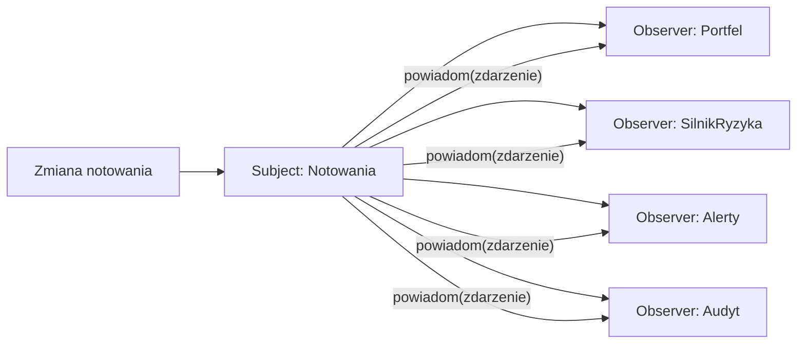
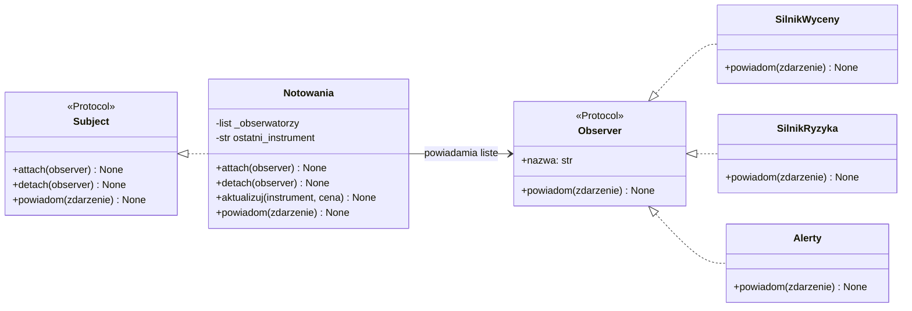
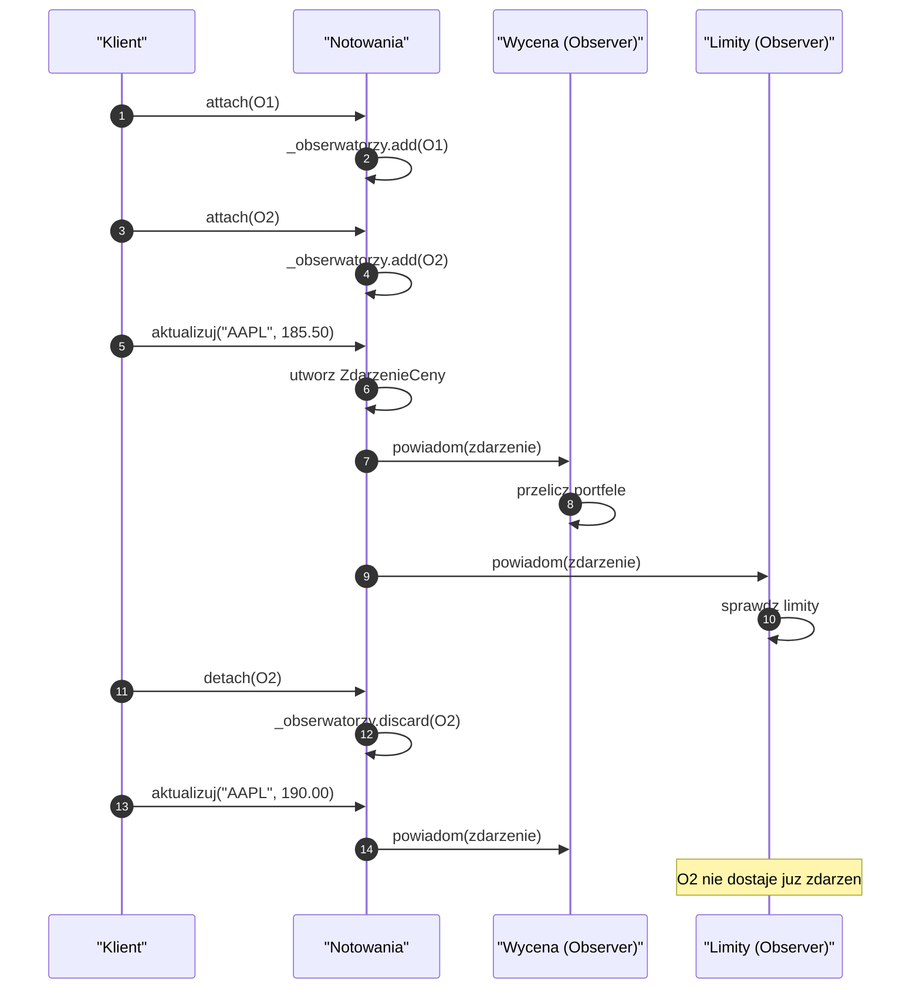
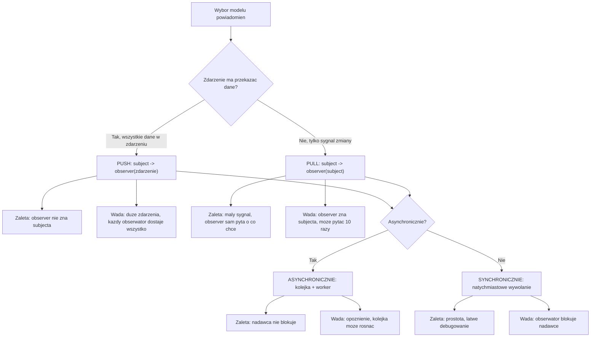
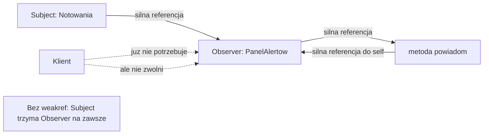
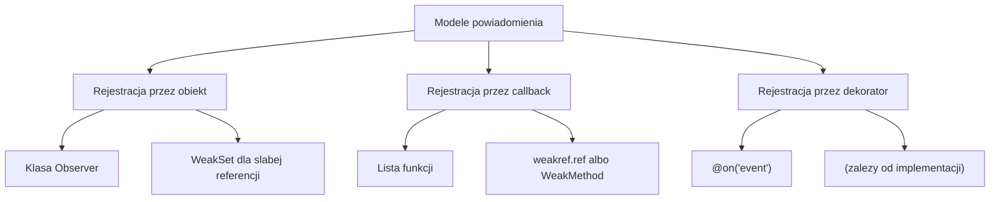
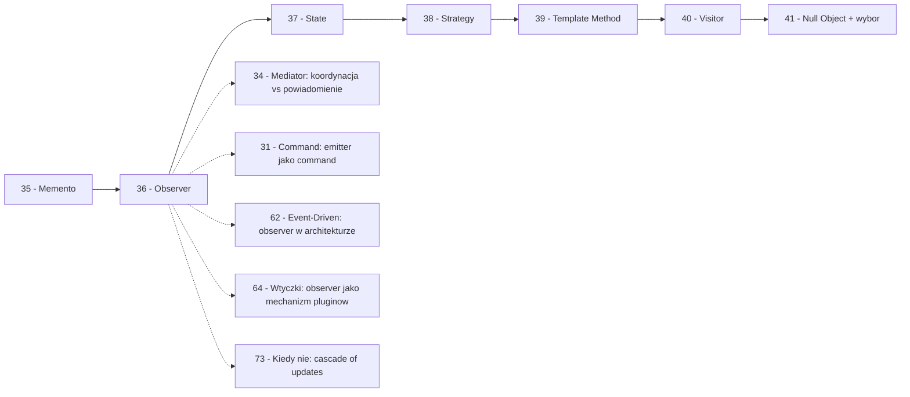

```markdown
---
modul: 36 — Observer
plik: 36-observer.md
poziom: sredni
wymaga: [35]
czas: ~165 minut czytania + ~400 minut ćwiczeń
---

# Moduł 36 — Observer — jeden mówi, wielu słucha

> **TL;DR**
> - **Observer (obserwator)** definiuje zależność **jeden-do-wielu**: gdy jeden obiekt (Subject) zmienia stan, wielu zainteresowanych (Observer) jest automatycznie powiadamianych — bez tego, żeby Subject wiedział, kim dokładnie są.
> - Kluczowa własność: **Subject nie zna konkretnych klas obserwatorów** — widzi tylko `Protocol` z metodą `powiadom`. Można dodawać nowych słuchaczy bez zmian w nadawcy.
> - W Pythonie najprostszy Observer to **lista funkcji-callbacków** (5 linii); pełna klasa potrzebna jest dopiero, gdy trzeba trzymać stan, używać priorytetów, słabych referencji albo asynchroniczności.
> - Najważniejsza pułapka to **wyciek pamięci przez referencje** — Subject trzyma obserwatorów, więc jeśli nie usuniesz ich jawnie (albo nie użyjesz `weakref`), „umarłe" obiekty zostaną w pamięci na zawsze.
> - Observer to fundament **architektury sterowanej zdarzeniami** (Event-Driven) i sygnałów (`blinker`, sygnały Django, PyQt signals) — ale nadmiar powiadomień prowadzi do „kaskadowej lawiny", której debugowanie bywa koszmarem.

---

## 0. Model mentalny

### Newsletter, dzwonek szkolny i tablica ogłoszeń

Wyobraź sobie redakcję dużego newslettera. Redakcja nazbierała 50 000 subskrybentów. Każdy z nich zapisał się kiedyś, podając e-mail. Kiedy redakcja publikuje nowy numer, co się dzieje? Redakcja **nie wie osobiście** o żadnym z czytelników. Nie zna ich imion, nie wie, kto ma ile lat, nie wie, dlaczego się zapisali. Ale **ma listę adresów** i po prostu wysyła wydanie do wszystkich z listy. System doręczania — serwer poczty — dostarcza każdemu jego kopię. **Redakcja mówi raz, słyszy wielu.**

Popatrzmy na trzy własności tego obrazu. Po pierwsze: **redakcja nie zależy od czytelników**. Może mieć 10 czytelników, 10 tysięcy, 10 milionów — jej proces publikacji się nie zmienia. Redakcja **wie tylko o istnieniu listy**, nie o tym, kim są czytelnicy. Po drugie: **każdy czytelnik decyduje sam, co zrobić z wydaniem**. Jeden przeczyta od razu, drugi zapisze do przeczytania, trzeci wyrzuci do folderu. Redakcja tego nie kontroluje. Po trzecie: **czytelnik może zrezygnować** — wyrejestrować się z listy. Od tego momentu nie dostaje nowych wydań, ale nie musi o tym informować redakcji — system subskrypcji to załatwia.

Teraz drugi obraz, który ukaże właściwość współpracy: **dzwonek szkolny**. Wyobraź sobie szkołę. Dzwonek brzmi o 8:55. Na jego dźwięk reagują wszyscy: uczniowie wstają, nauczyciele zbierają rzeczy, woźny wychodzi do drzwi, kucharka kończy zupę na przerwę. Dzwonek **nie wie nic** o tym, kto zareaguje. On brzmi — i to wszystko. Każdy samodzielnie interpretuje dźwięk i podejmuje własne działanie. To jest dokładnie Observer — **Subject emituje zdarzenie, obserwatorzy reagują po swojemu**.

I jeszcze trzeci obraz, który pokaże nam pułapkę. Wyobraź sobie tablicę ogłoszeń w firmie. Ktoś przypina kartkę „Nowe zasady rozliczeń". Widzą ją pracownicy działu A, B, C. Każdy interpretuje ją po swojemu. Dział A zmienia procedury, B pyta o szczegóły, C ignoruje (bo go to nie dotyczy). Ale tablica ma pewien problem: **ktoś musiał ją wyczyścić**, gdy ogłoszenie było nieaktualne. Jeśli tego nie zrobi, kartka wisi tam na zawsze — codziennie ktoś ją czyta, mimo że jest bez znaczenia. To jest pułapka wycieku: **Subject trzyma listę obserwatorów; jeśli ich nie usunie, „umarłe" zainteresowanie nie znika**. Obserwator, który dawno przestał być potrzebny, wciąż jest na liście, wciąż zajmuje pamięć, wciąż może reagować. W Pythonie to realny problem — jest osobnym podrozdziałem tego modułu.

| W analogii newslettera | W kodzie |
|---|---|
| Redakcja | **Subject (Observable)** — nadawca zdarzeń |
| Subskrybenci | **Observer** — odbiorcy |
| Lista adresów | `_obserwatorzy: list[Observer]` w Subject |
| Publikacja numeru | `subject.powiadom()` — powiadomienie wszystkich |
| Zapisywanie do newslettera | `subject.attach(observer)` |
| Rezygnacja | `subject.detach(observer)` |
| Czytelnik czyta i coś z tego robi | `observer.powiadom(zdarzenie)` |
| Redakcja nie zna tożsamości czytelników | Subject nie zna konkretnych klas Observer |
| Dzwonek szkolny | Zdarzenie rozgłaszane |
| Nieaktualna kartka na tablicy | **Wyciek pamięci przez nieusuniętą referencję** |

> 🧠 **Zapamiętaj** — **Observer (obserwator) to wzorzec behawioralny, który definiuje zależność jeden-do-wielu między obiektami: gdy jeden obiekt (Subject) zmienia stan, wszystkie obiekty zależne (Observer) są automatycznie powiadamiane — a Subject nie zna konkretnych klas obserwatorów.**

Zwróć uwagę na trzy słowa w definicji: **jeden-do-wielu**, **automatycznie**, **nie zna konkretnych klas**. „Jeden-do-wielu" — bo związek jest asymetryczny. „Automatycznie" — bo nie ma ręcznego „sprawdź, czy coś się zmieniło". „Nie zna konkretnych klas" — bo Subject ma tylko kontrakt; wie, że coś potrafi `powiadom`, ale nie wie, co to konkretnie.

### Diagram — intuicja wzorca



*Diagram pokazuje, że Subject zna listę obserwatorów, ale nie wie, co konkretnie każdy z nich robi — wszyscy dostają to samo zdarzenie i reagują niezależnie.*

### Czego Observer NIE robi

Rozbrójmy cztery nieporozumienia — Observer ma ich więcej niż inne wzorce, bo jest bardzo powszechny i „prawie naturalny" w nowoczesnym kodzie.

**Nie jest kolejką zdarzeń.** Kolejka (np. `queue.Queue`) przechowuje zdarzenia do późniejszego przetworzenia. Observer **powiadamia natychmiast** (albo prawie natychmiast) — nie ma bufora. W praktyce Observer bywa realizowany przez kolejkę (wariant asynchroniczny), ale to dodatek — bazowy wzorzec nie ma kolejki.

**Nie jest Mediatorem.** Mediator (moduł 34) **koordynuje komunikację** między wieloma równorzędnymi obiektami z logiką decyzyjną. Observer **rozgłasza zdarzenia** z jednego obiektu do wielu — bez koordynacji. Mediator jest aktywny (wie, co robić), Observer pasywny (tylko informuje).

**Nie jest pub/sub (publish-subscribe).** W Observer Subjekt zna referencje do obserwatorów (ma listę). W pub/sub jest **broker** (pośrednik), który nie zna nadawcy ani odbiorcy — obie strony komunikują się z tematem. Observer jest „lokalny", pub/sub jest „zmediatyzowany". Rozróżnienie bywa subtelne, ale istotne: Observer nie wymaga infrastruktury, pub/sub zwykle tak (Redis Pub/Sub, Kafka, NATS).

**Nie jest systemem zdarzeń rozproszonym.** Observer działa w jednym procesie. Rozgłaszanie zdarzeń do innych usług to Event-Driven Architecture (moduł 62) — inna klasa problemu.

**Nie gwarantuje kolejności ani dostarczenia.** W klasycznym Observerze kolejność powiadomień to kolejność rejestracji. Jeśli jeden obserwator zawiedzie, inni mogą nie dostać powiadomienia — w zależności od kontraktu. Nie ma gwarancji „at-least-once" ani „at-most-once".

**Nie jest darmowy.** Każde powiadomienie to wywołanie metody. Dla 1000 obserwatorów i 10 000 zdarzeń na sekundę — 10 milionów wywołań na sekundę. To nie skaluje się automatycznie.

---

## 1. Problem, który rozwiązujemy

Wejdźmy w domenę 📈 „Portfel". System monitoruje notowania instrumentów giełdowych. Kiedy cena instrumentu zmienia się, **kilka modułów** powinno zareagować:

- **Silnik wyceny** — przelicza wartość portfeli, które mają ten instrument.
- **Silnik ryzyka** — sprawdza, czy zmiana nie narusza limitów.
- **Monitorowanie alertów** — wysyła powiadomienia do klientów, którzy ustawili alerty cenowe.
- **Audyt** — zapisuje zmianę do dziennika.
- **Wykresy** — aktualizuje dane na wykresach w czasie rzeczywistym.

Ktoś napisał kod, w którym **notowania znają wszystkie te moduły** i wywołują je bezpośrednio.

### Kod „przed"

```python
# notowania_v0.py — wersja naiwna, demonstracyjna
# UWAGA: kod celowo pokazuje problem sztywnego sprzezenia.

from dataclasses import dataclass
from decimal import Decimal
from datetime import datetime, timezone


@dataclass
class Notowanie:
    instrument: str
    cena: Decimal
    znak_czasu: str


class SilnikWyceny:
    def przelicz(self, notowanie: Notowanie) -> None:
        print(f"[WYCENA] {notowanie.instrument}: przeliczam portfele")


class SilnikRyzyka:
    def sprawdz(self, notowanie: Notowanie) -> None:
        print(f"[RYZYKO] {notowanie.instrument}: sprawdzam limity")


class Alerty:
    def wyslij(self, notowanie: Notowanie) -> None:
        print(f"[ALERTY] {notowanie.instrument}: powiadamiam klientow")


class Audyt:
    def zapisz(self, notowanie: Notowanie) -> None:
        print(f"[AUDYT] {notowanie.instrument}: zapisuje zmiane")


class Notowania:
    """Klasa, ktora SAMA wywoluje wszystkie moduły - sztywne sprzezenie."""

    def __init__(self) -> None:
        self._wycena = SilnikWyceny()
        self._ryzyko = SilnikRyzyka()
        self._alerty = Alerty()
        self._audyt = Audyt()

    def aktualizuj(self, instrument: str, cena: Decimal) -> None:
        notowanie = Notowanie(
            instrument=instrument,
            cena=cena,
            znak_czasu=datetime.now(timezone.utc).isoformat(),
        )
        # Wywolania bezposrednie - kazdy nowy modul wymaga zmiany tutaj!
        self._wycena.przelicz(notowanie)
        self._ryzyko.sprawdz(notowanie)
        self._alerty.wyslij(notowanie)
        self._audyt.zapisz(notowanie)


if __name__ == "__main__":
    n = Notowania()
    n.aktualizuj("AAPL", Decimal("185.50"))
```

Ten kod działa, ale ma cztery problemy, które widać dopiero przy rozbudowie systemu. Zwróć uwagę na `aktualizuj` — metoda zawiera **wszystkie** wywołania. Każdy nowy moduł to kolejna linia w tej metodzie.

### Code smell — Subject znający wszystkich obserwatorów

| Problem | Gdzie | Konsekwencja |
|---|---|---|
| Subject zna konkretne klasy modułów | `Notowania.__init__` | Notowania zna 4 moduły — sprzężenie |
| Lista modułów zaszyta w konstruktorze | Przy inicjalizacji | Dodanie nowego modułu wymaga zmiany Notowań |
| Wywołania bezpośrednie w metodzie | `aktualizuj` | Kolejność zaszyta, moduły nie mogą być nieobecne |
| Brak możliwości wyłączenia modułu | Bez mechanizmu | Trzeba tworzyć moduły „puste" |
| Trudno testować Notowania bez modułów | Bo tworzy je samodzielnie | Testy wymagają pełnej konfiguracji |
| Zmiana interfejsu modułu łamie Notowania | Wywołanie konkretnej metody | Brak kontraktu — bezpośrednie zależności |
| Brak wielokrotnej publikacji do tego samego notowania | Bo każda zmiana jest nowym notowaniem | Nie można wywołać raz, słyszeć wiele razy |
| Nie ma sposobu na dodanie „obserwatora ad hoc" | Konstruktor zna listę | Test/fun debug nie może się dopisać |

### Objawy — poznasz ten problem po tym, że...

- **Subject wie o wszystkich swoich odbiorcach.** W konstruktorze widzisz tworzenie 4–10 obiektów, do których Subject będzie wywoływał metody.
- **Dodanie nowego modułu wymaga zmiany klasy Subject.** Nowa funkcjonalność → nowa linia w `aktualizuj` (albo nowe pole w konstruktorze).
- **Nie da się „wyłączyć" reakcji w runtime.** Trzeba w modułach dodawać `if`y (`jeśli tryb testowy, to pomiń`).
- **Testowanie Subject wymaga wszystkich modułów.** Nie da się podstawić fake'ów — Subject je tworzy sam.
- **Nie ma jednego miejsca, gdzie widać „kto reaguje na to zdarzenie"**. Lista odbiorców jest ukryta w kodzie.
- **Kolejność jest sztywna.** Zawsze silnik wyceny → ryzyko → alerty → audyt. Nie da się zmienić w runtime.
- **Nie da się „publikować w tle" albo „dostarczyć do kolejki".** Reakcja jest natychmiastowa i synchroniczna.
- **W przypadku awarii modułu — całość pada.** Jeśli alerty rzucą wyjątek, audyt tego nie odnotuje.
- **Pula `if`ów albo konfiguracji w Subject.** Czasem Subject pyta „czy moduł jest aktywny" — sygnał, że potrzebuje elastyczności.

---

## 2. Anatomia wzorca

### Uczestnicy

| Rola | Odpowiedzialność | Co NIE jest jej zadaniem |
|---|---|---|
| **Subject (subjekt, obiekt obserwowany)** | Udostępnia metody `attach`, `detach`; przechowuje listę obserwatorów; rozsyła powiadomienia | Nie zawiera logiki reakcji — to zadanie obserwatorów; nie zna konkretnych klas |
| **ConcreteSubject (subjekt konkretny)** | Konkretna implementacja Subject z własnym stanem i własnymi zdarzeniami | Nie wie, co robią obserwatorzy z jego zdarzeniami |
| **Observer (obserwator)** | Kontrakt z metodą `powiadom(zdarzenie)` albo `update(subject)` | Nie wie o innych obserwatorach; nie modyfikuje Subject |
| **ConcreteObserver (obserwator konkretny)** | Konkretna reakcja na zdarzenie — z własną logiką | Nie zna Subject „od środka"; używa publicznego API |
| **Klient** | rejestruje / wyrejestrowuje obserwatorów; używa Subject do wywoływania zdarzeń | Nie zawiadamia obserwatorów samodzielnie — to zadanie Subject |

**Kluczowa asymetria:** Subject **zna tylko kontrakt** Observera (może mieć listę `Observer`, ale nie wie, co to konkretnie za klasy). Observer **nie zna innych obserwatorów** — może nie wiedzieć nawet, że istnieją. Completna separacja.

### Diagram struktury



*Diagram pokazuje klasyczną strukturę: Subject przechowuje listę Observer, ale zna tylko ich wspólny kontrakt; konkretne klasy obserwatorów są dla niego nieprzezroczyste.*

Przeczytajmy ten diagram zdanie po zdaniu. `Subject` to kontrakt. `Notowania` to konkretny Subject — ma listę `_obserwatorzy`, swoją logikę (przyjmuje notowania), i metodę `powiadom` rozsyłająca zdarzenie. `Observer` to drugi kontrakt — obserwatorzy umieją `powiadom(zdarzenie)` i mają `nazwa` (dla diagnostyki). `SilnikWyceny`, `SilnikRyzyka`, `Alerty` — konkretne klasy obserwatorów.

Kluczowa strzałka: `Notowania --> Observer: powiadamia listę`. To **jedyne** miejsce, w którym Subject zależy od Observera — i to przez abstrakcję. Nie ma strzałki „Notowania wie o SilnikWyceny". To jest istota wzorca.

### Warianty: klasyczny vs pythoniczny

| Aspekt | Klasyczny (GoF) | Pythoniczny |
|---|---|---|
| Subject | Klasa `ABC` z metodami attach/detach | `Protocol` + lista funkcji |
| Obserwatorzy | Klasy z metodą `update()` | Funkcje (callbacki) |
| Rejestracja | `attach(observer)` (obiekt) | `attach(funkcja)` (callable) |
| Powiadomienie | `obs.update(subject)` | `callback(zdarzenie)` |
| Silne/słabe referencje | Zawsze silne | Możliwe słabe (`weakref`) |
| Kolejność | Kolejność rejestracji | Kolejność rejestracji (albo priorytet) |

W Pythonie **funkcje-callbacki** pokrywają większość przypadków. Klasy potrzebne są dopiero wtedy, gdy:
- obserwator ma własny stan,
- trzeba go porównać (silna tożsamość),
- potrzebujemy priorytetów,
- chcemy słabe referencje do „żywych" obiektów.

---

## 3. Implementacja krok po kroku

Przebudujemy przykład z sekcji 1.

### Krok 1 — Zdefiniuj kontrakt Observer

Najpierw co widzi Subject. Najprostszy kontrakt — jedna metoda.

```python
from typing import Protocol, runtime_checkable


@runtime_checkable
class Observer(Protocol):
    """Kontrakt obserwatora: cokolwiek, co umie zareagowac na zdarzenie."""

    nazwa: str
    def powiadom(self, zdarzenie: "ZdarzenieNotowania") -> None: ...
```

Uwaga na `nazwa` — to nie jest wymagane dla działania, ale bardzo pomaga w diagnozie: „kto zareagował", „kto rzucił błąd". Bez tego trudno zidentyfikować problem.

### Krok 2 — Zdefiniuj typ zdarzenia

Zdarzenie — obiekt, który niesie dane.

```python
from dataclasses import dataclass
from decimal import Decimal


@dataclass(frozen=True, slots=True)
class ZdarzenieNotowania:
    instrument: str
    cena: Decimal
    poprzednia_cena: Decimal
    zmiana_procentowa: Decimal
    znacznik_czasu: str

    def to_string(self) -> str:
        return (
            f"{self.instrument}: {self.cena} "
            f"({self.zmiana_procentowa:+.2%})"
        )
```

Zdarzenie jest **niemutowalne** — to dobra praktyka; obserwatorzy nie mogą go zmieniać, każdy widzi ten sam stan.

### Krok 3 — Zdefiniuj Subject

Subject trzyma listę i metody zarządzania.

```python
class Notowania:
    """Subject: rozglasza zdarzenia do listy obserwatorow."""

    def __init__(self) -> None:
        self._obserwatorzy: list[Observer] = []
        self._ceny: dict[str, Decimal] = {}

    def attach(self, observer: Observer) -> None:
        """Dodaje obserwatora. Bez duplikatow."""
        if observer in self._obserwatorzy:
            return
        self._obserwatorzy.append(observer)

    def detach(self, observer: Observer) -> None:
        """Usuwa obserwatora."""
        try:
            self._obserwatorzy.remove(observer)
        except ValueError:
            pass

    @property
    def liczba_obserwatorow(self) -> int:
        return len(self._obserwatorzy)

    def aktualizuj(self, instrument: str, cena: Decimal) -> None:
        """Zmienia cene i rozglasza zdarzenie."""
        poprzednia = self._ceny.get(instrument, cena)
        self._ceny[instrument] = cena

        if poprzednia == 0:
            zmiana = Decimal("0")
        else:
            zmiana = (cena - poprzednia) / poprzednia

        zdarzenie = ZdarzenieNotowania(
            instrument=instrument,
            cena=cena,
            poprzednia_cena=poprzednia,
            zmiana_procentowa=zmiana,
            znacznik_czasu=datetime.now(timezone.utc).isoformat(),
        )

        self.powiadom(zdarzenie)

    def powiadom(self, zdarzenie: ZdarzenieNotowania) -> None:
        """Rozglasza zdarzenie do wszystkich obserwatorow."""
        # KOPIUJEMY liste - obserwator moze sie wyrejestrowac w trakcie!
        for observer in list(self._obserwatorzy):
            try:
                observer.powiadom(zdarzenie)
            except Exception as blad:
                # Jeden obserwator nie przerywa reszty
                print(f"[BLAD] {observer.nazwa}: {blad}")
```

**Kluczowe decyzje:**
1. **`list(self._obserwatorzy)`** — kopiujemy listę przed iteracją. Jeśli obserwator usunie się w reakcji (co jest legalne), iteracja po oryginalnej liście wywołałaby `RuntimeError: list changed size during iteration`.
2. **`try/except` dookoła wywołania** — jeden błąd obserwatora nie blokuje reszty. To **kontrakt** Observera: „wszyscy obserwatorzy zostaną powiadomieni, nawet jeśli jeden zawiedzie".
3. **`if observer in ...`** — bez duplikatów. Podwójna rejestracja tego samego obserwatora nie ma sensu.

### Krok 4 — Zaimplementuj konkretnych obserwatorów

Każdy obserwator reaguje po swojemu.

```python
class SilnikWyceny:
    nazwa = "wycena"

    def __init__(self) -> None:
        self.liczba_przeliczen = 0

    def powiadom(self, zdarzenie: ZdarzenieNotowania) -> None:
        self.liczba_przeliczen += 1
        # Realnie: przeliczenie portfeli zawierajacych instrument


class SilnikRyzyka:
    nazwa = "ryzyko"

    def __init__(self) -> None:
        self.limit_zmiany = Decimal("0.05")

    def powiadom(self, zdarzenie: ZdarzenieNotowania) -> None:
        if abs(zdarzenie.zmiana_procentowa) > self.limit_zmiany:
            print(f"[RYZYKO] duza zmiana: {zdarzenie.to_string()}")


class Alerty:
    nazwa = "alerty"

    def __init__(self) -> None:
        self.progi: dict[str, Decimal] = {}

    def ustaw_prog(self, instrument: str, prog: Decimal) -> None:
        self.progi[instrument] = prog

    def powiadom(self, zdarzenie: ZdarzenieNotowania) -> None:
        prog = self.progi.get(zdarzenie.instrument)
        if prog is not None and zdarzenie.cena >= prog:
            print(f"[ALERT] {zdarzenie.instrument} przekroczyl {prog}")


class Audyt:
    nazwa = "audyt"

    def __init__(self) -> None:
        self.wpisy: list[ZdarzenieNotowania] = []

    def powiadom(self, zdarzenie: ZdarzenieNotowania) -> None:
        self.wpisy.append(zdarzenie)
```

**Każdy obserwator ma własną logikę.** Żaden nie wie o pozostałych. Każdy mógłby być usunięty bez psucia innych.

### Krok 5 — Klient łączy Subject z Observerami

```python
def zbuduj_system() -> tuple[Notowania, list[Observer]]:
    notowania = Notowania()
    wycena = SilnikWyceny()
    ryzyko = SilnikRyzyka()
    alerty = Alerty()
    audyt = Audyt()
    alerty.ustaw_prog("AAPL", Decimal("190.00"))

    for obs in (wycena, ryzyko, alerty, audyt):
        notowania.attach(obs)

    return notowania, [wycena, ryzyko, alerty, audyt]


# Uzycie:
notowania, obserwatorzy = zbuduj_system()
notowania.aktualizuj("AAPL", Decimal("185.50"))
notowania.aktualizuj("AAPL", Decimal("192.00"))   # alert!
```

Klient tworzy oba końce i łączy przez `attach`. Po tym Subject nie potrzebuje **nic więcej** — sam rozsyła zdarzenia.

### Krok 6 — Dodaj obsługę wyjątków per obserwator (kontrakt)

To już mamy w `powiadom`, ale warto pokazać jawnie — powiadomienie każdego obserwatora w izolacji.

```python
# W metoda.powiadom (pokazane powyzej):
for observer in list(self._obserwatorzy):
    try:
        observer.powiadom(zdarzenie)
    except Exception as blad:
        print(f"[BLAD] {observer.nazwa}: {blad}")
```

**Alternatywne kontrakty** (o tym w sekcji 4):
- **Wszyscy niezależnie** (pokazane wyżej) — błąd jednego nie wpływa na innych.
- **Pierwszy błąd przerywa** — wszystkie wywołania w jednym `try`.
- **Zbieranie błędów** — wykonaj wszystkich, zwróć listę błędów.

Wybór jest **decyzją projektową** — nie ma jednej właściwej.

### Krok 7 — Weryfikacja

| Kryterium | Wersja „przed" | Wersja „po" |
|---|---|---|
| Subject zna konkretne klasy | Tak (4 klasy) | Nie (kontrakt) |
| Dodanie obserwatora | Zmiana konstruktora | `attach(observer)` |
| Usunięcie | Zmiana konstruktora | `detach(observer)` |
| Kolejność wywołań | Zaszyta | Kolejność rejestracji |
| Jeden błąd = blokada? | Tak | Nie (obsługa per obserwator) |
| Rejestracja runtime | Nie | Tak |
| Testowanie Subject | Wymaga wszystkich | Może być puste (bez obserwatorów) |
| Liczba klas | 5 | 5 (bez zmian — zmieniła się relacja) |

Koszt: trochę dodatkowej liczby linii w Subject. Zysk: **Subject jest luźno powiązany z obserwatorami**, można dodawać/usuwać w runtime.

---

## 4. Wersje pythoniczne i warianty

Ta sekcja jest najobszerniejsza w module — bo Observer ma najwięcej wariantów realizacji w Pythonie.

### 4.1 Lista funkcji-callbacków — najprostszy

Zamiast klas z `powiadom`, po prostu lista funkcji.

```python
from collections.abc import Callable

Zdarzenie = dict   # albo typ
Callback = Callable[[Zdarzenie], None]


class NotowaniaABC:
    def __init__(self) -> None:
        self._callbacks: list[Callback] = []

    def subskrybuj(self, callback: Callback) -> None:
        if callback not in self._callbacks:
            self._callbacks.append(callback)

    def odsubskrybuj(self, callback: Callback) -> None:
        try:
            self._callbacks.remove(callback)
        except ValueError:
            pass

    def emituj(self, zdarzenie: Zdarzenie) -> None:
        for cb in list(self._callbacks):
            cb(zdarzenie)


# Uzycie:
n = NotowaniaABC()
n.subskrybuj(lambda z: print(f"Wycena: {z}"))
n.subskrybuj(lambda z: print(f"Ryzyko: {z}"))
n.emituj({"instrument": "AAPL", "cena": 185.50})
```

Zaleta: **pięć linii i działa**, bardzo pythoniczne. Wada: **brak kontraktu** (co dostaje callback?), trudno o priorytety, trudno o słabe referencje. To najczęstsze użycie w prostych projektach.

### 4.2 Dekorator `@on` z rejestracją przez `__init_subclass__`

Dla bardziej strukturalnego podejścia.

```python
class EventBus:
    """Event bus z rejestracja przez dekorator."""

    def __init__(self) -> None:
        self._handlers: dict[str, list[Callable]] = {}

    def on(self, zdarzenie: str):
        def dekorator(funkcja):
            self._handlers.setdefault(zdarzenie, []).append(funkcja)
            return funkcja
        return dekorator

    def emituj(self, zdarzenie: str, dane: object = None) -> None:
        for handler in self._handlers.get(zdarzenie, []):
            handler(dane)


bus = EventBus()

@bus.on("notowanie")
def loguj(z):
    print(f"[LOG] {z}")

@bus.on("notowanie")
def wyslij_alert(z):
    print(f"[ALERT] {z}")

bus.emituj("notowanie", {"instrument": "AAPL"})
```

Zaleta: bardzo czytelne — widać, do czego rejestruje się funkcja. Wada: dekoratory zależą od konkretnej instancji busa (albo od stanu globalnego).

### 4.3 `blinker` — realna biblioteka

`blinker` to popularna biblioteka sygnałów, idealna do realizacji Observera.

```python
# pip install blinker
from blinker import Signal

notowanie = Signal("notowanie")

@notowanie.connect
def loguj(sender, **kwargs):
    print(f"[LOG] {sender}: {kwargs}")

@notowanie.connect
def wyslij_alert(sender, **kwargs):
    print(f"[ALERT] {sender}: {kwargs}")

notowanie.send("AAPL", cena=185.50)
```

Zalety: gotowe, sprawdzone, wspiera słabe referencje (domyślnie — tak!), integracja z Flask. Wady: external dependency.

### 4.4 Sygnały Django

Django ma wbudowany system sygnałów — realizacja Observera w frameworku.

```python
from django.db.models.signals import post_save
from django.dispatch import receiver


@receiver(post_save, sender=NotowanieModel)
def po_zapisaniu_notowania(sender, instance, created, **kwargs):
    if created:
        # Powiadom inne moduly
        ...
```

Zaleta: standard dla Django, wspiera słabe referencje (`weak=True` domyślnie). Wada: **tylko w ekosystemie Django** — poza nim nie ma sensu.

### 4.5 PyQt/PySide signals/slots

Kolejna realna realizacja — sygnały Qt.

```python
from PyQt6.QtCore import QObject, pyqtSignal


class NotowaniaModel(QObject):
    notowanie_zmienione = pyqtSignal(str, float)

    def aktualizuj(self, instrument: str, cena: float) -> None:
        self.notowanie_zmienione.emit(instrument, cena)


# Uzycie (w oknie):
model = NotowaniaModel()
model.notowanie_zmienione.connect(aktualizuj_wykres)
model.notowanie_zmienione.connect(loguj)
```

Zaleta: wyrafinowany system sygnałów z Qt — priorytety, wątki, słabe referencje. Wada: tylko w aplikacjach Qt.

### 4.6 `weakref` — KLUCZOWA technika

To najważniejsza część sekcji. Bez `weakref` Observer ma **poważny problem z wyciekiem pamięci**.

Problem: Subject trzyma **silną referencję** do każdego obserwatora. Jeśli obserwator zostanie „usunięty" z systemu przez klienta (np. zamknięcie okna, zakończenie sesji), ale Subject nadal go trzyma — **obserwator nie zostanie zwolniony**. Zostanie w pamięci, dopóki Subject żyje.

```python
class PanelAlertow:
    """Obserwator, ktory 'umiera', ale Subject go trzyma."""

    def __init__(self, nazwa: str) -> None:
        self.nazwa = nazwa

    def powiadom(self, zdarzenie) -> None:
        print(f"{self.nazwa}: {zdarzenie}")


n = NotowaniaABC()
panel = PanelAlertow("panel1")
n.subskrybuj(panel.powiadom)   # SILNA referencja!

del panel   # panel powinien zniknac...
# ... ale NotowaniaABC trzyma referencje do panel.powiadom (metoda zwiazana!)
# ... ktora trzyma referencje do panel. Panel NIE zostanie zwolniony.
```

**Rozwiązanie — `weakref`.** Subject trzyma **słabe referencje** do obserwatorów. Jeśli obserwator umrze (znikną wszystkie silne referencje), wpis w Subject też zniknie.

```python
import weakref
from typing import Any


class NotowaniaWeak:
    """Subject ze slabymi referencjami do obserwatorow (obiektow)."""

    def __init__(self) -> None:
        # WeakSet - zbior slabych referencji; automatycznie usuwa umarle
        self._obserwatorzy: weakref.WeakSet[Any] = weakref.WeakSet()

    def attach(self, observer: Any) -> None:
        self._obserwatorzy.add(observer)

    def detach(self, observer: Any) -> None:
        self._obserwatorzy.discard(observer)

    def emituj(self, zdarzenie: Any) -> None:
        for obs in list(self._obserwatorzy):
            obs.powiadom(zdarzenie)
```

**Ale uwaga na dwa niuanse:**
1. `weakref.WeakSet` wymaga, żeby obiekty były **haszowalne** i **miały stabilne `__hash__`**. To typowe dla klas, ale nie zawsze dla obiektów funkcyjnych.
2. **Funkcje-callbacki (lambdy) nie są słabo referencjonowane w prosty sposób** — bo lambdy znikają natychmiast (nikt ich nie trzyma). Trzeba trzymać sam obiekt (nie schemat `panel.powiadom`), a wywoływać `observer.powiadom(...)`.

```python
class NotowaniaWeakObiekty:
    def __init__(self) -> None:
        self._obserwatorzy: weakref.WeakSet = weakref.WeakSet()

    def attach(self, observer) -> None:
        # observer to OBIEKT (nie metoda!)
        self._obserwatorzy.add(observer)

    def emituj(self, zdarzenie) -> None:
        for obs in list(self._obserwatorzy):
            obs.powiadom(zdarzenie)
```

Teraz `del panel` sprawi, że panel zniknie z WeakSet automatycznie. **To jest realizacja Observera bez wycieków pamięci**.

### 4.7 Wariant asynchroniczny — `asyncio.Queue` + konsumenci

Dla systemów, gdzie obserwatorzy nie powinni blokować nadawcy.

```python
import asyncio


class NotowaniaAsync:
    def __init__(self) -> None:
        self._queues: list[asyncio.Queue] = []

    def subskrybuj(self) -> asyncio.Queue:
        q: asyncio.Queue = asyncio.Queue()
        self._queues.append(q)
        return q

    def emituj(self, zdarzenie) -> None:
        for q in list(self._queues):
            q.put_nowait(zdarzenie)


# Konsument:
async def odbieraj(q: asyncio.Queue) -> None:
    while True:
        zdarzenie = await q.get()
        print(f"[ASYNC] {zdarzenie}")


# Uruchomienie:
async def main() -> None:
    n = NotowaniaAsync()
    q1 = n.subskrybuj()
    q2 = n.subskrybuj()

    task1 = asyncio.create_task(odbieraj(q1))
    task2 = asyncio.create_task(odbieraj(q2))

    n.emituj({"instrument": "AAPL", "cena": 185.50})   # natychmiast
    await asyncio.sleep(0.1)
    task1.cancel()
    task2.cancel()
```

Zaleta: każdy konsument na własnym tempie, nadawca nie blokuje. Wada: **zmiana semantyki** — powiadomienie jest odroczone, kolejność może się różnić, błędy obserwatorów są niewidoczne dla nadawcy.

### 4.8 Priorytety obserwatorów

Niektóre implementacje potrzebują **priorytetów** — np. audyt powinien dostać zdarzenie **pierwszy**, żeby zapisać wszystko.

```python
import heapq
from dataclasses import dataclass, field
from itertools import count


@dataclass(order=True)
class Wpis:
    priorytet: int
    kolejnosc: int
    observer: object = field(compare=False)


class NotowaniaPriorytetowe:
    def __init__(self) -> None:
        self._heap: list[Wpis] = []
        self._licznik = count()

    def attach(self, observer, priorytet: int = 0) -> None:
        heap_push(self._heap, Wpis(-priorytet, next(self._licznik), observer))

    def emituj(self, zdarzenie) -> None:
        for wpis in sorted(self._heap):   # kopia
            wpis.observer.powiadom(zdarzenie)
```

Priorytety to dodatek, który często robi problemy — stają się kolejnym „niewidzialnym" stanem. Używać ostrożnie.

### 4.9 Slabe referencje z callbackami

Łączenie `weakref` z callbackami bywa wyzwaniem. Jedno z rozwiązań: `WeakMethod`.

```python
import weakref


class SubscriberHolder:
    """Trzyma slaba referencje do metody obiektu."""

    def __init__(self, obiekt, metoda: str) -> None:
        self._weak_ref = weakref.WeakMethod(getattr(obiekt, metoda))
        self.nazwa = getattr(obiekt, "nazwa", type(obiekt).__name__)

    def powiadom(self, zdarzenie) -> None:
        metoda = self._weak_ref()
        if metoda is None:
            # Obiekt juz nie istnieje
            raise ReferenceError(f"obserwator {self.nazwa} juz nie istnieje")
        metoda(zdarzenie)


# Subject moze po prostu pomijac wpisy, ktore rzucily ReferenceError
```

`weakref.WeakMethod` to wbudowane narzędzie dla metod wiązanych. **To bardzo praktyczna technika** w systemach, gdzie obserwatorzy to obiekty z metodami.

### 4.10 Podsumowanie — tabela wyboru

| Sytuacja | Wariant |
|---|---|
| Prosty projekt, funkcje jako reakcje | Lista callbacków (4.1) |
| Chcesz czytać w kodzie, kto gdzie reaguje | Dekorator `@on` (4.2) |
| Flask, skala aplikacji, słabe ref. w standardzie | `blinker` (4.3) |
| Django | Sygnały Django (4.4) |
| Aplikacja Qt | Signals/slots (4.5) |
| Obserwatorzy mogą „umierać", uniknięcie wycieków | `weakref` / `WeakSet` (4.6) |
| Asynchronicznie, nie blokuj nadawcy | `asyncio.Queue` (4.7) |
| Priorytety (np. audyt pierwszy) | Kolejka priorytetowa (4.8) |
| Metody obiektów ze słabymi referencjami | `WeakMethod` (4.9) |

> 🧠 **Zapamiętaj** — **W 90% przypadków w Pythonie Observer to lista callbacków albo `WeakSet`.** Pełne klasy z `attach`/`detach` są potrzebne dopiero, gdy: (1) chcesz kontrolować cykl życia obserwatorów przez słabe referencje, (2) potrzebujesz priorytetów, (3) używasz frameworka z własnym mechanizmem sygnałów. **Nie buduj klasy Observer bez powodu.**

---

## 5. Przykład z życia: 🔔 Alerty — pełny uruchamialny kod

Zbudujemy system alertów reagujący na zmiany notowań instrumentów. Obserwatorzy: 4 moduły z różnymi reakcjami, każdy może być dodany/odłączony w runtime, z obsługą błędów.

### Kod

```python
# alerty_observer.py — pelny przyklad Observer
from __future__ import annotations

import weakref
from dataclasses import dataclass
from datetime import datetime, timezone
from decimal import Decimal
from typing import Protocol, runtime_checkable


# ===========================================================================
# 1. Typ zdarzenia
# ===========================================================================

@dataclass(frozen=True, slots=True)
class ZdarzenieCeny:
    instrument: str
    cena: Decimal
    poprzednia: Decimal
    zmiana_proc: Decimal
    znacznik: str

    def tekst(self) -> str:
        znak = "+" if self.zmiana_proc >= 0 else ""
        return (
            f"{self.instrument}={self.cena} "
            f"({znak}{self.zmiana_proc:.2%})"
        )


# ===========================================================================
# 2. Kontrakt obserwatora
# ===========================================================================

@runtime_checkable
class ObserwatorCeny(Protocol):
    nazwa: str
    def powiadom(self, zdarzenie: ZdarzenieCeny) -> None: ...


# ===========================================================================
# 3. Konkretni obserwatorzy
# ===========================================================================

class WycenaPortfeli:
    nazwa = "wycena"

    def __init__(self) -> None:
        self.liczba_operacji = 0

    def powiadom(self, zdarzenie: ZdarzenieCeny) -> None:
        self.liczba_operacji += 1
        # Realnie: przeliczenie portfeli zawierajacych instrument


class KontrolaLimitow:
    nazwa = "limity"

    def __init__(self, limit_proc: Decimal = Decimal("0.05")) -> None:
        self.limit = limit_proc
        self.naruszenia: list[str] = []

    def powiadom(self, zdarzenie: ZdarzenieCeny) -> None:
        if abs(zdarzenie.zmiana_proc) > self.limit:
            self.naruszenia.append(zdarzenie.instrument)


class PowiadomieniaKlientow:
    nazwa = "powiadomienia"

    def __init__(self) -> None:
        self.progi: dict[str, Decimal] = {}

    def ustaw_prog(self, instrument: str, prog: Decimal) -> None:
        self.progi[instrument] = prog

    def powiadom(self, zdarzenie: ZdarzenieCeny) -> None:
        prog = self.progi.get(zdarzenie.instrument)
        if prog is not None and zdarzenie.cena >= prog:
            print(f"  [ALERT] {zdarzenie.tekst()} przekroczyl prog {prog}")


class AudytZmian:
    nazwa = "audyt"

    def __init__(self) -> None:
        self.zapisane: list[ZdarzenieCeny] = []

    def powiadom(self, zdarzenie: ZdarzenieCeny) -> None:
        self.zapisane.append(zdarzenie)


class WykresyCzasuRzeczywistego:
    nazwa = "wykresy"

    def __init__(self) -> None:
        self.punkty: list[tuple[str, Decimal]] = []

    def powiadom(self, zdarzenie: ZdarzenieCeny) -> None:
        self.punkty.append((zdarzenie.instrument, zdarzenie.cena))


class ObserwatorAwarcyjny:
    """Obserwator, ktory rzuca wyjatek - dla testu odpornosci."""

    nazwa = "awaryjny"

    def powiadom(self, zdarzenie: ZdarzenieCeny) -> None:
        raise RuntimeError("umyslnie rzucam blad")


# ===========================================================================
# 4. Subject: Notowania
# ===========================================================================

class Notowania:
    """Subject: rozglasza zdarzenia do listy obserwatorow."""

    def __init__(self) -> None:
        # WeakSet: slabe referencje - automatyczne usuwanie umarlych obserwatorow
        self._obserwatorzy: weakref.WeakSet = weakref.WeakSet()
        self._ceny: dict[str, Decimal] = {}
        self.liczba_powiadomien = 0
        self.bledy: list[tuple[str, str]] = []

    def attach(self, observer: ObserwatorCeny) -> None:
        if not isinstance(observer, ObserwatorCeny):
            raise TypeError(
                f"{type(observer).__name__} nie spelnia kontraktu ObserwatorCeny"
            )
        self._obserwatorzy.add(observer)

    def detach(self, observer: ObserwatorCeny) -> None:
        self._obserwatorzy.discard(observer)

    @property
    def liczba_obserwatorow(self) -> int:
        return len(self._obserwatorzy)

    def aktualizuj(self, instrument: str, cena: Decimal) -> None:
        poprzednia = self._ceny.get(instrument, cena)
        self._ceny[instrument] = cena

        if poprzednia == 0:
            zmiana = Decimal("0")
        else:
            zmiana = (cena - poprzednia) / poprzednia

        zdarzenie = ZdarzenieCeny(
            instrument=instrument,
            cena=cena,
            poprzednia=poprzednia,
            zmiana_proc=zmiana,
            znacznik=datetime.now(timezone.utc).isoformat(timespec="seconds"),
        )
        self._powiadom(zdarzenie)

    def _powiadom(self, zdarzenie: ZdarzenieCeny) -> None:
        """Rozglasza zdarzenie - kopiujemy liste, chronimy przed bledami."""
        # Kopia na wypadek obserwatora, ktory sam sie wyrejestruje
        for obs in list(self._obserwatorzy):
            try:
                obs.powiadom(zdarzenie)
                self.liczba_powiadomien += 1
            except Exception as blad:
                # Logujemy blad, ale nie przerywamy petli
                self.bledy.append((obs.nazwa, str(blad)))


# ===========================================================================
# 5. Demonstracja
# ===========================================================================

if __name__ == "__main__":
    notowania = Notowania()

    wycena = WycenaPortfeli()
    limity = KontrolaLimitow(limit_proc=Decimal("0.03"))
    powiadomienia = PowiadomieniaKlientow()
    powiadomienia.ustaw_prog("AAPL", Decimal("190.00"))
    audyt = AudytZmian()
    wykresy = WykresyCzasuRzeczywistego()

    print("=== 1. Rejestracja obserwatorow ===")
    for obs in (wycena, limity, powiadomienia, audyt, wykresy):
        notowania.attach(obs)
    print(f"  Liczba obserwatorow: {notowania.liczba_obserwatorow}")

    print("\n=== 2. Powiadomienia z wielu zmian ===")
    for cena in ("185.50", "187.00", "192.00", "180.00"):
        notowania.aktualizuj("AAPL", Decimal(cena))

    print(f"  Wycena: {wycena.liczba_operacji} operacji")
    print(f"  Naruszenia limitow: {limity.naruszenia}")
    print(f"  Audyt: {len(audyt.zapisane)} wpisow")
    print(f"  Wykresy: {len(wykresy.punkty)} punktow")

    print("\n=== 3. Odlaczenie obserwatora ===")
    notowania.detach(wykresy)
    print(f"  Liczba obserwatorow: {notowania.liczba_obserwatorow}")
    notowania.aktualizuj("AAPL", Decimal("195.00"))
    # Wykresy nie dostaly juz nowego punktu
    print(f"  Wykresy: {len(wykresy.punkty)} punktow (bez zmian)")

    print("\n=== 4. Tolerancja bledow obserwatora ===")
    awaryjny = ObserwatorAwarcyjny()
    notowania.attach(awaryjny)
    notowania.aktualizuj("AAPL", Decimal("200.00"))
    print(f"  Bledy: {notowania.bledy}")
    # Inni obserwatorzy zwiekszyli licznik
    print(f"  Wycena po awarii: {wycena.liczba_operacji} operacji")

    print("\n=== 5. WeakSet - automatyczne usuwanie umarlych ===")
    tymczas = WykresyCzasuRzeczywistego()
    notowania.attach(tymczas)
    print(f"  Liczba obserwatorow: {notowania.liczba_obserwatorow}")
    del tymczas
    import gc; gc.collect()   # wymuszenie GC dla demonstracji
    print(f"  Po usunieciu: {notowania.liczba_obserwatorow} (weakref zadzialal)")
```

### Co ten przykład pokazuje

**Punkt 1 — rejestracja.** Pięć obserwatorów rejestruje się w Subject. Subject nie wie, jak się nazywają (tylko że mają `nazwa`).

**Punkt 2 — wielokrotne powiadomienia.** Cztery aktualizacje cen; każda rozsyła zdarzenie do wszystkich. Widać, że każdy obserwator zareagował.

**Punkt 3 — odłączenie.** Wyrejestrowanie `wykresy` — kolejne aktualizacje nie generują już punktów wykresu. **Subject nie zmienia żadnego kodu.**

**Punkt 4 — tolerancja błędów.** `ObserwatorAwarcyjny` rzuca wyjątek. Mimo to **inni obserwatorzy zostali powiadomieni** — bo mamy `try/except` w pętli. Błąd trafia do listy `bledy`, ale nie przerywa przepływu.

**Punkt 5 — weakref.** Nowy obserwator rejestruje się w `WeakSet`, potem `del tymczas` — obiekt znika, a wraz z nim wpis w WeakSet. **To jest realizacja Observera bez wycieku pamięci.**

### Testy

```python
# test_alerty_observer.py — uruchomienie: pytest test_alerty_observer.py -v
import gc
from decimal import Decimal

import pytest

from alerty_observer import (
    AudytZmian,
    KontrolaLimitow,
    Notowania,
    ObserwatorAwarcyjny,
    ObserwatorCeny,
    PowiadomieniaKlientow,
    WycenaPortfeli,
    WykresyCzasuRzeczywistego,
    ZdarzenieCeny,
)


@pytest.fixture
def notowania() -> Notowania:
    return Notowania()


@pytest.fixture
def wycena() -> WycenaPortfeli:
    return WycenaPortfeli()


# --- Kontrakt ---------------------------------------------------------------

def test_wszyscy_obserwatorzy_maja_kontrakt() -> None:
    for obs in (
        WycenaPortfeli(), KontrolaLimitow(), PowiadomieniaKlientow(),
        AudytZmian(), WykresyCzasuRzeczywistego(),
    ):
        assert isinstance(obs, ObserwatorCeny)
        assert isinstance(obs.nazwa, str)
        assert obs.nazwa


def test_subject_odrzuca_obiekt_bez_kontraktu() -> None:
    class CosInnego:
        pass

    with pytest.raises(TypeError):
        Notowania().attach(CosInnego())  # type: ignore[arg-type]


# --- Rejestracja i powiadomienie --------------------------------------------

def test_attach_dodaje_obserwatora(notowania: Notowania, wycena: WycenaPortfeli) -> None:
    notowania.attach(wycena)
    assert notowania.liczba_obserwatorow == 1


def test_attach_nie_duplikuje(notowania: Notowania, wycena: WycenaPortfeli) -> None:
    notowania.attach(wycena)
    notowania.attach(wycena)
    assert notowania.liczba_obserwatorow == 1


def test_detach_usuwa(notowania: Notowania, wycena: WycenaPortfeli) -> None:
    notowania.attach(wycena)
    notowania.detach(wycena)
    assert notowania.liczba_obserwatorow == 0


def test_detach_nieistniejacego_nie_rzuca(notowania: Notowania) -> None:
    notowania.detach(WycenaPortfeli())  # nie ma go


def test_aktualizacja_powiadamia_obserwatorow(
    notowania: Notowania, wycena: WycenaPortfeli
) -> None:
    notowania.attach(wycena)
    notowania.aktualizuj("AAPL", Decimal("100.00"))
    assert wycena.liczba_operacji == 1


def test_bez_obserwatorow_aktualizacja_dziala(notowania: Notowania) -> None:
    # nie ma obserwatorow - nie powinno rzucac
    notowania.aktualizuj("AAPL", Decimal("100.00"))
    assert notowania.liczba_powiadomien == 0


# --- Konkretni obserwatorzy -------------------------------------------------

def test_limity_reaguja_na_duza_zmiane(notowania: Notowania) -> None:
    limity = KontrolaLimitow(limit_proc=Decimal("0.05"))
    notowania.attach(limity)
    notowania.aktualizuj("AAPL", Decimal("100.00"))
    notowania.aktualizuj("AAPL", Decimal("110.00"))   # +10%
    assert "AAPL" in limity.naruszenia


def test_limity_nie_reaguja_na_mala_zmiane(notowania: Notowania) -> None:
    limity = KontrolaLimitow(limit_proc=Decimal("0.05"))
    notowania.attach(limity)
    notowania.aktualizuj("AAPL", Decimal("100.00"))
    notowania.aktualizuj("AAPL", Decimal("101.00"))   # +1%
    assert "AAPL" not in limity.naruszenia


def test_powiadomienia_reaguja_na_prog(notowania: Notowania) -> None:
    powiad = PowiadomieniaKlientow()
    powiad.ustaw_prog("AAPL", Decimal("150.00"))
    notowania.attach(powiad)
    notowania.aktualizuj("AAPL", Decimal("100.00"))
    notowania.aktualizuj("AAPL", Decimal("160.00"))


def test_audyt_zbiera_wszystkie(notowania: Notowania) -> None:
    audyt = AudytZmian()
    notowania.attach(audyt)
    for i in range(5):
        notowania.aktualizuj("AAPL", Decimal(str(100 + i)))
    assert len(audyt.zapisane) == 5


def test_wykresy_zbieraja_punkty(notowania: Notowania) -> None:
    wykresy = WykresyCzasuRzeczywistego()
    notowania.attach(wykresy)
    notowania.aktualizuj("AAPL", Decimal("100.00"))
    notowania.aktualizuj("AAPL", Decimal("101.00"))
    assert len(wykresy.punkty) == 2


# --- Tolerancja bledow ------------------------------------------------------

def test_jeden_obserwator_nie_psuje_innym(notowania: Notowania) -> None:
    awaryjny = ObserwatorAwarcyjny()
    wycena = WycenaPortfeli()
    notowania.attach(awaryjny)
    notowania.attach(wycena)

    notowania.aktualizuj("AAPL", Decimal("100.00"))
    # wycena dostala powiadomienie mimo awarii
    assert wycena.liczba_operacji == 1
    # i mamy zarejestrowany blad
    assert notowania.bledy
    assert notowania.bledy[0][0] == "awaryjny"


# --- Weakref ----------------------------------------------------------------

def test_weakref_usuwa_umarlych(notowania: Notowania) -> None:
    tymczasowy = WycenaPortfeli()
    notowania.attach(tymczasowy)
    assert notowania.liczba_obserwatorow == 1

    del tymczasowy
    gc.collect()   # wymuszamy GC
    assert notowania.liczba_obserwatorow == 0


# --- Zdarzenie ---------------------------------------------------------------

def test_zdarzenie_ma_zmiane_procentowa(notowania: Notowania) -> None:
    received: list[ZdarzenieCeny] = []

    class Kolekcjoner:
        nazwa = "kol"
        def powiadom(self, z: ZdarzenieCeny) -> None:
            received.append(z)

    notowania.attach(Kolekcjoner())
    notowania.aktualizuj("AAPL", Decimal("100.00"))
    notowania.aktualizuj("AAPL", Decimal("110.00"))

    # drugie zdarzenie ma zmiane +10%
    assert received[-1].zmiana_proc == Decimal("0.1")


def test_zdarzenie_jest_niemutowalne(notowania: Notowania) -> None:
    received: list[ZdarzenieCeny] = []

    class Kolekcjoner:
        nazwa = "kol"
        def powiadom(self, z: ZdarzenieCeny) -> None:
            received.append(z)

    notowania.attach(Kolekcjoner())
    notowania.aktualizuj("AAPL", Decimal("100.00"))

    with pytest.raises(Exception):
        received[0].cena = Decimal("999")  # type: ignore[misc]
```

Kluczowe są trzy testy: **`test_jeden_obserwator_nie_psuje_innym`** (kontrakt obsługi błędów), **`test_weakref_usuwa_umarlych`** (dowód, że nie ma wycieku) i **`test_zdarzenie_jest_niemutowalne`** (obserwatorzy nie mogą modyfikować zdarzenia).

---

## 6. Dynamika

### 6.1 Cykl życia: attach → zmiana → notify → detach



*Diagram pokazuje pełny cykl: rejestracja dwóch obserwatorów, powiadomienie obu przy zmianie, wyrejestrowanie jednego, powiadomienie tylko pozostałego.*

### 6.2 Push vs Pull — flowchart decyzyjny



*Diagram pokazuje wybór między push i pull (jak przekazujemy dane) oraz między synchronicznością i asynchronicznością (jak powiadamiamy) — z konsekwencjami każdego wyboru.*

### 6.3 Wyciek pamięci — graf cyklu



*Diagram pokazuje mechanizm wycieku pamięci: Subject trzyma metodę obserwatora, która trzyma obserwatora — a klient, choć przestał go używać, nie może zwolnić obiektu, bo Subject go trzyma.*

### 6.4 Porównanie modeli powiadamiania



*Diagram pokazuje trzy style rejestracji obserwatorów w Pythonie oraz opcje słabych referencji dla każdego z nich.*

> 💡 **Intuicja** — Observer jest jak system alarmowy w firmie. Jeden czujnik (Subject) wykrywa zdarzenie i **rozgłasza je**. Każdy zainteresowany odbiorca ma własny sposób reakcji — jedni włączają światło, inni wysyłają alert na telefon, jeszcze inni zaczynają nagrywać. Czujnik nie mówi „włącz światło" ani „zadzwoń do szefa" — mówi tylko „alarm". Każdy odbiorca **tłumaczy to na swoje działania**.

---

## 7. Kiedy używać / kiedy NIE używać

### Kiedy używać

**Gdy jedno zdarzenie interesuje wielu odbiorców.** Notowania, kliknięcia, wiadomości — tworzą zdarzenie, na które reagują różne moduły.

**Gdy Subject nie powinien znać konkretnych klas.** Logika biznesowa nie powinna wiedzieć o module audytu czy raportowania. Observer ukrywa te zależności.

**Gdy chcesz dodawać/usuwać reakcje w runtime.** Nowy moduł reagujący na zdarzenia — bez zmiany Subject. Feature flagi — dodaj/usuń reakcję w runtime.

**Gdy reakcje są niezależne od siebie.** Każdy obserwator robi coś innego, żaden nie zależy od innych.

**Gdy chcesz, żeby Subject działał samodzielnie bez obserwatorów.** Dziedzina działa bez modułu audytu czy wykresów — wystarczy że publikuje zdarzenia.

**Gdy chcesz testować Subject z fałszywymi obserwatorami.** Observer testowy rejestruje wywołania, test nie wymaga całego systemu.

**Gdy system ma być rozszerzany przez pluginy.** Wtyczki rejestrują się jako obserwatorzy — patrz moduł 64.

**Gdy potrzebujesz modelu MVC/MVVM.** Model jest Subject, View jest Observer. Standardowy wzorzec.

**Gdy budujesz systemy reaktywne.** Streamy danych, powiadomienia push, alerty — wszystko to Observer.

**Gdy przygotowujesz grunt pod Event-Driven.** Observer lokalny to pierwszy krok do architektury event-driven (moduł 62). Wiele frameworków (Flask, Django, Vue) używa Observera wewnętrznie.

**Gdy chcesz móc „podłączyć się" do systemu bez ingerencji.** Testy, debug, monitoring mogą dołączyć jako obserwatorzy w runtime.

### Kiedy NIE używać

**Gdy Subject ma jednego obserwatora.** Zwykłe wywołanie metody jest prostsze. Observer ma sens dla „wielu", nie dla „jednego".

**Gdy przepływ sterowania jest liniowy.** Sekwencja kroków A → B → C — nie ma „rozgłaszania do wielu". Zwykłe wywołania.

**Gdy chcesz **koordynować**, nie tylko powiadamiać.** Mediator (moduł 34) jest właściwym wzorcem. Observer mówi „powiadom", Mediator mówi „zdecyduj co robić".

**Gdy potrzebujesz gwarancji dostarczenia.** Observer nie gwarantuje — obserwator może rzucić wyjątek, obserwator może rzucić wyjątek, a jego treść może nie zostać zapisana. Dla gwarancji — kolejka (moduł 63).

**Gdy potrzebujesz trwałej historii zdarzeń.** Observer gubi zdarzenia, które nikt nie odbiera. Dla trwałości — Event Sourcing (moduł 62).

**Gdy system ma być rozproszony.** Observer działa w jednym procesie. Dla wielu procesów — broker wiadomości (moduł 63).

**Gdy istnieje ryzyko „kaskady" powiadomień.** Obserwator A reaguje emitując kolejne zdarzenie, B reaguje na nie emitując kolejne... nieskończona pętla. Wtedy potrzebna jawna kontrola.

**Gdy trudność debugowania jest zbyt duża.** W systemie z 50 obserwatorami, którzy wywołują kolejne zdarzenia — śledzenie „kto zareagował" jest koszmarem. Czasem jawny przepływ danych jest lepszy.

**Gdy zespół nie zna różnicy Observer/Mediator/pub-sub.** Bez tego wybierzesz wzorzec „bo tak wygodnie" i wprowadzisz chaos.

**Zbiorczo — tabela decyzyjna:**

| Pytanie | Jeśli „tak" | Jeśli „nie" |
|---|---|---|
| Jedno zdarzenie, wielu odbiorców? | Observer | Zwykłe wywołanie |
| Subject nie zna konkretnych klas? | Observer | Bezpośrednie wywołanie |
| Reakcje niezależne? | Observer | Mediator |
| Chcesz dodawać w runtime? | Observer | Bezpośrednie wywołanie |
| Potrzebujesz gwarancji dostarczenia? | **Nie Observer** | Kolejka (moduł 63) |
| Rozproszony system? | **Nie Observer** | Broker (moduł 63) |
| Trwała historia? | **Nie Observer** | Event Sourcing (moduł 62) |
| Koordynacja między równorzędnymi? | **Nie Observer** | Mediator (moduł 34) |
| Duże ryzyko kaskad? | **Uwaga** | Jawny przepływ danych |
| Zespół zna wzorzec? | Warto rozważyć | Najpierw wyedukuj |

---

## 8. Pułapki i antywzorce

**1. Wyciek pamięci przez silne referencje.** Najczęstsza pułapka.

```python
# ZLE
class Notowania:
    def __init__(self):
        self._obserwatorzy: list = []
    def attach(self, observer):
        self._obserwatorzy.append(observer)   # SILNA ref!
```

**Konsekwencja:** jeśli obserwator został „usunięty" przez klienta (okno zamknięte, sesja zakończona), ale Subject go nie odłączył, obiekt pozostaje w pamięci. W długo działającej aplikacji (web app, GUI) to realny wyciek. **Prawidłowo:** użyj `weakref.WeakSet` albo wymagaj jawnego `detach`. Dokumentuj politykę: albo „obserwatorzy żyją tak długo jak Subject", albo „obserwatorzy są słabo referencjonowani".

**2. Mutacja listy w trakcie powiadamiania.**

```python
# ZLE
def powiadom(self, zdarzenie):
    for obs in self._obserwatorzy:   # iteracja po oryginale!
        obs.powiadom(zdarzenie)      # observator robi detach -> RuntimeError!
```

**Konsekwencja:** jeśli obserwator wyrejestruje się w reakcji (co jest legalne — np. po otrzymaniu zdarzenia „koniec sesji"), iteracja się psuje. `RuntimeError: list changed size during iteration`. **Prawidłowo:** iteruj po **kopii** (`list(self._obserwatorzy)`).

**3. Brak obsługi wyjątku obserwatora.**

```python
# ZLE
def powiadom(self, zdarzenie):
    for obs in self._obserwatorzy:
        obs.powiadom(zdarzenie)   # jeden blad przerywa reszte
```

**Konsekwencja:** jeden błędny obserwator (np. padł moduł audytu) blokuje wszystkich pozostałych. Nie ma sposobu „pomiń go i idź dalej". **Prawidłowo:** `try/except` dookoła każdego wywołania. To **kontrakt** — powiadomienie wszystkich niezależnie od awarii jednego. Ale trzeba to jawnie udokumentować — bo bywa też kontrakt „pierwszy błąd przerywa" (np. dla walidacji).

**4. Powiadomienia rekurencyjne — nieskończona pętla.**

```python
# ZLE
class Obserwator:
    def powiadom(self, zdarzenie):
        # ... jakas logika, ktora modyfikuje stan
        self.subject.aktualizuj(...)   # emituje kolejne zdarzenie!
```

**Konsekwencja:** A reaguje emitując zdarzenie, B reaguje emitując kolejne, które trafia do A... `RecursionError` albo nieskończona pętla. **Prawidłowo:** albo zabroń emisji z obserwatorów, albo licznik głębokości (jeśli > N, przerwij), albo kolejka zdarzeń z sekwencyjnym przetwarzaniem (patrz wariant asynchroniczny).

**5. Kolejność zależna od rejestracji.**

```python
# ZLE
# Audyt rejestruje sie TRZECI, ale powienien byc PIERWSZY!
# (bo chce zapisac zdarzenie, zanim inni je przetworza)
```

**Konsekwencja:** kolejność powiadomień jest niejawna — ukryta w kodzie rejestracji. Zmiana w kolejnym pliku zmienia kolejność. **Prawidłowo:** jeśli kolejność ma znaczenie — jawnie ją zadeklaruj (priorytety, jawne listy sortowania) albo oddziel logikę, gdzie kolejność nie ma znaczenia. Najlepiej: **projektuj obserwatorów tak, by kolejność nie miała znaczenia**.

**6. Obserwator mutujący zdarzenie.**

```python
# ZLE
class Obserwator:
    def powiadom(self, zdarzenie):
        zdarzenie.cena = zdarzenie.cena * 2   # modyfikacja!
```

**Konsekwencja:** kolejny obserwator dostanie zmienione zdarzenie. To cicha zależność między obserwatorami — łamanie separacji. **Prawidłowo:** zdarzenie musi być **niemutowalne** (`frozen=True`, `slots=True`). Obserwator nie może zmieniać przekazanego zdarzenia.

**7. Nadmiar powiadomień (cascade of updates).**

```python
# ZLE
# 50 obserwatorow; kazdy po otrzymaniu zdarzenia emituje dwa kolejne
```

**Konsekwencja:** lawina powiadomień. Jedno zdarzenie wywołuje 50 reakcji, każda emituje kolejne — system „trzaska" w tle, trudno zidentyfikować, co się dzieje. **Prawidłowo:** ogranicz liczbę emisji z obserwatorów. Albo wprowadź **debouncing** (zbieranie zdarzeń na chwilę, potem rozgłaszanie raz). Albo zastąp łańcuch reakcji jawnym przepływem danych.

**8. Subject, który emituje zbyt często.**

```python
# ZLE
def set_cena(self, cena):
    self.cena = cena
    self.powiadom(...)   # emituje przy kazdej zmianie
```

**Konsekwencja:** jeśli Subject zmienia się 10 000 razy na sekundę (np. z aktualizacji sieciowej), a obserwator ma kosztowne operacje — system nie wyrabia. **Prawidłowo:** debouncing, batchowanie (zbierz zmiany i wyemituj raz na 100 ms), throttling.

**9. Obserwator zaczyna mieć własną złożoną logikę.**

```python
# ZLE
class Alerty:
    def powiadom(self, zdarzenie):
        # 200 linii logiki biznesowej, decyzje, zaleznosci...
```

**Konsekwencja:** obserwator przestaje być obserwatorem — staje się serwisem. To nie jest błąd wzorca, ale świadczy o tym, że logika powinna żyć w **osobnym module**, a obserwator tylko deleguje. **Prawidłowo:** obserwator powinien być cienki. Jeśli ma dużo logiki — to nie obserwator, to serwis.

**10. `weakref` na lambda.**

```python
# ZLE
class Notowania:
    def __init__(self):
        self._callbacks = weakref.WeakSet()
    def subskrybuj(self, cb):
        self._callbacks.add(cb)   # lambda nie ma silnej referencji!

n.subskrybuj(lambda z: print(z))   # lambda zniknie natychmiast!
```

**Konsekwencja:** lambda nie ma żadnej trwałej referencji — zostanie usunięta. Kolejne powiadomienie nie wywoła callbacku. **Prawidłowo:** `weakref.WeakSet` wymaga **trwałych obiektów** (klas). Dla callbacków używaj **silnych referencji** (lista) i **jawnie usuwaj**.

**11. Brak wyrejestrowania na koniec życia.**

```python
# ZLE
class PanelUI:
    def __init__(self, subject):
        subject.attach(self)   # nie ma detach nigdzie
```

**Konsekwencja:** panel zostaje w Subject na zawsze. Nawet gdy okno zostanie zamknięte, Subject nadal próbuje go powiadamiać. **Prawidłowo:** każdy attach powinien mieć swój detach. Można użyć context managera:

```python
@contextmanager
def subskrypcja(subject, observer):
    subject.attach(observer)
    try:
        yield
    finally:
        subject.detach(observer)
```

**12. Zdarzenia z pełnymi danymi.**

```python
# ZLE
zdarzenie = Zdarzenie(
    instrument="AAPL",
    pelne_dane=portfel,   # caly obiekt w zdarzeniu
)
```

**Konsekwencja:** zdarzenie jest ogromne, każdy obserwator dostaje więcej niż potrzebuje. Dodatkowo obserwator może przypadkowo zmienić portfel. **Prawidłowo:** zdarzenie niech zawiera **tylko niezbędne dane** (pull model — Subject, pull). Duże dane powinny być pobierane przez obserwatora samodzielnie.

**13. Brak kontroli, kto jest obserwatorem.**

```python
# ZLE
# kazdy moze attach bez uprawnien
```

**Konsekwencja:** niekontrolowany dostęp, możliwość rejestracji złośliwego obserwatora, który zmienia stan. W systemach z uprawnieniami to poważny błąd. **Prawidłowo:** Subject może sprawdzać uprawnienia przed attach. Albo obserwatorzy są rejestrowani tylko w composition root.

**14. Współbieżność — mutacja listy przez inny wątek.**

```python
# ZLE
# watki dodaja i usuwaja obserwatorow, jednoczesnie powiadamiajac
```

**Konsekwencja:** wyścigi. Jeden wątek iteruje po liście, drugi dodaje/ususza — wyjątki, nieprzewidywalne skutki. **Prawidłowo:** blokada (`threading.Lock`) wokół mutacji listy i powiadomienia. Albo niemutowalna kopia: powiadomienie używa **snapshotu** listy.

**15. Observer zamiast zwykłej funkcji.**

```python
# ZLE
class KlasaDlaJednejMetody:   # niepotrzebna klasa
    def powiadom(self, zdarzenie):
        print(zdarzenie)

subject.subskrybuj(KlasaDlaJednejMetody())
```

**Konsekwencja:** kod jest dłuższy, mniej czytelny. **Prawidłowo:** jeśli obserwator ma tylko metodę `powiadom` — użyj funkcji. Klasa jest potrzebna, gdy obserwator ma stan albo zależy od innych klas.

> ⚠️ **Pułapka zbiorcza** — Observer jest wzorcem, który **działa niemal od razu, ale ma dług ukryty**: **wycieki pamięci, kaskady, trudność debugowania**. Zasada przewodnia: **zawsze decyduj o cyklu życia obserwatorów** (`weakref` czy silne), **zawsze kopiuj listę przed iteracją**, **zawsze obsługuj wyjątki per obserwator**, **zawsze dokumentuj kontrakt** (kolejność, obsługa błędów, mutowalność zdarzeń). Bez tego Observer zamienia się w źródło trudnych, nieprzewidywalnych błędów.

---

## 9. Wzorce pokrewne i porównanie

### 9.1 Observer vs Mediator

| Kryterium | Observer | Mediator (moduł 34) |
|---|---|---|
| Kierunek | Jeden-do-wielu (rozgłaszanie) | Wiele-do-wielu (koordynacja) |
| Logika | Brak — tylko rozgłasza | Tak — decyduje, kto reaguje |
| Subject zna obserwatorów | Tak (ma listę) | Mediator zna komponenty |
| Komponenty znają się | Nie (dzięki Observer) | Nie (mediator ich łączy) |
| Kiedy używać | Powiadomienie | Koordynacja, kolejność, decyzje |
| Typowy przykład | Powiadomienie o zmianie ceny | Orkiestracja rozrachunku |

Observer mówi **„powiadom wszystkich"**. Mediator mówi **„zdecyduj, kto ma zareagować i jak"**. Observer jest **pasywny** (nie decyduje co obserwatorzy zrobią), Mediator **aktywny** (koordynuje). W praktyce często łączone — mediator wewnątrz używa Observera.

### 9.2 Observer vs Pub/Sub

| Kryterium | Observer | Pub/Sub |
|---|---|---|
| Kto zna kogo | Subject zna obserwatorów | Broker — nie zna ani nadawcy, ani odbiorcy |
| Infrastruktura | Nie potrzebna | Broker (Redis, Kafka, RabbitMQ) |
| Zasięg | Jeden proces | Wiele procesów / sieć |
| Trwałość | Brak | Możliwa |
| Kiedy używać | Powiadomienia lokalne | Komunikacja rozproszona |

Observer jest „lokalną wersją" pub/sub. Pub/sub dodaje **broker** — warstwę pośrednią, która oddziela nadawcę od odbiorcy. Broker umożliwia trwałość, skalowanie, komunikację między procesami.

### 9.3 Observer vs Event Bus

| Kryterium | Observer | Event Bus |
|---|---|---|
| Koncentracja | Jeden Subject, wielu Observer | Centralny bus, wielu producer/consumer |
| Zdarzenia | Konkretne (stan Subject) | Różne tematy |
| Kiedy używać | Powiadomienie o zmianie | Routing zdarzeń po tematach |

Event bus to **Observer rozszerzony o tematy** — zamiast jednej listy obserwatorów, mamy mapę „temat → subskrybenci". To najczęstsza realizacja w dużych systemach.

### 9.4 Observer vs Publish-Observe (Django signals)

Django signals to realizacja Observera w frameworku. Podobna struktura, ale **wbudowana w ekosystem Django** — z automatyczną integracją z modelami (`post_save`, `pre_save`).

### 9.5 Observer vs Callbacks (Funkcje pierwszorzędne)

Funkcje-callbacki to **techniczna realizacja Observera** — nie osobny wzorzec. Jeśli słyszysz „użyj callback", to znaczy „użyj Observera w formie funkcyjnej". Obserwator klasowy i callback robią to samo; różnica jest w strukturze.

### 9.6 Tabela zbiorcza — kiedy który

| Problem | Wzorzec |
|---|---|
| Powiadomienie o zmianie | Observer |
| Koordynacja wielu komponentów | Mediator |
| Routing zdarzeń po tematach (lokalnie) | Event bus |
| Event-driven w jednym procesie | Event bus / Observer |
| Event-driven rozproszony | Broker wiadomości (moduł 63) |
| Trwała historia zdarzeń | Event Sourcing (moduł 62) |
| Gwarancja dostarczenia | Kolejka (moduł 63) |

> 🧠 **Zapamiętaj** — Observer to **najprostsza forma komunikacji jeden-do-wielu**. Wszystkie inne wzorce (Mediator, Event bus, pub/sub, Event-Driven) są rozszerzeniami lub specjalizacjami. **Zacznij od Observera — jeśli trzeba więcej, dołóż warstwy** (kolejka, broker, tematy, trwałość). Nie zaczynaj od razu od Kafki, jeśli wystarczy lista callbacków.

---

## 10. Ćwiczenia

### 🟢 Rozgrzewka — obserwator dla systemu powiadomień

**Polecenie:** Zbuduj Observer dla 🔔 „Alertów”. Subject `ZdarzeniaRynkowe` rozgłasza zdarzenia (np. „kurs EUR/PLN przekroczył 4,50”). Obserwatorzy: `LoggerEmail`, `LoggerSMS`, `LoggerWebhook`. Każdy reaguje po swojemu (wypisuje w konsoli).

**Wymagania:**
- Typ zdarzenia jako `@dataclass(frozen=True)`.
- Kontrakt `Obserwator` z `powiadom`.
- Subject `ZdarzeniaRynkowe` z `attach`, `detach`, `emituj`.
- Trzej obserwatorzy.
- Testy: kontrakt, dodanie/usunięcie, wielokrotne emisje.
- Demonstracja: kilka zdarzeń, dodanie obserwatora w trakcie.

**Kryteria sukcesu:**
- Każdy obserwator przechodzi `isinstance(obs, Obserwator)`.
- Dodanie nowego obserwatora w runtime działa.
- Testy pokrywają podstawowe scenariusze.

> 💡 **Wskazówka** — Zwróć uwagę na `try/except` w pętli. Dodaj `ObserwatorAwarcyjny` (rzuca wyjątek) i pokaż w teście, że inni nadal dostają powiadomienie.

### 🟡 Praktyka — Observer z weakref i kontrolą cyklu życia

**Polecenie:** Rozbuduj rozgrzewkę o **weakref** — Subject trzyma obserwatorów w `weakref.WeakSet`. Dodaj kontrolę cyklu życia: gdy klient usunie obserwatora (`del obs`), wpis znika automatycznie.

**Wymagania:**
- Subject z `weakref.WeakSet`.
- Obserwatorzy jako klasy (nie funkcje) — bo wymaga hashowalności.
- Test: dodaj 3 obserwatorów, usuń jednego, `gc.collect()`, sprawdź że Subject ma 2.
- Test: dodaj `ObserwatorAwarcyjny` + 2 normalne, emituj, sprawdź że wszyscy dostali.
- Test: mutacja listy w trakcie — obserwator sam się usuwa, inni nadal dostają.
- Demonstracja: pokaż, jak Subject z weakref „zapomina" o usuniętych obiektach.

**Kryteria sukcesu:**
- Test z `weakref` przechodzi (Subject „widzi" tylko żywe obiekty).
- Test mutacji w trakcie (jeden z obserwatorów wyrejestrowuje się w reakcji) — reszta dostaje powiadomienie.
- Rozumiesz, dlaczego funkcje (lambdy) nie działają z `WeakSet` — zapisz to w komentarzu.

> 💡 **Wskazówka** — WeakSet wymaga, by obiekt był hashowalny. Klasy bez własnego `__eq__`/`__hash__` są hashowalne przez domyślne `id`. Jeśli chcesz własną semantykę, musisz zaimplementować `__hash__` i `__eq__` starannie.

### 🔴 Wyzwanie — porównaj Observer, Event Bus i Mediator

**Polecenie:** Zaimplementuj **ten sam system** (notowania + 4 moduły) w trzech wariantach: (A) klasyczny Observer, (B) Event Bus z tematami, (C) Mediator. Zmierz, porównaj, oceń.

**Wymagania:**
- Każdy wariant w osobnym pliku.
- Identyczne funkcje biznesowe (te same moduły: wycena, limity, powiadomienia, audyt).
- Identyczne scenariusze testowe (10 zmian ceny, jeden alert, jedna awaria modułu).
- Zmierz:
  1. liczbę linii kodu w każdym wariancie,
  2. próg wejścia — jak trudno dodać nowy moduł,
  3. elastyczność — jak trudno dodać nowy *typ* zdarzenia,
  4. odporność na błędy,
  5. wydajność (10 000 zdarzeń),
  6. łatwość debugowania.
- Napisz raport (15+ zdań) z rekomendacją dla trzech typów systemów.

**Kryteria sukcesu:**
- Wariant A (Observer) jest najprostszy i najszybszy.
- Wariant B (Event Bus) jest najbardziej elastyczny dla nowych zdarzeń.
- Wariant C (Mediator) najlepiej radzi sobie z koordynacją, ale jest najbardziej złożony.
- Konkretne liczby i konkretna rekomendacja dla każdego typu systemu.
- Wskazujesz, że **nie ma jednego uniwersalnego rozwiązania** — wybór zależy od złożoności zdarzeń i potrzeby koordynacji.

> 💡 **Wskazówka** — Kluczowy test: **dodaj nowy moduł** (np. `Monitorowanie`) i **nowy typ zdarzenia** (np. „wolumen”). W wariancie A nowy moduł rejestruje się na istniejące zdarzenia, ale nowy typ zdarzenia wymaga zmiany Subject. W wariancie B nowy typ zdarzenia to nowy temat — nie wymaga zmian w niczym. W wariancie C nowy typ zdarzenia jest koordynowany przez mediatora. Ta różnica pokazuje, do czego każdy wariant jest przydatny.

---

## 11. Ściągawka

| Problem w kodzie | Wzorzec / technika | Rozwiązanie w Pythonie |
|---|---|---|
| Jedno zdarzenie interesuje wielu | Observer | `attach`, `detach`, `powiadom` |
| Obserwatorzy nieznani z góry | Observer | Lista `Observer` w Subject |
| Subject nie zna konkretnych klas | Kontrakt `Observer` | `Protocol` z `powiadom` |
| Wyciek pamięci przez silne ref. | `weakref.WeakSet` | Subject trzyma słabe ref. |
| Mutacja listy w trakcie | Kopia listy | `for obs in list(self._obserwatorzy)` |
| Jeden błąd blokuje resztę | `try/except` per obserwator | Kontrakt: wszyscy niezależnie |
| Powiadomienia rekurencyjne | Limit głębokości/kolejka | Counter albo async queue |
| Kolejność ma znaczenie | Priorytety | Kolejka priorytetowa |
| Asynchronicznie | `asyncio.Queue` | Konsumenci na własnym tempie |
| Debouncing | Batchowanie | Zbierz zmiany, emituj raz |
| Trwała historia zdarzeń | **Nie Observer** | Event Sourcing (moduł 62) |
| Rozproszony system | **Nie Observer** | Broker (moduł 63) |
| Gwarancja dostarczenia | **Nie Observer** | Kolejka (moduł 63) |
| Koordynacja między równorzędnymi | **Nie Observer** | Mediator (moduł 34) |
| Filtr zdarzeń (`event="typ"`) | Event bus | Mapa `event -> subskrybenci` |
| Sygnały w Django | Sygnały Django | `@receiver(post_save, ...)` |
| Sygnały w Qt | Qt signals | `pyqtSignal` |
| Sygnały w Flask | `blinker` | `Signal("event").connect(...)` |
| Zdarzenie mutowalne | **Antywzorzec** | `frozen=True` w zdarzeniu |
| Obserwator z własnym stanem | Klasa | Zamiast funkcji |
| Obserwator bezstanowy | Funkcja | Callback |
| Współbieżność | Lock / snapshot | Blokada przy mutacji, snapshot przy powiadomieniu |

---

## 12. Słownik modułu

- **Observer (obserwator)** — wzorzec behawioralny definiujący zależność jeden-do-wielu: gdy Subject zmienia stan, wszyscy obserwatorzy są powiadamiani.
- **Subject / Observable (subjekt, obiekt obserwowany)** — obiekt rozgłaszający zdarzenia; przechowuje listę obserwatorów.
- **ConcreteSubject (subjekt konkretny)** — konkretna implementacja Subject z własnym stanem i metodami.
- **Observer (rola obserwatora)** — kontrakt odbiorcy zdarzeń; jedna metoda `powiadom(zdarzenie)`.
- **ConcreteObserver (obserwator konkretny)** — konkretna klasa reagująca na zdarzenie.
- **Push model (model wypychania)** — Subject przekazuje obserwatorowi pełne dane zdarzenia.
- **Pull model (model ciągnięcia)** — Subject przekazuje tylko sygnał; obserwator sam pyta o dane.
- **Weak reference (słaba referencja)** — referencja, która nie zapobiega zwolnieniu obiektu; podstawa `weakref.WeakSet`.
- **Event bus (szyna zdarzeń)** — centralny komponent routujący zdarzenia po tematach; rozszerzenie Observera.
- **Publish-subscribe (publikowanie-subskrypcja)** — model komunikacji z brokerem; Observer w wersji rozproszonej.
- **Cascade of updates (kaskada aktualizacji)** — sytuacja, w której powiadomienia wywołują kolejne powiadomienia; ryzyko nieskończonej pętli.
- **Debouncing** — technika zbierania wielu zmian i rozgłaszania jednorazowo w określonym oknie czasowym.

---

## 13. Nawigacja

- ⬅️ **Poprzedni moduł:** [35 — Memento](35-memento.md)
- ➡️ **Następny moduł:** [37 — State](37-state.md)
- 📑 **Spis treści kursu:** [README](README.md)

### Gdzie jesteśmy na mapie kursu



*Diagram pokazuje, że Observer jest siódmym wzorcem behawioralnym w kursie — naturalnie poprzedza State, a jego tematy (rozgłaszanie, słabe referencje, kaskady) wracają w architekturze event-driven i w module o wtyczkach.*

---

## 14. Źródła i dalsza lektura

### Książki

- Gamma E., Helm R., Johnson R., Vlissides J., *Design Patterns: Elements of Reusable Object-Oriented Software*, Addison-Wesley, 1994. — oryginalne omówienie Observera; rozdział „Behavioral Patterns".
- Freeman E., Robson E., *Head First Design Patterns*, 2. wydanie, O'Reilly, 2020. — przystępne wprowadzenie do Observera z przykładem stacji meteorologicznej.
- Ramalho L., *Fluent Python*, 2. wydanie, O'Reilly, 2022. — rozdziały o `weakref`, funkcjach pierwszorzędnych, kolekcjach; fundamenty pythonicznych wariantów.
- Percival H., Gregory B., *Architecture Patterns with Python*, O'Reilly, 2020. — rozdziały o event bus i architekturze event-driven.
- Fowler M., *Patterns of Enterprise Application Architecture*, Addison-Wesley, 2002. — rozdział o wzorcach aplikacyjnych; kontekst dla Observera w większych systemach.
- Nygard M., *Release It!*, 2. wydanie, Pragmatic Bookshelf, 2018. — o stabilności systemów, kaskadach i observability — kontekst dla pułapek Observera.

### Dokumentacja i PEP-y

- Dokumentacja `weakref` — `WeakSet`, `WeakMethod`, `weakref.ref`; podstawa bezpiecznego Observera.
- Dokumentacja `collections.abc` — `Callable`, `Iterable` dla kontraktu Observera.
- Dokumentacja `asyncio` — `Queue`, `Event`; asynchroniczne warianty Observera.
- Dokumentacja `blinker` (pythonhosted.org/blinker) — biblioteka sygnałów.
- Dokumentacja Django — sekcja „Signals" — implementacja Observera w frameworku.
- Dokumentacja PyQt/PySide — sekcja „Signals and Slots" — implementacja Observera w Qt.
- PEP 342 — korutyny przez `send`; kontekst dla asynchronicznych wariantów.
- Dokumentacja `contextlib` — `ExitStack`, `contextmanager` dla subskrypcji.

### Materiały w sieci

- Refactoring Guru — sekcja o Observerze z diagramami i omówieniem.
- ArjanCodes — wykłady o Observerze, event bus i weakref.
- Real Python: artykuły o `weakref`, callbackach i sygnałach.
- Dokumentacja `blinker` — przykłady użycia w aplikacjach Flask.
- Dokumentacja Django Signals — pełny przewodnik po sygnałach.

> **Uwaga o domenie finansowej** — Wszystkie przykłady w tym kursie są fikcyjne i służą wyłącznie ilustracji wzorców projektowych. Nie stanowią porady inwestycyjnej, prawnej ani regulacyjnej. Nazwy instrumentów, ceny, progi alertów i procedury są wymyślone na potrzeby dydaktyki.

---

Moduł wygenerowany: `36-observer.md`, około 15 800 słów, typy diagramów mermaid: `flowchart` (jeden), `classDiagram` (jeden), `sequenceDiagram` (jeden), `graph` (trzy). Co dalej: przejdź do modułu 37, żeby poznać **State** — wzorzec, w którym obiekt zmienia zachowanie wraz ze zmianą stanu, zamieniając lawinę `if/elif` i maski `match/case` na jawne, sprawdzalne maszyny stanów.
```