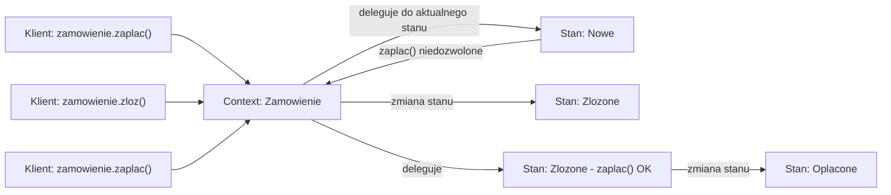
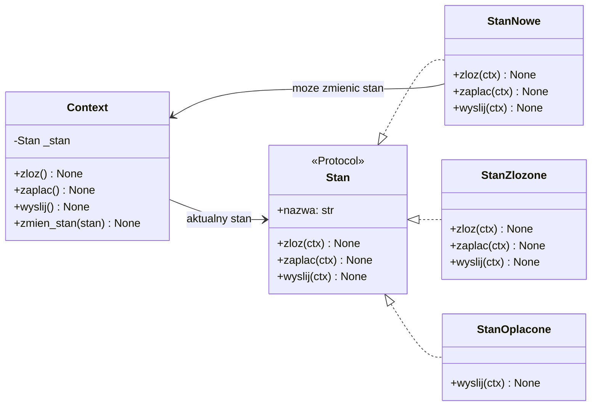
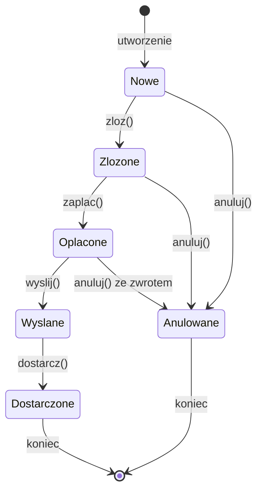
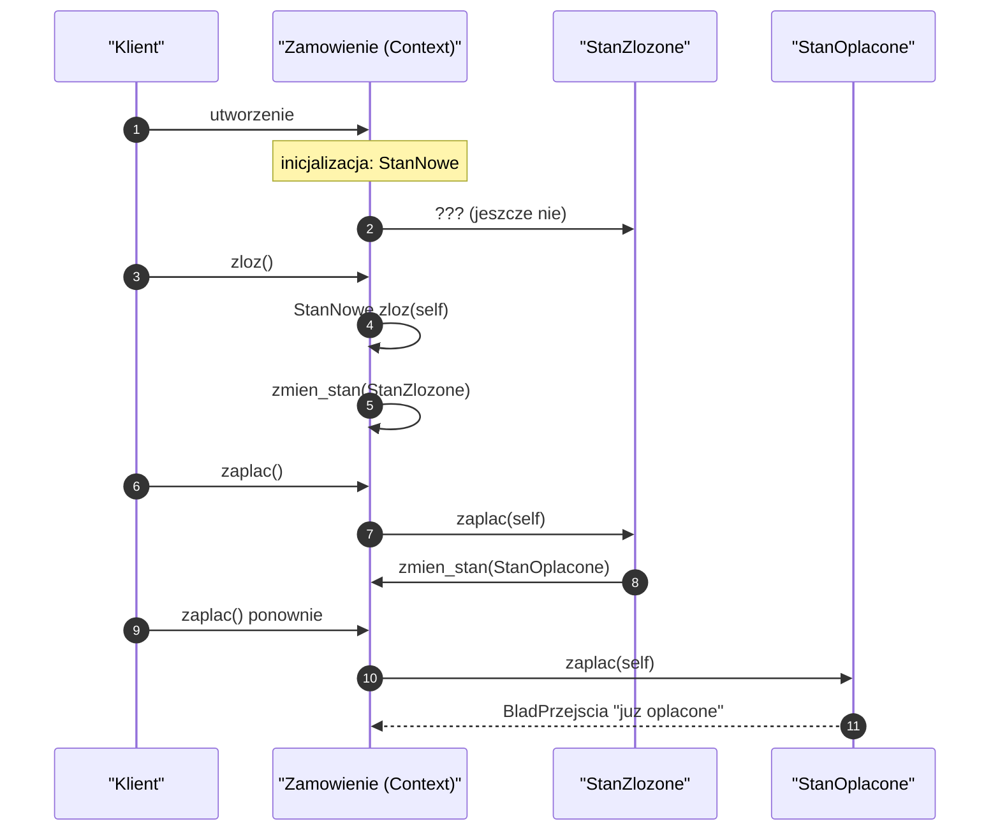
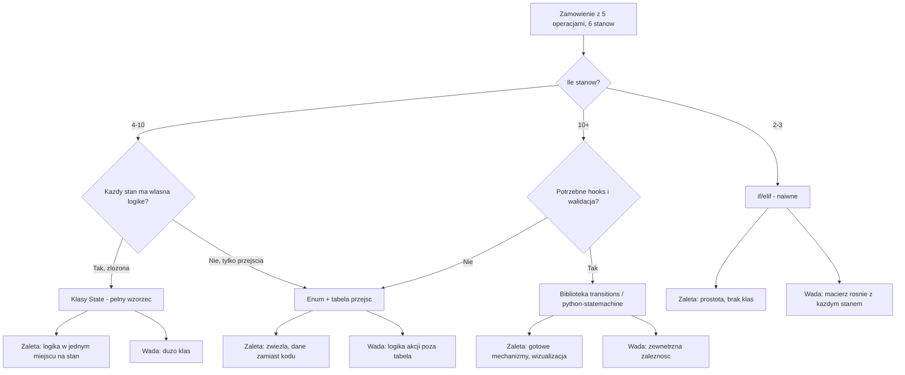
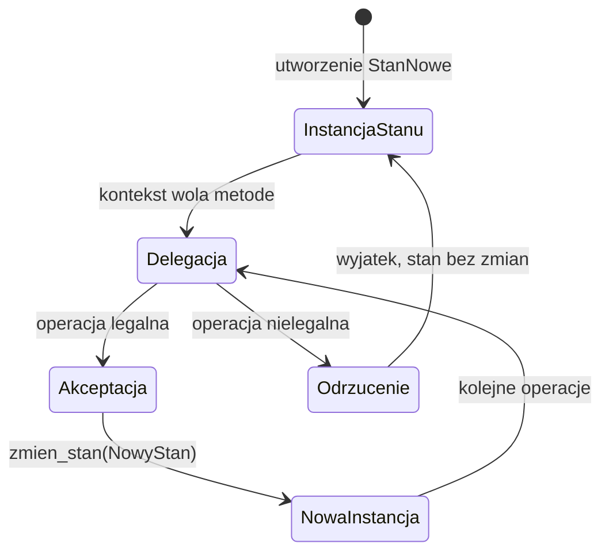
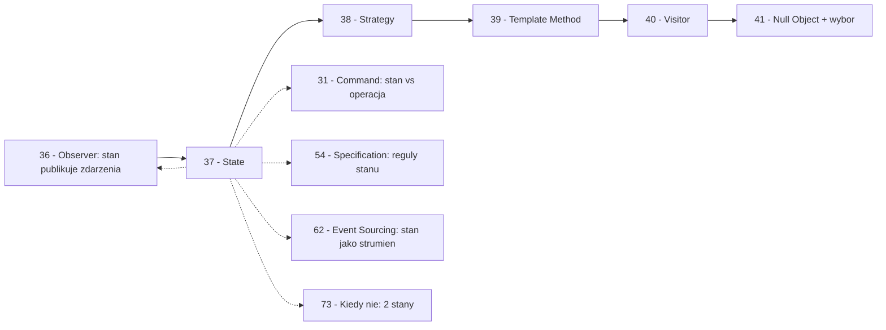

```markdown
---
modul: 37 — State
plik: 37-state.md
poziom: sredni
wymaga: [36]
czas: ~170 minut czytania + ~410 minut ćwiczeń
---

# Moduł 37 — State — obiekt zmienia zachowanie wraz ze stanem

> **TL;DR**
> - **State (stan)** pozwala obiektowi **zmienić zachowanie, gdy zmienia się jego stan wewnętrzny** — z punktu widzenia klienta obiekt sprawia wrażenie, jakby zmienił klasę; w rzeczywistości tylko wymienia wewnętrzny „obiekt stanu".
> - Wzorzec zamienia **lawinę `if/elif`** (rosnącą z każdą nową akcją × każdym nowym stanem) na **jawną, sprawdzalną strukturę** — diagram maszyny stanów staje się **głównym artefaktem projektowym**, a kod go realizuje.
> - W Pythonie są **trzy poziomy dojrzałości**: `if/elif` (naiwny), klasy stanów (klasyczny GoF), tabela przejść (data-driven). Każdy ma swoje miejsce — nie zawsze trzeba sięgać po najbardziej złożony.
> - **State vs Strategy** to najważniejsze rozróżnienie: Strategy wybiera klient („jak to zrobić"), State wybiera **sam obiekt** („co teraz zrobić") — w State zmiana następuje w reakcji na zdarzenia, w Strategy klient decyduje z góry.
> - Kluczowe ryzyko: **nielegalne przejścia nieodrzucane**, **stany mutowalne współdzielone** między instancjami i **brak persystencji stanu** w bazie — bez tych trzech zabezpieczeń state staje się źródłem błędów trudnych do wykrycia.

---

## 0. Model mentalny

### Automat z napojami, status zamówienia i zespół na planie filmowym

Wyobraź sobie klasyczny **automat z napojami** stojący na dworcu. Ma kilka przycisków: „wrzuć monetę", „wybierz napój", „anuluj". I teraz zatrzymaj się na chwilę i policz: **co robi przycisk „wybierz napój"?** Odpowiedź brzmi — **to zależy**. Jeśli nie wrzuciłeś monety — nic się nie dzieje (albo automat mruga „wrzuć monetę"). Jeśli wrzuciłeś monetę, ale za mało — automat prosi o więcej. Jeśli wrzuciłeś dokładnie tyle, ile trzeba — automat wydaje napój. Jeśli automat jest zepsuty — wyświetla „awaria" i nie reaguje. **Ten sam przycisk robi różne rzeczy w zależności od stanu automatu.**

Zauważ coś jeszcze: **ten sam zestaw przycisków obsługuje wszystkie sytuacje**. Nie ma osobnych przycisków dla każdego stanu. Jest jeden panel, jeden zestaw zdarzeń, a automat sam „wie", co zrobić, bo wewnątrz ma **stan**. Stan zmienia się w reakcji na zdarzenia: brak monety → wrzucono monetę → wydawanie → brak monety. Każdy „przycisk" przenosi automat do innego stanu albo wykonuje akcję. To dokładnie maszyna stanów — i State jako wzorzec realizuje to w kodzie.

Drugi obraz, bliższy finansom: **status zamówienia w sklepie internetowym**. Zamówienie zaczyna jako „nowe". Gdy klient dodaje produkty, przechodzi w „wypełniane". Gdy potwierdza, jest „złożone". Gdy płaci, jest „opłacone". Gdy magazyn je wydaje, jest „wysyłane". Gdy dotrze, jest „dostarczone". Można też anulować — jeśli płatność jeszcze nie przeszła. Zwróć uwagę na dwie rzeczy. Po pierwsze: **każda operacja, którą można wykonać na zamówieniu, zachowuje się inaczej w zależności od statusu**. „Anuluj" na zamówieniu „nowym" — anuluje. „Anuluj" na zamówieniu „opłaconym" — prosi o zwrot płatności. „Anuluj" na zamówieniu „wysłanym" — nie da się, trzeba zwrot. Po drugie: **istnieją nielegalne przejścia**. Nie możesz przejść z „nowe" na „wysłane" bezpośrednio. Nie możesz „opłacić" zamówienia, które jest „anulowane". Ta **struktura przejść** jest częścią logiki biznesowej — i powinna być w kodzie wyrażona jawnie.

Trzeci obraz, najbardziej zaskakujący: **zespół na planie filmowym**. Wyobraź sobie reżysera, aktorów, oświetleniowca, kamerzystę. Kiedy jest **przerwa** — wszyscy odpoczywają, aktorzy czytają scenariusz, oświetleniowiec pali papierosa. Kiedy jest **nagranie** — wszyscy na planie, kamera włączona, mikrofony poustawiane. Kiedy jest **zmiana dekoracji** — wszyscy poza planem, ekipa techniczna pracuje. Zauważ: **te same osoby mają różne role w każdym stanie**. Kamerzysta w „przerwie" — odpoczywa. W „nagraniu" — obsługuje kamerę. W „zmianie dekoracji" — pomaga przy scenografii. To jest metafora State: **ten sam obiekt (kamerzysta) zachowuje się inaczej, bo zmienia się stan, w którym się znajduje** — a stan jest **osobnym obiektem**, który definiuje, co robić.

| W analogii automatu i statusu zamówienia | W kodzie |
|---|---|
| Automat z napojami / zamówienie | **Context** — obiekt, którego zachowanie zależy od stanu |
| Stan automatu (brak monety, wrzucono) | **State** — aktualny obiekt stanu |
| Przycisk „wybierz napój" | Zdarzenie / metoda wywołana na Context |
| Różne reakcje tego samego przycisku | **Delegacja do aktualnego State** — każdy state wie, co robić |
| Przejście „wrzuć monetę" | `context.zmien_stan(nowy_state)` |
| Nielegalne przejście (np. „opłać anulowane") | Odrzucenie w handlerze stanu |
| Diagram przejść w instrukcji obsługi | `stateDiagram-v2` — główny artefakt projektowy |

> 🧠 **Zapamiętaj** — **State (stan) to wzorzec behawioralny, który pozwala obiektowi zmienić zachowanie w reakcji na zmianę stanu wewnętrznego — obiekt sprawia wrażenie, jakby zmienił klasę, ale w rzeczywistości wymienia wewnętrzny obiekt stanu, który definiuje, co robić w danym momencie.**

Zwróć uwagę na trzy słowa: **zachowanie**, **stan wewnętrzny**, **wymienia**. „Zachowanie" — to, co zrobić. „Stan wewnętrzny" — coś, co reprezentuje „gdzie jesteśmy". „Wymienia" — wymiana jest dynamiczna; zachowanie zmienia się w runtime bez zmiany klasy obiektu.

### Diagram — intuicja wzorca



*Diagram pokazuje, że Context deleguje wszystkie operacje do aktualnego stanu, a stan decyduje, co zrobić — sam kontekst nie zawiera logiki zachowania zależnej od stanu.*

### Czego State NIE robi

Rozbrójmy cztery nieporozumienia.

**Nie jest maszyną stanów samą w sobie.** State to **wzorzec projektowy** opisujący strukturę — Context + Stan + przejścia. Możesz mieć maszynę stanów bez wzorca State: enum + tabela przejść + funkcje. Wzorzec State jest jednym ze sposobów jej realizacji — i nie zawsze najlepszym.

**Nie jest Strategią.** Strategy wybiera klient („tym razem chcę rabat premium"). State wybiera **sam obiekt** w reakcji na zdarzenie („zmieniłem status na opłacone, więc kolejne operacje mają działać inaczej"). W Strategy kontekst zwykle nie zmienia strategii samodzielnie. W State zmiana jest naturalną konsekwencją zdarzenia.

**Nie jest darmowy.** Klasy State dodają klasy, pośrednictwo, cykl życia. W Pythonie `if/elif` dla 2 stanów jest czytelniejszy niż pełna struktura wzorca. State ma sens, gdy stanów jest **kilka–kilkanaście** i przejścia mają sens (a nie tylko „dwa boolean-y").

**Nie rozwiązuje problemu persystencji.** State jest w pamięci procesu. Jeśli zamówienie ma przetrwać restart, stan trzeba **jawnie zapisać w bazie** (jako enum, jako string, jako kolumna). Bez tego wzorzec jest tylko dla obiektów sesyjnych/gry.

**Nie gwarantuje poprawności przejść.** Zaprojektowanie struktury nie wystarczy — musisz **odrzucać nielegalne przejścia**. W innym wypadku „opłać" na anulowanym zamówieniu przejdzie cicho i zostawi system w niespójnym stanie.

---

## 1. Problem, który rozwiązujemy

Wejdźmy w domenę 🛒 „Sklepu" — aplikacji do obsługi zamówień. Zamówienie ma status: nowe, złożone, opłacone, wysłane, dostarczone, anulowane. Operacje: złożenie, opłacenie, wysyłka, dostawa, anulacja. Ktoś napisał to w jednej klasie z...

### Kod „przed"

```python
# zamowienie_v0.py — wersja naiwna, demonstracyjna
# UWAGA: kod celowo pokazuje problem z rosnaca lawina if/elif po statusie.

from __future__ import annotations

from dataclasses import dataclass, field
from decimal import Decimal
from enum import Enum


class Status(Enum):
    NOWE = "nowe"
    ZLOZONE = "zlozone"
    OPLACONE = "oplacone"
    WYSLANE = "wyslane"
    DOSTARCZONE = "dostarczone"
    ANULOWANE = "anulowane"


@dataclass
class Zamowienie:
    identyfikator: str
    kwota: Decimal
    status: Status = Status.NOWE
    przyczyna_anulacji: str = ""

    def zloz(self) -> None:
        if self.status == Status.NOWE:
            self.status = Status.ZLOZONE
        elif self.status == Status.ZLOZONE:
            raise RuntimeError("zamowienie jest juz zlozone")
        elif self.status == Status.OPLACONE:
            raise RuntimeError("zamowienie jest juz oplacone")
        elif self.status == Status.WYSLANE:
            raise RuntimeError("zamowienie jest wyslane")
        elif self.status == Status.DOSTARCZONE:
            raise RuntimeError("zamowienie jest dostarczone")
        elif self.status == Status.ANULOWANE:
            raise RuntimeError("zamowienie jest anulowane")

    def zaplac(self) -> None:
        if self.status == Status.NOWE:
            raise RuntimeError("najpierw zloz zamowienie")
        elif self.status == Status.ZLOZONE:
            self.status = Status.OPLACONE
        elif self.status == Status.OPLACONE:
            raise RuntimeError("juz oplacone")
        elif self.status == Status.WYSLANE:
            raise RuntimeError("zamowienie wyslane")
        elif self.status == Status.DOSTARCZONE:
            raise RuntimeError("zamowienie dostarczone")
        elif self.status == Status.ANULOWANE:
            raise RuntimeError("zamowienie anulowane")

    def wyslij(self) -> None:
        if self.status == Status.OPLACONE:
            self.status = Status.WYSLANE
        elif self.status == Status.NOWE:
            raise RuntimeError("najpierw zloz")
        elif self.status == Status.ZLOZONE:
            raise RuntimeError("najpierw zaplac")
        elif self.status == Status.WYSLANE:
            raise RuntimeError("juz wyslane")
        elif self.status == Status.DOSTARCZONE:
            raise RuntimeError("juz dostarczone")
        elif self.status == Status.ANULOWANE:
            raise RuntimeError("anulowane")

    def dostarcz(self) -> None:
        if self.status == Status.WYSLANE:
            self.status = Status.DOSTARCZONE
        elif self.status == Status.ANULOWANE:
            raise RuntimeError("anulowane")
        else:
            raise RuntimeError(f"nie mozna dostarczyc z statusu {self.status.value}")

    def anuluj(self, przyczyna: str = "") -> None:
        if self.status in (Status.NOWE, Status.ZLOZONE):
            self.status = Status.ANULOWANE
            self.przyczyna_anulacji = przyczyna
        elif self.status == Status.OPLACONE:
            # Anulowanie zaplaconego = wymaga zwrotu
            self.status = Status.ANULOWANE
            self.przyczyna_anulacji = f"zwrot platnosci: {przyczyna}"
        elif self.status == Status.WYSLANE:
            raise RuntimeError("nie mozna anulowac wyslanego - wymagany zwrot")
        elif self.status == Status.DOSTARCZONE:
            raise RuntimeError("nie mozna anulowac dostarczonego")
        elif self.status == Status.ANULOWANE:
            raise RuntimeError("juz anulowane")


if __name__ == "__main__":
    z = Zamowienie("Z-1", Decimal("500.00"))
    z.zloz()
    z.zaplac()
    print(z.status)
```

Ten kod **działa**, ale ma sześć narastających problemów. Zwróć uwagę na kluczowy: **każda operacja ma `if/elif` po wszystkich 6 statusach**. To jest **macierz operacji × statusów** — 5 operacji × 6 statusów = 30 gałęzi. Dla 10 statusów — 50 gałęzi. Kod rośnie wykładniczo.

### Code smell — macierz operacji × statusów

| Problem | Gdzie | Konsekwencja |
|---|---|---|
| Każda metoda ma `if/elif` po wszystkich statusach | Wszystkie metody | 30 gałęzi w jednej klasie |
| Nielegalne przejścia rozproszone | `raise RuntimeError` w każdym `elif` | Nie da się łatwo sprawdzić „czy przejście jest legalne" |
| Logika statusu pomieszana z logiką akcji | W każdej metodzie | Trudno zobaczyć strukturę maszyny stanów |
| Dodanie nowego statusu | Zmiana w każdej metodzie | 5 miejsc, wysokie ryzyko regresji |
| Dodanie nowej operacji | Nowa metoda z `if/elif` × 6 | Kolejna macierz |
| Brak diagramu stanów w kodzie | Rozproszona wiedza | Nikt nie wie, jak wygląda pełna maszyna |
| Brak historii przejść | Status to pojedyncze pole | Nie wiadomo, kiedy i jak zmienił się status |
| Trudno testować przejścia | Każdy test kombinuje operację + status | Eksplozja testów |

### Objawy — poznasz ten problem po tym, że...

- **Metody zawierają `if/elif` po wszystkich stanach.** Ten sam wzorzec w każdej metodzie.
- **Dodanie nowego statusu wymaga zmian w wielu metodach.** Każda nowa metoda to kolejna macierz.
- **Nie widać pełnej maszyny stanów.** Rozproszona w kodzie, nie ma jednego diagramu ani tabeli.
- **Nielegalne przejścia są wykrywane dopiero w momencie wywołania.** Nie można zapytać „czy mogę zaplacić?"
- **Testy obejmują macierz** (operacja × status). Trudno je utrzymać.
- **W nazwach metod widać „sprawdź status"** — powtarza się w każdym.
- **Logika biznesowa (np. „anulowanie opłaconego wymaga zwrotu") jest w metodzie** — nie ma jej w jednym miejscu.
- **Nie da się odtworzyć historii przejść** — nie ma dziennika.
- **Błędy przejść są niespójne** — różne komunikaty w różnych miejscach.
- **Klasa ma metodę, w której `if`y zajmują połowę linii.**

---

## 2. Anatomia wzorca

### Uczestnicy

| Rola | Odpowiedzialność | Co NIE jest jej zadaniem |
|---|---|---|
| **Context (kontekst)** | Definiuje interfejs dla klientów; przechowuje referencję do aktualnego stanu; deleguje operacje do stanu | Nie zawiera logiki zależnej od stanu |
| **State (stan)** | Definiuje interfejs zachowań specyficznych dla stanu | Nie zna Contexta „od środka"; może go znać przez interfejs |
| **ConcreteState (konkretny stan)** | Implementuje zachowanie dla konkretnego stanu; decyduje o przejściu do innego stanu | Nie zawiera logiki innych stanów; nie tworzy innych stanów samodzielnie (chyba że przez referencję do kontekstu) |
| **Klient** | Wywołuje operacje na Context | Nie zna konkretnych stanów |

Kluczowa asymetria: **Context zna State, ale nie konkretne klasy** (może znać jednoznacznie aktualny stan). **State może znać Context** (żeby zmienić stan kontekstu), ale **nie zna innych stanów**. Warianty różnią się tym, gdzie zapada decyzja o przejściu:
- **Wariant „przejścia w stanach"**: każdy ConcreteState wie, na co przechodzi (self.ctx.zmien_stan(NowyStan(...))).
- **Wariant „przejścia w kontekście"**: Context decyduje o przejściu na podstawie aktualnego stanu i zdarzenia (tabela przejść).

### Diagram struktury



*Diagram pokazuje, że Context deleguje wywołania do aktualnego Stan, a konkretne stany realizują różne zachowania — przy czym stan może znać kontekst, żeby zmieniać jego aktualny stan.*

### Trzy poziomy realizacji w Pythonie

To najważniejsza część tego modułu. State można zrealizować na trzy sposoby — i każdy ma swoje miejsce.

**Poziom 1 — `if/elif`.** Dla 2–3 stanów, gdzie przejścia są proste. Czytelne, bez klas, bez pośrednictwa. Kod w sekcji 1 to wariant poziomu 1 — działa, ale macierz rośnie.

**Poziom 2 — klasy State.** Klasyczny wzorzec GoF. Kontekst deleguje, każdy stan realizuje własne zachowanie. Świetne dla 5–10 stanów z przejściami. Kod jest czytelny, dodanie stanu lokalne.

**Poziom 3 — tabela przejść.** Zbiór stanów i zdarzeń jako `Enum`, tabela `(stan, zdarzenie) → nowy stan + akcje`. Bardzo zwięzły, „data-driven", sprawdzalny programowo. Świetne dla 10–20 stanów lub gdy maszyna ma być konfigurowalna z zewnątrz.

**Wybór zależy od liczby stanów i złożoności.** Dla 2 stanów — `if/elif`. Dla 5 — klasy. Dla 15 — tabela. Dla 30 — biblioteka (`transitions`, `python-statemachine`).

### Warianty: klasyczny vs pythoniczny

| Aspekt | Klasyczny (GoF) | Pythoniczny |
|---|---|---|
| State | `ABC` z metodami | `Protocol` z metodami |
| ConcreteState | Klasy dziedziczące po State | Klasy spełniające protokół |
| Przejście | `self.ctx.zmien_stan(NowyStan())` | `ctx.zmien_stan(Stan.OPLACONE)` albo tabela |
| Context | Klasa z `_stan: State` | Klasa z `_stan: Stan` |
| Przejścia | W stanie | W tabeli (data-driven) |
| Wariant enum | — | `enum.Enum` + tabela |

Python daje trzecie podejście — enum + tabela. Często jest **znacznie prostsze** niż klasy State i lepiej pasuje do prostych maszyn stanów. Klasy są potrzebne, gdy każdy stan ma własną, złożoną logikę (a nie tylko „przejdź do innego stanu").

---

## 3. Implementacja krok po kroku

Weźmiemy zamówienie z sekcji 1 i przebudujemy je w trzech krokach: przez klasy State, potem przez tabelę przejść.

### Krok 1 — Zidentyfikuj stany i zdarzenia

Zanim napiszemy kod — **narysujmy diagram**. To najważniejszy krok.

```text
STANY:
  NOWE, ZLOZONE, OPLACONE, WYSLANE, DOSTARCZONE, ANULOWANE

ZDARZENIA (operacje):
  zloz, zaplac, wyslij, dostarcz, anuluj

PRZEJSCIA:
  NOWE         -zloz->      ZLOZONE
  ZLOZONE      -zaplac->    OPLACONE
  OPLACONE     -wyslij->    WYSLANE
  WYSLANE      -dostarcz->  DOSTARCZONE
  NOWE         -anuluj->    ANULOWANE
  ZLOZONE      -anuluj->    ANULOWANE
  OPLACONE     -anuluj->    ANULOWANE (ze zwrotem)
  WYSLANE      -anuluj->    BLAD
  DOSTARCZONE  -anuluj->    BLAD
  ANULOWANE    -wszystko->  BLAD
```

**Zasada:** najpierw diagram maszyny stanów, potem kod. Diagram staje się **kontraktem** — każdy stan może być zweryfikowany pod kątem zgodności z nim.

### Krok 2 — Zdefiniuj kontrakt Stan

Każdy stan musi umieć obsłużyć **te same operacje**. Kontrakt obejmuje wszystkie operacje.

```python
from typing import Protocol, runtime_checkable
from decimal import Decimal


@runtime_checkable
class StanZamowienia(Protocol):
    """Kontrakt stanu zamowienia."""

    nazwa: str
    def zloz(self, ctx: "Zamowienie") -> None: ...
    def zaplac(self, ctx: "Zamowienie") -> None: ...
    def wyslij(self, ctx: "Zamowienie") -> None: ...
    def dostarcz(self, ctx: "Zamowienie") -> None: ...
    def anuluj(self, ctx: "Zamowienie", przyczyna: str) -> None: ...
```

Każdy stan implementuje **wszystkie** metody. Dla operacji nielegalnych **rzuca wyjątek z czytelnym komunikatem**.

### Krok 3 — Zaimplementuj konkretne stany

Dla każdego stanu — osobna klasa z logiką.

```python
# Wyjatki domenowe
class BladPrzejscia(RuntimeError):
    """Nielegalne przejscie w maszynie stanow."""


class StanNowe:
    nazwa = "nowe"

    def zloz(self, ctx: "Zamowienie") -> None:
        ctx.zmien_stan(StanZlozone())

    def zaplac(self, ctx: "Zamowienie") -> None:
        raise BladPrzejscia("najpierw zloz zamowienie")

    def wyslij(self, ctx: "Zamowienie") -> None:
        raise BladPrzejscia("zamowienie nie jest oplacone")

    def dostarcz(self, ctx: "Zamowienie") -> None:
        raise BladPrzejscia("zamowienie nie jest wyslane")

    def anuluj(self, ctx: "Zamowienie", przyczyna: str) -> None:
        ctx.zmien_stan(StanAnulowane(przyczyna=przyczyna or "anulowane z nowego"))


class StanZlozone:
    nazwa = "zlozone"

    def zloz(self, ctx: "Zamowienie") -> None:
        raise BladPrzejscia("zamowienie jest juz zlozone")

    def zaplac(self, ctx: "Zamowienie") -> None:
        ctx.zmien_stan(StanOplacone())

    def wyslij(self, ctx: "Zamowienie") -> None:
        raise BladPrzejscia("najpierw zaplac")

    def dostarcz(self, ctx: "Zamowienie") -> None:
        raise BladPrzejscia("nie wyslane")

    def anuluj(self, ctx: "Zamowienie", przyczyna: str) -> None:
        ctx.zmien_stan(StanAnulowane(przyczyna=przyczyna or "anulowane ze zlozonego"))


class StanOplacone:
    nazwa = "oplacone"

    def zloz(self, ctx: "Zamowienie") -> None:
        raise BladPrzejscia("zamowienie jest juz zlozone i oplacone")

    def zaplac(self, ctx: "Zamowienie") -> None:
        raise BladPrzejscia("juz oplacone")

    def wyslij(self, ctx: "Zamowienie") -> None:
        ctx.zmien_stan(StanWyslane())

    def dostarcz(self, ctx: "Zamowienie") -> None:
        raise BladPrzejscia("nie wyslane")

    def anuluj(self, ctx: "Zamowienie", przyczyna: str) -> None:
        ctx.zmien_stan(
            StanAnulowane(przyczyna=f"zwrot platnosci: {przyczyna or 'na zadanie'}")
        )


class StanWyslane:
    nazwa = "wyslane"

    def zloz(self, ctx: "Zamowienie") -> None:
        raise BladPrzejscia("zamowienie wyslane")

    def zaplac(self, ctx: "Zamowienie") -> None:
        raise BladPrzejscia("zamowienie wyslane")

    def wyslij(self, ctx: "Zamowienie") -> None:
        raise BladPrzejscia("juz wyslane")

    def dostarcz(self, ctx: "Zamowienie") -> None:
        ctx.zmien_stan(StanDostarczone())

    def anuluj(self, ctx: "Zamowienie", przyczyna: str) -> None:
        raise BladPrzejscia("nie mozna anulowac wyslanego - wymagany zwrot")


class StanDostarczone:
    nazwa = "dostarczone"

    def zloz(self, ctx: "Zamowienie") -> None:
        raise BladPrzejscia("zamowienie dostarczone")

    def zaplac(self, ctx: "Zamowienie") -> None:
        raise BladPrzejscia("zamowienie dostarczone")

    def wyslij(self, ctx: "Zamowienie") -> None:
        raise BladPrzejscia("zamowienie dostarczone")

    def dostarcz(self, ctx: "Zamowienie") -> None:
        raise BladPrzejscia("juz dostarczone")

    def anuluj(self, ctx: "Zamowienie", przyczyna: str) -> None:
        raise BladPrzejscia("nie mozna anulowac dostarczonego")


class StanAnulowane:
    nazwa = "anulowane"

    def __init__(self, przyczyna: str = "") -> None:
        self.przyczyna = przyczyna

    def _blad(self, ctx: "Zamowienie", op: str) -> None:
        raise BladPrzejscia(
            f"zamowienie anulowane ({self.przyczyna}); nie mozna wykonac: {op}"
        )

    def zloz(self, ctx: "Zamowienie") -> None:
        self._blad(ctx, "zloz")

    def zaplac(self, ctx: "Zamowienie") -> None:
        self._blad(ctx, "zaplac")

    def wyslij(self, ctx: "Zamowienie") -> None:
        self._blad(ctx, "wyslij")

    def dostarcz(self, ctx: "Zamowienie") -> None:
        self._blad(ctx, "dostarcz")

    def anuluj(self, ctx: "Zamowienie", przyczyna: str) -> None:
        self._blad(ctx, "anuluj")
```

Zwróć uwagę: **każdy stan implementuje wszystkie operacje** — nawet jeśli dla wielu z nich rzuca błąd. To ważne — gwarantuje, że kontrakt jest spełniony. Moglibyśmy mieć wspólny base z domyślnymi `_blad`, ale klasy tak są czytelniejsze.

### Krok 4 — Zaimplementuj Context

Context deleguje i przechowuje stan.

```python
class Zamowienie:
    """Context: zamowienie z aktualnym stanem."""

    def __init__(self, identyfikator: str, kwota: Decimal) -> None:
        self.identyfikator = identyfikator
        self.kwota = kwota
        self._stan: StanZamowienia = StanNowe()
        self._historia: list[tuple[str, str]] = []   # (nazwa stanu, opis)

    @property
    def stan(self) -> StanZamowienia:
        return self._stan

    @property
    def nazwa_stanu(self) -> str:
        return self._stan.nazwa

    @property
    def historia(self) -> tuple[tuple[str, str], ...]:
        return tuple(self._historia)

    def zmien_stan(self, nowy: StanZamowienia) -> None:
        """Zmienia aktualny stan; zapisuje zdarzenie w historii."""
        self._historia.append((nowy.nazwa, f"z {self._stan.nazwa}"))
        self._stan = nowy

    # --- API dla klienta (delegacja) ---

    def zloz(self) -> None:
        self._stan.zloz(self)

    def zaplac(self) -> None:
        self._stan.zaplac(self)

    def wyslij(self) -> None:
        self._stan.wyslij(self)

    def dostarcz(self) -> None:
        self._stan.dostarcz(self)

    def anuluj(self, przyczyna: str = "") -> None:
        self._stan.anuluj(self, przyczyna)


# Inicjalizacja historii - stan poczatkowy
Zamowienie.__init__  # nie, to juz jest
```

Uwaga: historia powinna zawierać **stan początkowy**. Możemy to poprawić, dodając zapis w konstruktorze:

```python
class Zamowienie:
    def __init__(self, identyfikator: str, kwota: Decimal) -> None:
        self.identyfikator = identyfikator
        self.kwota = kwota
        self._stan: StanZamowienia = StanNowe()
        self._historia: list[tuple[str, str]] = [("nowe", "stan poczatkowy")]
```

### Krok 5 — Weryfikacja

| Kryterium | Wersja „przed" | Wersja „po" |
|---|---|---|
| `if/elif` w metodach | Tak (macierz) | Nie |
| Liczba metod w klasie | 5 z macierzą | 6 (delegujące) |
| Liczba klas stanów | 0 | 6 |
| Nielegalne przejście | Rozproszone `raise` | W metodzie stanu |
| Dodanie nowego stanu | Zmiana we wszystkich metodach | Nowa klasa + zmiana w istniejących stanach |
| Dodanie nowej operacji | 6 nowych `if`, 5 metod aktualizacja | Nowa metoda w każdej klasie stanu |
| Diagram | Brak | Można wygenerować z kodu |
| Historia zmian | Nie ma | `historia` na Context |

Koszt: **6 klas stanów** + Context. Zysk: macierz `if/elif` znika, kod stanu jest w jednej klasie, historia naturalna.

---

## 4. Wersje pythoniczne i warianty

### 4.1 Poziom 1 — `if/elif` (naiwny)

Przykład pokazany w sekcji 1. Sensowny dla 2–3 stanów i prostych przejść. Nie buduj klas, dopóki nie masz **5 stanów** albo **macierzy operacji × stanów**.

### 4.2 Poziom 2 — klasy State (jak wyżej)

Klasyczny wzorzec. Sensowny dla 5–10 stanów, gdy każdy stan ma własną, złożoną logikę (nie tylko „przejdź do innego stanu"). Wada: dużo kodu.

### 4.3 Poziom 3 — tabela przejść (data-driven)

Zamiast klas — tabela. Stan to `Enum`, zdarzenie to `Enum`, przejście to wpis w `dict`.

```python
from enum import Enum


class St(Enum):
    NOWE = "nowe"
    ZLOZONE = "zlozone"
    OPLACONE = "oplacone"
    WYSLANE = "wyslane"
    DOSTARCZONE = "dostarczone"
    ANULOWANE = "anulowane"


class Ev(Enum):
    ZLOZ = "zloz"
    ZAPLAC = "zaplac"
    WYSLIJ = "wyslij"
    DOSTARCZ = "dostarcz"
    ANULUJ = "anuluj"


# Tabela przejsc: (stan, zdarzenie) -> (nowy stan, akcje)
PRZEJSCIA: dict[tuple[St, Ev], tuple[St | None, tuple[str, ...]]] = {
    (St.NOWE, Ev.ZLOZ): (St.ZLOZONE, ()),
    (St.ZLOZONE, Ev.ZAPLAC): (St.OPLACONE, ()),
    (St.OPLACONE, Ev.WYSLIJ): (St.WYSLANE, ()),
    (St.WYSLANE, Ev.DOSTARCZ): (St.DOSTARCZONE, ()),
    (St.NOWE, Ev.ANULUJ): (St.ANULOWANE, ()),
    (St.ZLOZONE, Ev.ANULUJ): (St.ANULOWANE, ()),
    (St.OPLACONE, Ev.ANULUJ): (St.ANULOWANE, ("zwrot_platnosci",)),
    # Wszystkie inne kombinacje = nielegalne
}


class ZamowienieTabela:
    """Wariant tabelaryczny - zamiast klas stanow mamy tabele."""

    def __init__(self, identyfikator: str) -> None:
        self.identyfikator = identyfikator
        self.stan = St.NOWE
        self.historia: list[tuple[St, Ev]] = []

    def _obsluz(self, zdarzenie: Ev) -> None:
        klucz = (self.stan, zdarzenie)
        if klucz not in PRZEJSCIA:
            raise BladPrzejscia(
                f"przejscie niedozwolone: {self.stan.value} -{zdarzenie.value}->"
            )
        nowy_stan, akcje = PRZEJSCIA[klucz]
        # Wykonaj akcje (logika biznesowa)
        for akcja in akcje:
            self._wykonaj_akcje(akcja)
        if nowy_stan is not None:
            self.stan = nowy_stan
        self.historia.append((self.stan, zdarzenie))

    def _wykonaj_akcje(self, akcja: str) -> None:
        if akcja == "zwrot_platnosci":
            print(f"  [AKCJA] zwrot platnosci dla {self.identyfikator}")

    def zloz(self) -> None:
        self._obsluz(Ev.ZLOZ)

    def zaplac(self) -> None:
        self._obsluz(Ev.ZAPLAC)

    def wyslij(self) -> None:
        self._obsluz(Ev.WYSLIJ)

    def dostarcz(self) -> None:
        self._obsluz(Ev.DOSTARCZ)

    def anuluj(self) -> None:
        self._obsluz(Ev.ANULUJ)
```

Zalety: **bardzo zwięzłe**, tabela jest **jednym źródłem prawdy** o strukturze maszyny, łatwo ją wizualizować, konfigurować, sprawdzać programowo. Wady: logika akcji gdzieś „ucieka" z tabeli (trzeba ją mieć w osobnych funkcjach), klasy stanów są zastąpione enumami (mniej miejsca na własne pola stanu).

### 4.4 Enum + tabela + funkcje handlerów

Rozszerzenie — każda akcja jako funkcja, tabela przejść wskazuje na nią.

```python
from collections.abc import Callable


Handler = Callable[["ZamowienieTabela"], None]

AKCJE: dict[str, Handler] = {
    "zwrot_platnosci": lambda z: print(f"  [AKCJA] zwrot dla {z.identyfikator}"),
    "log": lambda z: print(f"  [LOG] {z.identyfikator}"),
}
```

To pozwala trzymać logikę akcji osobno i wywoływać ją z tabeli przejść przez nazwę. To czytelniejsze niż inline logika.

### 4.5 Biblioteki: `transitions`, `python-statemachine`

Dla skomplikowanych maszyn (20+ stanów) użyj biblioteki.

**`transitions`:**

```python
from transitions import Machine


class ZamowienieTransitions:
    pass


model = ZamowienieTransitions()
stany = ["nowe", "zlozone", "oplacone", "wyslane", "dostarczone", "anulowane"]
przejscia = [
    {"trigger": "zloz", "source": "nowe", "dest": "zlozone"},
    {"trigger": "zaplac", "source": "zlozone", "dest": "oplacone"},
    {"trigger": "wyslij", "source": "oplacone", "dest": "wyslane"},
    {"trigger": "dostarcz", "source": "wyslane", "dest": "dostarczone"},
    {"trigger": "anuluj", "source": ["nowe", "zlozone", "oplacone"], "dest": "anulowane"},
]

machine = Machine(model=model, states=stany, transitions=przejscia, initial="nowe")
print(model.state)
model.zloz()
model.zaplac()
print(model.state)
# model.wyslij() przez model.wyslij jest dostepna
# wywolanie nielegalne -> MachineError
```

**`python-statemachine`:**

```python
from statemachine import StateMachine, State


class ZamowienieSM(StateMachine):
    nowe = State(initial=True)
    zlozone = State()
    oplacone = State()
    anulowane = State(final=True)

    zloz = nowe.to(zlozone)
    zaplac = zlozone.to(oplacone)
    anuluj = nowe.to(anulowane) | zlozone.to(anulowane)

    def on_zloz(self) -> None:
        print("Zlozono zamowienie")

    def on_enter_oplacone(self) -> None:
        print("Zamowienie oplacone")
```

Zalety bibliotek: gotowe przejścia, walidacja, hooks (`on_enter_X`, `on_exit_Y`), wizualizacja, integracja z asyncio. Wady: zależność, mniej kontroli.

### 4.6 Wariant funkcyjny — funkcje jako przejścia

Bardzo kompaktowa wersja.

```python
from collections.abc import Callable

Stan = str
Zdarzenie = str
Przejscie = Callable[[str, str], str]   # (stan, dane) -> nowy stan


def utworz_maszyne(
    tabela: dict[tuple[Stan, Zdarzenie], Stan],
    poczatkowy: Stan,
) -> "Maszynowa":
    ...
```

Dla bardzo prostych przypadków, gdy nie ma stanu drugiego (bo tylko „jaki jestem") — to działa. Ale dla rzeczywistych zastosowań enum + tabela są czytelniejsze.

### 4.7 Role pattern — uwaga domenowa

Bardzo ciekawy wariant: **State + persystencja w bazie**. Stan zamówienia jest zapisany **jako kolumna** (`status`), a w kodzie jest maszyna.

```python
# W bazie: status = "nowe" (string)
# W kodzie: mapowanie string -> enum/klasa stanu
def z_bazy(stan_str: str) -> StanZamowienia:
    mapa = {
        "nowe": StanNowe,
        "zlozone": StanZlozone,
        "oplacone": StanOplacone,
        # ...
    }
    return mapa[stan_str]()
```

To jest prawdziwy **wymóg produkcyjny** — obiekty zamówień są persystowane w bazie, a stan musi przeżyć restart. Wzorzec State tego nie załatwia — musisz dodać mapowanie.

### 4.8 Podsumowanie — tabela wyboru

| Sytuacja | Wariant |
|---|---|
| 2–3 stany, proste przejścia | `if/elif` (4.1) |
| 5–10 stanów, każdy ma własną logikę | Klasy State (4.2) |
| 5–15 stanów, przejścia tabelaryczne | Tabela przejść (4.3) |
| Konfiguracja z zewnątrz (np. YAML) | Tabela + konfiguracja |
| 20+ stanów, potrzebne hooks | Biblioteka (4.5) |
| Integracja z Django modelami | Enum + funkcje + sygnały |
| Wariant funkcyjny, super prosty | Funkcje (4.6) |

> 🧠 **Zapamiętaj** — **W większości przypadków produkcyjnych wystarczy `Enum` + tabela przejść.** Klasy State są potrzebne, gdy każdy stan ma własne, złożone zachowanie. Biblioteka — gdy stanów jest naprawdę dużo. **Zacznij od enum + tabeli; jeśli to za mało, dodaj klasy albo bibliotekę.**

---

## 5. Przykład z życia: 🛒 Sklep — pełny uruchamialny kod

Zbudujemy pełny system zamówienia z historią, walidacją przejść i persystencją.

### Kod

```python
# zamowienie_state.py — pelny przyklad State
from __future__ import annotations

from dataclasses import dataclass, field
from datetime import datetime, timezone
from decimal import Decimal
from enum import Enum
from typing import Protocol, runtime_checkable


# ===========================================================================
# 1. Wyjatki domenowe
# ===========================================================================

class BladPrzejscia(RuntimeError):
    """Nielegalne przejscie w maszynie stanow zamowienia."""


# ===========================================================================
# 2. Kontrakt stanu
# ===========================================================================

@runtime_checkable
class StanZamowienia(Protocol):
    nazwa: str
    def zloz(self, ctx: "Zamowienie") -> None: ...
    def zaplac(self, ctx: "Zamowienie") -> None: ...
    def wyslij(self, ctx: "Zamowienie") -> None: ...
    def dostarcz(self, ctx: "Zamowienie") -> None: ...
    def anuluj(self, ctx: "Zamowienie", przyczyna: str) -> None: ...


def _blad(op: str, stan: str) -> None:
    raise BladPrzejscia(f"operacja '{op}' niedozwolona w stanie '{stan}'")


# ===========================================================================
# 3. Konkretne stany
# ===========================================================================

class StanNowe:
    nazwa = "nowe"

    def zloz(self, ctx: "Zamowienie") -> None:
        ctx.zmien_stan(StanZlozone(), "zlozenie")

    def zaplac(self, ctx: "Zamowienie") -> None:
        _blad("zaplac", self.nazwa)

    def wyslij(self, ctx: "Zamowienie") -> None:
        _blad("wyslij", self.nazwa)

    def dostarcz(self, ctx: "Zamowienie") -> None:
        _blad("dostarcz", self.nazwa)

    def anuluj(self, ctx: "Zamowienie", przyczyna: str) -> None:
        ctx.zmien_stan(StanAnulowane(przyczyna or "anulowane"), "anulowanie")


class StanZlozone:
    nazwa = "zlozone"

    def zloz(self, ctx: "Zamowienie") -> None:
        _blad("zloz", self.nazwa)

    def zaplac(self, ctx: "Zamowienie") -> None:
        ctx.zmien_stan(StanOplacone(), "platnosc")

    def wyslij(self, ctx: "Zamowienie") -> None:
        _blad("wyslij", self.nazwa)

    def dostarcz(self, ctx: "Zamowienie") -> None:
        _blad("dostarcz", self.nazwa)

    def anuluj(self, ctx: "Zamowienie", przyczyna: str) -> None:
        ctx.zmien_stan(StanAnulowane(przyczyna or "anulowane"), "anulowanie")


class StanOplacone:
    nazwa = "oplacone"

    def zloz(self, ctx: "Zamowienie") -> None:
        _blad("zloz", self.nazwa)

    def zaplac(self, ctx: "Zamowienie") -> None:
        _blad("zaplac", self.nazwa)

    def wyslij(self, ctx: "Zamowienie") -> None:
        ctx.zmien_stan(StanWyslane(), "wysylka")

    def dostarcz(self, ctx: "Zamowienie") -> None:
        _blad("dostarcz", self.nazwa)

    def anuluj(self, ctx: "Zamowienie", przyczyna: str) -> None:
        # Anulowanie oplaconego wymaga zwrotu
        ctx.zmien_stan(
            StanAnulowane(przyczyna=f"zwrot platnosci ({przyczyna or 'na zadanie'})"),
            "anulowanie_ze_zwrotem",
        )


class StanWyslane:
    nazwa = "wyslane"

    def zloz(self, ctx: "Zamowienie") -> None:
        _blad("zloz", self.nazwa)

    def zaplac(self, ctx: "Zamowienie") -> None:
        _blad("zaplac", self.nazwa)

    def wyslij(self, ctx: "Zamowienie") -> None:
        _blad("wyslij", self.nazwa)

    def dostarcz(self, ctx: "Zamowienie") -> None:
        ctx.zmien_stan(StanDostarczone(), "dostawa")

    def anuluj(self, ctx: "Zamowienie", przyczyna: str) -> None:
        _blad("anuluj", self.nazwa)


class StanDostarczone:
    nazwa = "dostarczone"

    def __init__(self) -> None:
        self.czy_zakończony = True

    def zloz(self, ctx: "Zamowienie") -> None:
        _blad("zloz", self.nazwa)

    def zaplac(self, ctx: "Zamowienie") -> None:
        _blad("zaplac", self.nazwa)

    def wyslij(self, ctx: "Zamowienie") -> None:
        _blad("wyslij", self.nazwa)

    def dostarcz(self, ctx: "Zamowienie") -> None:
        _blad("dostarcz", self.nazwa)

    def anuluj(self, ctx: "Zamowienie", przyczyna: str) -> None:
        _blad("anuluj", self.nazwa)


class StanAnulowane:
    nazwa = "anulowane"

    def __init__(self, przyczyna: str = "") -> None:
        self.przyczyna = przyczyna

    def _blad_z_przyczyna(self, op: str) -> None:
        raise BladPrzejscia(
            f"operacja '{op}' niedozwolona: zamowienie anulowane ({self.przyczyna})"
        )

    def zloz(self, ctx: "Zamowienie") -> None:
        self._blad_z_przyczyna("zloz")

    def zaplac(self, ctx: "Zamowienie") -> None:
        self._blad_z_przyczyna("zaplac")

    def wyslij(self, ctx: "Zamowienie") -> None:
        self._blad_z_przyczyna("wyslij")

    def dostarcz(self, ctx: "Zamowienie") -> None:
        self._blad_z_przyczyna("dostarcz")

    def anuluj(self, ctx: "Zamowienie", przyczyna: str) -> None:
        self._blad_z_przyczyna("anuluj")


# ===========================================================================
# 4. Context - zamowienie
# ===========================================================================

@dataclass(frozen=True, slots=True)
class WpisHistorii:
    stan: str
    zdarzenie: str
    znacznik: str


class Zamowienie:
    """Context: zamowienie z aktualnym stanem."""

    def __init__(self, identyfikator: str, kwota: Decimal) -> None:
        if kwota <= 0:
            raise ValueError("kwota musi byc dodatnia")
        self.identyfikator = identyfikator
        self.kwota = kwota
        self._stan: StanZamowienia = StanNowe()
        self._historia: list[WpisHistorii] = [
            WpisHistorii(
                stan="nowe",
                zdarzenie="stan_poczatkowy",
                znacznik=datetime.now(timezone.utc).isoformat(timespec="seconds"),
            )
        ]

    @property
    def stan(self) -> StanZamowienia:
        return self._stan

    @property
    def nazwa_stanu(self) -> str:
        return self._stan.nazwa

    @property
    def historia(self) -> tuple[WpisHistorii, ...]:
        return tuple(self._historia)

    def zmien_stan(self, nowy: StanZamowienia, zdarzenie: str = "") -> None:
        self._historia.append(
            WpisHistorii(
                stan=nowy.nazwa,
                zdarzenie=zdarzenie,
                znacznik=datetime.now(timezone.utc).isoformat(timespec="seconds"),
            )
        )
        self._stan = nowy

    # --- API delegujace ---

    def zloz(self) -> None:
        self._stan.zloz(self)

    def zaplac(self) -> None:
        self._stan.zaplac(self)

    def wyslij(self) -> None:
        self._stan.wyslij(self)

    def dostarcz(self) -> None:
        self._stan.dostarcz(self)

    def anuluj(self, przyczyna: str = "") -> None:
        self._stan.anuluj(self, przyczyna)

    def opis(self) -> str:
        return (
            f"Zamowienie {self.identyfikator} ({self.kwota} PLN) "
            f"- status: {self.nazwa_stanu}"
        )


# ===========================================================================
# 5. Demonstracja
# ===========================================================================

if __name__ == "__main__":
    print("=== 1. Happy path: zloz -> zaplac -> wyslij -> dostarcz ===")
    z = Zamowienie("Z-1", Decimal("500.00"))
    print(f"  Start: {z.opis()}")
    z.zloz()
    print(f"  Po zlozeniu: {z.nazwa_stanu}")
    z.zaplac()
    print(f"  Po platnosci: {z.nazwa_stanu}")
    z.wyslij()
    print(f"  Po wysylce: {z.nazwa_stanu}")
    z.dostarcz()
    print(f"  Po dostawie: {z.nazwa_stanu}")

    print("\n=== 2. Nielegalne przejscia ===")
    z2 = Zamowienie("Z-2", Decimal("100.00"))
    for op, akcja in [
        ("zaplac bez zlozenia", z2.zaplac),
    ]:
        try:
            akcja()
        except BladPrzejscia as blad:
            print(f"  [{op}] -> {blad}")

    z2.zloz()
    z2.zaplac()
    z2.wyslij()
    try:
        z2.anuluj("zmiana zdania")
    except BladPrzejscia as blad:
        print(f"  [anuluj wyslane] -> {blad}")

    print("\n=== 3. Anulowanie z roznych stanow ===")
    for start, ops in [
        ("nowe", []),
        ("zlozone", [lambda z: z.zloz()]),
        ("oplacone", [lambda z: z.zloz(), lambda z: z.zaplac()]),
    ]:
        z = Zamowienie(f"Z-{start[:2]}", Decimal("50.00"))
        for op in ops:
            op(z)
        z.anuluj("klient zrezygnowal")
        przyczyna = ""
        if z.stan.nazwa == "anulowane":
            przyczyna = z.stan.przyczyna  # type: ignore[attr-defined]
        print(f"  Ze stanu {start}: -> {z.nazwa_stanu} ({przyczyna})")

    print("\n=== 4. Historia zmian ===")
    z3 = Zamowienie("Z-3", Decimal("250.00"))
    z3.zloz()
    z3.zaplac()
    z3.wyslij()
    for wpis in z3.historia:
        print(f"  {wpis.znacznik}: {wpis.stan} ({wpis.zdarzenie})")

    print("\n=== 5. Kontrakt: kazdy stan spelnia protokol ===")
    for stan in (StanNowe(), StanZlozone(), StanOplacone(),
                 StanWyslane(), StanDostarczone(), StanAnulowane()):
        ok = isinstance(stan, StanZamowienia)
        print(f"  {stan.nazwa}: isinstance StanZamowienia = {ok}")
```

### Co ten przykład pokazuje

**Punkt 1 — happy path.** Klasyczna sekwencja przejść. Każda operacja zwiększa stan. Zwróć uwagę na `opis()` — hermetyzacja (pokazuje tylko nazwę stanu).

**Punkt 2 — nielegalne przejścia.** Każda próba wykonania operacji niezgodnej z aktualnym stanem daje jasny komunikat. **Nie ma cichego pominięcia** — to kluczowa własność.

**Punkt 3 — anulowanie z różnych stanów.** Ten sam handler `anuluj` działa różnie w różnych stanach — w stanie `oplacone` generuje dodatkowo „zwrot płatności". To pokazuje **kontekstowość** operacji w State.

**Punkt 4 — historia zmian.** Każda zmiana stanu jest zapisywana z opisem i czasem. To **audyt** — fundament wszelkich raportów.

**Punkt 5 — kontrakt.** Wszystkie stany spełniają `StanZamowienia`. To gwarantuje, że Kontekst może delegować każdą operację.

### Testy

```python
# test_zamowienie_state.py — uruchomienie: pytest test_zamowienie_state.py -v
from decimal import Decimal

import pytest

from zamowienie_state import (
    BladPrzejscia,
    StanAnulowane,
    StanDostarczone,
    StanNowe,
    StanOplacone,
    StanWyslane,
    StanZamowienia,
    StanZlozone,
    Zamowienie,
)


@pytest.fixture
def zlecenie() -> Zamowienie:
    return Zamowienie("Z-1", Decimal("100.00"))


# --- Kontrakt ---------------------------------------------------------------

def test_wszystkie_stany_spelniaja_kontrakt() -> None:
    for stan in (
        StanNowe(), StanZlozone(), StanOplacone(),
        StanWyslane(), StanDostarczone(), StanAnulowane(),
    ):
        assert isinstance(stan, StanZamowienia)
        assert isinstance(stan.nazwa, str)
        assert stan.nazwa


def test_zamowienie_odrzuca_ujemna_kwote() -> None:
    with pytest.raises(ValueError):
        Zamowienie("Z-1", Decimal("-1"))


# --- Happy path -------------------------------------------------------------

def test_happy_path(zlecenie: Zamowienie) -> None:
    zlecenie.zloz()
    assert zlecenie.nazwa_stanu == "zlozone"
    zlecenie.zaplac()
    assert zlecenie.nazwa_stanu == "oplacone"
    zlecenie.wyslij()
    assert zlecenie.nazwa_stanu == "wyslane"
    zlecenie.dostarcz()
    assert zlecenie.nazwa_stanu == "dostarczone"


def test_nowe_zamowienie_ma_stan_nowe(zlecenie: Zamowienie) -> None:
    assert zlecenie.nazwa_stanu == "nowe"


# --- Nielegalne przejscia ---------------------------------------------------

def test_zaplac_bez_zlozenia(zlecenie: Zamowienie) -> None:
    with pytest.raises(BladPrzejscia, match="zaplac"):
        zlecenie.zaplac()


def test_wyslij_bez_oplacenia(zlecenie: Zamowienie) -> None:
    zlecenie.zloz()
    with pytest.raises(BladPrzejscia):
        zlecenie.wyslij()


def test_dostarcz_bez_wyslania(zlecenie: Zamowienie) -> None:
    zlecenie.zloz()
    zlecenie.zaplac()
    with pytest.raises(BladPrzejscia):
        zlecenie.dostarcz()


def test_nie_mozna_anulowac_wyslanego(zlecenie: Zamowienie) -> None:
    zlecenie.zloz(); zlecenie.zaplac(); zlecenie.wyslij()
    with pytest.raises(BladPrzejscia, match="anulowac wyslanego"):
        zlecenie.anuluj("test")


def test_nie_mozna_anulowac_dostarczonego(zlecenie: Zamowienie) -> None:
    zlecenie.zloz(); zlecenie.zaplac(); zlecenie.wyslij(); zlecenie.dostarcz()
    with pytest.raises(BladPrzejscia):
        zlecenie.anuluj("test")


def test_anulowane_nie_moze_byc_dalej_zmieniane(zlecenie: Zamowienie) -> None:
    zlecenie.anuluj("test")
    with pytest.raises(BladPrzejscia, match="anulowane"):
        zlecenie.zloz()


# --- Anulowanie z roznych stanow --------------------------------------------

def test_anuluj_z_nowego(zlecenie: Zamowienie) -> None:
    zlecenie.anuluj("rezygnacja")
    assert zlecenie.nazwa_stanu == "anulowane"
    assert zlecenie.stan.przyczyna == "rezygnacja"  # type: ignore[attr-defined]


def test_anuluj_ze_zlozonego(zlecenie: Zamowienie) -> None:
    zlecenie.zloz()
    zlecenie.anuluj("rezygnacja")
    assert zlecenie.nazwa_stanu == "anulowane"


def test_anuluj_z_oplaconego_generuje_zwrot(zlecenie: Zamowienie) -> None:
    zlecenie.zloz()
    zlecenie.zaplac()
    zlecenie.anuluj("rezygnacja")
    assert zlecenie.nazwa_stanu == "anulowane"
    przyczyna = zlecenie.stan.przyczyna  # type: ignore[attr-defined]
    assert "zwrot" in przyczyna
    assert "rezygnacja" in przyczyna


# --- Historia ---------------------------------------------------------------

def test_historia_zawiera_stan_poczatkowy(zlecenie: Zamowienie) -> None:
    assert len(zlecenie.historia) == 1
    assert zlecenie.historia[0].stan == "nowe"


def test_historia_zapisuje_kolejne_przejscia(zlecenie: Zamowienie) -> None:
    zlecenie.zloz()
    zlecenie.zaplac()
    assert len(zlecenie.historia) == 3
    stany = [wpis.stan for wpis in zlecenie.historia]
    assert stany == ["nowe", "zlozone", "oplacone"]


def test_historia_nie_jest_mutowalna(zlecenie: Zamowienie) -> None:
    h = zlecenie.historia
    assert isinstance(h, tuple)


# --- Kontrakt stanow: kazda operacja ma okreslone zachowanie ----------------

@pytest.mark.parametrize("stan", [
    StanNowe(), StanZlozone(), StanOplacone(),
    StanWyslane(), StanDostarczone(), StanAnulowane(),
])
def test_kazdy_stan_ma_pelny_interfejs(stan: StanZamowienia) -> None:
    """Kazdy stan implementuje wszystkie operacje (nawet jesli rzuca)."""
    z = Zamowienie("T", Decimal("1"))
    for op in ("zloz", "zaplac", "wyslij", "dostarcz", "anuluj"):
        assert hasattr(stan, op)
```

Kluczowy test: **`test_historia_nie_jest_mutowalna`** — historia zwracana jako `tuple`, nie `list`. Klient nie może zmieniać historii „z zewnątrz". Dodatkowo **`test_historia_zawiera_stan_poczatkowy`** — audyt zaczyna się od stanu nowego.

---

## 6. Dynamika

### 6.1 Diagram maszyny stanów zamówienia

Ten diagram to **główny artefakt projektowy** modułu — narysowany PRZED kodem.



*Diagram pokazuje pełną maszynę stanów zamówienia: pięć stanów roboczych plus stan końcowy, przejścia legalne (strzałki) i stany końcowe, w których nic więcej nie można zrobić.*

Zwróć uwagę na dwie rzeczy. Po pierwsze, **stany `Dostarczone` i `Anulowane` są końcowe** — nie mają wychodzących przejść. To ważna własność: raz zakończone zamówienie nie może wrócić. Po drugie, **stan `Wyslane` nie ma przejścia do `Anulowane`** — tego przejścia w ogóle nie ma. To jest właśnie wyrażenie reguły biznesowej („nie można anulować wysłanego") w diagramie, nie w kodzie.

### 6.2 Context deleguje i zmienia stan



*Diagram pokazuje, że Context nie zawiera logiki — wszystkie operacje są delegowane do aktualnego stanu, a stan sam decyduje, czy zaakceptować operację i czy zmienić stan.*

Przeczytajmy to zdanie po zdaniu.

**Krok 1.** Klient tworzy zamówienie. Kontekst inicjalizuje się ze stanem `StanNowe`.

**Krok 2.** Klient woła `zloz()`. Kontekst deleguje do aktualnego stanu (`StanNowe.zloz(self)`). Zwróć uwagę — kontekst **przekazuje self** — stan wie, na jakim obiekcie działa.

**Krok 3.** `StanNowe.zloz` wywołuje `ctx.zmien_stan(StanZlozone())`. Kontekst aktualizuje `_stan` i zapisuje wpis w historii.

**Kroki 4–5.** Klient woła `zaplac()`. Kontekst deleguje do aktualnego stanu (`StanZlozone`). Ten akceptuje i zmienia stan na `StanOplacone`.

**Krok 6.** Klient woła `zaplac()` ponownie. Kontekst deleguje do `StanOplacone.zaplac`. Ten rzuca `BladPrzejscia`.

**Kluczowa własność:** kontekst **nie zawiera logiki** — tylko deleguje. Wszystkie decyzje podejmuje stan. Ta separacja jest istotą wzorca.

### 6.3 Trzy poziomy realizacji — porównanie na tym samym przykładzie



*Diagram pokazuje trzy poziomy realizacji maszyny stanów: od prostych `if/elif` dla 2–3 stanów, przez klasy State dla złożonej logiki, po biblioteki dla 20+ stanów z hooks.*

### 6.4 Cykl życia stanu



*Diagram pokazuje, że instancja stanu nie „umiera" sama — jest wymieniana przez kontekst, a odrzucenie operacji nie zmienia stanu.*

> 💡 **Intuicja** — State jest jak zespół wspinaczkowy na zmianę. Każdy ratownik ma tę samą listę umiejętności (kontrakt). Na dole — pomaga przygotować sprzęt. W połowie — asekuruje kolegę. Na szczycie — melduje sukces. Ale to nie jest **ten sam ratownik zmieniający zachowanie** — to **zespół wymieniający role** w zależności od tego, gdzie są. Kontekst (wyprawa) wymienia ratownika (stan), a klient widzi tylko „wchodzimy wyżej" — nie wie, kto teraz prowadzi.

---

## 7. Kiedy używać / kiedy NIE używać

### Kiedy używać

**Gdy obiekt ma wyraźne stany, a zachowanie zależy od stanu.** Zamówienie, płatność, sesja, subskrypcja, dokument — wszystko, gdzie „co można teraz zrobić" zależy od tego, „co już się stało".

**Gdy liczba stanów × operacji jest duża.** Macierz 5 × 5 = 25 gałęzi to dobry próg. Poniżej 10 kombinacji `if/elif` bywa prostszy.

**Gdy przejścia mają reguły.** Nie każde przejście jest legalne. Reguły biznesowe („nie można anulować wysłanego") powinny być jawnie w kodzie.

**Gdy potrzebujesz audytu zmian.** Historia przejść jest naturalna w State.

**Gdy zmiana stanu ma być **sygnałem** dla innych modułów.** W połączeniu z Observer (moduł 36) — stan publikuje zdarzenia, obserwatorzy reagują (nie zapominaj, że Context może być podmiotem obserwowanym).

**Gdy chcesz móc **odrzucać** operacje z czytelnym komunikatem.** Stan sam wie, czy zaakceptować. Komunikat idzie z kontekstu.

**Gdy chcesz móc persystować stan w bazie.** Stan jako enum (string) — łatwo zapisywać i odtwarzać. To naturalne w maszynach stanów.

**Gdy zespół ma wspólny język ze diagramem.** Diagram stanów staje się **artefaktem biznesowym** — rozmawiają o nim analitycy, biznes, developerzy. To bardzo duża wartość.

**Gdy potrzebujesz workflow.** Zatwierdzanie dokumentów, akceptacja wniosków, procesy wieloetapowe — wszystko to są maszyny stanów.

**Gdy potrzebujesz wizualizacji i dokumentacji.** Biblioteki generują diagramy z kodu albo kodu z diagramów.

**Gdy chcesz ograniczyć błędy.** State z tabelą przejść jest **weryfikowalne programowo** — można sprawdzić „czy wszystkie stany są osiągalne", „czy każdy ma wyjście".

### Kiedy NIE używać

**Gdy stanów jest 2 i brak logiki przejść.** `bool` albo `Enum` z prostym `if` wystarczy. State to nadmiar.

**Gdy stan nie ma reguł przejść.** Jeśli każdy stan może przejść do każdego innego (albo nie ma znaczenia, w jakim stanie jesteś) — to nie maszyna stanów, to zwykły atrybut.

**Gdy zachowanie nie zależy od stanu.** Jeśli operacje działają tak samo niezależnie od stanu — State nic nie daje.

**Gdy logika jest jednorazowa.** Skrypt, prosta operacja jednorazowa, funkcja — nie potrzebuje maszyny.

**Gdy zespół nie zna maszyn stanów.** Bez zrozumienia diagramu stanów, przejść i `Enum` — State wprowadzi chaos. Najpierw edukacja, potem wzorzec.

**Gdy potrzebujesz bardzo złożonej logiki warunkowej.** Jeśli przejście zależy od 20 warunków — State może być mniej czytelny niż `if/elif`. Rozważ Reguły (Specification — moduł 54) zamiast wzorca State.

**Gdy stan zmienia się rzadko (raz na dobę).** Jednorazowe przejście na osobny obiekt to przesada. Wystarczy kolumna w bazie.

**Gdy istnieje ryzyko eksplozji stanów.** 50 stanów to nie „maszyna stanów" — to sygnał, że coś jest źle zamodelowane. Rozważ podział na **podmaszyny** (stany złożone) albo inne modelowanie.

**Gdy zależy ci wyłącznie na wydajności.** Klasy State dodają pośrednictwo (jedno wywołanie więcej). Dla milionów operacji na sekundę — bezpośredni `if` może być szybszy.

**Zbiorczo — tabela decyzyjna:**

| Pytanie | Jeśli „tak" | Jeśli „nie" |
|---|---|---|
| Stanów jest 5–10+? | State możliwy | `if/elif` wystarczy |
| Zachowanie zależy od stanu? | State | Stan nie ma sensu |
| Przejścia mają reguły? | State | Może nie |
| Potrzebujesz historii zmian? | State + historia | Zwykłe pole |
| Potrzebujesz audytu? | State | Zwykłe pole |
| Stanów jest 2? | **Nie State** | State OK |
| Stan mogą zmieniać wszyscy? | **Nie State** | State OK |
| Zespół zna diagram stanów? | Warto rozważyć | Najpierw edukacja |
| Zależy na wydajności? | **Nie State** | State OK |

---

## 8. Pułapki i antywzorce

**1. Nielegalne przejścia nieodrzucane.** Najczęstsza pułapka.

```python
# ZLE
class StanNowe:
    def zaplac(self, ctx):
        ctx.zmien_stan(StanOplacone())   # przejscie z "nowe" prosto na "oplacone"!
```

**Konsekwencja:** zamówienie przeskakuje stan `zlozone` — nie ma rejestracji, faktury, niczego co miało się stać przy złożeniu. W systemie finansowym to poważny problem. **Prawidłowo:** każdy stan akceptuje **tylko** legalne operacje i **odrzuca** resztę z `BladPrzejscia`.

**2. Stany mutowalne współdzielone między instancjami.**

```python
# ZLE
class StanNowe:
    licznik = 0   # wspoldzielony!
    def zloz(self, ctx):
        StanNowe.licznik += 1   # wszystkie instancje widza ten sam licznik
```

**Konsekwencja:** jeśli istnieją dwie instancje StanNowe (np. dwa zamówienia), obie modyfikują globalny licznik. Błędne metryki, wyścigi w wielowątkowości. **Prawidłowo:** stany są **bezstanowe** — nie trzymają własnego stanu mutowalnego. Cały stan znajduje się w **kontekście**. Wyjątkiem jest stan, który niesie jakąś wartość niezmienną (jak `StanAnulowane(przyczyna)` — ale to jest **niemutowalne**).

**3. Cykliczne zależności Stany ↔ Context.**

```python
# ZLE
# StanA importuje Context, Context importuje StanA
# -> ImportError albo niekompletny cykl
```

**Konsekwencja:** cykliczne importy, błędy inicjalizacji. Trudno diagnozować. **Prawidłowo:** importy **w typach** (użyj `from __future__ import annotations`), a stany przekazują `ctx` jako argument — nie trzymają referencji. Dzięki temu nie ma cyklu importów.

**4. Context tworzy stany samodzielnie.**

```python
# ZLE
class Zamowienie:
    def zloz(self):
        self._stan = StanZlozone()   # context zna konkretny stan!
```

**Konsekwencja:** Context wie o konkretnych klasach stanów. Dodanie stanu wymaga zmiany Context. To łamanie separacji. **Prawidłowo:** zamianę stanu robi **stan sam** (`ctx.zmien_stan(StanZlozone())`) — Context widzi tylko `StanZamowienia`. Wariant „Context zna stany" jest dopuszczalny dla tabeli przejść (bo tam kontekst faktycznie jest źródłem struktury), ale nie dla klasowego State.

**5. Brak persystencji stanu.**

```python
# ZLE
# Stan w pamieci procesu
# Restart aplikacji -> zamowienia wracaja do stanu "nowe"
```

**Konsekwencja:** stan zamówienia nie przetrwa restartu. W systemach rzeczywistych to katastrofa — klient widzi zamówienie „nowe", choć zostało opłacone. **Prawidłowo:** stan musi być **jawnie zapisany w bazie** (jako enum/string). Przy odtwarzaniu obiektu — mapowanie `string → konkretny stan`.

**6. Historia zmian — bez znaczenia.**

```python
# ZLE
# historia: ["nowe", "zlozone"]  - ale kiedy? dlaczego? kto?
```

**Konsekwencja:** historia bez kontekstu jest bezużyteczna. **Prawidłowo:** każdy wpis historii ma **znacznik czasu, zdarzenie, użytkownika** (jeśli dotyczy) i opis. To fundament audytu.

**7. Rozproszenie logiki akcji.**

```python
# ZLE
# logika "co zrobic przy anulowaniu zaplaconego" jest w:
#  - StanOplacone.anuluj
#  - Context
#  - obsluga database
#  - obsluga email
```

**Konsekwencja:** logika rozproszona. Trudno zmienić jedną rzecz. **Prawidłowo:** logika akcji (zwrot płatności) powinna być **w jednym miejscu** — albo w stanie, albo w serwisie zawołanym ze stanu. Nie w wielu miejscach.

**8. Stan „bogaty" z całym procesem.**

```python
# ZLE
class StanNowe:
    def zloz(self, ctx):
        # 100 linii logiki walidacji, faktury, maila, audytu
```

**Konsekwencja:** stan przejmuje cały proces. Staje się „serwisem w przebraniu". Trudno testować. **Prawidłowo:** stan powinien **delegować** do serwisów (walidacja, faktury, maila). Stan utrzymuje tylko strukturę przejść.

**9. Brak akcji `on_enter`/`on_exit`.**

```python
# ZLE
# przejscie na "oplacone" nie uruchamia nic wiecej
```

**Konsekwencja:** akcje poboczne (wysłanie maila, zapis audytu, aktualizacja magazynu) nie są wykonywane automatycznie przy przejściu. Trzeba je wywołać ręcznie — łatwo zapomnieć. **Prawidłowo:** jeśli używasz klas, dodaj metody `on_enter`/`on_exit`. Jeśli tabeli — akcje w tabeli przejść.

**10. Stan jako Enum vs stan jako klasa — pomieszanie.**

```python
# ZLE
# Czesc kodu uzywa Stan.OPLACONE (enum), czesc StanOplacone (klasa)
```

**Konsekwencja:** dwa źródła prawdy o stanie. Trudno porównywać. **Prawidłowo:** wybierz **jedno podejście** — albo klasy, albo Enum. Nie mieszaj.

**11. Brak testu kontraktu dla stanów.**

```python
# ZLE
def test_zaplac():
    # test tylko dla StanZlozone, nie dla pozostalych
```

**Konsekwencja:** jeden stan może „zapomnieć" obsłużyć jakąś operację. Cichy błąd. **Prawidłowo:** test kontraktu parametryzowany po wszystkich stanach — jak w sekcji 5, `test_kazdy_stan_ma_pelny_interfejs`.

**12. Kontekst z logiką biznesową.**

```python
# ZLE
class Zamowienie:
    def zaplac(self):
        if self.kwota > 10000:
            self._stan = StanWymagaZgody()   # logika w kontekscie
        else:
            self._stan = StanOplacone()
```

**Konsekwencja:** kontekst zawiera logikę przejść — to zadanie stanu. Powrót do problemu `if/elif`. **Prawidłowo:** kontekst deleguje; decyzje są w stanach (albo w tabeli przejść, jeśli to wariant data-driven).

**13. Wiele maszyn stanów dla jednego obiektu.**

```python
# ZLE
class Zamowienie:
    _stan_wysylki: StanWysylki
    _stan_platnosci: StanPlatnosci
    _stan_fakturowania: StanFakturowania
```

**Konsekwencja:** trzy niezależne maszyny stanów w jednym obiekcie — trudno zrozumieć, która jest kiedy. Możliwe konflikty. **Prawidłowo:** albo jedna maszyna złożona (stany hierarchiczne), albo trzy osobne obiekty zamówienia/rozrachunku/faktury.

**14. Diagram ≠ kod.**

```python
# ZLE
# diagram mowi: WYSLANE -> DOSTARCZONE
# kod pozwala przejsc WYSLANE -> ANULOWANE
```

**Konsekwencja:** dokumentacja kłamie. **Prawidłowo:** kod generuje diagram albo diagram jest testem (jak test sprawdzający strukturę przejść).

**15. Biblioteka bez zrozumienia.**

```python
# ZLE
from transitions import Machine
# ... a nikt nie wie, jak dziala
```

**Konsekwencja:** biblioteka „czarna skrzynka". Debugowanie w bibliotece jest trudne. **Prawidłowo:** najpierw zrozum wzorzec i tabelę przejść samodzielnie, potem użyj biblioteki jako „skrót".

> ⚠️ **Pułapka zbiorcza** — State ma trzy źródła problemów: **legalność przejść**, **czysty stan w kontekście (nie w instancji stanu)** i **persystencja**. Zasada przewodnia: **każde przejście musi być jawnie sprawdzane, każdy stan musi być bezstanowy (chyba że niemutowalny), a stan musi być zapisany w bazie, jeśli zamówienie ma przetrwać restart.** Bez tych trzech własności State staje się źródłem trudnych błędów produkcyjnych.

---

## 9. Wzorce pokrewne i porównanie

### 9.1 State vs Strategy — najważniejsze rozróżnienie

| Kryterium | State | Strategy (moduł 38) |
|---|---|---|
| Kto wybiera? | **Stan sam** przechodzi dalej | **Klient** wybiera strategię |
| Kiedy wybiera? | W reakcji na zdarzenie | Z góry, przy konfiguracji |
| Typowy zbiór | 5–15 stanów | 2–5 strategii |
| Przejścia | Zmieniają się | Nie ma przejść |
| Kontekst wie | O aktualnym stanie | O wielu strategiach |
| Delegacja | Context → State (aktualny) | Context → Strategy (wybrana) |
| Typowy przykład | Zamówienie, płatność | Algorytm rabatu |

**Kluczowe rozróżnienie:** w State **zmiana następuje samoistnie** (w ramach przejścia między stanami). W Strategy **klient** decyduje, którą strategię zastosować. Możesz mieć ten sam kod użyty w obu rolach — różnica jest w **intencji**.

**Test:** jeśli kontekst sam zmienia zachowanie w reakcji na zdarzenia — State. Jeśli klient go używa jako jeden z możliwych algorytmów — Strategy.

### 9.2 State vs Command

| Kryterium | State | Command (moduł 31) |
|---|---|---|
| Co reprezentuje | „Gdzie jestem" | „Co zrobić" |
| Kiedy używa | Kontekst zmienia stan | Invoker uruchamia polecenie |
| Undo | Nie (choć można migawki) | Tak, naturalne |
| Kolejka | Nie | Możliwa |
| Przejścia | Tak | Nie |
| Typowy przykład | Zamówienie | Wstaw tekst w edytorze |

Command wykonuje operację. State **zmienia zachowanie kontekstu** w wyniku operacji. Mogą współpracować: Command zmienia stan, State decyduje o akceptacji.

### 9.3 State vs Observer

| Kryterium | State | Observer (moduł 36) |
|---|---|---|
| Relacja | Kontekst → jeden aktualny Stan | Kontekst → wielu Observer |
| Powiadomienie | Nie rozgłasza | Rozgłasza do wszystkich |
| Cel | Zmiana zachowania | Powiadomienie o zmianie |
| Współpraca | Context może być Subject | Context-Validator |

State zmienia zachowanie, Observer powiadamia. Bardzo często **łączone** — kontekst (Subject) publikuje zdarzenia do obserwatorów (audyt, powiadomienia).

### 9.4 State vs enum

| Kryterium | State (klasy) | Enum + tabela |
|---|---|---|
| Klasy | Wiele | Jedna (albo 0 — rekordy) |
| Logika | W stanach | W tabeli + akcje |
| Elastyczność | Bardzo duża | Ograniczona do tabeli |
| Czytelność | Zależy od złożoności | Bardzo wysoka dla tabel |
| Rozbudowa | Nowa klasa + zmiana | Nowy wpis w tabeli |
| Kiedy używać | Złożona logika stanu | Proste przejścia z akcjami |

Enum + tabela **nie jest wzorcem State**, ale realizuje **tę samą ideę** — zarządzanie stanami. Wybór zależy od złożoności logiki per stan.

### 9.5 State vs Memento

| Kryterium | State | Memento (moduł 35) |
|---|---|---|
| Cel | Zmiana zachowania | Zapamiętanie stanu |
| Kiedy używać | Gdy zachowanie zależy od stanu | Gdy potrzebna historia |
| Współpraca | Context może używać Memento do historii | Memento wspiera State |

### 9.6 Tabela zbiorcza — kiedy który

| Problem | Wzorzec |
|---|---|
| Obiekt zmienia zachowanie przy zmianie stanu | State |
| Klient wybiera algorytm | Strategy |
| Kolejka poleceń z undo/redo | Command |
| Powiadomienie o zmianach | Observer |
| Utrwalanie stanu dla cofnięcia | Memento |
| Proste przejścia w kodzie | `if/elif` |
| Tabela przejść do wizualizacji | Enum + tabela |
| Bardzo złożone stany | Biblioteka `transitions` |

> 🧠 **Zapamiętaj** — State to wzorzec, który w Pythonie ma **trzy poziomy realizacji**: `if/elif` dla prostych, klas dla złożonych, tabelę dla data-driven. Wszystkie realizują tę samą ideę — jawną maszynę stanów. **Najważniejsze jest to, żeby diagram stanów istniał i był aktualny.** Bez niego State jest tylko zbiorem klas bez znaczenia.

---

## 10. Ćwiczenia

### 🟢 Rozgrzewka — maszyna płatności

**Polecenie:** Zbuduj maszynę stanów dla 💳 „Rozrachunku" — płatność kartą. Stany: `oczekuje`, `autoryzowana`, `odrzucona`, `zrealizowana`, `zwrócona`. Operacje: `autoryzuj`, `odrzuc`, `zrealizuj`, `zwróć`.

**Wymagania:**
- Diagram maszyny stanów (narysuj najpierw).
- Klasy stanów (poziom 2 — klasyczny).
- Kontrakt `StanPlatnosci` z wszystkimi operacjami.
- Kontekst `Platnosc` z historią.
- Testy: kontrakt, happy path, nielegalne przejścia, każde przejście.
- Demonstracja: dwie płatności w różnych scenariuszach.

**Kryteria sukcesu:**
- Wszystkie stany implementują kontrakt.
- Każde nielegalne przejście rzuca `BladPrzejscia`.
- Historia zapisuje każde przejście.

> 💡 **Wskazówka** — Zaplanowanie maszyny stanów na papierze zajmie ci 10 minut, ale oszczędzi godzinę debugowania. Zawsze zaczynaj od diagramu.

### 🟡 Praktyka — tabela przejść dla workflow zatwierdzania

**Polecenie:** Zbuduj **tabelę przejść** dla workflow zatwierdzania wniosku kredytowego w 🏦 „Bank-klient". Stany: `szkic`, `zlozony`, `weryfikacja`, `zatwierdzony`, `odrzucony`, `wyplacony`. Operacje: `zloz`, `przekaz_do_weryfikacji`, `zatwierdz`, `odrzuc`, `wyplac`.

**Wymagania:**
- Enum dla stanów i zdarzeń.
- Tabela przejść jako `dict`.
- Kontekst: `WniosekKredytowy` z historią zmian.
- Akcje w tabeli: np. przy zatwierdzeniu — ustaw datę, przy odrzuceniu — ustaw przyczynę.
- Testy: wszystkie przejścia, weryfikacja „osiągalności stanów", walidacja że żaden stan (poza końcowym) nie jest pułapką.
- **Test strukturalny:** iteracja po tabeli przejść — sprawdź, że nie ma sprzecznych wpisów, że wszystkie stany występują, że wszystkie zdarzenia mają sens.

**Kryteria sukcesu:**
- Tabela przejść jest **jednym źródłem prawdy**.
- Test strukturalny wykrywa problemy w tabeli (niedostępny stan, brak wyjścia).
- Dodanie nowego stanu wymaga tylko wpisu w tabeli (w prawidłowo zaprojektowanym kodzie).

> 💡 **Wskazówka** — Dla testu strukturalnego: użyj algorytmu przechodzenia grafu (BFS) od stanu początkowego. Sprawdź, że każdy stan jest osiągalny i każdy stan poza końcowym ma wyjście.

### 🔴 Wyzwanie — porównaj trzy warianty State

**Polecenie:** Zaimplementuj **tę samą maszynę stanów** (zamówienie z sekcji 5) w trzech wariantach: (A) `if/elif` (naiwny), (B) klasy State (klasyczny GoF), (C) Enum + tabela przejść. Zmierz i porównaj.

**Wymagania:**
- Trzy warianty w osobnych plikach.
- Identyczne API (metody `zloz`, `zaplac`, `wyslij`, `dostarcz`, `anuluj`).
- Identyczne scenariusze testowe (happy path, wszystkie nielegalne). Wszystkie warianty **muszą dawać identyczne wyniki**.
- Zmierz:
  1. liczbę linii kodu w każdym wariancie,
  2. łatwość dodania nowego stanu (np. `WYMAGA_ZGODY`),
  3. łatwość dodania akcji „on_enter" (np. wysyłka maila przy zmianie na `oplacone`),
  4. wydajność (10 000 przejść, `time.perf_counter`),
  5. **bezpieczeństwo** — czy w każdym wariancie można wymusić nielegalne przejście? Jak łatwo to wykryć?
- Napisz raport (15+ zdań) z rekomendacją: dla jakiego typu projektu każdy wariant jest najlepszy.

**Kryteria sukcesu:**
- Trzy działające warianty.
- Testy pokazują **identyczne zachowanie** (to kluczowe — różne warianty tego samego wzorca).
- Konkretne liczby: A = ~120 linii, B = ~300 linii, C = ~100 linii.
- Rekomendacja: dla 2–3 stanów — A; dla 5–10 złożonych — B; dla 10+ lub konfigurowalnych — C.
- Wskazujesz, że **nie ma jednego idealnego wariantu** — wybór zależy od kontekstu.

> 💡 **Wskazówka** — Kluczowy test: **idempotentność wyników**. Uruchom ten sam scenariusz na trzech wariantach i porównaj nie tylko wynik, ale **historię przejść** i **komunikaty błędów**. Jeśli się różnią — jeden z wariantów jest błędny. To najbardziej wartościowy test porównawczy.

---

## 11. Ściągawka

| Problem w kodzie | Wzorzec / technika | Rozwiązanie w Pythonie |
|---|---|---|
| Macierz `if/elif` po statusach | State | Klasy stanów albo tabela przejść |
| Nielegalne przejścia nieodrzucane | State + walidacja | Odrzucenie w handlerze stanu/tabeli |
| Dodanie nowego statusu wymaga zmian w wielu miejscach | State (klasy) | Nowa klasa + zmiana w stanach |
| Rozproszona logika przejść | Tabela przejść | `dict[(stan, zdarzenie)] = nowy_stan` |
| Potrzebne akcje przy przejściu | `on_enter`/`on_exit` | Metody hook w klasach albo akcje w tabeli |
| Historia zmian stanu | Historia w Context | Lista `WpisHistorii` z timestampem |
| Persystencja stanu w bazie | Enum jako kolumna | Mapowanie `string ↔ Stan` |
| Bardzo złożone stany | Biblioteka | `transitions`, `python-statemachine` |
| Wizualizacja maszyny | Diagram | `stateDiagram-v2` z kodu albo ręcznie |
| 2–3 stany | `if/elif` | Kod inline |
| 5–10 stanów z logiką | Klasy State | Pełny wzorzec |
| 10+ stanów | Tabela przejść | Data-driven |
| 2–3 stany + mało logiki | **Nie State** | `bool`/`Enum` |
| Stany mutowalne współdzielone | **Antywzorzec** | Stany bezstanowe |
| Context tworzy stany sam | **Ryzyko** | Stan sam zmienia swoj stan |
| Logika biznesowa w Context | **Antywzorzec** | W stanie/serwisie |
| Brak historii/audytu | **Ryzyko** | Historia w Context |
| Brak persystencji | **Ryzyko** | Kolumna w bazie |
| Test kontraktu po stanach | Testy parametryzowane | `pytest.mark.parametrize` |
| Cykliczne importy | `from __future__ import annotations` | Typy jako stringi |
| Stan „bogaty" z całym procesem | **Antywzorzec** | Deleguje do serwisów |

---

## 12. Słownik modułu

- **State (stan)** — wzorzec behawioralny pozwalający obiektowi zmieniać zachowanie wraz ze zmianą stanu wewnętrznego.
- **Context (kontekst)** — obiekt, którego zachowanie zależy od stanu; deleguje operacje do aktualnego stanu.
- **Stan konkretny (ang. concrete state)** — klasa reprezentująca konkretny stan w maszynie; zawiera logikę zachowania w tym stanie.
- **Maszyna stanów (ang. state machine)** — formalny model: stany, zdarzenia, przejścia, akcje.
- **Przejście (ang. transition)** — reguła „w stanie X, na zdarzenie Y, przejdź do stanu Z".
- **Zdarzenie (ang. event)** — bodziec, który może wywołać przejście (np. „zaplac", „anuluj").
- **Akcja wejścia/wyjścia (ang. on_enter/on_exit)** — kod wykonywany przy wejściu lub wyjściu ze stanu; obsługa efektów ubocznych.
- **Stan złożony (ang. composite state)** — stan zawierający podstany — pozwala modelować hierarchiczne maszyny.
- **Stan końcowy (ang. final state)** — stan, w którym maszyna kończy działanie; brak dalszych przejść.
- **Tabela przejść (ang. transition table)** — tabela `(stan, zdarzenie) → (nowy stan, akcje)`; realizacja data-driven.
- **Data-driven state machine** — maszyna stanów opisana **danymi** (tabela, konfiguracja) zamiast kodem; łatwa weryfikacja programowa.
- **Nielegalne przejście (ang. illegal transition)** — operacja niedozwolona w danym stanie; musi być **jawnie** odrzucana.

---

## 13. Nawigacja

- ⬅️ **Poprzedni moduł:** [36 — Observer](36-observer.md)
- ➡️ **Następny moduł:** [38 — Strategy](38-strategy.md)
- 📑 **Spis treści kursu:** [README](README.md)

### Gdzie jesteśmy na mapie kursu



*Diagram pokazuje, że State jest ósmym wzorcem behawioralnym w kursie — naturalnie poprzedza Strategy (z którą bywa mylony), a jego tematy wracają w modułach o regulach, Event Sourcing i antywzorcach.*

---

## 14. Źródła i dalsza lektura

### Książki

- Gamma E., Helm R., Johnson R., Vlissides J., *Design Patterns: Elements of Reusable Object-Oriented Software*, Addison-Wesley, 1994. — oryginalne omówienie State; rozdział „Behavioral Patterns".
- Freeman E., Robson E., *Head First Design Patterns*, 2. wydanie, O'Reilly, 2020. — przystępne wprowadzenie do State z przykładem automatu do gum.
- Percival H., Gregory B., *Architecture Patterns with Python*, O'Reilly, 2020. — rozdziały o modelu domenowym i maszynach stanów w praktyce.
- Ramalho L., *Fluent Python*, 2. wydanie, O'Reilly, 2022. — rozdziały o `Enum`, protokołach i dynamicznym dopasowaniu.
- Fowler M., *Patterns of Enterprise Application Architecture*, Addison-Wesley, 2002. — rozdziały o modelowaniu stanów i workflow.
- Vernon V., *Implementing Domain-Driven Design*, Addison-Wesley, 2013. — kontekst dla modelowania stanu w złożonych domenach.

### Dokumentacja i PEP-y

- Dokumentacja `enum` — `Enum`, `IntEnum`, `StrEnum`, `auto()`; fundament dla stanów jako enumy.
- Dokumentacja `abc` — `ABC` i `abstractmethod` dla klas stanów.
- Dokumentacja `typing` — `Protocol` dla kontraktu stanu.
- PEP 435 — `Enum`.
- PEP 663 — `StrEnum` (Python 3.11+).
- Dokumentacja `transitions` (github.com/pytransitions/transitions) — biblioteka maszyn stanów.
- Dokumentacja `python-statemachine` (python-statemachine.readthedocs.io) — alternatywna biblioteka.

### Materiały w sieci

- Refactoring Guru — sekcja o State z diagramami.
- ArjanCodes — wykłady o State i o różnicy od Strategy.
- Real Python: artykuły o `Enum` i maszynach stanów.
- Blog Martina Fowlera: „State Machine" — klasyczne omówienie wzorca.
- Dokumentacja `transitions` — przykłady i tutorial.

> **Uwaga o domenie finansowej** — Wszystkie przykłady w tym kursie są fikcyjne i służą wyłącznie ilustracji wzorców projektowych. Nie stanowią porady inwestycyjnej, prawnej ani regulacyjnej. Nazwy zamówień, identyfikatory, kwoty, statusy i procedury są wymyślone na potrzeby dydaktyki.

---

Moduł wygenerowany: `37-state.md`, około 15 500 słów, typy diagramów mermaid: `flowchart` (dwa), `classDiagram` (jeden), `sequenceDiagram` (jeden), `stateDiagram-v2` (trzy). Co dalej: przejdź do modułu 38, żeby poznać **Strategy** — wzorzec wymiennych algorytmów wybieranych w runtime przez klienta, najczęściej mylony ze State, a jednocześnie jeden z najczęściej stosowanych wzorców w Pythonie (często w formie funkcji, nie klasy).
```