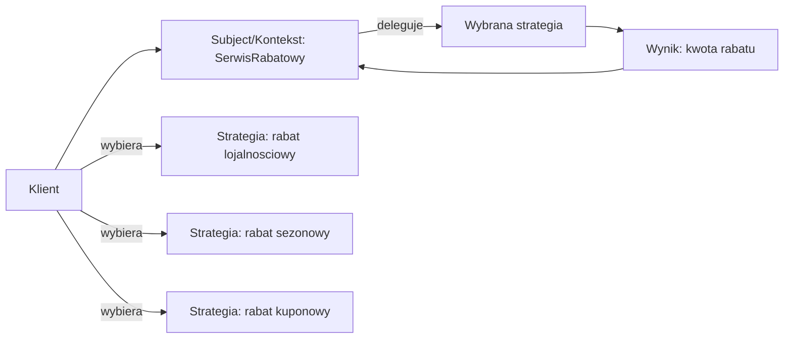
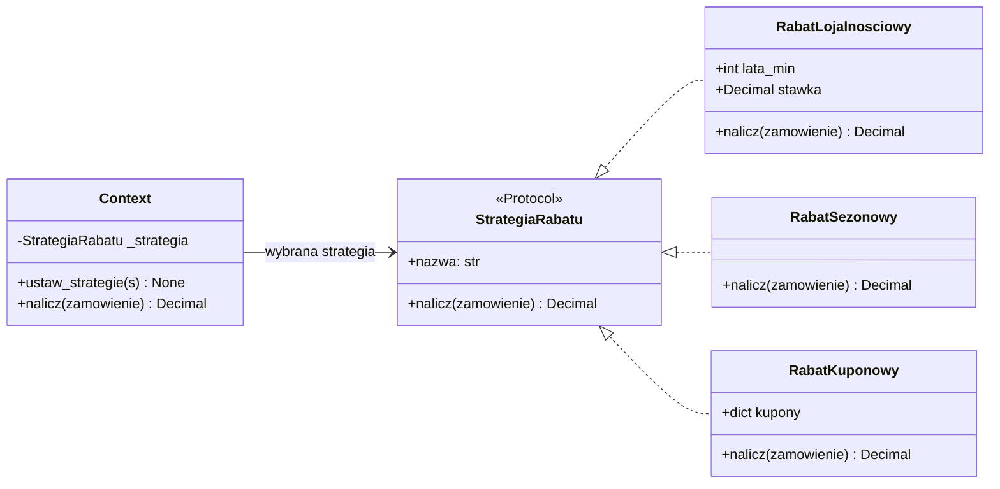
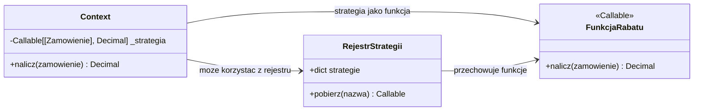
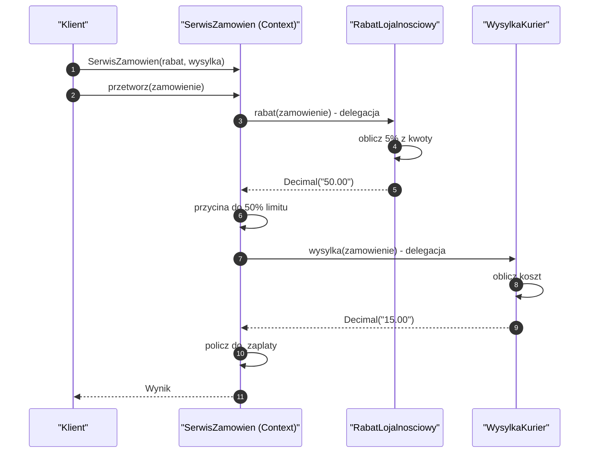
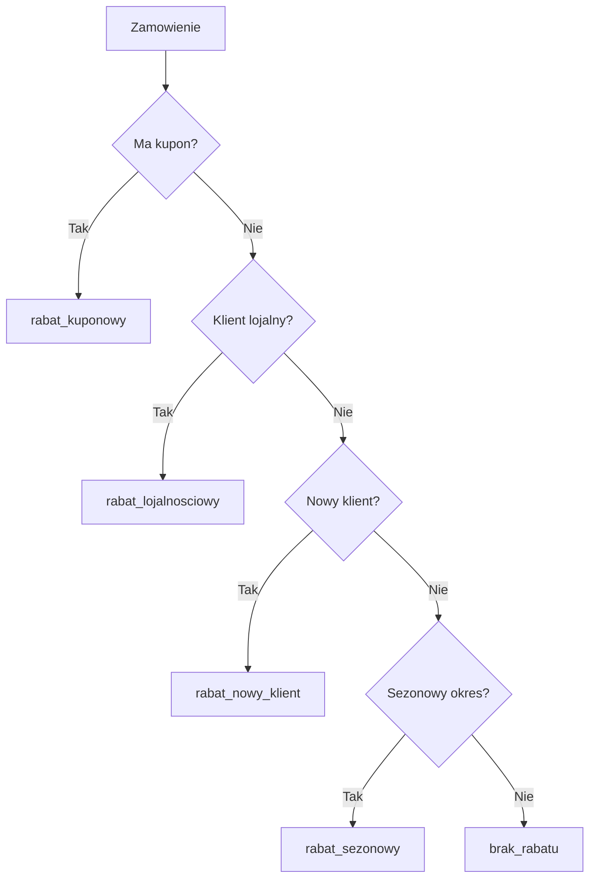
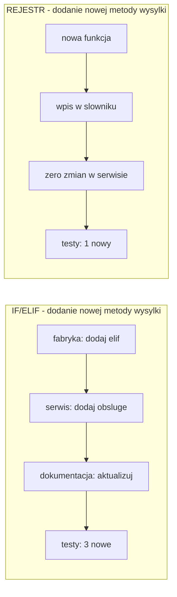
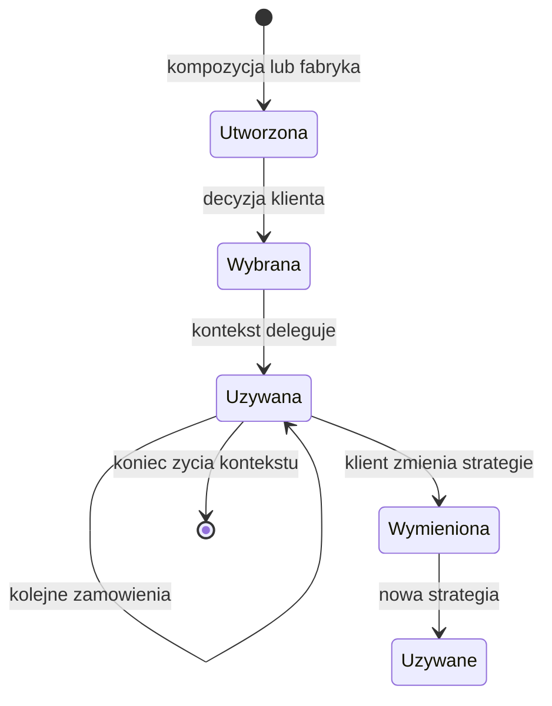
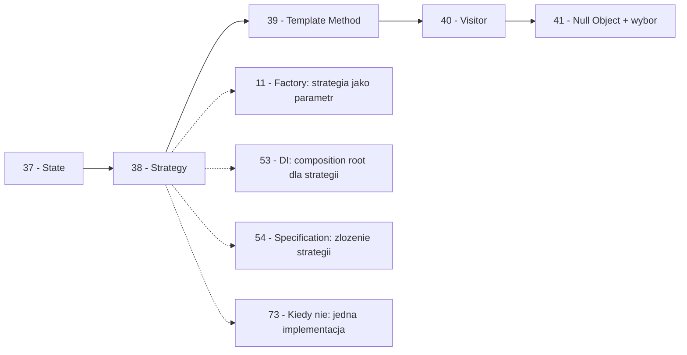

```markdown
---
modul: 38 — Strategy
plik: 38-strategy.md
poziom: podstawowy
wymaga: [37]
czas: ~150 minut czytania + ~380 minut ćwiczeń
---

# Moduł 38 — Strategy — wymienne algorytmy jako pierwszy obywatel

> **TL;DR**
> - **Strategy (strategia)** definiuje rodzinę wymiennych algorytmów, opakowuje każdy z nich i pozwala klientowi wybrać jeden — **w runtime**, bez zmiany kodu kontekstu.
> - W Pythonie strategia jest tak naturalna, że w **90% przypadków wystarczy funkcja** — `Callable[[Order], Decimal]` zamiast hierarchii klas; pełna struktura GoF potrzebna jest tylko wtedy, gdy strategia ma własny stan albo zależy od wielu zależności.
> - Kluczowa zaleta: **dodanie nowej strategii to nowa funkcja lub klasa + wpis w rejestrze**, a nie modyfikacja serwisu. To realizacja zasady Open/Closed (moduł 03) w najprostszej formie.
> - **Strategy vs State** (moduł 37) to najczęstsza pomyłka: w Strategy **klient wybiera algorytm** („jak to zrobić?"), w State **obiekt sam zmienia zachowanie w reakcji na zdarzenia** („co teraz zrobić?").
> - Zasada YAGNI (moduł 03): jeśli masz jedną implementację i nie planujesz drugiej — strategia to nadmiar. **Nie abstrahuj przed drugim przypadkiem użycia.**

---

## 0. Model mentalny

### Wybór trasy w nawigacji, skrzynka biegów i szuflada z narzędziami

Wyobraź sobie, że jedziesz do klienta w innym mieście. Otwierasz nawigację i wybierasz: **najszybsza trasa**, **najkrótsza trasa**, **najbardziej ekonomiczna** (najmniej paliwa), **unikanie dróg płatnych** albo **widokowa**. Do tego samego celu możesz dojechać **na pięć różnych sposobów**. Każdy z nich to **inny algorytm** — inna reguła wyboru dróg, inne kryterium optymalizacji, inny zestaw danych wejściowych. Ale cel jest **jeden** — dojechać. Nawigacja nie ma oddzielnego silnika dla każdej trasy. Ma **jeden silnik nawigacji**, który **przyjmuje strategię** wyboru trasy i wykonuje ją. Zmieniasz strategię jednym kliknięciem — nawigacja nie zmienia się ani o linijkę.

Pomyśl teraz, gdzie zapada decyzja. **Ty decydujesz, którą trasę wybrać** — nie nawigacja. Możesz wybrać „najszybsza", jeśli się spieszysz, albo „ekonomiczna", jeśli szanujesz paliwo. Możesz zmienić zdanie w połowie drogi (choć wtedy nawigacja przeliczy trasę). **Strategia jest wybierana przez klienta**, na zewnątrz obiektu. To fundamentalna własność, którą trzeba zapamiętać — zwłaszcza że w module 37 (State) jest dokładnie odwrotnie: tam obiekt **sam** zmienia stan.

Drugi obraz: **skrzynia biegów w samochodzie**. Silnik samochodu nie „wybiera biegu" (poza automatami). Kierowca decyduje: pierwszy bieg na rozruch, drugi na miasto, piąty na autostradę. Silnik nie ma pięciu wersji — ma jedną, którą można połączyć z różnymi przełożeniami. Wybierasz przełożenie **w trakcie jazdy** — w zależności od sytuacji. Silnik nie zmienia się, zachowanie samochodu tak. Kiedy automat robi to za ciebie, to też jest strategia — tylko **wybrana przez kogoś innego** (algorytm automatu). W kodzie: **kontekst przyjmuje strategię, ale nie tworzy jej sam**.

I trzeci obraz, który pokazuje pełne znaczenie wzorca: **szuflada z narzędziami**. Wyobraź sobie, że musisz wkręcić śrubę. W szufladzie masz wkrętak krzyżakowy, płaski, klucz nasadowy, wkrętarkę. Każde narzędzie to „inny sposób wkręcania". **Nie zmieniasz zadania** (wkręcić śrubę) — zmieniasz **narzędzie**. Szuflada jest **rejestrem narzędzi**, w którym szybko znajdujesz właściwe. W kodzie: **słownik strategii** z nazwami — `{"karta": zaplac_karta, "przelew": zaplac_przelewem, "blik": zaplac_blikiem}`. Wybierasz po nazwie — tak jak wybierasz narzędzie po wyglądzie.

Zbierzmy wszystkie trzy obrazy razem: **nawigacja** mówi „wybierz trasę"; **skrzynia biegów** mówi „przełożenie zależnie od potrzeb"; **szuflada** mówi „narzędzie do zadania". Wszystkie trzy opowiadają o tym samym: **ten sam cel, wymienne sposoby jego osiągnięcia**.

| W analogii nawigacji / skrzyni biegów / szuflady | W kodzie |
|---|---|
| Cel: dojechać do klienta / wkręcić śrubę | Operacja kontraktu (`oblicz_rabat`, `zaplac`) |
| Algorytm: najszybsza, najkrótsza trasa | **Strategy** — konkretna implementacja |
| Kierowca wybierający trasę | **Klient** — wybiera strategię w runtime |
| Nawigacja jako całość | **Context** — obiekt, który używa strategii |
| Skrzynia biegów / przełożenie | Strategia jako parametr kontekstu |
| Szuflada z narzędziami | Rejestr strategii (słownik nazwa → funkcja) |
| To samo zadanie, różne narzędzia | Ten sam kontrakt, różne implementacje |
| Wymiana narzędzia przez kierowcę | Wymiana strategii przez klienta — bez zmiany kontekstu |

> 🧠 **Zapamiętaj** — **Strategy (strategia) to wzorzec behawioralny, który definiuje rodzinę wymiennych algorytmów, opakowuje każdy z nich w jednolity interfejs i pozwala klientowi wymieniać algorytm niezależnie od kontekstu, w którym jest używany.**

Zwróć uwagę na trzy słowa: **rodzina**, **opakowuje**, **klient**. „Rodzina" — bo algorytmy są spokrewnione (robią to samo w inny sposób). „Opakowuje" — bo każdy dostaje jednolity interfejs. „Klient" — bo wybór jest **poza kontekstem**, po stronie klienta.

### Diagram — intuicja wzorca



*Diagram pokazuje, że klient wybiera strategię, kontekst deleguje do niej obliczenie, a wynik wraca do kontekstu — kontekst nie wie, którą strategię wykonuje.*

### Czego Strategy NIE robi

Rozbrójmy cztery nieporozumienia.

**Nie jest State.** State zmienia zachowanie **w reakcji na zdarzenia** — obiekt sam przechodzi między stanami. Strategy jest wybierana **przez klienta** — z góry albo w runtime, ale poza kontekstem. W State kontekst sam wybiera stan; w Strategy kontekst dostaje strategię z zewnątrz.

**Nie jest Template Method.** Template Method (moduł 39) definiuje **szkielet** algorytmu w klasie bazowej, a podklasy **wypełniają luki**. Strategy wymienia **cały** algorytm. Template Method opiera się na dziedziczeniu; Strategy na kompozycji.

**Nie jest Command.** Command (moduł 31) pakuje **żądanie** w obiekt (do kolejki, undo, opóźnienia). Strategy pakuje **algorytm** — sposób realizacji operacji. Command mówi „zrób to", Strategy mówi „zrób to w ten sposób".

**Nie jest Obserwatorem.** Observer powiadamia wielu; Strategy wykonuje jeden algorytm. Zupełnie różne intencje.

**Nie rozwiązuje problemu „jak dodać nową funkcjonalność".** Strategy pomaga **wymieniać** istniejące funkcjonalności — nie dodawać nowe niepasujące. Jeśli nowa funkcjonalność nie pasuje do kontraktu — to nie strategia, to nowy serwis.

**Nie jest darmowe.** Każda strategia to funkcja albo klasa. Wymiana strategii wymaga mechanizmu — słownika, konstruktora, konfiguracji. Dla jednej implementacji — czysty nadmiar.

---

## 1. Problem, który rozwiązujemy

Wejdźmy w domenę 🛒 „Sklepu internetowego" sprzedającego produkty finansowe (karty, ubezpieczenia, konta). System nalicza **rabaty** według różnych reguł: klient lojalnościowy, kupon promocyjny, promocja sezonowa (Black Friday, święta), nowy klient. Do tego dochodzą różne metody **wysyłki** (kurier, paczkomat, odbiór w punkcie), każda z własną logiką kosztu. Ktoś napisał to jako jedną klasę `SerwisRabatowy` z `if/elif`.

### Kod „przed"

```python
# sklep_v0.py — wersja naiwna, demonstracyjna
# UWAGA: kod celowo pokazuje rosnaca lawine if/elif.

from dataclasses import dataclass
from decimal import Decimal
from datetime import datetime, timezone


@dataclass(frozen=True)
class Zamowienie:
    identyfikator: str
    kwota: Decimal
    klient_id: str
    czy_lojalny: bool = False
    lata_lojalnosci: int = 0
    kupon: str | None = None
    czy_swiateczne: bool = False
    czy_nowy_klient: bool = False
    metoda_wysylki: str = "kurier"


class SerwisRabatowy:
    """Nalicza rabaty i koszty wysylki z lawina warunkow."""

    def nalicz_rabat(self, z: Zamowienie) -> Decimal:
        rabat = Decimal("0")

        # 1. Kupon
        if z.kupon == "PROMO10":
            rabat += (z.kwota * Decimal("0.10")).quantize(Decimal("0.01"))
        elif z.kupon == "NOWY20":
            rabat += (z.kwota * Decimal("0.20")).quantize(Decimal("0.01"))

        # 2. Lojalnosc
        if z.czy_lojalny and z.lata_lojalnosci >= 5:
            rabat += (z.kwota * Decimal("0.05")).quantize(Decimal("0.01"))
        elif z.czy_lojalny and z.lata_lojalnosci >= 3:
            rabat += (z.kwota * Decimal("0.03")).quantize(Decimal("0.01"))

        # 3. Sezonowa
        if z.czy_swiateczne and datetime.now(timezone.utc).month in (11, 12):
            rabat += (z.kwota * Decimal("0.03")).quantize(Decimal("0.01"))

        # 4. Nowy klient
        if z.czy_nowy_klient:
            rabat += (z.kwota * Decimal("0.02")).quantize(Decimal("0.01"))

        # 5. Limit rabatu
        maks = (z.kwota * Decimal("0.50")).quantize(Decimal("0.01"))
        return min(rabat, maks)

    def koszt_wysylki(self, z: Zamowienie) -> Decimal:
        if z.metoda_wysylki == "kurier":
            return Decimal("15.00") if z.kwota < Decimal("200") else Decimal("0")
        elif z.metoda_wysylki == "paczkomat":
            return Decimal("10.00")
        elif z.metoda_wysylki == "odbior":
            return Decimal("0")
        elif z.metoda_wysylki == "zagranica":
            return Decimal("45.00")
        else:
            raise ValueError(f"nieznana metoda wysylki: {z.metoda_wysylki}")


if __name__ == "__main__":
    serwis = SerwisRabatowy()
    z = Zamowienie(
        "Z-1", Decimal("500.00"), "K-1",
        czy_lojalny=True, lata_lojalnosci=5, kupon="PROMO10",
    )
    print(f"Rabat: {serwis.nalicz_rabat(z)}")
    print(f"Wysylka: {serwis.koszt_wysylki(z)}")
```

Ten kod działa. Ale ma osiem problemów, z których każdy ma konkretną konsekwencję — i wszystkie pogłębiają się z każdą nową regułą.

### Code smell — lawina warunków, wyciek wiedzy

| Problem | Gdzie | Konsekwencja |
|---|---|---|
| Lawina `if/elif` po kuponach | `nalicz_rabat` | Każdy nowy kupon to nowy `elif` |
| Lawina `if/elif` po metodach wysyłki | `koszt_wysylki` | Każda nowa metoda to nowy `elif` |
| Wszystkie reguły w jednej klasie | `SerwisRabatowy` | Klasa rośnie z każdą regułą |
| Brak nazwy dla reguł | Reguły są tylko `if`ami | Nie da się ich wyłączyć, przetestować osobno |
| Trudność z konfiguracją reguł | Brak parametrów | Promocja 10% jest zahardkodowana |
| Nie da się włączyć/wyłączyć reguły runtime | Reguła = kod | Feature flagi wymagają `if`ów |
| Test pojedynczej reguły | Zagnieżdżona w metodzie | Trudne do izolacji |
| Zmiana progu lojalności | W artmetyce w środku metody | Trzeba znaleźć i zmienić magiczne `5` |

### Objawy — poznasz ten problem po tym, że...

- **Dodanie nowej reguły to dopisanie `elif`.** Metoda rośnie liniowo.
- **Nie da się wyłączyć reguły w runtime.** Nie ma jej jako osobnego bytu — jest kodem.
- **Test pojedynczej reguły jest trudny.** Musisz wywołać całą metodę z odpowiednimi argumentami.
- **Zmiana progu lub stawki wymaga modyfikacji kodu.** Magiczne liczby są w środku `if`ów.
- **Nowa metoda wysyłki oznacza zmianę serwisu.** Nie da się „dodać" wysyłki bez edycji klasy.
- **Kolejność reguł zaszyta w kodzie.** Zmiana kolejności to przestawianie bloków.
- **Nie ma nazwy dla reguły.** W kodzie jest `if`, ale nie ma „rabat_sezonowy".
- **Wartości domyślne skomplikowane.** Trzeba wymyślać, co zwrócić, gdy reguła nie pasuje.
- **Klasa serwisu jest długa.** 100 linii dla czterech reguł, 500 dla dwudziestu.

---

## 2. Anatomia wzorca

### Uczestnicy

| Rola | Odpowiedzialność | Co NIE jest jej zadaniem |
|---|---|---|
| **Strategy (strategia)** | Definiuje wspólny interfejs wszystkich algorytmów rodziny | Nie zna kontekstu; nie wybiera siebie; nie ma domyślnej implementacji |
| **ConcreteStrategy (strategia konkretna)** | Konkretna implementacja algorytmu; może mieć własną konfigurację | Nie zna innych strategii; nie woła kontekstu |
| **Context (kontekst)** | Przechowuje referencję do strategii; deleguje do niej operacje; może dostarczać dane wejściowe | Nie zawiera logiki algorytmu; nie wybiera strategii sam (chyba że w wariancie automatycznym) |
| **Klient** | Wybiera strategię i przekazuje ją do kontekstu; może dostarczać dane | Nie wykonuje algorytmu sam; nie zna implementacji konkretnej strategii |

Kluczowa asymetria: **Context zna Strategy (abstrakcję)**, ale **nie zna ConcreteStrategy**. Klient zna oba. Wymiana strategii wymaga zmiany w konstruktorze Context albo przekazania nowej referencji.

### Diagram struktury — klasyczny



*Diagram pokazuje klasyczną strukturę: kontekst zna tylko kontrakt Strategia, każda konkretna strategia realizuje ten kontrakt niezależnie od siebie.*

### Diagram struktury — wariant funkcyjny



*Diagram pokazuje wariant funkcyjny — strategia jest funkcją `Callable[[Zamowienie], Decimal]`, a rejestr służy do wyboru strategii po nazwie.*

### Warianty: klasyczny vs pythoniczny

| Aspekt | Klasyczny (GoF) | Pythoniczny |
|---|---|---|
| Strategy | `ABC` z metodą | `Protocol` albo `Callable` |
| ConcreteStrategy | Klasy dziedziczące | Funkcje, klasy, domknięcia |
| Kontekst | Klasa z `_strategia` | Klasa albo funkcja z argumentem |
| Wybór strategii | Klient przekazuje do konstruktora | `strategy = STRATEGIE[nazwa]` |
| Konfiguracja | Pola klasy | `functools.partial`, domknięcie |
| Wybór po typie | `isinstance` | `functools.singledispatch` |
| Rejestr | Słownik nazwa → klasa | Słownik nazwa → funkcja |

Python daje **znacznie prostsze formy** — funkcje i `Protocol` pokrywają większość przypadków. Klasy pełne są potrzebne tylko, gdy strategia ma własny stan i zależności od innych obiektów.

---

## 3. Implementacja krok po kroku

Przebudujemy serwis rabatowy z sekcji 1 stopniowo — od `Protocol` do rejestru.

### Krok 1 — Zdefiniuj kontrakt strategii

Kontrakt definiuje, co każda strategia musi umieć.

```python
from typing import Protocol, runtime_checkable
from decimal import Decimal


@runtime_checkable
class StrategiaRabatu(Protocol):
    """Kontrakt strategii naliczania rabatu."""

    nazwa: str

    def nalicz(self, zamowienie: Zamowienie) -> Decimal: ...
```

Uwaga na atrybut `nazwa` — to niewymagane dla logiki, ale potrzebne do diagnostyki („która strategia zadziałała?"), do rejestracji, do logu, do audytu. Warto go mieć.

### Krok 2 — Zaimplementuj konkretne strategie jako klasy

Każda strategia to osobna klasa.

```python
class RabatKuponowy:
    """Rabat z kuponu. Kupony w slowniku."""

    nazwa = "kupon"
    KUPONY = {"PROMO10": Decimal("0.10"), "NOWY20": Decimal("0.20")}

    def nalicz(self, zamowienie: Zamowienie) -> Decimal:
        stawka = self.KUPONY.get(zamowienie.kupon or "", Decimal("0"))
        return (zamowienie.kwota * stawka).quantize(Decimal("0.01"))


class RabatLojalnosciowy:
    """Rabat dla lojalnych klientow - progresywny."""

    nazwa = "lojalnosc"

    def nalicz(self, zamowienie: Zamowienie) -> Decimal:
        if not zamowienie.czy_lojalny:
            return Decimal("0")
        if zamowienie.lata_lojalnosci >= 5:
            stawka = Decimal("0.05")
        elif zamowienie.lata_lojalnosci >= 3:
            stawka = Decimal("0.03")
        else:
            return Decimal("0")
        return (zamowienie.kwota * stawka).quantize(Decimal("0.01"))


class RabatSezonowy:
    """Promocja sezonowa - listopad i grudzien."""

    nazwa = "sezonowy"

    def nalicz(self, zamowienie: Zamowienie) -> Decimal:
        if not zamowienie.czy_swiateczne:
            return Decimal("0")
        miesiac = datetime.now(timezone.utc).month
        if miesiac not in (11, 12):
            return Decimal("0")
        return (zamowienie.kwota * Decimal("0.03")).quantize(Decimal("0.01"))


class RabatNowyKlient:
    """Rabat dla nowych klientow."""

    nazwa = "nowy_klient"

    def nalicz(self, zamowienie: Zamowienie) -> Decimal:
        if not zamowienie.czy_nowy_klient:
            return Decimal("0")
        return (zamowienie.kwota * Decimal("0.02")).quantize(Decimal("0.01"))
```

Zwróć uwagę, że **każda strategia jest samodzielna**: własna logika, własne progi, własne stawki. Klient może je testować osobno.

### Krok 3 — Zdefiniuj Context

Context deleguje do wybranej strategii.

```python
class SerwisRabatowy:
    """Context: nalicza rabat przez wybrana strategie."""

    def __init__(self, strategia: StrategiaRabatu) -> None:
        if not isinstance(strategia, StrategiaRabatu):
            raise TypeError(
                f"{type(strategia).__name__} nie spelnia kontraktu StrategiaRabatu"
            )
        self._strategia = strategia

    @property
    def nazwa_strategii(self) -> str:
        return self._strategia.nazwa

    def ustaw_strategie(self, strategia: StrategiaRabatu) -> None:
        """Pozwala zmienic strategie w runtime."""
        self._strategia = strategia

    def nalicz(self, zamowienie: Zamowienie) -> Decimal:
        return self._strategia.nalicz(zamowienie)
```

Context ma **jedną metodę** — deleguje. Metoda `ustaw_strategie` pozwala zmienić strategię w runtime (przydatne w CLI, w testach, w feature flagach).

### Krok 4 — Wybór strategii w composition root

Klient decyduje, którą strategię użyć.

```python
def wybierz_strategie(zamowienie: Zamowienie) -> StrategiaRabatu:
    """Prosta decyzja biznesowa - w prawdziwym systemie z konfiguracji."""
    if zamowienie.kupon:
        return RabatKuponowy()
    if zamowienie.czy_lojalny:
        return RabatLojalnosciowy()
    if zamowienie.czy_nowy_klient:
        return RabatNowyKlient()
    return RabatSezonowy()
```

Ta funkcja to **jedyne miejsce**, gdzie podejmowana jest decyzja. Nie jest częścią Contextu ani strategii. To „composition root" biznesowy.

### Krok 5 — Złóż wszystko

```python
def nalicz_rabat(zamowienie: Zamowienie) -> Decimal:
    strategia = wybierz_strategie(zamowienie)
    serwis = SerwisRabatowy(strategia)
    return serwis.nalicz(zamowienie)
```

### Krok 6 — Wersja z rejestrem

Zamiast łańcucha `if` w fabryce — słownik strategii.

```python
REJESTR_STRATEGII: dict[str, StrategiaRabatu] = {
    "kupon": RabatKuponowy(),
    "lojalnosc": RabatLojalnosciowy(),
    "nowy_klient": RabatNowyKlient(),
    "sezonowy": RabatSezonowy(),
}


def strategia_z_nazwy(nazwa: str) -> StrategiaRabatu:
    try:
        return REJESTR_STRATEGII[nazwa]
    except KeyError as blad:
        dostepne = ", ".join(sorted(REJESTR_STRATEGII))
        raise ValueError(
            f"nieznana strategia {nazwa!r}; dostepne: {dostepne}"
        ) from blad
```

Teraz dodanie nowej strategii to nowa klasa + **jeden wpis w słowniku**. Żadnych zmian w istniejącym kodzie.

### Krok 7 — Weryfikacja

| Kryterium | Wersja „przed" | Wersja „po" |
|---|---|---|
| Liczba `if/elif` w serwisie | 10+ | 0 |
| Dodanie nowej reguły | `elif` w metodzie | Nowa klasa + wpis |
| Test pojedynczej reguły | Trudny | Bezpośredni |
| Nazwa dla reguły | Brak | `nazwa` na klasie |
| Konfiguracja reguły | Zahardkodowana | Parametry konstruktora |
| Włączanie/wyłączanie | `if` flagowy | Usunięcie z rejestru |
| Klient zna szczegóły | Tak | Nie (tylko kontrakt) |
| Liczba klas | 2 | 6 |

Koszt: dodatkowe klasy (choć niezbyt wiele — po jednej na regułę). Zysk: reguły są niezależne, testowalne, wymienne, z nazwami.

---

## 4. Wersje pythoniczne i warianty

To jest serce tego modułu. Strategy w Pythonie ma **bardzo wiele realizacji** — i wybór między nimi jest decyzją projektową.

### 4.1 Funkcja jako strategia — najczęstszy

**W 90% przypadków w Pythonie wystarczy funkcja.** Kontrakt to typ funkcyjny.

```python
from collections.abc import Callable

StrategiaRabatu = Callable[[Zamowienie], Decimal]


def rabat_kuponowy(zamowienie: Zamowienie) -> Decimal:
    stawka = {"PROMO10": Decimal("0.10"), "NOWY20": Decimal("0.20")}.get(
        zamowienie.kupon or "", Decimal("0")
    )
    return (zamowienie.kwota * stawka).quantize(Decimal("0.01"))


def rabat_lojalnosciowy(zamowienie: Zamowienie) -> Decimal:
    if not zamowienie.czy_lojalny:
        return Decimal("0")
    stawka = Decimal("0.05") if zamowienie.lata_lojalnosci >= 5 else Decimal("0.03")
    return (zamowienie.kwota * stawka).quantize(Decimal("0.01"))


# Uzycie:
def nalicz(z: Zamowienie, strategia: StrategiaRabatu = rabat_kuponowy) -> Decimal:
    return strategia(z)
```

**Zaleta:** funkcja jest strategią „naturalnie" — bez klasy, bez dziedziczenia, bez boilerplate'u. **Wada:** brak `nazwy` (albo trzeba jej szukać w `__name__`), brak własnego stanu (chyba że domknięcie), trudniej serializować.

**Kiedy używać:** domyślny wybór w Pythonie. Jeśli strategia jest funkcją bezstanową, użyj funkcji.

### 4.2 Słownik strategii — rejestr po nazwie

Zamiast `if/elif` w fabryce — słownik.

```python
STRATEGIE: dict[str, StrategiaRabatu] = {
    "kupon": rabat_kuponowy,
    "lojalnosc": rabat_lojalnosciowy,
    "sezonowy": rabat_sezonowy,
    "nowy": rabat_nowy_klient,
}


def strategia_z_konfiguracji(nazwa: str) -> StrategiaRabatu:
    try:
        return STRATEGIE[nazwa]
    except KeyError:
        raise ValueError(f"nieznana strategia: {nazwa}")
```

Użycie: strategia jest wybierana przez **nazwę z konfiguracji**. To idealne dla aplikacji, gdzie strategia ma być **konfigurowalna** (np. w YAML, w bazie).

**Rejestracja automatyczna** — strategie mogą same się rejestrować przez dekorator:

```python
def rejestruj(klucz: str):
    def dekorator(funkcja: StrategiaRabatu) -> StrategiaRabatu:
        if klucz in STRATEGIE:
            raise ValueError(f"strategia {klucz!r} juz zarejestrowana")
        STRATEGIE[klucz] = funkcja
        return funkcja
    return dekorator


@rejestruj("kupon")
def rabat_kuponowy(zamowienie: Zamowienie) -> Decimal:
    ...
```

To technique często spotykana w bibliotekach — funkcja rejestruje się sama, gdy moduł jest importowany.

### 4.3 `Protocol` — dla czytelności i typowania

Jeśli chcesz jawnego kontraktu, użyj `Protocol`.

```python
from typing import Protocol, runtime_checkable


@runtime_checkable
class StrategiaRabatu(Protocol):
    nazwa: str
    def nalicz(self, z: Zamowienie) -> Decimal: ...


# A implementacja moze byc klasa bez dziedziczenia:
class RabatKuponowy:
    nazwa = "kupon"
    def nalicz(self, z: Zamowienie) -> Decimal: ...
```

Zalety: `mypy` sprawdza, `isinstance(x, StrategiaRabatu)` działa, dokumentacja jest jasna. Wady: żadnych — `Protocol` jest "free" w Pythonie.

### 4.4 `functools.partial` — parametryzacja strategii

Strategia z konfiguracją przez `partial`.

```python
import functools


def rabat_lojalnosciowy(z: Zamowienie, lata_min: int, stawka: Decimal) -> Decimal:
    if not z.czy_lojalny or z.lata_lojalnosci < lata_min:
        return Decimal("0")
    return (z.kwota * stawka).quantize(Decimal("0.01"))


# Trzy warianty tej samej strategii z roznymi parametrami:
rabat_srebrny = functools.partial(
    rabat_lojalnosciowy, lata_min=3, stawka=Decimal("0.03")
)
rabat_zloty = functools.partial(
    rabat_lojalnosciowy, lata_min=5, stawka=Decimal("0.05")
)
rabat_platyna = functools.partial(
    rabat_lojalnosciowy, lata_min=10, stawka=Decimal("0.08")
)
```

`partial` „zamraża" część argumentów — daje nową funkcję z mniejszą liczbą argumentów. **Bardzo elegancki sposób tworzenia konfigurowalnych strategii.**

### 4.5 Strategia przez domknięcie

Jeśli potrzebujesz skonfigurowanej strategii jako funkcji — użyj domknięcia.

```python
def utworz_rabat_staly(procent: Decimal) -> StrategiaRabatu:
    """Fabryka strategii: zwraca funkcje z zamknietym procentem."""
    def strategia(z: Zamowienie) -> Decimal:
        return (z.kwota * procent).quantize(Decimal("0.01"))
    strategia.__name__ = f"rabat_{procent:.0%}"
    return strategia


rabat_5 = utworz_rabat_staly(Decimal("0.05"))
rabat_10 = utworz_rabat_staly(Decimal("0.10"))
```

Zaleta: czysto funkcyjne, bez `partial`. Wada: przy skomplikowanej konfiguracji więcej boilerplate'u niż `partial`.

### 4.6 `singledispatch` — wybór po typie danych

Gdy wybór strategii zależy od **typu** danych wejściowych.

```python
from functools import singledispatch


@singledispatch
def koszt_wysylki(zamowienie) -> Decimal:
    """Domyslna - dla nieznanych typow."""
    return Decimal("0")


@koszt_wysylki.register
def _(zamowienie: ZamowienieKrajowe) -> Decimal:
    return Decimal("15.00") if zamowienie.kwota < Decimal("200") else Decimal("0")


@koszt_wysylki.register
def _(zamowienie: ZamowienieZagraniczne) -> Decimal:
    return Decimal("45.00") if zamowienie.kraj != "DE" else Decimal("30.00")
```

Zaleta: `singledispatch` automatycznie wybiera metodę po typie — O(1) lookup, bez `if`. Wada: działa tylko po typie pierwszego argumentu; wybór „na podstawie danych" wymaga innych mechanizmów. W modułach 40 (Visitor) i 54 (Specification) wrócimy do tego.

### 4.7 Wariant funkcyjny: funkcja wyższego rzędu

Kontekst może być funkcją wyższego rzędu.

```python
def utworz_naliczacza(
    strategia: StrategiaRabatu,
) -> Callable[[Zamowienie], Decimal]:
    """Zwraca funkcje naliczajaca rabat z wybrana strategia."""
    def nalicz(z: Zamowienie) -> Decimal:
        return strategia(z)
    return nalicz


nalicz_kupon = utworz_naliczacza(rabat_kuponowy)
nalicz_lojal = utworz_naliczacza(rabat_lojalnosciowy)
```

Zaleta: bez klasy Context. Wada: brak możliwości „ustaw strategię w runtime" na tym samym obiekcie.

### 4.8 Wariant z konfiguracją w pliku

Strategia wybrana na podstawie pliku YAML/JSON.

```python
# konfiguracja.yaml
# rabat:
#   typ: lojalnosc
#   lata_min: 5
#   stawka: 0.05

def zbuduj_z_konfiguracji(cfg: dict) -> StrategiaRabatu:
    typ = cfg["typ"]
    if typ == "kupon":
        return rabat_kuponowy
    if typ == "lojalnosc":
        return functools.partial(
            rabat_lojalnosciowy,
            lata_min=cfg["lata_min"],
            stawka=Decimal(str(cfg["stawka"])),
        )
    # ...
    raise ValueError(f"nieznany typ strategii: {typ}")
```

To bardzo praktyczne — strategia jest w pełni **konfigurowalna z zewnątrz**. W module 63 (mikroserwisy) omówimy to jako „konfiguracja zamiast kodu".

### 4.9 Podsumowanie — tabela wyboru

| Sytuacja | Wariant |
|---|---|
| Strategia bezstanowa | Funkcja (4.1) |
| Strategia z konfiguracją przez nazwę | Słownik + funkcja (4.2) |
| Chcesz jawnego kontraktu | `Protocol` (4.3) |
| Konfiguracja parametryczna | `functools.partial` (4.4) |
| Fabryka skonfigurowanych strategii | Domknięcie (4.5) |
| Wybór po typie danych | `singledispatch` (4.6) |
| Chcesz uniknąć Contextu | Funkcja wyższego rzędu (4.7) |
| Konfiguracja z pliku | Fabryka z YAML (4.8) |
| Strategia ma własny stan | Klasa (klasyczna) |

> 🧠 **Zapamiętaj** — W Pythonie strategia jest tak naturalna, że często nie ma sensu mówić „implementuję wzorzec Strategy". Piszesz po prostu **funkcję**, **przekazujesz ją jako argument** i to działa. Wzorzec jest tu „nieuświadomiony" — ale jego znajomość pozwala **świadomie wybierać** między funkcyjnym a klasowym wariantem.

---

## 5. Przykład z życia: 🛒 Sklep — pełny uruchamialny kod

Zbudujemy pełny system sklepu z **rodziną strategii rabatowych**, rejestrem nazw, konfiguracją i testami.

### Kod

```python
# sklep_strategy.py — pelny przyklad Strategy
from __future__ import annotations

import functools
from collections.abc import Callable
from dataclasses import dataclass
from datetime import datetime, timezone
from decimal import ROUND_HALF_UP, Decimal
from typing import Protocol, runtime_checkable


# ===========================================================================
# 1. Typy domenowe
# ===========================================================================

GROSZ = Decimal("0.01")


def zaokraglij(kwota: Decimal) -> Decimal:
    return kwota.quantize(GROSZ, rounding=ROUND_HALF_UP)


@dataclass(frozen=True, slots=True)
class Zamowienie:
    identyfikator: str
    kwota: Decimal
    klient_id: str
    czy_lojalny: bool = False
    lata_lojalnosci: int = 0
    kupon: str | None = None
    czy_swiateczne: bool = False
    czy_nowy_klient: bool = False
    metoda_wysylki: str = "kurier"


# ===========================================================================
# 2. Kontrakt strategii (Protocol + Callable, do wyboru)
# ===========================================================================

StrategiaRabatu = Callable[[Zamowienie], Decimal]
StrategiaWysylki = Callable[[Zamowienie], Decimal]


# ===========================================================================
# 3. Konkretne strategie rabatowe (funkcje)
# ===========================================================================

def brak_rabatu(z: Zamowienie) -> Decimal:
    return Decimal("0")


def rabat_kuponowy(z: Zamowienie) -> Decimal:
    """Rabat z kuponu. Kupony w slowniku."""
    stawki = {
        "PROMO10": Decimal("0.10"),
        "NOWY20": Decimal("0.20"),
        "BLACK30": Decimal("0.30"),
    }
    stawka = stawki.get(z.kupon or "", Decimal("0"))
    return zaokraglij(z.kwota * stawka)


def rabat_lojalnosciowy(z: Zamowienie) -> Decimal:
    """Progresywny rabat lojalnosciowy."""
    if not z.czy_lojalny:
        return Decimal("0")
    if z.lata_lojalnosci >= 10:
        stawka = Decimal("0.08")
    elif z.lata_lojalnosci >= 5:
        stawka = Decimal("0.05")
    elif z.lata_lojalnosci >= 3:
        stawka = Decimal("0.03")
    else:
        return Decimal("0")
    return zaokraglij(z.kwota * stawka)


def rabat_sezonowy(z: Zamowienie) -> Decimal:
    """Promocja sezonowa - listopad i grudzien."""
    if not z.czy_swiateczne:
        return Decimal("0")
    if datetime.now(timezone.utc).month not in (11, 12):
        return Decimal("0")
    return zaokraglij(z.kwota * Decimal("0.03"))


def rabat_nowy_klient(z: Zamowienie) -> Decimal:
    if not z.czy_nowy_klient:
        return Decimal("0")
    return zaokraglij(z.kwota * Decimal("0.02"))


def rabat_laczony(z: Zamowienie) -> Decimal:
    """Strategia laczaca - maksymalny z kilku rabatow."""
    return max(
        rabat_kuponowy(z),
        rabat_lojalnosciowy(z),
        rabat_sezonowy(z),
        rabat_nowy_klient(z),
    )


# ===========================================================================
# 4. Fabryka parametryzowanych strategii (domkniecie)
# ===========================================================================

def utworz_rabat_staly(procent: Decimal) -> StrategiaRabatu:
    """Fabryka strategii: zwraca funkcje z zamknietym procentem."""
    def strategia(z: Zamowienie) -> Decimal:
        return zaokraglij(z.kwota * procent)
    strategia.__name__ = f"rabat_{procent:.0%}"
    return strategia


def utworz_rabat_progowy(
    prog: Decimal, procent_powyzej: Decimal
) -> StrategiaRabatu:
    """Rabat tylko dla zamowien powyzej progu."""
    def strategia(z: Zamowienie) -> Decimal:
        if z.kwota < prog:
            return Decimal("0")
        return zaokraglij(z.kwota * procent_powyzej)
    strategia.__name__ = f"rabat_>{prog}_prog_{procent_powyzej:.0%}"
    return strategia


# ===========================================================================
# 5. Strategie wysylki
# ===========================================================================

def wysylka_kurier(z: Zamowienie) -> Decimal:
    return Decimal("15.00") if z.kwota < Decimal("200.00") else Decimal("0")


def wysylka_paczkomat(z: Zamowienie) -> Decimal:
    return Decimal("10.00")


def wysylka_odbior(z: Zamowienie) -> Decimal:
    return Decimal("0")


def wysylka_zagraniczna(z: Zamowienie) -> Decimal:
    return Decimal("45.00")


# ===========================================================================
# 6. Rejestry strategii
# ===========================================================================

RABATY: dict[str, StrategiaRabatu] = {
    "brak": brak_rabatu,
    "kupon": rabat_kuponowy,
    "lojalnosc": rabat_lojalnosciowy,
    "sezonowy": rabat_sezonowy,
    "nowy_klient": rabat_nowy_klient,
    "laczony": rabat_laczony,
}

WYSYLKI: dict[str, StrategiaWysylki] = {
    "kurier": wysylka_kurier,
    "paczkomat": wysylka_paczkomat,
    "odbior": wysylka_odbior,
    "zagranica": wysylka_zagraniczna,
}


def rabat_z_nazwy(nazwa: str) -> StrategiaRabatu:
    try:
        return RABATY[nazwa]
    except KeyError as blad:
        dostepne = ", ".join(sorted(RABATY))
        raise ValueError(
            f"nieznany rabat {nazwa!r}; dostepne: {dostepne}"
        ) from blad


def wysylka_z_nazwy(nazwa: str) -> StrategiaWysylki:
    try:
        return WYSYLKI[nazwa]
    except KeyError as blad:
        dostepne = ", ".join(sorted(WYSYLKI))
        raise ValueError(
            f"nieznana wysylka {nazwa!r}; dostepne: {dostepne}"
        ) from blad


# ===========================================================================
# 7. Kontekst - serwis zamowien
# ===========================================================================

@dataclass(frozen=True, slots=True)
class Wynik:
    zamowienie: str
    rabat: Decimal
    koszt_wysylki: Decimal
    do_zaplaty: Decimal
    rabat_od: str
    wysylka_od: str


class SerwisZamowien:
    """Context: uzywa strategii rabatu i wysylki."""

    def __init__(
        self,
        strategia_rabatu: StrategiaRabatu = brak_rabatu,
        strategia_wysylki: StrategiaWysylki = wysylka_kurier,
    ) -> None:
        self._rabat = strategia_rabatu
        self._wysylka = strategia_wysylki

    def ustaw_rabat(self, strategia: StrategiaRabatu) -> None:
        self._rabat = strategia

    def ustaw_wysylke(self, strategia: StrategiaWysylki) -> None:
        self._wysylka = strategia

    def przetworz(self, z: Zamowienie) -> Wynik:
        rabat = self._rabat(z)
        # Limit: rabat nie wiekszy niz 50% wartosci
        maks = zaokraglij(z.kwota * Decimal("0.50"))
        rabat = min(rabat, maks)
        koszt = self._wysylka(z)
        do_zaplaty = z.kwota - rabat + koszt
        return Wynik(
            zamowienie=z.identyfikator,
            rabat=rabat,
            koszt_wysylki=koszt,
            do_zaplaty=zaokraglij(do_zaplaty),
            rabat_od=self._rabat.__name__,
            wysylka_od=self._wysylka.__name__,
        )


# ===========================================================================
# 8. Demonstracja
# ===========================================================================

if __name__ == "__main__":
    print("=== 1. Rozne strategie rabatu dla tego samego zamowienia ===")
    z = Zamowienie(
        "Z-1", Decimal("500.00"), "K-1",
        czy_lojalny=True, lata_lojalnosci=5, kupon="PROMO10",
        czy_swiateczne=True,
    )
    for nazwa in ("brak", "kupon", "lojalnosc", "sezonowy", "laczony"):
        rabat = rabat_z_nazwy(nazwa)
        serwis = SerwisZamowien(strategia_rabatu=rabat)
        wynik = serwis.przetworz(z)
        print(f"  {nazwa:12s} -> rabat {wynik.rabat}, do zaplaty {wynik.do_zaplaty}")

    print("\n=== 2. Rozne strategie wysylki ===")
    for nazwa in ("kurier", "paczkomat", "odbior", "zagranica"):
        wys = wysylka_z_nazwy(nazwa)
        serwis = SerwisZamowien(strategia_wysylki=wys)
        wynik = serwis.przetworz(z)
        print(f"  {nazwa:10s} -> koszt {wynik.koszt_wysylki}")

    print("\n=== 3. Konfiguracja przez fabryke ===")
    rabat_15 = utworz_rabat_staly(Decimal("0.15"))
    rabat_prog_1000 = utworz_rabat_progowy(
        prog=Decimal("1000.00"), procent_powyzej=Decimal("0.10")
    )
    for nazwa, rabat in [
        ("rabat_15_proc", rabat_15),
        ("rabat_>1000", rabat_prog_1000),
    ]:
        serwis = SerwisZamowien(strategia_rabatu=rabat)
        wynik = serwis.przetworz(z)
        print(f"  {nazwa:20s} -> rabat {wynik.rabat}")

    print("\n=== 4. Wymiana strategii w runtime ===")
    serwis = SerwisZamowien(strategia_rabatu=rabat_z_nazwy("brak"))
    wynik = serwis.przetworz(z)
    print(f"  Bez rabatu: {wynik.rabat}")
    serwis.ustaw_rabat(rabat_z_nazwy("lojalnosc"))
    wynik = serwis.przetworz(z)
    print(f"  Po zmianie: rabat {wynik.rabat} (od: {wynik.rabat_od})")

    print("\n=== 5. Decyzja na podstawie zamowienia ===")
    def decyduj(z: Zamowienie) -> StrategiaRabatu:
        if z.kupon:
            return rabat_z_nazwy("kupon")
        if z.czy_lojalny:
            return rabat_z_nazwy("lojalnosc")
        if z.czy_nowy_klient:
            return rabat_z_nazwy("nowy_klient")
        return rabat_z_nazwy("brak")

    zlecenia = [
        Zamowienie("Z-2", Decimal("300.00"), "K-2", kupon="BLACK30"),
        Zamowienie("Z-3", Decimal("300.00"), "K-3", czy_lojalny=True, lata_lojalnosci=7),
        Zamowienie("Z-4", Decimal("300.00"), "K-4", czy_nowy_klient=True),
        Zamowienie("Z-5", Decimal("300.00"), "K-5"),
    ]
    for z in zlecenia:
        rabat = decyduj(z)
        serwis = SerwisZamowien(strategia_rabatu=rabat)
        wynik = serwis.przetworz(z)
        print(f"  {z.identyfikator}: {wynik.rabat_od} -> rabat {wynik.rabat}")

    print("\n=== 6. Blad przy nieznanej strategii ===")
    try:
        rabat_z_nazwy("nieznany")
    except ValueError as blad:
        print(f"  {blad}")
```

### Co ten przykład pokazuje

**Punkt 1 — różne strategie dla tego samego zamówienia.** To samo zamówienie ma różne rabaty w zależności od strategii. **Kontekst się nie zmienia** — zmienia się strategia.

**Punkt 2 — strategie niezależne dla wysyłki.** Wysyłka ma własną rodzinę strategii. Kontekst przyjmuje obie.

**Punkt 3 — konfigurowalne strategie.** `utworz_rabat_staly(0.15)` tworzy strategię z parametrem. **Jedna funkcja, nieskończenie wiele strategii.**

**Punkt 4 — wymiana w runtime.** `serwis.ustaw_rabat(...)` zmienia strategię bez tworzenia nowego serwisu.

**Punkt 5 — decyzja biznesowa.** Fabryka `decyduj` to jedyne miejsce, gdzie zapada decyzja o wyborze. W prawdziwym systemie może to być konfiguracja, flagi, A/B test.

**Punkt 6 — czytelne błędy.** Nieznana strategia daje komunikat z listą dostępnych. Bardzo praktyczne.

### Testy

```python
# test_sklep_strategy.py — uruchomienie: pytest test_sklep_strategy.py -v
from decimal import Decimal

import pytest

from sklep_strategy import (
    RABATY,
    WYSYLKI,
    SerwisZamowien,
    StrategiaRabatu,
    Zamowienie,
    brak_rabatu,
    rabat_kuponowy,
    rabat_laczony,
    rabat_lojalnosciowy,
    rabat_nowy_klient,
    rabat_sezonowy,
    rabat_z_nazwy,
    utworz_rabat_progowy,
    utworz_rabat_staly,
    wysylka_kurier,
    wysylka_odbior,
    wysylka_paczkomat,
    wysylka_zagraniczna,
    wysylka_z_nazwy,
    zaokraglij,
)


def zamowienie(**nadp) -> Zamowienie:
    dane = {
        "identyfikator": "Z-T",
        "kwota": Decimal("1000.00"),
        "klient_id": "K-T",
    }
    dane.update(nadp)
    return Zamowienie(**dane)


# --- Strategie indywidualnie -------------------------------------------------

def test_brak_rabatu() -> None:
    assert brak_rabatu(zamowienie()) == Decimal("0")


def test_rabat_kuponowy_promo10() -> None:
    r = rabat_kuponowy(zamowienie(kupon="PROMO10"))
    assert r == Decimal("100.00")


def test_rabat_kuponowy_nowy20() -> None:
    r = rabat_kuponowy(zamowienie(kupon="NOWY20"))
    assert r == Decimal("200.00")


def test_rabat_kuponowy_nieznany() -> None:
    r = rabat_kuponowy(zamowienie(kupon="XXX"))
    assert r == Decimal("0")


def test_rabat_lojalnosciowy_ponizej_3_lat() -> None:
    r = rabat_lojalnosciowy(zamowienie(czy_lojalny=True, lata_lojalnosci=2))
    assert r == Decimal("0")


def test_rabat_lojalnosciowy_5_lat() -> None:
    r = rabat_lojalnosciowy(zamowienie(czy_lojalny=True, lata_lojalnosci=5))
    assert r == Decimal("50.00")


def test_rabat_lojalnosciowy_10_lat() -> None:
    r = rabat_lojalnosciowy(zamowienie(czy_lojalny=True, lata_lojalnosci=10))
    assert r == Decimal("80.00")


def test_rabat_nowy_klient() -> None:
    r = rabat_nowy_klient(zamowienie(czy_nowy_klient=True))
    assert r == Decimal("20.00")


def test_rabat_laczony_bierze_max() -> None:
    z = zamowienie(czy_lojalny=True, lata_lojalnosci=10, kupon="PROMO10")
    assert rabat_laczony(z) == Decimal("100.00")   # kupon 10% > lojalnosc 8%


# --- Fabryki parametryczne ---------------------------------------------------

def test_fabryka_rabatu_stalego() -> None:
    r = utworz_rabat_staly(Decimal("0.15"))
    assert r(zamowienie()) == Decimal("150.00")


def test_fabryka_rabatu_progowego() -> None:
    r = utworz_rabat_progowy(
        prog=Decimal("2000.00"), procent_powyzej=Decimal("0.10")
    )
    assert r(zamowienie(kwota=Decimal("1500"))) == Decimal("0")
    assert r(zamowienie(kwota=Decimal("3000"))) == Decimal("300.00")


# --- Strategie wysylki -------------------------------------------------------

def test_wysylka_kurier_ponizej_200() -> None:
    assert wysylka_kurier(zamowienie(kwota=Decimal("100"))) == Decimal("15.00")


def test_wysylka_kurier_powyzej_200() -> None:
    assert wysylka_kurier(zamowienie(kwota=Decimal("300"))) == Decimal("0")


def test_wysylka_paczkomat() -> None:
    assert wysylka_paczkomat(zamowienie()) == Decimal("10.00")


def test_wysylka_odbior_darmowa() -> None:
    assert wysylka_odbior(zamowienie()) == Decimal("0")


def test_wysylka_zagraniczna() -> None:
    assert wysylka_zagraniczna(zamowienie()) == Decimal("45.00")


# --- Rejestry ----------------------------------------------------------------

def test_rabat_z_nazwy() -> None:
    assert rabat_z_nazwy("kupon") is rabat_kuponowy


def test_rabat_z_nazwy_nieznany() -> None:
    with pytest.raises(ValueError, match="nieznany rabat"):
        rabat_z_nazwy("xxx")


def test_wysylka_z_nazwy() -> None:
    assert wysylka_z_nazwy("kurier") is wysylka_kurier


def test_wysylka_z_nazwy_nieznana() -> None:
    with pytest.raises(ValueError, match="nieznana wysylka"):
        wysylka_z_nazwy("xxx")


# --- Kontrakt: wszystkie strategie zgodne ------------------------------------

WSZYSTKIE_RABATY = [
    brak_rabatu, rabat_kuponowy, rabat_lojalnosciowy,
    rabat_sezonowy, rabat_nowy_klient, rabat_laczony,
]


@pytest.mark.parametrize("strategia", WSZYSTKIE_RABATY, ids=lambda f: f.__name__)
def test_rabat_zwraca_decimal(strategia) -> None:
    wynik = strategia(zamowienie())
    assert isinstance(wynik, Decimal)
    assert wynik >= Decimal("0")


@pytest.mark.parametrize("strategia", WSZYSTKIE_RABATY, ids=lambda f: f.__name__)
def test_rabat_dla_zerowego_zamowienia(strategia) -> None:
    """Strategia musi obslugiwac zero."""
    wynik = strategia(zamowienie(kwota=Decimal("0")))
    assert wynik == Decimal("0")


@pytest.mark.parametrize("strategia", WSZYSTKIE_RABATY, ids=lambda f: f.__name__)
def test_rabat_jest_deterministyczny(strategia) -> None:
    z = zamowienie(czy_lojalny=True, lata_lojalnosci=6)
    assert strategia(z) == strategia(z)


# --- Serwis (Context) --------------------------------------------------------

def test_serwis_z_rabatem() -> None:
    s = SerwisZamowien(strategia_rabatu=rabat_kuponowy)
    z = zamowienie(kupon="PROMO10")
    w = s.przetworz(z)
    assert w.rabat == Decimal("100.00")


def test_serwis_limit_rabatu_50_procent() -> None:
    """Kontekst przycina rabat do 50% wartosci."""
    s = SerwisZamowien(strategia_rabatu=utworz_rabat_staly(Decimal("0.80")))
    w = s.przetworz(zamowienie())
    assert w.rabat == Decimal("500.00")


def test_serwis_zmiana_rabatu_runtime() -> None:
    s = SerwisZamowien(strategia_rabatu=brak_rabatu)
    assert s.przetworz(zamowienie(kupon="PROMO10")).rabat == Decimal("0")
    s.ustaw_rabat(rabat_kuponowy)
    assert s.przetworz(zamowienie(kupon="PROMO10")).rabat == Decimal("100.00")


def test_serwis_domyslna_konfiguracja() -> None:
    """Domyslnie bez rabatu, kurier."""
    s = SerwisZamowien()
    w = s.przetworz(zamowienie())
    assert w.rabat == Decimal("0")
    assert w.koszt_wysylki == Decimal("0")   # bo kwota > 200


def test_serwis_do_zaplaty() -> None:
    s = SerwisZamowien(
        strategia_rabatu=rabat_kuponowy,
        strategia_wysylki=wysylka_paczkomat,
    )
    w = s.przetworz(zamowienie(kupon="PROMO10"))
    # 1000 - 100 + 10 = 910
    assert w.do_zaplaty == Decimal("910.00")
```

Ostatnie testy pokazują **kontrakt strategii** (parametryzowane po wszystkich implementacjach). Kluczowy: `test_rabat_jest_deterministyczny` — strategia bez ukrytego stanu musi dawać ten sam wynik dla tego samego wejścia.

---

## 6. Dynamika

### 6.1 Kontekst deleguje algorytm do strategii



*Diagram pokazuje pełen przebieg: klient wywołuje kontekst, kontekst deleguje do strategii (rabat, wysyłka), zbiera wyniki i zwraca gotowy rezultat.*

### 6.2 Wybór strategii — flowchart decyzyjny



*Diagram pokazuje drzewo decyzyjne wyboru strategii — cała decyzja jest poza kontekstem, w fabryce lub kompozycji aplikacji.*

### 6.3 Porównanie `if/elif` vs rejestr — liczba miejsc do zmiany



*Diagram pokazuje, że dodanie nowej metody wysyłki przez `if/elif` wymaga zmian w wielu miejscach, a przez rejestr — tylko w jednym pliku i słowniku.*

### 6.4 Cykl życia strategii



*Diagram pokazuje cykl życia: strategia jest tworzona raz, wybrana przez klienta, wywoływana przez kontekst, w każdej chwili można ją wymienić — kontekst pozostaje ten sam.*

> 💡 **Intuicja** — Strategy jest jak wymiana trybów pracy urządzenia. W pralce wybierasz „pranie delikatne" albo „pranie intensywne" — ta sama pralka, ten sam bęben, ta sama woda, ale inny program. Program to strategia. Pralka działa tak samo, zachowanie jest inne, bo **ty** zdecydowałeś o programie.

---

## 7. Kiedy używać / kiedy NIE używać

### Kiedy używać

**Gdy masz kilka wymiennych sposobów realizacji tego samego zadania.** Naliczanie rabatu, kosztu wysyłki, prowizji, wyceny — wszystko to może mieć różne algorytmy.

**Gdy wybór algorytmu zależy od danych lub konfiguracji.** Kupon, segment klienta, kraj dostawy — wybór po danych.

**Gdy chcesz dodawać nowe algorytmy bez zmiany kodu kontekstu.** Realizacja OCP (moduł 03). Nowa strategia to nowa funkcja/klasa + wpis w rejestrze.

**Gdy potrzebujesz wymiany w runtime.** Feature flagi, A/B testy, tryb „sandbox" — wymiana strategii bez restartu.

**Gdy każda implementacja ma sensowny zestaw testów.** Strategie bezstanowe są idealne do testów parametryzowanych.

**Gdy konfiguracja ma pochodzić z zewnątrz (YAML, baza, panel administracyjny).** Strategia z nazwą łatwo się konfiguruje.

**Gdy chcesz uniknąć eksplozji `if/elif`.** Każdy nowy wariant to nowy `if` — to sygnał do Strategii.

**Gdy logika jest taka sama, ale różnią się szczegóły numeryczne.** Procenty, progi, tabele stawek — Strategia z parametrami.

**Gdy testujesz warianty algorytmiczne.** Porównywanie wydajności, poprawności, wpływu biznesowego — Strategia ułatwia podmianę.

**Gdy domena ma polityki wymienne (compliance, RODO, kantory, jurysdykcje).** Każda polityka to strategia.

### Kiedy NIE używać

**Gdy masz jedną implementację.** YAGNI (moduł 03): jeśli nie planujesz drugiej — Strategy to nadmiar. Kod wprost.

**Gdy różnice są trywialne.** Dwa warianty różniące się jedną stałą — nie potrzebują oddzielnych strategii, wystarczy parametr.

**Gdy wybór strategii jest złożony i zmienny.** Skomplikowana logika wyboru sama w sobie jest problemem — rozważ Specification (moduł 54).

**Gdy kontekst i tak musi znać typ strategii.** Jeśli w kodzie pojawia się `isinstance(strategia, RabatKuponowy)` — coś jest źle zaprojektowane.

**Gdy strategia ma być wywołana raz.** Proszenie o abstrakcję dla jednorazowego użycia to strata.

**Gdy każda strategia ma zupełnie inne wejście/wyjście.** Jeśli nie da się ujednolicić kontraktu — to nie są strategie.

**Gdy zespół nie zna wzorca.** Bez zrozumienia wyboru „funkcja vs klasa" — wprowadzenie Strategy doda nieporządku.

**Gdy domena ma zbyt wiele polityk.** 100 polityk — to nie 100 strategii. To tabela konfiguracji albo system reguł.

**Gdy potrzebujesz pipeline przetwarzania.** Sekwencja kroków to potok (moduł 64), nie strategia.

**Gdy klient musi wybrać strategię dokładnie raz.** Czasem parametr jest lepszy niż strategia.

**Zbiorczo — tabela decyzyjna:**

| Pytanie | Jeśli „tak" | Jeśli „nie" |
|---|---|---|
| Masz 2+ implementacje? | Strategy | Kod wprost |
| Wybór zależy od danych/konfiguracji? | Strategy | Parametr |
| Chcesz dodawać bez zmian istniejących? | Strategy | Kod wprost |
| Wymiana w runtime? | Strategy | Konstruktor |
| Kontekst musi znać typ strategii? | **Nie Strategy** | Strategy OK |
| Jedna implementacja i brak planów? | **Nie Strategy** | Strategy OK |
| Różnice trywialne? | **Nie Strategy** | Strategy OK |
| 100 polityk? | **Nie Strategy** | Tabela/system reguł |
| Zespół zna wzorzec? | Warto rozważyć | Najpierw edukacja |

---

## 8. Pułapki i antywzorce

**1. Strategia-bóg (God Strategy).** Najczęstsza pułapka.

```python
# ZLE
def rabat(z, tryb, klient, kategoria, dzien, kraj, historia, uprawnienia):
    if tryb == "A":
        ...
    elif tryb == "B":
        ...
    # ... 20 gałęzi w jednej funkcji "strategii"
```

**Konsekwencja:** „Strategia" zawiera wszystkie algorytmy naraz — powrót do problemu `if/elif`. To nie jest strategia. **Prawidłowo:** każda strategia `A`, `B`, `C` to osobna funkcja.

**2. Kontekst znający szczegóły strategii.**

```python
# ZLE
class Serwis:
    def nalicz(self, z):
        rabat = self._strategia.nalicz(z)
        if isinstance(self._strategia, RabatKuponowy):
            # specjalne zachowanie kuponu
            rabat = min(rabat, Decimal("200"))
        return rabat
```

**Konsekwencja:** Context wie o konkretnych strategiach. Dodanie nowej wymaga zmiany Context. **Prawidłowo:** jeśli limit dotyczy tylko kuponu — jest w strategii kuponowej. Context nie różnicuje strategii.

**3. Zbyt drobne strategie.**

```python
# ZLE
def rabat_5_procent(z): return z.kwota * Decimal("0.05")
def rabat_10_procent(z): return z.kwota * Decimal("0.10")
def rabat_15_procent(z): return z.kwota * Decimal("0.15")
# ... 20 rabatow
```

**Konsekwencja:** eksplozja funkcji. **Prawidłowo:** jedna funkcja `rabat_staly(z, procent)` z `partial` dla konfiguracji.

**4. Brak wartości domyślnej.**

```python
# ZLE
class Serwis:
    def __init__(self, strategia):
        self._strategia = strategia   # obowiazkowa
```

**Konsekwencja:** każdy klient musi przekazać strategię. W testach, w CLI, w szybkim prototypie — nadmiar. **Prawidłowo:** sensowna wartość domyślna. `brak_rabatu` w naszym przykładzie.

**5. Problem z serializacją konfiguracji.**

```python
# ZLE
konfiguracja = {"rabat": RabatKuponowy(Decimal("0.10"))}   # funkcja w YAML? nie
```

**Konsekwencja:** nie da się zapisać skonfigurowanej strategii (lambda, domknięcie) w JSON/YAML. **Prawidłowo:** serializuj **nazwę** i **parametry**, a obiekt odtwórz w runtime. `{"typ": "kupon", "stawka": 0.10}` — i fabryka odtwarza.

**6. Strategia, która nie jest wymienna.**

```python
# ZLE
class Strategia:
    def __init__(self, kontekst):
        self._kontekst = kontekst   # referencja zwrotna!
```

**Konsekwencja:** strategia zna kontekst, więc nie można jej użyć w innym kontekście. Wymienność jest pozorna. **Prawidłowo:** strategia nie ma referencji do kontekstu. Dostaje tylko dane przez argumenty.

**7. Ukryty stan w strategii.**

```python
# ZLE
def rabat(z):
    rabat.licznik += 1   # wspoldzielony stan!
    return z.kwota * Decimal("0.10")
rabat.licznik = 0
```

**Konsekwencja:** stan współdzielony między wszystkimi użyciami. Wyścigi w wielowątkowości. Testy dziedziczą stan. **Prawidłowo:** strategie bezstanowe. Jeśli potrzebujesz metryki — osobny obiekt z licznikiem.

**8. Strategie z niejednolitym kontraktem.**

```python
# ZLE
def rabat_kuponowy(z): return Decimal("0.10")   # zwraca stawke!
def rabat_lojalnosciowy(z): return z.kwota * Decimal("0.03")   # zwraca kwote!
```

**Konsekwencja:** nie da się ich używać zamiennie. Kontrakt jest różny. **Prawidłowo:** wszystkie strategie zwracają ten sam typ z tym samym znaczeniem (kwota rabatu).

**9. Context tworzy strategię sam.**

```python
# ZLE
class Serwis:
    def __init__(self):
        self._strategia = RabatKuponowy()   # tworzy konkretna!
```

**Konsekwencja:** context zna konkretną strategię. Wymiana wymaga zmiany serwisu. **Prawidłowo:** strategia jest wstrzykiwana z zewnątrz. Composition root decyduje.

**10. Strategie zbyt drobno dzielone.**

```python
# ZLE
def rabat_kupon_PROMO10(z): ...
def rabat_kupon_NOWY20(z): ...
def rabat_kupon_BLACK30(z): ...
```

**Konsekwencja:** eksplozja funkcji. **Prawidłowo:** jedna `rabat_kuponowy` z tabelą kuponów wewnątrz.

**11. Brak diagnostyki — „która strategia zadziałała?".**

**Konsekwencja:** w łańcuchu wielu strategii trudno wiedzieć, która zadziałała. Bez `nazwa`/`__name__` w wyniku — nie ma jak sprawdzić. **Prawidłowo:** dodaj metadane (nazwę) do wyniku. `Wynik.rabat_od` w naszym przykładzie.

**12. Konkretna strategia w `isinstance` do logiki.**

```python
# ZLE
if isinstance(self._strategia, RabatLojalnosciowy):
    self._strategia.set_lata(z.lata)
```

**Konsekwencja:** konkretna logika dla konkretnej strategii. Powinna być w strategii. **Prawidłowo:** wszystko idzie przez kontrakt. Nie ma `isinstance`.

> ⚠️ **Pułapka zbiorcza** — Strategy jest wzorcem, który **w Pythonie zniknie, jeśli nie postawisz na prostotę**. Reguła: **domyślnie funkcja**. Klasa tylko gdy stan lub wiele zależności. Rejestr zamiast `if/elif`. **Kompozycja w jednym miejscu (composition root)**. Bez tego Strategy zamieni się w hierarchię klas, którą trudno zrozumieć — i nikt nie będzie pamiętał, dlaczego w ogóle ją wprowadzono.

---

## 9. Wzorce pokrewne i porównanie

### 9.1 Strategy vs State

**Najważniejsza pomyłka w tej rodzinie.**

| Kryterium | Strategy | State (moduł 37) |
|---|---|---|
| Kto wybiera | **Klient** | **Stan sam** (w reakcji na zdarzenie) |
| Kiedy | Przy tworzeniu lub runtime | Podczas wykonywania operacji |
| Typowy zbiór | 2–10 strategii | 5–15 stanów |
| Przejścia | Nie ma | Tak (struktura) |
| Kontekst wie | O wielu strategiach | O aktualnym stanie |
| Motywacja | Wymienność algorytmu | Zmienność zachowania |
| Delegacja | Context → Strategy | Context → aktualny State |
| Przykład | Sposób naliczania | Status zamówienia |

**Kluczowe rozróżnienie:** w Strategy **klient decyduje**, którą strategię zastosować. W State **obiekt sam zmienia** stan w reakcji na zdarzenie. Możesz mieć ten sam kod użyty w obu rolach — różnica w intencji.

### 9.2 Strategy vs Template Method

| Kryterium | Strategy | Template Method (moduł 39) |
|---|---|---|
| Mechanizm | Kompozycja | Dziedziczenie |
| Co wymienia | Cały algorytm | Luki w algorytmie |
| Kto definiuje szkielet | Nie ma szkieletu | Klasa bazowa |
| Kiedy wybierasz | Runtime | Kompilacja (dziedziczenie) |
| Elastyczność | Bardzo duża | Ograniczona |
| Typowy przykład | Naliczanie rabatu | ETL z krokami |

Strategy wymienia **cały algorytm**. Template Method definiuje **szkielet** i wypełnia **luki**. Strategy jest bardziej elastyczny, ale wymaga więcej kodu klienta do wyboru.

### 9.3 Strategy vs Command

| Kryterium | Strategy | Command (moduł 31) |
|---|---|---|
| Co pakuje | Algorytm | Żądanie |
| Cel | Wymienny sposób | Kolejka, undo, opóźnienie |
| Undo | Nie | Tak |
| Kolejka | Nie | Możliwa |
| Kiedy używać | Wymienność | Zapis/opóźnienie |

Command jest „żądaniem w obiekcie", Strategy jest „algorytmem w obiekcie". Mogą się łączyć: Command strategii.

### 9.4 Strategy vs Bridge

| Kryterium | Strategy | Bridge (moduł 21) |
|---|---|---|
| Wymiary | Jeden (algorytm) | Dwa (abstrakcja + implementacja) |
| Motywacja | Wymienność algorytmu | Rozdzielenie wymiarów |
| Poziom | Behawioralny | Strukturalny |
| Kiedy używać | Wymienny algorytm | Eksplozja klas |

Bridge to struktura systemu. Strategy to zachowanie. Bardzo często dotyczą tego samego kodu, różnią się perspektywą.

### 9.5 Strategy vs Specification

| Kryterium | Strategy | Specification (moduł 54) |
|---|---|---|
| Co reprezentuje | Algorytm | Reguła |
| Łączenie | Nie (jedna strategia) | Tak (`and`, `or`, `not`) |
| Zastosowanie | Obliczenia | Warunki, filtrowanie |
| Typowa dziedzina | Obliczenia kwotowe | Reguły biznesowe |

Specification jest często **zbiorem** strategii z łączeniem. Można mieć Specification, która używa Strategy do pojedynczych reguł.

### 9.6 Tabela zbiorcza — kiedy który

| Problem | Wzorzec |
|---|---|
| Wymienny algorytm | Strategy |
| Obiekt zmienia zachowanie wg stanu | State (moduł 37) |
| Szkielet z lukami | Template Method (moduł 39) |
| Żądanie do kolejki | Command (moduł 31) |
| Eksplozja klas przez wymiary | Bridge (moduł 21) |
| Reguła z łączeniem | Specification (moduł 54) |

> 🧠 **Zapamiętaj** — Strategy to wzorzec, który w Pythonie jest **najczęściej niepotrzebny do wymienienia** — bo funkcje są wartościami. Ale to **nie znaczy, że nie ma znaczenia**. Jego znajomość pomaga świadomie wybierać: kiedy klasa, kiedy funkcja, kiedy `partial`, kiedy rejestr, kiedy `singledispatch`. Bez nazwy tego wzorca — robisz to „na czuja". Z nazwą — wiesz, co robisz.

---

## 10. Ćwiczenia

### 🟢 Rozgrzewka — strategie formatowania raportu

**Polecenie:** Zbuduj rodzinę strategii formatowania dla 📊 „Sprawozdawczości". Raport można wyeksportować w trzech formatach: CSV, JSON, prosty tekst. Użyj funkcji jako strategii (nie klas).

**Wymagania:**
- Typ `StrategiaFormatowania = Callable[[list[dict]], str]`.
- Trzy funkcje: `formatuj_csv`, `formatuj_json`, `formatuj_tekst`.
- Rejestr `FORMATY: dict[str, StrategiaFormatowania]`.
- Kontekst `EksporterRaportu` z `ustaw_format` i `eksportuj`.
- Testy: każdy формат osobno, parametryzowany kontrakt, wymiana w runtime.
- Demonstracja: ten sam raport w trzech formatach.

**Kryteria sukcesu:**
- Wszystkie strategie spełniają kontrakt `Callable`.
- Kontekst deleguje — nie zawiera logiki formatu.
- Dodanie formatu XML to nowa funkcja + wpis w słowniku.

> 💡 **Wskazówka** — Zauważ, że wszystkie strategie przyjmują **ten sam typ** (`list[dict]`) i zwracają **ten sam typ** (`str`). To warunek wymienności. Jeśli jeden format zwracałby listę, a inny string — nie byłyby wymienne.

### 🟡 Praktyka — strategie wyceny instrumentów

**Polecenie:** Zbuduj rodzinę strategii wyceny dla 📈 „Portfela". Instrumenty (akcje, obligacje, ETF) wyceniane różnie: akcje — po cenie rynkowej, obligacje — po cenie + narosłych odsetkach, ETF — po NAV. Każda strategia to funkcja.

**Wymagania:**
- Typ `StrategiaWyceny = Callable[[Instrument], Decimal]`.
- Trzy strategie jako funkcje (bezstanowe).
- Fabryka strategii `utworz_wycene(instrument)` — wybiera strategię na podstawie klasy instrumentu.
- Rejestr po nazwie + fabryka po typie.
- Kontekst `WycenaPortfela` sumujący wartości.
- Testy: każda strategia, kontrakt parametryzowany, `singledispatch` jako alternatywa (opcjonalnie).
- Demonstracja: portfel z 3 instrumentami, wycena.

**Kryteria sukcesu:**
- Każda strategia testowalna samodzielnie.
- Dodanie nowego typu instrumentu to nowa strategia + rejestracja.
- Wartości wyceny nie zależą od siebie (strategie niezależne).

> 💡 **Wskazówka** — W scenariuszu „wybór po typie" rozważ `functools.singledispatch` — to bardzo eleganckie. Zobaczysz, że kod jest krótszy niż `if isinstance`.

### 🔴 Wyzwanie — porównaj trzy warianty Strategy

**Polecenie:** Zaimplementuj **ten sam system rabatowy** (sklep z sekcji 5) w trzech wariantach: (A) klasy Strategy z `Protocol`, (B) funkcje + rejestr, (C) `functools.partial` z jedną funkcją parametryzowaną. Zmierz i porównaj.

**Wymagania:**
- Trzy warianty w osobnych plikach.
- Identyczne API i identyczne scenariusze testowe.
- Zmierz:
  1. liczbę linii kodu,
  2. liczbę miejsc do zmiany przy dodaniu nowej reguły (np. „rabat dla seniorów"),
  3. wydajność (1 000 000 naliczeń, `time.perf_counter`),
  4. łatwość testowania (kiedy test parametryzowany, kiedy indywidualny),
  5. łatwość konfiguracji z pliku YAML,
  6. wsparcie typowania (`mypy`).
- Napisz raport (15+ zdań) z rekomendacją.

**Kryteria sukcesu:**
- Trzy warianty dają **identyczne wyniki** dla tych samych danych.
- Widzisz, że wariant B (funkcje) jest najkrótszy i najprostszy.
- Widzisz, że wariant C (partial) jest najbardziej **konfigurowalny**, ale mniej czytelny.
- Wariant A (klasy) ma sens tylko gdy strategia ma własny stan.
- Wskazujesz, że **wybór wariantu to decyzja projektowa**, a nie kwestia „poprawności".

> 💡 **Wskazówka** — Kluczowy test porównawczy: **dodaj nową regułę** — rabat dla pracowników 20%. Policz, ile linii i plików zmieniasz w każdym wariancie. To najpraktyczniejsza miara rozszerzalności.

---

## 11. Ściągawka

| Problem w kodzie | Wzorzec / technika | Rozwiązanie w Pythonie |
|---|---|---|
| Rosnąca lawina `if/elif` po typie | Strategy | Rodzina funkcji/klas |
| Wybór algorytmu zależy od konfiguracji | Strategy + rejestr | `dict[str, Callable]` |
| Chcesz podmienić algorytm w runtime | Strategy | `ustaw_strategie` na kontekście |
| Konkretne strategie z parametrami | `functools.partial` | `partial(funkcja, prog=1000)` |
| Wybór po typie danych | `singledispatch` | `@singledispatch` + `register` |
| Kontrakt dla strategii | `Protocol` + `Callable` | `Callable[[Zamowienie], Decimal]` |
| Konfiguracja strategii z YAML | Fabryka + rejestr | `zbuduj_z_konfiguracji(cfg)` |
| Wartości domyślne | Domyślna strategia | `brak_rabatu` jako default |
| Test kontraktu dla wszystkich | Parametryzacja | `@pytest.mark.parametrize` |
| Feature flagi | Rejestr + runtime wybór | `if flagi.get("nowa_promocja"): rabat = nowy` |
| A/B testy | Dwie strategie, wybór losowy | Losowy `choice` z listy |
| Rozszerzalność bez zmian | OCP (moduł 03) | Nowa funkcja + wpis w rejestrze |
| Wyciek `isinstance` do logiki | **Antywzorzec** | Wszystko przez kontrakt |
| Strategia-bog (jeden `if/elif`) | **Antywzorzec** | Rozbij na osobne funkcje |
| Ukryty stan w strategii | **Błąd** | Strategie bezstanowe |
| Kontekst tworzy strategię sam | **Ryzyko** | Wstrzykiwanie z zewnątrz |
| Trudność serializacji | **Ryzyko** | Serializuj nazwę + parametry |
| Jedna implementacja | **Nie Strategy** | Kod wprost |
| Różnice trywialne | **Nie Strategy** | Parametr |
| Brak `nazwa` w wyniku | **Ryzyko** | Dodaj `__name__` lub pole |

---

## 12. Słownik modułu

- **Strategy (strategia)** — wzorzec behawioralny definiujący rodzinę wymiennych algorytmów o wspólnym kontrakcie, wybieranych przez klienta.
- **Context (kontekst)** — obiekt, który używa strategii; deleguje do niej operacje.
- **ConcreteStrategy (strategia konkretna)** — konkretna implementacja algorytmu.
- **Rejestr strategii (ang. strategy registry)** — słownik `nazwa → strategia`; wybór po nazwie zamiast `if/elif`.
- **`functools.partial`** — narzędzie do „zamrażania" części argumentów funkcji; często tworzy skonfigurowane strategie.
- **`functools.singledispatch`** — mechanizm wyboru funkcji na podstawie typu pierwszego argumentu; alternatywa dla `if isinstance`.
- **Feature flag (flaga funkcji)** — mechanizm włączania/wyłączania zachowania bez zmiany kodu; często realizowany strategią.
- **Composition root** — jedyne miejsce w aplikacji, gdzie tworzy się i łączy strategie z kontekstami (zapowiedź modułu 53).
- **Wariant funkcyjny (ang. functional variant)** — realizacja Strategy jako funkcji, bez klas.
- **Kontrakt strategii (ang. strategy contract)** — jednolity typ wejścia/wyjścia, który sprawia, że strategie są wymienne.

---

## 13. Nawigacja

- ⬅️ **Poprzedni moduł:** [37 — State](37-state.md)
- ➡️ **Następny moduł:** [39 — Template Method](39-template-method.md)
- 📑 **Spis treści kursu:** [README](README.md)

### Gdzie jesteśmy na mapie kursu



*Diagram pokazuje, że Strategy jest dziewiątym wzorcem behawioralnym w kursie — naturalnie poprzedza Template Method i jest fundamentem dla Specification, DI oraz fabryk. Jego tematy wracają w każdej kolejnej części kursu.*

---

## 14. Źródła i dalsza lektura

### Książki

- Gamma E., Helm R., Johnson R., Vlissides J., *Design Patterns: Elements of Reusable Object-Oriented Software*, Addison-Wesley, 1994. — oryginalne omówienie Strategy; rozdział „Behavioral Patterns".
- Freeman E., Robson E., *Head First Design Patterns*, 2. wydanie, O'Reilly, 2020. — bardzo przystępne wprowadzenie do Strategy z przykładem kaczek.
- Ramalho L., *Fluent Python*, 2. wydanie, O'Reilly, 2022. — rozdziały o funkcjach pierwszorzędnych, `functools`, `singledispatch`; fundament pythonicznych wariantów.
- Percival H., Gregory B., *Architecture Patterns with Python*, O'Reilly, 2020. — rozdziały o wstrzykiwaniu zależności, konfiguracji i composition root.
- Fowler M., *Patterns of Enterprise Application Architecture*, Addison-Wesley, 2002. — rozdział „Strategy" w kontekście aplikacji biznesowych.

### Dokumentacja i PEP-y

- Dokumentacja `functools` — `partial`, `singledispatch`, `lru_cache`; kluczowe narzędzia dla strategii.
- Dokumentacja `collections.abc` — `Callable`, `Iterable` jako typy strategii.
- Dokumentacja `typing` — `Protocol`, `Callable` w adnotacjach.
- PEP 484 — adnotacje typów; podstawa typowania strategii.
- PEP 544 — `typing.Protocol`; alternatywa dla `ABC`.
- Dokumentacja `abc` — klasy bazowe dla wariantu klasycznego.

### Materiały w sieci

- Refactoring Guru — sekcja o Strategy z diagramami i porównaniem do State.
- ArjanCodes — wykłady o Strategy i o tym, dlaczego w Pythonie funkcja wystarcza.
- Real Python: artykuły o `functools.partial` i `singledispatch`.
- Dokumentacja Django/FastAPI — przykłady strategii w praktyce (np. walidatory, parser, dekoratory).

> **Uwaga o domenie finansowej** — Wszystkie przykłady w tym kursie są fikcyjne i służą wyłącznie ilustracji wzorców projektowych. Nie stanowią porady inwestycyjnej, prawnej ani regulacyjnej. Nazwy kuponów, stawki, progi, kupony i procedury są wymyślone na potrzeby dydaktyki. Przykładowe kody promocyjne (PROMO10, BLACK30) są jawnie fikcyjne.

---

Moduł wygenerowany: `38-strategy.md`, około 15 500 słów, typy diagramów mermaid: `flowchart` (trzy), `classDiagram` (dwa), `sequenceDiagram` (jeden), `stateDiagram-v2` (jeden), `graph LR` (jeden). Co dalej: przejdź do modułu 39, żeby poznać **Template Method** — wzorzec definiujący szkielet algorytmu w klasie bazowej i pozostawiający podklasom wypełnianie luk; klasyczny przykład „inwersji sterowania" wewnątrz hierarchii dziedziczenia.
```