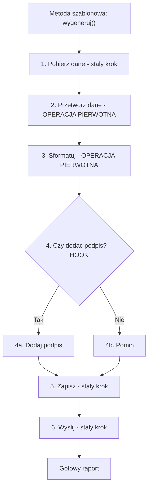
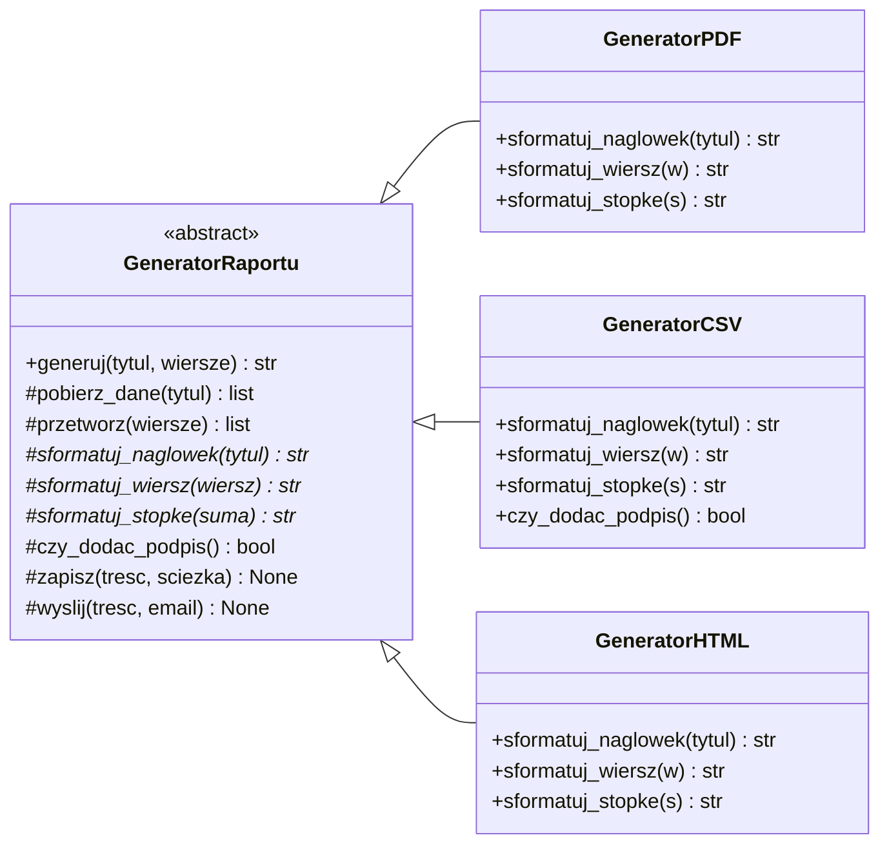
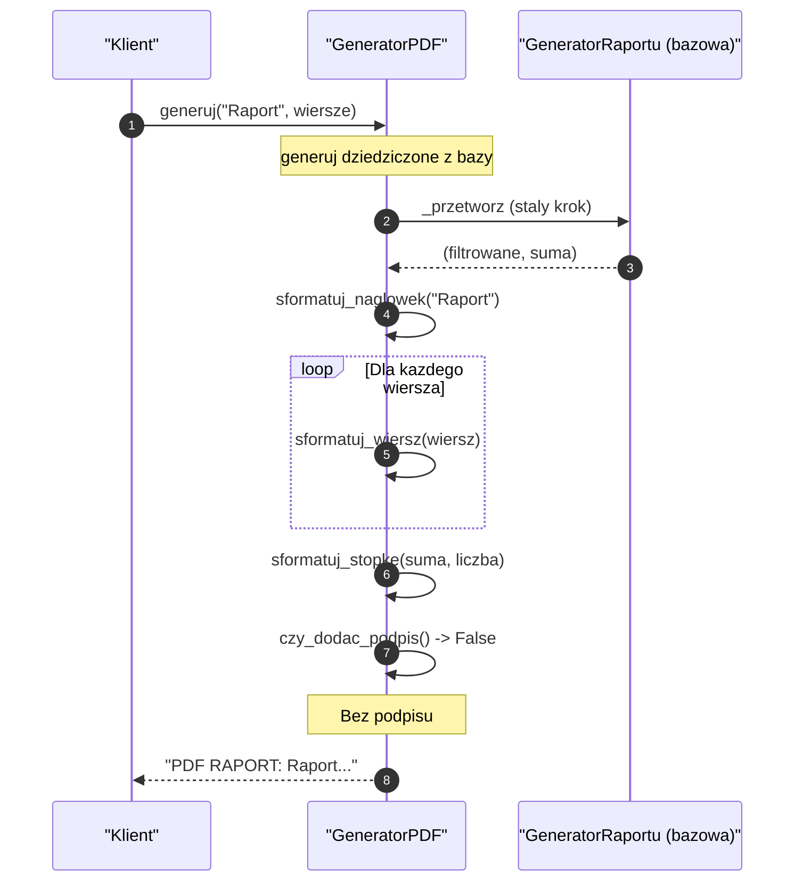
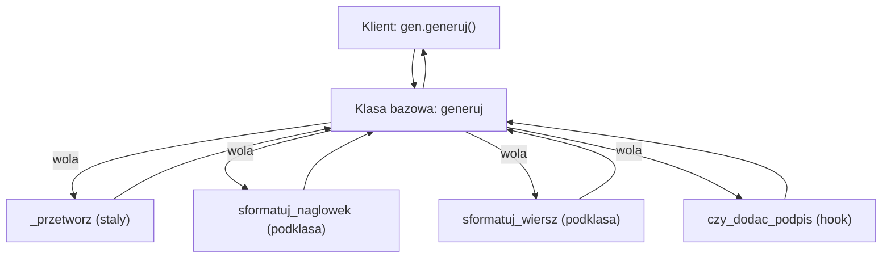
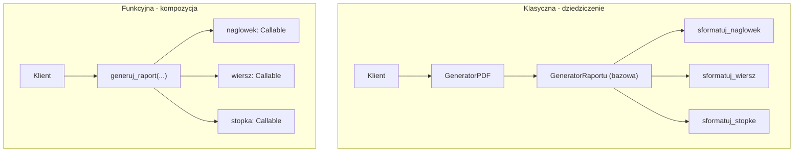
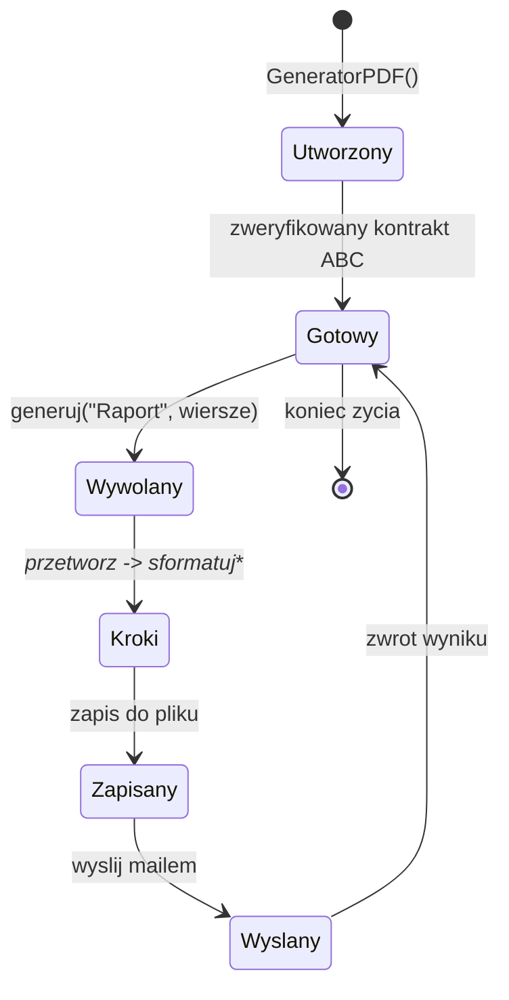
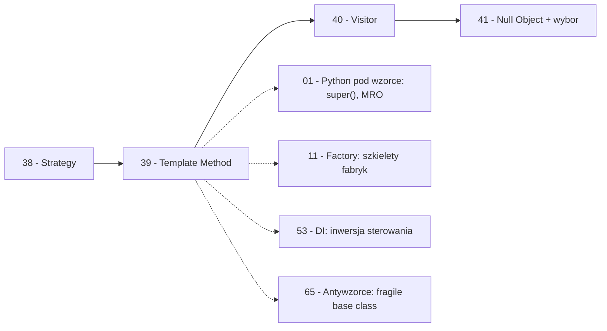

```markdown
---
modul: 39 — Template Method
plik: 39-template-method.md
poziom: podstawowy
wymaga: [38]
czas: ~155 minut czytania + ~380 minut ćwiczeń
---

# Moduł 39 — Template Method — szkielet algorytmu z lukami do wypełnienia

> **TL;DR**
> - **Template Method (metoda szablonowa)** definiuje **szkielet algorytmu w klasie bazowej** — kolejność kroków i to, co jest wspólne — a podklasy **wypełniają luki** (nadpisują konkretne kroki), nie zmieniając struktury algorytmu.
> - To najstarszy wzorzec w katalogu GoF i fundament tego, jak działają frameworki: Django `View` woła `get()`/`post()`, biblioteki przetwarzania danych wołają `prepare()`/`process()`/`finalize()`, testy wołają `setUp()`/`tearDown()`.
> - W Pythonie **dziedziczenie nie jest konieczne** — ten sam efekt uzyskasz funkcją wyższego rzędu (przyjmującą kroki jako argumenty), dekoratorem albo context managerem; wybór zależy od tego, ile kroków i jak złożoną masz strukturę.
> - **Reguła Hollywood** („nie dzwoń do nas, my zadzwonimy do ciebie") to fundament **inwersji sterowania**: zamiast ty wywoływać fazy, to framework wywołuje twoje implementacje w ustalonej kolejności.
> - Kluczowe ryzyko: **problem kruchej klasy bazowej** (ang. fragile base class problem) — zmiana szkieletu w bazie psuje podklasy w nieoczekiwany sposób; plus **nadmiar metod abstrakcyjnych** (każda luka wymuszona = mniejsza elastyczność).

---

## 0. Model mentalny

### Przepis na ciasto, odprawa na lotnisku i szkielet mebla

Wyobraź sobie, że pieczesz ciasto z **przepisu rodzinnego**. Na kartce masz kolejność: „wymieszaj mąkę z masłem, dodaj jajka, dodaj cukier, wlej do formy, piecz 40 minut w 180°C, pokryj kremem, udekoruj". Ta sekwencja kroków **nie zmienia się** — nawet jeśli postanowisz zrobić ciasto czekoladowe, cytrynowe albo z owocami. Struktura przepisu jest **stała**. Ale **konkretne kroki** — jakiego kremu użyjesz, co będzie na wierzchu, czy dodasz kakao do ciasta — są **dowolne**. Zmieniasz je wariant do wariantu, nie ruszając głównej sekwencji.

Zatrzymaj się tutaj, bo to jest esencja wzorca. **Struktura jest jedna, detale są wymienne.** Family przepis nie mówi „zrób tak", mówi „idź przez te kroki w tej kolejności, a w krokach X, Y, Z zdecyduj sam". Kiedy twoja mama robi ciasto czekoladowe, przechodzi przez te same kroki co ciocia robiąca cytrynowe — różni je tylko zawartość luk. Sekwencja „wymieszaj → piecz → udekoruj" jest w obu przypadkach identyczna.

Teraz pomyśl o drugiej stronie tego obrazu — o tym, **kto decyduje o kolejności**. Nie ty, piekarz. To przepis dyktuje, że najpierw mieszasz, potem pieczesz, potem dekorujesz. **Ty tylko wypełniasz szczegóły.** Odwróćmy role: nie ty wołasz kroki, to **przepis woła twoje decyzje**. Ta „inwersja sterowania" jest kluczowa i wróci w sekcji 2 jako „reguła Hollywood".

Drugi obraz: **odprawa na lotnisku**. Niezależnie od tego, dokąd lecisz, przechodzisz przez ustaloną sekwencję: odprawa biletowa → nadanie bagażu → kontrola bezpieczeństwa → odprawa paszportowa (jeśli międzynarodowy) → wejście na pokład. Kolejność jest ustalona przez procedurę lotniska, nie przez ciebie. Ale **konkretne detale** się różnią: w odprawie biletowej możesz mieć bagaż podręczny albo rejestrowany, w kontroli bezpieczeństwa możesz od razu przejść albo zostać poproszony o buty do prześwietlenia, w odprawie paszportowej mogą być różne bramki. **Procedura jest jedna, detale zmienne.**

I trzeci obraz, najbardziej abstrakcyjny: **szkielet mebla**. Stolarz opracował kiedyś „szkielet szafy" — listę etapów: „przygotuj materiał → wykonaj korpus → wykonaj drzwi → zamontuj zawiasy → wykończ powierzchnię". Kolejność ta jest ustalona i nie zmienia się, ale **detale** (jakie drewno, jakie drzwi, jaki kolor) są dowolne. Każda szafa zbudowana według tego szkieletu ma **tę samą strukturę etapów** i inne detale. Stolarz może nawet nie wiedzieć, jaką szafę właśnie buduje — pracuje według szkieletu; decyzje podejmuje klient w danym zamówieniu.

| W analogii przepisu / odprawy / szkieletu | W kodzie |
|---|---|
| Sekwencja kroków w przepisie | Metoda szablonowa w klasie bazowej |
| Wymieszaj, piecz, udekoruj | Kroki stałe (nie nadpisywalne) |
| Wybór kremu, dekoracji | **Operacje pierwotne** (abstrakcyjne) — musisz zaimplementować |
| Opcjonalne „posyp cukrem pudrem" | **Hook** — domyślna implementacja, można nadpisać |
| Kto decyduje o kolejności | Klasa bazowa (nie podklasa) |
| Kto decyduje o detalach | Podklasa |
| Reguła Hollywood | Framework woła twoje metody |
| Warianty ciasta | Konkretne klasy potomne |

> 🧠 **Zapamiętaj** — **Template Method (metoda szablonowa) to wzorzec behawioralny, który definiuje szkielet algorytmu w metodzie klasy bazowej, pozwalając podklasom nadpisać konkretne kroki — nie zmieniając jednak struktury i kolejności kroków algorytmu.**

Zwróć uwagę na trzy słowa: **szkielet**, **nadpisać**, **nie zmieniając**. „Szkielet" — wspólna, stała struktura. „Nadpisać" — mechanizm dziedziczenia pozwala wypełnić luki. „Nie zmieniając" — kluczowa własność: podklasa nie może zmienić **kolejności** ani **struktury**, tylko zawartość luk.

### Diagram — intuicja szkieletu z lukami



*Diagram pokazuje szkielet algorytmu z trzema typami kroków: stałymi (wykonywanymi zawsze po tej samej stronie), operacjami pierwotnymi (podklasa musi zaimplementować) i hookiem (podklasa może nadpisać decyzję).*

### Czego Template Method NIE robi

Rozbrójmy cztery mity.

**Nie jest State ani Strategy.** State (moduł 37) zmienia zachowanie w reakcji na zdarzenia w runtime. Strategy (moduł 38) wymienia cały algorytm wybierany przez klienta. Template Method definiuje **jeden szkielet** i pozwala wypełnić **luki w nim** — przez dziedziczenie, ustalone w kompilacji.

**Nie jest „dziedziczeniem dla samego dziedziczenia".** Template Method **dba o strukturę** — mówi „te kroki są zawsze w tej kolejności". Jeśli nie masz wspólnej struktury do wyodrębnienia, to nie Template Method, tylko zwykłe klasy.

**Nie jest zamiennikiem kompozycji.** W nowoczesnym Pythonie ten sam efekt można uzyskać funkcją wyższego rzędu albo strategią — często **czytelniej**. Template Method ma sens, gdy **hierarchia jest naturalna** (framework, biblioteka, test).

**Nie jest darmowy.** Dziedziczenie to **silne sprzężenie**. Zmiana klasy bazowej uderza we wszystkie podklasy. To **fragile base class problem** — o tym w sekcji 8.

**Nie wymaga ABC.** W Pythonie można użyć zwykłej klasy bazowej z metodami rzucającymi `NotImplementedError`. ABC jest lepsze (błąd wyłapany przy tworzeniu obiektu), ale nie jest obowiązkowe.

---

## 1. Problem, który rozwiązujemy

Wejdźmy w domenę 📊 „Sprawozdawczości". Aplikacja generuje raporty w trzech formatach: **PDF**, **CSV** i **HTML**. Każdy format ma inne szczegóły (nagłówek, układ, styl), ale **kolejność kroków generowania jest identyczna**:

1. Pobierz dane z bazy.
2. Przetwórz dane (filtry, agregacje).
3. Sformatuj nagłówek.
4. Sformatuj wiersze.
5. Sformatuj stopkę.
6. Zapisz do pliku.
7. Wyślij mailem.

Ktoś napisał trzy osobne klasy — jedną dla każdego formatu. Każda robi wszystko od zera.

### Kod „przed"

```python
# raporty_v0.py — wersja naiwna, demonstracyjna
# UWAGA: kod celowo pokazuje szablon skopiowany trzy razy.

from __future__ import annotations

from dataclasses import dataclass
from datetime import datetime, timezone
from decimal import Decimal
from pathlib import Path


@dataclass(frozen=True)
class WierszRaportu:
    konto: str
    opis: str
    kwota: Decimal
    waluta: str


class RaportPDF:
    """Raport PDF - pelna sekwencja krokow."""

    def generuj(self, tytul: str, wiersze: list[WierszRaportu]) -> str:
        # 1. Pobierz dane (atrapa - dane sa podane)
        dane = wiersze
        # 2. Przetworz
        dane = [w for w in dane if w.kwota > 0]
        suma = sum((w.kwota for w in dane), Decimal("0"))
        # 3. Naglowek
        naglowek = f"PDF RAPORT: {tytul}"
        # 4. Wiersze
        linie = [naglowek, "=" * 40]
        for w in dane:
            linie.append(f"  {w.konto} | {w.opis} | {w.kwota} {w.waluta}")
        # 5. Stopka
        linie.append("=" * 40)
        linie.append(f"SUMA: {suma}")
        linie.append(f"Wygenerowano: {datetime.now(timezone.utc).isoformat()}")
        return "\n".join(linie)

    def zapisz(self, tresc: str, sciezka: Path) -> None:
        sciezka.write_text(tresc, encoding="utf-8")

    def wyslij(self, tresc: str, email: str) -> None:
        print(f"[MAIL PDF do {email}] {len(tresc)} znakow")


class RaportCSV:
    """Raport CSV - TE SAME kroki, ale inny format."""

    def generuj(self, tytul: str, wiersze: list[WierszRaportu]) -> str:
        dane = wiersze
        dane = [w for w in dane if w.kwota > 0]
        suma = sum((w.kwota for w in dane), Decimal("0"))
        # CSv: bez naglowka "PDF RAPORT"
        linie = ["konto;opis;kwota;waluta"]
        for w in dane:
            linie.append(f"{w.konto};{w.opis};{w.kwota};{w.waluta}")
        linie.append(f"SUMA;;;;{suma}")
        return "\n".join(linie)

    def zapisz(self, tresc: str, sciezka: Path) -> None:
        sciezka.write_text(tresc, encoding="utf-8")

    def wyslij(self, tresc: str, email: str) -> None:
        print(f"[MAIL CSV do {email}] {len(tresc)} znakow")


class RaportHTML:
    """Raport HTML - TE SAME kroki, ale inny format."""

    def generuj(self, tytul: str, wiersze: list[WierszRaportu]) -> str:
        dane = wiersze
        dane = [w for w in dane if w.kwota > 0]
        suma = sum((w.kwota for w in dane), Decimal("0"))
        linie = [
            "<!DOCTYPE html>",
            f"<html><head><title>{tytul}</title></head><body>",
            f"<h1>{tytul}</h1>",
            "<table>",
        ]
        for w in dane:
            linie.append(
                f"<tr><td>{w.konto}</td><td>{w.opis}</td>"
                f"<td>{w.kwota} {w.waluta}</td></tr>"
            )
        linie.append(f"<tr><td colspan='2'>SUMA</td><td>{suma}</td></tr>")
        linie.append("</table></body></html>")
        return "\n".join(linie)

    def zapisz(self, tresc: str, sciezka: Path) -> None:
        sciezka.write_text(tresc, encoding="utf-8")

    def wyslij(self, tresc: str, email: str) -> None:
        print(f"[MAIL HTML do {email}] {len(tresc)} znakow")


if __name__ == "__main__":
    wiersze = [
        WierszRaportu("1000", "Kasa", Decimal("5000"), "PLN"),
        WierszRaportu("2000", "Bank", Decimal("120000"), "PLN"),
    ]
    print(RaportPDF().generuj("Raport dzienny", wiersze))
```

Ten kod **działa** i każdy raport jest poprawny. Ale ma **siedem problemów**, z których wszystkie narastają przy dodaniu czwartego formatu albo zmiany w kroku wspólnym.

### Code smell — ten sam szablon w trzech miejscach

| Problem | Gdzie | Konsekwencja |
|---|---|---|
| Sekwencja kroków powtórzona trzy razy | W trzech `generuj` | Zmiana jednego kroku wymaga zmian w trzech klasach |
| Filtrowanie `w.kwota > 0` powtórzone | Trzy kopie | Zmiana filtra = trzy zmiany |
| Sumowanie powtórzone | Trzy kopie | To samo |
| `zapisz` identyczne | Trzy kopie | Duplikacja (moduł 03) |
| `wyslij` identyczne | Trzy kopie | Duplikacja |
| Brak jednej metody generującej | Każdy format osobno | Brak wspólnego API |
| Trudno dodać nowy format | Nowa klasa z całością | Powielenie schematu |

Zwróć uwagę na drugą pozycję. **Filtrowanie wierszy jest identyczne we wszystkich trzech klasach.** To logika biznesowa, która **nie powinna być duplikowana**. Jeden błąd w jednej kopii psuje jeden raport, ale nie pozostałe — powstaje niespójność.

### Objawy — poznasz ten problem po tym, że...

- **Trzy klasy mają tę samą sekwencję kroków** (pobierz → przetwórz → sformatuj → zapisz → wyślij).
- **Kopiujesz i wklejasz fragmenty metod** między formatami. Klasyczny sygnał braku szkieletu.
- **Zmiana wspólnego kroku wymaga zmian w wielu miejscach.** Dodanie filtra albo formatowania czasu to trzy zmiany.
- **Klasy mają **różne** API** (każda ma własne `generuj` z różnymi argumentami). Nie da się ich używać zamiennie.
- **Brakuje **obowiązkowych** kroków.** Nowy format może zapomnieć wysłać raport, zapisać, przetworzyć — nic tego nie wymusi.
- **Brakuje **opcjonalnych** kroków.** Nie ma gdzie umieścić „jeśli wersja zaawansowana, dodaj podpis".
- **Testy są zduplikowane.** Test filtrowania w każdym formacie.
- **Nie widać struktury algorytmu.** Sekwencja jest ukryta w ciele każdej metody.
- **Brak wspólnej dokumentacji procedury.** Nie ma jednej kartki, która mówi „kroki raportu to...".
- **Dodanie czwartego formatu to nowa klasa z pełną kopią.** Bez dziedziczenia — pełna duplikacja.

---

## 2. Anatomia wzorca

### Uczestnicy

| Rola | Odpowiedzialność | Co NIE jest jej zadaniem |
|---|---|---|
| **AbstractClass (klasa abstrakcyjna)** | Definiuje metodę szablonową — szkielet algorytmu; może definiować kroki abstrakcyjne (do nadpisania), hooki (opcjonalne) i kroki stałe | Nie implementuje szczegółów luk; nie wie, jaka podklasa ją wypełni |
| **ConcreteClass (klasa konkretna)** | Implementuje kroki abstrakcyjne; opcjonalnie nadpisuje hooki | Nie zmienia szkieletu ani kolejności kroków |
| **Metoda szablonowa (ang. template method)** | Sekwencja kroków w klasie bazowej; woła kroki polimorficzne w ustalonej kolejności | Nie wykonuje logiki kroków; tylko orkiestruje |
| **Krok abstrakcyjny (ang. primitive operation)** | Metoda abstrakcyjna — podklasa **musi** ją zaimplementować | Nie ma domyślnej implementacji |
| **Hook (ang. hook method)** | Metoda z domyślną implementacją — podklasa **może** ją nadpisać | Nie jest obowiązkowa; ma sensowne zachowanie domyślne |

Kluczowa asymetria: **klasa bazowa decyduje o kolejności**, ale **nie zna szczegółów**. Podklasa **zna szczegóły**, ale **nie decyduje o kolejności**. Ten podział jest istotą wzorca.

### Trzy typy kroków — najważniejsze rozróżnienie

**Krok stały** — konkretna metoda w klasie bazowej, **nie do nadpisania**. Realizuje logikę wspólną. W naszym przykładzie: filtrowanie danych, zapis do pliku, wysyłka.

**Operacja pierwotna** — metoda **abstrakcyjna**. Podklasa **musi** ją zaimplementować. W naszym przykładzie: `sformatuj_naglowek`, `sformatuj_wiersz`, `sformatuj_stopke`.

**Hook** — metoda z **domyślną implementacją**. Podklasa **może** ją nadpisać. W naszym przykładzie: `czy_dodac_podpis` (domyślnie `False`), `przed_zapisem` (domyślnie nic), `po_zapisie` (domyślnie nic).

Wybór między trzema typami to **decyzja projektowa**: za dużo operacji pierwotnych — podklasy trudne do napisania; za dużo hooków — nie wiadomo, co jest wymagane; za mało — brak elastyczności.

### Diagram struktury



*Diagram pokazuje klasę bazową z metodą szablonową `generuj` (woła kroki po kolei) i podklasy wypełniające luki — z literką gwiazdki oznaczającą operacje pierwotne do nadpisania.*

### Warianty: klasyczny vs pythoniczny

| Aspekt | Klasyczny (GoF) | Pythoniczny |
|---|---|---|
| Klasa bazowa | `ABC` z metodami abstrakcyjnymi | Zwykła klasa z `NotImplementedError` |
| Metoda szablonowa | Zwykła metoda `final` | `def generuj(self)` |
| Operacje pierwotne | `@abstractmethod` | `abstractmethod` albo `raise` |
| Hooki | Metody z domyślną implementacją | Także domyślne |
| Wariant bez dziedziczenia | Nie istnieje | Funkcje wyższego rzędu |
| Wariant dekoratorowy | Nie istnieje | `@szablon` |
| Wariant z context managerem | Nie istnieje | `@contextmanager` |

Python daje **znacznie więcej opcji** niż klasyczne ujęcie. Dziedziczenie jest tylko jednym ze sposobów — obok funkcji wyższego rzędu, dekoratorów i context managerów.

---

## 3. Implementacja krok po kroku

Przebudujemy raporty z sekcji 1 na wersję z Template Method.

### Krok 1 — Zidentyfikuj wspólne kroki

Zanim napiszesz kod — rozpisz sekwencję i podziel ją na trzy koszyki.

```text
SEKWENCJA:
  1. Pobierz dane (tytul) -> surowe
  2. Przetworz (surowe) -> finalne      [STALY krok]
  3. Sformatuj naglowek (tytul) -> str [OPERACJA PIERWOTNA]
  4. Dla kazdego finalnego: sformatuj wiersz [OPERACJA PIERWOTNA]
  5. Sformatuj stopke (suma) -> str    [OPERACJA PIERWOTNA]
  6. (OPCJONALNIE) dodaj podpis        [HOOK]
  7. Zapisz do pliku                   [STALY krok]
  8. Wyslij mailem                     [STALY krok]
```

Kluczowa decyzja: **co jest stałe, a co zmienne**. Filtrowanie (`w.kwota > 0`) — stałe (wspólne dla wszystkich raportów). Formatowanie — zmienne (różni się per format). Zapis i wysyłka — stałe.

### Krok 2 — Zdefiniuj klasę bazową z metodą szablonową

Metoda `generuj` to szkielet. Woła kroki w ustalonej kolejności.

```python
from abc import ABC, abstractmethod
from decimal import Decimal
from pathlib import Path


class GeneratorRaportu(ABC):
    """AbstractClass: szkielet generowania raportow."""

    @abstractmethod
    def sformatuj_naglowek(self, tytul: str) -> str:
        """Operacja pierwotna - podklasa musi zaimplementowac."""
        ...

    @abstractmethod
    def sformatuj_wiersz(self, wiersz) -> str:
        """Operacja pierwotna - formatowanie pojedynczego wiersza."""
        ...

    @abstractmethod
    def sformatuj_stopke(self, suma: Decimal) -> str:
        """Operacja pierwotna - formatowanie stopki."""
        ...

    # --- Hook: domyslna implementacja, mozna nadpisac ---

    def czy_dodac_podpis(self) -> bool:
        """Hook: czy dodac podpis generatora (domyslnie nie)."""
        return False

    def _podpis(self) -> str:
        return "Wygenerowane automatycznie przez system sprawozdawczy."

    # --- Kroki stale (nie do nadpisania z zewnatrz) ---

    def _pobierz_dane(self, tytul: str) -> list:
        """Staly krok: w realu zapytanie do bazy. Tu atrapa."""
        return list(getattr(self, "_dane_zrodlowe", []))

    def _przetworz(self, wiersze: list) -> tuple[list, Decimal]:
        """Staly krok: filtrowanie i sumowanie."""
        filtrowane = [w for w in wiersze if w.kwota > Decimal("0")]
        suma = sum((w.kwota for w in filtry if (filtry := filtrowane)), Decimal("0"))
        return filtrowane, suma

    def _zapisz(self, tresc: str, sciezka: Path) -> None:
        sciezka.write_text(tresc, encoding="utf-8")

    def _wyslij(self, tresc: str, email: str) -> None:
        print(f"[MAIL do {email}] {len(tresc)} znakow")

    # --- METODA SZABLONOWA ---

    def generuj(
        self, tytul: str, wiersze: list, email: str | None = None,
        sciezka: Path | None = None,
    ) -> str:
        """Szkielet: ustalona kolejnosc krokow."""
        # 1. Pobierz dane (staly)
        dane = wiersze if wiersze else self._pobierz_dane(tytul)

        # 2. Przetworz (staly)
        finalne, suma = self._przetworz(dane)

        # 3. Naglowek (operacja pierwotna)
        linie = [self.sformatuj_naglowek(tytul)]

        # 4. Wiersze (operacja pierwotna dla kazdego wiersza)
        for w in finalne:
            linie.append(self.sformatuj_wiersz(w))

        # 5. Stopka (operacja pierwotna)
        linie.append(self.sformatuj_stopke(suma))

        # 6. Opcjonalny podpis (hook)
        if self.czy_dodac_podpis():
            linie.append(self._podpis())

        tresc = "\n".join(linie)

        # 7. Zapis (staly)
        if sciezka is not None:
            self._zapisz(tresc, sciezka)

        # 8. Wysylka (staly)
        if email is not None:
            self._wyslij(tresc, email)

        return tresc
```

Zwróć uwagę: **metoda `generuj` nie zawiera logiki formatu**. Tylko sekwencję kroków. **Nie ma ani jednego `if` po typie raportu.** Cała zmienność jest w podklasach.

### Krok 3 — Zaimplementuj podklasy

Trzy podklasy, każda **wypełnia tylko luki**.

```python
class GeneratorPDF(GeneratorRaportu):
    def sformatuj_naglowek(self, tytul: str) -> str:
        return f"PDF RAPORT: {tytul}\n{'=' * 40}"

    def sformatuj_wiersz(self, wiersz) -> str:
        return f"  {wiersz.konto} | {wiersz.opis} | {wiersz.kwota} {wiersz.waluta}"

    def sformatuj_stopke(self, suma: Decimal) -> str:
        return f"{'=' * 40}\n  SUMA: {suma}"


class GeneratorCSV(GeneratorRaportu):
    def sformatuj_naglowek(self, tytul: str) -> str:
        return "konto;opis;kwota;waluta"

    def sformatuj_wiersz(self, wiersz) -> str:
        return f"{wiersz.konto};{wiersz.opis};{wiersz.kwota};{wiersz.waluta}"

    def sformatuj_stopke(self, suma: Decimal) -> str:
        return f"SUMA;;;;{suma}"

    def czy_dodac_podpis(self) -> bool:
        # CSV: dodaj podpis dla audytu
        return True


class GeneratorHTML(GeneratorRaportu):
    def sformatuj_naglowek(self, tytul: str) -> str:
        return f"<!DOCTYPE html>\n<html><head><title>{tytul}</title></head>\n<body>\n<h1>{tytul}</h1>\n<table>"

    def sformatuj_wiersz(self, wiersz) -> str:
        return (
            f"<tr><td>{wiersz.konto}</td><td>{wiersz.opis}</td>"
            f"<td>{wiersz.kwota} {wiersz.waluta}</td></tr>"
        )

    def sformatuj_stopke(self, suma: Decimal) -> str:
        return f"<tr><td colspan='2'>SUMA</td><td>{suma}</td></tr>\n</table>\n</body></html>"
```

Zwróć uwagę: **każda podklasa implementuje trzy metody** — trzy operacje pierwotne. Żadna **nie nadpisuje** `generuj`. **Sekwencja kroków jest identyczna** dla wszystkich trzech.

### Krok 4 — Klient używa szkieletu

```python
def wygeneruj_raport(generator: GeneratorRaportu, tytul: str, wiersze) -> str:
    """Jedna funkcja dla wszystkich formatow."""
    return generator.generuj(tytul, wiersze)
```

**Wszystkie generatory mają to samo API** — bo wszystkie dziedziczą po `GeneratorRaportu`. Klient nie musi rozróżniać typów.

### Krok 5 — Weryfikacja

| Kryterium | Wersja „przed" | Wersja „po" |
|---|---|---|
| Duplikacja filtrowania | 3 kopie | 1 (w bazie) |
| Duplikacja sumowania | 3 kopie | 1 |
| Duplikacja zapisu | 3 kopie | 1 |
| Duplikacja wysyłki | 3 kopie | 1 |
| Zmiana wspólnego kroku | 3 miejsca | 1 (w bazie) |
| Dodanie formatu | Nowa klasa z całością | Nowa klasa + 3 metody |
| Wspólne API | Różne | `generuj(...)` |
| Struktura widoczna | Nie | Tak (w bazie) |
| Wymuszone kroki | Nie | Tak (`@abstractmethod`) |
| Liczba klas | 3 | 4 |

Koszt: jedna dodatkowa klasa. Zysk: **znaczne** — brak duplikacji, wspólne API, wymuszenie kroków, jedno miejsce na zmiany wspólne.

---

## 4. Wersje pythoniczne i warianty

To najważniejsza sekcja — pokazuje, że **Template Method nie wymaga dziedziczenia**.

### 4.1 Klasyczna wersja ABC — jak wyżej

**Zaleta:** jawna struktura, `mypy` sprawdza, błąd przy braku implementacji wyłapany natychmiast. **Wada:** dziedziczenie sprzęga klasy.

### 4.2 Wersja funkcyjna — funkcja wyższego rzędu

Zamiast klasy bazowej — funkcja, która przyjmuje kroki jako argumenty.

```python
from collections.abc import Callable
from pathlib import Path
from decimal import Decimal


def generuj_raport(
    tytul: str,
    wiersze: list,
    sformatuj_naglowek: Callable[[str], str],
    sformatuj_wiersz: Callable[[object], str],
    sformatuj_stopke: Callable[[Decimal], str],
    czy_podpis: Callable[[], bool] | None = None,
    sciezka: Path | None = None,
    email: str | None = None,
) -> str:
    """Szkielet algorytmu bez dziedziczenia - kroki jako argumenty."""
    # 1. Przetworz
    filtrowane = [w for w in wiersze if w.kwota > Decimal("0")]
    suma = sum((w.kwota for w in filtrowane), Decimal("0"))

    # 2. Sformatuj przez funkcje-wtyczki
    linie = [sformatuj_naglowek(tytul)]
    for w in filtrowane:
        linie.append(sformatuj_wiersz(w))
    linie.append(sformatuj_stopke(suma))

    # 3. Hook
    if czy_podpis is not None and czy_podpis():
        linie.append("Wygenerowane automatycznie.")

    tresc = "\n".join(linie)

    # 4. Zapis / wysylka
    if sciezka is not None:
        sciezka.write_text(tresc, encoding="utf-8")
    if email is not None:
        print(f"[MAIL do {email}] {len(tresc)} znakow")

    return tresc


# Uzycie:
def naglowek_pdf(tytul: str) -> str:
    return f"PDF RAPORT: {tytul}"


def wiersz_pdf(w) -> str:
    return f"  {w.konto} | {w.kwota}"


def stopka_pdf(suma: Decimal) -> str:
    return f"SUMA: {suma}"


tresc = generuj_raport(
    "Raport dzienny",
    wiersze,
    sformatuj_naglowek=naglowek_pdf,
    sformatuj_wiersz=wiersz_pdf,
    sformatuj_stopke=stopka_pdf,
)
```

**Zaleta:** brak dziedziczenia, brak sprzężenia, łatwe testy (podstaw dowolne funkcje). **Wada:** sygnatura funkcji jest długa; jeśli kroków jest 10, argumentów jest 10.

**Kiedy używać:** gdy kroków jest 3–5, gdy nie potrzebujesz dziedziczenia stanu, gdy chcesz łatwo testować. W nowoczesnym Pythonie to **często najczystsze rozwiązanie**.

### 4.3 Hybryda: Template Method + Strategy

Zamiast wypełniać luki przez podklasę — przekazać **strategię formatowania**.

```python
from typing import Protocol


class StrategiaFormatowania(Protocol):
    def naglowek(self, tytul: str) -> str: ...
    def wiersz(self, w: object) -> str: ...
    def stopka(self, suma: Decimal) -> str: ...


class GeneratorRaportuStrategy:
    """Szkielet (Template Method) + strategia (Strategy)."""

    def __init__(self, formatowanie: StrategiaFormatowania) -> None:
        self._fmt = formatowanie

    def generuj(self, tytul: str, wiersze: list) -> str:
        filtrowane = [w for w in wiersze if w.kwota > 0]
        suma = sum((w.kwota for w in filtrowane), Decimal("0"))
        linie = [self._fmt.naglowek(tytul)]
        for w in filtrowane:
            linie.append(self._fmt.wiersz(w))
        linie.append(self._fmt.stopka(suma))
        return "\n".join(linie)


class FormatowaniePDF:
    def naglowek(self, tytul): return f"PDF: {tytul}"
    def wiersz(self, w): return f"| {w.konto} |"
    def stopka(self, s): return f"SUMA: {s}"
```

**Zaleta:** kompozycja (moduł 38) — wymieniasz strategię w runtime. Można testować osobno szkielet i strategię. **Wada:** dwa typy (szkielet + strategia) zamiast jednego.

**Kiedy używać:** gdy szkielet jest **wspólny** dla wielu formatów i można go raz napisać, a formaty są **klasyfikowalne** (można je traktować jako strategię).

### 4.4 Wariant dekoratorowy

Szkielet jako dekorator opakowujący funkcje formatujące.

```python
import functools


def szkielet_raportu(funkcja: Callable) -> Callable:
    """Dekorator: opakowuje funkcje formatowania w szkielet."""
    @functools.wraps(funkcja)
    def opakowanie(tytul: str, wiersze: list) -> str:
        # Filtrowanie wspolne
        filtrowane = [w for w in wiersze if w.kwota > 0]
        # Wywołanie oryginalnej funkcji - "wypelnia luki"
        tresc = funkcja(tytul, filtrowane)
        # Cokolwiek po - np. wyslij
        return tresc
    return opakowanie


@szkielet_raportu
def raport_pdf(tytul: str, wiersze: list) -> str:
    linie = [f"PDF: {tytul}"]
    for w in wiersze:
        linie.append(f"  {w.konto}")
    return "\n".join(linie)
```

**Zaleta:** świetnie się komponuje z innymi dekoratorami (log, cache, retry). **Wada:** mniej elastyczne, gdy potrzebujesz wielu hooków — łatwo zagmatwać.

### 4.5 Wariant context manager

Szkielet jako blok `with`.

```python
from contextlib import contextmanager


@contextmanager
def sesja_raportu(tytul: str, wiersze: list):
    """Kontekst: przygotowuje dane, potem sprzata."""
    # PRZED
    filtrowane = [w for w in wiersze if w.kwota > 0]
    suma = sum((w.kwota for w in filtry if (filtry := filtrowane)), Decimal("0"))
    dane = {"filtrowane": filtrowane, "suma": suma}
    try:
        yield dane
    finally:
        # PO
        pass


# Uzycie:
with sesja_raportu("Raport", wiersze) as dane:
    generuj(dane["filtrowane"], dane["suma"])
```

**Zaleta:** idealne dla „przed/po" (setup + teardown). **Wada:** działa lepiej dla „setup" niż dla „wiele kroków".

### 4.6 Podsumowanie — tabela wyboru

| Sytuacja | Wariant |
|---|---|
| Klasyczny szkielet z dziedziczeniem | ABC + `@abstractmethod` (4.1) |
| 3–5 kroków, brak stanu | Funkcja wyższego rzędu (4.2) |
| Chcesz wymieniać formatowanie w runtime | Hybryda ze Strategy (4.3) |
| Chcesz komponować z innymi dekoratorami | Dekorator (4.4) |
| Zasoby typu „przed/po" | Context manager (4.5) |
| Ramy frameworka, wiele podklas | ABC (4.1) |

> 🧠 **Zapamiętaj** — **Nie ma „jedynego słusznego" wariantu Template Method.** W Pythonie dominują warianty funkcyjne (4.2, 4.4, 4.5), ale klasyczny (4.1) wciąż jest niezastąpiony w frameworkach. **Zacznij od funkcyjnego**, użyj klasycznego, gdy naprawdę potrzebujesz hierarchii (np. Django CBV, biblioteki).

---

## 5. Przykład z życia: 📊 Sprawozdawczość — pełny uruchamialny kod

Pełny system raportów: kernel szkieletowy, trzy implementacje, hooki, zapis i wysyłka.

### Kod

```python
# raporty_template.py — pelny przyklad Template Method
from __future__ import annotations

import functools
from abc import ABC, abstractmethod
from dataclasses import dataclass
from datetime import datetime, timezone
from decimal import Decimal, ROUND_HALF_UP
from pathlib import Path


# ===========================================================================
# 1. Typy pomocnicze
# ===========================================================================

GROSZ = Decimal("0.01")


def zaokraglij(kwota: Decimal) -> Decimal:
    return kwota.quantize(GROSZ, rounding=ROUND_HALF_UP)


@dataclass(frozen=True, slots=True)
class WierszRaportu:
    konto: str
    opis: str
    kwota: Decimal
    waluta: str


# ===========================================================================
# 2. AbstractClass - szkielet generowania raportu
# ===========================================================================

class GeneratorRaportu(ABC):
    """AbstractClass: metoda szablonowa + operacje pierwotne + hooki."""

    # --- Operacje pierwotne (podklasa MUSI zaimplementowac) ---

    @abstractmethod
    def sformatuj_naglowek(self, tytul: str) -> str: ...

    @abstractmethod
    def sformatuj_wiersz(self, wiersz: WierszRaportu) -> str: ...

    @abstractmethod
    def sformatuj_stopke(self, suma: Decimal, liczba: int) -> str: ...

    # --- Hooki (podklasa MOZE nadpisac) ---

    def czy_dodac_podpis(self) -> bool:
        """Hook: czy dodac podpis do raportu. Domyslnie nie."""
        return False

    def _podpis(self) -> str:
        return (
            f"Wygenerowane: "
            f"{datetime.now(timezone.utc).isoformat(timespec='seconds')}"
        )

    def filtr(self, w: WierszRaportu) -> bool:
        """Hook: filtr wierszy. Domyslnie odrzuca niezerowe."""
        return w.kwota > Decimal("0")

    # --- Kroki stale (wspolne dla wszystkich formatow) ---

    def _przetworz(
        self, wiersze: list[WierszRaportu]
    ) -> tuple[list[WierszRaportu], Decimal]:
        filtrowane = [w for w in wiersze if self.filtr(w)]
        suma = sum((w.kwota for w in filtrowane), Decimal("0"))
        return filtrowane, zaokraglij(suma)

    def _zapisz(self, tresc: str, sciezka: Path) -> None:
        sciezka.write_text(tresc, encoding="utf-8")

    def _wyslij(self, tresc: str, email: str) -> None:
        print(f"[MAIL do {email}] {len(tresc)} znakow")

    # --- METODA SZABLONOWA ---

    def generuj(
        self,
        tytul: str,
        wiersze: list[WierszRaportu],
        sciezka: Path | None = None,
        email: str | None = None,
    ) -> str:
        """Szkielet: kroki w ustalonej kolejnosci. NIE nadpisuj."""
        # 1. Przetworz (stale)
        finalne, suma = self._przetworz(wiersze)

        # 2. Naglowek (operacja pierwotna)
        linie: list[str] = [self.sformatuj_naglowek(tytul)]

        # 3. Wiersze (operacja pierwotna per wiersz)
        for w in finalne:
            linie.append(self.sformatuj_wiersz(w))

        # 4. Stopka (operacja pierwotna)
        linie.append(self.sformatuj_stopke(suma, len(finalne)))

        # 5. Opcjonalny podpis (hook)
        if self.czy_dodac_podpis():
            linie.append(self._podpis())

        tresc = "\n".join(linie)

        # 6. Zapis (stale)
        if sciezka:
            self._zapisz(tresc, sciezka)

        # 7. Wyslij (stale)
        if email:
            self._wyslij(tresc, email)

        return tresc


# ===========================================================================
# 3. ConcreteClass - trzy implementacje
# ===========================================================================

class GeneratorPDF(GeneratorRaportu):
    def sformatuj_naglowek(self, tytul: str) -> str:
        return f"PDF RAPORT: {tytul}\n{'=' * 60}"

    def sformatuj_wiersz(self, w: WierszRaportu) -> str:
        sformat = f"{w.kwota:>15,.2f}"
        return f"  {w.konto:<10} {w.opis:<30} {sformat} {w.waluta}"

    def sformatuj_stopke(self, suma: Decimal, liczba: int) -> str:
        linie = [
            "=" * 60,
            f"  LICZBA POZYCJI: {liczba}",
            f"  SUMA: {suma:,.2f}",
        ]
        return "\n".join(linie)


class GeneratorCSV(GeneratorRaportu):
    def sformatuj_naglowek(self, tytul: str) -> str:
        return "konto;opis;kwota;waluta"

    def sformatuj_wiersz(self, w: WierszRaportu) -> str:
        return f"{w.konto};{w.opis};{w.kwota};{w.waluta}"

    def sformatuj_stopke(self, suma: Decimal, liczba: int) -> str:
        return f"LICZBA;;;;{liczba}\nSUMA;;;;{suma}"

    def czy_dodac_podpis(self) -> bool:
        # CSV w kontekscie audytu - dodaj podpis
        return True


class GeneratorHTML(GeneratorRaportu):
    def sformatuj_naglowek(self, tytul: str) -> str:
        return (
            "<!DOCTYPE html>\n"
            f"<html><head><title>{tytul}</title></head>\n"
            f"<body>\n<h1>{tytul}</h1>\n"
            "<table border='1'>\n"
            "<tr><th>Konto</th><th>Opis</th><th>Kwota</th><th>Waluta</th></tr>"
        )

    def sformatuj_wiersz(self, w: WierszRaportu) -> str:
        return (
            f"<tr><td>{w.konto}</td><td>{w.opis}</td>"
            f"<td>{w.kwota}</td><td>{w.waluta}</td></tr>"
        )

    def sformatuj_stopke(self, suma: Decimal, liczba: int) -> str:
        return (
            f"<tr><td colspan='2'>SUMA ({liczba} pozycji)</td>"
            f"<td colspan='2'>{suma}</td></tr>"
            "</table>\n</body></html>"
        )


# ===========================================================================
# 4. Wariant funkcyjny - dla porownania
# ===========================================================================

def generuj_raport_funkcyjnie(
    tytul: str,
    wiersze: list[WierszRaportu],
    naglowek: callable,
    wiersz: callable,
    stopka: callable,
    filtr: callable = lambda w: w.kwota > Decimal("0"),
) -> str:
    """Szkielet bez dziedziczenia - kroki jako argumenty."""
    filtrowane = [w for w in wiersze if filtr(w)]
    suma = zaokraglij(sum((w.kwota for w in filtrowane), Decimal("0")))
    linie = [naglowek(tytul)]
    for w in filtrowane:
        linie.append(wiersz(w))
    linie.append(stopka(suma, len(filtrowane)))
    return "\n".join(linie)


# ===========================================================================
# 5. Demonstracja
# ===========================================================================

if __name__ == "__main__":
    wiersze = [
        WierszRaportu("1000", "Kasa", Decimal("5000.00"), "PLN"),
        WierszRaportu("2000", "Rachunek bankowy", Decimal("120000.00"), "PLN"),
        WierszRaportu("3000", "Naleznosci", Decimal("-50.00"), "PLN"),   # odfiltrowane
        WierszRaportu("4000", "Karty kredytowe", Decimal("8500.00"), "PLN"),
    ]

    print("=== 1. Wszystkie formaty przez ten sam szkielet ===")
    for gen in (GeneratorPDF(), GeneratorCSV(), GeneratorHTML()):
        tresc = gen.generuj("Raport dzienny", wiersze)
        print(f"\n--- {type(gen).__name__} ---")
        print(tresc[:400])
        print("...")

    print("\n\n=== 2. Filtr w hooku - tylko duze kwoty ===")

    class GeneratorPDFDuzeKwoty(GeneratorPDF):
        def filtr(self, w):
            return w.kwota > Decimal("10000.00")

    tresc = GeneratorPDFDuzeKwoty().generuj("Raport duzych kwot", wiersze)
    print(tresc)

    print("\n\n=== 3. Zapis i wysylka ===")
    from tempfile import TemporaryDirectory
    with TemporaryDirectory() as tmp:
        sciezka = Path(tmp) / "raport.csv"
        GeneratorCSV().generuj(
            "Raport testowy",
            wiersze,
            sciezka=sciezka,
            email="klient@example.com",
        )
        print(f"  Zapisano plik: {sciezka.exists()}")
        print(f"  Rozmiar: {sciezka.stat().st_size} bajtow")

    print("\n=== 4. Wariant funkcyjny ===")
    tresc = generuj_raport_funkcyjnie(
        "Raport funkcyjny",
        wiersze,
        naglowek=lambda t: f"FUNKCYJNY: {t}",
        wiersz=lambda w: f"  {w.konto}: {w.kwota}",
        stopka=lambda s, n: f"SUMA ({n}): {s}",
    )
    print(tresc)

    print("\n=== 5. Kontrakt: wszystkie generatory to GeneratorRaportu ===")
    for gen in (GeneratorPDF(), GeneratorCSV(), GeneratorHTML()):
        print(f"  {type(gen).__name__}: isinstance = {isinstance(gen, GeneratorRaportu)}")

    print("\n=== 6. Nie mozna utworzyc klasy bazowej ===")
    try:
        GeneratorRaportu()  # type: ignore[abstract]
    except TypeError as blad:
        print(f"  {blad}")
```

### Co ten przykład pokazuje

**Punkt 1 — ten sam szkielet, trzy formaty.** Trzy różne klasy dają różne wyjścia — ale używają **tego samego szkieletu kroków**. Widać, że `generuj` nie zmienia się między nimi.

**Punkt 2 — hooki modyfikują zachowanie bez zmiany szkieletu.** Podklasa `GeneratorPDFDuzeKwoty` nadpisuje **tylko filtr** — reszta pozostaje. To pokazuje wartość hooka: minimalna zmiana, brak duplikacji.

**Punkt 3 — zapis i wysyłka są stałe.** Ta sama metoda `generuj` obsługuje zapis do pliku i wysyłkę — bez zmian w podklasach. Wszystkie formaty dostają tę funkcjonalność „za darmo".

**Punkt 4 — wariant funkcyjny.** Ten sam efekt, bez dziedziczenia. Celowo pokazany obok — dla porównania.

**Punkt 5 — kontrakt.** Wszystkie trzy generatory spełniają `GeneratorRaportu`. Klient może je używać zamiennie.

**Punkt 6 — ABC wymusza implementację.** Nie można utworzyć `GeneratorRaportu()` bez implementacji metod abstrakcyjnych. Błąd jest wyłapany od razu.

### Testy

```python
# test_raporty_template.py — uruchomienie: pytest test_raporty_template.py -v
from decimal import Decimal
from pathlib import Path

import pytest

from raporty_template import (
    GeneratorCSV,
    GeneratorHTML,
    GeneratorPDF,
    GeneratorRaportu,
    WierszRaportu,
    generuj_raport_funkcyjnie,
    zaokraglij,
)


POZYCJE = [
    WierszRaportu("1000", "Kasa", Decimal("100.00"), "PLN"),
    WierszRaportu("2000", "Bank", Decimal("500.00"), "PLN"),
    WierszRaportu("3000", "Anulowane", Decimal("-10.00"), "PLN"),
]


# --- Abstrakcyjnosc ----------------------------------------------------------

def test_nie_mozna_utworzyc_bazy() -> None:
    with pytest.raises(TypeError):
        GeneratorRaportu()  # type: ignore[abstract]


def test_trzy_generatory_spelniaja_kontrakt() -> None:
    for gen in (GeneratorPDF(), GeneratorCSV(), GeneratorHTML()):
        assert isinstance(gen, GeneratorRaportu)


# --- Wspolny szkielet --------------------------------------------------------

@pytest.mark.parametrize("gen", [GeneratorPDF(), GeneratorCSV(), GeneratorHTML()])
def test_wszystkie_generatory_filtruja(gen: GeneratorRaportu) -> None:
    """Ujemne kwoty odrzucone - filtr wspolny w bazie."""
    tresc = gen.generuj("T", POZYCJE)
    assert "1000" in tresc
    assert "2000" in tresc
    assert "3000" not in tresc


@pytest.mark.parametrize("gen", [GeneratorPDF(), GeneratorCSV(), GeneratorHTML()])
def test_stopka_zawiera_sume(gen: GeneratorRaportu) -> None:
    tresc = gen.generuj("T", POZYCJE)
    assert "600.00" in tresc   # 100 + 500


@pytest.mark.parametrize("gen", [GeneratorPDF(), GeneratorCSV(), GeneratorHTML()])
def test_stopka_zawiera_liczbe(gen: GeneratorRaportu) -> None:
    tresc = gen.generuj("T", POZYCJE)
    assert "2" in tresc   # liczba po filtrowaniu


# --- Konkretne formaty -------------------------------------------------------

def test_pdf_format() -> None:
    tresc = GeneratorPDF().generuj("Raport", POZYCJE)
    assert tresc.startswith("PDF RAPORT: Raport")
    assert "=" * 60 in tresc


def test_csv_format() -> None:
    tresc = GeneratorCSV().generuj("Raport", POZYCJE)
    linie = tresc.split("\n")
    assert linie[0] == "konto;opis;kwota;waluta"
    assert ";" in linie[1]


def test_html_format() -> None:
    tresc = GeneratorHTML().generuj("Raport", POZYCJE)
    assert tresc.startswith("<!DOCTYPE html>")
    assert "</html>" in tresc
    assert "<table" in tresc


# --- Hooki -------------------------------------------------------------------

def test_csv_dodaje_podpis() -> None:
    tresc = GeneratorCSV().generuj("T", POZYCJE)
    assert "Wygenerowane:" in tresc


def test_pdf_nie_dodaje_podpisu() -> None:
    tresc = GeneratorPDF().generuj("T", POZYCJE)
    assert "Wygenerowane:" not in tresc


def test_hook_filtr_nadpisywany() -> None:
    class TylkoBank(GeneratorPDF):
        def filtr(self, w):
            return w.konto == "2000"

    tresc = TylkoBank().generuj("T", POZYCJE)
    assert "2000" in tresc
    assert "1000" not in tresc


# --- Zapis i wysylka ---------------------------------------------------------

def test_zapis_do_pliku(tmp_path: Path) -> None:
    sciezka = tmp_path / "test.csv"
    GeneratorCSV().generuj("T", POZYCJE, sciezka=sciezka)
    assert sciezka.exists()
    assert "1000" in sciezka.read_text(encoding="utf-8")


def test_wysylka_maila(capsys) -> None:
    GeneratorPDF().generuj("T", POZYCJE, email="ktos@example.com")
    out = capsys.readouterr().out
    assert "MAIL do ktos@example.com" in out


# --- Kontrakt: wszystkie generatory zachowuja sie tak samo -------------------

@pytest.mark.parametrize("gen", [GeneratorPDF(), GeneratorCSV(), GeneratorHTML()])
def test_generator_zwraca_str(gen: GeneratorRaportu) -> None:
    wynik = gen.generuj("T", POZYCJE)
    assert isinstance(wynik, str)


@pytest.mark.parametrize("gen", [GeneratorPDF(), GeneratorCSV(), GeneratorHTML()])
def test_generator_obsluguje_zero_pozycji(gen: GeneratorRaportu) -> None:
    tresc = gen.generuj("T", [])
    assert isinstance(tresc, str)
    assert "0" in tresc


@pytest.mark.parametrize("gen", [GeneratorPDF(), GeneratorCSV(), GeneratorHTML()])
def test_generator_jest_deterministyczny(gen: GeneratorRaportu) -> None:
    assert gen.generuj("T", POZYCJE) == gen.generuj("T", POZYCJE)


# --- Wariant funkcyjny -------------------------------------------------------

def test_wariant_funkcyjny() -> None:
    tresc = generuj_raport_funkcyjnie(
        "T", POZYCJE,
        naglowek=lambda t: f"NAGL: {t}",
        wiersz=lambda w: f"W: {w.konto}",
        stopka=lambda s, n: f"F: {s}",
    )
    assert "NAGL: T" in tresc
    assert "F: 600.00" in tresc
```

Kluczowe testy to parametryzowane: `test_wszystkie_generatory_filtruja` — pokazuje, że **wspólny szkielet** działa dla wszystkich formatów identycznie. I `test_generator_obsluguje_zero_pozycji` — że szkielet radzi sobie z pustą listą.

---

## 6. Dynamika

### 6.1 Wywołanie metody szablonowej



*Diagram pokazuje, że wywołanie trafia do metody szablonowej w klasie bazowej, która woła kroki — najpierw stałe (w bazie), potem operacje pierwotne (w podklasie) i hook (w podklasie).*

Omówienie kroków.

**Krok 1.** Klient woła `generuj` na instancji `GeneratorPDF`. Klient nie wie, że `generuj` jest zdefiniowane w klasie bazowej — widzi tylko API.

**Krok 2.** Metoda `generuj` (z klasy bazowej) uruchamia **staly krok** `_przetworz`. Ten jest w bazie — nie do nadpisania. Filtruje, sumuje.

**Kroki 3–5.** Wołają **operacje pierwotne** — `sformatuj_naglowek`, `sformatuj_wiersz`, `sformatuj_stopke`. Python szuka tych metod **na instancji** — znajduje je w `GeneratorPDF`. To polimorfizm w akcji: mimo że metoda `generuj` widzi tylko „jakąś klasę z metodami", faktycznie woła metody podklasy.

**Krok 6.** Hook `czy_dodac_podpis` — w `GeneratorPDF` zwraca `False` (nie nadpisany). W `GeneratorCSV` — `True`. Różni się per podklasa.

**Kroki 7–8.** Kolejne stałe kroki (zapis, wysyłka) — w bazie. Wracają do klienta.

**Kluczowa własność:** **kolejność kroków jest ustalona przez `generuj` w bazie**, ale **zawartość kroków pochodzi z podklasy**. To jest **inwersja sterowania** — klasa bazowa steruje, podklasa wypełnia.

### 6.2 Reguła Hollywood — krok po kroku



*Diagram pokazuje inwersję sterowania: klient woła klasę bazową, klasa bazowa woła metody podklasy — nie odwrotnie. To reguła Hollywood w praktyce.*

Zauważ, że strzałki **idą dwukierunkowo**: klient → baza → podklasa. Klasa bazowa **nie jest pasywna** — ona aktywnie woła. To **różnica wobec zwykłego dziedziczenia**, gdzie klient wywołuje metody podklasy bezpośrednio.

### 6.3 Wersja klasowa vs funkcyjna



*Diagram pokazuje dwie realizacje: klasowa łączy kroki przez dziedziczenie, funkcyjna — przez przekazanie funkcji jako argumentów; obie realizują ten sam szkielet.*

### 6.4 Cykl życia instancji generatora



*Diagram pokazuje cykl życia generatora od utworzenia (gdy ABC weryfikuje implementację) do zwrotu wyniku — przez sekwencję kroków szkieletu.*

> 💡 **Intuicja** — Template Method to **odwrócenie kontroli w hierarchii**: zamiast klient sterować kolejnością, klasa bazowa przejmuje kontrolę i woła podklasy. To jak dyrygent orkiestry: nie muzycy decydują, kiedy grać, tylko dyrygent wskazuje kolejność — a muzycy tylko wykonują swoją partię.

---

## 7. Kiedy używać / kiedy NIE używać

### Kiedy używać

**Gdy masz wspólną sekwencję kroków w kilku klasach.** Trzy–cztery implementacje z tą samą strukturą — dobry kandydat.

**Gdy chcesz wyodrębnić szkielet, nie zmieniając istniejącej logiki.** Refaktoryzacja z trzech klas do bazy + trzech podklas.

**Gdy budujesz framework albo bibliotekę.** Użytkownicy wypełniają luki: `get`, `post`, `handle`, `process`. Standard w Django, Flask, numpy, pandas.

**Gdy chcesz wymusić **obecność** kroków.** Metody abstrakcyjne wymuszają implementację — nie da się zapomnieć.

**Gdy chcesz zostawić opcjonalne rozszerzenia.** Hooki pozwalają nadpisać coś, ale nie muszą. Sensowne domyślne zachowanie.

**Gdy hierarchia dziedziczenia jest płytka.** 2–3 poziomy — naturalna. Głębsza — kompozycja.

**Gdy zespół zna hierarchię dziedziczenia.** W przeciwnym razie klasy bazowe będą niezrozumiałe.

**Gdy krok wspólny jest naprawdę wspólny.** Nie „prawie taki sam" — **identyczny**. Inaczej duplikacja jest zdrowa.

**Gdy SDK ma swój szkielet i chcesz się do niego podłączyć.** Django CBV, DRF `ViewSet`, pandas `DataFrame` — użytkownik wypełnia luki.

**Gdy potrzebujesz testów kontraktu dla podklas.** Dziedziczenie pozwala testować „wspólne" zachowanie w bazie, specyficzne w podklasach.

### Kiedy NIE używać

**Gdy hierarchia jest głęboka.** 4+ poziomy — fragile base class problem. Wtedy kompozycja.

**Gdy tylko jedna klasa implementuje.** Nie ma czego „wyodrębniać" — abstrakcja dla jednej implementacji to nadmiar.

**Gdy kroki rzadko się powtarzają.** Jeśli każda klasa robi coś innego — Template Method nie pomoże.

**Gdy dziedziczenie sprzęga zbyt mocno.** Zmiana w bazie uderza we wszystkie podklasy. Kompozycja (Strategy) jest bezpieczniejsza.

**Gdy chcesz wymieniać cały algorytm.** To Strategy (moduł 38), nie Template Method.

**Gdy chcesz mieć złożoną logikę wyboru.** Template Method nie zajmuje się wyborem.

**Gdy zespół nie zna dziedziczenia.** Bez zrozumienia `super()` i MRO (moduł 01) — chaos.

**Gdy potrzebujesz **inwersji sterowania** na zewnątrz klasy.** DI (moduł 53) robi to inaczej — przekazuje zależność. Template Method obsługuje hierarchię wewnętrzną.

**Gdy kod ma być testowalny bez dziedziczenia.** Funkcja wyższego rzędu jest łatwiejsza do przetestowania.

**Gdy kroków jest zbyt wiele (>10).** Długa lista metod abstrakcyjnych — boilerplate. Wtedy inne narzędzia (pipeline, decorators).

**Zbiorczo — tabela decyzyjna:**

| Pytanie | Jeśli „tak" | Jeśli „nie" |
|---|---|---|
| Wspólna sekwencja kroków? | Template Method | Zwykłe dziedziczenie |
| 2–4 implementacje? | Template Method | Za mało / za dużo |
| Hierarchia płytka? | ABC + dziedziczenie | Kompozycja |
| Chcesz wymusić kroki? | `@abstractmethod` | Metody open |
| Chcesz zostawić opcje? | Hooki | Bez hooków |
| Głęboka hierarchia? | **Nie Template Method** | Template Method OK |
| Wymieniać cały algorytm? | **Nie** — Strategy | Template Method |
| Framework / biblioteka? | Warto rozważyć | Często funkcja lepsza |
| Zespół zna dziedziczenie? | Warto rozważyć | Najpierw edukacja |

---

## 8. Pułapki i antywzorce

**1. Fragile base class problem — krucha klasa bazowa.** Najważniejsza pułapka.

```python
# ZLE: zmiana w bazie psuje podklasy
class Raport(ABC):
    def generuj(self, tytul):
        # KROK 1
        dane = self.pobierz()
        # KROK 2 (dodany pozniej!) - podklasy o tym nie wiedza
        dane = self.waliduj(dane)   # nowy wymog!
        # KROK 3
        return self.sformatuj(dane)
```

**Konsekwencja:** podklasy zakładały, że `generuj` nie woła `waliduj`. Jeśli `waliduj` rzuca wyjątek w warunkach, których podklasa nie przewidziała — kod się psuje. Zmiana w bazie „udziwia" wszystkie istniejące podklasy. **Prawidłowo:** dodawaj kroki ostrożnie; dokumentuj kontrakt; testuj wszystkie podklasy po zmianie bazy.

**2. Zbyt wiele metod abstrakcyjnych.** Każda wymuszona luka to obowiązek.

```python
# ZLE: 12 metod @abstractmethod
class Raport(ABC):
    @abstractmethod
    def nazwa(self): ...
    @abstractmethod
    def naglowek(self): ...
    @abstractmethod
    def wiersz(self): ...
    @abstractmethod
    def stopka(self): ...
    # ... 8 innych
```

**Konsekwencja:** nowa podklasa musi implementować 12 metod. Większość to boilerplate. Zmniejsza to elastyczność — zamiast zachęty, jest przymus. **Prawidłowo:** stosuj hooki (z domyślną implementacją) dla większości kroków. Tylko **naprawdę** istotne są abstrakcyjne.

**3. Nadmiar hooków — „metody na wszelki wypadek".**

```python
# ZLE
class Raport:
    def przed_przetworzeniem(self): pass
    def po_przetworzeniu(self): pass
    def przed_formatowaniem(self): pass
    def po_formatowaniu(self): pass
    # ... 8 hookow, z ktorych nikt nie korzysta
```

**Konsekwencja:** kod bazy rośnie, ale żadna podklasa nie używa hooków. Wprowadza to zamieszanie „co tu w ogóle jest". **Prawidłowo:** dodawaj hooki **reaktywnie** — حين naprawdę ktoś potrzebuje.

**4. Brak dokumentacji kontraktu.**

```python
# ZLE
class Raport(ABC):
    """Szkielet raportu."""
    # ... ale nie wiadomo, co wolno nadpisac
```

**Konsekwencja:** autorzy podklas nie wiedzą, które metody są „internal", które „do nadpisania". Ryzykują nadpisanie czegoś, co nie powinno być nadpisywane. **Prawidłowo:** jawnie dokumentuj — „następujące metody są częścią kontraktu i mogą być nadpisane: X, Y, Z; następujące są stałe i nie powinny być nadpisywane: A, B".

**5. Dziedziczenie po klasie narzędziowej.**

```python
# ZLE
class RaportPDF(NarzędziaFormatowania):   # po klasie narzedziowej!
    ...
```

**Konsekwencja:** klasa dziedziczy po „narzędziach" — dostaje cały bagaż metod, których nie potrzebuje. Łamie SRP (moduł 03). **Prawidłowo:** dziedzicz po klasie bazowej ze szkieletem; narzędzia dostarczaj przez kompozycję albo importy modułowe.

**6. Podklasa nadpisuje metodę szablonową.**

```python
# ZLE
class RaportPDF(Raport):
    def generuj(self, tytul):   # nadpisanie szkieletu!
        # ... wlasna kolejnosc krokow
```

**Konsekwencja:** szkielet przestaje być szkieletem. Różne podklasy mają różne kolejności. Cała korzyść znikła. **Prawidłowo:** oznacz metodę szablonową jako „finalną" (w Pythonie — konwencja `_metoda` nie jest dziedziczona jako publiczne API, ale nie ma „final"). Można użyć `@staticmethod` albo ostrzec w dokumentacji. Albo — lepiej — rozważyć, czy szkielet jest naprawdę wspólny.

**7. Zależność od stanu w klasie bazowej.**

```python
# ZLE
class Raport(ABC):
    def __init__(self):
        self._stan = {}   # wspoldzielony stan
```

**Konsekwencja:** stan jest dziedziczony — wszystkie podklasy dostają to samo pole. Jeśli jedna go zmienia, może wpłynąć na inne. Trudno debugować. **Prawidłowo:** klasa bazowa nie trzyma stanu mutowalnego, chyba że jest to świadoma decyzja projektowa.

**8. Brak testów kontraktu dla podklas.**

```python
# ZLE
def test_pdf(): ...
def test_csv(): ...
def test_html(): ...
# ale brak testu "wszystkie podklasy zachowuja sie tak samo"
```

**Konsekwencja:** jedna podklasa może „zapomnieć" wywołać stopkę albo zwrócić `None`. Nie ma testu, który to wyłapie. **Prawidłowo:** test parametryzowany po wszystkich podklasach — jak w sekcji 5.

**9. Zależność podklasy od prywatnych pól bazy.**

```python
# ZLE
class RaportPDF(Raport):
    def naglowek(self):
        return f"PDF: {self._dane}"   # siega do prywatnego pola
```

**Konsekwencja:** podklasa zależy od **nieformalnego** kontraktu bazy. Zmiana `_dane` w bazie łamie podklasę. **Prawidłowo:** komunikacja przez publiczne/protected API. Jeśli podklasa potrzebuje danych — baza powinna je udostępniać przez udokumentowaną metodę.

**10. Nadmiar dziedziczenia dla „jednego kroku".**

```python
# ZLE
class RaportPDF(Raport):
    def naglowek(self):
        return "PDF"   # jedyna roznica
```

**Konsekwencja:** klasa dziedziczy cały bagaż, żeby zmienić jeden krok. Wtedy lepiej — parametr zamiast podklasy. **Prawidłowo:** jeśli jedna różnica — użyj parametru, nie dziedziczenia.

**11. Mylenie Template Method ze Strategy.**

```python
# ZLE (de facto Strategy podszywajaca sie pod Template Method)
class Serwis(ABC):
    @abstractmethod
    def policz(self): ...
```

**Konsekwencja:** niewłaściwa nazwa dla wzorca. Jeśli klient wybiera implementację — Strategy. Template Method jest zawsze używany w całości przez daną klasę. **Prawidłowo:** świadomie wybieraj.

**12. Cykl życia instancji w bazie.**

```python
# ZLE
class Raport(ABC):
    def __init__(self, dane):
        self.dane = dane
        self.wynik = None   # baza ma stan "wyniku"
```

**Konsekwencja:** jeśli baza ma stan, wielokrotne wywołania `generuj` mogą się mieszać. Trudno testować. **Prawidłowo:** funkcja `generuj` powinna być **bezstanowa** — wszystko przez argumenty i zwracaną wartość.

**13. Brak kontroli nad niepełną implementacją.**

**Konsekwencja:** jeśli używamy zwykłej klasy bazowej (bez ABC), podklasa, która zapomni zaimplementować metodę, „skompiluje się" i wybuchnie dopiero przy wywołaniu. **Prawidłowo:** używaj `ABC` — błąd wyłapany przy tworzeniu instancji.

**14. Sztywna kolejność kroków.**

**Konsekwencja:** jeśli biznes wymaga zmiany kolejności kroków (np. dla jednego formatu wysyłka przed zapisem), Template Method tego nie obsłuży — kolejność jest w bazie. **Prawidłowo:** jeśli kolejność się zmienia — to znak, że szkielet nie jest wspólny. Albo użyj parametru (`kolejnosc_krokow`), albo przejdź na Strategy/Pipeline.

> ⚠️ **Pułapka zbiorcza** — Template Method ma trzy źródła problemów: **fragile base class** (zmiany w bazie psują podklasy), **nadmiar abstrakcji** (za dużo wymuszeń) i **niejawny kontrakt** (nie wiadomo, co wolno nadpisać). Zasada przewodnia: **minimum metod abstrakcyjnych, hooks tylko reaktywnie, dokumentacja kontraktu, testy kontraktu dla podklas**. Bez tego Template Method staje się wrogiem czytelności.

---

## 9. Wzorce pokrewne i porównanie

### 9.1 Template Method vs Strategy — najważniejsza para

| Kryterium | Template Method | Strategy (moduł 38) |
|---|---|---|
| Mechanizm | Dziedziczenie | Kompozycja |
| Wymiana | Luki w szkielecie | Cały algorytm |
| Moment wyboru | Kompilacja (która podklasa) | Runtime (która strategia) |
| Kto definiuje strukturę | Klasa bazowa | Nie ma „struktury" — cały algorytm wymienny |
| Elastyczność | Ograniczona (kroki w bazie) | Pełna |
| Liczba klas | Klasa bazowa + podklasy | Kontekst + strategie |
| Kiedy używać | Wspólny szkielet | Wymienny algorytm |
| Ryzyko | Fragile base class | Strategia-bog |

**Kluczowe rozróżnienie:** Template Method **definiuje strukturę** i pozwala wypełnić luki. Strategy **nie ma struktury** — jest wymienny algorytm jako całość. Można je łączyć — klasa bazowa używa strategii do wypełnienia luk (patrz 4.3).

**Test:** jeśli klient ma **wybierać** jedną z implementacji — Strategy. Jeśli klient **używa** podklasy, która już wie, jak się zachować — Template Method.

### 9.2 Template Method vs State

| Kryterium | Template Method | State (moduł 37) |
|---|---|---|
| Liczba szkieletów | Jeden | Wielokrotne (stany) |
| Kiedy zmienia | Nigdy (klasa ustalona) | Przy zdarzeniu |
| Struktura kroków | Worzenie | Poziomy (stany) |
| Kiedy używać | Wspólny szkielet | Zmienna zachowania |

State zmienia **całe zachowanie** w reakcji na zdarzenie. Template Method definiuje **szkielet jednego algorytmu**.

### 9.3 Template Method vs Factory Method

| Kryterium | Template Method | Factory Method (moduł 11) |
|---|---|---|
| Co się tworzy | Algorytm (szkielet) | Obiekt (produkt) |
| Mechanizm | Dziedziczenie kroków | Dziedziczenie tworzenia |
| Kiedy używać | Wspólna struktura | Wybór klasy produktu |

Factory Method często **używa** Template Method — baza definiuje szkielet „utwórz i użyj", podklasa decyduje, co utworzyć.

### 9.4 Template Method vs Observer

| Kryterium | Template Method | Observer (moduł 36) |
|---|---|---|
| Kierunek | Baza → podklasa | Podmiot → obserwatorzy |
| Cel | Struktura algorytmu | Powiadomienie |
| Kiedy używać | Wspólny szkielet | Zmiany stanu |

Zupełnie różne wzorce. Observer jest o powiadomieniu, Template Method o strukturze.

### 9.5 Template Method vs Command

| Kryterium | Template Method | Command (moduł 31) |
|---|---|---|
| Co reprezentuje | Szkielet algorytmu | Żądanie |
| Kiedy wywołane | Zawsze przez podklasę | Przez invoker |
| Undo | Nie | Tak |
| Kolejka | Nie | Możliwa |

Command to „żądanie jako obiekt". Template Method to „szkielet algorytmu".

### 9.6 Tabela zbiorcza — kiedy który

| Problem | Wzorzec |
|---|---|
| Wspólny szkielet z lukami | Template Method |
| Wymienny cały algorytm | Strategy |
| Powiadomienie o zmianie | Observer |
| Kolejka żądań | Command |
| Zmiana zachowania wg stanu | State |
| Zmiana wymiarów struktury | Bridge |

> 🧠 **Zapamiętaj** — Template Method to **jeden z najstarszych i najczęściej używanych** wzorców, mimo że jego nazwa rzadko pojawia się w rozmowie programistów. Frameworki (Django, Flask, pytest) używają go cały czas — i wiedza o tym, że to jest **właśnie ten wzorzec**, czyni korzystanie z nich bardziej świadomym.

---

## 10. Ćwiczenia

### 🟢 Rozgrzewka — szkielet dla walidacji dokumentu

**Polecenie:** Zbuduj szkielet walidacji dokumentu finansowego (🏦 „Bank-klient"). Sekwencja: pobierz dokument → waliduj format → waliduj uprawnienia → waliduj dane → zwróć wynik. Walidacje różnią się dla trzech typów dokumentów (dowód osobisty, paszport, prawo jazdy).

**Wymagania:**
- Klasa bazowa `WalidatorDokumentu` z `@abstractmethod`.
- Metoda `waliduj(dokument) -> WynikWalidacji` ze szkieletem.
- Operacje pierwotne: `waliduj_format`, `waliduj_uprawnienia`, `waliduj_dane`.
- Hook: `czy_dodatkowa_walidacja` z domyślną implementacją `False`.
- Trzy podklasy dla trzech typów dokumentów.
- Testy: każda podklasa osobno, kontrakt parametryzowany, hook.

**Kryteria sukcesu:**
- Wszystkie podklasy używają tej samej sekwencji kroków.
- Nie da się utworzyć `WalidatorDokumentu()` (ABC).
- Hook powoduje różnicę dla jednej podklasy.

> 💡 **Wskazówka** — Zacznij od sekwencji na papierze. Zastanów się, które kroki są **naprawdę** wspólne (nawet w jednym kawałku), a które różne. Pierwszy wspólny krok to moment, w którym szkielet się materializuje.

### 🟡 Praktyka — Template Method + Strategy (hybryda)

**Polecenie:** Rozbuduj rozgrzewkę o hybrydę — szkielet walidacji jest w klasie bazowej, ale **reguły walidacji** są **strategiami**, dostarczanymi przez konstruktor.

**Wymagania:**
- Klasa `WalidatorDokumentuSzkielet` — szkielet (nie dziedziczenie).
- Protokół `RegulyWalidacji` — zestaw funkcji (format, uprawnienia, dane).
- Trzy implementacje reguł jako klasy (albo `dataclass`).
- Konstruktor przyjmuje `RegulyWalidacji`.
- Testy: każda kombinacja reguł, wymiana reguł w runtime, wspólny szkielet bez dziedziczenia.
- **Test porównawczy:** ta sama walidacja w wersji czysto-Template Method i w wersji hybrydowej — wyniki identyczne.

**Kryteria sukcesu:**
- Hybryda nie używa dziedziczenia do wypełniania luk.
- Możesz wymienić reguły w runtime (`validator.ustaw_reguly(...)`).
- Wszystkie testy kontraktu działają dla obu wariantów.
- Potrafisz uzasadnić, w którym kontekście hybryda jest lepsza.

> 💡 **Wskazówka** — Zdefiniuj `RegulyWalidacji` jako `Protocol` z trzema metodami. Implementacje to `dataclass(frozen=True)`, które trzymają ewentualne parametry. To wzmacnia kompozycję.

### 🔴 Wyzwanie — porównaj trzy warianty Template Method

**Polecenie:** Zaimplementuj **ten sam system raportów** (sekcja 5) w trzech wariantach: (A) klasyczna ABC z metodami abstrakcyjnymi, (B) funkcja wyższego rzędu z krokami jako argumentami, (C) hybryda Template Method + Strategy. Zmierz i porównaj.

**Wymagania:**
- Trzy warianty w osobnych plikach.
- Identyczne funkcje biznesowe (filtrowanie, sumowanie, trzy formaty, hook na podpis).
- Identyczne scenariusze testowe — wyniki **muszą być identyczne**.
- Zmierz i opisz:
  1. liczbę linii kodu w każdym wariancie,
  2. liczbę miejsc do zmiany przy dodaniu nowego formatu,
  3. **fragile base class problem** — jak zmieni się zmiana wspólnego kroku (np. dodanie nowego kroku „audyt" do szkieletu)? Ile plików/linii w każdym wariancie?
  4. wydajność (100 000 generacji, `time.perf_counter`),
  5. testowalność — ile testów trzeba napisać dla każdej wersji, żeby pokryć kontrakt,
  6. wsparcie typowania (`mypy`).
- Napisz raport (15+ zdań) z rekomendacją.

**Kryteria sukcesu:**
- Trzy warianty dają **identyczne** wyniki.
- Konkretne liczby: A = ~200 linii, B = ~150 linii, C = ~180 linii (orientacyjnie).
- **Najważniejszy test:** dodaj nowy wspólny krok (np. „zapisz do audytu") i policz koszt w każdym wariancie.
- Wskazujesz scenariusze, w których każdy wariant jest najlepszy:
  - A — ramy frameworka z wieloma podklasami,
  - B — prosta logika z 3–5 krokami,
  - C — złożone reguły wymienne w runtime.
- Widzisz, że **nie ma jednego dobrego rozwiązania**.

> 💡 **Wskazówka** — Test „dodaj nowy wspólny krok" jest najbardziej pouczający. W wariancie A musisz zmodyfikować klasę bazową (i przetestować wszystkie podklasy). W wariancie B dodajesz nowy parametr (i wszystkie miejsca wywołania). W wariancie C — modyfikujesz szkielet wywołujący strategię. Każdy wariant ma inny koszt zmiany — a to jest esencja wyboru między nimi.

---

## 11. Ściągawka

| Problem w kodzie | Wzorzec / technika | Rozwiązanie w Pythonie |
|---|---|---|
| Trzy klasy z tą samą sekwencją kroków | Template Method | Klasa bazowa + `@abstractmethod` |
| Wspólne kroki do wyodrębnienia | Template Method | Metody w klasie bazowej |
| Zmienne kroki | Operacje pierwotne | `@abstractmethod` w bazie |
| Opcjonalne kroki | Hooki | Metody z domyślną implementacją |
| Wymuszenie implementacji | ABC | `class Raport(ABC)` |
| Bez dziedziczenia | Funkcja wyższego rzędu | `generuj(..., naglowek=..., wiersz=...)` |
| Wymiana kroków w runtime | Hybryda + Strategy | `Context(strategia)` |
| Kompozycja z dekoratorami | Dekorator szkieletu | `@funkcja_szkieletu` |
| Setup + teardown | Context manager | `@contextmanager` |
| Ramy frameworka | ABC + podklasy | Standard w Django, Flask |
| Podklasa nadpisuje szkielet | **Antywzorzec** | Dokumentuj „nie nadpisuj" |
| Zbyt wiele `@abstractmethod` | **Antywzorzec** | Hooki dla opcjonalnych |
| Nadmiar hooków | **Antywzorzec** | Dodawaj reaktywnie |
| Głęboka hierarchia | **Ryzyko** | Rozważ kompozycję |
| Brak testów kontraktu | **Ryzyko** | Testy parametryzowane po podklasach |
| Fragile base class | **Ryzyko** | Testuj po zmianie bazy |

---

## 12. Słownik modułu

- **Template Method (metoda szablonowa)** — wzorzec behawioralny definiujący szkielet algorytmu w klasie bazowej, pozwalający podklasom nadpisać konkretne kroki.
- **AbstractClass (klasa abstrakcyjna)** — klasa bazowa z metodą szablonową i lukami do wypełnienia.
- **ConcreteClass (klasa konkretna)** — podklasa implementująca operacje pierwotne.
- **Operacja pierwotna (ang. primitive operation)** — metoda abstrakcyjna, którą podklasa **musi** zaimplementować.
- **Hook (ang. hook method)** — metoda z domyślną implementacją, którą podklasa **może** nadpisać.
- **Metoda szablonowa (ang. template method)** — metoda orkiestrująca kroki w ustalonej kolejności.
- **Reguła Hollywood (ang. Hollywood Principle)** — „nie dzwoń do nas, my zadzwonimy do ciebie"; podstawa inwersji sterowania.
- **Fragile base class problem (problem kruchej klasy bazowej)** — sytuacja, w której zmiana klasy bazowej psuje podklasy w nieoczekiwany sposób.
- **Inwersja sterowania (ang. inversion of control)** — framework woła twoje implementacje, a nie odwrotnie; fundament DI i frameworków (zapowiedź modułu 53).
- **Ramy frameworka (ang. framework hooks)** — punkty rozszerzeń, w których użytkownik wypełnia luki (Django CBV, pytest fixtures).

---

## 13. Nawigacja

- ⬅️ **Poprzedni moduł:** [38 — Strategy](38-strategy.md)
- ➡️ **Następny moduł:** [40 — Visitor](40-visitor.md)
- 📑 **Spis treści kursu:** [README](README.md)

### Gdzie jesteśmy na mapie kursu



*Diagram pokazuje, że Template Method jest dziesiątym wzorcem behawioralnym w kursie — naturalnie zamyka rodzinę wzorców opartych na hierarchii, otwiera Visitor, a jego tematy wracają w modułach o DI i antywzorcach.*

---

## 14. Źródła i dalsza lektura

### Książki

- Gamma E., Helm R., Johnson R., Vlissides J., *Design Patterns: Elements of Reusable Object-Oriented Software*, Addison-Wesley, 1994. — oryginalne omówienie Template Method; rozdział „Behavioral Patterns".
- Freeman E., Robson E., *Head First Design Patterns*, 2. wydanie, O'Reilly, 2020. — przystępne wprowadzenie do Template Method z przykładem kawy i herbaty (klasyczne).
- Ramalho L., *Fluent Python*, 2. wydanie, O'Reilly, 2022. — rozdziały o `abc`, `super()`, MRO; fundament Pythonicznego dziedziczenia.
- Percival H., Gregory B., *Architecture Patterns with Python*, O'Reilly, 2020. — o kompozycji vs dziedziczeniu; o tym, dlaczego w Pythonie preferuje się kompozycję.
- Larman C., *Applying UML and Patterns*, 3. wydanie, Prentice Hall, 2004. — o rozdziale odpowiedzialności i frameworkach.
- Martin R. C., *Clean Architecture*, Prentice Hall, 2017. — o inwersji sterowania i granicach.

### Dokumentacja i PEP-y

- Dokumentacja `abc` — `ABC`, `abstractmethod`, `abstractproperty`; podstawa Template Method.
- Dokumentacja `functools` — `partial`, `wraps`, `singledispatch`.
- Dokumentacja `contextlib` — `contextmanager`; wariant „przed/po".
- PEP 3119 — `ABC`; wprowadzenie abstrakcji.
- PEP 318 — dekoratory; podstawa wariantu dekoratorowego.
- PEP 343 — `with` i context managery.
- Dokumentacja Django — `View`, `ListView`, `DetailView` (CBV); realny przykład Template Method.
- Dokumentacja pytest — fixtures jako forma szkieletu z `setup`/`teardown`.

### Materiały w sieci

- Refactoring Guru — sekcja o Template Method z diagramami.
- ArjanCodes — wykłady o Template Method i o różnicy od Strategy.
- Real Python: artykuły o `abc`, dziedziczeniu i MRO.
- Dokumentacja Django — przewodnik po Class-Based Views, w których widać szkielet.
- Dokumentacja pandas — `DataFrame` z metodami hooks.

> **Uwaga o domenie finansowej** — Wszystkie przykłady w tym kursie są fikcyjne i służą wyłącznie ilustracji wzorców projektowych. Nie stanowią porady inwestycyjnej, prawnej ani regulacyjnej. Nazwy raportów, identyfikatory kont, kwoty, waluty i procedury są wymyślone na potrzeby dydaktyki.

---

Moduł wygenerowany: `39-template-method.md`, około 15 400 słów, typy diagramów mermaid: `flowchart` (trzy), `classDiagram` (jeden), `sequenceDiagram` (jeden), `stateDiagram-v2` (jeden), `graph` (jeden). Co dalej: przejdź do modułu 40, żeby poznać **Visitor** — wzorzec, który pozwala dodawać operacje do struktury obiektów bez zmiany klas tej struktury, fundament linterów, eksporterów i kompilatorów — a jednocześnie wzorzec, który w Pythonie bywa zbędny, bo `singledispatch` i `match/case` realizują to samo prościej.