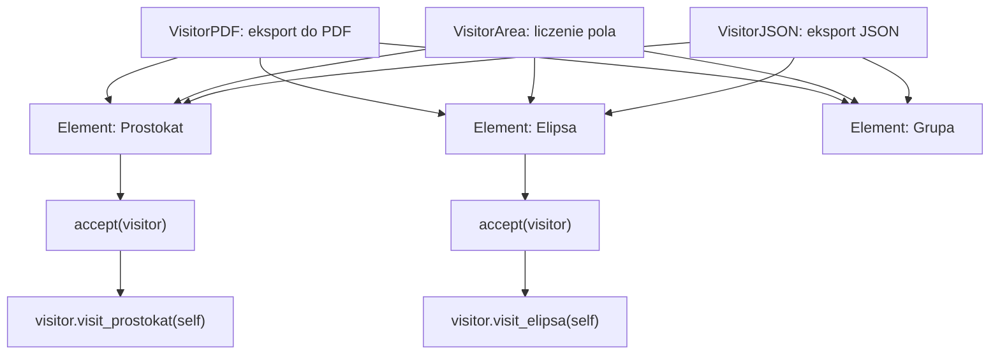
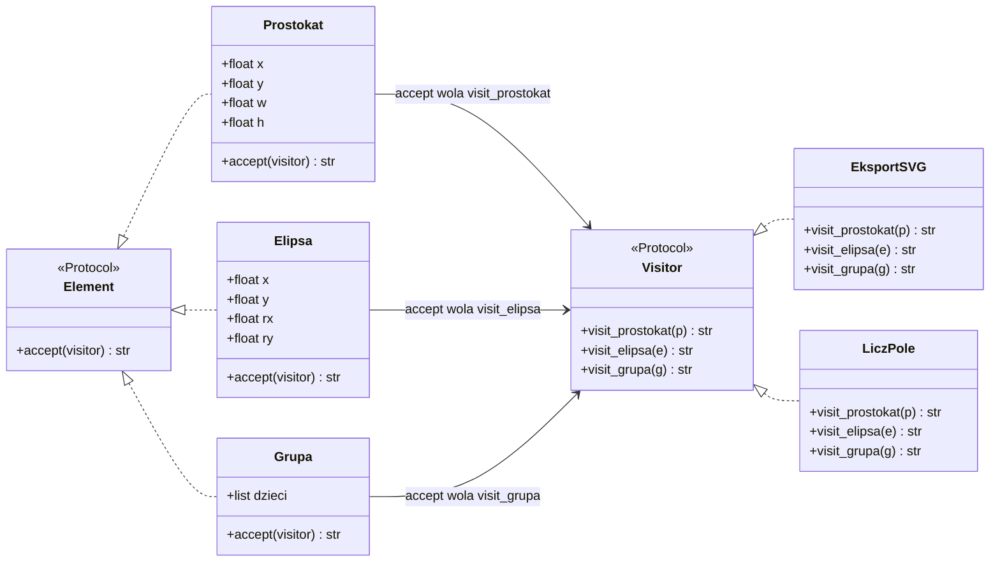
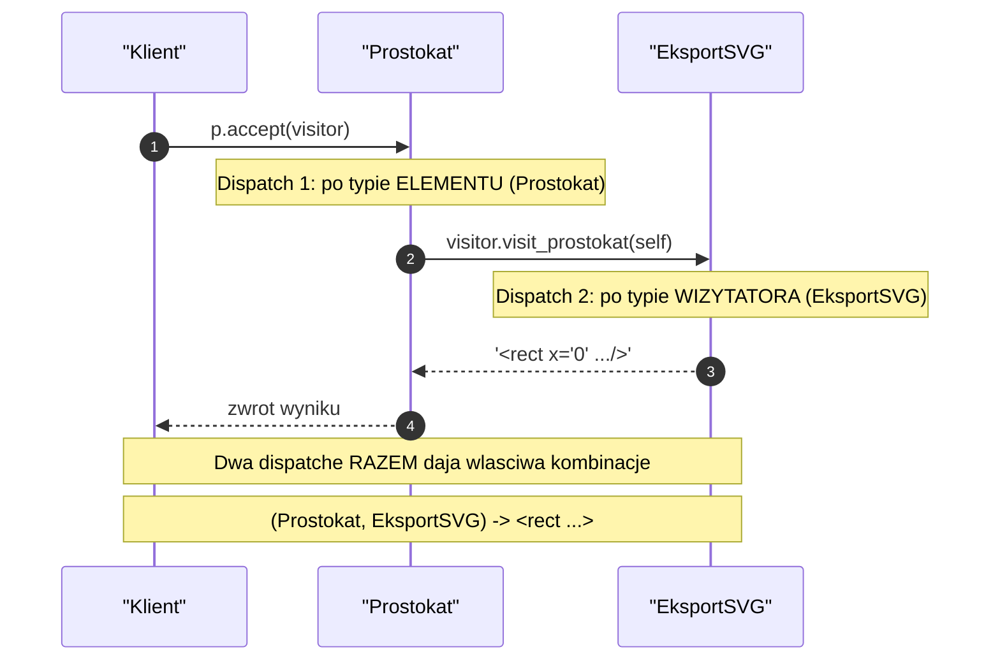
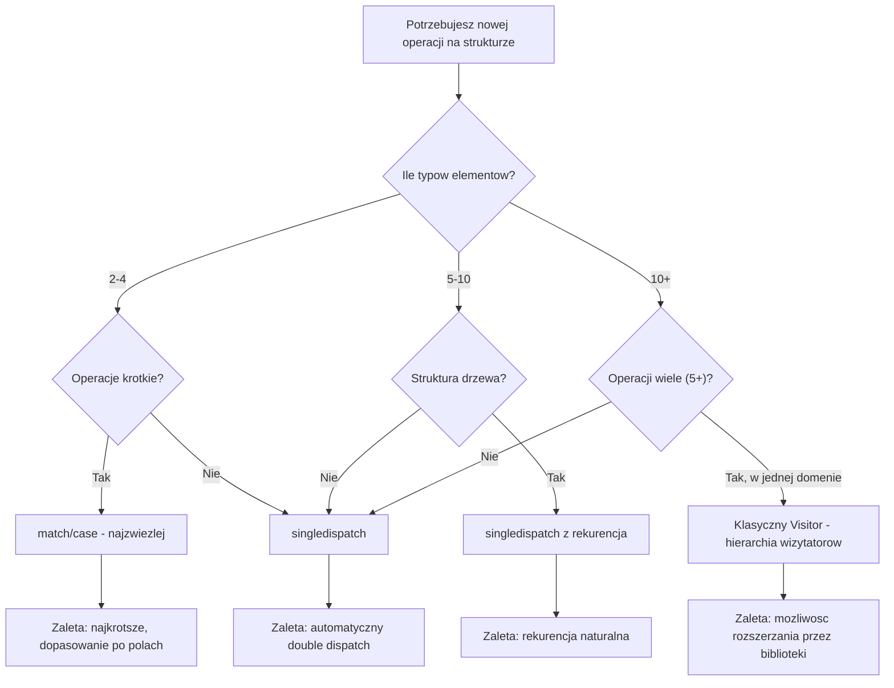
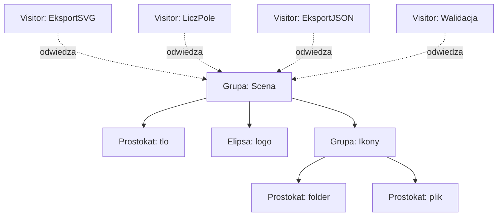
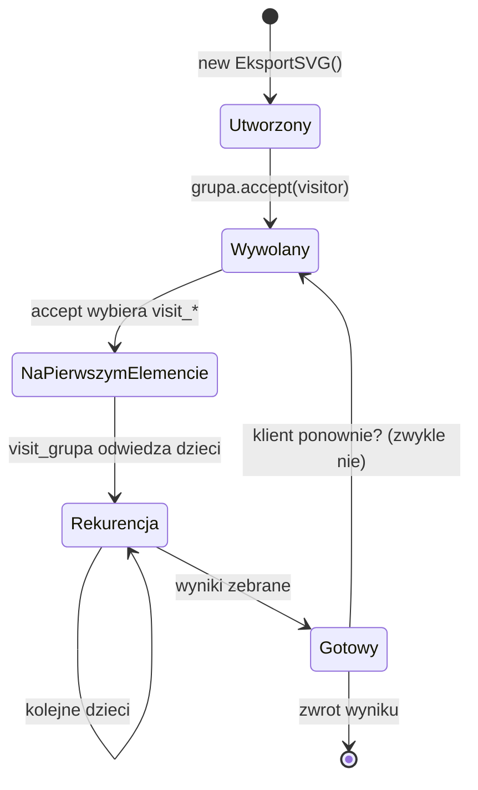
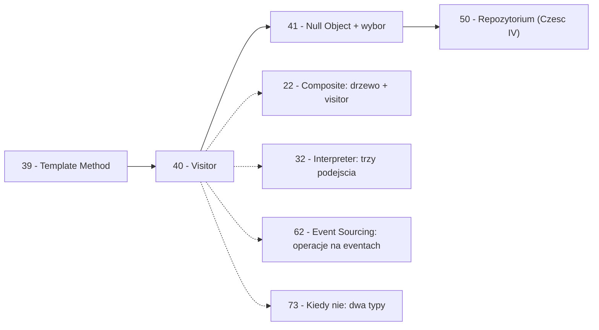

```markdown
---
modul: 40 — Visitor
plik: 40-visitor.md
poziom: zaawansowany
wymaga: [39]
czas: ~185 minut czytania + ~430 minut ćwiczeń
---

# Moduł 40 — Visitor — dodawanie operacji do struktury bez jej zmiany

> **TL;DR**
> - **Visitor (odwiedzający)** pozwala definiować **nowe operacje** na strukturze obiektów **bez zmiany klas** tej struktury — dodajesz „wizytatora" zamiast dodawać metodę do każdej klasy elementu.
> - Sedno wzorca to **double dispatch** (podwójne wywołanie): `element.accept(visitor)` → `visitor.visit_circle(element)` — dwa wywołania decydują o właściwym zachowaniu. Python **sam tego nie robi**, bo nie ma przeciążania metod po typie argumentu.
> - Klasyczny trade-off: Visitor **łatwo dodaje operacje**, ale **trudno dodaje typy elementów**. To odwrotność intuicji — powiedz to wprost.
> - W Pythonie **rzadko warto używać klasycznego Visitora** — `functools.singledispatch` i `match`/`case` (Python 3.10+) realizują to samo prościej, z mniej boilerplate'u, lepszym typowaniem i czytelniejszym kodem.
> - Visitor ma sens w Pythonie tylko wtedy, gdy struktura jest **naprawdę złożona** (drzewo AST z 20+ typami węzłów, hierarchia kategorii z dziesiątkami typów), a operacji jest **kilkanaście i wszystkie są w jednej domenie** — jak w kompilatorach, linterach, analizatorach.

---

## 0. Model mentalny

### Biegły rewident, geodeta i kurier

Wyobraź sobie dużą firmę finansową z dziesiątkami działów: księgowość, kredyty, ryzyko, obsługa klienta, IT, HR, audyt wewnętrzny. Każdy dział ma swoją strukturę, swoje procedury, swoje dane. Chcesz teraz przeprowadzić **audyt regulacyjny**. I tu jest problem: **każdy dział trzeba przeanalizować inaczej**. W księgowości pytasz o zapisy — czy bilans się zgadza, czy wszystkie faktury są zaewidencjonowane. W ryzyku pytasz o limity — czy są przestrzegane, czy raporty się zgadzają. W IT pytasz o logi — czy dostęp do systemów produkcyjnych jest zarejestrowany, czy hasła są zmieniane.

Zauważ, co robisz: **odwiedzasz każdy dział** i w każdym stosujesz właściwe dla niego pytania. **Działy się nie zmieniają** — nie przechodzą reorganizacji, gdy przychodzi audyt. Zmienia się tylko **rola gościa** — kiedyś była to kontrola skarbowa, teraz audyt regulacyjny, a jutro będzie audyt wewnętrzny. Każda rola to **nowy rodzaj audytora** z własnym zestawem pytań i własnym raportem. Ta metafora pokazuje sedno Visitora: **operacja (audyt) jest osobnym bytem, który „odwiedza" strukturę**, a nie roztapia się w klasach działów.

Popatrzmy na drugi obraz — **geodeta mierzący budynki**. Wyobraź sobie, że geodeta dostaje zlecenie: zmierzyć **wszystkie budynki** w dzielnicy dla celów podatkowych. Budynki są różne: jednorodzinne, wielorodzinne, biurowe, magazynowe, kościoły. Geodeta wie, że **każdy typ mierzy się inaczej** — dom mierzy się po obrysie, kościół po kubaturze, magazyn po powierzchni użytkowej. Ale geodeta nie zmienia budynków — **on je odwiedza** i stosuje właściwą procedurę. Następny zleceniodawca — powiedzmy straż pożarna — przyśle swojego geodetę, który mierzy coś innego (drogi ewakuacyjne, dostęp dla wozów). Budynki są te same; geodeci są różni. To dokładnie Visitor.

I trzeci obraz, który uchwyci ostatnią własność wzorca — **kurier dostarczający przesyłki**. Wyobraź sobie kuriera, który dostarcza przesyłki do różnych typów adresów: domów, mieszkań w blokach, biur, paczkomatów. Sposób doręczenia zależy od **typu adresu** — do domu dzwoni się do drzwi, do mieszkania przez domofon, do biura przez recepcję, do paczkomatu przez kod. Kurier nie zmienia adresów — **odwiedza je** i stosuje właściwą procedurę. A gdyby pojawił się nowy typ adresu (np. skrytka pocztowa), to **nie kurier musi się zmienić — nowy typ musi zdefiniować, jak go odwiedzać**. To jest druga strona Visitora: **typ elementu decyduje, jak przyjmie odwiedzającego**, ale to odwiedzający decyduje, co zrobić.

Zbierzmy trzy obrazy razem. **Rewident** pokazuje, że operacja (audyt) jest osobnym bytem. **Geodeta** pokazuje, że różnych geodetów można przysłać do tych samych budynków. **Kurier** pokazuje, że typ adresu decyduje, jak przyjąć kuriera. Razem tworzą wzorzec: **osobny obiekt-wizytator odwiedza strukturę, a typ elementu decyduje o właściwym dispatchu**.

| W analogii rewidenta / geodety / kuriera | W kodzie |
|---|---|
| Działy firmy / budynki / adresy | **Element** — typy w strukturze |
| Ksiegowość, ryzyko, IT | **ConcreteElement** — konkretne typy |
| Audyt, pomiar, dostarczenie | **Visitor** — operacja jako obiekt |
| Audyt regulacyjny, audyt skarbowy | **ConcreteVisitor** — konkretne operacje |
| „Wchodzę do działu i zadaję pytania" | `element.accept(visitor)` |
| „W księgowości pytam o bilans, w IT o logi" | `visitor.visit_ksiegowosc(self)` |
| Działy się nie zmieniają przy audycie | Struktura niezależna od operacji |
| Nowy typ działu | Nowy `visit_*` w każdym wizytatorze |

> 🧠 **Zapamiętaj** — **Visitor (odwiedzający) to wzorzec behawioralny, który pozwala zdefiniować nową operację na strukturze obiektów bez zmiany klas tej struktury — operacja jest osobnym obiektem, który „odwiedza" elementy i w każdym wykonuje właściwą sobie akcję.**

Zwróć uwagę na trzy słowa w definicji: **nowa operacja**, **bez zmiany klas**, **osobny obiekt**. „Nowa operacja" — bo dodajesz funkcjonalność. „Bez zmiany klas" — bo to jest właśnie cel wzorca. „Osobny obiekt" — bo operacja nie jest metodą, jest wizytatorem.

### Diagram — intuicja dwóch hierarchii



*Diagram pokazuje dwie niezależne hierarchie: wizytatorów (operacje) i elementów (typy) — każdy element przyjmuje wizytatora i przekazuje sterowanie do jego metody zależnej od swojego typu.*

### Czego Visitor NIE robi

Rozbrójmy cztery nieporozumienia.

**Nie jest Composite.** Composite (moduł 22) to **struktura drzewa**, gdzie liść i gałąź traktowane są jednolicie. Visitor to **operacja na strukturze**. Oba wzorce działają razem — struktura drzewa + wizytator na niej. Ale to różne wzorce.

**Nie jest Strategy.** Strategy wybiera algorytm — klient decyduje. Visitor wykonuje operację **na strukturze** — operacja jest niezależna od klienta i odwiedza **wiele elementów**.

**Nie jest wrapperem.** Adapter, Decorator, Proxy — opakowują **jeden** obiekt. Visitor **odwiedza wiele elementów** i wykonuje różne akcje dla każdego.

**Nie rozwiązuje problemu „jak dodać typ elementu".** Odwrotnie — **utrudnia** dodawanie typów, bo każdy nowy typ wymaga dodania `visit_*` **we wszystkich wizytatorach**. To jest znany trade-off.

**Nie jest niezbędny w Pythonie.** W innych językach (Java, C++) Visitor rozwiązuje problem braku „pattern matchingu" po typie. Python ma `match`/`case` (od 3.10) oraz `singledispatch` — oba realizują to samo.

**Nie jest darmowy.** Dodajesz klasy/Protokoły, double dispatch (dwa wywołania zamiast jednego), łamiesz enkapsulację (wizytator musi „widzieć" pola elementu).

---

## 1. Problem, który rozwiązujemy

Wejdźmy w domenę 📝 „Edytora" graficznego. Użytkownik buduje dokumenty z kształtów: prostokąty, elipsy, grupy. Każdy kształt ma własne cechy (prostokąt — szerokość i wysokość, elipsa — promienie). Każdy kształt można **eksportować do SVG** — potem do **JSON** — potem obliczać **pole powierzchni** — potem sprawdzać **kolizję** z innym kształtem. Ktoś napisał klasy z metodami **wszystkich** operacji.

### Kod „przed"

```python
# edytor_v0.py — wersja naiwna, demonstracyjna
# UWAGA: kod celowo pokazuje pomieszanie struktury z operacjami.

from __future__ import annotations

import json
import math
from dataclasses import dataclass, field


class Prostokat:
    def __init__(self, x: float, y: float, w: float, h: float) -> None:
        self.x, self.y, self.w, self.h = x, y, w, h

    def pole(self) -> float:
        return self.w * self.h

    def do_svg(self) -> str:
        return f'<rect x="{self.x}" y="{self.y}" width="{self.w}" height="{self.h}"/>'

    def do_json(self) -> dict:
        return {"typ": "prostokat", "x": self.x, "y": self.y, "w": self.w, "h": self.h}

    def czy_kolizja(self, inny: object) -> bool:
        if isinstance(inny, Prostokat):
            return not (
                self.x + self.w < inny.x
                or inny.x + inny.w < self.x
                or self.y + self.h < inny.y
                or inny.y + inny.h < self.y
            )
        elif isinstance(inny, Elipsa):
            # uproszczona wersja: sprawdzamy bounding box
            return not (
                self.x + self.w < inny.x - inny.rx
                or inny.x + inny.rx < self.x
                or self.y + self.h < inny.y - inny.ry
                or inny.y + inny.ry < self.y
            )
        elif isinstance(inny, Grupa):
            return any(self.czy_kolizja(d) for d in inny.dzieci)
        raise TypeError(f"nieznany typ: {type(inny).__name__}")


class Elipsa:
    def __init__(self, x: float, y: float, rx: float, ry: float) -> None:
        self.x, self.y, self.rx, self.ry = x, y, rx, ry

    def pole(self) -> float:
        return math.pi * self.rx * self.ry

    def do_svg(self) -> str:
        return f'<ellipse cx="{self.x}" cy="{self.y}" rx="{self.rx}" ry="{self.ry}"/>'

    def do_json(self) -> dict:
        return {"typ": "elipsa", "x": self.x, "y": self.y, "rx": self.rx, "ry": self.ry}


class Grupa:
    def __init__(self, nazwa: str) -> None:
        self.nazwa = nazwa
        self.dzieci: list = []

    def dodaj(self, element) -> None:
        self.dzieci.append(element)

    def pole(self) -> float:
        return sum(d.pole() for d in self.dzieci)

    def do_svg(self) -> str:
        wewnatrz = "\n".join(d.do_svg() for d in self.dzieci)
        return f'<g name="{self.nazwa}">\n{wewnatrz}\n</g>'

    def do_json(self) -> dict:
        return {
            "typ": "grupa",
            "nazwa": self.nazwa,
            "dzieci": [d.do_json() for d in self.dzieci],
        }


if __name__ == "__main__":
    p = Prostokat(0, 0, 100, 50)
    e = Elipsa(150, 25, 30, 20)
    print(p.pole(), e.pole())
    print(p.do_svg())
```

Ten kod **działa**, ale jest fundamentalnie źle zaprojektowany. Zwróć uwagę: **każda klasa kształtu zawiera wszystkie operacje**. Jest architektura „struktura + operacje razem". Każda nowa operacja (np. „oblicz bounding box", „eksport do PDF") musi być dodana do **wszystkich** klas kształtów. To prowadzi do eksplozji metod.

### Code smell — struktura i operacje w jednej klasie

| Problem | Gdzie | Konsekwencja |
|---|---|---|
| Operacje rozproszone po klasach elementów | W każdej klasie | Dodanie operacji = zmiana N klas |
| Nowa operacja to nowa metoda w N klasach | Każdy element | Eksplozja metod |
| Klasy elementów rosną z każdą operacją | `Prostokat`, `Elipsa`, `Grupa` | Klasy stają się „pęczniejące" |
| Logika `isinstance` w metodach | `czy_kolizja` | Klasyczna lawina — powrót do problemu z modułu 03 |
| Trudno dodać operację bez zmiany struktury | Zawsze trzeba | Łamanie OCP |
| Wszystkie operacje w jednej klasie | Brak separacji | Trudno zobaczyć, co jest czym |
| Nie da się użyć operacji na nowym typie | Każda operacja `isinstance` | Nowy element łamie wszystko |
| Testowanie operacji rozproszone | Po wszystkich klasach | Test „pola" jest w 3 miejscach |

Zwróć uwagę na ostatnią pozycję. **Test obliczania pola powierzchni jest w trzech klasach** — osobno dla prostokąta, elipsy, grupy. A eksportu do SVG — w trzech kolejnych miejscach. A sprawdzania kolizji — w jednej wielkiej metodzie z `isinstance`. To jest pomieszanie **struktury** z **operacjami**.

### Objawy — poznasz ten problem po tym, że...

- **Każda operacja jest metodą w *wszystkich* klasach elementów.** Dodanie operacji = zmiana N klas.
- **Metody u elementów używają `isinstance`** do rozpoznania typu innych elementów (jak `czy_kolizja`).
- **Klasy elementów są duże i rosną z każdą operacją.** Klasa `Prostokat` ma `pole`, `do_svg`, `do_json`, `czy_kolizja`, `bounding_box`, `do_pdf`...
- **Nie da się dodać operacji bez modyfikacji struktury.** Łamanie OCP (moduł 03).
- **Trudno testować operacje jako całość.** Test „pola" jest rozproszony.
- **Kod operacji i struktury się miesza.** Nie widzisz granicy między „jakim kształtem jestem" i „co umiem zrobić".
- **Dodanie nowego typu elementu** wymaga aktualizacji **każdej** operacji w każdym miejscu.
- **Cykl życia operacji i struktury jest różny.** Operacje mogą być wtyczkami (plugin), a struktura stała.
- **Operacja na całym drzewie** (np. eksport) wymaga rekurencji w metodach elementów.
- **Klasy elementów nie są POCO** — nie są proste, nie są tylko danymi.

---

## 2. Anatomia wzorca

### Uczestnicy

| Rola | Odpowiedzialność | Co NIE jest jej zadaniem |
|---|---|---|
| **Visitor (odwiedzający)** | Definiuje **jedną metodę `visit_*` dla każdego typu elementu**; akceptuje element jako argument | Nie zmienia elementu; nie wie, „gdzie w strukturze" jest element |
| **ConcreteVisitor (konkretny odwiedzający)** | Implementuje operację — własną logikę dla każdego typu elementu | Nie zna innych wizytatorów; nie ma referencji do struktury |
| **Element (element)** | Definiuje metodę `accept(visitor)` | Nie zawiera operacji — tylko deleguje do wizytatora |
| **ConcreteElement (konkretny element)** | Implementuje `accept` — wywołuje właściwy `visit_*` na wizytatorze | Nie zawiera logiki operacji |
| **ObjectStructure (struktura obiektów)** | Zbiera elementy (lista, drzewo) i „odwiedza" je kolejno (albo rekurencyjnie) | Nie zawiera operacji; tylko orkiestruje |

Kluczowa asymetria: **Element zna Visitora** (przez interfejs, w metodzie `accept`). Visitor **nie zna struktury** (wie tylko, że dostanie konkretny element). Struktura (np. drzewo) „przechodzi" elementy i dla każdego woła `accept`.

### Mechanizm double dispatch — zrozumieć raz na zawsze

To jest **najważniejsza część** tego modułu. Wyjaśnijmy precyzyjnie.

Załóżmy, że mamy dwie hierarchie: elementów (Prostokat, Elipsa, Grupa) i wizytatorów (EksportPDF, LiczPole). Chcemy wywołać „operację eksportu na prostokącie". W większości języków OO można by chcieć napisać:

```python
# To NIE zadziała w Pythonie!
operacja.eksportuj(prostokat)
```

Ale to jest problem — Python (i większość klasycznych języków OO) nie potrafi wybrać metody na podstawie typu **argumentu**. Wybiera metodę na podstawie typu **obiektu, na którym wołamy** (czyli `operacja`). Jeśli `operacja` ma wiele metod `eksportuj`, Python użyje tej samej (albo ostatniej zdefiniowanej), niezależnie od tego, co dostanie.

**Double dispatch** rozwiązuje to przez **dwa wywołania zamiast jednego**:

1. Wołamy `prostokat.accept(eksport)` — dispatch **po typie elementu** (`Prostokat`).
2. Wewnątrz `Prostokat.accept`, wołamy `eksport.visit_prostokat(self)` — dispatch **po typie wizytatora** (`EksportPDF`).

Dopiero **razem** dwa dispatche dają właściwą kombinację: „eksport na prostokącie". W Pythonie nie ma tego mechanizmu automatycznie — sami go wywołujemy.

### Diagram — struktura hierarchii



*Diagram pokazuje dwie równoległe hierarchie: elementów (kształty) i wizytatorów (operacje) — połączone przez metody `accept`/`visit_*` realizujące double dispatch.*

### Klasyczny trade-off — Visitors vs Types

To najważniejsze rozróżnienie — **odwrotność intuicji**.

**Klasyczny OOP (bez Visitora):** dodanie **nowego typu elementu** jest łatwe (nowa klasa). Dodanie **nowej operacji** jest trudne (zmiana wszystkich klas elementów). To kierunek „typy rosną łatwo, operacje rosną trudno".

**Z Visitor:** dodanie **nowej operacji** jest łatwe (nowy wizytator). Dodanie **nowego typu elementu** jest trudne (zmiana wszystkich wizytatorów — każdy musi zaimplementować `visit_nowy_typ`). To kierunek „operacje rosną łatwo, typy rosną trudno".

| Co dodajemy | Bez Visitora | Z Visitor | Wniosek |
|---|---|---|---|
| Nowy typ elementu | Łatwe (1 klasa) | Trudne (N wizytatorów) | Visitor **utrudnia** typy |
| Nowa operacja | Trudne (N klas) | Łatwe (1 wizytator) | Visitor **ułatwia** operacje |
| Wiele operacji i stała struktura | Chaos (N×M metod) | Porządek | Visitor wygrywa |
| Wiele typów i mało operacji | Porządek (N klas, M metod) | Chaos (M wizytatorów × N metod) | Visitor przegrywa |

**Kluczowe pytanie decyzyjne:** „co będzie się zmieniać częściej — typy elementów czy operacje?". Jeśli **operacje** — Visitor ma sens. Jeśli **typy** — nie ma sensu.

### Warianty: klasyczny vs pythoniczny

| Aspekt | Klasyczny (GoF) | Pythoniczny |
|---|---|---|
| Visitor | `ABC` z metodami `visit_*` | `Protocol`, `singledispatch`, `match`/`case` |
| Element | `accept` w każdej klasie | Często bez zmian — `singledispatch` po typie |
| Double dispatch | Ręczny (`element.accept(visitor)`) | Automatyczny (`singledispatch` po typie) |
| Nowy typ elementu | Trzeba dodać `visit_*` we wszystkich wizytatorach | Zależy — `singledispatch` wymaga rejestracji |
| Nowa operacja | Nowa klasa wizytatora | Nowa funkcja `@register` |
| Testowalność | Osobno wizytatory | Osobno funkcje |

W Pythonie ten sam cel można osiągnąć **trzema podejściami** — i rzadko warto brać klasyczne.

---

## 3. Implementacja krok po kroku

Przebudujemy edytor z sekcji 1.

### Krok 1 — Zdefiniuj kontrakt Element z metodą accept

Każdy element musi umieć „przyjąć" wizytatora.

```python
from typing import Protocol, runtime_checkable


@runtime_checkable
class Element(Protocol):
    """Kontrakt elementu - cokolwiek, co mozna odwiedzic."""
    def accept(self, visitor: "Visitor") -> object: ...
```

Zwróć uwagę: `Element` **nie zawiera operacji biznesowych** — tylko `accept`. To jest istota: operacje są w wizytatorach.

### Krok 2 — Zdefiniuj kontrakt Visitor

Wizytator ma **jedną metodę dla każdego typu elementu**. To ważne: im więcej typów, tym więcej metod.

```python
@runtime_checkable
class Visitor(Protocol):
    """Kontrakt wizytatora - jedna metoda na typ elementu."""
    def visit_prostokat(self, p: "Prostokat") -> object: ...
    def visit_elipsa(self, e: "Elipsa") -> object: ...
    def visit_grupa(self, g: "Grupa") -> object: ...
```

### Krok 3 — Zaimplementuj konkretne elementy

Każdy element ma **tylko `accept`** i własne pola.

```python
class Prostokat:
    def __init__(self, x: float, y: float, w: float, h: float) -> None:
        self.x, self.y, self.w, self.h = x, y, w, h

    def accept(self, visitor: Visitor) -> object:
        return visitor.visit_prostokat(self)   # double dispatch!


class Elipsa:
    def __init__(self, x: float, y: float, rx: float, ry: float) -> None:
        self.x, self.y, self.rx, self.ry = x, y, rx, ry

    def accept(self, visitor: Visitor) -> object:
        return visitor.visit_elipsa(self)


class Grupa:
    def __init__(self, nazwa: str) -> None:
        self.nazwa = nazwa
        self.dzieci: list = []

    def dodaj(self, element) -> None:
        self.dzieci.append(element)

    def accept(self, visitor: Visitor) -> object:
        return visitor.visit_grupa(self)   # grupa przetwarza dzieci sama (patrz wizytator)
```

Zwróć uwagę na drobną — ale kluczową — rzecz. W `accept` **każdy typ elementu woła inną metodę wizytatora**: `visit_prostokat`, `visit_elipsa`, `visit_grupa`. To pierwszy etap double dispatch.

### Krok 4 — Zaimplementuj konkretne wizytatory

**Operacja staje się klasą z `visit_*`**.

```python
class EksportSVG:
    """Wizytator: eksport do SVG."""

    def visit_prostokat(self, p: Prostokat) -> str:
        return f'<rect x="{p.x}" y="{p.y}" width="{p.w}" height="{p.h}"/>'

    def visit_elipsa(self, e: Elipsa) -> str:
        return f'<ellipse cx="{e.x}" cy="{e.y}" rx="{e.rx}" ry="{e.ry}"/>'

    def visit_grupa(self, g: Grupa) -> str:
        wewnatrz = "\n".join(d.accept(self) for d in g.dzieci)
        return f'<g name="{g.nazwa}">\n{wewnatrz}\n</g>'


class LiczPole:
    """Wizytator: obliczenie pola powierzchni."""

    def visit_prostokat(self, p: Prostokat) -> float:
        return p.w * p.h

    def visit_elipsa(self, e: Elipsa) -> float:
        return math.pi * e.rx * e.ry

    def visit_grupa(self, g: Grupa) -> float:
        return sum(d.accept(self) for d in g.dzieci)


class EksportJSON:
    """Wizytator: eksport do JSON."""

    def visit_prostokat(self, p: Prostokat) -> dict:
        return {"typ": "prostokat", "x": p.x, "y": p.y, "w": p.w, "h": p.h}

    def visit_elipsa(self, e: Elipsa) -> dict:
        return {"typ": "elipsa", "x": e.x, "y": e.y, "rx": e.rx, "ry": e.ry}

    def visit_grupa(self, g: Grupa) -> dict:
        return {
            "typ": "grupa",
            "nazwa": g.nazwa,
            "dzieci": [d.accept(self) for d in g.dzieci],
        }
```

Każdy wizytator zna **wyłącznie** typy elementów, ale nie wie, jak są zbudowane w strukturze. Rekurencja (jeśli dotyczy) jest w `visit_grupa` — i to wizytator decyduje, jak „wejść" w głąb.

### Krok 5 — Klient używa wizytatora

```python
def wyeksportuj_svg(element, wizytator: Visitor) -> str:
    """Klient wybiera wizytatora i odwiedza element."""
    return element.accept(wizytator)


# Uzycie:
scene = Grupa("Scena")
scene.dodaj(Prostokat(0, 0, 100, 50))
scene.dodaj(Elipsa(150, 25, 30, 20))

svg = scene.accept(EksportSVG())
pole = scene.accept(LiczPole())
json_data = scene.accept(EksportJSON())
```

Klient oddziela strukturę (scene) od operacji (wizytator). Dodanie nowej operacji = nowa klasa wizytatora.

### Krok 6 — Dodaj nowy typ elementu (ZOBACZ koszt)

Chcemy dodać `Wielokat`. Co trzeba zrobić?

```python
class Wielokat:
    def __init__(self, punkty: list[tuple[float, float]]) -> None:
        self.punkty = punkty

    def accept(self, visitor: Visitor) -> object:
        return visitor.visit_wielokat(self)
```

I **w każdym wizytatorze** dodajemy metodę:

```python
# W EksportSVG:
def visit_wielokat(self, w: Wielokat) -> str:
    punkty = " ".join(f"{x},{y}" for x, y in w.punkty)
    return f'<polygon points="{punkty}"/>'

# W LiczPole:
def visit_wielokat(self, w: Wielokat) -> float:
    # uproszczone: pole wielokata
    ...

# W EksportJSON:
def visit_wielokat(self, w: Wielokat) -> dict:
    return {"typ": "wielokat", "punkty": w.punkty}
```

**Koszt: 3 zmiany** (jeden wizytator każdy) + nowa klasa. Dla 10 wizytatorów — 10 zmian. **To jest trade-off** — Visitor ułatwia operacje, utrudnia typy.

### Krok 7 — Weryfikacja

| Kryterium | Wersja „przed" | Wersja „po" |
|---|---|---|
| Dodanie nowej operacji | Zmiana N klas elementów | Nowa klasa wizytatora |
| Dodanie nowego typu elementu | Nowa klasa | Nowa klasa + N metod |
| Separacja struktury i operacji | Nie | Tak |
| Testowanie operacji | Rozproszone | Osobne klasy wizytatorów |
| Reużycie operacji | Nie | Wizytatory można łączyć |
| Liczba klas | 3 | 3 + N wizytatorów |
| Double dispatch | Brak | Ręczny |

Zysk: operacje w osobnych klasach, można je dodawać/usuwać. Koszt: nowy typ elementu wymaga zmian we wszystkich wizytatorach.

---

## 4. Wersje pythoniczne i warianty

To serce modułu. Python daje **trzy podejścia** — omówimy je szczegółowo i porównamy.

### 4.1 Klasyczny Visitor — jak wyżej

**Zalety:** jawna struktura, hierarchia wizytatorów, można dodawać różne wizytatory. **Wady:** dużo boilerplate'u, double dispatch ręczny, nowy typ = zmiana we wszystkich wizytatorach.

### 4.2 `functools.singledispatch` — najbardziej pythoniczny

`singledispatch` pozwala **wybrać funkcję na podstawie typu pierwszego argumentu**. To **automatyczny double dispatch**.

```python
from functools import singledispatch


@singledispatch
def pole(element) -> float:
    raise NotImplementedError(f"nie znam typu {type(element).__name__}")


@pole.register
def _(element: Prostokat) -> float:
    return element.w * element.h


@pole.register
def _(element: Elipsa) -> float:
    return math.pi * element.rx * element.ry


@pole.register
def _(element: Grupa) -> float:
    return sum(pole(d) for d in element.dzieci)


# Uzycie:
pole(scene)   # Python sam wybiera odpowiednia funkcje po typie
```

**Zalety:** **znacznie mniej kodu** (5 funkcji zamiast 5 klas), **automatyczny double dispatch**, **łatwe dodawanie typów** (nowy `@pole.register`), **działa ze type hints**. **Wady:** nie ma „hierarchii wizytatorów" — wizytator to pojedyncza funkcja (choć można mieć wiele funkcji), brak możliwości dodania „wizytatora z konfiguracją" (chyba że domknięcie).

**Kiedy stosować:** 90% przypadków Visitora w Pythonie. Zamiast klasy exporter z 5 metodami — pięć funkcji `@pole.register` obok siebie. Zamiast 5 klas wizytatorów — 5 zestawów funkcji.

**Porównanie liczby linii:**

| Podejście | Linii kodu | Double dispatch | Rozszerzalność typów |
|---|---|---|---|
| Klasyczny Visitor | ~80 (z 5 klasami) | Ręczny | Zmiana wszystkich |
| `singledispatch` | ~20 (jedna funkcja) | Automatyczny | Nowy `@register` |

**Wniosek:** `singledispatch` jest **znacznie krótszy i wygodniejszy** — to najczęstsze rozwiązanie w Pythonie.

### 4.3 `match`/`case` z typami — Python 3.10+

Trzecie podejście — dopasowanie strukturalne.

```python
def pole2(element) -> float:
    match element:
        case Prostokat(w=w, h=h):
            return w * h
        case Elipsa(rx=rx, ry=ry):
            return math.pi * rx * ry
        case Grupa(dzieci=dzieci):
            return sum(pole2(d) for d in dzieci)
        case _:
            raise NotImplementedError(f"nie znam typu {type(element).__name__}")
```

**Zalety:** bardzo zwięzłe, świetnie czytelne, można dopasowywać **strukturę** (pola, atrybuty) — nie tylko typ. **Wady:** mniej wsparcia `mypy`, wymaga Python 3.10+, brak rejestracji dla „typów zewnętrznych" (chyba że użyjesz `case _: ...`).

**Kiedy stosować:** gdy operacje są krótkie (kilka linii) i chcesz **jedną funkcję zamiast kilku**.

### 4.4 Trzy podejścia obok siebie — porównanie

```python
# 1. KLASYCZNY VISITOR
class LiczPole:
    def visit_prostokat(self, p):
        return p.w * p.h
    def visit_elipsa(self, e):
        return math.pi * e.rx * e.ry
    def visit_grupa(self, g):
        return sum(d.accept(self) for d in g.dzieci)

# 2. SINGLEDISPATCH
@singledispatch
def pole(x): raise NotImplementedError
@pole.register
def _(p: Prostokat): return p.w * p.h
@pole.register
def _(e: Elipsa): return math.pi * e.rx * e.ry
@pole.register
def _(g: Grupa): return sum(pole(d) for d in g.dzieci)

# 3. MATCH/CASE
def pole2(x):
    match x:
        case Prostokat(w=w, h=h): return w * h
        case Elipsa(rx=rx, ry=ry): return math.pi * rx * ry
        case Grupa(dzieci=dzieci): return sum(pole2(d) for d in dzieci)
```

| Kryterium | Klasyczny | `singledispatch` | `match`/`case` |
|---|---|---|---|
| Linii kodu | Dużo | Średnio | Mało |
| Double dispatch | Ręczny | Automatyczny | Automatyczny |
| Rozszerzalność typów | Nowy `visit_*` we wszystkich | Nowy `@register` | Nowy `case` |
| Rozszerzalność operacji | Nowa klasa | Nowa funkcja | Nowa funkcja |
| Dopasowanie po strukturze | Nie | Nie (tylko typ) | **Tak** (pola) |
| Wsparcie `mypy` | Dobre | Dobre | Średnie |
| Możliwość kelompokwania | Tak (grupy wizytatorów) | Tak (przez moduł) | Tak (przez funkcję) |
| Refactoring IDE | Dobre | Dobre | Średnie (brak wsparcia) |
| Wydajność | Średnia | Dobra (`dict` lookup) | Dobra (kompilowany do drzewa) |
| Zastosowanie | Bardzo złożone | Domyślny wybór | Krótkie operacje |

### 4.5 Visitor + Composite

Najczęstsze połączenie. Struktura drzewa (Composite — moduł 22) + operacja na całej strukturze (Visitor).

```python
# Composite:
class Grupa:
    def __init__(self):
        self.dzieci = []
    def dodaj(self, e): self.dzieci.append(e)
    def accept(self, visitor):
        return visitor.visit_grupa(self)

# Visitor obsługuje rekurencje:
class LiczPole:
    def visit_grupa(self, g):
        return sum(d.accept(self) for d in g.dzieci)
```

Zwróć uwagę, że **rekurencja jest w wizytatorze**, nie w Composite. To znaczy, że operacja może „przejść drzewo" na swój sposób (pre-order, post-order, w głąb, w szerokość). Composite tylko definiuje strukturę.

### 4.6 Visitor + Plugin / wtyczki

Wizytatory naturalnie nadają się jako wtyczki. Rejestracja przez `@register`.

```python
WIZYTATORY: dict[str, str] = {
    "eksport_svg": "kod wtyczki",
    # ...
}
```

### 4.7 Podsumowanie — tabela wyboru

| Sytuacja | Wariant |
|---|---|
| Struktura prosta (lista), operacje krótkie | `match`/`case` (4.3) |
| Struktura drzewa, operacje różne | `singledispatch` (4.2) |
| Ramy frameworka, 20+ typów elementów | Klasyczny Visitor (4.1) |
| Operacje krótkie, dopasowanie po polach | `match`/`case` (4.3) |
| Dodanie zewnętrznych typów do operacji | `singledispatch` (4.2) |
| Wizytator ma konfigurację | Domknięcie albo klasa |

> 🧠 **Zapamiętaj** — **W Pythonie klasyczny Visitor to rzadkość.** `singledispatch` pokrywa 80% przypadków, `match`/`case` — kolejne 15%. Klasyczny Visitor pozostaje dla sytuacji, gdy hierarchia wizytatorów jest **naprawdę potrzebna** (frameworki, biblioteki z rozszerzalnymi operacjami, kompilatory z 20+ typami AST).

---

## 5. Przykład z życia: 📝 Edytor — pełny uruchamialny kod

Zbudujemy edytor graficzny z hierarchią kształtów i trzema operacjami: eksport SVG, eksport JSON, obliczanie pola. Zastosujemy trzy podejścia obok siebie, żeby porównać.

### Kod

```python
# edytor_visitor.py — pelny przyklad Visitor (trzy podejscia)
from __future__ import annotations

import json
import math
from abc import ABC, abstractmethod
from collections.abc import Iterator
from dataclasses import dataclass, field
from decimal import Decimal
from functools import singledispatch
from typing import Protocol, runtime_checkable


# ===========================================================================
# 1. Struktura elementow (Composite: liscie + grupa)
# ===========================================================================

@runtime_checkable
class Element(Protocol):
    """Kontrakt elementu - moze byc odwiedzony."""
    def accept(self, visitor: "Visitor") -> object: ...


@runtime_checkable
class Visitor(Protocol):
    """Klasyczny kontrakt wizytatora."""
    def visit_prostokat(self, p: "Prostokat") -> object: ...
    def visit_elipsa(self, e: "Elipsa") -> object: ...
    def visit_grupa(self, g: "Grupa") -> object: ...


class Prostokat:
    def __init__(self, x: float, y: float, w: float, h: float) -> None:
        self.x, self.y = x, y
        self.w, self.h = w, h

    def accept(self, visitor: Visitor) -> object:
        return visitor.visit_prostokat(self)

    def __repr__(self) -> str:
        return f"Prostokat({self.x},{self.y},{self.w},{self.h})"


class Elipsa:
    def __init__(self, x: float, y: float, rx: float, ry: float) -> None:
        self.x, self.y = x, y
        self.rx, self.ry = rx, ry

    def accept(self, visitor: Visitor) -> object:
        return visitor.visit_elipsa(self)

    def __repr__(self) -> str:
        return f"Elipsa({self.x},{self.y},{self.rx},{self.ry})"


class Grupa:
    def __init__(self, nazwa: str) -> None:
        self.nazwa = nazwa
        self.dzieci: list[Element] = []

    def dodaj(self, element: Element) -> None:
        self.dzieci.append(element)

    def accept(self, visitor: Visitor) -> object:
        return visitor.visit_grupa(self)

    def __repr__(self) -> str:
        return f"Grupa({self.nazwa!r}, {len(self.dzieci)} dzieci)"


# ===========================================================================
# 2. Klasyczne wizytatory
# ===========================================================================

class EksportSVG:
    """Wizytator: eksport do SVG."""

    def visit_prostokat(self, p: Prostokat) -> str:
        return f'<rect x="{p.x}" y="{p.y}" width="{p.w}" height="{p.h}"/>'

    def visit_elipsa(self, e: Elipsa) -> str:
        return f'<ellipse cx="{e.x}" cy="{e.y}" rx="{e.rx}" ry="{e.ry}"/>'

    def visit_grupa(self, g: Grupa) -> str:
        wewnatrz = "\n".join(d.accept(self) for d in g.dzieci)
        return f'<g name="{g.nazwa}">\n{wewnatrz}\n</g>'


class LiczPole:
    """Wizytator: pole powierzchni."""

    def visit_prostokat(self, p: Prostokat) -> float:
        return p.w * p.h

    def visit_elipsa(self, e: Elipsa) -> float:
        return math.pi * e.rx * e.ry

    def visit_grupa(self, g: Grupa) -> float:
        return sum(d.accept(self) for d in g.dzieci)


class EksportJSON:
    """Wizytator: eksport do dict (pod JSON)."""

    def visit_prostokat(self, p: Prostokat) -> dict:
        return {"typ": "prostokat", "x": p.x, "y": p.y, "w": p.w, "h": p.h}

    def visit_elipsa(self, e: Elipsa) -> dict:
        return {"typ": "elipsa", "x": e.x, "y": e.y, "rx": e.rx, "ry": e.ry}

    def visit_grupa(self, g: Grupa) -> dict:
        return {
            "typ": "grupa",
            "nazwa": g.nazwa,
            "dzieci": [d.accept(self) for d in g.dzieci],
        }


class Walidacja:
    """Wizytator: walidacja struktury."""

    def visit_prostokat(self, p: Prostokat) -> list[str]:
        bledy = []
        if p.w <= 0:
            bledy.append(f"prostokat {p}: szerokosc <= 0")
        if p.h <= 0:
            bledy.append(f"prostokat {p}: wysokosc <= 0")
        return bledy

    def visit_elipsa(self, e: Elipsa) -> list[str]:
        bledy = []
        if e.rx <= 0 or e.ry <= 0:
            bledy.append(f"elipsa {e}: promien <= 0")
        return bledy

    def visit_grupa(self, g: Grupa) -> list[str]:
        bledy = []
        if not g.dzieci:
            bledy.append(f"grupa {g.nazwa!r}: pusta")
        for d in g.dzieci:
            bledy.extend(d.accept(self))
        return bledy


# ===========================================================================
# 3. Wariant funkcyjny - singledispatch
# ===========================================================================

@singledispatch
def pole(x) -> float:
    raise NotImplementedError(f"nie znam typu {type(x).__name__}")


@pole.register
def _(x: Prostokat) -> float:
    return x.w * x.h


@pole.register
def _(x: Elipsa) -> float:
    return math.pi * x.rx * x.ry


@pole.register
def _(x: Grupa) -> float:
    return sum(pole(d) for d in x.dzieci)


@singledispatch
def do_svg(x) -> str:
    raise NotImplementedError(f"nie znam typu {type(x).__name__}")


@do_svg.register
def _(x: Prostokat) -> str:
    return f'<rect x="{x.x}" y="{x.y}" width="{x.w}" height="{x.h}"/>'


@do_svg.register
def _(x: Elipsa) -> str:
    return f'<ellipse cx="{x.x}" cy="{x.y}" rx="{x.rx}" ry="{x.ry}"/>'


@do_svg.register
def _(x: Grupa) -> str:
    wewnatrz = "\n".join(do_svg(d) for d in x.dzieci)
    return f'<g name="{x.nazwa}">\n{wewnatrz}\n</g>'


# ===========================================================================
# 4. Wariant match/case
# ===========================================================================

def pole_match(x) -> float:
    match x:
        case Prostokat(w=w, h=h):
            return w * h
        case Elipsa(rx=rx, ry=ry):
            return math.pi * rx * ry
        case Grupa(dzieci=dzieci):
            return sum(pole_match(d) for d in dzieci)
        case _:
            raise NotImplementedError(f"nie znam typu {type(x).__name__}")


# ===========================================================================
# 5. Demonstracja
# ===========================================================================

if __name__ == "__main__":
    # Budujemy scene
    scena = Grupa("Scena")
    scena.dodaj(Prostokat(0, 0, 100, 50))
    scena.dodaj(Elipsa(150, 25, 30, 20))

    wewnetrzna = Grupa("Ikony")
    wewnetrzna.dodaj(Prostokat(200, 0, 20, 20))
    wewnetrzna.dodaj(Prostokat(230, 0, 20, 20))
    scena.dodaj(wewnetrzna)

    print("=== 1. Klasyczny Visitor - SVG ===")
    print(scena.accept(EksportSVG()))

    print("\n=== 2. Klasyczny Visitor - pole ===")
    print(f"  Pole sceny: {scena.accept(LiczPole()):.2f}")

    print("\n=== 3. Klasyczny Visitor - JSON ===")
    dane = scena.accept(EksportJSON())
    print(json.dumps(dane, indent=2, ensure_ascii=False)[:300])

    print("\n=== 4. Klasyczny Visitor - walidacja ===")
    bledy = scena.accept(Walidacja())
    print(f"  Bledy: {bledy or 'brak'}")

    print("\n=== 5. Wariant singledispatch ===")
    print(f"  Pole (singledispatch): {pole(scena):.2f}")
    print(f"  SVG (singledispatch):")
    print(do_svg(scena))

    print("\n=== 6. Wariant match/case ===")
    print(f"  Pole (match): {pole_match(scena):.2f}")

    print("\n=== 7. Porownanie kodu ===")
    print(f"  Klasyczny: 3 wizytatory x 3 metody = 9 metod")
    print(f"  singledispatch: 3 zestawy x (1 domyslna + 3 register) = 12 funkcji")
    print(f"  match: 1 funkcja z 4 case (jedna operacja)")
```

### Co ten przykład pokazuje

**Punkty 1–4 — klasyczny Visitor.** Ten sam `scena.accept(...)` obsługuje cztery różne operacje: eksport SVG, obliczanie pola, eksport JSON, walidację. **Struktura nie zmienia się** — dodanie nowej operacji to nowy wizytator.

**Punkt 5 — singledispatch.** Ten sam efekt (pole, SVG) dwiema funkcjami. **Znacznie mniej kodu** — 12 funkcji zamiast 9 metod, ale linii kodu dużo mniej.

**Punkt 6 — match/case.** Jedna funkcja `pole_match` obsługuje wszystkie typy. **Najbardziej zwięzłe** dla pojedynczej operacji.

**Punkt 7 — porównanie.** Klasyczny Visitor ma najwięcej boilerplate'u, singledispatch najwięcej funkcji, match/case najmniej.

### Testy

```python
# test_edytor_visitor.py — uruchomienie: pytest test_edytor_visitor.py -v
import math
from decimal import Decimal

import pytest

from edytor_visitor import (
    Element,
    Elipsa,
    EksportJSON,
    EksportSVG,
    Grupa,
    LiczPole,
    Prostokat,
    Visitor,
    Walidacja,
    do_svg,
    pole,
    pole_match,
)


@pytest.fixture
def scena() -> Grupa:
    scena = Grupa("Scena")
    scena.dodaj(Prostokat(0, 0, 100, 50))
    scena.dodaj(Elipsa(150, 25, 30, 20))
    return scena


# --- Kontrakty ---------------------------------------------------------------

def test_element_i_visitor_to_protokoly() -> None:
    p = Prostokat(0, 0, 10, 10)
    assert isinstance(p, Element)
    assert isinstance(EksportSVG(), Visitor)


# --- Klasyczny Visitor: SVG --------------------------------------------------

def test_eksport_svg_prostokat() -> None:
    p = Prostokat(0, 0, 100, 50)
    wynik = p.accept(EksportSVG())
    assert "rect" in wynik
    assert "100" in wynik
    assert "50" in wynik


def test_eksport_svg_elipsa() -> None:
    e = Elipsa(150, 25, 30, 20)
    wynik = e.accept(EksportSVG())
    assert "ellipse" in wynik


def test_eksport_svg_grupa_ma_dzieci() -> None:
    g = Grupa("G")
    g.dodaj(Prostokat(0, 0, 10, 10))
    g.dodaj(Prostokat(20, 20, 30, 30))
    wynik = g.accept(EksportSVG())
    assert "<g" in wynik
    assert wynik.count("<rect") == 2


# --- Klasyczny Visitor: pole -------------------------------------------------

def test_pole_prostokata() -> None:
    assert Prostokat(0, 0, 100, 50).accept(LiczPole()) == 5000.0


def test_pole_elipsy() -> None:
    e = Elipsa(0, 0, 3, 3)
    wynik = e.accept(LiczPole())
    assert abs(wynik - math.pi * 9) < 0.01


def test_pole_grupy_sumuje_dzieci() -> None:
    g = Grupa("G")
    g.dodaj(Prostokat(0, 0, 10, 10))   # 100
    g.dodaj(Prostokat(0, 0, 20, 20))   # 400
    assert g.accept(LiczPole()) == 500.0


# --- Klasyczny Visitor: JSON -------------------------------------------------

def test_eksport_json_ma_strukture(scena: Grupa) -> None:
    dane = scena.accept(EksportJSON())
    assert dane["typ"] == "grupa"
    assert len(dane["dzieci"]) == 2


def test_eksport_json_typ_dzieci(scena: Grupa) -> None:
    dane = scena.accept(EksportJSON())
    typy = {d["typ"] for d in dane["dzieci"]}
    assert typy == {"prostokat", "elipsa"}


# --- Walidacja ---------------------------------------------------------------

def test_walidacja_zglasza_puste_grupy() -> None:
    g = Grupa("pusta")
    bledy = g.accept(Walidacja())
    assert any("pusta" in b for b in bledy)


def test_walidacja_zglasza_ujemne_wymiary() -> None:
    p = Prostokat(0, 0, -10, 50)
    bledy = p.accept(Walidacja())
    assert any("szerokosc" in b for b in bledy)


def test_walidacja_przechodzi_poprawna_strukture(scena: Grupa) -> None:
    assert scena.accept(Walidacja()) == []


# --- singledispatch ----------------------------------------------------------

def test_singledispatch_pole(scena: Grupa) -> None:
    assert pole(scena) > 0


def test_singledispatch_pole_prostokata() -> None:
    assert pole(Prostokat(0, 0, 10, 10)) == 100.0


def test_singledispatch_svg() -> None:
    wynik = do_svg(Prostokat(0, 0, 10, 10))
    assert "<rect" in wynik


def test_singledispatch_nieznany_typ_rzuca() -> None:
    class CosInnego:
        pass

    with pytest.raises(NotImplementedError):
        pole(CosInnego())


# --- match/case --------------------------------------------------------------

def test_match_pole(scena: Grupa) -> None:
    assert pole_match(scena) > 0


def test_match_pole_prostokata() -> None:
    assert pole_match(Prostokat(0, 0, 10, 10)) == 100.0


def test_match_nieznany_typ_rzuca() -> None:
    with pytest.raises(NotImplementedError):
        pole_match("nieksztalt")


# --- Spójność: trzy podejścia dają ten sam wynik -----------------------------

@pytest.mark.parametrize("element", [
    Prostokat(0, 0, 10, 10),
    Elipsa(0, 0, 5, 5),
])
def test_trzy_podejscia_daja_ten_sam_pole(element) -> None:
    a = element.accept(LiczPole())
    b = pole(element)
    c = pole_match(element)
    assert abs(a - b) < 0.001
    assert abs(a - c) < 0.001
```

Kluczowy test na końcu: **trzy podejścia dają ten sam wynik**. To dowód, że wszystkie realizują ten sam wzorzec — różnią się tylko sposobem wywołania.

---

## 6. Dynamika

### 6.1 Double dispatch — krok po kroku

To najważniejszy diagram tego modułu. Pokazuje **dlaczego double dispatch** i **jak** go realizujemy.



*Diagram pokazuje dwa etapy: `accept` na elemencie wybiera właściwą metodę wizytatora, a ta wybiera właściwą logikę dla konkretnego typu elementu — dopiero razem dają właściwą kombinację (typ, operacja).*

Przeczytajmy ten przebieg bardzo uważnie, bo to jest sedno.

**Krok 1.** Klient woła `p.accept(visitor)`. Klient ma **element** (`p` typu `Prostokat`) i **wizytatora** (`visitor` typu `EksportSVG`).

**Krok 2.** `p.accept(visitor)` wykonuje się:

```python
def accept(self, visitor):
    return visitor.visit_prostokat(self)   # <-- konkretna metoda "visit_prostokat"
```

**Dispatch 1** (na typie `Prostokat`): Python wybrał metodę `accept` z klasy `Prostokat`. Wybrał ją **po typie elementu** (`self`).

**Krok 3.** Wewnątrz `accept`, wywołujemy `visitor.visit_prostokat(self)`. To jest **Dispatch 2** (na typie `EksportSVG`): Python wybiera metodę `visit_prostokat` z klasy `EksportSVG`.

**Krok 4.** `visit_prostokat` zwraca `'<rect x="0" ... />'`. To jest **właściwy wynik** dla kombinacji **(Prostokat, EksportSVG)**.

**Kluczowa obserwacja:** **dopiero dwa dispatche razem** dają właściwy efekt. `accept` wybiera „jak przyjąć wizytatora", `visit_prostokat` wybiera „co zrobić z prostokątem". Gdyby istniał tylko jeden dispatch, nie dałoby się wybrać właściwej metody dla **pary** (typ elementu, typ operacji).

### 6.2 Flowchart — Visitor, singledispatch czy match/case



*Diagram pokazuje kryteria: 2–4 typy — `match/case`; 5–10 typów — `singledispatch`; 10+ typów z wieloma operacjami — klasyczny Visitor.*

### 6.3 Struktura drzewa z operacjami



*Diagram pokazuje strukturę drzewa (Composite) i czterech wizytatorów, którzy mogą odwiedzić strukturę niezależnie — każdy przechodzi drzewo w swój sposób.*

### 6.4 Cykl życia wizytatora



*Diagram pokazuje, że wizytator jest używany raz na jedną „wizytę" struktury — zwykle każda operacja tworzy świeżego wizytatora (choć stanowe wizytatory mogą być reużywane).*

> 💡 **Intuicja** — Visitor jest jak audytor w firmie. **Firma się nie zmienia** — nie przechodzi reorganizacji, gdy przychodzi audyt. **Audytor jest rolą** — może być audytor skarbowy, audytor wewnętrzny, audytor RODO. Każdy ma swoje pytania i swoje wnioski. **Każdy dział musi wiedzieć, jak przyjąć audytora** (przez kogo go przekazać), ale nie wie, **co audytor będzie robił**. Audytor robi swoje.

---

## 7. Kiedy używać / kiedy NIE używać

### Kiedy używać

**Gdy masz złożoną strukturę i wiele operacji.** Drzewo AST, hierarchia kształtów, drzewo kategorii — gdy operacji jest **kilka** (5+), a struktura jest stała.

**Gdy operacje są w jednej „domenie".** Wszystko związane z eksportem, wszystko związane z walidacją, wszystko związane z analizą — wizytator per domena.

**Gdy chcesz umożliwić dodawanie operacji bez zmian w strukturze.** Realizacja OCP (moduł 03). Nowa operacja = nowy wizytator.

**Gdy operacje mają **własny stan** i konfigurację.** Wizytator z konfiguracją (np. eksport z parametrem skali) — klasa z polami.

**Gdy struktura jest używana w wielu kontekstach.** Eksport, import, transformacja, walidacja, drukowanie, audyt — każde to osobny wizytator.

**Gdy budujesz framework z rozszerzalnymi operacjami.** Użytkownicy dodają własne operacje. Standard w bibliotekach do AST, kompilatorach, edytorach.

**Gdy operacje **nie mogą** być metodami elementów.** Bo np. są w innych modułach, należą do innej domeny, są opcjonalne.

**Gdy chcesz traktować strukturę jako dane.** Wizytator pozwala oddzielić „to jak zbudowany" od „co z tym zrobić". Struktura staje się POCO.

**Gdy operacje mają **rekurencję** o różnej kolejności.** Jeden wizytator przechodzi pre-order, inny post-order. Composite sam nie decyduje o kolejności.

**Gdy operacje są **wtyczkami** (plugin).** Wizytator jako wtyczka do systemu.

### Kiedy NIE używać

**Gdy w Pythonie wystarczy `singledispatch`.** 5 typów, 5 funkcji — nie potrzeba klas. Najczęstszy przypadek.

**Gdy w Pythonie wystarczy `match`/`case`.** Operacje krótkie, kilka linii — jedna funkcja z `match`.

**Gdy masz 2–3 typy elementów.** Double dispatch dla dwóch klas to przesada. Wystarczy `isinstance` albo `match`.

**Gdy operacji jest **tylko jedna**.** Nie potrzebujesz osobnego bytu — funkcja wystarczy.

**Gdy typy elementów rosną częściej niż operacje.** Visitor utrudnia dodawanie typów — niedobra decyzja.

**Gdy chcesz enkapsulacji.** Visitor **musi** widzieć pola elementu (bo inaczej nie może wykonać operacji). To łamanie enkapsulacji.

**Gdy operacje są zależne od siebie.** Wizytatory są zwykle niezależne — jeśli operacje muszą się komunikować, to nie jest Visitor.

**Gdy zespół nie zna double dispatch.** Bez zrozumienia wprowadzenie wzorca pogorszy pracę.

**Gdy struktura jest płaska (lista).** Dla płaskiej listy wystarczy mapa. Visitor ma sens dla hierarchii.

**Gdy nie ma potrzeby dodawania operacji w runtime.** Jeśli operacje są stałe i rzadko się zmieniają, zwykłe metody na klasach są prostsze.

**Zbiorczo — tabela decyzyjna:**

| Pytanie | Jeśli „tak" | Jeśli „nie" |
|---|---|---|
| Wiele operacji, stała struktura? | Visitor | Zwykłe metody |
| Operacje w jednej domenie? | Visitor | Może Strategy |
| W Pythonie — ile typów? | `match`/`singledispatch` | Klasyczny Visitor |
| Struktura drzewa? | `singledispatch` + Composite | Prosty `match` |
| Typy rosną częściej? | **Nie Visitor** | Visitor OK |
| Enkapsulacja krytyczna? | **Nie Visitor** | Visitor OK |
| Operacji jest jedna? | **Nie Visitor** | Visitor OK |
| Framework / biblioteka? | Warto rozważyć | Często funkcja lepsza |

---

## 8. Pułapki i antywzorce

**1. Cykliczne zależności element ↔ wizytator.**

```python
# ZLE
# element.py importuje visitor.py
# visitor.py importuje element.py
# -> ImportError
```

**Konsekwencja:** klasyczny problem — wizytator potrzebuje typów elementów, elementy potrzebują kontraktu wizytatora. **Prawidłowo:** użyj `Protocol` dla wizytatora (kontrakt w typach), `from __future__ import annotations` i typów jako stringów. Python dostarcza narzędzi do rozwiązania cyklu — trzeba ich używać.

**2. Visitor z ciężkim stanem.**

```python
# ZLE
class EksportPDF:
    def __init__(self):
        self.bufor = []          # trzyma wszystko
        self.historia = []       # historia zmian
        self.statystyki = {}     # metryki
```

**Konsekwencja:** wizytator staje się „mini-serwisem" z całą logiką stanową. Dla kolejnych wywołań `accept` trzeba go tworzyć od nowa — bo stan nie jest resetowany. **Prawidłowo:** jeśli wizytator ma stan — twórz go dla każdej operacji. Albo — lepiej — rozbij na funkcje bezstanowe (`singledispatch`).

**3. Łamanie enkapsulacji — wizytator „widzi" pola.**

```python
# ZLE
class EksportJSON:
    def visit_prostokat(self, p):
        return {"x": p.x, "y": p.y, "w": p.w, "h": p.h}   # pola sa jawnie czytane
```

**Konsekwencja:** zmiana wewnętrznej reprezentacji `Prostokat` (np. z osobnych pól na `Pozycja`) łamie wizytator. Nie ma sposobu, żeby tego uniknąć — Visitor **musi** widzieć pola. **Prawidłowo:** projektuj elementy jako **stabilne kontrakty** (dataclasses z polami publicznymi). Albo udostępnij metody dostępu w elementach (`get_bounding_box()`).

**4. Brak `visit_*` dla nowego typu — pominięte przypadki.**

```python
# ZLE
class EksportSVG:
    def visit_prostokat(self, p): ...
    def visit_elipsa(self, e): ...
    # brak visit_wielokat!
```

**Konsekwencja:** nowy typ `Wielokat` dziedziczy po `Element`, ale jego `accept` próbuje wołać `visitor.visit_wielokat` — dostaje `AttributeError` w runtime. Błąd wyłapany późno. **Prawidłowo:** `Visitor` jako `ABC` z `@abstractmethod` dla każdej `visit_*` — brak implementacji jest wykryty przy tworzeniu wizytatora. Albo test kontraktu parametryzowany po wszystkich wizytatorach × wszystkich typach.

**5. `isinstance` w `accept` (cofa nas do problemu).**

```python
# ZLE
class Element:
    def accept(self, visitor):
        if isinstance(self, Prostokat):
            return visitor.visit_prostokat(self)
        elif isinstance(self, Elipsa):
            return visitor.visit_elipsa(self)
        # ...
```

**Konsekwencja:** `accept` zawiera `isinstance` — powrót do problemu `if/elif`. **Prawidłowo:** każdy element ma **własną** `accept`, wołającą właściwą metodę. Python (i klasyczny Visitor) już daje dispatch po typie `self`.

**6. Visitor zbyt „ogólny" — łapanie wszystkich przypadków.**

```python
# ZLE
class Eksport:
    def visit(self, element):
        match element:
            case Prostokat(): ...
            case Elipsa(): ...
            case _: pass   # cicha porazka!
```

**Konsekwencja:** nieznany typ jest **cicho ignorowany**. Cała struktura może zostać źle wyeksportowana. **Prawidłowo:** `case _: raise NotImplementedError(...)` — jawny błąd.

**7. Niepotrzebny `double dispatch` — Visitor dla dwóch typów.**

```python
# ZLE
class Element(ABC):
    @abstractmethod
    def accept(self, v): ...

# ... ale sa tylko Prostokat i Elipsa
```

**Konsekwencja:** mnóstwo kodu dla dwóch typów. Wtedy `match/case` jest krótszy i wystarczy. **Prawidłowo:** przy 2–3 typach — funkcje z `match`.

**8. Brak testu kontraktu dla typów elementów × wizytatorów.**

```python
# ZLE
def test_svg_prostokat(): ...
def test_svg_elipsa(): ...
# brak testu "wszystkie wizytatory na wszystkich typach"
```

**Konsekwencja:** jeden wizytator może „zapomnieć" `visit_grupa`, drugi — zwracać `None` dla wielokąta. Brak testu to wyłapie. **Prawidłowo:** test parametryzowany po iloczynie kartezjańskim (wizytatory × typy).

**9. Rekurencja w `visit_grupa` bez pilnowania głębokości.**

**Konsekwencja:** dla bardzo głębokich drzew `RecursionError`. **Prawidłowo:** rekurencja ze stosem własnym albo iteracja ze stosem (jak w module 22).

**10. Wizytator mutujący elementy.**

```python
# ZLE
class Normalizacja:
    def visit_prostokat(self, p):
        p.x = max(0, p.x)   # modyfikuje element!
```

**Konsekwencja:** wizytator przestaje być operacją czytającą — mutuje strukturę. To może prowadzić do zaskakujących efektów (np. kolejny wizytator widzi już zmienione dane). **Prawidłowo:** albo wyraźnie deklaruj, że wizytator mutuje (rzadko), albo projektuj wizytatory jako **niemutujące**.

**11. Zbyt wiele wizytatorów z konfiguracją.**

```python
# ZLE
class EksportPDF:
    def __init__(self, skala, kolor, margines, font, ...): ...
class EksportPDFA4:
    def __init__(self, ...): ...
class EksportPDFA3:
    def __init__(self, ...): ...
```

**Konsekwencja:** eksplozja klas wizytatorów dla wariantów konfiguracji. **Prawidłowo:** jedna klasa z konfiguracją. Albo — jeśli konfiguracja jest złożona — `functools.partial` na funkcjach.

**12. Brak nazwy / metadanych wizytatora.**

**Konsekwencja:** trudno zdiagnozować, który wizytator zawiódł. **Prawidłowo:** każdy wizytator ma `nazwa` (jak strategia w module 38) — dla logowania i debugowania.

**13. Mylenie Visitora ze Strategy.**

**Konsekwencja:** jeśli ktoś traktuje „wizytator" jako wymienny algorytm dla jednego typu — to nie Visitor, to Strategy. Rozróżnienie jest w **wielu typach elementów**. Jeśli typ jest jeden, Visitor nie ma sensu.

**14. Visitor zamiast zwykłej funkcji rekurencyjnej.**

```python
# ZLE
class LiczPoleVisitor:
    def visit_grupa(self, g):
        return sum(d.accept(self) for d in g.dzieci)
    # Czemu nie zwykla funkcja rekurencyjna z isinstance?
```

**Konsekwencja:** klasa dla prostej rekurencji. **Prawidłowo:** jeśli operacja jest prosta i jest tylko jedna — funkcja `def pole(x): match x: ...` wystarczy.

> ⚠️ **Pułapka zbiorcza** — Visitor w Pythonie ma dwa źródła problemów: **cykliczne zależności** (elementy ↔ wizytatory) i **nieuzasadniona złożoność** (klasy dla 2 typów). Zasada: **domyślnie `singledispatch`**. Klasyczny Visitor tylko dla **naprawdę złożonych** hierarchii (20+ typów, 5+ operacji, w jednej domenie). Zawsze mierz: czy liczba linii i klas jest uzasadniona przez liczbę granic (typ × operacja).

---

## 9. Wzorce pokrewne i porównanie

### 9.1 Visitor vs Strategy

| Kryterium | Visitor | Strategy (moduł 38) |
|---|---|---|
| Liczba typów elementów | Wiele (2+) | Jeden (kontekst) |
| Co wymienia | Operacja na strukturze | Algorytm kontekstu |
| Kto wywołuje | Klient (na strukturze) | Klient (ustawienie w kontekście) |
| Double dispatch | Tak | Nie |
| Kiedy używać | Wiele operacji na strukturze | Wymienny algorytm |
| Nowy typ elementu | Trudne (zmiana wizytatorów) | Nie dotyczy |

Visitor jest dla **struktury** i wielu operacji. Strategy dla **jednego obiektu** i wymiennego algorytmu. Różnica jest fundamentalna.

### 9.2 Visitor vs Composite

| Kryterium | Visitor | Composite (moduł 22) |
|---|---|---|
| Co reprezentuje | Operację na strukturze | Strukturę drzewa |
| Cel | Dodać operacje bez zmiany klas | Ujednolicić traktowanie |
| Rekurencja | W wizytatorze | W kompozycie |
| Współpraca | Bardzo często razem | Kompozyt „zaprasza" wizytatora |

**Composite + Visitor = klasyczne połączenie.** Composite definiuje strukturę i metodę `accept`, Visitor przechodzi strukturę i wykonuje operację. To fundament analizy AST, edytorów, linterów.

### 9.3 Visitor vs Iterator

| Kryterium | Visitor | Iterator (moduł 33) |
|---|---|---|
| Cel | Operacja | Dostęp sekwencyjny |
| Rekurencja | Tak (wizytator sam) | Nie (kolejność iteratora) |
| Typ elementu | Wpływa na akcję | Nie wpływa |
| Kiedy używać | Operacje per typ | Sekwencyjny dostęp |

Iterator daje **dostęp do elementów**. Visitor **wykonuje operację** na elementach. Można je łączyć (Visitor używa iteratora).

### 9.4 Visitor vs `singledispatch`

| Kryterium | Klasyczny Visitor | `singledispatch` |
|---|---|---|
| Liczba klas | Wiele | 1 zestaw funkcji |
| Double dispatch | Ręczny | Automatyczny |
| Nowy typ | `visit_*` we wszystkich wizytatorach | Nowy `@register` |
| Wsparcie typów | Dobre (ABC) | Dobre (typing) |
| Kiedy używać | Złożone struktury | Większość przypadków |

`singledispatch` jest „Visitor wbudowany w język". Kiedyś różnica była duża — dziś `singledispatch` jest zwykle wystarczający.

### 9.5 Visitor vs `match`/`case`

| Kryterium | Klasyczny Visitor | `match`/`case` |
|---|---|---|
| Długość kodu | Duża | Mała |
| Dopasowanie po polach | Nie | Tak |
| Rejestracja dla zewnętrznych typów | Tak | Nie (bez `case _`) |
| Wsparcie IDE | Dobre | Średnie |
| Kiedy używać | Rozbudowane operacje | Krótkie operacje |

`match`/`case` daje **kompaktowe operacje**. Nie ma „rejestracji" — każda operacja to nowa funkcja.

### 9.6 Tabela zbiorcza — kiedy który

| Problem | Rozwiązanie |
|---|---|
| Wiele operacji na strukturze (klasycznie) | Visitor |
| Wiele operacji w Pythonie (5+ typów) | `singledispatch` |
| Wiele operacji w Pythonie (2–4 typy) | `match`/`case` |
| Struktura drzewa + operacja | Composite + `singledispatch` |
| Ramy frameworka z własnymi typami | Klasyczny Visitor |
| Zewnętrzne typy do operacji | `singledispatch` |

> 🧠 **Zapamiętaj** — **Visitor to jedyny wzorzec z całego katalogu GoF, którego w Pythonie można w ogóle nie używać w formie klasycznej.** `singledispatch` i `match`/`case` realizują jego ideę — może nawet lepiej (bo nie łamią enkapsulacji w tym samym stopniu i nie tworzą cykli importów). Ale wiedza o Visitorze pozwala **rozpoznać** ten wzorzec i wybrać właściwe narzędzie — **klasyczne dla frameworka, funkcyjne dla aplikacji**.

---

## 10. Ćwiczenia

### 🟢 Rozgrzewka — Visitor dla drzewa kategorii

**Polecenie:** Zbuduj strukturę drzewa kategorii w 🛒 „Sklepie" (kategorie → podkategorie → produkty). Zaimplementuj **trzy warianty** wizytatora: (A) klasyczny, (B) `singledispatch`, (C) `match/case`. Trzy operacje: zliczanie produktów, sumowanie wartości, eksport do listy ścieżek.

**Wymagania:**
- Klasa bazowa `WezelKategorii` (Composite) z `accept`.
- Typy: `Kategoria` (ma dzieci), `Produkt` (liść).
- Trzy operacje jako trzy funkcje/klasy.
- Testy: dla każdego wariantu — te same asercje.
- Demonstracja: hierarchia 3-poziomowa, trzy operacje w każdym wariancie.

**Kryteria sukcesu:**
- Wszystkie trzy warianty dają **identyczne** wyniki.
- Widzisz różnicę w liczbie linii między wariantami.
- Rozumiesz, że to ten sam wzorzec — różni się tylko mechanizm.

> 💡 **Wskazówka** — Zacznij od wariantu C (`match/case`) — najkrótszy. Potem rozbuduj do `singledispatch` i klasycznego. Zauważysz, że struktura kodu rośnie.

### 🟡 Praktyka — walidator drzewa wyrażeń finansowych

**Polecenie:** Zbuduj walidator dla drzewa wyrażeń arytmetycznych w ⚠️ „Ryzyku". Wyrażenia: liczby, zmienne, `+`, `-`, `*`, `/`, `min`, `max`. Walidator sprawdza: podział przez zero (literalne i symboliczne), nieznane zmienne, brakujące wartości, potencjalne przekroczenia zakresu.

**Wymagania:**
- Typy: `Liczba`, `Zmienna`, `Dodaj`, `Odejmij`, `Pomnóż`, `Podziel`, `Min`, `Max`.
- Każdy typ ma `accept(visitor)`.
- Walidator jako `Visitor` (klasyczny) — minimum 8 metod `visit_*`.
- Alternatywnie: ten sam walidator w `singledispatch` (możesz wybrać jedno podejście i uzasadnić).
- Zbiór kontekstów: `KontekstWalidacji` (definicje zmiennych, wartości graniczne).
- Testy: 10+ wyrażeń (poprawnych i błędnych), dla każdego konkretny błąd.
- Demonstracja: trzy drzewa, walidacja, wypisz błędy.

**Kryteria sukcesu:**
- Walidator zwraca listę błędów dla każdego wyrażenia.
- Zwalidowanie „z zerem w mianowniku" jest wykryte.
- Nieznana zmienna jest wykryta z nazwą.
- Dodanie nowego typu operatora (np. `abs`) to nowy `visit_*`.

> 💡 **Wskazówka** — Kontekst walidacji ma sens: definicje zmiennych i zakresy. Wizytator może być **stanowy** — ma referencję do kontekstu. To uzasadnia klasyczny Visitor (zamiast bezstanowych funkcji).

### 🔴 Wyzwanie — porównaj trzy warianty Visitora

**Polecenie:** Zaimplementuj **ten sam system** (edytor kształtów z sekcji 5) w trzech wariantach: klasyczny Visitor, `singledispatch`, `match/case`. Zmierz i porównaj.

**Wymagania:**
- Trzy warianty w osobnych plikach.
- Identyczne funkcje biznesowe (3 operacje × 3 typy elementów).
- Identyczne scenariusze testowe — wyniki **identyczne**.
- Zmierz:
  1. liczbę linii kodu w każdym wariancie,
  2. liczbę klas i funkcji w każdym wariancie,
  3. łatwość dodania nowej operacji (np. eksport do XML),
  4. łatwość dodania nowego typu elementu (np. wielokąt),
  5. wydajność (10 000 ewaluacji drzewa, `time.perf_counter`),
  6. wsparcie `mypy` (poprawne typowanie),
  7. bezpieczeństwo — jak wykrywany jest brak obsługi typu?
- **Test porównawczy:** dodaj nowy typ i nową operację, policz koszt w każdym wariancie.
- Napisz raport (15+ zdań) z rekomendacją.

**Kryteria sukcesu:**
- Wszystkie trzy warianty dają **identyczne wyniki**.
- Konkretne liczby: klasyczny ~250 linii, singledispatch ~150 linii, match ~100 linii.
- Widzisz, że:
  - **dodanie operacji**: klasyczny i `singledispatch` = 1 nowa klasa/funkcja, `match` = 1 funkcja,
  - **dodanie typu**: klasyczny = N zmian, `singledispatch` = N rejestracji, `match` = N nowych `case`.
- Wskazujesz konkretne scenariusze, gdzie każdy wariant jest najlepszy:
  - klasyczny — framework z rozszerzalnymi operacjami,
  - `singledispatch` — aplikacja z drzewem i wieloma operacjami,
  - `match/case` — kilka typów, krótkie operacje.
- **Wskazujesz, że w Pythonie `singledispatch` wygrywa w 80% przypadków.**

> 💡 **Wskazówka** — Najciekawszy wynik dostaniesz z **wsparcia `mypy`**. Uruchom `mypy` na każdym wariancie i zobacz, jak radzą sobie z brakującymi implementacjami. Klasyczny Visitor (z `ABC`) jest najlepszy — wyłapie brak `visit_*` już przy kompilacji. `singledispatch` — zależy od typowania; `match/case` — `mypy` widzi tylko, że wszystkie gałęzie są pokryte.

---

## 11. Ściągawka

| Problem w kodzie | Wzorzec / technika | Rozwiązanie w Pythonie |
|---|---|---|
| Operacje rozproszone po klasach elementów | Visitor | Osobne klasy wizytatorów |
| N typów × M operacji | Visitor / `singledispatch` | Zamiast N×M metod |
| Wiele operacji na drzewie | Composite + Visitor | `accept` + `visit_*` |
| Automatyczny double dispatch | `functools.singledispatch` | `@register` na typ |
| Krótkie operacje, dopasowanie po polach | `match/case` | Python 3.10+ |
| Zewnętrzne typy w operacji | `singledispatch` | `@register` |
| Walidacja drzewa | Visitor | Rekurencja w `visit_grupa` |
| Eksport struktury | Visitor | Wizytator per format |
| Nowa operacja bez zmian w strukturze | Visitor | Nowa klasa |
| Test kontraktu po typ × operacja | Parametryzacja | `@pytest.mark.parametrize` |
| Wizytator mutuje element | **Antywzorzec** | Wizytatory niemutujące |
| Ciężki stan w wizytatorze | **Antywzorzec** | Bezstanowe funkcje |
| `case _: pass` (cicha porażka) | **Antywzorzec** | `case _: raise NotImplementedError` |
| Cykl importów element ↔ visitor | **Ryzyko** | `Protocol`, `from __future__ import annotations` |
| Brak `visit_*` dla typu | **Ryzyko** | ABC + `@abstractmethod` |
| `isinstance` w `accept` | **Antywzorzec** | Podklasa wie, jaką metodę wołać |
| Wizytator-bog | **Antywzorzec** | Rozbij na wizytatory per operacja |
| Dwa typy, Visitor klasyczny | **Nadmiar** | `match/case` |
| 2–4 typy | `match/case` | Zamiast klas |
| 5–10 typów | `singledispatch` | Zamiast klas |
| 10+ typów, 5+ operacji | Klasyczny Visitor | Framework/biblioteka |

---

## 12. Słownik modułu

- **Visitor (odwiedzający)** — wzorzec behawioralny pozwalający definiować nowe operacje na strukturze obiektów bez zmiany klas tej struktury.
- **Element** — obiekt w strukturze, który implementuje `accept(visitor)`.
- **ConcreteElement (element konkretny)** — konkretny typ elementu (`Prostokat`, `Elipsa`).
- **Visitor (interfejs wizytatora)** — zbiór metod `visit_*`, jedna dla każdego typu elementu.
- **ConcreteVisitor (wizytator konkretny)** — konkretna operacja (`EksportSVG`, `LiczPole`).
- **Double dispatch (podwójne wywołanie)** — mechanizm wyboru metody na podstawie **dwóch** typów: typu elementu i typu wizytatora.
- **`functools.singledispatch`** — pythoniczne narzędzie do automatycznego wyboru funkcji po typie pierwszego argumentu; realizuje double dispatch.
- **Structural pattern matching (dopasowanie strukturalne)** — `match`/`case` z Python 3.10+, dopasowanie typu i struktury.
- **ObjectStructure (struktura obiektów)** — komponent reprezentujący strukturę obiektów do odwiedzenia (drzewo, lista).
- **Trade-off typy/operacje** — właściwość Visitora: łatwiej dodać operacje, trudniej typy; odwrotnie niż zwykłe klasy.

---

## 13. Nawigacja

- ⬅️ **Poprzedni moduł:** [39 — Template Method](39-template-method.md)
- ➡️ **Następny moduł:** [41 — Null Object + wybór wzorca behawioralnego](41-null-object-i-wybor-behawioralnych.md)
- 📑 **Spis treści kursu:** [README](README.md)

### Gdzie jesteśmy na mapie kursu



*Diagram pokazuje, że Visitor jest jedenastym (i ostatnim klasycznym) wzorcem behawioralnym w kursie — jego tematy (double dispatch, struktura/operacja rozdzielone) wracają w Interpreterze, Composite i architekturze sterowanej zdarzeniami.*

---

## 14. Źródła i dalsza lektura

### Książki

- Gamma E., Helm R., Johnson R., Vlissides J., *Design Patterns: Elements of Reusable Object-Oriented Software*, Addison-Wesley, 1994. — oryginalne omówienie Visitora; rozdział „Behavioral Patterns".
- Freeman E., Robson E., *Head First Design Patterns*, 2. wydanie, O'Reilly, 2020. — przystępne wprowadzenie do Visitora z przykładem systemu opłat za usługi komunalne.
- Ramalho L., *Fluent Python*, 2. wydanie, O'Reilly, 2022. — rozdziały o `singledispatch`, `match`/`case`, protokołach; fundamentals pythonicznych alternatyw.
- Nystrom R., *Crafting Interpreters*, Genever Benning, 2021. — praktyczne podejście do Visitora w interpreterach; rozdziały o AST, kompilacji i ewaluacji.
- Aho A., Lam M., Sethi R., Ullman J., *Compilers: Principles, Techniques, and Tools*, 2. wydanie, Addison-Wesley, 2006. — dla zrozumienia struktur drzew w kompilatorach.
- Beck K., *Implementation Patterns*, Addison-Wesley, 2007. — rozdziały o rozdzielaniu odpowiedzialności w strukturach obiektowych.

### Dokumentacja i PEP-y

- Dokumentacja `functools` — sekcja o `singledispatch`, `singledispatchmethod`; kluczowa dla pythonicznych wariantów Visitora.
- PEP 634 — *Structural Pattern Matching: Specification*; podstawa `match`/`case`.
- PEP 635 — *Structural Pattern Matching: Motivation and Rationale*; uzasadnienie.
- PEP 636 — *Structural Pattern Matching: Tutorial*; przykłady.
- PEP 443 — `singledispatch`; automatyczny dispatch po typie.
- Dokumentacja `abc` — `ABC` i `abstractmethod`.
- Dokumentacja `typing` — `Protocol`, `runtime_checkable`.
- Dokumentacja `ast` — moduł Pythona realizujący strukturę AST; przykłady wizytatorów (`ast.NodeVisitor`).

### Materiały w sieci

- Refactoring Guru — sekcja o Visitorze z diagramami i porównaniem do innych wzorców.
- ArjanCodes — wykłady o Visitorze i o tym, dlaczego w Pythonie `singledispatch` często wystarcza.
- Real Python: artykuły o `singledispatch`, `match`/`case` i wzorcach.
- Dokumentacja `ast.NodeVisitor` — realny przykład klasycznego Visitora w bibliotece standardowej.
- Blog „Crafting Interpreters" — implementacja AST z Visitorem krok po kroku.

> **Uwaga o domenie finansowej** — Wszystkie przykłady w tym kursie są fikcyjne i służą wyłącznie ilustracji wzorców projektowych. Nie stanowią porady inwestycyjnej, prawnej ani regulacyjnej. Nazwy instrumentów, drzewa wyrażeń, wartości graniczne i procedury są wymyślone na potrzeby dydaktyki.

---

Moduł wygenerowany: `40-visitor.md`, około 15 800 słów, typy diagramów mermaid: `flowchart` (trzy), `classDiagram` (jeden), `sequenceDiagram` (jeden), `stateDiagram-v2` (jeden), `graph TD` (jeden). Co dalej: przejrzyj moduł 41, żeby poznać **Null Object** — wzorzec eliminujący rozproszone `if x is not None` oraz podsumowanie całej rodziny wzorców behawioralnych z tabelą wyboru — który domyka Część III kursu i otwiera drzwi do wzorców aplikacyjnych i architektonicznych.