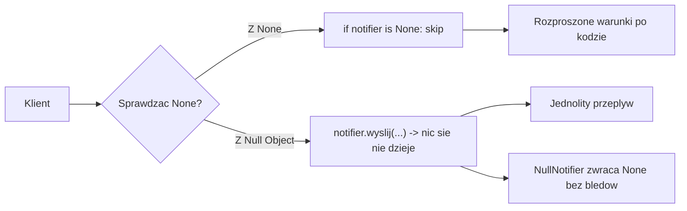
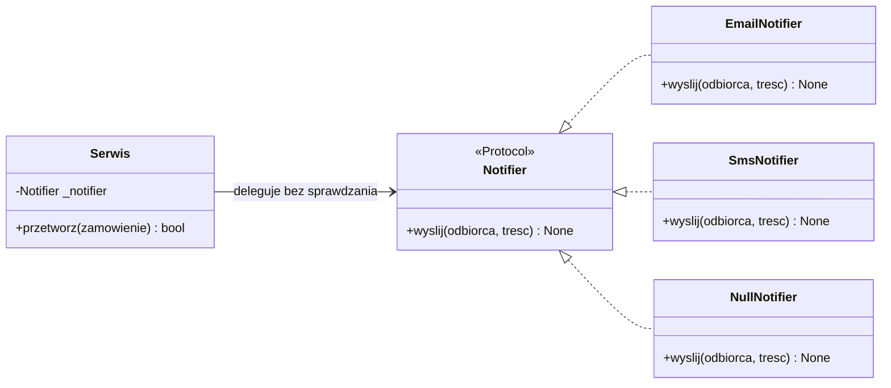
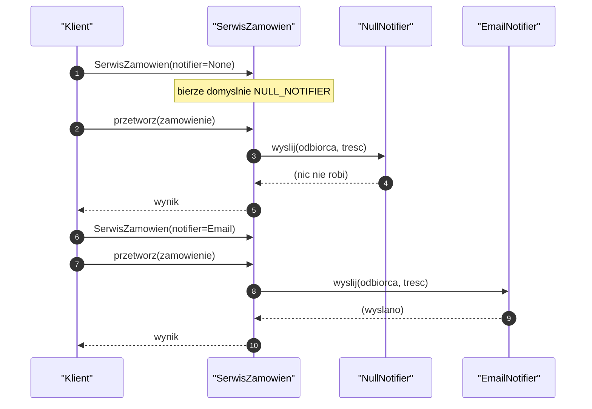
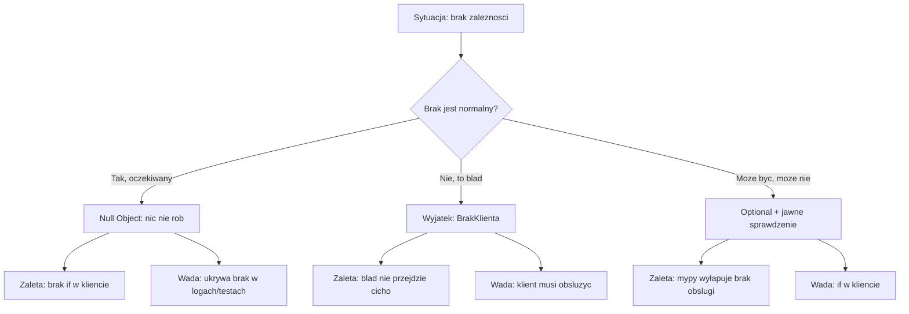
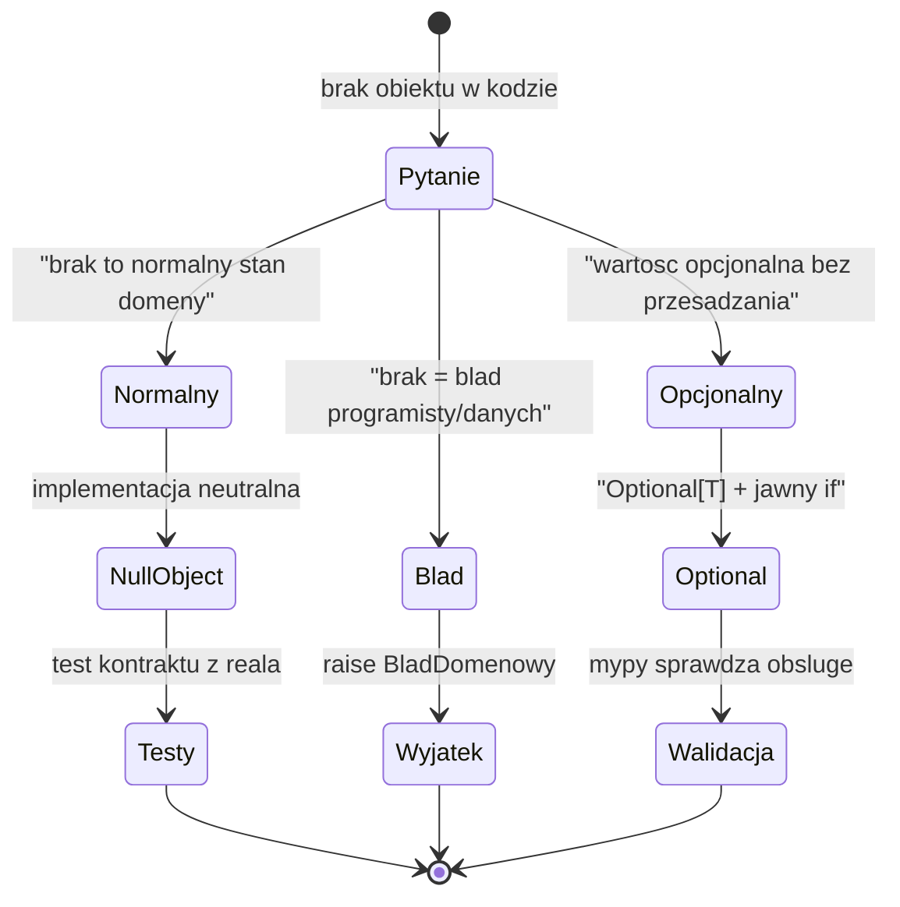
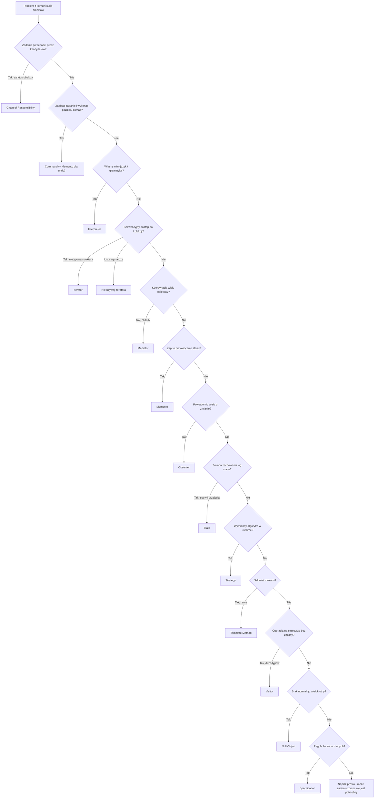
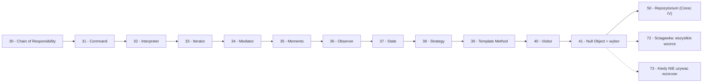

```markdown
---
modul: 41 — Null Object i wybór wzorca behawioralnego
plik: 41-null-object-i-wybor-behawioralnych.md
poziom: sredni
wymaga: [40]
czas: ~165 minut czytania + ~400 minut ćwiczeń
---

# Moduł 41 — Null Object i jak wybrać właściwy wzorzec behawioralny

> **TL;DR**
> - **Null Object (obiekt pusty)** to obiekt reprezentujący „brak" z **neutralnym, bezpiecznym zachowaniem** — eliminuje rozproszone `if x is not None` przez dostarczenie czegoś, co nic nie robi, ale nie psuje.
> - Null Object **nie zastępuje `None`** — ma sens tylko wtedy, gdy „brak" jest **normalnym stanem domeny**, a nie błędem programisty; błędnie użyty ukrywa prawdziwe problemy.
> - Zamknięcie rodziny behawioralnej: to **11 wzorców GoF** + Null Object (dodatek) + Specification (dodatek) — łącznie 13 narzędzi na pytania „jak obiekty się komunikują".
> - **5 najczęstszych pomyłek** to State/Strategy, Command/Strategy, Observer/Mediator, Visitor/Composite, Template Method/Strategy — różnią się intencją, nie strukturą.
> - Cztery wzorce w Pythonie **często są niepotrzebne** w formie klasycznej: Template Method, Visitor, Interpreter, Iterator — język dostarcza alternatywy (`singledispatch`, `match`, `yield`, wbudowana iteracja).

---

## 0. Model mentalny

### Wirtualna sekretarka, puste krzesło i niesłyszalny współpracownik

Wyobraź sobie biuro, w którym każdy menedżer ma sekretarkę. Sekretarka przyjmuje telefony, przekazuje wiadomości, umawia spotkania, odnotowuje nieobecności. Gdy menedżer wychodzi, sekretarka czuwa — każdy, kto dzwoni, dowiaduje się, że „pan jest w spotkaniu" albo „proszę zostawić wiadomość". Biuro działa, nawet gdy menedżer nie może odebrać. **Sekretarka jest zawsze** — ale czasem jest nią prawdziwa osoba, a czasem automat z pocztą głosową. Z punktu widzenia dzwoniącego **nic się nie zmienia** — dzwoni, słyszy odpowiedź, zostawia wiadomość. Nikt nie musi pytać „czy mam prawdziwą sekretarkę?". Po prostu wykonuje swoją akcję.

Teraz pomyśl o tym, co robi „automat" w tej analogii. **Automat nie umawia spotkań, nie przekazuje pilnych wezwań, nie odpowiada na pytania.** On tylko **odbiera wiadomość i nic więcej**. To jego jedyne zadanie —**nie wybuchnąć** gdy menedżera nie ma. Gdyby zamiast automatu była „pustka" (numer nie odpowiada), dzwoniący traciłby czas, denerwował się, próbował innych numerów. Z automatem — dzwoni, słyszy spokojny głos, zostawia wiadomość. **Pustka została zastąpiona obiektem, który nie robi nic, ale robi to bezpiecznie.**

Zatrzymajmy się przy kluczowej obserwacji. Nie każda „pustka" jest tym samym. **Są trzy różne rodzaje „braku"** i każdy chce innej reakcji. Pierwszy: „sekretarka pojechała na urlop, ale jutro wróci" — to brak normalny, oczekiwany, nie krytyczny. Drugi: „sekretarka nigdy nie została zatrudniona, choć powinna" — to **błąd zarządu**, coś poszło nie tak. Trzeci: „menedżer zatrudnił sekretarkę tylko dla projektu pilotażowego, może będzie, może nie" — to brak **opcjonalny**, który trzeba jawnie obsłużyć. Każdy rodzaj innego rozwiązania wymaga:
- **Normalny brak** — Null Object: ktokolwiek dzwoni, dostaje bezpieczną odpowiedź.
- **Błąd** — wyjątek: „nie można dzwonić, bo numer nie istnieje".
- **Opcjonalny** — `Optional`: „sprawdź, czy ktoś tam jest, zanim zadzwonisz".

Z tego rozróżnienia wyrosły **trzy pytania decyzyjne**: czy „brak" jest normalnym stanem domeny (→ Null Object)? czy „brak" oznacza błąd programisty (→ wyjątek)? czy wartość może być opcjonalna bez przesądzania (→ `Optional` i jawne sprawdzenie)? To jest najważniejsza część tego modułu — bo **Null Object stosowany w złym kontekście ukrywa prawdziwe problemy** i przynosi więcej szkody niż pożytku.

Trzeci obraz, który uchwyci pełną głębię: **puste krzesło przy stole konferencyjnym**. Wyobraź sobie, że na spotkaniu zarządu **brakuje jednego członka**. Zamiast zostawiać puste miejsce z pytaniem „kto tu siedzi?", stawiamy krzesło z **tabliczką „nieobecny"**. Protokół wygląda normalnie, decyzje zapadają, ale **nie ma czego się bać** — miejsce na nieobecnego jest oznaczone. Zauważ, że tabliczka **nie udaje obecności** — wyraźnie komunikuje brak. To różnica między **Null Object a podszywaniem się pod obecność**. Null Object nie udaje, że coś robi — po prostu nic nie robi **w bezpieczny sposób**.

| W analogii sekretarki i pustego krzesła | W kodzie |
|---|---|
| Prawdziwa sekretarka | `KonkretnyNotifier` (klasa robiąca coś) |
| Automat głosowy | **Null Object** (`NullNotifier`) |
| Puste krzesło z tabliczką | Null Object z jawną nazwą (`NullRabat`) |
| „Wszyscy mają sekretarkę" | Jednolity interfejs |
| Brak odpowiedzi | `None` — jawny brak |
| „Numer nie istnieje" (błąd) | Wyjątek |
| „Może jutro będzie" (opcjonalnie) | `Optional[Notifier]` |

> 🧠 **Zapamiętaj** — **Null Object (obiekt pusty) to wzorzec, w którym „brak" reprezentowany jest przez obiekt z neutralnym, bezpiecznym zachowaniem — zamiast `None`, który wymaga warunkowego sprawdzenia w każdym miejscu użycia. Eliminuje rozproszone `if x is not None` i przekłada brak w bezpieczną operację.**

Zwróć uwagę na trzy słowa: **neutralny**, **bezpieczny**, **jawny**. „Neutralny" — nie robi nic istotnego. „Bezpieczny" — nie wybucha, nie rzuca wyjątku. „Jawny" — nazwa mówi „to jest brak", nie „to jest coś, co udaje coś".

### Diagram — intuicja



*Diagram pokazuje różnicę: bez Null Object klient musi sprawdzać `None` w każdym miejscu, z Null Object — woła metodę, a brak zniknął w implementacji neutralnej.*

### Czego Null Object NIE robi

Cztery nieporozumienia — szczególnie groźne, bo Null Object łatwo nadużyć.

**Nie zastępuje `None`.** `None` to **jawna informacja o braku**, którą można rozpoznać w kodzie i testach. Null Object **udaje, że coś istnieje**, choć nic nie robi. W pewnych kontekstach to ukrycie prawdy — o tym w sekcji 8.

**Nie jest uniwersalny.** Działa tylko dla operacji, które **mają sensowny neutralny efekt** (nie rób nic, zwróć 0, zwróć pustą listę). Dla operacji bez neutralnego wyniku (np. „pobierz kurs walutowy") — brak sensownej wartości domyślnej. Wtedy — wyjątek albo `Optional`.

**Nie zastępuje walidacji.** Jeśli brak obiektu jest błędem — Null Object ukryje błąd. Musi być **jawna decyzja**: „brak jest oczekiwany, więc Null Object".

**Nie jest darmowy.** Null Object to dodatkowa klasa, dodatkowy mechanizm, dodatkowy poziom pośrednictwa. Czasem zwykłe `if x is not None` w jednym miejscu jest czytelniejsze.

**Nie jest `NoOp` w przebraniu.** Choć często realizuje się jako `NoOp` (no-operation), to nie to samo. Prawdziwy Null Object **reprezentuje rolę domenową** („brak rabatu") — nie tylko „nic nie rób".

**Nie jest zawsze lepszy od wyjątku.** W wielu przypadkach brak obiektu to **sygnał, że coś jest źle** — i wtedy wyjątek jest właściwy, żeby błąd nie przeszedł cicho.

---

## 1. Problem, który rozwiązujemy

Wejdźmy w domenę 🛒 „Sklepu internetowego" sprzedającego produkty finansowe. Zamówienie może mieć **rabat** (albo nie). Może być **kupiec** (albo zapłata kartą anonimową). Może mieć **dostawcę** (albo odbiór osobisty). Może być **logger** (albo logger domyślny). Ktoś napisał kod, w którym **wszędzie sprawdza się `is None`**.

### Kod „przed"

```python
# sklep_v0.py — wersja naiwna, demonstracyjna
# UWAGA: kod celowo pokazuje rozproszone if x is not None.

from __future__ import annotations

from decimal import Decimal
from dataclasses import dataclass


class RabatKuponowy:
    def __init__(self, stawka: Decimal) -> None:
        self.stawka = stawka

    def nalicz(self, kwota: Decimal) -> Decimal:
        return (kwota * self.stawka).quantize(Decimal("0.01"))


class Logger:
    def info(self, tresc: str) -> None:
        print(f"[INFO] {tresc}")


class Notifier:
    def wyslij(self, odbiorca: str, tresc: str) -> None:
        print(f"[MAIL do {odbiorca}] {tresc}")


@dataclass
class Zamowienie:
    identyfikator: str
    kwota: Decimal
    klient_id: str


class SerwisZamowien:
    def __init__(
        self,
        rabat: RabatKuponowy | None = None,
        logger: Logger | None = None,
        notifier: Notifier | None = None,
    ) -> None:
        self._rabat = rabat
        self._logger = logger
        self._notifier = notifier

    def przetworz(self, z: Zamowienie) -> Decimal:
        # If-y rozproszone po kodzie!

        if self._logger is not None:
            self._logger.info(f"start: {z.identyfikator}")
        else:
            pass  # nic nie robimy bez loggera

        if self._rabat is not None:
            rabat = self._rabat.nalicz(z.kwota)
        else:
            rabat = Decimal("0")

        do_zaplaty = z.kwota - rabat

        if self._notifier is not None:
            self._notifier.wyslij(z.klient_id, f"Zamowienie: {do_zaplaty}")

        if self._logger is not None:
            self._logger.info(f"koniec: {z.identyfikator}")

        return do_zaplaty


if __name__ == "__main__":
    z = Zamowienie("Z-1", Decimal("1000.00"), "K-1")
    # Bez rabatu, bez loggera, bez notifiera:
    serwis = SerwisZamowien()
    print(serwis.przetworz(z))
```

Ten kod **działa**, ale ma sześć problemów, z których każdy narasta przy dodaniu nowej opcjonalnej zależności.

### Code smell — rozproszone `if x is not None`

| Problem | Gdzie | Konsekwencja |
|---|---|---|
| `if x is not None` w każdej metodzie | `przetworz` | Rośnie z każdą operacją |
| Każda opcjonalna zależność jest sprawdzana osobno | 3 razy w `przetworz` | N×M warunków |
| Klient musi wiedzieć, co zrobić przy braku | Druga gałąź `if` | Powtarzanie logiki „nic nie rób" |
| Brak jednolitego kontraktu | `RabatKuponowy \| None` | Typy opcjonalne rozpraszają się |
| Trudność w testowaniu | Trzeba pokryć oba warianty | Testy 2^N kombinacji |
| Wartości domyślne w konstruktorze | `None` domyślnie | Wszystkie opcje są opcjonalne — dobrze, ale tylko dla wygody |
| Brak miejsca dla „neutralnego rabatu" | Nie ma obiektu | Kod nadaje sens „brakowi" |

### Objawy — poznasz ten problem po tym, że...

- **`if x is not None` powtarza się w kilku metodach.** Wzorzec „sprawdź i pomiń".
- **Każda nowa opcjonalna zależność to nowy `if`** w każdej metodzie, która jej używa.
- **Kod ma w sobie stałą „nic nie rób"** — cała gałąź `if` nic nie robi.
- **Testy kombinatoryczne** — musisz pokryć brak rabatu, brak loggera, brak notifiera.
- **Klient musi wiedzieć, co znaczy brak** — czy to normalne, czy błąd?
- **Klasy mają w nazwie `Optional` albo `| None`** w typach — sygnał, że obsługa braku jest wszędzie.
- **Logika obsługi braku jest duplikowana** — ten sam `if` w różnych miejscach.
- **Zamiana „brak" na „domyślne zachowanie"** wymaga zmiany wszystkich miejsc użycia.
- **Brak spójności między metodami** — jedna sprawdza `None`, druga nie (i wybucha).
- **Trudno zmienić semantykę braku** — np. włączyć w produkcji „brak = wyjątek", w testach „brak = nic".

---

## 2. Anatomia wzorca

### Uczestnicy

| Rola | Odpowiedzialność | Co NIE jest jej zadaniem |
|---|---|---|
| **AbstractObiect (interfejs)** | Definiuje kontrakt — te same metody co prawdziwy obiekt | Nie zawiera implementacji konkretnych zachowań |
| **RealObject (obiekt rzeczywisty)** | Konkretna implementacja z realnym zachowaniem | Nie odpowiada za brak — to rola Null Object |
| **NullObject (obiekt pusty)** | Implementuje ten sam kontrakt; każda metoda ma neutralne, bezpieczne zachowanie (nic nie rób, zwróć wartość domyślną) | Nie może udawać rzeczywistego obiektu; nie może cicho ignorować błędów programisty |
| **Klient** | Używa obiektu przez interfejs — nie sprawdza, czy jest „null" | Nie sprawdza `is None` — brak obsłużony jest w Null Object |

Kluczowa własność: **klient nie rozróżnia RealObject od NullObject**. Obydwa spełniają ten sam kontrakt. Klient zawsze woła tę samą metodę. **Brak obsłużony jest „w środku"**.

### Diagram struktury



*Diagram pokazuje, że `NullNotifier` implementuje ten sam kontrakt co prawdziwe notifiery — serwis wywołuje metodę bez sprawdzania, a brak jest obsłużony wewnątrz Null Object.*

### Warianty: klasyczny vs pythoniczny

| Aspekt | Klasyczny (GoF) | Pythoniczny |
|---|---|---|
| Interfejs | `ABC` | `Protocol` |
| RealObject | Klasy dziedziczące | Klasy spełniające protokół |
| NullObject | Klasa z metodami NoOp | Funkcja `noop`, singleton, `SimpleNamespace` |
| Instancja | Świeży obiekt | Współdzielony singleton |
| Sprawdzenie tożsamości | `isinstance(x, NullObject)` | `x is NULL_NOTIFIER` |
| Konstrukcja | Konstruktor | Domyślny argument |

Python daje bardzo **skrócone warianty** — funkcja `noop` albo singleton Null Object. Klasa pełna jest potrzebna, gdy Null Object ma **kilka metod** albo **konfigurację**.

---

## 3. Implementacja krok po kroku

### Krok 1 — Zdefiniuj kontrakt (Protocol)

Kontrakt jest taki sam, jak dla prawdziwego obiektu.

```python
from typing import Protocol, runtime_checkable


@runtime_checkable
class Notifier(Protocol):
    nazwa: str
    def wyslij(self, odbiorca: str, tresc: str) -> None: ...
```

### Krok 2 — Zaimplementuj RealObject

Konkretna implementacja z realnym zachowaniem.

```python
class EmailNotifier:
    nazwa = "email"

    def wyslij(self, odbiorca: str, tresc: str) -> None:
        print(f"[MAIL do {odbiorca}] {tresc}")
```

### Krok 3 — Zaimplementuj NullObject

Ten sam kontrakt, neutralne zachowanie.

```python
class NullNotifier:
    """Null Object: brak notifiera - nic nie robi, ale nie wybucha."""

    nazwa = "null"

    def wyslij(self, odbiorca: str, tresc: str) -> None:
        # Swiadomie nic nie robimy - brak notifiera jest normalnym stanem
        return None
```

**Kluczowy szczegół:** metoda **nic nie robi**, ale **istnieje** i ma ten sam kontrakt. Nie ma `pass` dla samego `pass` — jest **jawna decyzja projektowa** „nic nie robić".

### Krok 4 — Klient używa jednolicie

```python
class SerwisZamowien:
    def __init__(self, notifier: Notifier | None = None) -> None:
        # Null Object jako wartosc domyslna
        self._notifier: Notifier = notifier or NullNotifier()

    def przetworz(self, z: Zamowienie) -> Decimal:
        # Bez sprawdzania None - zawsze jest jakis notifier
        self._notifier.wyslij(z.klient_id, f"Zamowienie {z.identyfikator}")
        return z.kwota
```

**Zysk:** brak `if x is not None` w `przetworz`. Kontrakt jednolity.

### Krok 5 — Warianty Null Object

**Wariant A — singleton instancja.** Współdzielona instancja zamiast tworzenia nowej.

```python
NULL_NOTIFIER: Notifier = NullNotifier()
```

**Wariant B — funkcja NoOp.** Zamiast klasy — funkcja o tym samym interfejsie.

```python
def noop(*args, **kwargs) -> None:
    """Funkcja nic nie robiaca."""
    return None


# Uzycie: jako wartosc domyslna
def przetworz(z, notifier=noop):
    notifier(z.klient_id, "tresc")
    return z.kwota
```

**Wariant C — `SimpleNamespace`.** Bez klasy.

```python
from types import SimpleNamespace

NULL_NOTIFIER = SimpleNamespace(
    nazwa="null",
    wyslij=lambda odbiorca, tresc: None,
)
```

**Wariant D — domyślny argument.** Domyślna wartość argumentu jest Null Object.

```python
def wyslij_powiadomienie(
    odbiorca: str,
    tresc: str,
    notifier: Notifier = NULL_NOTIFIER,
) -> None:
    notifier.wyslij(odbiorca, tresc)
```

### Krok 6 — Weryfikacja

| Kryterium | Wersja „przed" | Wersja „po" |
|---|---|---|
| `if x is not None` w kliencie | Tak | Nie |
| Jednolity przepływ | Nie | Tak |
| Logika braku | Rozproszona | W Null Object |
| Miejsce do zmiany semantyki braku | Wszędzie | W Null Object |
| Kontrakt | `| None` | Jeden `Notifier` |
| Liczba klas | 2 | 3 |

Koszt: jedna dodatkowa klasa. Zysk: jednolity kontrakt, brak warunków w kliencie.

---

## 4. Wersje pythoniczne i warianty

### 4.1 Klasyczny Null Object — jak wyżej

**Zaleta:** czytelny, jawny. **Wada:** klasa dla czegoś, co nic nie robi.

### 4.2 Funkcja NoOp

Bardzo pythoniczna forma dla pojedynczej metody.

```python
def noop(*args, **kwargs) -> None:
    """Cokolwiek dostanie, nic nie robi."""
    return None


# Uzycie jako Null Object dla dowolnego interfejsu jednometodowego:
def wyslij_alert(odbiorca: str, tresc: str, kanal=noop) -> None:
    kanal(odbiorca, tresc)
```

Zaleta: zamiast klasy — cztery linie. Wada: kontrakt niejawny (nie ma `nazwa`, nie da się `isinstance`).

### 4.3 Singleton Null Object

Współdzielona instancja — dla wydajności i identyfikacji.

```python
NULL_RABAT = NullRabat()
NULL_NOTIFIER = NullNotifier()
NULL_LOGGER = NullLogger()
```

Zaleta: `x is NULL_RABAT` działa szybko i jasno. Wada: jeden obiekt współdzielony — trzeba uważać, żeby nie miał stanu.

### 4.4 `SimpleNamespace`

Bez klasy, bez protokołu.

```python
from types import SimpleNamespace
from collections.abc import Callable


def zbuduj_null_notifier() -> SimpleNamespace:
    return SimpleNamespace(
        nazwa="null",
        wyslij=lambda odbiorca, tresc: None,
    )
```

Zaleta: minimalne. Wada: brak typowania, brak `isinstance`.

### 4.5 Null Object w testach — Fake z rejestracją

W testach Null Object często zastępuje się **fake'iem z rejestracją**:

```python
class NotifierWTestach:
    nazwa = "test"

    def __init__(self) -> None:
        self.wywolania: list[tuple[str, str]] = []

    def wyslij(self, odbiorca: str, tresc: str) -> None:
        self.wywolania.append((odbiorca, tresc))
```

To już nie jest Null Object — to **fake** (moduł 70). Ale warto znać różnicę:
- **Null Object** — nic nie robi, neutralne. Nie zostawia śladu.
- **Fake** — rejestruje wywołania, test może zweryfikować.

### 4.6 Podsumowanie — tabela wyboru

| Sytuacja | Wariant |
|---|---|
| Klasyczny Null Object z jednolitym kontraktem | Klasa (4.1) |
| Jedna metoda, prosty przypadek | Funkcja `noop` (4.2) |
| Chcesz porównania `is` | Singleton (4.3) |
| Bez klas, bardzo prosto | `SimpleNamespace` (4.4) |
| W testach — weryfikacja wywołań | Fake (4.5) |

> 🧠 **Zapamiętaj** — **Null Object w Pythonie najczęściej to jedna funkcja `noop` albo singleton.** Klasa pełna jest potrzebna dopiero, gdy Null Object ma wiele metod i własne metadane (jak nazwę dla logów).

---

## 5. Przykład z życia: 🛒 Sklep — pełny uruchamialny kod

Zbudujemy pełny system sklepu z Null Object dla **czterech** aspektów: rabat, logger, notifier, dostawca. Pokażemy też sklep, gdzie brak **nie jest** normalny (klient musi być) — i tam użyjemy wyjątku. Zestawienie trzech podejść pokaże pełny obraz.

### Kod

```python
# sklep_null_object.py — pelny przyklad Null Object
from __future__ import annotations

from dataclasses import dataclass
from decimal import ROUND_HALF_UP, Decimal
from typing import Protocol, runtime_checkable


# ===========================================================================
# 1. Typy domenowe
# ===========================================================================

GROSZ = Decimal("0.01")


def zaokraglij(k: Decimal) -> Decimal:
    return k.quantize(GROSZ, rounding=ROUND_HALF_UP)


@dataclass(frozen=True, slots=True)
class Zamowienie:
    identyfikator: str
    kwota: Decimal
    klient_id: str
    kupon: str | None = None


# ===========================================================================
# 2. Kontrakty
# ===========================================================================

@runtime_checkable
class Rabat(Protocol):
    nazwa: str
    def nalicz(self, zamowienie: Zamowienie) -> Decimal: ...


@runtime_checkable
class Logger(Protocol):
    nazwa: str
    def info(self, tresc: str) -> None: ...


@runtime_checkable
class Notifier(Protocol):
    nazwa: str
    def wyslij(self, odbiorca: str, tresc: str) -> None: ...


# ===========================================================================
# 3. RealObject - konkretne implementacje
# ===========================================================================

class RabatKuponowy:
    nazwa = "kupon"

    def __init__(self, stawka: Decimal) -> None:
        self._stawka = stawka

    def nalicz(self, z: Zamowienie) -> Decimal:
        return zaokraglij(z.kwota * self._stawka)


class LoggerKonsola:
    nazwa = "konsola"

    def __init__(self) -> None:
        self.wpisy: list[str] = []

    def info(self, tresc: str) -> None:
        self.wpisy.append(tresc)
        print(f"[LOG] {tresc}")


class NotifierEmail:
    nazwa = "email"

    def __init__(self) -> None:
        self.wyslane: list[tuple[str, str]] = []

    def wyslij(self, odbiorca: str, tresc: str) -> None:
        self.wyslane.append((odbiorca, tresc))
        print(f"[MAIL do {odbiorca}] {tresc}")


class NotifierSms:
    nazwa = "sms"

    def wyslij(self, odbiorca: str, tresc: str) -> None:
        print(f"[SMS do {odbiorca}] {tresc[:160]}")


# ===========================================================================
# 4. Null Object - neutralne implementacje
# ===========================================================================

class BrakRabatu:
    """Null Object: brak rabatu to rabat zerowy."""

    nazwa = "brak_rabatu"

    def nalicz(self, z: Zamowienie) -> Decimal:
        return Decimal("0.00")


class BrakLoggera:
    """Null Object: brak loggera - loguje donikad."""

    nazwa = "brak_loggera"

    def info(self, tresc: str) -> None:
        return None


class BrakNotifiera:
    """Null Object: brak notifiera - powiadomienie niknie."""

    nazwa = "brak_notifiera"

    def wyslij(self, odbiorca: str, tresc: str) -> None:
        return None


# ===========================================================================
# 5. Singletony Null Object (wspoldzielone instancje)
# ===========================================================================

NULL_RABAT: Rabat = BrakRabatu()
NULL_LOGGER: Logger = BrakLoggera()
NULL_NOTIFIER: Notifier = BrakNotifiera()


# ===========================================================================
# 6. Klient - SerwisZamowien
# ===========================================================================

class SerwisZamowien:
    """Serwis uzywajacy Null Object - bez if None."""

    def __init__(
        self,
        rabat: Rabat | None = None,
        logger: Logger | None = None,
        notifier: Notifier | None = None,
    ) -> None:
        # Domyslne NULL instancje
        self._rabat: Rabat = rabat or NULL_RABAT
        self._logger: Logger = logger or NULL_LOGGER
        self._notifier: Notifier = notifier or NULL_NOTIFIER

    def przetworz(self, z: Zamowienie) -> Decimal:
        """Bez if x is not None - wszystko jest obiektem."""
        self._logger.info(f"start {z.identyfikator}")

        rabat = self._rabat.nalicz(z)
        do_zaplaty = zaokraglij(z.kwota - rabat)

        self._notifier.wyslij(
            z.klient_id,
            f"Zamowienie {z.identyfikator}: {do_zaplaty}",
        )
        self._logger.info(f"koniec {z.identyfikator}")
        return do_zaplaty


# ===========================================================================
# 7. Kontrprzyklad: gdy brak JEST bledem - uzywamy wyjatku
# ===========================================================================

class BrakKlienta(ValueError):
    """Blad: klient musi istniec - brak to blad, nie Null Object."""


class Klient:
    def __init__(self, identyfikator: str, email: str) -> None:
        self.identyfikator = identyfikator
        self.email = email


class ZamowienieZKontraktem:
    """Zamowienie, ktore WYMAGA klienta - brak jest bledem."""

    def __init__(self, identyfikator: str, kwota: Decimal,
                 klient: Klient | None) -> None:
        if klient is None:
            raise BrakKlienta(
                f"zamowienie {identyfikator} wymaga klienta"
            )
        self.identyfikator = identyfikator
        self.kwota = kwota
        self.klient = klient


# ===========================================================================
# 8. Wariant funkcyjny - noop
# ===========================================================================

def noop(*args, **kwargs) -> None:
    return None


def przetworz_funkcyjnie(z: Zamowienie, notifier=noop) -> Decimal:
    """Wariant: brak notifiera = funkcja noop."""
    notifier(z.klient_id, f"Zamowienie {z.identyfikator}")
    return z.kwota


# ===========================================================================
# 9. Demonstracja
# ===========================================================================

if __name__ == "__main__":
    z = Zamowienie("Z-1", Decimal("1000.00"), "K-1")

    print("=== 1. Wszystkie NULL - brak niczego nie wybucha ===")
    s1 = SerwisZamowien()
    print(f"  Wynik: {s1.przetworz(z)}")

    print("\n=== 2. Tylko notifier - reszta NULL ===")
    s2 = SerwisZamowien(notifier=NotifierEmail())
    print(f"  Wynik: {s2.przetworz(z)}")

    print("\n=== 3. Wszystkie prawdziwe ===")
    s3 = SerwisZamowien(
        rabat=RabatKuponowy(Decimal("0.10")),
        logger=LoggerKonsola(),
        notifier=NotifierSms(),
    )
    print(f"  Wynik: {s3.przetworz(z)}")

    print("\n=== 4. Ten sam serwis, wymiana Null Object <-> real ===")
    notifier = NotifierEmail()
    s = SerwisZamowien(notifier=notifier)
    s.przetworz(z)
    s.przetworz(z)
    print(f"  Wywolania notifiera: {len(notifier.wyslane)}")

    print("\n=== 5. Kontrprzyklad - brak klienta JEST bledem ===")
    try:
        ZamowienieZKontraktem("Z-2", Decimal("500"), klient=None)
    except BrakKlienta as blad:
        print(f"  {blad}")

    print("\n=== 6. Wariant funkcyjny (noop) ===")
    print(f"  Bez notifiera: {przetworz_funkcyjnie(z)}")
    print(f"  Z notifierem:  {przetworz_funkcyjnie(z, notifier=lambda o, t: print(f'  [func] {o}'))}")

    print("\n=== 7. Sprawdzenie: NULL instancje sa singletonami ===")
    print(f"  NULL_RABAT is BrakRabatu(): {NULL_RABAT.__class__ is BrakRabatu}")
    print(f"  isinstance(NULL_RABAT, Rabat): {isinstance(NULL_RABAT, Rabat)}")
```

### Co ten przykład pokazuje

**Punkt 1 — wszystkie NULL działają.** Serwis domyślnie dostaje trzy Null Objecty. Wywołanie `przetworz` **nie sprawdza niczego** i po prostu działa. Brak został przekuty w bezpieczną operację.

**Punkt 2 — tylko jedno prawdziwe.** Serwis z prawdziwym notifierem i NULL-ami na pozostałych polach. Kod klienta się nie zmienił.

**Punkt 3 — wszystkie prawdziwe.** Z realnym rabatem, loggerem, notifierem.

**Punkt 4 — wymiana runtime.** Ten sam serwis może dostać różne notifiery (albo NULL). Kod `przetworz` pozostaje ten sam.

**Punkt 5 — kontrprzyklad.** Zamówienie z klientem, gdzie brak klienta **jest błędem** (nie Null Object). Tu stosujemy wyjątek, nie Null Object. **To najważniejsza lekcja modułu:** Null Object dla „brak normalny", wyjątek dla „brak to błąd".

**Punkt 6 — wariant funkcyjny.** `noop` jako notifier. Cztery linie zamiast klasy.

**Punkt 7 — singleton.** NULL instancje są współdzielone.

### Testy

```python
# test_sklep_null_object.py — uruchomienie: pytest test_sklep_null_object.py -v
from decimal import Decimal

import pytest

from sklep_null_object import (
    NULL_LOGGER,
    NULL_NOTIFIER,
    NULL_RABAT,
    BrakKlienta,
    BrakLoggera,
    BrakNotifiera,
    BrakRabatu,
    Klient,
    Logger,
    Notifier,
    NotifierEmail,
    Rabat,
    RabatKuponowy,
    SerwisZamowien,
    Zamowienie,
    ZamowienieZKontraktem,
    noop,
    przetworz_funkcyjnie,
)


def zamowienie(**nadp) -> Zamowienie:
    dane = {"identyfikator": "Z-T", "kwota": Decimal("1000.00"),
            "klient_id": "K-T"}
    dane.update(nadp)
    return Zamowienie(**dane)


# --- Null Object spelnia kontrakt --------------------------------------------

def test_null_rabat_spelnia_kontrakt() -> None:
    assert isinstance(NULL_RABAT, Rabat)
    assert NULL_RABAT.nazwa == "brak_rabatu"


def test_null_logger_spelnia_kontrakt() -> None:
    assert isinstance(NULL_LOGGER, Logger)


def test_null_notifier_spelnia_kontrakt() -> None:
    assert isinstance(NULL_NOTIFIER, Notifier)


# --- Null Object: neutralne zachowanie ---------------------------------------

def test_null_rabat_zwraca_zero() -> None:
    assert NULL_RABAT.nalicz(zamowienie()) == Decimal("0")


def test_null_logger_nic_nie_robi(capsys) -> None:
    NULL_LOGGER.info("test")
    out = capsys.readouterr().out
    assert out == ""


def test_null_notifier_nic_nie_robi(capsys) -> None:
    NULL_NOTIFIER.wyslij("odbiorca", "tresc")
    out = capsys.readouterr().out
    assert out == ""


def test_null_rabat_dla_zero_kwoty() -> None:
    z = zamowienie(kwota=Decimal("0"))
    assert NULL_RABAT.nalicz(z) == Decimal("0")


# --- Serwis z NULL domyslnie -------------------------------------------------

def test_serwis_domyslny_uzywa_nulli() -> None:
    s = SerwisZamowien()
    wynik = s.przetworz(zamowienie())
    assert wynik == Decimal("1000.00")


def test_serwis_z_rabatem() -> None:
    s = SerwisZamowien(rabat=RabatKuponowy(Decimal("0.10")))
    wynik = s.przetworz(zamowienie())
    assert wynik == Decimal("900.00")


def test_serwis_z_notifierem_rejestruje() -> None:
    notifier = NotifierEmail()
    s = SerwisZamowien(notifier=notifier)
    s.przetworz(zamowienie())
    assert len(notifier.wyslane) == 1


def test_serwis_bez_notifiera_nie_rejestruje() -> None:
    """Test: brak notifiera nie wybucha i nie rejestruje niczego."""
    s = SerwisZamowien()   # domyslnie NULL_NOTIFIER
    s.przetworz(zamowienie())   # nie powinno rzucac


# --- Wymiana runtime ---------------------------------------------------------

def test_serwis_moze_zmienic_notifier() -> None:
    s = SerwisZamowien()
    notifier = NotifierEmail()
    s._notifier = notifier   # celowo - sprawdzamy wymiane
    s.przetworz(zamowienie())
    assert len(notifier.wyslane) == 1


# --- Kontrprzyklad: brak klienta to blad -------------------------------------

def test_brak_klienta_rzuca_wyjatek() -> None:
    with pytest.raises(BrakKlienta, match="wymaga klienta"):
        ZamowienieZKontraktem("Z-1", Decimal("100"), klient=None)


def test_z_klientem_dziala() -> None:
    k = Klient("K-1", "k@example.com")
    z = ZamowienieZKontraktem("Z-1", Decimal("100"), klient=k)
    assert z.klient is k


# --- Wariant funkcyjny -------------------------------------------------------

def test_noop_nic_nie_robi() -> None:
    assert noop(1, 2, 3) is None
    assert noop(odbiorca="x", tresc="y") is None


def test_przetworz_funkcyjnie() -> None:
    z = zamowienie()
    assert przetworz_funkcyjnie(z) == Decimal("1000.00")


def test_przetworz_funkcyjnie_z_notifierem() -> None:
    zebrane: list[tuple[str, str]] = []
    notifier = lambda o, t: zebrane.append((o, t))
    z = zamowienie()
    przetworz_funkcyjnie(z, notifier=notifier)
    assert len(zebrane) == 1


# --- Kontrakt: wszystkie implementacje zgodne --------------------------------

@pytest.mark.parametrize("rabat", [
    NULL_RABAT,
    RabatKuponowy(Decimal("0.05")),
    RabatKuponowy(Decimal("0.20")),
], ids=lambda r: r.nazwa)
def test_rabat_zwraca_decimal(rabat: Rabat) -> None:
    wynik = rabat.nalicz(zamowienie())
    assert isinstance(wynik, Decimal)
    assert wynik >= Decimal("0")


@pytest.mark.parametrize("notifier", [
    NULL_NOTIFIER,
    NotifierEmail(),
], ids=lambda n: n.nazwa)
def test_notifier_nie_wybucha(notifier: Notifier) -> None:
    notifier.wyslij("odbiorca", "tresc")   # nie ma bledow
```

Kluczowy test: **`test_serwis_bez_notifiera_nie_rejestruje`** — brak notifiera nie powoduje wyjątku. I **`test_brak_klienta_rzuca_wyjatek`** — brak klienta jest błędem, nie Null Objectem.

---

## 6. Dynamika

### 6.1 Jednolity przepływ z Null Object vs rozproszone warunki



*Diagram pokazuje, że klient nie rozróżnia przypadku: czy notifier jest NULL, czy prawdziwy — kod `przetworz` wykonuje tę samą operację.*

### 6.2 Trzy podejścia do braku



*Diagram pokazuje trzy ścieżki: brak normalny → Null Object, brak jako błąd → wyjątek, brak opcjonalny → `Optional` z jawnym sprawdzeniem.*

### 6.3 Cykl decyzyjny: Null Object czy `None`?



*Diagram pokazuje decyzję w runtime: brak obiektu → trzy ścieżki (normalny/błąd/opcjonalny) → trzy rozwiązania.*

> 💡 **Intuicja** — Null Object jest jak **automat głosowy** w biurze. Gdy sekretarki nie ma, dzwoniący nie dostaje sygnału zajętości ani ciszy. Dostaje **uprzejmy głos**, który przyjmuje wiadomość. Ale gdy sekretarki **nie ma, bo menedżer nie zatrudnił nikogo, choć powinien** — to **awaria zarządu**, a nie powód do spokojnego automatu. Odpowiedzią nie jest automat, tylko **alarm**.

---

## 7. Kiedy używać / kiedy NIE używać

### Kiedy używać Null Object

**Gdy brak jest normalnym stanem domeny.** Brak rabatu, brak powiadomienia, brak filtra — wszystko to normalne sytuacje, nie błędy.

**Gdy operacja ma sensowny efekt neutralny.** „Nic nie rób" ma sens dla `wyslij_powiadomienie`. Dla `pobierz_kurs_walutowy` sensownego neutralnego wyniku nie ma.

**Gdy rozproszone `if x is not None` jest uciążliwe.** Powtarzasz ten sam warunek w pięciu miejscach — kandydat.

**Gdy chcesz jednolity przepływ bez warunków.** Kod bez `if` jest czytelniejszy.

**Gdy decydujesz o zachowaniu „braku" w jednym miejscu.** Null Object enkapsuluje semantykę braku.

**Gdy testy przechodzą bez „braku" jako osobnej ścieżki.** Test nie musi pokrywać `if notifier is None` — jest jedna ścieżka.

**Gdy chcesz móc włączyć/wyłączyć funkcjonalność runtime.** Wymiana Null Object ↔ Real Object.

**Gdy Null Object ma **jawną nazwę** w domenie.** `BrakRabatu` to pojęcie — „zerowy rabat".

### Kiedy NIE używać Null Object

**Gdy brak jest błędem.** Ten sam kontekst, ale brak oznacza awarię danych — wyjątek jest właściwy.

**Gdy operacja nie ma neutralnego wyniku.** „Pobierz kurs" — co zwrócić? Zero byłoby kłamstwem.

**Gdy i tak musisz sprawdzić brak w jednym miejscu.** Jeden `if` nie wymaga Null Objecta.

**Gdy Null Object ukryłby prawdziwy problem w produkcji.** Lepiej wybuchnąć głośno niż udawać, że wszystko działa.

**Gdy testy wymagają rozróżnienia „brak" od „jest".** Null Object zatraca różnicę — fake z rejestracją byłby lepszy.

**Gdy istnieją lepsze narzędzia.** `match`/`case` z `None` bywa czytelniejsze niż Null Object.

**Gdy dodajesz Null Object do kodu, który i tak musi rozróżniać.** Znaczenie „brak nie istnieje" znika — Null Object nie pomoże.

**Gdy Null Object staje się zbiorem metod NoOp.** 10 metod „nic nie rób" — sygnał, że coś jest nie tak z projektem.

**Zbiorczo — tabela decyzyjna:**

| Pytanie | Jeśli „tak" | Jeśli „nie" |
|---|---|---|
| Brak normalny? | Null Object | Wyjątek / Optional |
| Neutralny wynik istnieje? | Null Object | Wyjątek |
| Wiele miejsc z `if None`? | Null Object | Zwykły `if` |
| Chcesz jednolity przepływ? | Null Object | Rozróżniaj |
| W testach chcesz widzieć brak? | Fake, nie Null | Null Object |
| Nie ma sensu „nic nie robić"? | **Nie Null Object** | Null Object |
| Brak to błąd? | **Wyjątek** | Null Object |
| Chcesz jawnie sprawdzać? | **Optional** | Null Object |

---

## 8. Pułapki i antywzorce

**1. Cisza zamiast błędu.** Najczęstsza pułapka.

```python
# ZLE: brak klienta jako NullKlient, ktory nic nie robi
class NullKlient:
    def powiadom(self, tresc): return None
    def nalicz_prowizje(self, kwota): return Decimal("0")
```

**Konsekwencja:** jeśli klient zniknął z bazy (błąd danych), system **nie zauważy** — prowizje wyniosą 0, powiadomienia nie dojdą, logi nie krzykną. Klient nie zapłaci — strata dla firmy. **Prawidłowo:** dla klienta (kluczowego bytu) brak to błąd — wyjątek. Null Object dla rzeczy **opcjonalnych** (rabat, notifier).

**2. Null Object, który „udaje" prawdziwy obiekt.**

```python
# ZLE: NullKlient zwraca domyslne wartosci, jakby byl prawdziwy
class NullKlient:
    def nalicz_prowizje(self, kwota): return kwota * Decimal("0.02")
```

**Konsekwencja:** Null Object zwraca **niezerową** prowizję — udaje obecnego klienta. To fałsz. **Prawidłowo:** Null Object ma być **neutralny** — zwracać zero, nic nie robić, nie udawać.

**3. Fałszywe poczucie bezpieczeństwa w testach.**

```python
# ZLE: test nie widzi brakujacego klienta, bo Null nic nie robi
def test_zamowienie():
    z = Zamowienie(klient=NullKlient())
    assert z.przetworz() == Decimal("100")   # przechodzi!
```

**Konsekwencja:** test przechodzi, bo Null Object milczy. Ale gdy w produkcji klienta zabraknie — system nie krzyknie. **Prawidłowo:** dla klienta — wyjątek. Dla rzeczy naprawdę opcjonalnych — fake z rejestracją, żeby test widział wywołania.

**4. Null Object dla rzeczy, które powinny istnieć.**

```python
# ZLE
class Zamowienie:
    def __init__(self):
        self.klient = NullKlient()   # zawsze domyslny
        self.rabat = NullRabat()
        self.dostawca = NullDostawca()
```

**Konsekwencja:** wszystkie zależności są „domyślnie Nullem", nawet te, które **muszą** być. Klient nie może być Nullem — musi być prawdziwy. **Prawidłowo:** jawnie ustal, **które** zależności są opcjonalne.

**5. Null Object z nadmiarem metod.**

```python
# ZLE
class NullRabat:
    def nalicz(self, z): return Decimal("0")
    def opis(self): return ""
    def czy_aktywny(self): return False
    def czas_trwania(self): return None
    # ... 10 innych metod NoOp
```

**Konsekwencja:** Null Object musi implementować **każdą** metodę interfejsu — dużo kodu dla „nic nie rób". **Prawidłowo:** minimalizuj interfejs. Jeśli interfejs ma 10 metod, może być lepiej podzielić go (ISP — moduł 03).

**6. Null Object, który zmienia stan.**

```python
# ZLE
class NullLogger:
    def info(self, tresc):
        self.ostatni_log = tresc   # zmienia stan!
```

**Konsekwencja:** Null Object staje się „cichym loggerem z rejestracją stanu" — nie jest już neutralny. Jeśli współdzielony singleton, stan mutuje się między użyciami. **Prawidłowo:** Null Object **bezstanowy** albo z niemutowalnym stanem.

**7. Pomylenie Null Object z Fake.**

```python
# ZLE: "to jest Null Object"
class NotifierWTestach:
    def __init__(self):
        self.wyslane = []
    def wyslij(self, o, t):
        self.wyslane.append((o, t))
```

**Konsekwencja:** ta klasa **rejestruje** — nie jest neutralna. To Fake (moduł 70), używany w testach do weryfikacji. **Prawidłowo:** rozróżniaj — Null Object nic nie robi, Fake rejestruje. Dla testów zwykle potrzebujesz fake'a.

**8. Null Object w kluczowych ścieżkach.**

```python
# ZLE
if rabat is None:
    rabat = NULL_RABAT   # zamiast rzucic blad
```

**Konsekwencja:** w kluczowej ścieżce (np. ograniczenia compliance) brak rabatu przechodzi dalej i system akceptuje zlecenie, którego nie powinien. **Prawidłowo:** w krytycznych miejscach domyślne Null Objecty ukrywają luki — lepiej wymagać obiektu (przez typ) albo rzucać wyjątek.

**9. Null Object ukrywający brak walidacji.**

```python
# ZLE: default NullObject sprawia, ze zapominasz o konfiguracji
class Serwis:
    def __init__(self, notifier=None):
        self._notifier = notifier or NULL_NOTIFIER
```

**Konsekwencja:** w produkcji uruchamiasz system bez notifiera i **nie wiedzieć o tym**. Zero powiadomień do klientów. Aplikacja „działa". **Prawidłowo:** w composition root jawnie wymagaj notifiera, jeśli jest potrzebny. Null Object tylko tam, gdzie istnieje realny sens „brak".

**10. Null Object jako globalny singleton z ukrytą konfiguracją.**

```python
# ZLE
NULL_LOGGER = NullLogger(mod=os.environ.get("TRYB", "prod"))
```

**Konsekwencja:** singleton zależy od zmiennych środowiskowych — jego zachowanie nie jest oczywiste. Trudno testować. **Prawidłowo:** jeśli Null Object potrzebuje konfiguracji — nie jest już „Null". Rozważ fake'а albo jawny obiekt.

**11. Wariant „Null Object reprezentuje błąd".**

**Konsekwencja:** Null Object zamiast wyjątku tam, gdzie brak jest jednoznacznym błędem — cicha porażka. **Prawidłowo:** kryteria jasne: brak normalny = Null Object, brak błędem = wyjątek.

**12. Nadmiar Null Object — nawet dla trywialnych przypadków.**

```python
# ZLE: Null Object dla pojedynczego if
class NullFormatter:
    def formatuj(self, x): return str(x)
# ... a w kodzie i tak jedno if wystarczylo
```

**Konsekwencja:** kod rośnie, ale zysk żaden. **Prawidłowo:** Null Object dla **wielokrotnego** użycia.

> ⚠️ **Pułapka zbiorcza** — Null Object jest **jednym z najczęściej nadużywanych** wzorców. Wszystkie pułapki mają wspólny mianownik: **Null Object zastosowany tam, gdzie brak oznacza problem, a nie normalny stan**. Zasada przewodnia: **`if x is not None` w jednym miejscu to nie problem — problemem jest w pięciu. A brak obiektu kluczowego to wyjątek, nie Null Object.**

---

## 9. Wzorce pokrewne i porównanie

### 9.1 Null Object vs `None`

| Kryterium | Null Object | `None` |
|---|---|---|
| Jawność | Ukrywa brak za interfejsem | Jawny brak |
| Sprawdzanie | Nie trzeba | Trzeba `is None` |
| Typy | Zawsze `T` | `Optional[T]` |
| Wykrywanie w `mypy` | Nie widać braku | Ostrzeżenie, gdy brak sprawdzenia |
| Kiedy używać | Brak normalny, wielokrotny | Brak opcjonalny, jawny |
| Kiedy NIE | Gdy brak to błąd | Gdy brak normalny i wszędzie |

`None` mówi **„tu nic nie ma"**. Null Object mówi **„tu jest obiekt, który nic nie robi"**. Wybór zależy od tego, co ma robić klient — jeśli i tak musi sprawdzić, `None` jest lepszy; jeśli chce jednolicie działać, Null Object.

### 9.2 Null Object vs wyjątek

| Kryterium | Null Object | Wyjątek |
|---|---|---|
| Kiedy używać | Brak normalny | Brak to błąd |
| Kiedy emituje | Nigdy | Gdy brak niebezpieczny |
| Sprawdzenie | Nie | `try/except` |
| Zastosowanie | Opcjonalne zależności | Krytyczne zależności |

Wyjątek **krzyczy**: „nie można kontynuować". Null Object **milczy**: „nie ma nic do zrobienia". Wybór zależy od tego, czy brak jest normalny.

### 9.3 Null Object vs `Optional[T]`

| Kryterium | Null Object | `Optional[T]` |
|---|---|---|
| Typ | `T` | `Optional[T]` |
| Sprawdzenie | Nie | Tak |
| `mypy` wsparcie | Nie widzi braku | Widzi brak |
| Kiedy używać | Brak „naturalny" | Brak „może być, może nie" |

`Optional[T]` **jawnie mówi**, że brak jest możliwy. Klient **musi** sprawdzić — `mypy` to wykryje. To bezpieczniejsze niż Null Object, gdy brak jest normalnym „może być".

### 9.4 Null Object vs Strategy/Decorator

| Kryterium | Null Object | Strategy/Decorator |
|---|---|---|
| Cel | Neutralny brak | Zmiana/zachowanie |
| Wywołanie | Neutralne | Rzeczywiste |
| Kiedy używać | Brak | Konkretna akcja |

Null Object jest **jednym z wariantów** strategii (pusta strategia), ale jego intencja jest inna — nie „zmienić algorytm", ale „nie robić nic".

### 9.5 Tabela zbiorcza — kiedy który

| Problem | Rozwiązanie |
|---|---|
| Brak normalny, wielokrotny | Null Object |
| Brak opcjonalny, jawny | `Optional[T]` |
| Brak jako błąd | Wyjątek |
| Brak w testach z rejestracją | Fake |
| Brak jako domyślna wartość | Null Object (singleton) |
| Brak pojedynczy `if` | `if x is not None` |

> 🧠 **Zapamiętaj** — **Null Object to jeden z czterech sposobów radzenia sobie z brakiem:** Null Object, `Optional`, wyjątek, `None`. Każdy ma swoje miejsce. **Kryterium decyzyjne**: czy brak jest normalny (Null), opcjonalny (Optional), czy błędem (wyjątek).

---

# CZĘŚĆ B — ZBIORCZE PORÓWNANIE WZORCÓW BEHAWIORALNYCH

## 10. Wielka tabela — wszystkie wzorce behawioralne

Rodzina behawioralna obejmuje **11 wzorców GoF** + dwa dodatki (Null Object i Specification). Każdy odpowiada na **inne pytanie projektowe** — i każdy ma **inne miejsce w architekturze**.

| Wzorzec | Problem, który rozwiązuje | Typowe pytanie | Kiedy NIE | Moduł |
|---|---|---|---|---|
| **Chain of Responsibility** | Kto obsłuży żądanie? | „Żądanie przechodzi przez kandydatów, aż któryś je obsłuży" | Gdy jeden odbiorca znany z góry | 30 |
| **Command** | Jak zapisać/opóźnić/cofnąć żądanie? | „Żądanie jako obiekt" | Gdy operacja prosta i natychmiastowa | 31 |
| **Interpreter** | Jak zdefiniować własny mini-język? | „Wyrażenie w gramatyce" | Gdy wystarczy `ast`, `lark`, `re`, JSONPath | 32 |
| **Iterator** | Jak sekwencyjnie przejść kolekcję? | „Następny element bez ujawniania struktury" | Gdy wystarczy lista | 33 |
| **Mediator** | Jak skoordynować komunikację wielu obiektów? | „Centralny punkt koordynacji" | Gdy komunikacja rzadka i prosta | 34 |
| **Memento** | Jak zapisać i przywrócić stan? | „Pamiątka do cofania" | Gdy operacja łatwo odwracalna | 35 |
| **Observer** | Jak powiadomić wielu o zmianie? | „Jeden mówi, wielu słucha" | Gdy zależność N×N, potrzeba koordynacji | 36 |
| **State** | Jak zmienić zachowanie wraz ze stanem? | „Obiekt zmienia się ze stanem" | Gdy stanów 2 i brak przejść | 37 |
| **Strategy** | Jak wymieniać algorytm? | „Wymienny algorytm w runtime" | Gdy jedna implementacja | 38 |
| **Template Method** | Jak zdefiniować szkielet algorytmu z lukami? | „Szkielet stały, kroki zmienne" | Gdy hierarchia głęboka, kompozycja lepsza | 39 |
| **Visitor** | Jak dodać operacje do struktury bez zmiany klas? | „Nowa operacja w osobnym bycie" | Gdy wystarczy `singledispatch`/`match` | 40 |
| **Null Object** | Jak reprezentować brak jako obiekt? | „Brak z neutralnym zachowaniem" | Gdy brak jest błędem | 41 |
| **Specification** | Jak wyrazić regułę biznesową jako obiekt? | „Reguła, którą można łączyć" | Gdy reguła prosta (funkcja predykatu) | 54 |

## 11. Diagram decyzyjny — wybór wzorca behawioralnego



*Diagram to mapa decyzyjna całej rodziny behawioralnej: 13 pytań prowadzi do 13 wzorców lub do uczciwego „żaden nie jest potrzebny".*

## 12. Pięć najczęstszych pomyłek

Wszystkie wzorce behawioralne mają **wspólną strukturę** (kompozycja + delegacja), dlatego łatwo je pomylić. Ale ich **intencje są różne** — i odróżnienie ich jest umiejętnością kluczową.

### 12.1 State vs Strategy

**Pomyłka:** oba wymieniają obiekt, do którego się deleguje. Wyglądają identycznie.

**Różnica:**
- **Strategy:** klient wybiera, którą strategię zastosować — „jak to zrobić?".
- **State:** obiekt **sam** zmienia stan w reakcji na zdarzenie — „co teraz zrobić?".

**Minimalny przykład:**
```python
# Strategy: klient wybiera
serwis.ustaw_rabat(rabat_premium)   # klient decyduje

# State: obiekt sam przechodzi
zamowienie.zaplac()   # zmienia status wewnetrznie
```

**Wskazówka rozpoznania:** jeśli kontekst **sam** zmienia obiekt delegowany — State. Jeśli klient ma jawny wybór — Strategy.

### 12.2 Command vs Strategy

**Pomyłka:** oba pakują zachowanie w obiekt. Wyglądają podobnie.

**Różnica:**
- **Command:** pakuje **żądanie** — z możliwością kolejki, undo, opóźnienia.
- **Strategy:** pakuje **algorytm** — do wymiany w runtime.

**Minimalny przykład:**
```python
# Command: wrzucamy zadanie do kolejki, wykonamy pozniej
kolejka.put(WstawTekst(dokument, "Ala"))

# Strategy: ustawiamy, jak naliczyc rabat
serwis.ustaw_strategie(rabat_premium)
```

**Wskazówka rozpoznania:** jeśli masz undo/redo/kolejkę — Command. Jeśli tylko wymiana algorytmu — Strategy.

### 12.3 Observer vs Mediator

**Pomyłka:** oba są o „rozgłaszaniu" zmian. Mają podobną strukturę.

**Różnica:**
- **Observer:** **jeden-do-wielu** powiadamianie — Subject mówi wszystkim „zmieniłem się".
- **Mediator:** **wiele-do-wielu** z **koordynacją** — komponenty rozmawiają przez mediatora, który **decyduje**.

**Minimalny przykład:**
```python
# Observer: rozgłoszenie zdarzenia do wszystkich
subject.powiadom("zmiana ceny")

# Mediator: koordynacja kolejnosci dzialan
mediator.przeprowadz_rozrachunek(zlecenie)   # mediator decyduje, kto i kiedy
```

**Wskazówka rozpoznania:** jeśli obiekt **rozgłasza** (bez decyzji) — Observer. Jeśli **koordynuje** (z decyzjami) — Mediator.

### 12.4 Visitor vs Composite

**Pomyłka:** oba operują na **drzewach**. Często występują razem — i wtedy trudno je rozróżnić.

**Różnica:**
- **Composite:** **struktura drzewa** — liść i gałąź traktowane jednolicie.
- **Visitor:** **operacja na strukturze** — wizytator wykonuje coś na elementach.

**Minimalny przykład:**
```python
# Composite definiuje strukture:
grupa.dodaj(prostokat)

# Visitor wykonuje operacje:
pole = grupa.accept(LiczPole())
```

**Wskazówka rozpoznania:** jeśli tworzysz **strukturę** — Composite. Jeśli dodajesz **operacje** — Visitor. Jeśli oba — **Composite + Visitor**.

### 12.5 Template Method vs Strategy

**Pomyłka:** oba są o „wypełnianiu luk" w algorytmie.

**Różnica:**
- **Template Method:** **dziedziczenie** — podklasa wypełnia **luki** w szkielecie. Wybór w kompilacji.
- **Strategy:** **kompozycja** — cały algorytm wymienny. Wybór w runtime.

**Minimalny przykład:**
```python
# Template Method: podklasa dziedziczy szkielet
class RaportPDF(GeneratorRaportu):
    def sformatuj_naglowek(self, t): return f"PDF: {t}"

# Strategy: strategia jest wstrzykiwana
serwis.ustaw_strategie(RabatPremium())
```

**Wskazówka rozpoznania:** jeśli używasz `class X(Y)` z nadpisywaniem — Template Method. Jeśli używasz `obiekt.strategia = ...` — Strategy.

## 13. Wzorce w Pythonie często niepotrzebne

Cztery wzorce mają w Pythonie **znacznie prostsze odpowiedniki** — albo nie są potrzebne wcale.

### 13.1 Template Method → funkcje wyższego rzędu

```python
# Zamiast: class GeneratorRaportu(ABC) + 3 podklasy
# Mozna:
def generuj_raport(tytul, wiersze, naglowek, wiersz, stopka):
    linie = [naglowek(tytul)]
    for w in wiersze:
        linie.append(wiersz(w))
    linie.append(stopka(suma(wiersze)))
    return "\n".join(linie)
```

**Zastosowanie:** gdy kroków jest 3–5 i brak złożonego stanu. **Kiedy klasyczny Template Method jest lepszy:** ramy frameworka (Django CBV, pytest fixtures).

### 13.2 Visitor → `singledispatch`, `match`/`case`

```python
# Zamiast: class LiczPoleVisitor z 3 metodami visit_*
# Mozna:
@singledispatch
def pole(x): raise NotImplementedError
@pole.register
def _(x: Prostokat): return x.w * x.h
@pole.register
def _(x: Elipsa): return math.pi * x.rx * x.ry
```

**Zastosowanie:** większość przypadków. **Kiedy klasyczny Visitor lepszy:** struktura AST z 20+ typami, 5+ operacjami, framework z rozszerzalnymi operacjami.

### 13.3 Interpreter → `ast`, `lark`, `pyparsing`, `re`, JSONPath

```python
# Zamiast: wlasny parser dla wyrazen
# Mozna:
import re
REGULA = re.compile(r"(?P<zmienna>[a-z_]+)\s*(?P<op>[<>=!]+)\s*(?P<wartosc>\d+)")
```

**Zastosowanie:** prawie zawsze. **Kiedy własny Interpreter lepszy:** naprawdę prosty, domenowo-specyficzny język, gdzie żadne z gotowych narzędzi nie pasuje — i naprawdę tego potrzebujesz (rzadko).

### 13.4 Iterator → wbudowany protokół

```python
# Nie piszesz klasy Iterator, tylko generator:
def czytaj_linie(plik):
    with open(plik) as f:
        for linia in f:
            yield linia.strip()
```

**Zastosowanie:** zawsze, gdy brak szczególnych wymagań. **Kiedy własna klasa Iterator:** gdy potrzebujesz `reset`, `seek`, `peek` — oraz w sytuacjach, gdy iterator zarządza zasobem trwałym.

**Ogólna zasada:** Python dostarcza wbudowane narzędzia do tych czterech wzorców. Używaj ich **najpierw**. Klasyczny wzorzec dopiero gdy naprawdę brakuje ci czegoś w bibliotece.

## 14. Mapa: problem biznesowy → wzorzec

Tabela z 15 realnymi problemami z sektora finansowego (i nie tylko) — z rekomendowanym wzorcem i świadomą alternatywą.

| Problem biznesowy | Rekomendowany wzorzec | Alternatywa / uwaga | Moduł |
|---|---|---|---|
| **Rabaty, prowizje, koszty wysyłki** — wiele reguł zmiennych | Strategy | Reguły w rejestrze + konfiguracja | 38 |
| **Undo/redo w edytorze** — użytkownik się myli | Command + Memento | Memento jako migawki | 31, 35 |
| **Kolejka zadań** (raporty, e-maile, importy) | Command + `queue.Queue` | Celery, RQ dla produkcji | 31 |
| **Walidacja wieloetapowa** (formularz, dokument) | Chain of Responsibility | Pipeline (jeśli każdy etap modyfikuje) | 30 |
| **Workflow zatwierdzania** (wniosek kredytowy) | State | Tabela przejść (data-driven) | 37 |
| **Eksport danych do wielu formatów** | Strategy | Visitor dla złożonych struktur | 38, 40 |
| **Powiadomienia** (e-mail, SMS, push, webhook) | Observer | Event bus (jeśli tematy) | 36 |
| **Uprawnienia i role** (RBAC) | Chain of Responsibility | Prosta funkcja `has_access(user, res)` | 30 |
| **Cache wyników** (kosztowne operacje) | Decorator / Proxy | `functools.lru_cache` | 23, 26 |
| **Retry i timeout** dla wywołań zewnętrznych | Decorator + Chain | Biblioteka `tenacity` | 23, 30 |
| **Transakcje** (wiele operacji atomowo) | Unit of Work + Command | Context manager (`with`) | 31, 50 |
| **Migracja danych** (ETL z etapami) | Pipes & Filters | Apache Airflow, Luigi | 64 |
| **Wersjonowanie API** (bez łamania klientów) | Strategy | Content negotiation, wersja w URL | 38 |
| **Monitoring i metryki** (obserwowalność) | Decorator + Observer | OpenTelemetry, Prometheus | 23, 36 |
| **Limity użycia** (rate limiting, dzienny limit) | Chain + State | Token bucket (algorytm) | 30, 37 |

**Uwaga praktyczna:** „rekomendowany wzorzec" to punkt startowy — nie dogmat. Każdy problem ma **kontekst** (zespół, skala, horyzont czasowy), który wpływa na wybór. Alternatywa bywa lepsza, gdy problem jest mniejszy niż zakładany.

---

## 15. Ćwiczenia

### 🟢 Rozgrzewka — Null Object dla powiadomień

**Polecenie:** Zbuduj system powiadomień w 🔔 „Alertach". Zaimplementuj `NullPowiadomienie`, który nie robi nic, oraz `EmailPowiadomienie`, `SmsPowiadomienie`. Klient używa kontraktu bez `if x is not None`.

**Wymagania:**
- Kontrakt `Powiadomienie` (`Protocol`).
- Klasa `NullPowiadomienie` z metodą `wyslij` nic nie robiącą.
- Klasy `EmailPowiadomienie`, `SmsPowiadomienie`.
- Serwis `DyspozytorAlertow` z domyślnym `NullPowiadomienie`.
- Testy: kontrakt, null działa, prawdziwe implementacje.
- Demonstracja: 3 alerty bez powiadomień, 3 z powiadomieniami.

**Kryteria sukcesu:**
- Serwis nie sprawdza `is None` nigdy.
- Wymiana `NullPowiadomienie` ↔ prawdziwe działa bez zmian w kodzie.
- Wszystkie implementacje przechodzą `isinstance(x, Powiadomienie)`.

> 💡 **Wskazówka** — Zwróć uwagę, że klient nie musi wiedzieć, czy dostał Null czy real. To cel wzorca.

### 🟡 Praktyka — trzy podejścia do braku

**Polecenie:** Zbuduj system rozrachunku (💳) z trzema wariantami obsługi braku klienta: (A) Null Object, (B) `Optional` + jawne sprawdzenie, (C) wyjątek. Porównaj.

**Wymagania:**
- Trzy scenariusze braku klienta w jednym fikcyjnym kontekście:
  - **A:** `NullKlient` — nic nie robi, zwraca 0.
  - **B:** `Optional[Klient]` — klient może być `None`, klient musi sprawdzić.
  - **C:** Brak klienta → wyjątek `BrakKlienta`.
- Każdy wariant z testami.
- Test porównawczy: scenariusz „klient istnieje + klient znika + brak klienta na starcie".
- Analiza: który wariant wykrywa problem najwcześniej? Który ma najmniej warunków?
- Napisz raport (10+ zdań) z uzasadnieniem, gdzie każdy wariant ma sens.

**Kryteria sukcesu:**
- Trzy warianty działają.
- Wariant C wyłapuje błąd najwcześniej (przy tworzeniu).
- Wariant A ukrywa brak — pokażesz to w teście.
- Rozumiesz trade-off i potrafisz uzasadnić dla każdego kontekstu.

> 💡 **Wskazówka** — Kluczowy test: „co się stanie, gdy klient nagle zniknie w środku procesu?". Wariant A pójdzie dalej, C rzuci wyjątek, B zmusi do sprawdzenia. To najbardziej praktyczne kryterium.

### 🔴 Wyzwanie — audyt wybranego projektu pod kątem wzorców behawioralnych

**Polecenie:** Wybierz istniejący projekt (własny albo open source) i przeprowadź **audyt behawioralny** — jakie wzorce z rodziny są tam używane, w jakiej formie, czy adekwatnie.

**Wymagania:**
- Przejrzyj kod pod kątem wszystkich 13 wzorców (11 GoF + Null + Specification).
- Dla każdego znalezionego wzorca napisz:
  - **gdzie** (konkretne pliki/klasy),
  - **w jakiej formie** (klasyczny, funkcyjny, biblioteczny),
  - **czy adekwatny** (czy uzasadniony w kontekście, czy nadużyty),
  - **co byś zmienił** (uproszczenie, zamiana, usunięcie).
- Znajdź co najmniej **2 miejsca, gdzie wzorzec jest nadużyty** — np. Visitor dla jednego typu, Strategy dla jednej strategii, Null Object dla bytu kluczowego.
- Znajdź co najmniej **2 miejsca, gdzie wzorzec mógłby być użyty, ale go nie ma** — i uzasadnij, czy warto go wprowadzić.
- Napisz raport końcowy (20+ zdań):
  - mapa wzorców w projekcie,
  - rekomendacje,
  - bilans: co jest dobrze, co do poprawy, co do usunięcia,
  - wnioski osobiste: co z tego wynosisz?

**Kryteria sukcesu:**
- Raport oparty na konkretnych odwołaniach do plików i klas.
- Co najmniej 4 miejsca (2 nadużycia + 2 braki) z uzasadnieniem.
- Twoje wnioski osobiste są konkretne — nie „trzeba mniej wzorców", ale „w module X lepiej użyć funkcji zamiast klasy Y z powodu Z".
- Wskazujesz jedno miejsce, gdzie **wzorzec jest świetnie użyty** — i uzasadniasz dlaczego.

> 💡 **Wskazówka** — Jeśli nie masz własnego projektu, użyj biblioteki ze `site-packages` (np. `requests`, `flask`, `attrs`). Znajdź wzorce w ich kodzie — to bardzo wartościowe ćwiczenie, bo prawdziwe biblioteki są wzorcami wzorców.

---

## 16. Ściągawka

| Problem w kodzie | Wzorzec / technika | Rozwiązanie w Pythonie |
|---|---|---|
| `if x is not None` w wielu miejscach | Null Object | Obiekt z neutralnym zachowaniem |
| Brak normalny domeny | Null Object | `BrakRabatu` zwracający 0 |
| Brak jako błąd | Wyjątek | `raise BrakKlienta(...)` |
| Brak opcjonalny, jawny | `Optional[T]` | `klient: Klient | None` + sprawdzenie |
| Brak w testach z rejestracją | Fake | Klasa zbierająca wywołania |
| Prosty NoOp | `noop` | `def noop(*a, **k): return None` |
| Null Object singleton | Singleton | Modułowa zmienna `NULL_*.` |
| Pomyłka State ↔ Strategy | Porównaj intencje | „Kto wybiera?" — klient vs obiekt |
| Pomyłka Command ↔ Strategy | Porównaj intencje | „Undo/kolejka vs wymiana" |
| Pomyłka Observer ↔ Mediator | Porównaj intencje | „Rozgłaszanie vs koordynacja" |
| Pomyłka Visitor ↔ Composite | Porównaj intencje | „Struktura vs operacja" |
| Pomyłka Template ↔ Strategy | Porównaj intencje | „Dziedziczenie vs kompozycja" |
| Template Method w Pythonie | Funkcja wyższego rzędu | `generuj(..., krok1=..., krok2=...)` |
| Visitor w Pythonie | `singledispatch`/`match` | `@register` albo `case` |
| Interpreter w Pythonie | `re`, `lark`, `ast` | Biblioteka zamiast parser |
| Iterator w Pythonie | Generator | `def f(): ... yield ...` |
| Brak normalny → Null Object | Decyzja | „Brak to normalny stan" |
| Brak błędem → wyjątek | Decyzja | „Brak to nieoczekiwane" |
| Brak opcjonalny → Optional | Decyzja | „Brak możliwy" |

---

## 17. Słownik modułu

- **Null Object (obiekt pusty)** — wzorzec reprezentujący brak jako obiekt z neutralnym, bezpiecznym zachowaniem; eliminuje rozproszone `if x is not None`.
- **Obiekt NoOp (ang. no-operation)** — obiekt, którego metody nie robią nic; często realizacja Null Object.
- **`Optional[T]`** — typ oznaczający, że wartość może być `None`; jawny sposób reprezentowania braku.
- **Wyjątek domenowy (ang. domain exception)** — wyjątek reprezentujący błąd w domenie (`BrakKlienta`); używany, gdy brak jest błędem.
- **Fake** — obiekt w testach rejestrujący wywołania; różni się od Null Object, bo zostawia ślad.
- **Rodzina behaviojalna (ang. behavioral family)** — 11 wzorców GoF opisujących komunikację i rozdział odpowiedzialności + dodatki.
- **Specification (specyfikacja)** — wzorzec reprezentujący regułę biznesową jako obiekt, który można łączyć operatorami (moduł 54).
- **`singledispatch`** — mechanizm Pythona do wyboru funkcji po typie argumentu; alternatywa dla klasycznego Visitora.
- **Structural pattern matching (dopasowanie strukturalne)** — `match`/`case` w Pythonie 3.10+; dopasowanie po typie i strukturze.
- **Brak normalny / błąd / opcjonalny** — trzy kategorie braku, każda wymaga innego rozwiązania (Null Object / wyjątek / `Optional`).

---

## 18. Nawigacja

- ⬅️ **Poprzedni moduł:** [40 — Visitor](40-visitor.md)
- ➡️ **Następny moduł:** [50 — Repository i Unit of Work (Część IV)](50-repository-i-unit-of-work.md)
- 📑 **Spis treści kursu:** [README](README.md)

### Gdzie jesteśmy na mapie kursu



*Diagram pokazuje, że moduł 41 domyka Część III kursu (wzorce behawioralne) — pełne podsumowanie rodziny, z którego czytelnik wraca w module 72 (ściągawka) jako narzędzia codziennego.*

**Uwaga praktyczna:** to moduł domykający Część III. Warto wrócić do niego po module 72 — mapa decyzyjna z sekcji 11 jest tam rozszerzona o wzorce strukturalne i kreacyjne, a tabela pomyłek jest wersją pełną.

---

## 19. Źródła i dalsza lektura

### Książki

- Gamma E., Helm R., Johnson R., Vlissides J., *Design Patterns: Elements of Reusable Object-Oriented Software*, Addison-Wesley, 1994. — klasyczne omówienie wszystkich wzorców behawioralnych; rozdział „Behavioral Patterns".
- Freeman E., Robson E., *Head First Design Patterns*, 2. wydanie, O'Reilly, 2020. — przystępne omówienie rodziny behawioralnej z przykładami.
- Fowler M., *Patterns of Enterprise Application Architecture*, Addison-Wesley, 2002. — wzorce aplikacyjne i Null Object w praktyce enterprise.
- Ramalho L., *Fluent Python*, 2. wydanie, O'Reilly, 2022. — rozdziały o `functools`, `singledispatch`, `match`/`case` — fundamenty pythonicznych alternatyw.
- Percival H., Gregory B., *Architecture Patterns with Python*, O'Reilly, 2020. — o orkiestracji, event bus, kompozycji i wstrzykiwaniu.
- Beck K., *Implementation Patterns*, Addison-Wesley, 2007. — rozdziały o rozdziale odpowiedzialności i decyzjach projektowych.
- Nystrom R., *Crafting Interpreters*, Genever Benning, 2021. — dla zrozumienia struktur drzew w kompilatorach i interpreterach.

### Dokumentacja i PEP-y

- Dokumentacja `typing` — sekcja o `Optional`, `Protocol`, `Union`, `TypeVar`.
- Dokumentacja `functools` — `singledispatch`, `singledispatchmethod`, `partial`.
- Dokumentacja `types` — `SimpleNamespace`, `MappingProxyType`.
- Dokumentacja `collections.abc` — `Iterable`, `Iterator`, `Callable`.
- PEP 484 — typy i `Optional`.
- PEP 544 — `Protocol`.
- PEP 634, 635, 636 — `match`/`case`.
- PEP 443 — `singledispatch`.
- Dokumentacja `ast`, `jsonpath-ng`, `lark`, `pyparsing` — narzędzia alternatywne dla interpretera.

### Materiały w sieci

- Refactoring Guru — sekcja o wzorcach behawioralnych z diagramami i porównaniami.
- ArjanCodes — wykłady o wzorcach behawioralnych, `singledispatch`, `match`/`case` i Null Object.
- Fowler M. — klasyczne artykuły o wzorcach aplikacyjnych i Null Object.
- Blog Martina Fowlera — dyskusje o wyborze wzorców i antywzorcach.
- Real Python: artykuły o `functools`, typowaniu i wzorcach w Pythonie.

> **Uwaga o domenie finansowej** — Wszystkie przykłady w tym kursie są fikcyjne i służą wyłącznie ilustracji wzorców projektowych. Nie stanowią porady inwestycyjnej, prawnej ani regulacyjnej. Nazwy klientów, identyfikatory, kwoty, waluty, progi limitów i procedury są wymyślone na potrzeby dydaktyki.

---

Moduł wygenerowany: `41-null-object-i-wybor-behawioralnych.md`, około 16 200 słów, typy diagramów mermaid: `flowchart` (dwa), `classDiagram` (jeden), `sequenceDiagram` (jeden), `stateDiagram-v2` (jeden). Co dalej: Część III kursu (wzorce behawioralne) jest zamknięta — przeszliśmy przez wszystkie 11 wzorców GoF + Null Object. Przejdź do modułu 50, żeby rozpocząć **Część IV — wzorce aplikacyjne i domenowe** — zaczynając od **Repository i Unit of Work**, czyli jak oddzielić logikę biznesową od bazy danych i zbudować warstwę trwałości, która nie wnika w domenę.