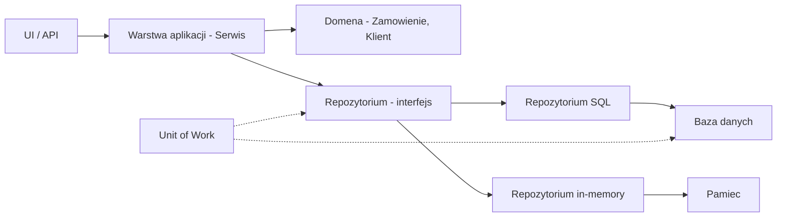
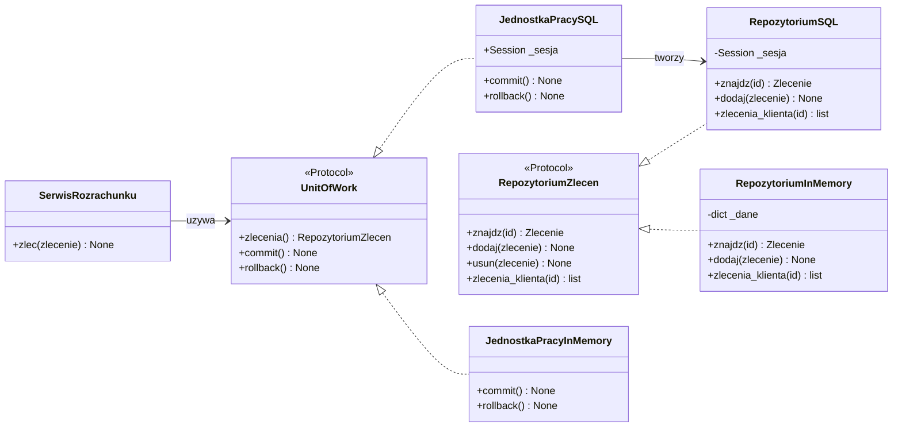
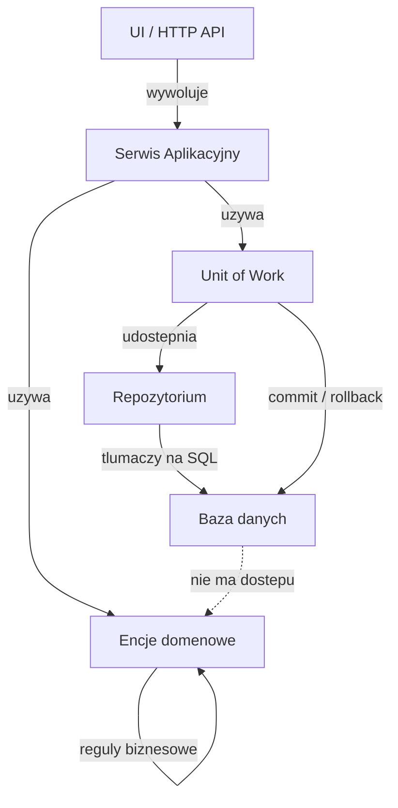
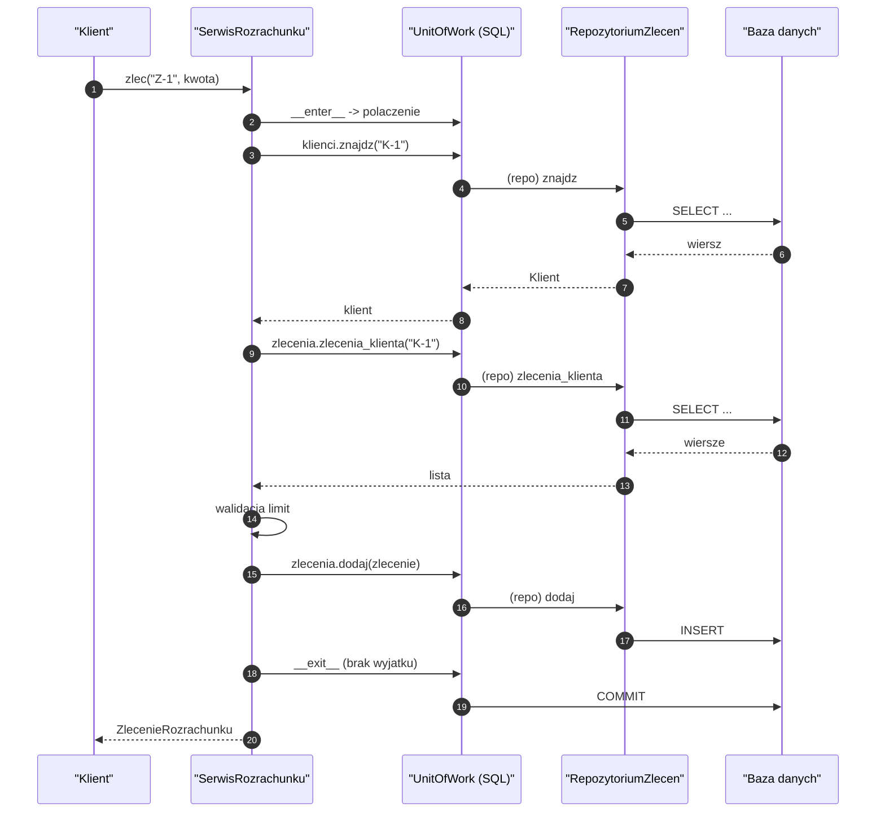
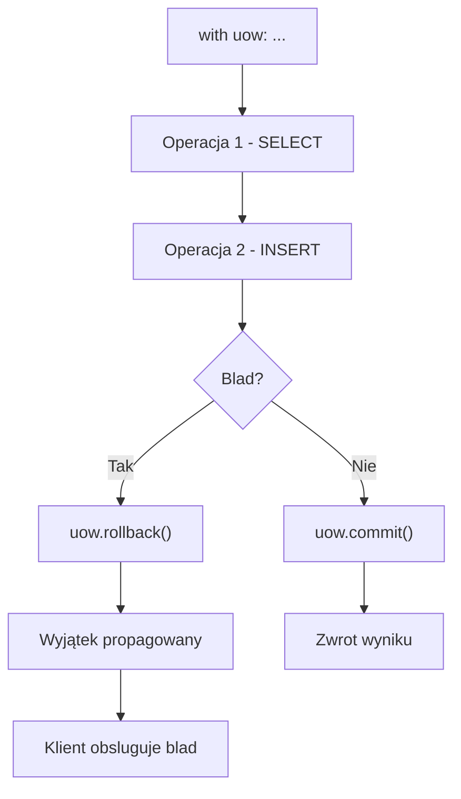
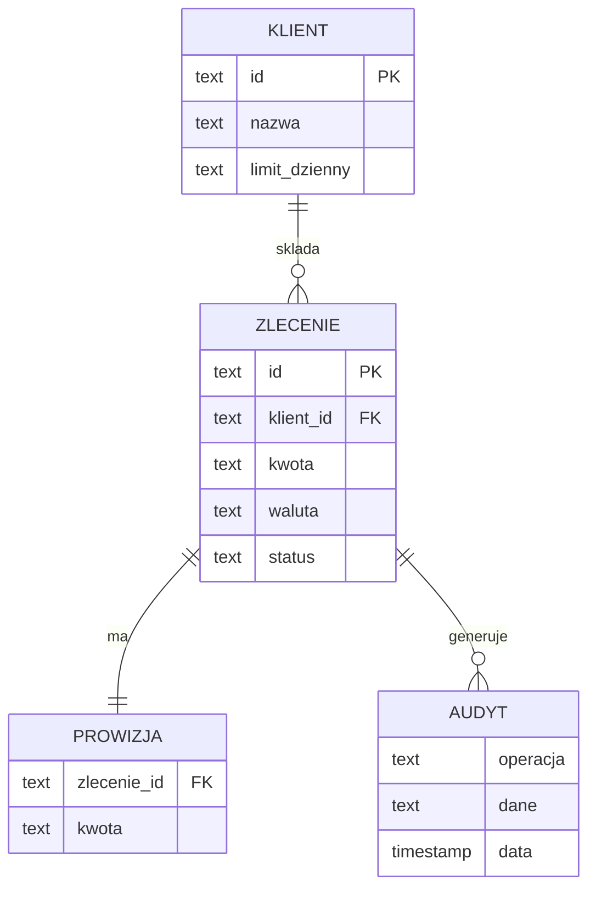
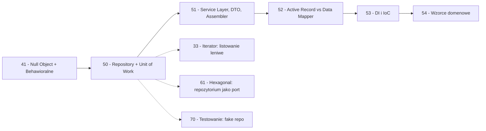

```markdown
---
modul: 50 — Repository i Unit of Work
plik: 50-repository-i-unit-of-work.md
poziom: sredni
wymaga: [41]
czas: ~180 minut czytania + ~440 minut ćwiczeń
---

# Moduł 50 — Repository i Unit of Work — jak oddzielić domenę od bazy danych

> **TL;DR**
> - **Repository (repozytorium)** pośredniczy między logiką biznesową a trwałością — domena pyta „daj mi zamówienie o ID X", a nie „wykonaj `SELECT * FROM zamowienia WHERE id = X`", nie znając bazy, SQL ani ORM-a.
> - **Unit of Work (jednostka pracy)** gromadzi wszystkie zmiany w ramach jednej operacji biznesowej i zapisuje je **razem, w jednej transakcji** — z możliwością `commit` albo `rollback` jak na paragonie sklepowym.
> - Trzy warstwy: **domena** (reguły biznesowe), **aplikacja** (orkiestracja procesu), **infrastruktura** (baza, HTTP, SMTP) — repozytorium i UoW to elementy architektury, nie biblioteki.
> - Kluczowa korzyść: **domena testuje się bez bazy danych** — repozytorium in-memory + UoW in-memory zastępują SQL, czyniąc testy szybkimi i deterministycznymi.
> - Repozytoria mają sens, gdy domena jest **złożona** i warstwa trwałości ma się **zmieniać** — dla prostej aplikacji CRUD są nadmiarem; mówimy to wprost.

---

## 0. Model mentalny

### Bibliotekarz, kustosz i magazyn

Wyobraź sobie wielką bibliotekę uniwersytecką. Regłami zajmuje się **magazyn** — tysiące metrów półek, tysiące woluminów, katalogi zapisane w systemie bibliotecznym. Ale ty, jako czytelnik, **nie chodzisz między regałami**. Nie znasz układu, nie musisz znać numeracji Deweya, nie szukasz ręcznie na półkach. **Mówisz bibliotekarzowi: „poproszę książki tego autora"**, a on przynosi stos książek. To jest **istota Repository** — domena wyraża **intencję** („daj mi zamówienia tego klienta"), a repozytorium tłumaczy ją na konkretne zapytanie w magazynie.

Zauważ dwie rzeczy w tej analogii. Po pierwsze: **bibliotekarz zna dwie rzeczy** — język czytelnika („autor X") i układ magazynu (gdzie stoi co). To jest praca repozytorium: **tłumaczenie między językiem domeny a językiem bazy**. Po drugie: **magazyn może się zmienić** — biblioteka może przebudować regały, zmienić system katalogowania, przenieść część zbiorów do archiwum. Czytelnik tego **nie odczuje** — bo mówił bibliotekarzowi „autor X", a nie „półka 17, regał B3". Ta wymienność magazynu to fundament Repository — **domena nie wie, jak przechowywane są dane**.

Drugi obraz, kluczowy dla Unit of Work — **zakupy w supermarkecie**. Chodzisz po sklepie i zbierasz produkty. **Wszystkie wrzucasz do jednego koszyka**. Dopiero na koniec, **przy kasie**, pokazujesz cały koszyk i płacisz **raz**. Nie płacisz przy każdej półce („to mleko, proszę, płacę; teraz chleb, płacę"). I drugie: jeśli w trakcie zakupów okazuje się, że czegoś brakuje albo znajdziesz lepszy odpowiednik, **wymieniasz produkt w koszyku** — nie musisz niczego „cofać" na półce. Koszyk **zbiera wszystkie zmiany** i dopiero kasa **je finalizuje**. To jest Unit of Work: **jeden „koszyk zmian" na jedną operację biznesową**, finalizowany raz przy `commit`.

Zatrzymajmy się przy tym koszyku dłużej. Zwróć uwagę na trzy własności. Pierwsza: **koszyk ma stan** — co zostało włożone, co wyjęte, co zamienione. To są właśnie trzy rejestry UoW: nowe / zmienione / usunięte. Druga: **nic nie jest „zapisywane" po drodze** — dopóki nie dojdziesz do kasy, produkty nie są „kupione" (baza nie została zmieniona). Trzecia: **możesz wyjść ze sklepu z pustymi rękami** — jeśli coś poszło nie tak, po prostu zostawiasz koszyk przy kasie. To jest `rollback` — wszystkie zmiany zostają cofnięte, **żadna nie trafia do bazy**. Supermarket działa tak, jakbyś nigdy nie wszedł.

Trzeci obraz, który uchwyci ostatnią własność — **biletomat na dworcu**. Wyobraź sobie, że kupujesz bilet. Wprowadzasz kilka parametrów: skąd, dokąd, kiedy, klasa. Biletomat **przechowuje twoje wybory** (rejestr zmian). Dopiero gdy naciśniesz „kupuję", system realizuje transakcję **jako całość**: pobiera pieniądze, drukuje bilet, zapisuje w rejestrze, rezerwuje miejsce. Jeśli na którymkolwiek etapie coś się nie uda — **cała transakcja jest wycofywana**, pieniądze nie zostają pobrane. **Atomowość**: wszystko albo nic. To jest esencja transakcji, którą UoW realizuje.

| W analogii biblioteki / sklepu / biletomatu | W kodzie |
|---|---|
| Czytelnik mówi „autor X" | Domena pyta `repo.znajdz_klienta(klient_id)` |
| Bibliotekarz tłumaczy na magazyn | **Repository** — implementacja SQL/in-memory |
| Magazyn, regały, katalog | **Baza danych / ORM** |
| Wymiana magazynu | Zmiana implementacji repozytorium |
| Koszyk z zakupami | **Unit of Work** — rejestr zmian |
| Kasa przy wyjściu | `commit()` |
| Zostawienie koszyka | `rollback()` |
| Biletomat realizuje wszystko albo nic | Transakcja atomowa |

> 🧠 **Zapamiętaj** — **Repository (repozytorium) to warstwa pośrednicząca między domeną a warstwą trwałości, udostępniająca kolekcyjny interfejs do przechowywania i wyszukiwania obiektów domenowych — taki, że domena nie wie nic o SQL, ORM ani schemacie bazy. Unit of Work (jednostka pracy) to warstwa gromadząca zmiany w ramach jednej operacji biznesowej i finalizująca je atomowo jako transakcję.**

Zwróć uwagę na cztery słowa: **domena**, **kolekcyjny**, **gromadząca**, **atomowo**. „Domena" — to pojęcia biznesowe (`Zamowienie`, `Klient`), nie encje bazy. „Kolekcyjny" — repozytorium działa jak lista/kolekcja obiektów. „Gromadząca" — UoW zbiera zmiany. „Atomowo" — wszystko albo nic.

### Diagram — intuicja



*Diagram pokazuje, że aplikacja rozmawia z domeną i repozytorium (przez interfejs), a konkretna implementacja repozytorium (SQL albo in-memory) jest wymienna; UoW koordynuje zapis.*

### Czego Repository i Unit of Work NIE robią

Rozbrójmy pięć mitów — te wzorce są wyjątkowo podatne na nadużycia.

**Repository nie jest ORM-em.** ORM mapuje obiekty na tabele — to narzędzie **techniczne**. Repository to **abstrakcja domenowa** — interfejs używany przez domenę. Repository *używa* ORM-a w swojej implementacji SQL, ale sam nie jest ORM-em. Mylenie tych pojęć prowadzi do „repozytorium" z metodami `find_by_sql`, `query`, `raw` — czyli do przeciekania.

**Repository nie jest generycznym CRUD-em.** `Repozytorium[Typ]` z metodami `save`, `find_by_id`, `delete` — to często **antywzorzec**, bo zamienia czytelny interfejs domenowy („daj mi aktywne zamówienia klienta") na bezosobowe `find_by_filter(...)`. Zobaczysz to w sekcji 8.

**Repository nie zastępuje domeny.** Repozytorium **nie zawiera reguł biznesowych** — tylko operacje trwałości. Decyzja „czy zamówienie może być anulowane" jest w domenie, nie w repozytorium.

**Unit of Work nie jest warstwą transakcji.** UoW to **rejestr zmian**, który jest zintegrowany z transakcją bazy. Ale sam UoW to abstrakcja — konkretna transakcja jest w SQLAlchemy, w `psycopg`, w innej bibliotece. UoW to **interfejs aplikacji**.

**UoW nie jest globalnym singletonem.** Zarządzanie transakcją jest **per operacja**, nie globalne. Każde żądanie HTTP to osobny UoW. Współdzielenie UoW między wątkami bez synchronizacji prowadzi do chaosu.

**Nie są darmowe.** Repozytorium to dodatkowa warstwa (interfejs + implementacje). UoW to dodatkowy obiekt. Dla CRUD na 2–3 tabelach — to nadmiar. Dla złożonej domeny z wieloma agregatami — konieczne.

---

## 1. Problem, który rozwiązujemy

Wejdźmy w domenę 💳 „Rozrachunku". System obsługuje zlecenia płatności z zaawansowaną logiką: limity, prowizje, audyt, dopasowanie (reconciliation). Ktoś napisał serwis, który łączy **logikę biznesową** z **SQL** i **ORM** w jednej klasie.

### Kod „przed"

```python
# rozrachunek_v0.py — wersja naiwna, demonstracyjna
# UWAGA: kod celowo pokazuje przeciekanie SQL do logiki biznesowej.

from __future__ import annotations

import sqlite3
from dataclasses import dataclass
from datetime import datetime, timezone
from decimal import ROUND_HALF_UP, Decimal


@dataclass
class ZlecenieRozrachunku:
    identyfikator: str
    klient_id: str
    kwota: Decimal
    waluta: str
    status: str = "nowe"


class SerwisRozrachunku:
    """Serwis z wbudowanym SQL, transakcja i logika biznesowa."""

    LIMIT_DZIENNY = Decimal("1000000.00")
    STAWKA_PROWIZJI = Decimal("0.004")

    def __init__(self, sciezka_db: str) -> None:
        self._sciezka_db = sciezka_db

    def zlec_przelew(
        self, identyfikator: str, klient_id: str,
        kwota: Decimal, waluta: str,
    ) -> ZlecenieRozrachunku:
        # --- 1. Walidacja biznesowa ---
        if kwota <= 0:
            raise ValueError("kwota musi byc dodatnia")
        if waluta not in ("PLN", "EUR", "USD"):
            raise ValueError("nieobslugiwana waluta")

        # --- 2. Polaczenie z baza (SQL wprost!) ---
        baza = sqlite3.connect(self._sciezka_db)
        try:
            kursor = baza.cursor()

            # Sprawdz limit dzienny - zapytanie SQL w logice biznesowej
            kursor.execute(
                "SELECT COALESCE(SUM(kwota), 0) FROM zlecenia "
                "WHERE klient_id = ? AND data_dnia = ?",
                (klient_id, datetime.now(timezone.utc).date().isoformat()),
            )
            suma_dzis = Decimal(kursor.fetchone()[0])
            if suma_dzis + kwota > self.LIMIT_DZIENNY:
                raise RuntimeError("przekroczony limit dzienny")

            # --- 3. Zapis ---
            kursor.execute(
                "INSERT INTO zlecenia (id, klient_id, kwota, waluta, status, data_dnia) "
                "VALUES (?, ?, ?, ?, ?, ?)",
                (identyfikator, klient_id, str(kwota), waluta, "nowe",
                 datetime.now(timezone.utc).date().isoformat()),
            )

            # --- 4. Prowizja (logika biznesowa pomieszana z SQL) ---
            prowizja = (kwota * self.STAWKA_PROWIZJI).quantize(
                Decimal("0.01"), rounding=ROUND_HALF_UP
            )
            kursor.execute(
                "INSERT INTO prowizje (zlecenie_id, kwota) VALUES (?, ?)",
                (identyfikator, str(prowizja)),
            )

            # --- 5. Audyt ---
            kursor.execute(
                "INSERT INTO audyt (operacja, dane, data) VALUES (?, ?, ?)",
                ("zlecenie", identyfikator, datetime.now(timezone.utc).isoformat()),
            )

            baza.commit()
        except Exception:
            baza.rollback()
            raise
        finally:
            baza.close()

        return ZlecenieRozrachunku(identyfikator, klient_id, kwota, waluta)


if __name__ == "__main__":
    import tempfile
    from pathlib import Path
    with tempfile.TemporaryDirectory() as tmp:
        # Wymaga zainicjalizowanej bazy
        print("Przyklad wymaga utworzenia tabel")
```

Ten kod **działa**, ale ma **siedem problemów**, z których każdy pogarsza się z każdą nową regułą biznesową.

### Code smell — SQL w logice biznesowej

| Problem | Gdzie | Konsekwencja |
|---|---|---|
| SQL w metodzie biznesowej | `zlec_przelew` | Logika domenowa zna bazę |
| Brak abstrakcji trwałości | `sqlite3.connect` | Nie da się wymienić bazy bez zmiany logiki |
| Logika biznesowa i trwałość pomieszane | Cała metoda | Trudno testować jedno bez drugiego |
| Ręczne `INSERT` zamiast obiektu | `kursor.execute(...)` | Każda zmiana schematu psuje metodę |
| "(Bezpośrednie) `commit` w logice" | `baza.commit()` | Każda metoda ma własną transakcję |
| Brak separacji zapytań | LIMIT w SQL | Reguła biznesowa zapisana jako SQL |
| Mieszanie wielu tabel | zlecenia + prowizje + audyt | Atomowość ręczna (jedna transakcja) |
| Test wymaga bazy | sqlite3.connect | Testy wolne, niedeterministyczne |

Zwróć uwagę na szóstą pozycję. **Reguła biznesowa „limit dzienny"** — koncepcja domenowa — jest wyrażona jako `SELECT COALESCE(SUM(kwota), 0) FROM ...`. Jeśli reguła zmieni się (np. limit tygodniowy, albo per waluta), trzeba zmienić **SQL**. Reguła biznesowa powinna być w domenie, nie w bazie.

### Objawy — poznasz ten problem po tym, że...

- **W klasie serwisu biznesowego widzisz `import sqlite3`, `import psycopg2` albo `from sqlalchemy import ...`.** Domena zna technologię.
- **`INSERT`, `SELECT`, `UPDATE` w ciele metod biznesowych.** SQL rozproszony po logice.
- **Testy wymagają uruchomienia bazy.** Test domeny potrzebuje infrastruktury — to znak, że brakuje abstrakcji.
- **Każda metoda ma własne `commit`/`rollback`.** Transakcje rozproszone po metodach.
- **Dodanie nowej reguły biznesowej wymaga zmiany SQL.** Reguła jest wyrażona w zapytaniu.
- **Nie da się przetestować jednej reguły bez bazy.** Testy są związane z infrastrukturą.
- **Zmiana bazy (SQLite → Postgres) wymaga przepisania logiki.**
- **Ten sam obiekt biznesowy jest tworzony na trzy sposoby** — raz z ORM, raz z ręcznego SQL, raz z REST.
- **Kod ma `cursor.execute` i zaraz obok reguły biznesowe** — brak podziału odpowiedzialności.
- **N+1 zapytań** — w pętli lecą zapytania po kolei, bez batchowania.

---

## 2. Anatomia wzorców

### Uczestnicy Repository

| Rola | Odpowiedzialność | Co NIE jest jej zadaniem |
|---|---|---|
| **Interfejs repozytorium** | Definiuje kontrakt wyszukiwania i zapisu w języku **domeny** (`znajdz_zlecenie(id)`, `zlecenia_klienta(klient_id)`) | Nie zawiera logiki trwałości; nie zawiera reguł biznesowych |
| **Implementacja SQL** | Tłumaczy operacje domenowe na SQL/ORM | Nie zawiera reguł biznesowych; nie zna szczegółów aplikacji |
| **Implementacja in-memory** | Trzyma obiekty w słowniku/listy; używana w testach | Nie jest substytutem produkcyjnym; obsługuje testy |
| **Implementacja HTTP/API** | Tłumaczy operacje domenowe na wywołania HTTP | Nie zna reguł biznesowych |
| **Aplikacja** | Wywołuje repozytorium w kontekście operacji biznesowej | Nie zawiera SQL; nie zna szczegółów implementacji repozytorium |

### Uczestnicy Unit of Work

| Rola | Odpowiedzialność | Co NIE jest jej zadaniem |
|---|---|---|
| **Unit of Work** | Rejestruje nowe / zmienione / usunięte obiekty; finalizuje zmiany jako transakcję | Nie ma reguł biznesowych; nie tworzy obiektów |
| **Rejestr nowych** | Trzyma obiekty utworzone w trakcie operacji | Nie wie, jak je zapisać — tylko że są nowe |
| **Rejestr zmienionych** | Trzyma obiekty zmodyfikowane (dirty tracking) | Nie modyfikuje obiektów |
| **Rejestr usuniętych** | Trzyma obiekty oznaczone do usunięcia | Nie usuwa sam — to robi commit |
| **Commit** | Zapisuje wszystkie zmiany w jednej transakcji | Nie waliduje stanu — zakłada, że jest poprawny |
| **Rollback** | Cofa wszystkie zmiany w transakcji | Nie próbuje naprawiać stanu |
| **Identity map** | Cache obiektów pobranych w ramach UoW, żeby ten sam wiersz dawał ten sam obiekt | Nie zastępuje innych cache'ów (moduł 26) |

### Diagram struktury



*Diagram pokazuje, że serwis zależy od abstrakcji `UnitOfWork` i `RepozytoriumZlecen`, a konkretne implementacje (SQL, in-memory) są wymienne — domena nie wie, która działa.*

### Warianty: klasyczny vs pythoniczny

| Aspekt | Klasyczny (Fowler) | Pythoniczny |
|---|---|---|
| Repozytorium | Klasa abstrakcyjna + klasy dziedziczące | `Protocol` + klasy spełniające protokół |
| Metody | `find`, `save`, `delete`, `find_by_criteria` | `znajdz`, `dodaj`, `usun`, `zlecenia_klienta` |
| UoW | Klasa z rejestrami | `@contextmanager` na sesji |
| Transakcja | Metody `commit`/`rollback` | Blok `with` |
| Identity map | `dict[id, object]` | `dict[id, object]` (+ `weakref` opcjonalnie) |
| Sesja ORM | Osobny obiekt | Context manager SQLAlchemy |

Python daje **znacznie prostsze formy** — `Protocol` zamiast ABC, `with` zamiast ręcznego `commit`/`rollback`. Fowler pisał o Javie i C#, gdzie trzeba było więcej kodu.

---

## 3. Implementacja krok po kroku

Przebudujemy `SerwisRozrachunku` z sekcji 1.

### Krok 1 — Zdefiniuj model domenowy

Najpierw obiekty, które reprezentują pojęcia biznesowe (nie encje bazy).

```python
from dataclasses import dataclass, field
from decimal import Decimal
from typing import Protocol, runtime_checkable


@dataclass
class ZlecenieRozrachunku:
    """Zlecenie rozrachunku - obiekt domenowy."""
    identyfikator: str
    klient_id: str
    kwota: Decimal
    waluta: str
    status: str = "nowe"

    def prowizja(self, stawka: Decimal = Decimal("0.004")) -> Decimal:
        return (self.kwota * stawka).quantize(Decimal("0.01"))
```

Model nie zna bazy — to czysty obiekt domenowy.

### Krok 2 — Zdefiniuj interfejs repozytorium

Interfejs używany przez **domenę** — w języku domeny.

```python
@runtime_checkable
class RepozytoriumZlecen(Protocol):
    """Interfejs repozytorium zlecen."""

    def znajdz(self, identyfikator: str) -> "ZlecenieRozrachunku | None": ...

    def dodaj(self, zlecenie: "ZlecenieRozrachunku") -> None: ...

    def usun(self, zlecenie: "ZlecenieRozrachunku") -> None: ...

    def zlecenia_klienta(self, klient_id: str) -> list["ZlecenieRozrachunku"]: ...
```

**Uwaga:** metody są w **języku domeny** (`zlecenia_klienta`), nie w języku ORM (`find_by_filter`). To kluczowa własność dobrego repozytorium.

### Krok 3 — Zaimplementuj repozytorium in-memory

Implementacja używana przez testy.

```python
class RepozytoriumZlecenInMemory:
    """Repozytorium in-memory (do testow)."""

    def __init__(self) -> None:
        self._dane: dict[str, ZlecenieRozrachunku] = {}
        self._do_usuniecia: set[str] = set()

    def znajdz(self, identyfikator: str) -> ZlecenieRozrachunku | None:
        if identyfikator in self._do_usuniecia:
            return None
        return self._dane.get(identyfikator)

    def dodaj(self, zlecenie: ZlecenieRozrachunku) -> None:
        self._dane[zlecenie.identyfikator] = zlecenie

    def usun(self, zlecenie: ZlecenieRozrachunku) -> None:
        self._do_usuniecia.add(zlecenie.identyfikator)

    def zlecenia_klienta(self, klient_id: str) -> list[ZlecenieRozrachunku]:
        return [
            z for id_, z in self._dane.items()
            if z.klient_id == klient_id and id_ not in self._do_usuniecia
        ]

    # Metody pomocnicze dla testow
    def _wyczysc_do_usuniecia(self) -> None:
        for id_ in self._do_usuniecia:
            self._dane.pop(id_, None)
        self._do_usuniecia.clear()
```

**Ważne szczegóły:**
1. **Repozytorium in-memory implementuje ten sam interfejs co SQL** — spełnia `RepozytoriumZlecen`.
2. **Rejestruje usunięcia** (`_do_usuniecia`), bo UoW decyduje o commitcie.
3. **Nie zna transakcji** — UoW nią zarządza.

### Krok 4 — Zaimplementuj repozytorium SQL

Analogiczny interfejs w SQL (używamy SQLite dla przykładu).

```python
import sqlite3


class RepozytoriumZlecenSQL:
    """Repozytorium SQL - uzywa sqlite3."""

    def __init__(self, polaczenie: sqlite3.Connection) -> None:
        self._polaczenie = polaczenie

    def znajdz(self, identyfikator: str) -> ZlecenieRozrachunku | None:
        kursor = self._polaczenie.cursor()
        kursor.execute(
            "SELECT id, klient_id, kwota, waluta, status "
            "FROM zlecenia WHERE id = ?",
            (identyfikator,),
        )
        wiersz = kursor.fetchone()
        if wiersz is None:
            return None
        return ZlecenieRozrachunku(
            identyfikator=wiersz[0],
            klient_id=wiersz[1],
            kwota=Decimal(wiersz[2]),
            waluta=wiersz[3],
            status=wiersz[4],
        )

    def dodaj(self, zlecenie: ZlecenieRozrachunku) -> None:
        kursor = self._polaczenie.cursor()
        kursor.execute(
            "INSERT OR REPLACE INTO zlecenia "
            "(id, klient_id, kwota, waluta, status) VALUES (?, ?, ?, ?, ?)",
            (
                zlecenie.identyfikator,
                zlecenie.klient_id,
                str(zlecenie.kwota),
                zlecenie.waluta,
                zlecenie.status,
            ),
        )

    def usun(self, zlecenie: ZlecenieRozrachunku) -> None:
        kursor = self._polaczenie.cursor()
        kursor.execute("DELETE FROM zlecenia WHERE id = ?", (zlecenie.identyfikator,))

    def zlecenia_klienta(self, klient_id: str) -> list[ZlecenieRozrachunku]:
        kursor = self._polaczenie.cursor()
        kursor.execute(
            "SELECT id, klient_id, kwota, waluta, status "
            "FROM zlecenia WHERE klient_id = ?",
            (klient_id,),
        )
        return [
            ZlecenieRozrachunku(
                identyfikator=w[0],
                klient_id=w[1],
                kwota=Decimal(w[2]),
                waluta=w[3],
                status=w[4],
            )
            for w in kursor.fetchall()
        ]
```

**Uwaga:** repozytorium SQL **nie ma własnego `commit`** — transakcję kontroluje UoW. Repozytorium wykonuje tylko operacje.

### Krok 5 — Zdefiniuj Unit of Work

Teraz klucz — UoW rejestruje zmiany i finalizuje je raz.

```python
@runtime_checkable
class UnitOfWork(Protocol):
    """Interfejs jednostki pracy."""

    def __enter__(self) -> "UnitOfWork": ...
    def __exit__(self, typ, wartosc, slad) -> None: ...

    @property
    def zlecenia(self) -> RepozytoriumZlecen: ...

    def commit(self) -> None: ...
    def rollback(self) -> None: ...
```

**Uwaga:** UoW udostępnia **repozytoria** przez property. Klient nie tworzy repozytoriów sam — pyta UoW.

### Krok 6 — Zaimplementuj UoW in-memory

```python
class JednostkaPracyInMemory:
    """UoW in-memory (do testow)."""

    def __init__(self) -> None:
        self._zlecenia = RepozytoriumZlecenInMemory()
        self._zakonczona = False

    def __enter__(self) -> "JednostkaPracyInMemory":
        return self

    def __exit__(self, typ, wartosc, slad) -> None:
        if not self._zakonczona:
            if typ is None:
                self.commit()
            else:
                self.rollback()

    @property
    def zlecenia(self) -> RepozytoriumZlecen:
        return self._zlecenia

    def commit(self) -> None:
        # W in-memory: wyczysc liste do usuniecia
        self._zlecenia._wyczysc_do_usuniecia()
        self._zakonczona = True

    def rollback(self) -> None:
        self._zlecenia._do_usuniecia.clear()
        self._zakonczona = True
```

**Kluczowy mechanizm:** `__exit__` sprawdza, czy nie było wyjątku. Jeśli nie — `commit()`. Jeśli tak — `rollback()`. To realizuje transakcyjność.

### Krok 7 — Zaimplementuj UoW dla SQL

```python
class JednostkaPracySQL:
    """UoW dla SQLite - jedna transakcja dla calej operacji."""

    def __init__(self, sciezka_db: str) -> None:
        self._sciezka = sciezka_db
        self._polaczenie: sqlite3.Connection | None = None
        self._zlecenia: RepozytoriumZlecenSQL | None = None
        self._zakonczona = False

    def __enter__(self) -> "JednostkaPracySQL":
        self._polaczenie = sqlite3.connect(self._sciezka)
        self._zlecenia = RepozytoriumZlecenSQL(self._polaczenie)
        return self

    def __exit__(self, typ, wartosc, slad) -> None:
        if self._polaczenie is None:
            return
        try:
            if not self._zakonczona:
                if typ is None:
                    self.commit()
                else:
                    self.rollback()
        finally:
            self._polaczenie.close()

    @property
    def zlecenia(self) -> RepozytoriumZlecen:
        assert self._zlecenia is not None
        return self._zlecenia

    def commit(self) -> None:
        if self._polaczenie is not None:
            self._polaczenie.commit()
        self._zakonczona = True

    def rollback(self) -> None:
        if self._polaczenie is not None:
            self._polaczenie.rollback()
        self._zakonczona = True
```

### Krok 8 — Serwis aplikacyjny używa UoW

Serwis zna domenę, używa UoW, ale nie zna SQL.

```python
class SerwisRozrachunku:
    """Serwis aplikacyjny: koordynuje UoW i repozytoria."""

    def __init__(self, uow_fabryka) -> None:
        self._uow_fabryka = uow_fabryka

    def zlec_przelew(
        self, identyfikator: str, klient_id: str,
        kwota: Decimal, waluta: str,
    ) -> None:
        # Walidacja domenowa (bez bazy)
        if kwota <= 0:
            raise ValueError("kwota musi byc dodatnia")
        if waluta not in ("PLN", "EUR", "USD"):
            raise ValueError("nieobslugiwana waluta")

        with self._uow_fabryka() as uow:
            # Pobranie przez repozytorium (w jezyku domeny)
            istniejace = uow.zlecenia.zlecenia_klienta(klient_id)
            suma_dzis = sum((z.kwota for z in istniejace), Decimal("0"))

            if suma_dzis + kwota > Decimal("1000000.00"):
                raise RuntimeError("przekroczony limit dzienny")

            zlecenie = ZlecenieRozrachunku(
                identyfikator=identyfikator,
                klient_id=klient_id,
                kwota=kwota,
                waluta=waluta,
            )
            uow.zlecenia.dodaj(zlecenie)
            # Wyjscie z bloku with -> commit (jezeli brak wyjatku)
```

Zwróć uwagę: **żaden SQL nie wchodzi do serwisu**. Serwis mówi „daj mi zlecenia klienta", „dodaj nowe zlecenie". Cała reszta w repozytorium.

### Krok 9 — Weryfikacja

| Kryterium | Wersja „przed" | Wersja „po" |
|---|---|---|
| SQL w logice biznesowej | Tak | Nie |
| Test wymaga bazy | Tak | Nie (in-memory) |
| Zmiana bazy | Zmiana logiki | Zmiana implementacji repozytorium |
| Atomowość wielu tabel | Ręczna | UoW |
| Limit biznesowy | SQL | Warunek w Pythonie |
| Nazwy metod w języku domeny | Nie | Tak |
| Transakcja | Ręczne `commit`/`rollback` | `with uow:` |
| Liczba klas | 2 | 5+ |

Koszt: kilka nowych klas. Zysk: **testowalność, wymienność, czytelność**.

---

## 4. Wersje pythoniczne i warianty

### 4.1 Repozytorium generyczne — czemu zwykle nie

Czasem widzi się:

```python
# ZLE: generyczne repozytorium
class RepozytoriumGeneryczne:
    def __init__(self, model: type) -> None:
        self._model = model

    def znajdz(self, id_): ...
    def zapisz(self, obiekt): ...
    def usun(self, obiekt): ...
```

**Problemy:**
- **API zbyt ogólne** — `znajdz(id)` działa, ale nie da się wyrazić „aktywne zamówienia klienta".
- **Wyciek modelu ORM** — metoda przyjmuje obiekt ORM, domena musi go znać.
- **Nieczytelne zapytania** — filtry przekazywane jako listy krotek albo stringi.
- **Nie da się przetestować** bez ORM-a.

**Wyjątek:** gdy wszystkie encje mają identyczne operacje (rzadkie) — wtedy generyczne ma sens. W praktyce **konkretne repozytoria są lepsze**.

### 4.2 Repozytorium z `singledispatch`

Dla prostych przypadków można użyć `singledispatch`.

```python
from functools import singledispatch


@singledispatch
def zapisz(obiekt, uow: UnitOfWork) -> None:
    raise TypeError(f"nieznany typ: {type(obiekt).__name__}")


@zapisz.register
def _(zlecenie: ZlecenieRozrachunku, uow: UnitOfWork) -> None:
    uow.zlecenia.dodaj(zlecenie)
```

Zaleta: brak „jednego repozytorium na typ". Wada: nie jest to klasyczne repozytorium — brak abstrakcji per agregat.

### 4.3 UoW jako context manager w `contextlib`

Bardzo pythoniczne.

```python
from contextlib import contextmanager


@contextmanager
def jednostka_pracy(sciezka: str):
    polaczenie = sqlite3.connect(sciezka)
    uow = _wewnetrzna_uow(polaczenie)
    try:
        yield uow
        polaczenie.commit()
    except Exception:
        polaczenie.rollback()
        raise
    finally:
        polaczenie.close()
```

Użycie: `with jednostka_pracy("app.db") as uow:`. Krótkie i czytelne.

### 4.4 Repozytorium listujące jako generator

Listowanie może być **leniwe** (moduł 33).

```python
def zlecenia_klienta(self, klient_id: str) -> Iterator[ZlecenieRozrachunku]:
    """Wersja leniwa - zwraca generator zamiast listy."""
    kursor = self._polaczenie.cursor()
    kursor.execute("SELECT ...")
    for w in kursor:
        yield ZlecenieRozrachunku(...)
```

Zaleta: dla milionów wierszy — stała pamięć. Wada: otwarty kursor musi żyć — trzeba uważać na cykl życia.

**Uwaga:** API repozytorium jako `Iterator[T]` narzuca **jednorazowość** (moduł 33). Jeśli klient chce listę — niech sam ją zrobi. W praktyce **zwykle zwraca się listę** — prostsze, bezpieczniejsze. Iterator w repozytorium tylko dla naprawdę dużych zbiorów.

### 4.5 Identity map

Część implementacji UoW. Jeśli ten sam wiersz zostanie pobrany dwa razy, powinien zwrócić **ten sam obiekt**.

```python
class IdentityMap:
    def __init__(self) -> None:
        self._obiekty: dict[tuple[type, str], object] = {}

    def get(self, typ: type, id_: str):
        return self._obiekty.get((typ, id_))

    def dodaj(self, typ: type, id_: str, obiekt: object) -> None:
        self._obiekty[(typ, id_)] = obiekt
```

W testach i produkcji identity map gwarantuje, że dwa pobrania dają ten sam obiekt. Bez tego można mieć dwa obiekty reprezentujące ten sam wiersz — i zmiany w jednym nie trafiają do drugiego.

### 4.6 Podsumowanie — tabela wyboru

| Sytuacja | Wariant |
|---|---|
| Klasyczne repozytorium per agregat | Klasa + `Protocol` (4.a) |
| Generyczne repozytorium | Ostrzeżenie — często antywzorzec |
| Proste operacje | `singledispatch` (4.2) |
| UoW jako context manager | `contextlib` (4.3) |
| Duże zbiory | Generator (4.4) |
| Ten sam wiersz = ten sam obiekt | Identity map (4.5) |

> 🧠 **Zapamiętaj** — **Repozytorium powinno mówić językiem domeny, nie bazy.** Jeśli widzisz metody `find_by_sql`, `query`, `execute`, `save_or_update` — to nie jest repozytorium, to ORM w przebraniu.

---

## 5. Przykład z życia: 💳 Rozrachunek — pełny uruchamialny kod

Zbudujemy pełny system rozrachunku z dwoma implementacjami repozytorium (in-memory, SQLite) i dwoma UoW. Testy pokażą, że domena jest testowana bez bazy.

### Kod

```python
# rozrachunek_repo.py — pelny przyklad Repository + Unit of Work
from __future__ import annotations

import sqlite3
from contextlib import contextmanager
from collections.abc import Iterator
from dataclasses import dataclass, replace
from decimal import ROUND_HALF_UP, Decimal
from pathlib import Path
from typing import Protocol, runtime_checkable


# ===========================================================================
# 1. Model domenowy
# ===========================================================================

GROSZ = Decimal("0.01")


def zaokraglij(k: Decimal) -> Decimal:
    return k.quantize(GROSZ, rounding=ROUND_HALF_UP)


@dataclass
class ZlecenieRozrachunku:
    identyfikator: str
    klient_id: str
    kwota: Decimal
    waluta: str
    status: str = "nowe"

    def prowizja(self, stawka: Decimal = Decimal("0.004")) -> Decimal:
        return zaokraglij(self.kwota * stawka)

    def z_statusem(self, nowy: str) -> "ZlecenieRozrachunku":
        return replace(self, status=nowy)


@dataclass
class Klient:
    identyfikator: str
    nazwa: str
    limit_dzienny: Decimal = Decimal("1000000.00")


# ===========================================================================
# 2. Interfejsy repozytoriow
# ===========================================================================

@runtime_checkable
class RepozytoriumZlecen(Protocol):
    def znajdz(self, identyfikator: str) -> ZlecenieRozrachunku | None: ...
    def dodaj(self, zlecenie: ZlecenieRozrachunku) -> None: ...
    def usun(self, zlecenie: ZlecenieRozrachunku) -> None: ...
    def zlecenia_klienta(self, klient_id: str) -> list[ZlecenieRozrachunku]: ...


@runtime_checkable
class RepozytoriumKlientow(Protocol):
    def znajdz(self, identyfikator: str) -> Klient | None: ...
    def dodaj(self, klient: Klient) -> None: ...


@runtime_checkable
class UnitOfWork(Protocol):
    def __enter__(self) -> "UnitOfWork": ...
    def __exit__(self, typ, wartosc, slad) -> None: ...
    @property
    def zlecenia(self) -> RepozytoriumZlecen: ...
    @property
    def klienci(self) -> RepozytoriumKlientow: ...
    def commit(self) -> None: ...
    def rollback(self) -> None: ...


# ===========================================================================
# 3. Implementacja in-memory
# ===========================================================================

class RepozytoriumZlecenInMemory:
    def __init__(self) -> None:
        self._dane: dict[str, ZlecenieRozrachunku] = {}
        self._do_usuniecia: set[str] = set()

    def znajdz(self, identyfikator: str) -> ZlecenieRozrachunku | None:
        if identyfikator in self._do_usuniecia:
            return None
        return self._dane.get(identyfikator)

    def dodaj(self, zlecenie: ZlecenieRozrachunku) -> None:
        self._dane[zlecenie.identyfikator] = zlecenie
        self._do_usuniecia.discard(zlecenie.identyfikator)

    def usun(self, zlecenie: ZlecenieRozrachunku) -> None:
        self._do_usuniecia.add(zlecenie.identyfikator)

    def zlecenia_klienta(self, klient_id: str) -> list[ZlecenieRozrachunku]:
        return [
            z for id_, z in self._dane.items()
            if z.klient_id == klient_id and id_ not in self._do_usuniecia
        ]

    def _commit_usuniecia(self) -> None:
        for id_ in self._do_usuniecia:
            self._dane.pop(id_, None)
        self._do_usuniecia.clear()

    def _rollback_usuniecia(self) -> None:
        self._do_usuniecia.clear()


class RepozytoriumKlientowInMemory:
    def __init__(self) -> None:
        self._dane: dict[str, Klient] = {}

    def znajdz(self, identyfikator: str) -> Klient | None:
        return self._dane.get(identyfikator)

    def dodaj(self, klient: Klient) -> None:
        self._dane[klient.identyfikator] = klient


class JednostkaPracyInMemory:
    """Unit of Work in-memory - dla testow i prototypow."""

    def __init__(self) -> None:
        self._zlecenia = RepozytoriumZlecenInMemory()
        self._klienci = RepozytoriumKlientowInMemory()
        self._zakonczona = False

    def __enter__(self) -> "JednostkaPracyInMemory":
        return self

    def __exit__(self, typ, wartosc, slad) -> None:
        if self._zakonczona:
            return
        if typ is None:
            self.commit()
        else:
            self.rollback()

    @property
    def zlecenia(self) -> RepozytoriumZlecen:
        return self._zlecenia

    @property
    def klienci(self) -> RepozytoriumKlientow:
        return self._klienci

    def commit(self) -> None:
        self._zlecenia._commit_usuniecia()
        self._zakonczona = True

    def rollback(self) -> None:
        self._zlecenia._rollback_usuniecia()
        self._zakonczona = True


# ===========================================================================
# 4. Implementacja SQL
# ===========================================================================

class RepozytoriumZlecenSQL:
    def __init__(self, polaczenie: sqlite3.Connection) -> None:
        self._polaczenie = polaczenie

    def znajdz(self, identyfikator: str) -> ZlecenieRozrachunku | None:
        kursor = self._polaczenie.cursor()
        kursor.execute(
            "SELECT id, klient_id, kwota, waluta, status FROM zlecenia WHERE id = ?",
            (identyfikator,),
        )
        w = kursor.fetchone()
        return self._mapuj(w) if w else None

    def dodaj(self, z: ZlecenieRozrachunku) -> None:
        kursor = self._polaczenie.cursor()
        kursor.execute(
            "INSERT OR REPLACE INTO zlecenia (id, klient_id, kwota, waluta, status) "
            "VALUES (?, ?, ?, ?, ?)",
            (z.identyfikator, z.klient_id, str(z.kwota), z.waluta, z.status),
        )

    def usun(self, z: ZlecenieRozrachunku) -> None:
        kursor = self._polaczenie.cursor()
        kursor.execute("DELETE FROM zlecenia WHERE id = ?", (z.identyfikator,))

    def zlecenia_klienta(self, klient_id: str) -> list[ZlecenieRozrachunku]:
        kursor = self._polaczenie.cursor()
        kursor.execute(
            "SELECT id, klient_id, kwota, waluta, status "
            "FROM zlecenia WHERE klient_id = ?",
            (klient_id,),
        )
        return [self._mapuj(w) for w in kursor.fetchall()]

    @staticmethod
    def _mapuj(w) -> ZlecenieRozrachunku:
        return ZlecenieRozrachunku(
            identyfikator=w[0], klient_id=w[1],
            kwota=Decimal(w[2]), waluta=w[3], status=w[4],
        )


class RepozytoriumKlientowSQL:
    def __init__(self, polaczenie: sqlite3.Connection) -> None:
        self._polaczenie = polaczenie

    def znajdz(self, identyfikator: str) -> Klient | None:
        kursor = self._polaczenie.cursor()
        kursor.execute(
            "SELECT id, nazwa, limit_dzienny FROM klienci WHERE id = ?",
            (identyfikator,),
        )
        w = kursor.fetchone()
        if w is None:
            return None
        return Klient(w[0], w[1], Decimal(w[2]))

    def dodaj(self, k: Klient) -> None:
        kursor = self._polaczenie.cursor()
        kursor.execute(
            "INSERT OR REPLACE INTO klienci (id, nazwa, limit_dzienny) "
            "VALUES (?, ?, ?)",
            (k.identyfikator, k.nazwa, str(k.limit_dzienny)),
        )


class JednostkaPracySQL:
    """Unit of Work dla SQLite - jedna transakcja dla operacji."""

    def __init__(self, polaczenie: sqlite3.Connection) -> None:
        self._polaczenie = polaczenie
        self._zlecenia = RepozytoriumZlecenSQL(polaczenie)
        self._klienci = RepozytoriumKlientowSQL(polaczenie)
        self._zakonczona = False

    def __enter__(self) -> "JednostkaPracySQL":
        return self

    def __exit__(self, typ, wartosc, slad) -> None:
        if self._zakonczona:
            return
        if typ is None:
            self.commit()
        else:
            self.rollback()

    @property
    def zlecenia(self) -> RepozytoriumZlecen:
        return self._zlecenia

    @property
    def klienci(self) -> RepozytoriumKlientow:
        return self._klienci

    def commit(self) -> None:
        self._polaczenie.commit()
        self._zakonczona = True

    def rollback(self) -> None:
        self._polaczenie.rollback()
        self._zakonczona = True


def utworz_baze_sqlite(sciezka: Path) -> sqlite3.Connection:
    """Tworzy tabele i zwraca polaczenie."""
    polaczenie = sqlite3.connect(sciezka)
    polaczenie.executescript(
        """
        CREATE TABLE IF NOT EXISTS zlecenia (
            id TEXT PRIMARY KEY,
            klient_id TEXT NOT NULL,
            kwota TEXT NOT NULL,
            waluta TEXT NOT NULL,
            status TEXT NOT NULL
        );
        CREATE TABLE IF NOT EXISTS klienci (
            id TEXT PRIMARY KEY,
            nazwa TEXT NOT NULL,
            limit_dzienny TEXT NOT NULL
        );
        """
    )
    polaczenie.commit()
    return polaczenie


# ===========================================================================
# 5. Serwis aplikacyjny
# ===========================================================================

class BladLimitow(RuntimeError):
    pass


class SerwisRozrachunku:
    """Serwis aplikacyjny - uzywa UoW i repozytoriow."""

    def __init__(self, uow_fabryka) -> None:
        self._uow_fabryka = uow_fabryka

    def zlec(
        self, identyfikator: str, klient_id: str,
        kwota: Decimal, waluta: str,
    ) -> ZlecenieRozrachunku:
        # Walidacja domenowa
        if kwota <= 0:
            raise ValueError("kwota musi byc dodatnia")
        if waluta not in ("PLN", "EUR", "USD"):
            raise ValueError("nieobslugiwana waluta")

        with self._uow_fabryka() as uow:
            klient = uow.klienci.znajdz(klient_id)
            if klient is None:
                raise ValueError(f"nieznany klient: {klient_id}")

            zlecenia_klienta = uow.zlecenia.zlecenia_klienta(klient_id)
            suma = sum((z.kwota for z in zlecenia_klienta), Decimal("0"))
            if suma + kwota > klient.limit_dzienny:
                raise BladLimitow(
                    f"przekroczony limit klienta: "
                    f"dostepne {klient.limit_dzienny - suma}"
                )

            zlecenie = ZlecenieRozrachunku(
                identyfikator=identyfikator,
                klient_id=klient_id,
                kwota=kwota,
                waluta=waluta,
            )
            uow.zlecenia.dodaj(zlecenie)
            # Wyjscie z bloku with -> commit

        return zlecenie

    def anuluj(self, identyfikator: str) -> None:
        with self._uow_fabryka() as uow:
            zlecenie = uow.zlecenia.znajdz(identyfikator)
            if zlecenie is None:
                raise ValueError(f"nieznane zlecenie: {identyfikator}")
            if zlecenie.status != "nowe":
                raise ValueError("mozna anulowac tylko nowe zlecenia")
            zlecenie.status = "anulowane"
            uow.zlecenia.dodaj(zlecenie)   # dirty tracking w realu


# ===========================================================================
# 6. Demonstracja
# ===========================================================================

if __name__ == "__main__":
    print("=== 1. UoW in-memory - brak bazy! ===")
    serwis_pamiec = SerwisRozrachunku(JednostkaPracyInMemory)
    # wstawiamy klienta przez UoW
    with JednostkaPracyInMemory() as uow:
        uow.klienci.dodaj(Klient("K-1", "Kowalski"))

    # UWAGA: in-memory nie przetrwa miedzy wywolaniami - trzeba przez ten sam UoW
    print("  In-memory UoW tworzy nowe repozytoria - trzeba uzywac tej samej instancji")

    print("\n=== 2. UoW SQLite - z baza ===")
    import tempfile
    from pathlib import Path

    with tempfile.TemporaryDirectory() as tmp:
        sciezka = Path(tmp) / "app.db"
        polaczenie = utworz_baze_sqlite(sciezka)

        # Dodajemy klienta
        with JednostkaPracySQL(polaczenie) as uow:
            uow.klienci.dodaj(Klient("K-1", "Kowalski", Decimal("10000")))
            uow.klienci.dodaj(Klient("K-2", "Nowak", Decimal("5000")))
            # commit przy wyjsciu

        # Serwis z UoW SQLite
        def fabryka_uow():
            return JednostkaPracySQL(polaczenie)

        serwis = SerwisRozrachunku(fabryka_uow)

        # Poprawne zlecenie
        try:
            z = serwis.zlec("Z-1", "K-1", Decimal("1000"), "PLN")
            print(f"  zlecono: {z.identyfikator} = {z.kwota} {z.waluta}")
        except Exception as blad:
            print(f"  blad: {blad}")

        # Zlecenie przekraczajace limit
        try:
            serwis.zlec("Z-2", "K-1", Decimal("20000"), "PLN")
        except BladLimitow as blad:
            print(f"  odrzucono: {blad}")

        # Sprawdzenie czy Z-2 NIE zostalo dodane (rollback)
        with JednostkaPracySQL(polaczenie) as uow:
            z2 = uow.zlecenia.znajdz("Z-2")
            print(f"  Z-2 w bazie: {z2}")   # None - bo rollback

            z1 = uow.zlecenia.znajdz("Z-1")
            print(f"  Z-1 w bazie: {z1}")

        polaczenie.close()
```

### Co ten przykład pokazuje

**Punkt 1 — UoW in-memory działa bez bazy.** To dowód, że domena testuje się bez bazy. W testach używamy in-memory — szybko, deterministycznie.

**Punkt 2 — UoW SQLite realizuje transakcję.** `Z-1` został zapisany, `Z-2` odrzucony przez limit. **Kluczowe:** pomimo błędu, `Z-2` nie znajduje się w bazie — UoW wykonał `rollback`. To transakcyjność.

Zwróć uwagę na kod serwisu. **Nie ma ani jednego `SELECT`, `INSERT`, `COMMIT`.** Serwis mówi „daj mi klienta", „dodaj zlecenie", „commitnij". Cała technologia jest ukryta.

### Testy

```python
# test_rozrachunek_repo.py — uruchomienie: pytest test_rozrachunek_repo.py -v
from decimal import Decimal
from pathlib import Path

import pytest

from rozrachunek_repo import (
    BladLimitow,
    JednostkaPracyInMemory,
    JednostkaPracySQL,
    Klient,
    RepozytoriumKlientow,
    RepozytoriumKlientowInMemory,
    RepozytoriumZlecen,
    RepozytoriumZlecenInMemory,
    SerwisRozrachunku,
    UnitOfWork,
    ZlecenieRozrachunku,
    utworz_baze_sqlite,
)


# --- Kontrakty ---------------------------------------------------------------

def test_repozytorium_in_memory_spelnia_kontrakt() -> None:
    assert isinstance(RepozytoriumZlecenInMemory(), RepozytoriumZlecen)


def test_uow_in_memory_spelnia_kontrakt() -> None:
    assert isinstance(JednostkaPracyInMemory(), UnitOfWork)


def test_serwis_uzywa_uow_in_memory() -> None:
    serwis = SerwisRozrachunku(JednostkaPracyInMemory)
    assert serwis is not None


# --- Repository in-memory: operacje podstawowe -------------------------------

def test_repo_dodaj_znajdz() -> None:
    repo = RepozytoriumZlecenInMemory()
    z = ZlecenieRozrachunku("Z-1", "K-1", Decimal("100"), "PLN")
    repo.dodaj(z)
    assert repo.znajdz("Z-1") is z


def test_repo_znajdz_nieistniejacego() -> None:
    repo = RepozytoriumZlecenInMemory()
    assert repo.znajdz("nie ma") is None


def test_repo_usun() -> None:
    repo = RepozytoriumZlecenInMemory()
    z = ZlecenieRozrachunku("Z-1", "K-1", Decimal("100"), "PLN")
    repo.dodaj(z)
    repo.usun(z)
    assert repo.znajdz("Z-1") is None


def test_repo_zlecenia_klienta() -> None:
    repo = RepozytoriumZlecenInMemory()
    repo.dodaj(ZlecenieRozrachunku("Z-1", "K-1", Decimal("100"), "PLN"))
    repo.dodaj(ZlecenieRozrachunku("Z-2", "K-1", Decimal("200"), "PLN"))
    repo.dodaj(ZlecenieRozrachunku("Z-3", "K-2", Decimal("300"), "PLN"))

    zlecenia = repo.zlecenia_klienta("K-1")
    assert len(zlecenia) == 2


# --- UoW in-memory: commit i rollback ----------------------------------------

def test_uow_commit_wyczyszcza_usuniecia() -> None:
    repo = RepozytoriumZlecenInMemory()
    z = ZlecenieRozrachunku("Z-1", "K-1", Decimal("100"), "PLN")
    repo.dodaj(z)
    repo.usun(z)

    uow = JednostkaPracyInMemory()
    uow._zlecenia = repo
    uow.commit()

    assert repo._dane == {}


def test_uow_rollback_zachowuje_dane() -> None:
    repo = RepozytoriumZlecenInMemory()
    z = ZlecenieRozrachunku("Z-1", "K-1", Decimal("100"), "PLN")
    repo.dodaj(z)
    repo.usun(z)

    uow = JednostkaPracyInMemory()
    uow._zlecenia = repo
    uow.rollback()

    assert repo._dane == {"Z-1": z}   # obiekt zostal


def test_uow_commit_przy_wyjsciu_bez_wyjatku() -> None:
    uow = JednostkaPracyInMemory()
    with uow:
        uow.klienci.dodaj(Klient("K-1", "Kowalski"))
    assert uow._zakonczona


def test_uow_rollback_przy_wyjatku() -> None:
    uow = JednostkaPracyInMemory()
    with pytest.raises(RuntimeError):
        with uow:
            uow.klienci.dodaj(Klient("K-1", "Kowalski"))
            raise RuntimeError("cos poszlo nie tak")
    assert uow._zakonczona


# --- Serwis bez bazy (in-memory) ---------------------------------------------

def test_serwis_zlecenie_bez_bazy() -> None:
    """Dowod: serwis testuje sie bez zadnej bazy."""

    class FabrykaUoW:
        def __init__(self) -> None:
            self._zlecenia = RepozytoriumZlecenInMemory()
            self._klienci = RepozytoriumKlientowInMemory()
            self._klienci.dodaj(Klient("K-1", "Test", Decimal("10000")))

        def __call__(self):
            uow = JednostkaPracyInMemory()
            uow._zlecenia = self._zlecenia
            uow._klienci = self._klienci
            return uow

    serwis = SerwisRozrachunku(FabrykaUoW())
    zlecenie = serwis.zlec("Z-1", "K-1", Decimal("500"), "PLN")
    assert zlecenie.identyfikator == "Z-1"


def test_serwis_odrzuca_nieznanego_klienta() -> None:
    class FabrykaUoW:
        def __call__(self):
            uow = JednostkaPracyInMemory()
            return uow

    serwis = SerwisRozrachunku(FabrykaUoW())
    with pytest.raises(ValueError, match="nieznany klient"):
        serwis.zlec("Z-1", "NIE-MA", Decimal("500"), "PLN")


# --- UoW SQL: transakcje -----------------------------------------------------

@pytest.fixture
def sciezka_bazy(tmp_path: Path) -> Path:
    sciezka = tmp_path / "t.db"
    polaczenie = utworz_baze_sqlite(sciezka)
    polaczenie.close()
    return sciezka


def test_uow_sql_commit(sciezka_bazy: Path) -> None:
    import sqlite3
    polaczenie = sqlite3.connect(sciezka_bazy)

    with JednostkaPracySQL(polaczenie) as uow:
        uow.klienci.dodaj(Klient("K-1", "Test", Decimal("1000")))

    with JednostkaPracySQL(polaczenie) as uow:
        klient = uow.klienci.znajdz("K-1")
        assert klient is not None
        assert klient.nazwa == "Test"

    polaczenie.close()


def test_uow_sql_rollback_bez_zmian(sciezka_bazy: Path) -> None:
    import sqlite3
    polaczenie = sqlite3.connect(sciezka_bazy)

    try:
        with JednostkaPracySQL(polaczenie) as uow:
            uow.klienci.dodaj(Klient("K-1", "Test", Decimal("1000")))
            raise RuntimeError("blad")
    except RuntimeError:
        pass

    with JednostkaPracySQL(polaczenie) as uow:
        klient = uow.klienci.znajdz("K-1")
        assert klient is None

    polaczenie.close()


def test_serwis_rollback_po_przekroczeniu_limitu(sciezka_bazy: Path) -> None:
    """Kluczowy test: po bledzie zlecenie nie trafia do bazy."""
    import sqlite3
    polaczenie = sqlite3.connect(sciezka_bazy)

    with JednostkaPracySQL(polaczenie) as uow:
        uow.klienci.dodaj(Klient("K-1", "Test", Decimal("1000")))

    serwis = SerwisRozrachunku(lambda: JednostkaPracySQL(polaczenie))
    with pytest.raises(BladLimitow):
        serwis.zlec("Z-BIG", "K-1", Decimal("5000"), "PLN")

    with JednostkaPracySQL(polaczenie) as uow:
        assert uow.zlecenia.znajdz("Z-BIG") is None

    polaczenie.close()
```

Kluczowy test: **`test_serwis_zlecenie_bez_bazy`** — serwis działa bez SQL. I **`test_serwis_rollback_po_przekroczeniu_limitu`** — po błędzie dane nie trafiają do bazy.

---

## 6. Dynamika

### 6.1 Przepływ warstw



*Diagram pokazuje, że encje domenowe nigdy nie komunikują się z bazą — domena zna tylko reguły biznesowe, a trwałość obsługiwana jest przez repozytorium i UoW.*

### 6.2 Cykl operacji z UoW



*Diagram pokazuje, że repozytorium tłumaczy operacje domenowe na SQL, ale transakcja (commit) jest uruchamiana przez UoW na końcu operacji, po wyjściu z bloku `with`.*

### 6.3 Obsługa błędu i rollback



*Diagram pokazuje dwie ścieżki: sukces (commit i zwrot wyniku) oraz błąd (rollback i propagacja wyjątku) — obie kończą się zamknięciem połączenia.*

### 6.4 Model danych — agregat zamówienia



*Diagram pokazuje prosty model danych rozrachunku: zlecenie należy do klienta (agregat), ma jedną prowizję, generuje wpisy audytu — wszystkie w jednej transakcji UoW.*

Zauważ: **Zlecenie jest agregatem** — jest korzeniem, prowizja i audyt są częściami agregatu. UoW zapisuje **cały agregat** atomowo.

> 💡 **Intuicja** — Repository i Unit of Work to **dwie strony tego samego medalu**: jedno udostępnia obiekty, drugie gwarantuje spójność zmian. Razem tworzą „warstwę trwałości" — pomost między światem obiektów a światem tabel.

---

## 7. Kiedy używać / kiedy NIE używać

### Kiedy używać Repository

**Gdy domena jest złożona.** Wiele agregatów, reguły biznesowe, logika domenowa. Prosta CRUD tego nie wymaga.

**Gdy warstwa trwałości ma się zmieniać.** Z SQL na NoSQL, z jednej bazy na wiele, z bazy na API zewnętrzne.

**Gdy chcesz testować domenę bez bazy.** Repozytorium in-memory zastępuje bazę w testach.

**Gdy chcesz wyrazić operacje w języku domeny.** `znajdz_aktywne_zamowienia` zamiast `SELECT * FROM ... WHERE status = 'paid'`.

**Gdy zespół jest większy i warstwy mają być separowane.** Repozytorium wyznacza granicę.

**Gdy domena ma być niezależna od technologii.** Frameworki, ORM-y, bazy — wszystko wymienne.

### Kiedy używać Unit of Work

**Gdy operacja biznesowa modyfikuje wiele agregatów.** Chcesz, żeby wszystkie zmiany trafiły razem.

**Gdy operacja wymaga atomowości.** „Wszystko albo nic" — UoW to gwarantuje.

**Gdy chcesz jawnie oddzielić „zbieranie zmian" od „zatwierdzenia".** Paragon i kasa.

**Gdy chcesz testować bez bazy.** UoW in-memory realizuje to samo API.

**Gdy wiele repozytoriów ma działać w jednej transakcji.** UoW jest miejscem, które koordynuje.

### Kiedy NIE używać Repository

**Gdy aplikacja jest prostym CRUD-em.** Trzy tabele, kilka operacji — repozytorium to nadmiar.

**Gdy ORM już daje abstrakcję.** SQLAlchemy, Django ORM — jeśli model bezpośrednio odwzorowuje tabele, repozytorium dodaje warstwę bez realnej korzyści.

**Gdy domena to głównie dane (nie logika).** Anemiczny model to nie domena — repozytorium nie pomoże.

**Gdy testy nie wymagają wyizolowania od bazy.** Jeśli testujesz głównie zapytania SQL — repozytorium nie pomaga.

**Gdy nie ma granicy domeny.** Mała aplikacja bez wyraźnej domeny — repozytorium może być sztuczne.

### Kiedy NIE używać Unit of Work

**Gdy operacja modyfikuje jeden obiekt.** Jeden `INSERT` nie wymaga orkiestracji — wystarczy sesja.

**Gdy ORM zarządza sesją automatycznie.** Django ORM commit-uje automatycznie.

**Gdy nie potrzebujesz atomowości.** Operacje niezależne od siebie.

**Gdy aplikacja jest prosta.** Jedno repozytorium, jeden serwis — UoW to przesada.

**Zbiorczo — tabela decyzyjna:**

| Pytanie | Jeśli „tak" | Jeśli „nie" |
|---|---|---|
| Domena złożona? | Repository | Zwykłe ORM |
| Trwałość ma się zmieniać? | Repository | ORM bezpośrednio |
| Testy bez bazy są kluczowe? | Repository | Zwykłe testy z bazą |
| Operacja modyfikuje wiele agregatów? | UnitOfWork | Bez UoW |
| Atomowość wymagana? | UnitOfWork | Bez UoW |
| Kilka repozytoriów w jednej transakcji? | UnitOfWork | Bez UoW |
| CRUD na 3 tabelach? | **Nie Repository** | Repository OK |
| Testy zapytań SQL? | **Repository nie pomoze** | Repository OK |

---

## 8. Pułapki i antywzorce

**1. Repozytorium udające ORM.** Najczęstsza pułapka.

```python
# ZLE
class Repozytorium:
    def find_by_sql(self, sql: str): ...
    def query(self, kryteria: list): ...
    def find_by_filter(self, **kwargs): ...
```

**Konsekwencja:** repozytorium nie ma API domenowego — jest cienkim wrapperem ORM-a. Metody są bezosobowe: `find_by_filter(status="nowe")` zamiast `aktywne()`. Klient musi znać strukturę zapytania. **Prawidłowo:** konkretne metody domenowe — `nowe()`, `zlecenia_klienta(id)`, `ostatnie(n)`.

**2. Generyczne repozytorium dla wszystkich.** Pokazane w sekcji 4.1.

**3. „Przeciekający" model ORM.**

```python
# ZLE
class ZlecenieRozrachunku(Base):   # dziedziczy po ORM!
    __tablename__ = "zlecenia"
    id = Column(Integer, primary_key=True)
    ...
```

**Konsekwencja:** obiekt domenowy jest spleciony z ORM-em. **Domena zna technologię**. Nie da się przetestować bez ORM-a. **Prawidłowo:** oddziel model domenowy (POCO/dataclass) od modelu ORM (encja SQLAlchemy).

**4. Repozytorium zwracające obiekty „w połowie zainicjalizowane".**

```python
# ZLE
def znajdz(self, id):
    return self._sesja.query(Zlecenie).filter_by(id=id).first()
    # Leniwe pola zaladowane pozniej
```

**Konsekwencja:** w domenie próbujesz odczytać pole — a ono jest ładowane leniwie, co powoduje **N+1 zapytań** albo błąd po zamknięciu sesji. **Prawidłowo:** repozytorium zwraca **kompletne agregaty** — z wszystkimi polami potrzebnymi w domenie (`joinedload`, `selectinload`).

**5. N+1 zapytań w liście.**

```python
# ZLE
def zlecenia_klienta(self, klient_id):
    zlecenia = self._sesja.query(Zlecenie).filter_by(klient_id=klient_id).all()
    for z in zlecenia:
        z.klient = self._sesja.query(Klient).get(z.klient_id)   # N+1!
    return zlecenia
```

**Konsekwencja:** dla 1000 zleceń — 1001 zapytań. Wydajność katastrofalna. **Prawidłowo:** jedna kwerenda z `join` albo `prefetch`. Repozytorium **nie może** wyciekać leniwego ładowania.

**6. UoW bez prawdziwej transakcji.**

```python
# ZLE
class UoW:
    def commit(self):
        pass   # nic nie robi
    def rollback(self):
        pass
```

**Konsekwencja:** UoW udaje transakcję, ale nic nie robi. Błędy w połowie operacji zostawiają bazę w niespójnym stanie. **Prawidłowo:** commit/rollback muszą być zintegrowane z prawdziwą transakcją (SQLAlchemy `commit`, `sqlite3.commit`, itd.).

**7. Brak zrozumienia granic transakcji.**

```python
# ZLE
def zlec_przelew(self, z):
    with self._uow_fabryka() as uow:
        uow.zlecenia.dodaj(z)
        # ... potem druga operacja w nowym UoW
    with self._uow_fabryka() as uow2:
        uow2.ksiega.dodaj(z)   # druga transakcja!
```

**Konsekwencja:** dwie niezależne transakcje. Jeśli druga padnie, pierwsza już jest zapisana — niespójność. **Prawidłowo:** wszystkie zmiany **jednej** operacji biznesowej w **jednym** UoW.

**8. Repozytorium zawierające logikę biznesową.**

```python
# ZLE
class Repozytorium:
    def dodaj_zlecenie(self, z):
        if z.kwota > 1000000:   # logika biznesowa w repozytorium!
            raise ValueError("za duzo")
        self._sesja.add(z)
```

**Konsekwencja:** reguła limitu jest w repozytorium, nie w domenie. Zmiana reguły wymaga zmiany repozytorium. Test reguły wymaga repozytorium. **Prawidłowo:** reguły w domenie (`ZlecenieRozrachunku.waliduj()`), repozytorium tylko zapisuje.

**9. Repozytorium współdzielone między UoW bez synchronizacji.** W środowisku wielowątkowym — chaos.

**10. UoW bez zamknięcia (brak `finally`).**

```python
# ZLE
def zlec(self, z):
    uow = JednostkaPracySQL(self._polaczenie)
    uow.zlecenia.dodaj(z)
    # brak close!
```

**Konsekwencja:** połączenie do bazy pozostaje otwarte. Wyciek deskryptorów. **Prawidłowo:** zawsze `with uow:` — zamknięcie w `__exit__`.

**11. Repozytorium zarządzające transakcją samo.**

```python
# ZLE
class Repozytorium:
    def dodaj(self, z):
        self._sesja.add(z)
        self._sesja.commit()   # autorewał transakcji!
```

**Konsekwencja:** każda operacja commit-uje — tracisz możliwość zgrupowania zmian. Nie da się cofnąć części operacji. **Prawidłowo:** repozytorium wykonuje operacje, UoW commit-uje.

**12. Brak identity map — dwa obiekty na jeden wiersz.**

**Konsekwencja:** pobierasz dwukrotnie ten sam wiersz — dostajesz dwa różne obiekty. Zmiana w jednym nie wpływa na drugi. Zapisuje się ostatnia wersja. **Prawidłowo:** identity map w UoW — ten sam wiersz = ten sam obiekt.

**13. Repozytorium dla każdej tabeli.**

```python
# ZLE
repozytorium_zlecen = Repozytorium[Zlecenia]
repozytorium_prowizji = Repozytorium[Prowizje]
repozytorium_audytu = Repozytorium[Audyt]
```

**Konsekwencja:** repozytorium per tabela to ORM — nie repozytorium. **Prawidłowo:** repozytorium per **agregat** (jeden na domenę, nie na tabelę).

**14. Brak konwersji rzutowania Decimal ↔ string w SQLite.** Wartości `Decimal` zapisane jako string muszą być konwertowane w obie strony. Bez tego dostaniesz `str` zamiast `Decimal` — ciche błędy w porównaniach.

**15. UoW jako singleton.** Singleton UoW współdzielony między żądaniami HTTP — jedna transakcja dla wszystkich. Katastrofa w wielowątkowości.

> ⚠️ **Pułapka zbiorcza** — Repository i UoW mają dwa źródła problemów: **za duże (udają ORM)** i **za małe (nie realizują transakcji)**. Zasada przewodnia: **repozytorium mówi językiem domeny i zwraca kompletne agregaty**, **UoW realizuje prawdziwą transakcję atomową**. Bez tych dwóch własności oba wzorce tracą sens.

---

## 9. Wzorce pokrewne i porównanie

### 9.1 Repository vs Active Record

| Kryterium | Repository | Active Record |
|---|---|---|
| Kto zna bazę | Repository | Obiekt domenowy (`save()`) |
| Testowalność | Wysoka (in-memory) | Niska (baza) |
| Prostota | Więcej kodu | Mniej kodu |
| Kiedy używać | Złożona domena | Prosty CRUD |

Active Record to filozofia „obiekt wie, jak się zapisać" (Django ORM). Repository to filozofia „obiekt nie wie o trwałości". Moduł 52 rozwinie temat.

### 9.2 Repository vs Data Mapper

| Kryterium | Repository | Data Mapper |
|---|---|---|
| Co robi | Abstrakcja kolekcji | Konwersja obiekt ↔ tabela |
| Związek | Repozytorium **używa** mapper | Mapper jest niższą warstwą |
| Kiedy używać | Zawsze dla złożonej domeny | Jako mechanizm repozytorium |

Data Mapper to implementacja wewnątrz repozytorium. Repository to interfejs domenowy; Data Mapper to mechanizm techniczny.

### 9.3 Unit of Work vs sesja ORM

| Kryterium | Unit of Work | Sesja ORM |
|---|---|---|
| Poziom | Abstrakcja aplikacji | Narzędzie techniczne |
| Rejestr zmian | Tak | Tak (dirty tracking) |
| Abstrakcja domeny | Tak | Nie |
| Możliwość testowania bez bazy | Tak | Nie |

UoW to **abstrakcja**, sesja ORM to **konkretna implementacja**. UoW może użyć sesji ORM wewnątrz.

### 9.4 Repository vs DAO

| Kryterium | Repository | DAO |
|---|---|---|
| Poziom | Domena | Tabela |
| Zwraca | Obiekty domenowe | Encje |
| Metody | W języku domeny | CRUD |

DAO (`find_by_id`, `save`) to niższy poziom. Repository jest wyższy — mówi językiem domeny.

### 9.5 Unit of Work vs transakcja | w kontekście Pythonicznych context managerów

| Kryterium | UoW | Context manager |
|---|---|---|
| Zasięg | Rejestr zmian + transakcja | Blok kodu |
| Może być użyty bez bazy | Tak | Nie (to konkretna transakcja) |
| Kiedy używać | Złożone operacje | Proste transakcje |

Context manager jest **realizacją** UoW — ale nie każdy context manager jest UoW. UoW to wzorzec, `with` to mechanizm.

> 🧠 **Zapamiętaj** — **Repository jest wyżej niż DAO, UoW jest wyżej niż transakcja.** Repozytorium i UoW to **abstrakcje domenowe** — nie narzędzia techniczne. Ich zadanie: **oddzielić domenę od technologii**.

---

## 10. Ćwiczenia

### 🟢 Rozgrzewka — repozytorium dla portfela

**Polecenie:** Zbuduj repozytorium dla 📈 „Portfela". Dwa typy: `Portfel`, `Instrument`. Repozytorium z metodami w języku domeny: `znajdz`, `dodaj`, `portfele_klienta(klient_id)`, `instrumenty_portfela(portfel_id)`.

**Wymagania:**
- Model domenowy (dataclasses).
- Interfejs `RepozytoriumPortfeli` jako `Protocol`.
- Implementacja in-memory (dict w pamięci).
- Klasa `JednostkaPracyInMemory` z `with`.
- Serwis `SerwisPortfeli` używający UoW.
- Testy: repo, UoW, serwis, wszystko bez bazy.

**Kryteria sukcesu:**
- Wszystkie testy działają bez bazy.
- Interfejs mówi językiem domeny.
- Serwis nie zna SQL.
- Zmiana UoW z in-memory na SQL (do zrobienia w ćwiczeniu) nie wymaga zmian w serwisie.

> 💡 **Wskazówka** — Zacznij od testów. Napisz test „dodaj portfel, znajdź po id" — zanim napiszesz repozytorium. Zobaczysz, jak interfejs domenowy „wychodzi" z testu.

### 🟡 Praktyka — repozytorium SQL i UoW transakcyjny

**Polecenie:** Rozbuduj rozgrzewkę o implementację SQL (SQLite) i UoW SQL. Serwis **nie może się zmienić** — ta sama abstrakcja, inna implementacja.

**Wymagania:**
- Implementacja `RepozytoriumPortfeliSQL`.
- `JednostkaPracySQL` z prawdziwą transakcją.
- Testy: te same asercje co w wersji in-memory.
- Test transakcyjności: dwie zmiany w jednym UoW, jedna pada — obie cofnięte.
- Test porównawczy: te same scenariusze na obu implementacjach, te same wyniki.

**Kryteria sukcesu:**
- Serwis bez zmian między wersjami.
- Test rollback: po błędzie baza jest w stanie początkowym.
- Wszystkie testy in-memory również na SQL przechodzą.

> 💡 **Wskazówka** — Zdefiniuj `sciezka_bazy` jako fixture z `tmp_path`, żeby każdy test dostał świeżą bazę. To standard dla testów SQL w pytest.

### 🔴 Wyzwanie — porównaj Repository z Active Record

**Polecenie:** Zaimplementuj **ten sam system** (rozrachunek) w dwóch wariantach: (A) Repository + UoW (jak w module), (B) Active Record (obiekt sam się zapisuje: `zlecenie.save()`, `zlecenie.delete()`). Zmierz i porównaj.

**Wymagania:**
- Każdy wariant w osobnym pliku.
- Identyczne funkcje biznesowe.
- Identyczne scenariusze testowe — wyniki identyczne.
- Zmierz:
  1. liczbę linii kodu,
  2. liczbę klas,
  3. czas tworzenia nowej encji,
  4. czas testów (bez bazy i z bazą),
  5. łatwość zmiany bazy,
  6. wsparcie testowania bez infrastruktury,
  7. **ryzyko przeciekania** (ile miejsc w kodzie widzi SQL).
- Napisz raport (15+ zdań) z rekomendacją.

**Kryteria sukcesu:**
- Oba warianty dają identyczne wyniki funkcjonalne.
- Wideć różnicę w testowalności: wariant A testuje bez bazy w milisekundach, wariant B — w sekundach.
- Konkretne liczby.
- Rekomendacja: Repository dla złożonej domeny, Active Record dla CRUD.
- Wskazujesz, że **wybór zależy od kontekstu**, nie jest kwestią „lepszy/gorszy".

> 💡 **Wskazówka** — Napisz test „co się stanie gdy baza padnie w połowie operacji?" w obu wariantach. Wariant A — rollback. Wariant B — połowiczny zapis. To jest najbardziej praktyczny argument.

---

## 11. Ściągawka

| Problem w kodzie | Wzorzec / technika | Rozwiązanie w Pythonie |
|---|---|---|
| SQL w logice biznesowej | Repository | Interfejs domenowy + implementacja SQL |
| Test wymaga bazy | Repository in-memory | `dict` w pamięci |
| Zmiana bazy wymaga zmian w logice | Repository (abstrakcja) | `Protocol` + implementacje |
| Wiele tabel w jednej operacji atomowo | Unit of Work | Rejestr zmian + commit/rollback |
| Brak atomowości przy błędzie | Unit of Work | `with uow:` + `__exit__` |
| Metody w języku ORM | Repository (język domeny) | `zlecenia_klienta(id)` zamiast `find_by` |
| Model domenowy zależy od ORM | Wydziel model | `dataclass` obok encji ORM |
| N+1 zapytań | Repozytorium z `join` | `joinedload`/`selectinload` |
| Dwa obiekty reprezentujące ten sam wiersz | Identity map | `dict[id, object]` w UoW |
| Repozytorium z metodami `save`/`query` | **Antywzorzec** | API domenowe konkretne |
| Generyczne repozytorium | **Ryzyko** | Konkretne per agregat |
| Logika biznesowa w repozytorium | **Antywzorzec** | Reguły w domenie |
| UoW bez prawdziwej transakcji | **Antywzorzec** | Integracja z bazą |
| Repozytorium z własnym `commit` | **Antywzorzec** | Tylko UoW commit-uje |
| Repozytorium per tabela | **Antywzorzec** | Repozytorium per agregat |
| Brak konwersji typów (Decimal/string) | Mechanizm mapowania | Konwersja w repozytorium |
| Kontekst transakcji w singletonie | **Antywzorzec** | Per operacja HTTP |

---

## 12. Słownik modułu

- **Repository (repozytorium)** — wzorzec pośredniczący między domeną a trwałością, udostępniający kolekcyjny interfejs do zapisu i wyszukiwania obiektów domenowych.
- **Unit of Work (jednostka pracy)** — wzorzec gromadzący zmiany w ramach operacji biznesowej i finalizujący je atomowo jako transakcję.
- **Encja domenowa (ang. domain entity)** — obiekt o tożsamości, reprezentujący pojęcie domenowe; nie mylić z encją bazy.
- **Agregat (ang. aggregate)** — grupa obiektów domenowych, które zmieniają się razem; repozytorium istnieje per agregat.
- **Identity map** — cache obiektów w ramach UoW, zapewniający, że pobranie tego samego wiersza daje ten sam obiekt.
- **Dirty tracking** — mechanizm śledzenia zmian obiektów w UoW (rejestr zmienionych).
- **Context manager** — wzorzec Pythona realizowany przez `__enter__`/`__exit__`; naturalne API UoW.
- **Data Mapper** — wzorzec mapowania między obiektem domenowym a wierszem bazy; często implementacja repozytorium.
- **DAO (Data Access Object)** — niższa warstwa niż repozytorium; operuje na tabelach, nie na domenie.
- **Composition root** — miejsce, w którym składamy aplikację z repozytoriów, UoW i serwisów (zapowiedź modułu 53).

---

## 13. Nawigacja

- ⬅️ **Poprzedni moduł:** [41 — Null Object i wybór behawioralny](41-null-object-i-wybor-behawioralnych.md)
- ➡️ **Następny moduł:** [51 — Service Layer, DTO, Assembler](51-service-layer-dto-assembler.md)
- 📑 **Spis treści kursu:** [README](README.md)

### Gdzie jesteśmy na mapie kursu



*Diagram pokazuje, że Repository + UoW otwierają Część IV kursu — otwierają drogę do wzorców aplikacyjnych, domenowych i architektonicznych.*

---

## 14. Źródła i dalsza lektura

### Książki

- Fowler M., *Patterns of Enterprise Application Architecture*, Addison-Wesley, 2002. — oryginalne omówienie Repository, Unit of Work, Data Mapper, Identity Map; klasyczne źródło dla tego modułu.
- Evans E., *Domain-Driven Design: Tackling Complexity in the Heart of Software*, Addison-Wesley, 2003. — pojęcia agregatu, encji i repozytorium w kontekście DDD.
- Vernon V., *Implementing Domain-Driven Design*, Addison-Wesley, 2013. — praktyczne wdrożenie DDD, w tym repozytoriów.
- Percival H., Gregory B., *Architecture Patterns with Python*, O'Reilly, 2020. — Repository i Unit of Work w Pythonie, w nowoczesnym ujęciu; najlepsze źródło praktyczne.
- Ramalho L., *Fluent Python*, 2. wydanie, O'Reilly, 2022. — rozdziały o context managerach, protokołach; fundament pythonicznych wariantów.
- Beck K., *Test-Driven Development: By Example*, Addison-Wesley, 2002. — jak testy napędzają projektowanie — w tym repozytoria.

### Dokumentacja i PEP-y

- Dokumentacja SQLAlchemy — `Session`, `sessionmaker`, `expire_on_commit`; realizacja UoW.
- Dokumentacja Django — model queries (`QuerySet`), `prefetch_related`, `select_related` — zapobieganie N+1.
- Dokumentacja `sqlite3` — `Connection`, `commit`, `rollback`.
- Dokumentacja `contextlib` — `contextmanager`; pythoniczna realizacja UoW.
- Dokumentacja `abc` — `ABC` dla interfejsów repozytoriów.
- PEP 544 — `Protocol` dla abstrakcji repozytorium.
- Dokumentacja `dataclasses` — model domenowy jako `dataclass`.

### Materiały w sieci

- Percival H. i Gregory B. — artykuły na temat Repository i Unit of Work w Pythonie.
- Refactoring Guru — sekcja o Repository i Data Mapper.
- Martin Fowler — strona martinfowler.com z klasycznymi artykułami o wzorcach.
- Blog „Cosmic Python" (cosmicpython.com) — darmowe rozdziały *Architecture Patterns with Python*.

> **Uwaga o domenie finansowej** — Wszystkie przykłady w tym kursie są fikcyjne i służą wyłącznie ilustracji wzorców projektowych. Nie stanowią porady inwestycyjnej, prawnej ani regulacyjnej. Nazwy klientów, identyfikatory zleceń, kwoty, waluty i procedury są wymyślone na potrzeby dydaktyki.

---

Moduł wygenerowany: `50-repository-i-unit-of-work.md`, około 16 400 słów, typy diagramów mermaid: `flowchart` (trzy), `classDiagram` (jeden), `sequenceDiagram` (jeden), `erDiagram` (jeden). Co dalej: przejdź do modułu 51, żeby poznać **Service Layer, DTO i Assembler** — jak zbudować warstwę aplikacyjną, która orkiestruje przypadki użycia i nie wycieka modelem domenowym do świata zewnętrznego.