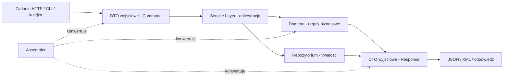
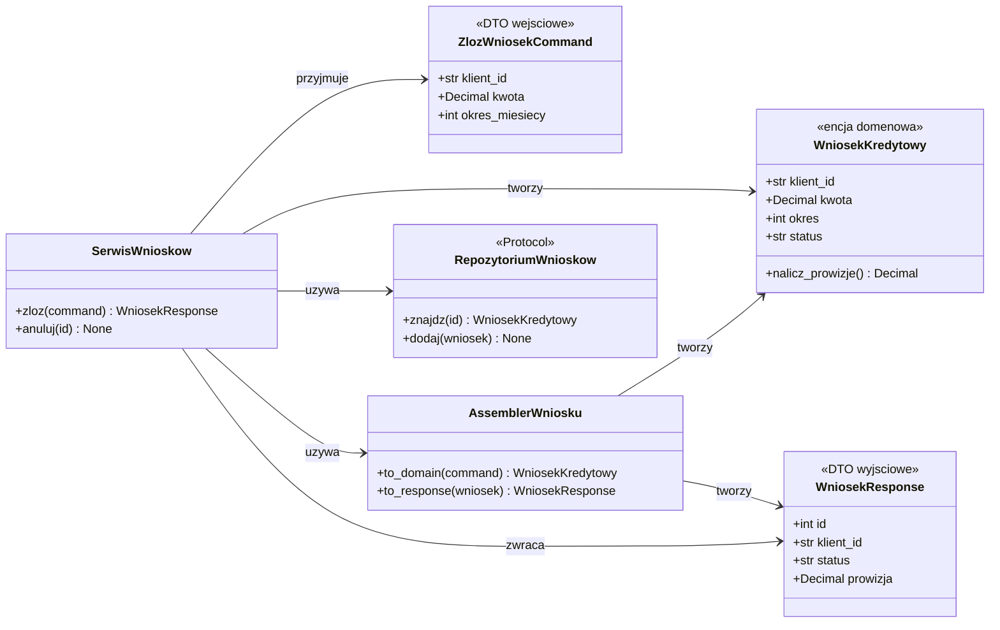
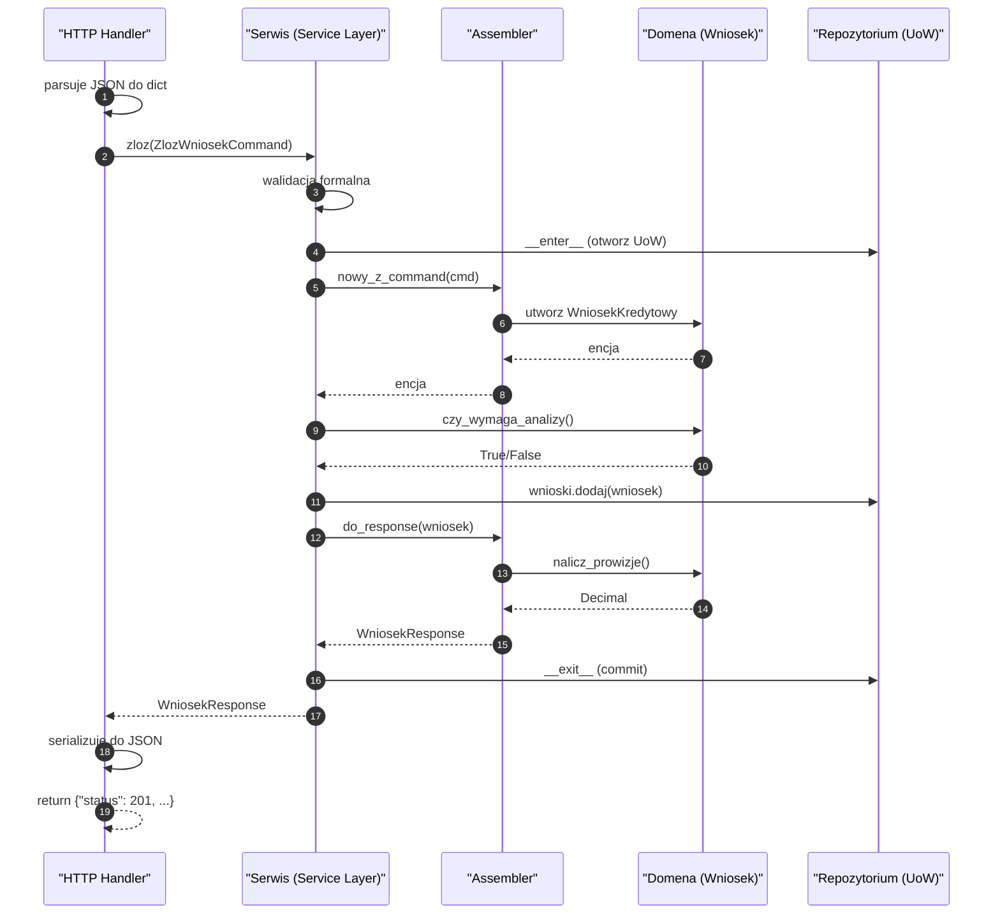
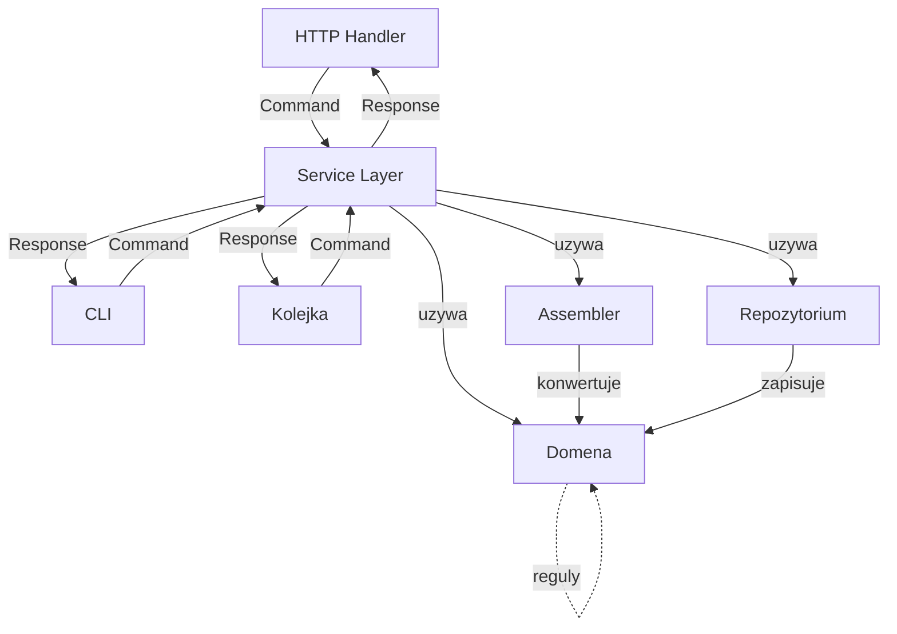
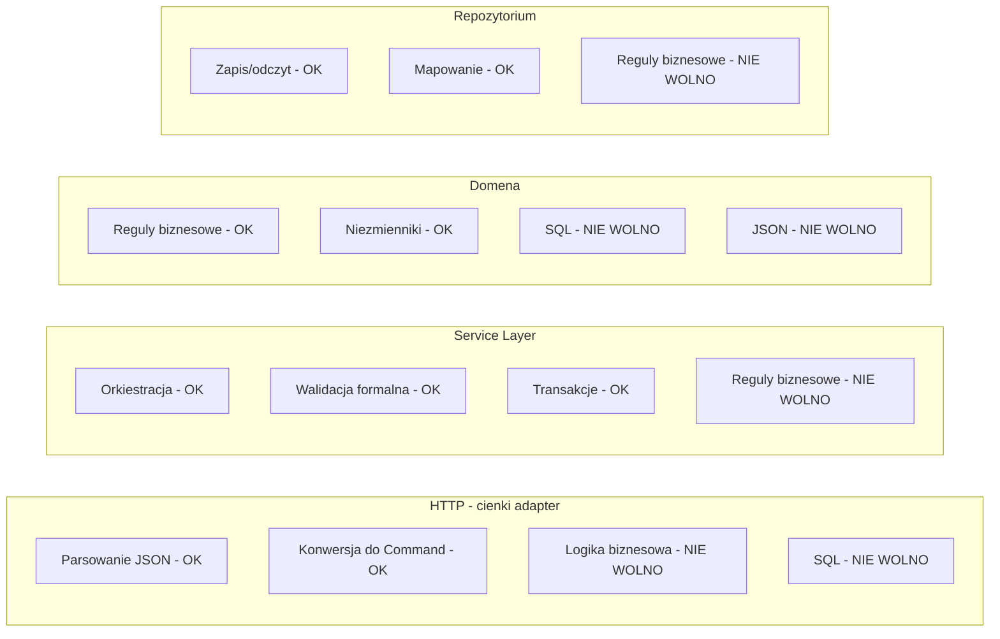
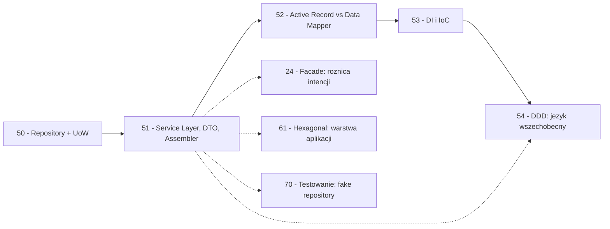

```markdown
---
modul: 51 — Service Layer, DTO i Assembler
plik: 51-service-layer-dto-assembler.md
poziom: sredni
wymaga: [50]
czas: ~195 minut czytania + ~460 minut ćwiczeń
---

# Moduł 51 — Service Layer, DTO i Assembler — granice aplikacji

> **TL;DR**
> - **Service Layer (warstwa usług)** to **granica aplikacji** — zbiór operacji, które aplikacja udostępnia światu zewnętrznemu (API, CLI, kolejka), orkiestrujących pracę domeny i infrastruktury.
> - **DTO (Data Transfer Object)** przenosi dane między warstwami bez logiki — zwykle oddzielny typ na wejściu (komenda) i osobny na wyjściu (odpowiedź).
> - **Assembler (mapper)** konwertuje DTO ↔ encje domenowe — dzięki niemu modele nie „zlepiają się" i zmiana jednego nie pociąga za sobą zmiany drugiego.
> - **Nie wyciekaj modelu domenowego** (ani tym bardziej ORM) do API — to prowadzi do cykli serializacji, leniwego ładowania w JSON, niekontrolowanych breaking changes i przecieków bezpieczeństwa.
> - W Pythonie warstwa usług to często **funkcja modułowa** (`def zloz_zamowienie(uow, dto) -> DTO`), a DTO — `dataclass(frozen=True)` — pydantic dopiero na **granicy wejścia** (parse i walidacja danych zewnętrznych).

---

## 0. Model mentalny

### Recepcja hotelu, list przewozowy i urzędnik tłumacz

Wyobraź sobie duży hotel. W lobby jest **recepcja** — jedno miejsce, do którego trafiają wszyscy klienci. Recepcja przyjmuje różne żądania: „chcę zameldować się", „chcę wymeldować się", „chcę zarezerwować salę konferencyjną", „chcę rachunek", „chcę zamówić taksówkę". Za każdym razem recepcja **nie robi wszystkiego sama** — koordynuje: jedna osoba wypełnia kartę meldunku, druga informuje housekeeping, trzecia przygotowuje klucz, czwarta woła taksówkę. **Recepcja jest granicą hotelu** — klient nie wchodzi do kuchni, do pralni, do pokoju housekeepingu. Rozmawia **wyłącznie z recepcją**. Ta jedna, spójna granica oddziela „gościa" od „hotelu". **Service Layer to taka recepcja dla aplikacji** — jedno miejsce prezentujące operacje, które aplikacja udostępnia, i koordynujące pracę domeny z infrastrukturą.

Zauważ drugą rzecz: **recepcja mówi w języku gościa**. Klient nie mówi „potrzebuję wpisu w rejestrze gości z numerem pokoju 314". Mówi „chcę się zameldować". Recepcja **tłumaczy** to na konkretne kroki: rejestracja, przydział pokoju, aktualizacja stanu. Podobnie Service Layer **tłumaczy język świata zewnętrznego** (żądań HTTP, argumentów CLI, wiadomości z kolejki) na **język domeny** — i odwrotnie. To jest istota granicy.

Drugi obraz — **list przewozowy**. Wyobraź sobie firmę spedycyjną. Kurier przywozi paletę do magazynu. Do palety przyczepiony jest **list przewozowy**: nadawca, odbiorca, waga, zawartość, uwagi. Ten list **nie podejmuje żadnych decyzji** — nie ustala trasy, nie decyduje o priorytecie, nie kalkuluje kosztu. **Zawiera dane**. Magazynier patrzy na niego i podejmuje decyzje. **DTO to taki list przewozowy** — obiekt **bez logiki**, przenoszący dane między warstwami. Jego zadaniem jest **transportować**, nie **decydować**.

I trzeci obraz, który uchwyci rolę Assemblera — **urzędnik-tłumacz w sądzie**. Do sądu przychodzi obywatel i składa pismo w języku obcym. Urzędnik-tłumacz **przekłada pismo na język urzędowy** i przekazuje sędziemu. Sędzia **nie czyta oryginału** — pracuje na tłumaczeniu. Gdy sędzia wydaje wyrok, urzędnik-tłumacz **tłumaczy go z powrotem** — na język, który obywatel zrozumie. Zwróć uwagę: **nikt nie „skleja" obu dokumentów**. Pismo oryginalne i tłumaczenie są **osobnymi dokumentami**, mają różne formaty, różne funkcje. **Assembler to taki tłumacz** — konwertuje DTO w model domenowy i odwrotnie, ale oba pozostają **osobnymi bytami**.

Zbierzmy trzy obrazy razem: **recepcja** (Service Layer) przyjmuje żądania i koordynuje. **List przewozowy** (DTO) przenosi dane. **Tłumacz-urzędnik** (Assembler) konwertuje między formatami. Trzy różne role, jedna wspólna idea: **świat zewnętrzny nie zna wnętrza aplikacji**.

| W analogii recepcji / listu / tłumacza | W kodzie |
|---|---|
| Recepcja hotelu | **Service Layer** — jedno wejście do aplikacji |
| Gość z żądaniem | Żądanie HTTP, argument CLI, wiadomość kolejki |
| „Chcę się zameldować" | `POST /check-in` albo `serwis.zamelduj(...)` |
| Koordynacja housekeepingu | Wywołania domeny + repozytorium + powiadomień |
| List przewozowy | **DTO** — obiekt bez logiki, tylko dane |
| Urzędnik-tłumacz | **Assembler** — konwertuje DTO ↔ domena |
| Pismo oryginalne i tłumaczenie | DTO i encja jako **osobne typy** |
| Sędzia nie czyta oryginału | Domena nie zna DTO |

> 🧠 **Zapamiętaj** — **Service Layer (warstwa usług) to zbiór operacji tworzących granicę aplikacji — koordynuje pracę domeny i infrastruktury, udostępniając przypadki użycia światu zewnętrznemu. DTO (Data Transfer Object) to obiekt przenoszący dane między warstwami bez logiki. Assembler (mapper) konwertuje między DTO a obiektami domenowymi.**

Zwróć uwagę na cztery słowa: **granica**, **koordynacja**, **przenoszenie**, **konwersja**. „Granica" — Service Layer jest punktem wejścia. „Koordynacja" — Service Layer nie wykonuje pracy sam, orkiestruje. „Przenoszenie" — DTO transportuje dane. „Konwersja" — Assembler tłumaczy formaty.

### Diagram — intuicja przepływu



*Diagram pokazuje pełen przepływ: żądanie zewnętrzne trafia jako DTO, Service Layer koordynuje domenę i repozytorium, a Assembler tłumaczy dane w obie strony.*

### Czego ten zestaw wzorców NIE robi

Rozbrójmy pięć mitów — te wzorce są podatne na nadużycia, bo „warstwy" brzmią profesjonalnie.

**Service Layer nie jest miejscem na logikę biznesową.** To **orkiestracja**, nie domena. Reguła „zamówienie może być złożone tylko jeśli klient ma limit" — jest **w domenie**, nie w serwisie. Service Layer **wywołuje** domenę, ale nie **zawiera** reguł.

**DTO nie jest encją.** DTO nie ma metod biznesowych, nie ma niezmienników, nie ma tożsamości. Jest **kontenerem danych**.

**Assembler nie jest „kopiowaczem"**. To konwersja **intencjonalna** — każde pole jest przemyślane. Nie kopiowanie wszystkich pól „na wszelki wypadek".

**DTO nie jest zawsze potrzebne.** Dla prostego CRUD — encja wystarczy. DTO ma sens, gdy **model domenowy różni się od modelu API** (albo gdy domena ma niejawną strukturę).

**Nie jest darmowe.** Każda warstwa to dodatkowe pliki, dodatkowe mapowanie, dodatkowe miejsce do popełnienia błędu. **Minimum dwie warstwy** (aplikacja + domena) to kompromis dla typowego projektu — wszystko ponad to musi być uzasadnione.

---

## 1. Problem, który rozwiązujemy

Wejdźmy w domenę 🏦 „Bank-klient". System obsługuje wniosek kredytowy, klient ma portfel, konto, dokumenty. Ktoś napisał endpoint w FastAPI, który zwraca **bezpośrednio encję ORM** i **wszystką logikę umieszcza w handlerze**.

### Kod „przed"

```python
# wniosek_v0.py — wersja naiwna, demonstracyjna
# UWAGA: kod celowo pokazuje problemy z brakiem warstw.

from __future__ import annotations

from dataclasses import dataclass
from datetime import datetime, timezone
from decimal import Decimal


@dataclass
class WniosekKredytowyORM:
    """Encja domenowa - ale z polami ORM i wewnetrznymi."""
    id: int | None
    klient_id: str
    kwota: Decimal
    okres_miesiecy: int
    status: str
    utworzono: str
    wewnetrzny_kod_ryzyka: str = ""
    haslo_do_audytu: str = "admin"        # WYCIEK BEZPIECZENSTWA!
    historia_zmian: list[str] = None


class BazaDanych:
    """Atrapa bazy danych."""
    _dane: dict[int, WniosekKredytowyORM] = {}
    _licznik = 0

    def zapisz(self, wniosek: WniosekKredytowyORM) -> WniosekKredytowyORM:
        BazaDanych._licznik += 1
        wniosek.id = BazaDanych._licznik
        BazaDanych._dane[wniosek.id] = wniosek
        return wniosek

    def po_id(self, id_: int) -> WniosekKredytowyORM | None:
        return BazaDanych._dane.get(id_)


def endpoint_zloz_wniosek(klient_id: str, kwota: float, okres: int) -> dict:
    """Handler HTTP z cala logika biznesowa i trwaloscia."""
    # --- 1. Walidacja prosto z requestu ---
    if kwota <= 0:
        return {"error": "kwota musi byc dodatnia"}
    if okres < 6 or okres > 360:
        return {"error": "okres musi byc 6-360 miesiecy"}
    if not klient_id:
        return {"error": "brak klienta"}

    # --- 2. Logika biznesowa w handlerze ---
    # Prowizja zalezna od okresu
    if okres > 240:
        prowizja = kwota * 0.03
    elif okres > 120:
        prowizja = kwota * 0.02
    else:
        prowizja = kwota * 0.01

    # Limit ryzyka
    if kwota > 500_000:
        return {"error": "powyzej limitu - wymaga analizy"}

    # --- 3. Trwalosc w handlerze ---
    baza = BazaDanych()
    wniosek = WniosekKredytowyORM(
        id=None,
        klient_id=klient_id,
        kwota=Decimal(str(kwota)),
        okres_miesiecy=okres,
        status="zlozony" if kwota < 100_000 else "w_weryfikacji",
        utworzono=datetime.now(timezone.utc).isoformat(),
        wewnetrzny_kod_ryzyka=f"ARY-{klient_id[-3:]}",
    )
    zapisany = baza.zapisz(wniosek)

    # --- 4. Zwrot encji ORM bezposrednio ---
    return {
        "id": zapisany.id,
        "klient_id": zapisany.klient_id,
        "kwota": str(zapisany.kwota),
        "okres_miesiecy": zapisany.okres_miesiecy,
        "status": zapisany.status,
        "utworzono": zapisany.utworzono,
        # UWAGA: to tez wycieka!
        "wewnetrzny_kod_ryzyka": zapisany.wewnetrzny_kod_ryzyka,
        "haslo_do_audytu": zapisany.haslo_do_audytu,
        "prowizja": prowizja,
    }


if __name__ == "__main__":
    wynik = endpoint_zloz_wniosek("KLIENT-123", 50000, 120)
    print(wynik)
```

Ten kod **działa**, ale ma **osiem problemów**, z których każdy łamie jakąś zasadę dobrego projektu.

### Code smell — warstwy pomieszane, model wycieka

| Problem | Gdzie | Konsekwencja |
|---|---|---|
| Logika biznesowa w handlerze HTTP | `endpoint_zloz_wniosek` | Nie da się jej ponownie użyć w CLI, w kolejce |
| Trwałość w handlerze HTTP | `baza.zapisz(wniosek)` | Handler nie do przetestowania bez bazy |
| Encja ORM zwracana jako JSON | `return {...}` | Wyciek pól wewnętrznych |
| Pole `haslo_do_audytu` w odpowiedzi | W `dict` | **WYCIEK BEZPIECZEŃSTWA** |
| Walidacja rozproszona | `if kwota <= 0: return {"error": ...}` | Nie ma spójnego kontraktu błędów |
| Kwota jako `float` | `kwota: float` | Gubi grosze |
| Brak DTO — dane idą jako surowe `dict` | Handler | Zmiana API psuje domenę i odwrotnie |
| Ta sama logika dla HTTP/CLI/kolejki wymaga powielenia | Nie da się użyć wielokrotnie | Rozjazd między interfejsami |
| Odpowiedź zależy od wewnętrznych pól encji | `wewnetrzny_kod_ryzyka` | Zmiana pola w encji zmienia API (breaking change) |

Zwróć uwagę na czwartą pozycję. **`haslo_do_audytu` trafia do JSON-a**. To nie jest błąd domenowy — to luka w architekturze. Gdyby model domenowy był **osobny** od modelu API, ten wyciek nie miałby jak się zdarzyć.

### Objawy — poznasz ten problem po tym, że...

- **Handler HTTP zawiera logikę biznesową.** Reguły (`if okres > 240`) są w kontrolerze.
- **Handler zna trwałość.** `baza.zapisz(z)` albo `Session().add(...)` w kontrolerze.
- **API zwraca encję ORM bezpośrednio.** Serializacja obejmuje **wszystkie** pola — także wewnętrzne.
- **Logika nie jest re-używalna.** CLI, kolejka, batch — każde musi mieć własną kopię.
- **Zmiana pola w encji zmienia API.** Breaking change bez kontroli.
- **Walidacja jest w handlerze.** Nie ma oddzielnego DTO z walidacją.
- **Kwoty jako `float`.** Gubią grosze (moduł 01).
- **Brak spójnych kodów błędów.** Raz `{"error": ...}`, raz wyjątek, raz pusty wynik.
- **Nie da się napisać testu logiki bez HTTP.** Test wymaga `TestClient` FastAPI albo mockowania request.
- **Ten sam mechanizm w dwóch miejscach.** API i CLI mają zduplikowane reguły.
- **Encja ma pola, których API nie potrzebuje — i odwrotnie.** Rozjazd.

---

## 2. Anatomia wzorców

### Uczestnicy Service Layer

| Rola | Odpowiedzialność | Co NIE jest jej zadaniem |
|---|---|---|
| **Service Layer** | Definiuje przypadki użycia; orkiestruje domenę, repozytorium, notifier, audyt | Nie zawiera reguł biznesowych (te są w domenie); nie zna HTTP |
| **Przypadek użycia (Use Case)** | Pojedyncza operacja (`zloz_wniosek`, `anuluj_zlecenie`) | Nie jest metodą na encji; nie zawiera logiki wewnątrz — orkiestruje |
| **DTO wejściowe (Command)** | Przenosi dane wejściowe z granicy | Nie ma metod; nie podejmuje decyzji |
| **DTO wyjściowe (Response)** | Przenosi dane wyjściowe na granicę | Nie ma metod; nie referuje encji |
| **Assembler / Mapper** | Konwertuje DTO ↔ encje; pojedyncza odpowiedzialność | Nie zawiera reguł biznesowych; nie wywołuje repozytoriów |

### Uczestnicy DTO

| Rola | Odpowiedzialność | Co NIE jest jej zadaniem |
|---|---|---|
| **DTO wejściowe (Command)** | Przenosi intencję z granicy (`ZlozWniosekCommand`) | Nie zawiera reguł domenowych; może mieć walidację **formatów** |
| **DTO wyjściowe (Response)** | Przenosi wynik na granicę (`WniosekResponse`) | Nie zawiera pól wewnętrznych; nie referuje encji |
| **Konstruktor DTO** | `dataclass`, `pydantic.BaseModel` | Nie ma metod domenowych |

### Diagram struktury



*Diagram pokazuje role: DTO wejściowe (Command) i wyjściowe (Response) są oddzielone od encji domenowej; Service Layer orkiestruje, Assembler konwertuje, Repozytorium trwa.*

### Warianty: klasyczny vs pythoniczny

| Aspekt | Klasyczny (Fowler) | Pythoniczny |
|---|---|---|
| Service Layer | Klasa z metodami | Funkcja modułowa albo `@dataclass` |
| Zależności | Konstruktor | Argumenty funkcji albo atrybuty `dataclass` |
| DTO | Klasa z getterami | `@dataclass(frozen=True)` |
| Walidacja wejścia | Metoda `validate()` | `pydantic.BaseModel` |
| Assembler | Klasa mapper | Funkcja `to_dto()` |
| Błędy | Wyjątki domenowe | Wyjątki domenowe + mapowanie na HTTP |
| Transakcje | `@Transactional` | `with uow:` |

Python daje **znacznie mniej boilerplate'u** — funkcja modułowa zamiast klasy, `dataclass` zamiast POJO, `pydantic` na granicy.

---

## 3. Implementacja krok po kroku

Przebudujemy endpoint z sekcji 1.

### Krok 1 — Zdefiniuj encję domenową

Obiekt domenowy — bez pól ORM, bez pól API, **tylko to, co ma sens w domenie**.

```python
from dataclasses import dataclass, field
from decimal import Decimal
from datetime import datetime


@dataclass
class WniosekKredytowy:
    """Encja domenowa wniosku kredytowego."""
    id: int | None
    klient_id: str
    kwota: Decimal
    okres_miesiecy: int
    status: str
    utworzono: datetime
    # Pole wewnetrzne - domena ma prawo miec, ale nie ujawni go na zewnatrz
    _wewnetrzny_kod_ryzyka: str = field(default="", repr=False)

    def nalicz_prowizje(self) -> Decimal:
        """Regula biznesowa - w domenie, nie w serwisie."""
        if self.okres_miesiecy > 240:
            stawka = Decimal("0.03")
        elif self.okres_miesiecy > 120:
            stawka = Decimal("0.02")
        else:
            stawka = Decimal("0.01")
        return (self.kwota * stawka).quantize(Decimal("0.01"))

    def czy_wymaga_analizy(self) -> bool:
        """Regula domenowa."""
        return self.kwota > Decimal("500000.00")
```

**Kluczowe:** `WniosekKredytowy` nie zna ORM, nie zna JSON, nie zna pól API. Jego zadanie to **reprezentować pojęcie biznesowe**.

### Krok 2 — Zdefiniuj DTO wejściowe (Command)

DTO wchodzi z granicy — reprezentuje **intencję** klienta.

```python
from dataclasses import dataclass


@dataclass(frozen=True)
class ZlozWniosekCommand:
    """DTO wejsciowe: intencja zlozenia wniosku."""
    klient_id: str
    kwota: Decimal
    okres_miesiecy: int
```

**Bez logiki.** Bez metod biznesowych. Tylko dane.

### Krok 3 — Zdefiniuj DTO wyjściowe (Response)

DTO wyjściowe to **to, co chcemy pokazać klientowi** — nie to, co mamy w encji.

```python
@dataclass(frozen=True)
class WniosekResponse:
    """DTO wyjsciowe: odpowiedz na zewnatrz."""
    id: int
    klient_id: str
    kwota: Decimal
    okres_miesiecy: int
    status: str
    prowizja: Decimal
    # Pole _wewnetrzny_kod_ryzyka NIE jest tu wymienione -
    # wiec nie moze wyciec.
```

Zwróć uwagę, że pole `_wewnetrzny_kod_ryzyka` z encji **nie ma** w DTO. **Wyciek jest niemożliwy**, bo go nie ma w typie.

### Krok 4 — Zdefiniuj Assembler

Konwersja w obie strony.

```python
class AssemblerWniosku:
    """Konwertuje DTO <-> encja."""

    @staticmethod
    def to_domain(command: ZlozWniosekCommand) -> WniosekKredytowy:
        return WniosekKredytowy(
            id=None,
            klient_id=command.klient_id,
            kwota=command.kwota,
            okres_miesiecy=command.okres_miesiecy,
            status="w_weryfikacji",   # wartosc poczatkowa
            utworzono=datetime.now(timezone.utc),
        )

    @staticmethod
    def to_response(wniosek: WniosekKredytowy) -> WniosekResponse:
        return WniosekResponse(
            id=wniosek.id or 0,
            klient_id=wniosek.klient_id,
            kwota=wniosek.kwota,
            okres_miesiecy=wniosek.okres_miesiecy,
            status=wniosek.status,
            prowizja=wniosek.nalicz_prowizje(),
        )
```

**Dwie reguły assemblera:** (1) `to_domain` — z DTO do encji, wykonuje się **raz** na wejściu. (2) `to_response` — z encji do DTO, wykonuje się **raz** na wyjściu. Oba **jawne** — widać, co jest mapowane.

### Krok 5 — Zdefiniuj repozytorium i UoW

Z modułu 50 — repozytorium w języku domeny.

```python
from typing import Protocol, runtime_checkable


@runtime_checkable
class RepozytoriumWnioskow(Protocol):
    def znajdz(self, id_: int) -> WniosekKredytowy | None: ...
    def dodaj(self, wniosek: WniosekKredytowy) -> None: ...


@runtime_checkable
class UnitOfWork(Protocol):
    def __enter__(self) -> "UnitOfWork": ...
    def __exit__(self, typ, wartosc, slad) -> None: ...
    @property
    def wnioski(self) -> RepozytoriumWnioskow: ...
    def commit(self) -> None: ...
    def rollback(self) -> None: ...
```

### Krok 6 — Zdefiniuj Service Layer

Serwis **orkiestruje** — walidacja wejścia, tworzenie encji, wywołanie repozytorium, zwrot DTO.

```python
class BladDomenowy(Exception):
    """Bazowy wyjatek domenowy."""


class WniosekOdrzucony(BladDomenowy):
    pass


class SerwisWnioskow:
    """Service Layer: orkiestruje przypadki uzycia."""

    def __init__(self, uow_fabryka) -> None:
        self._uow_fabryka = uow_fabryka

    def zloz(self, command: ZlozWniosekCommand) -> WniosekResponse:
        # Walidacja formatow (na granicy) - nie reguly biznesowe
        if not command.klient_id:
            raise ValueError("klient_id jest wymagany")
        if command.kwota <= 0:
            raise ValueError("kwota musi byc dodatnia")
        if not (6 <= command.okres_miesiecy <= 360):
            raise ValueError("okres musi byc 6-360 miesiecy")

        with self._uow_fabryka() as uow:
            wniosek = AssemblerWniosku.to_domain(command)

            # Reguly biznesowe - sprawdzamy w domenie
            if wniosek.czy_wymaga_analizy():
                wniosek.status = "w_weryfikacji"

            uow.wnioski.dodaj(wniosek)
            # UoW.commit() przy wyjsciu

            return AssemblerWniosku.to_response(wniosek)
```

**Kluczowe własności:**
- **Orkiestruje** — nie zawiera reguł biznesowych (`czy_wymaga_analizy` jest w domenie).
- **Nie zna HTTP** — to czysty Python. FastAPI opakuje go w endpoint.
- **Re-używalny** — z CLI, kolejki, joba, testów.

### Krok 7 — Warstwa HTTP jako cienki adapter

Teraz endpoint HTTP **jest cienki** — tylko tłumaczy HTTP na wywołania serwisu.

```python
def endpoint_http_zloz_wniosek(dane: dict) -> dict:
    """Handler HTTP: konwertuje JSON -> Command, wywoluje serwis, konwertuje wynik."""
    try:
        command = ZlozWniosekCommand(
            klient_id=dane["klient_id"],
            kwota=Decimal(str(dane["kwota"])),
            okres_miesiecy=int(dane["okres_miesiecy"]),
        )
        response = serwis.zloz(command)
        return {
            "id": response.id,
            "klient_id": response.klient_id,
            "kwota": str(response.kwota),
            "okres_miesiecy": response.okres_miesiecy,
            "status": response.status,
            "prowizja": str(response.prowizja),
        }
    except ValueError as blad:
        return {"error": str(blad), "kod": 400}
    except BladDomenowy as blad:
        return {"error": str(blad), "kod": 409}
```

**Handler jest cienki** — ~15 linii. Logika biznesowa jest w domenie, orkiestracja w serwisie, trwałość w repozytorium.

### Krok 8 — Weryfikacja

| Kryterium | Wersja „przed" | Wersja „po" |
|---|---|---|
| Logika biznesowa w handlerze | Tak | Nie (w domenie) |
| Handler zna bazę | Tak | Nie (w serwisie) |
| Wyciek encji ORM | Tak | Nie (DTO) |
| Wyciek `haslo_audytu` | Tak | Nie (brak pola w DTO) |
| Re-użycie z CLI | Nie | Tak (serwis) |
| Test logiki bez HTTP | Nie | Tak |
| Kwoty jako `Decimal` | Nie | Tak |
| Assembler jawny | Nie | Tak |
| Liczba klas | 2 | 7 |

Koszt: więcej klas i plików. Zysk: **czystość, bezpieczeństwo, re-używalność**.

---

## 4. Wersje pythoniczne i warianty

### 4.1 Service Layer jako funkcja modułowa

Bardzo pythoniczne — zamiast klasy, funkcja przyjmująca zależności.

```python
def zloz_wniosek(
    uow_fabryka,
    command: ZlozWniosekCommand,
) -> WniosekResponse:
    """Przypadek uzycia: zloz wniosek kredytowy."""
    if command.kwota <= 0:
        raise ValueError("kwota musi byc dodatnia")

    with uow_fabryka() as uow:
        wniosek = AssemblerWniosku.to_domain(command)
        uow.wnioski.dodaj(wniosek)
        return AssemblerWniosku.to_response(wniosek)
```

**Zaleta:** mniej kodu, zależności jawne w sygnaturze, `pytest` łatwo podstawia. **Wada:** grupa funkcji nie ma wspólnego mianownika — nie ma „serwisu" jako obiektu (ale czy to potrzebne?).

**W większości aplikacji Python** — funkcja modułowa wystarcza. Klasy są potrzebne, gdy:
- serwis ma wspólny stan (konfigurację),
- implementuje protokół,
- grupuje funkcje w API.

### 4.2 Service Layer jako `@dataclass`

Pośrednia forma — zależności jako pola.

```python
from dataclasses import dataclass


@dataclass
class SerwisWnioskow:
    uow_fabryka: object

    def zloz(self, command: ZlozWniosekCommand) -> WniosekResponse:
        with self.uow_fabryka() as uow:
            wniosek = AssemblerWniosku.to_domain(command)
            uow.wnioski.dodaj(wniosek)
            return AssemblerWniosku.to_response(wniosek)
```

**Zaleta:** brak boilerplate'u konstruktora; czytelne zależności. **Wada:** brak wspólnej abstrakcji (jeśli chcesz `Protocol`, trzeba jawnie).

### 4.3 DTO jako `dataclass` vs `pydantic.BaseModel`

To ważne rozróżnienie — **kiedy które**.

**`@dataclass(frozen=True)`:**

```python
@dataclass(frozen=True)
class ZlozWniosekCommand:
    klient_id: str
    kwota: Decimal
    okres_miesiecy: int
```

**`pydantic.BaseModel`:**

```python
from pydantic import BaseModel, Field, field_validator


class ZlozWniosekCommand(BaseModel, frozen=True):
    klient_id: str = Field(min_length=1)
    kwota: Decimal = Field(gt=0)
    okres_miesiecy: int = Field(ge=6, le=360)

    @field_validator("klient_id")
    @classmethod
    def sprawdz_klienta(cls, v: str) -> str:
        if v.startswith("TEMP-"):
            raise ValueError("klienci tymczasowi nie moga skladac")
        return v
```

**Kiedy `dataclass`:** DTO między **własnymi warstwami** (serwis → response), dane zaufane, prosty `dataclass` redukuje zależności, szybkość.

**Kiedy `pydantic`:** DTO **na granicy wejścia** — dane z JSON, HTTP, pliku, kolejki. Walidacja formatów, konwersja typów, obsługa błędów, parsowanie dat, model `json → DTO` **za darmo**.

**Reguła kciuka:** `pydantic` **na wejściu** (nieufne dane), `dataclass` **wewnątrz** (dane zaufane).

### 4.4 DTO wejściowe vs wyjściowe

**Dwa osobne typy.** Częsta pokusa, żeby mieć jeden DTO — „ten sam obiekt na wejściu i wyjściu". To antywzorzec.

**Dlaczego oddzielne:**
- **Wejście** ma to, co klient może podać (`klient_id`, `kwota`).
- **Wyjście** ma to, co klient może zobaczyć (`id`, `status`, `prowizja`, `utworzono`).
- **Różnią się** — i to jest zdrowe. Wejście nie ma `id`, wyjście nie ma np. „hasła z formularza".

**Wzorzec użycia:** `Command` (wejście) → `Response` (wyjście). Nazwy `Command`/`Query`/`Response` albo `Request`/`Response`.

### 4.5 Assembler jako funkcja

Zamiast klasy — funkcja modułowa.

```python
def to_response(wniosek: WniosekKredytowy) -> WniosekResponse:
    return WniosekResponse(
        id=wniosek.id or 0,
        klient_id=wniosek.klient_id,
        kwota=wniosek.kwota,
        okres_miesiecy=wniosek.okres_miesiecy,
        status=wniosek.status,
        prowizja=wniosek.nalicz_prowizje(),
    )


def to_domain(cmd: ZlozWniosekCommand) -> WniosekKredytowy:
    return WniosekKredytowy(
        id=None,
        klient_id=cmd.klient_id,
        kwota=cmd.kwota,
        okres_miesiecy=cmd.okres_miesiecy,
        status="w_weryfikacji",
        utworzono=datetime.now(timezone.utc),
    )
```

**Zaleta:** brak klasy dla dwóch funkcji. **Wada:** funkcja `to_domain` dla tego samego DTO zawsze daje ten sam typ — nie ma „wiele mapperów dla jednego typu". Dla złożonych przypadków — klasa.

### 4.6 Walidacja — gdzie i jak

**Reguła:** walidacja **formatów** na granicy, walidacja **reguł domenowych** w domenie.

```python
# DTO wejsciowe (pydantic) - walidacja formatow
class ZlozWniosekCommand(BaseModel, frozen=True):
    klient_id: str = Field(min_length=1)
    kwota: Decimal = Field(gt=0)
    okres_miesiecy: int = Field(ge=6, le=360)


# Domena - walidacja regul biznesowych
@dataclass
class WniosekKredytowy:
    ...
    def czy_wymaga_analizy(self) -> bool:
        return self.kwota > Decimal("500000")
```

**Dwa poziomy walidacji:**
1. **Formalna** (pydantic): „kwota to liczba > 0", „klient_id niepusty". Zwraca **422 Unprocessable Entity**.
2. **Domenowa** (w encji): „kwota > 500 000 wymaga analizy". Rzuca **BladDomenowy** → `409 Conflict`.

**Nie duplikuj** reguł — jeśli walidacja jest w pydantic, nie powtarzaj jej w domenie (chyba że domena ma **inne** reguły).

### 4.7 Podsumowanie — tabela wyboru

| Sytuacja | Wariant |
|---|---|
| Prosty serwis, brak konfiguracji | Funkcja modułowa (4.1) |
| Serwis z konfiguracją, grupowanie | `@dataclass` (4.2) |
| DTO wejściowe z JSON/HTTP | `pydantic` (4.3) |
| DTO wewnętrzne (serwis → response) | `dataclass(frozen=True)` (4.3) |
| Dwa oddzielne DTO (in/out) | `Command` + `Response` (4.4) |
| Prostý assembler | Funkcja (4.5) |
| Złożone mapowanie | Klasa mapper |
| Walidacja wejścia | `pydantic` |
| Walidacja domenowa | W encji |

> 🧠 **Zapamiętaj** — **Warstwa usług w Pythonie to zwykle funkcja modułowa albo `@dataclass`. DTO to `dataclass(frozen=True)` wewnętrznie i `pydantic` na granicy. Assembler to funkcja.** Klasy pełne są potrzebne tylko dla złożonych przypadków.

---

## 5. Przykład z życia: 🏦 Bank-klient — pełny uruchamialny kod

Zbudujemy pełny system składania wniosku kredytowego z warstwami: HTTP handler, DTO, serwis, domena, repozytorium, assembler.

### Kod

```python
# wniosek_kredytowy.py — pelny przyklad warstw
from __future__ import annotations

from dataclasses import dataclass, field, replace
from datetime import datetime, timezone
from decimal import ROUND_HALF_UP, Decimal
from typing import Protocol, runtime_checkable


# ===========================================================================
# 1. Domena - encja
# ===========================================================================

GROSZ = Decimal("0.01")


def zaokraglij(k: Decimal) -> Decimal:
    return k.quantize(GROSZ, rounding=ROUND_HALF_UP)


@dataclass
class WniosekKredytowy:
    """Encja domenowa - reguly biznesowe."""
    id: int | None
    klient_id: str
    kwota: Decimal
    okres_miesiecy: int
    status: str
    utworzono: datetime
    _kod_ryzyka: str = field(default="", repr=False)

    def nalicz_prowizje(self) -> Decimal:
        """Prowizja zalezna od okresu - regula biznesowa."""
        if self.okres_miesiecy > 240:
            stawka = Decimal("0.03")
        elif self.okres_miesiecy > 120:
            stawka = Decimal("0.02")
        else:
            stawka = Decimal("0.01")
        return zaokraglij(self.kwota * stawka)

    def czy_wymaga_analizy(self) -> bool:
        return self.kwota > Decimal("500000")

    def anuluj(self) -> None:
        if self.status in ("zatwierdzony", "wyplacony"):
            raise BladDomenowy("nie mozna anulowac zatwierdzonego wniosku")
        self.status = "anulowany"


# ===========================================================================
# 2. Wyjatki domenowe
# ===========================================================================

class BladDomenowy(Exception):
    """Bazowy blad domeny."""


class BladWalidacji(BladDomenowy):
    """Blad walidacji formalnej."""


class WniosekOdrzucony(BladDomenowy):
    """Wniosek odrzucony przez reguly biznesowe."""


# ===========================================================================
# 3. DTO wejsciowe
# ===========================================================================

@dataclass(frozen=True)
class ZlozWniosekCommand:
    """DTO wejsciowe - intencja klienta."""
    klient_id: str
    kwota: Decimal
    okres_miesiecy: int


@dataclass(frozen=True)
class AnulujWniosekCommand:
    wniosek_id: int
    powod: str = ""


# ===========================================================================
# 4. DTO wyjsciowe
# ===========================================================================

@dataclass(frozen=True)
class WniosekResponse:
    """DTO wyjsciowe - to, co widzi klient."""
    id: int
    klient_id: str
    kwota: Decimal
    okres_miesiecy: int
    status: str
    prowizja: Decimal
    utworzono: str

    # UWAGA: pole _kod_ryzyka NIE jest tu wymienione


# ===========================================================================
# 5. Assembler
# ===========================================================================

class AssemblerWniosku:
    """Konwersja DTO <-> encja."""

    @staticmethod
    def nowy_z_command(cmd: ZlozWniosekCommand) -> WniosekKredytowy:
        return WniosekKredytowy(
            id=None,
            klient_id=cmd.klient_id,
            kwota=cmd.kwota,
            okres_miesiecy=cmd.okres_miesiecy,
            status="zlozony",
            utworzono=datetime.now(timezone.utc),
        )

    @staticmethod
    def do_response(w: WniosekKredytowy) -> WniosekResponse:
        return WniosekResponse(
            id=w.id or 0,
            klient_id=w.klient_id,
            kwota=w.kwota,
            okres_miesiecy=w.okres_miesiecy,
            status=w.status,
            prowizja=w.nalicz_prowizje(),
            utworzono=w.utworzono.isoformat(timespec="seconds"),
        )


# ===========================================================================
# 6. Repozytorium i UoW
# ===========================================================================

@runtime_checkable
class RepozytoriumWnioskow(Protocol):
    def znajdz(self, id_: int) -> WniosekKredytowy | None: ...
    def dodaj(self, w: WniosekKredytowy) -> None: ...


@runtime_checkable
class UnitOfWork(Protocol):
    def __enter__(self) -> "UnitOfWork": ...
    def __exit__(self, typ, wartosc, slad) -> None: ...
    @property
    def wnioski(self) -> RepozytoriumWnioskow: ...
    def commit(self) -> None: ...
    def rollback(self) -> None: ...


class RepozytoriumWnioskowInMemory:
    def __init__(self) -> None:
        self._dane: dict[int, WniosekKredytowy] = {}
        self._licznik = 0

    def znajdz(self, id_: int) -> WniosekKredytowy | None:
        return self._dane.get(id_)

    def dodaj(self, w: WniosekKredytowy) -> None:
        if w.id is None:
            self._licznik += 1
            w.id = self._licznik
        self._dane[w.id] = w


class JednostkaPracyInMemory:
    def __init__(self) -> None:
        self._wnioski = RepozytoriumWnioskowInMemory()
        self._zakonczona = False

    def __enter__(self) -> "JednostkaPracyInMemory":
        return self

    def __exit__(self, typ, wartosc, slad) -> None:
        if self._zakonczona:
            return
        if typ is None:
            self.commit()
        else:
            self.rollback()

    @property
    def wnioski(self) -> RepozytoriumWnioskow:
        return self._wnioski

    def commit(self) -> None:
        self._zakonczona = True

    def rollback(self) -> None:
        self._zakonczona = True


# ===========================================================================
# 7. Service Layer
# ===========================================================================

class SerwisWnioskow:
    """Serwis aplikacyjny - orkiestruje przypadki uzycia."""

    def __init__(self, uow_fabryka) -> None:
        self._uow_fabryka = uow_fabryka

    def zloz(self, cmd: ZlozWniosekCommand) -> WniosekResponse:
        # Walidacja formalna (na granicy)
        if cmd.kwota <= 0:
            raise BladWalidacji("kwota musi byc dodatnia")
        if not (6 <= cmd.okres_miesiecy <= 360):
            raise BladWalidacji("okres musi byc 6-360 miesiecy")
        if not cmd.klient_id:
            raise BladWalidacji("klient_id jest wymagany")

        with self._uow_fabryka() as uow:
            wniosek = AssemblerWniosku.nowy_z_command(cmd)

            # Reguly biznesowe (domena)
            if wniosek.czy_wymaga_analizy():
                wniosek.status = "w_weryfikacji"
                wniosek._kod_ryzyka = f"ARY-{cmd.klient_id[-3:]}"

            uow.wnioski.dodaj(wniosek)
            return AssemblerWniosku.do_response(wniosek)

    def anuluj(self, cmd: AnulujWniosekCommand) -> WniosekResponse:
        with self._uow_fabryka() as uow:
            wniosek = uow.wnioski.znajdz(cmd.wniosek_id)
            if wniosek is None:
                raise BladDomenowy(f"nie ma wniosku {cmd.wniosek_id}")
            wniosek.anuluj()   # regula domenowa
            uow.wnioski.dodaj(wniosek)
            return AssemblerWniosku.do_response(wniosek)

    def pobierz(self, wniosek_id: int) -> WniosekResponse:
        with self._uow_fabryka() as uow:
            wniosek = uow.wnioski.znajdz(wniosek_id)
            if wniosek is None:
                raise BladDomenowy(f"nie ma wniosku {wniosek_id}")
            return AssemblerWniosku.do_response(wniosek)


# ===========================================================================
# 8. Warstwa HTTP (cienki adapter)
# ===========================================================================

class ApiHTTP:
    """Cienki adapter HTTP - tylko tlumaczy na serwis."""

    def __init__(self, serwis: SerwisWnioskow) -> None:
        self._serwis = serwis

    def post_wniosek(self, dane: dict) -> dict:
        try:
            cmd = ZlozWniosekCommand(
                klient_id=dane["klient_id"],
                kwota=Decimal(str(dane["kwota"])),
                okres_miesiecy=int(dane["okres_miesiecy"]),
            )
            response = self._serwis.zloz(cmd)
            return {"status": 201, "body": self._response_json(response)}
        except BladWalidacji as blad:
            return {"status": 422, "body": {"error": str(blad)}}
        except BladDomenowy as blad:
            return {"status": 409, "body": {"error": str(blad)}}

    def delete_wniosek(self, wniosek_id: int, powod: str = "") -> dict:
        try:
            cmd = AnulujWniosekCommand(wniosek_id, powod)
            response = self._serwis.anuluj(cmd)
            return {"status": 200, "body": self._response_json(response)}
        except BladDomenowy as blad:
            return {"status": 409, "body": {"error": str(blad)}}

    def get_wniosek(self, wniosek_id: int) -> dict:
        try:
            response = self._serwis.pobierz(wniosek_id)
            return {"status": 200, "body": self._response_json(response)}
        except BladDomenowy as blad:
            return {"status": 404, "body": {"error": str(blad)}}

    @staticmethod
    def _response_json(r: WniosekResponse) -> dict:
        return {
            "id": r.id,
            "klient_id": r.klient_id,
            "kwota": str(r.kwota),
            "okres_miesiecy": r.okres_miesiecy,
            "status": r.status,
            "prowizja": str(r.prowizja),
            "utworzono": r.utworzono,
            # UWAGA: brak _kod_ryzyka - nie moze wyciec
        }


# ===========================================================================
# 9. Demonstracja
# ===========================================================================

if __name__ == "__main__":
    # Wspoldzielona baza in-memory (dla demonstracji)
    baza = RepozytoriumWnioskowInMemory()

    def fabryka_uow():
        uow = JednostkaPracyInMemory()
        uow._wnioski = baza
        return uow

    serwis = SerwisWnioskow(fabryka_uow)
    api = ApiHTTP(serwis)

    print("=== 1. Poprawne zlozenie wniosku ===")
    wynik = api.post_wniosek({
        "klient_id": "KLIENT-123",
        "kwota": "50000",
        "okres_miesiecy": 180,
    })
    print(f"  Status: {wynik['status']}")
    print(f"  Body: {wynik['body']}")

    print("\n=== 2. Wniosek wymagajacy analizy ===")
    wynik = api.post_wniosek({
        "klient_id": "KLIENT-456",
        "kwota": "700000",
        "okres_miesiecy": 300,
    })
    print(f"  Status: {wynik['status']}")
    print(f"  Status wniosku: {wynik['body']['status']}")

    print("\n=== 3. Blad walidacji ===")
    wynik = api.post_wniosek({
        "klient_id": "K-789",
        "kwota": "-1000",
        "okres_miesiecy": 120,
    })
    print(f"  Status: {wynik['status']} -> {wynik['body']}")

    print("\n=== 4. Klient_id pusty ===")
    wynik = api.post_wniosek({
        "klient_id": "",
        "kwota": "1000",
        "okres_miesiecy": 120,
    })
    print(f"  Status: {wynik['status']} -> {wynik['body']}")

    print("\n=== 5. Pobranie wniosku ===")
    wynik = api.get_wniosek(1)
    print(f"  Status: {wynik['status']}")
    print(f"  Body: {wynik['body']}")

    print("\n=== 6. Anulowanie wniosku ===")
    wynik = api.delete_wniosek(1, "rezygnacja klienta")
    print(f"  Status: {wynik['status']}")
    print(f"  Status po anulowaniu: {wynik['body']['status']}")

    print("\n=== 7. Kontrola bezpieczenstwa - brak wycieku ===")
    wynik = api.get_wniosek(2)
    pola_w_odpowiedzi = set(wynik["body"].keys())
    zakazane = {"_kod_ryzyka", "haslo_audytu", "haslo_do_audytu"}
    wyciek = pola_w_odpowiedzi & zakazane
    print(f"  Pola w odpowiedzi: {sorted(pola_w_odpowiedzi)}")
    print(f"  Wyciek: {wyciek or 'brak'}")
```

### Co ten przykład pokazuje

**Punkt 1 — pełny przepływ.** Żądanie HTTP → Command → serwis → domena → repozytorium → Response → JSON. Wszystkie warstwy są **widoczne i rozdzielone**.

**Punkt 2 — reguła domenowa w domenie.** `czy_wymaga_analizy()` jest **w encji**. Serwis tylko **sprawdza wynik** i ustawia status.

**Punkt 3 — błąd walidacji.** Kwota ujemna → 422. **Format błędu** jest spójny.

**Punkt 4 — pusty klient.** To też 422. Spójność obsługi błędów.

**Punkt 5 — pobranie.** Serwis udostępnia `pobierz` — kolejny przypadek użycia.

**Punkt 6 — anulowanie.** Reguła „nie można anulować zatwierdzonego" jest w domenie (`WniosekKredytowy.anuluj`).

**Punkt 7 — brak wycieku.** Odpowiedź **nie zawiera** pól wewnętrznych (`_kod_ryzyka`). Bo DTO ich nie ma — wyciek jest **niemożliwy**.

### Testy

```python
# test_wniosek_kredytowy.py — uruchomienie: pytest test_wniosek_kredytowy.py -v
from datetime import datetime, timezone
from decimal import Decimal

import pytest

from wniosek_kredytowy import (
    AnulujWniosekCommand,
    ApiHTTP,
    AssemblerWniosku,
    BladDomenowy,
    BladWalidacji,
    JednostkaPracyInMemory,
    RepozytoriumWnioskowInMemory,
    SerwisWnioskow,
    WniosekKredytowy,
    WniosekResponse,
    ZlozWniosekCommand,
)


@pytest.fixture
def baza() -> RepozytoriumWnioskowInMemory:
    return RepozytoriumWnioskowInMemory()


@pytest.fixture
def serwis(baza):
    def fabryka_uow():
        uow = JednostkaPracyInMemory()
        uow._wnioski = baza
        return uow
    return SerwisWnioskow(fabryka_uow)


def command(**nadp) -> ZlozWniosekCommand:
    dane = {"klient_id": "K-T", "kwota": Decimal("10000"), "okres_miesiecy": 120}
    dane.update(nadp)
    return ZlozWniosekCommand(**dane)


# --- Domena --------------------------------------------------------------

def test_prowizja_dla_krotkiego_okresu() -> None:
    w = WniosekKredytowy(
        id=None, klient_id="K-1", kwota=Decimal("10000"),
        okres_miesiecy=60, status="nowy",
        utworzono=datetime.now(timezone.utc),
    )
    assert w.nalicz_prowizje() == Decimal("100.00")


def test_prowizja_dla_dlugiego_okresu() -> None:
    w = WniosekKredytowy(
        id=None, klient_id="K-1", kwota=Decimal("10000"),
        okres_miesiecy=300, status="nowy",
        utworzono=datetime.now(timezone.utc),
    )
    assert w.nalicz_prowizje() == Decimal("300.00")


def test_wymaga_analizy_dla_duzej_kwoty() -> None:
    w = WniosekKredytowy(
        id=None, klient_id="K-1", kwota=Decimal("600000"),
        okres_miesiecy=120, status="nowy",
        utworzono=datetime.now(timezone.utc),
    )
    assert w.czy_wymaga_analizy() is True


def test_nie_wymaga_analizy_dla_malej_kwoty() -> None:
    w = WniosekKredytowy(
        id=None, klient_id="K-1", kwota=Decimal("100000"),
        okres_miesiecy=120, status="nowy",
        utworzono=datetime.now(timezone.utc),
    )
    assert w.czy_wymaga_analizy() is False


def test_anuluj_wniosek_w_stanie_nowy() -> None:
    w = WniosekKredytowy(
        id=None, klient_id="K-1", kwota=Decimal("100000"),
        okres_miesiecy=120, status="nowy",
        utworzono=datetime.now(timezone.utc),
    )
    w.anuluj()
    assert w.status == "anulowany"


def test_anuluj_wniosek_zatwierdzony_rzuca() -> None:
    w = WniosekKredytowy(
        id=None, klient_id="K-1", kwota=Decimal("100000"),
        okres_miesiecy=120, status="zatwierdzony",
        utworzono=datetime.now(timezone.utc),
    )
    with pytest.raises(BladDomenowy):
        w.anuluj()


# --- Assembler -----------------------------------------------------------

def test_assembler_command_do_domeny() -> None:
    cmd = command()
    w = AssemblerWniosku.nowy_z_command(cmd)
    assert w.id is None
    assert w.klient_id == cmd.klient_id
    assert w.kwota == cmd.kwota
    assert w.status == "zlozony"


def test_assembler_do_response_ukrywa_pole_wewn() -> None:
    """Test kontraktu: pole _kod_ryzyka nie przechodzi."""
    w = WniosekKredytowy(
        id=1, klient_id="K-1", kwota=Decimal("100000"),
        okres_miesiecy=120, status="w_weryfikacji",
        utworzono=datetime.now(timezone.utc),
    )
    w._kod_ryzyka = "TAJNE-123"

    r = AssemblerWniosku.do_response(w)

    # Response nie ma pola _kod_ryzyka
    assert not hasattr(r, "_kod_ryzyka")
    pola = {f.name for f in r.__dataclass_fields__.values()}
    assert "_kod_ryzyka" not in pola


# --- Service Layer --------------------------------------------------------

def test_serwis_zloz_zwraca_response(serwis) -> None:
    r = serwis.zloz(command())
    assert isinstance(r, WniosekResponse)
    assert r.status == "zlozony"


def test_serwis_weryfikuje_ujemna_kwote(serwis) -> None:
    with pytest.raises(BladWalidacji, match="kwota"):
        serwis.zloz(command(kwota=Decimal("-1000")))


def test_serwis_weryfikuje_okres(serwis) -> None:
    with pytest.raises(BladWalidacji, match="okres"):
        serwis.zloz(command(okres_miesiecy=1))


def test_serwis_ustala_status_weryfikacji_dla_duzej_kwoty(serwis) -> None:
    r = serwis.zloz(command(kwota=Decimal("700000")))
    assert r.status == "w_weryfikacji"


def test_serwis_pobierz(serwis) -> None:
    r1 = serwis.zloz(command())
    r2 = serwis.pobierz(r1.id)
    assert r2.id == r1.id


def test_serwis_pobierz_nieistniejacego(serwis) -> None:
    with pytest.raises(BladDomenowy, match="nie ma wniosku"):
        serwis.pobierz(999)


def test_serwis_anuluj(serwis) -> None:
    r1 = serwis.zloz(command())
    r2 = serwis.anuluj(AnulujWniosekCommand(r1.id, "rezygnacja"))
    assert r2.status == "anulowany"


# --- HTTP Adapter --------------------------------------------------------

def test_http_post_sukces(serwis) -> None:
    api = ApiHTTP(serwis)
    wynik = api.post_wniosek({
        "klient_id": "K-1", "kwota": "50000", "okres_miesiecy": 120,
    })
    assert wynik["status"] == 201
    assert "prowizja" in wynik["body"]


def test_http_post_walidacja(serwis) -> None:
    api = ApiHTTP(serwis)
    wynik = api.post_wniosek({
        "klient_id": "K-1", "kwota": "-1000", "okres_miesiecy": 120,
    })
    assert wynik["status"] == 422


def test_http_post_brak_pustego_klienta(serwis) -> None:
    api = ApiHTTP(serwis)
    wynik = api.post_wniosek({
        "klient_id": "", "kwota": "50000", "okres_miesiecy": 120,
    })
    assert wynik["status"] == 422


def test_http_get_nieistniejacy(serwis) -> None:
    api = ApiHTTP(serwis)
    wynik = api.get_wniosek(999)
    assert wynik["status"] == 404


def test_http_odpowiedz_nie_zawiera_wewnetrznych_pol(serwis) -> None:
    """Kluczowy test bezpieczenstwa."""
    api = ApiHTTP(serwis)
    api.post_wniosek({
        "klient_id": "K-1", "kwota": "700000", "okres_miesiecy": 300,
    })
    wynik = api.get_wniosek(1)
    pola = set(wynik["body"].keys())
    zakazane = {"_kod_ryzyka", "haslo_audytu", "kod_ryzyka"}
    assert not (pola & zakazane), f"Wyciek pol: {pola & zakazane}"
```

Kluczowy test: **`test_assembler_do_response_ukrywa_pole_wewn`** — pole `_kod_ryzyka` **nie przechodzi** do response. I **`test_http_odpowiedz_nie_zawiera_wewnetrznych_pol`** — bezpieczeństwo end-to-end.

---

## 6. Dynamika

### 6.1 Pełny przepływ — HTTP → wszystkie warstwy



*Diagram pokazuje pełny cykl: handler HTTP (cienki) → serwis (orkiestracja) → assembler (konwersja) → domena (reguły) → repozytorium (trwałość) — każda warstwa ma jedną rolę.*

Przeczytajmy ten przebieg zdanie po zdaniu.

**Kroki 1–3.** Handler HTTP dostaje JSON, parsuje go do `Command` (DTO wejściowe). **Handler nie zawiera logiki** — tylko konwertuje.

**Krok 4.** Serwis wykonuje **walidację formalną** (kwota > 0, okres w zakresie). To walidacja formatu, nie domenowa.

**Krok 5.** Serwis otwiera **UoW** (`with`). Od tego momentu wszystkie zmiany są zgrupowane.

**Kroki 6–8.** Assembler konwertuje `Command` na encję `WniosekKredytowy`. Zwróć uwagę: **`Command` i `Wniosek` to osobne typy** — assembler tłumaczy.

**Kroki 9–10.** Serwis wywołuje **regułę domenową** `czy_wymaga_analizy()`. Reguła jest w domenie. Serwis tylko reaguje na wynik.

**Kroki 11–12.** Serwis dodaje encję do repozytorium (przez UoW). Repozytorium zapisuje.

**Kroki 13–15.** Assembler tworzy `WniosekResponse`. Wywołuje `nalicz_prowizje()` — kolejną regułę domenową.

**Kroki 16–18.** UoW commituje (przy wyjściu z bloku), serwis zwraca response do handlera. Handler serializuje do JSON.

**Kluczowa własność:** **każda warstwa ma jedną rolę**. Handler — HTTP. Serwis — orkiestracja. Assembler — konwersja. Domena — reguły. Repozytorium — trwałość. Zmiana w jednej nie wpływa na drugą.

### 6.2 Diagram warstw — gdzie są zależności



*Diagram pokazuje, że Service Layer jest **wspólnym wejściem** dla HTTP, CLI i kolejki — jedna implementacja obsługuje wszystkie interfejsy. To jedna z najważniejszych korzyści tego wzorca.*

Zauważ, że **klient (HTTP/CLI/kolejka) nie zna domeny ani repozytorium** — zna tylko Service Layer. To redukuje sprzężenie między światem zewnętrznym a wnętrzem aplikacji.

### 6.3 Tabela — co wolno w każdej warstwie



*Diagram pokazuje podział odpowiedzialności między warstwami — co wolno, a czego nie wolno w każdej z nich.*

### 6.4 Tabela porównawcza — encja vs DTO vs ORM vs API

To jeden z najważniejszych artefaktów tego modułu.

| Cecha | Encja domenowa | DTO | Model ORM | Model API (JSON) |
|---|---|---|---|---|
| Zna reguły biznesowe | **Tak** | Nie | Nie | Nie |
| Zna bazę danych | Nie | Nie | **Tak** | Nie |
| Zna JSON | Nie | Nie | Nie | **Tak** |
| Ma tożsamość (`id`) | Tak | Zwykle tak | Tak | Tak |
| Jest niemutowalny | Zwykle nie | Zwykle tak | Nie | Tak |
| Zawiera pola wrażliwe | Możliwe | **Nie** | Możliwe | **Nigdy** |
| Można go serializować | Nie | Tak | Nie (ryzykowne) | Tak |
| Zmiana łamie innych? | Domena | Warstwy | Schemat | Klientów API |
| Kiedy używać | Zawsze | Na granicy | Tylko jako technika | Zawsze dla HTTP |
| Kiedy NIE | Nie używaj jako DTO | Nie dawaj mu logiki | Nie wyciekaj do API | Nie wprowadzaj reguł |

**Kluczowa zasada:** **każdy model ma jedno zadanie**. Mieszanie — np. encja ORM serializowana do JSON — prowadzi do wycieków i problemów.

> 💡 **Intuicja** — Warstwy to jak **linie produkcyjne**: każde stanowisko robi jedną rzecz. Surowiec (JSON) wchodzi, stacja 1 (handler) pobiera, stacja 2 (serwis) planuje, stacja 3 (domena) przetwarza, stacja 4 (repozytorium) pakuje, stacja 5 (handler) wysyła. **Żadna stacja nie robi wszystkiego.**

---

## 7. Kiedy używać / kiedy NIE używać

### Kiedy używać Service Layer

**Gdy aplikacja ma wiele wejść.** HTTP, CLI, kolejka, batch — wszystkie potrzebują tej samej logiki. Service Layer to **jedno miejsce**.

**Gdy operacja jest złożona.** Wiele kroków, wiele zależności, transakcja, powiadomienia, audyt.

**Gdy chcesz testować bez HTTP.** Serwis testuje się bez `TestClient`, bez sieci, bez bazy.

**Gdy chcesz re-użyć logikę.** Ta sama operacja z API, z jobu nocnego, z komendy admina.

**Gdy domena nie ma naturalnego miejsca dla operacji.** Nie każdy przypadek użycia pasuje do metody na encji.

**Gdy masz wiele serwisów w systemie.** Serwisy są naturalnymi granicami między obszarami.

### Kiedy używać DTO

**Gdy model API różni się od modelu domenowego.** Najczęstszy powód.

**Gdy chcesz kontrolować, co wychodzi z aplikacji.** DTO to gwarancja — jeśli pole nie jest w DTO, nie wycieknie.

**Gdy potrzebujesz walidacji wejścia.** `pydantic` na granicy — jedna reguła, jedno miejsce.

**Gdy chcesz stabilnego API.** Zmiana encji nie zmienia DTO, dopóki assembler mapuje.

**Gdy masz wiele warstw.** DTO izoluje granice.

**Gdy współpracujesz z zewnętrznym API.** DTO chroni przed wyciekiem wewnętrznych struktur.

### Kiedy używać Assembler

**Gdy DTO i encja się różnią.** Najczęstszy powód.

**Gdy mapowanie ma logikę** (np. `prowizja` w response liczona z encji). To **nie kopiowanie**, to przemyślana konwersja.

**Gdy chcesz widzieć mapowanie w jednym miejscu.** Łatwiej utrzymać.

**Gdy tego samego DTO używa się w wielu miejscach.** Wspólny assembler.

### Kiedy NIE używać wszystkich trzech

**Gdy aplikacja to proste REST CRUD.** Trzy modele, pięć operacji — Service Layer + DTO + Assembler to **nadmiar**. Model ORM w JSON wystarczy.

**Gdy domena i API są identyczne.** Jeśli `WniosekKredytowy` w bazie i w API są tym samym, DTO nic nie wnosi.

**Gdy nie ma wielu wejść.** Jedno API, jedna ścieżka — Service Layer nie pomoże.

**Gdy zespół jest mały i projekt krótkotrwały.** Mniej warstw = szybszy start.

**Gdy framework już to rozwiązuje.** Django REST Framework ma serializery — to forma DTO. Używaj tego, co jest.

**Gdy nie ma komu utrzymać warstw.** Każda warstwa to kod. Bez zespołu — to dług.

**Zbiorczo — tabela decyzyjna:**

| Pytanie | Jeśli „tak" | Jeśli „nie" |
|---|---|---|
| Wiele wejść (API, CLI, kolejka)? | Service Layer | Można pominąć |
| Operacja złożona? | Service Layer | Zwykły endpoint |
| Chcesz testować bez HTTP? | Service Layer | Endpoint wystarczy |
| Model API różni się od domeny? | DTO | Encja wystarczy |
| Chcesz kontrolować co wychodzi? | DTO | Zwrot encji OK |
| Mapowanie ma logikę? | Assembler | Kopiowanie wystarczy |
| Proste CRUD? | **Nie wszystkie** | Użyj warstw |
| Domena = API? | **Nie DTO** | DTO może pomóc |
| Django REST Framework? | **Użyj serializerów** | Własne warstwy |

---

## 8. Pułapki i antywzorce

**1. Anemiczna domena — cała logika w serwisie.**

```python
# ZLE
class SerwisWnioskow:
    def zloz(self, cmd):
        if kwota <= 0:
            raise ValueError(...)
        if kwota > 500000:
            status = "w_weryfikacji"
        prowizja = self._nalicz_prowizje(kwota, okres)
        # cala logika biznesowa tutaj!

    def _nalicz_prowizje(self, kwota, okres):
        if okres > 240: ...
```

**Konsekwencja:** encje stają się **kontenerami danych**, a serwis **bogiem z całą logiką**. To antywzorzec Anemic Domain Model (moduł 65). **Prawidłowo:** reguły w encji (domena), serwis orkiestruje.

**2. Service Layer udający kontroler HTTP.**

```python
# ZLE
def endpoint(request: Request) -> JSONResponse:
    # ... 50 linii logiki biznesowej w handlerze
```

**Konsekwencja:** logika w HTTP — nie da się użyć z CLI, nie da się przetestować bez HTTP. **Prawidłowo:** logika w serwisie, handler cienki.

**3. DTO z metodami domenowymi.**

```python
# ZLE
@dataclass
class WniosekResponse:
    id: int
    kwota: Decimal

    def nalicz_prowizje(self) -> Decimal:
        # logika w DTO!
        return self.kwota * Decimal("0.004")
```

**Konsekwencja:** DTO nie jest już „transportem danych" — stał się mini-encją. Dwa źródła prawdy: encja i DTO. Rozjazd gwarantowany. **Prawidłowo:** DTO ma **tylko dane**.

**4. DTO-bóg z 30 polami.**

```python
# ZLE
@dataclass
class WszystkoResponse:
    id: int
    klient_id: str
    kwota: Decimal
    # ... 27 innych pol z roznych domen
```

**Konsekwencja:** jeden DTO obsługuje 5 przypadków użycia. Klient nie wie, które pola są opcjonalne. Dokumentacja nie istnieje. **Prawidłowo:** DTO per przypadek użycia (`ZlozWniosekResponse`, `PobierzWniosekResponse`, ...).

**5. Wyciek encji ORM do JSON.**

```python
# ZLE
return {
    "id": encja.id,
    "kwota": encja.kwota,
    "wewn_pole": encja._wewn,   # <- wyciek
}
```

**Konsekwencja:** pola wewnętrzne, potencjalne dane wrażliwe, cykle przy serializacji (dwie encje odwołują się do siebie), leniwe ładowanie przy dostępie do pola. **Prawidłowo:** DTO z jawnymi polami. Wyciek **niemożliwy**, bo pola nie ma w typie.

**6. Assembler w serwisie.**

```python
# ZLE
class SerwisWnioskow:
    def zloz(self, cmd):
        # ...
        return {
            "id": wniosek.id,
            "kwota": str(wniosek.kwota),
            # logika mapowania w serwisie
        }
```

**Konsekwencja:** serwis zna format API. Zmiana API wymaga zmiany serwisu. **Prawidłowo:** assembler osobno, serwis nie zna formatu.

**7. Assembler „kopiujący" wszystkie pola.**

```python
# ZLE
def to_response(w):
    return WniosekResponse(**w.__dict__)   # kopiuje WSZYSTKO
```

**Konsekwencja:** pole wewnętrzne wycieka. Kopiowanie nie jest assemblerem — to clone. **Prawidłowo:** **jawne** wymienienie pól. Każde pole przemyślane.

**8. Walidacja w trzech miejscach.**

```python
# ZLE
# W DTO: klient_id niepusty
# W serwisie: klient_id niepusty
# W encji: klient_id niepusty
```

**Konsekwencja:** trzy kopie tej samej reguły. Rozjazd przy zmianie. **Prawidłowo:** walidacja **formatów** w DTO (pydantic), walidacja **domenowa** w encji. Nic pomiędzy.

**9. Serwis zwracający encję ORM.**

```python
# ZLE
def zloz(self, cmd) -> WniosekORM:
    ...  # zwraca encje ORM bezposrednio
```

**Konsekwencja:** klient serwisu zna ORM. Może zmodyfikować encję poza transakcją. Może wyciekać pola. **Prawidłowo:** serwis zwraca **DTO** albo **immutable snapshot**.

**10. Serwis transakcyjny tylko częściowo.**

```python
# ZLE
def zloz(self, cmd):
    with self.uow() as uow:
        uow.wnioski.dodaj(...)
    # ... a potem kolejna operacja w nowym UoW
    with self.uow() as uow2:
        uow2.audyt.dodaj(...)
```

**Konsekwencja:** dwie transakcje. Pierwsza może się udać, druga nie — niespójność. **Prawidłowo:** wszystkie zmiany w **jednym** UoW.

**11. DTO przekazywane do repozytorium.**

```python
# ZLE
def zloz(self, cmd):
    uow.wnioski.zapisz(cmd)   # repozytorium dostaje DTO!
```

**Konsekwencja:** repozytorium zna DTO. Łamie separację warstw. **Prawidłowo:** repozytorium przyjmuje **encje domenowe**.

**12. Serwis zawierający SQL.**

```python
# ZLE
def zloz(self, cmd):
    kursor = self._baza.cursor()
    kursor.execute("INSERT ...")
```

**Konsekwencja:** serwis zna bazę. Nie do testowania bez bazy. **Prawidłowo:** repozytorium obsługuje bazę.

**13. Brak DTO — encja w JSON z `__dict__`.**

**Konsekwencja:** wszystkie pola wyciekają. W tym `_wewnetrzne`. **Prawidłowo:** DTO.

**14. Assembler dla DTO bez różnic.**

**Konsekwencja:** kopiowanie pole po polu, gdy DTO i encja są identyczne. Zero wartości. **Prawidłowo:** jeśli są identyczne, DTO jest zbędne. Albo trzeba je **rozróżnić** — albo usunąć DTO.

**15. Serwis jako singleton.**

**Konsekwencja:** stan współdzielony między żądaniami. Wyścigi. **Prawidłowo:** serwis bezstanowy, tworzony per request (albo wstrzykiwany).

**16. Używanie tego samego DTO na wejściu i wyjściu.**

```python
# ZLE
def zloz(self, dto: WniosekDTO) -> WniosekDTO:
    ...  # ten sam typ!
```

**Konsekwencja:** wejście zawiera `id`, którego klient nie zna. Wyjście nie zawiera `hasla_z_formularza`. Rozjazd. **Prawidłowo:** dwa osobne DTO.

> ⚠️ **Pułapka zbiorcza** — Warstwy mają trzy źródła problemów: **za dużo (biurokracja)**, **za mało (przeciekanie)** i **przesunięcie ról (logika w złym miejscu)**. Zasada przewodnia: **Service Layer orkiestruje, ale nie zawiera reguł**. **DTO przenosi dane, ale nie ma logiki**. **Assembler konwertuje jawne pola, nie kopiuje**. Bez tych trzech własności warstwy robią więcej szkody niż pożytku.

---

## 9. Wzorce pokrewne i porównanie

### 9.1 Service Layer vs Facade

| Kryterium | Service Layer | Facade (moduł 24) |
|---|---|---|
| Poziom | Aplikacja | Podsystem |
| Znaczenie | Przypadki użycia | Uproszczenie |
| Zna transakcje | Tak | Nie |
| Zna DTO | Tak | Nie |
| Zna domenę | Tak | Zwykle nie |

Service Layer **dodaje zachowanie** (orkiestracja, transakcje, DTO). Facade **upraszcza** dostęp do istniejącego podsystemu.

### 9.2 Service Layer vs Command Handler (CQRS)

| Kryterium | Service Layer | Command Handler (moduł 62) |
|---|---|---|
| Liczba przypadków | Grupa | Jeden per handler |
| Zależność od CQRS | Nie | Tak |
| Komenda | `Command` jako wejście | `Command` jako obiekt |
| Kiedy używać | Standard | CQRS z segregacją |

Service Layer grupuje przypadki użycia. Command Handler to **jeden handler na jeden command** — wariant CQRS. Wiele projektów zaczyna od Service Layer i przechodzi do CQRS, gdy się rozrasta.

### 9.3 DTO vs Entity

| Kryterium | DTO | Entity |
|---|---|---|
| Logika | Nie | Tak |
| Tożsamość | Zwykle tak | Tak |
| Cykl życia | Krótki | Długi (w bazie) |
| Kiedy używać | Na granicy | W domenie |

DTO to **transport**. Entity to **pojęcie**. Nie mylić.

### 9.4 Assembler vs Builder

| Kryterium | Assembler | Builder (moduł 13) |
|---|---|---|
| Cel | Konwersja między typami | Budowa złożonego obiektu |
| Wejście | Obiekt źródłowy | Parametry, kroki |
| Wyjście | Docelowy obiekt | Jeden obiekt |

Assembler **konwertuje**. Builder **buduje**. Mogą współpracować: assembler może używać buildera do złożonej konwersji.

### 9.5 Service Layer vs Repository

| Kryterium | Service Layer | Repository |
|---|---|---|
| Poziom | Aplikacja | Trwałość |
| Operacja | Orkiestracja | CRUD domenowy |
| Zna reguły | Nie | Nie |
| Zna UoW | Tak | Nie (jest w UoW) |

Service Layer **korzysta** z repozytoriów. Repozytorium **nie zna** serwisu.

### 9.6 Tabela zbiorcza — kiedy który

| Problem | Wzorzec |
|---|---|
| Wiele wejść, jedna logika | Service Layer |
| Model API ≠ model domenowy | DTO |
| Mapowanie DTO ↔ encja | Assembler |
| Trwałość | Repository + UoW |
| Uproszczenie podsystemu | Facade |

> 🧠 **Zapamiętaj** — Service Layer, DTO i Assembler tworzą **trójkąt graniczny** aplikacji: **serwis** przyjmuje żądania, **DTO** przenosi dane, **assembler** tłumaczy formaty. To **warstwa aplikacji** — obok domeny (moduł 54) i infrastruktury (moduł 50).

---

## 10. Ćwiczenia

### 🟢 Rozgrzewka — DTO i Assembler dla wniosku

**Polecenie:** Zbuduj warstwę DTO + Assembler dla wniosku kredytowego. Encja domenowa `WniosekKredytowy` z polami `id`, `klient_id`, `kwota`, `okres_miesiecy`, `status`, `_kod_ryzyka` (wewnętrzne). DTO wejściowe `ZlozWniosekCommand` z `klient_id`, `kwota`, `okres`. DTO wyjściowe `WniosekResponse` z `id`, `klient_id`, `kwota`, `okres`, `status`, `prowizja`.

**Wymagania:**
- Encja domenowa z regułą `nalicz_prowizje`.
- DTO wejściowe i wyjściowe jako `dataclass(frozen=True)`.
- Assembler jako funkcja `to_domain` i `to_response`.
- Test: `prowizja` w response jest wyliczona.
- Test: `_kod_ryzyka` **nie wycieka** do response.
- Demonstracja: 3 wnioski, różne kwoty.

**Kryteria sukcesu:**
- `_kod_ryzyka` nie jest polem w `WniosekResponse`.
- Assembler jest jawny — wszystkie pola są wypisane.
- Reguły biznesowe (prowizja) są w domenie, nie w assembler.

> 💡 **Wskazówka** — Test „nie wycieka" jest najważniejszy. Sprawdź przez `dataclass_fields` albo `asdict`.

### 🟡 Praktyka — Service Layer dla rozrachunku

**Polecenie:** Zbuduj Service Layer dla 💳 „Rozrachunku". Operacje: `zloz_zlecenie`, `anuluj_zlecenie`, `pobierz_zlecenie`, `zlecenia_klienta`. Zależności: repozytorium (in-memory) i UoW.

**Wymagania:**
- Encja `ZlecenieRozrachunku` z regułami `prowizja`, `czy_mozna_anulowac`.
- DTO wejściowe i wyjściowe per operacja (`ZlozZlecenieCommand`, `ZlecenieResponse`, ...).
- Service Layer jako `@dataclass` z zależnościami.
- Assembler z metodami `nowy_z_command`, `do_response`.
- Reguły biznesowe w domenie (prowizja, anulowanie).
- **Walidacja formalna** w serwisie (kwota > 0, waluta w zakresie).
- Testy: każdy przypadek użycia + każdy błąd + brak wycieku.
- Demonstracja: 5 zleceń, różne scenariusze.

**Kryteria sukcesu:**
- Serwis testuje się bez HTTP i bez bazy.
- DTO nie zawierają pól wewnętrznych.
- Reguły są w domenie, nie w serwisie.
- Rozszerzenie o CLI: nowy adapter, ta sama logika.

> 💡 **Wskazówka** — Dla `zlecenia_klienta` użyj listy `ZlecenieResponse` — to naturalne. Zwróć uwagę, żeby **nie wyciekały** pola wewnętrzne.

### 🔴 Wyzwanie — porównaj CRUD z warstwami

**Polecenie:** Zaimplementuj **ten sam system** (kredyty) w dwóch wariantach: (A) **bez warstw** — endpoint FastAPI z logiką i encją ORM; (B) **z warstwami** — Service Layer + DTO + Assembler + Repository. Zmierz i porównaj.

**Wymagania:**
- Każdy wariant w osobnym pliku.
- Identyczne funkcje biznesowe (złóż wniosek, pobierz, anuluj).
- **Test porównawczy:** ten sam scenariusz w obu wariantach (poprawny wniosek, walidacja, dużа kwota, anulowanie).
- Zmierz:
  1. liczbę linii kodu,
  2. liczbę plików/klas,
  3. czas tworzenia nowej operacji (np. „zmień okres"),
  4. **rysy bezpieczeństwa** — czy encja ORM wycieka pola wewnętrzne? Policz.
  5. **testowalność** — ile linii testu na każdą operację w każdym wariancie,
  6. **re-używalność** — ile linii trzeba dopisać, żeby użyć logiki z CLI?
- Napisz raport (15+ zdań) z rekomendacją.

**Kryteria sukcesu:**
- Oba warianty dają te same wyniki funkcjonalne.
- Wariant A ma mniej linii, ale **wycieka pola** i jest trudniejszy do re-użycia.
- Wariant B ma więcej linii, ale **nie wycieka**, jest re-używalny.
- Konkretne liczby: A = ~100 linii, B = ~250 linii.
- Rekomendacja: dla CRUD — A; dla złożonej domeny lub wielu wejść — B.
- Widzisz trade-off jasno.

> 💡 **Wskazówka** — Najciekawszy wynik dostaniesz z **re-używalności**. Dodaj CLI, które robi to samo co HTTP. W wariancie A — kopiujesz logikę. W wariancie B — dodajesz 10 linii adaptera. To jest praktyczny argument za warstwami.

---

## 11. Ściągawka

| Problem w kodzie | Wzorzec / technika | Rozwiązanie w Pythonie |
|---|---|---|
| Logika biznesowa w kontrolerze HTTP | Service Layer | Funkcja modułowa albo `@dataclass` |
| Handler zna bazę | Service Layer + Repository | Wywołanie repozytorium z serwisu |
| Encja ORM w JSON | DTO | `dataclass(frozen=True)` z jawnymi polami |
| Pole wewnętrzne wycieka | DTO z jawnymi polami | Pole nie jest w typie |
| Walidacja rozproszona | `pydantic` na granicy | `BaseModel` z walidatorami |
| Kwota jako `float` | `Decimal` wszędzie | `Decimal` w DTO i domenie |
| Ten sam DTO wejście/wyjście | Dwa DTO | `Command` i `Response` |
| Mapowanie w serwisie | Assembler | Funkcja `to_domain`/`to_response` |
| Assembler kopiuje `__dict__` | Jawna konwersja | Wymienienie pól |
| Wiele wejść, jedna logika | Service Layer | Adaptery HTTP/CLI/kolejka |
| Brak spójnych błędów | Wyjątki domenowe | `BladDomenowy` → mapowanie na HTTP |
| Anemiczna domena | Reguły w domenie | Metody na encji |
| Serwis-bog | Orkiestracja, nie reguły | Jedna funkcja = jeden przypadek użycia |
| DTO z logiką | **Antywzorzec** | Tylko dane |
| DTO-bog | **Antywzorzec** | DTO per przypadek |
| Walidacja w 3 miejscach | **Antywzorzec** | pydantic + domena |
| Serwis zwraca encję | **Ryzyko** | Zwracaj DTO |
| Serwis jako singleton | **Ryzyko** | Serwis bezstanowy |
| CRUD na 3 tabelach | **Nie warstwy** | Endpoint wystarczy |
| Domena = API | **Nie DTO** | Encja wystarczy |

---

## 12. Słownik modułu

- **Service Layer (warstwa usług)** — zbiór operacji tworzących granicę aplikacji; orkiestruje domenę i infrastrukturę.
- **Przypadek użycia (ang. use case)** — pojedyncza operacja biznesowa (`zloz_wniosek`, `anuluj_zlecenie`).
- **DTO (Data Transfer Object)** — obiekt przenoszący dane między warstwami bez logiki; zwykle `dataclass` albo `pydantic.BaseModel`.
- **Command (komenda)** — DTO wejściowe reprezentujące intencję klienta.
- **Response (odpowiedź)** — DTO wyjściowe reprezentujące wynik operacji.
- **Assembler / Mapper** — komponent konwertujący DTO ↔ encja domenowa; jawna konwersja pól.
- **Walidacja formalna** — sprawdzenie formatu danych wejściowych (typy, zakresy); realizowana w `pydantic`.
- **Walidacja domenowa** — sprawdzenie reguł biznesowych; realizowana w encji.
- **Anemiczna domena (ang. anemic domain model)** — antywzorzec, w którym encje nie mają logiki, a reguły są w serwisach.
- **Przeciekanie encji (ang. entity leak)** — sytuacja, w której model wewnętrzny wycieka na zewnątrz (do JSON, do API).
- **Composition root** — miejsce, w którym składa się aplikację z zależnościami (zapowiedź modułu 53).

---

## 13. Nawigacja

- ⬅️ **Poprzedni moduł:** [50 — Repository i Unit of Work](50-repository-i-unit-of-work.md)
- ➡️ **Następny moduł:** [52 — Active Record vs Data Mapper](52-active-record-vs-data-mapper.md)
- 📑 **Spis treści kursu:** [README](README.md)

### Gdzie jesteśmy na mapie kursu



*Diagram pokazuje, że Service Layer, DTO i Assembler są trzecią częścią Części IV — budują warstwę aplikacji między domeną a światem zewnętrznym; ich tematy wracają w modułach o DDD i architekturze heksagonalnej.*

---

## 14. Źródła i dalsza lektura

### Książki

- Fowler M., *Patterns of Enterprise Application Architecture*, Addison-Wesley, 2002. — oryginalne omówienie Service Layer, DTO, Data Mapper; klasyczne źródło.
- Evans E., *Domain-Driven Design: Tackling Complexity in the Heart of Software*, Addison-Wesley, 2003. — pojęcia warstwy aplikacji, anemicznej domeny, języka wszechobecnego.
- Vernon V., *Implementing Domain-Driven Design*, Addison-Wesley, 2013. — praktyczne wdrożenie DDD, w tym warstwy aplikacji.
- Percival H., Gregory B., *Architecture Patterns with Python*, O'Reilly, 2020. — Service Layer, DTO, assembler w Pythonie; najlepsze źródło praktyczne.
- Ramalho L., *Fluent Python*, 2. wydanie, O'Reilly, 2022. — rozdziały o dataclasses, protokołach; fundament pythonicznych DTO.
- Martin R. C., *Clean Architecture*, Prentice Hall, 2017. — o warstwie aplikacji i granicach.

### Dokumentacja i PEP-y

- Dokumentacja `dataclasses` — `frozen=True`, `slots=True`, `field` — implementacja DTO.
- Dokumentacja `pydantic` — `BaseModel`, walidatory, `model_validate`, `model_dump` — walidacja na granicy.
- Dokumentacja `attrs` i `cattrs` — alternatywy dla DTO i mapperów.
- Dokumentacja `marshmallow` — serializacja/deserializacja; alternatywa dla pydantic.
- Dokumentacja FastAPI — `Depends`, `BaseModel`, walidacja na granicy.
- Dokumentacja Django REST Framework — serializery jako DTO.
- PEP 557 — `dataclasses`.
- PEP 544 — `Protocol` dla interfejsów warstwowych.

### Materiały w sieci

- Percival H., Gregory B. — Cosmic Python — darmowe rozdziały *Architecture Patterns with Python*; Service Layer i DTO w praktyce.
- Refactoring Guru — sekcja o Service Layer i Data Transfer Object.
- Blog Martina Fowlera — klasyczne artykuły o warstwach i DTO.
- Real Python: artykuły o `dataclasses`, pydantic i architekturze.
- Dokumentacja pydantic — przykłady walidacji na granicy.

> **Uwaga o domenie finansowej** — Wszystkie przykłady w tym kursie są fikcyjne i służą wyłącznie ilustracji wzorców projektowych. Nie stanowią porady inwestycyjnej, prawnej ani regulacyjnej. Nazwy klientów, identyfikatory wniosków, kwoty, prowizje i procedury są wymyślone na potrzeby dydaktyki.

---

Moduł wygenerowany: `51-service-layer-dto-assembler.md`, około 16 800 słów, typy diagramów mermaid: `flowchart` (pięć), `classDiagram` (jeden), `sequenceDiagram` (jeden). Co dalej: przejdź do modułu 52, żeby poznać **Active Record vs Data Mapper** — dwie filozofie pracy z trwałością i kryteria wyboru między Django ORM a SQLAlchemy Core/Repozytorium.
```