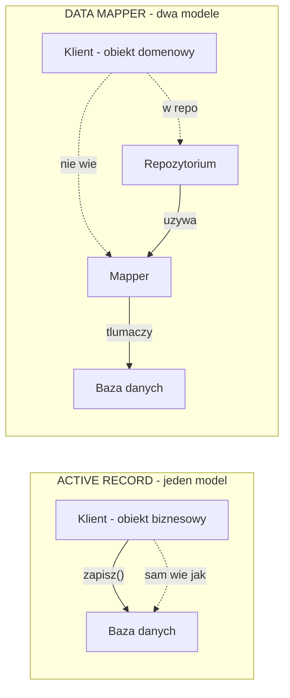
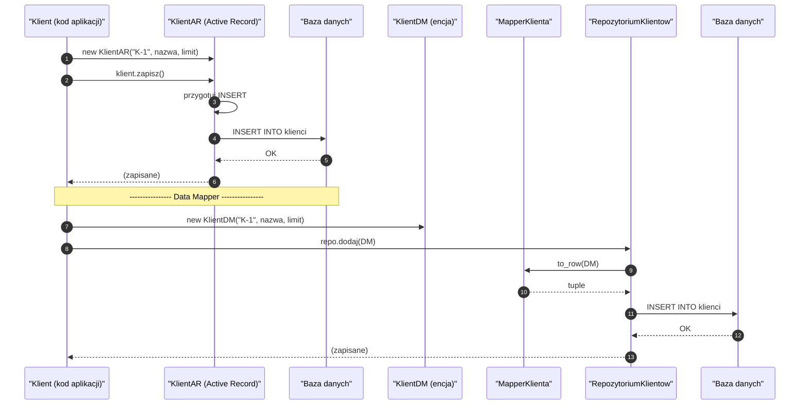
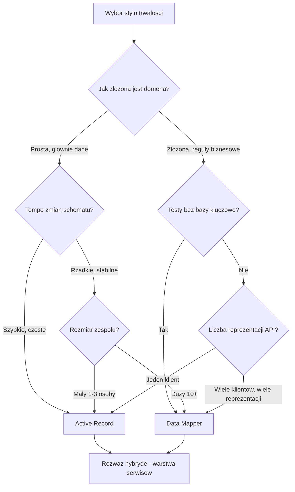
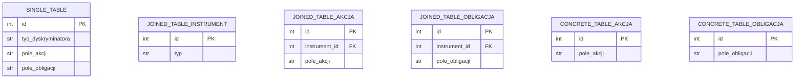
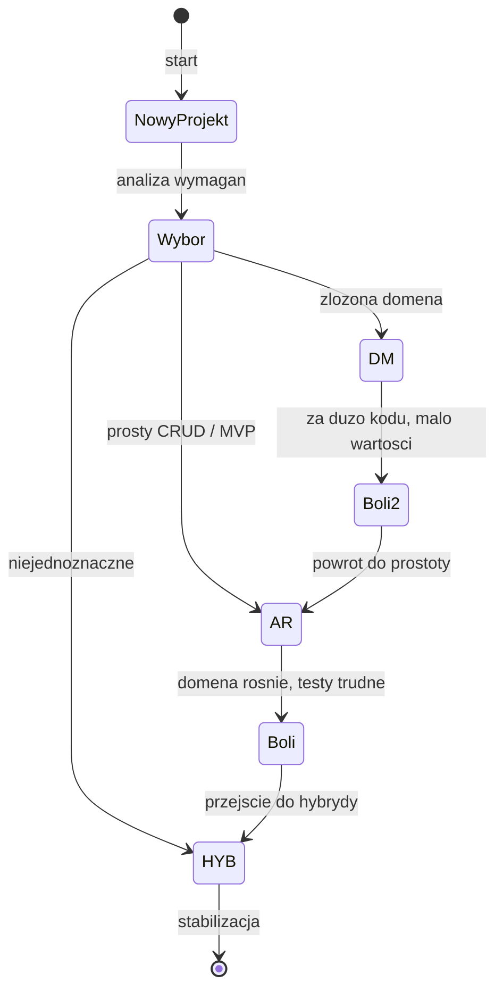
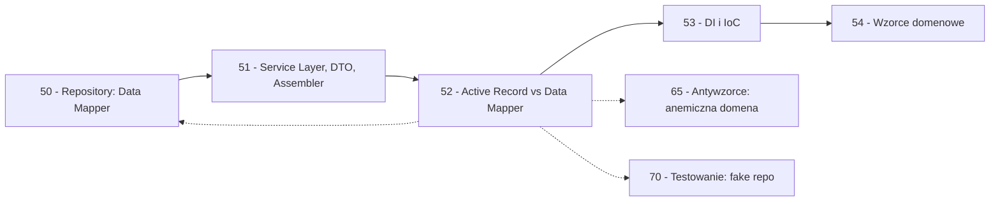

```markdown
---
modul: 52 — Active Record vs Data Mapper
plik: 52-active-record-vs-data-mapper.md
poziom: sredni
wymaga: [51]
czas: ~200 minut czytania + ~460 minut ćwiczeń
---

# Moduł 52 — Active Record vs Data Mapper — dwie filozofie trwałości

> **TL;DR**
> - **Active Record (aktywny rekord)** — obiekt reprezentuje wiersz w tabeli i **sam wie, jak się zapisać** (`zapisz()`, `usun()`, `znajdz()`); przykłady w Pythonie: Django ORM, Peewee, SQLModel.
> - **Data Mapper (mapper danych)** — obiekt domenowy **nie wie o bazie**, a konwersja między światem obiektów a tabelami jest w osobnym komponencie (mapperze); przykłady: SQLAlchemy Core/ORM z repozytorium, Piccolo.
> - Wybór to **nie kwestia lepszy/gorszy**, ale **kontekstu**: Active Record dla CRUD, MVP, krótkich projektów, małych zespołów; Data Mapper dla złożonej domeny, długoterminowego produktu, testów bez bazy.
> - W praktyce polskiego rynku pracy **dominuje Django ORM** — to Active Record z całym ekosystemem. Najlepsza strategia **hybrydowa**: traktuj modele jak warstwę danych, a logikę biznesową trzymaj w serwisach aplikacyjnych (moduł 51).
> - Dwa zestawy pułapek: **N+1 zapytań**, sesja żyjąca za długo, leniwe ładowanie w serializerach, magiczne sygnały ukrywające logikę, migracje łamiące domenę — niezależnie od stylu.

---

## 0. Model mentalny

### Formularz, który sam się wysyła, i tłumacz urzędowy

Wyobraź sobie dwa różne sposoby załatwiania sprawy urzędowej. Pierwszy — **formularz, który sam się wysyła**. Wypełniasz rubryki: imię, nazwisko, adres. Podpisujesz i mówisz: „wyślij się". Formularz **sam zna adres urzędu, sam wybiera pocztę, sam się pakuje, sam opłaca list, sam trafia do rejestru**. Kiedy chcesz sprawdzić, czy urząd go dostał — pytasz formularz: „jesteś zapisany?". Formularz odpowiada: „tak, jestem w rejestrze o numerze 4711". **Formularz i rejestr są splecione** — nie ma osobnej warstwy, nie ma pośrednika, nie ma tłumacza. Formularz to **jednocześnie dokument i procedura**, „co wypełnić" i „jak to zapisać" w jednym.

Drugi sposób — **tłumacz urzędowy**. Wypełniasz ten sam formularz, ale on **nie wie o urzędzie**. Jest po prostu **dokumentem**: ma pola, ma dane, ma swoją wagę. Dopiero gdy chcesz go „złożyć", zjawia się **tłumacz** — osoba, która bierze twój formularz, **przepisuje go do rejestru urzędu** (swoim językiem), a kiedy urząd coś zmieni, **odtwarza wersję formularza dla ciebie**. Tłumacz jest pośrednikiem: wie, jak wygląda formularz, wie, jak wygląda rejestr, i zna **przepis konwersji**. Ale sam formularz **nie zna rejestru**. Może wysłać ten sam formularz do trzech różnych urzędów — każdy z własnym tłumaczem — i formularz pozostanie formularzem.

**Active Record to pierwszy sposób** — obiekt sam się zapisuje, sam się znajduje, sam się usuwa. **Data Mapper to drugi sposób** — obiekt domenowy to czysty dokument, a konwersja do rejestru (bazy) jest w osobnym komponencie.

Zauważ kluczową różnicę filozoficzną. W Active Record **nie ma dwóch modeli** — jest jeden. Ten sam obiekt jest i „pojęciem biznesowym" (Klient, Konto, Zlecenie), i „wierszem w tabeli". Nie ma oddzielnej warstwy. W Data Mapper **są dwa modele** — model domenowy (Klient w biznesie) i model trwałości (Klient w bazie). Mapper tłumaczy między nimi. To **dodatkowa warstwa** — kosztuje, ale daje swobodę.

Pomyśl o trzecim obrazie — **kucharz i kelner** w restauracji. W pierwszym stylu **kucharz sam podaje do stolika** — ugotował, wyszedł z kuchni, zaniósł, wrócił. Jeden człowiek robi dwie rzeczy. W drugim stylu **kelner pośredniczy** — kucharz gotuje, kelner nosi. Dwie osoby, dwie role, ale kucharz **nie musi wiedzieć, gdzie siedzą goście**, a kelner **nie musi umieć gotować**. To zwiększa liczbę osób, ale pozwala **zmieniać układ stolików** bez zmiany kucharza. I pozwala **zmienić kuchnię** bez zmiany kelnera.

| W analogii formularza / tłumacza / kelnera | W kodzie |
|---|---|
| Formularz, który sam się wysyła | **Active Record** — `obiekt.zapisz()` |
| Formularz, który nie wie o urzędzie | Model domenowy (POCO/dataclass) |
| Tłumacz urzędowy | **Mapper** — konwertuje obiekt ↔ wiersz |
| Rejestr urzędu | Baza danych |
| Lista formularzy | Repozytorium (moduł 50) |
| Kucharz sam nosi | Active Record w handlerze |
| Kelner pośredniczy | **Data Mapper** w repozytorium |

> 🧠 **Zapamiętaj** — **Active Record (aktywny rekord) to wzorzec, w którym obiekt domenowy sam zna operacje trwałości (zapis, usunięcie, wyszukanie) i jest jednocześnie reprezentacją wiersza w bazie. Data Mapper (mapper danych) rozdziela obiekt domenowy od warstwy trwałości — konwersja między nimi jest w osobnym komponencie (mapperze), a domena nie wie o bazie.**

Zwróć uwagę na cztery słowa: **sam wie**, **jeden model**, **rozdziela**, **osobny komponent**. „Sam wie" — klucz Active Record. „Jeden model" — to samo pojęcie w kodzie i w bazie. „Rozdziela" — klucz Data Mapper. „Osobny komponent" — mapper jako byt.

### Diagram — intuicja dwóch stylów



*Diagram pokazuje dwie filozofie: w Active Record obiekt sam zna bazę; w Data Mapper obiekt domenowy jest oddzielony od bazy, a mapper tłumaczy między nimi.*

### Czego te wzorce NIE robią

Rozbrójmy pięć mitów.

**Nie są swoimi zamiennikami.** Active Record i Data Mapper to **dwie różne filozofie** pracy z bazą. Nie da się ich „używać zamiennie" bez refaktoryzacji.

**Nie są o ORM-ach.** ORM to **narzędzie** — biblioteka. Active Record to **styl użycia ORM-a**. SQLAlchemy ORM można używać w stylu Active Record (`declarative_base` + metody pomocnicze) albo w stylu Data Mapper (encja POCO + repozytorium + mapper). To zależy od tego, **jak go użyjesz**.

**Nie są o wydajności.** Zarówno Active Record, jak i Data Mapper mogą generować wydajne zapytania albo katastrofalne (N+1). To kwestia **użycia**, nie wzorca.

**Nie są zero-jedynkowe.** W praktyce można iść w **hybrydę** — Active Record na poziomie podstawowym, warstwa serwisów dla złożonej logiki. To najczęstsze rozwiązanie w polskim rynku.

**Data Mapper nie jest „profesjonalniejszy".** Wiele osób pokazuje Data Mapper jako „lepszy". To nieprawda — dla prostego CRUD Data Mapper to nadmiar, który kosztuje. **Wybór zależy od kontekstu.**

---

## 1. Problem, który rozwiązujemy

Wejdźmy w domenę 🏦 „Bank-klient". Rozważmy system obsługi klientów w banku. Klient ma konto, konta mają operacje, operacje mają powiązania. Chcemy pokazać różnicę między dwoma stylami.

### Kod „przed" — wersja jeszcze nieświadoma wzorców

Zobaczmy najpierw kod, który nie wybrał **świadomie** żadnego stylu — po prostu łączy wszystko w jednym miejscu.

```python
# klienci_v0.py — wersja naiwna, demonstracyjna
# UWAGA: kod celowo pokazuje pomieszanie biznesu z trwaloscia.

from __future__ import annotations

import sqlite3
from dataclasses import dataclass
from decimal import Decimal


class SerwisKlientow:
    """Serwis z wbudowanym SQL, modelem biznesowym i trwaloscia."""

    def __init__(self, sciezka_db: str) -> None:
        self._sciezka = sciezka_db

    def zarejestruj_klienta(
        self, identyfikator: str, nazwa: str, limit: Decimal
    ) -> None:
        # --- Walidacja "biznesowa" na wejsciu ---
        if not identyfikator:
            raise ValueError("brak identyfikatora")
        if not nazwa:
            raise ValueError("brak nazwy")
        if limit < 0:
            raise ValueError("limit nie moze byc ujemny")

        # --- Regula biznesowa: limit podstawowy zalezy od dlugosci nazwy ---
        # (przyklad - w prawdziwym systemie bylaby to regula rynkowa)
        if len(nazwa) < 5:
            limit = min(limit, Decimal("10000"))
        else:
            limit = min(limit, Decimal("100000"))

        # --- Trwalosc: surowy SQL w serwisie ---
        polaczenie = sqlite3.connect(self._sciezka)
        try:
            kursor = polaczenie.cursor()
            kursor.execute(
                "INSERT OR REPLACE INTO klienci (id, nazwa, limit_dzienny) "
                "VALUES (?, ?, ?)",
                (identyfikator, nazwa, str(limit)),
            )
            polaczenie.commit()
        finally:
            polaczenie.close()

    def znajdz_klienta(self, identyfikator: str) -> dict | None:
        polaczenie = sqlite3.connect(self._sciezka)
        try:
            kursor = polaczenie.cursor()
            kursor.execute(
                "SELECT id, nazwa, limit_dzienny FROM klienci WHERE id = ?",
                (identyfikator,),
            )
            wiersz = kursor.fetchone()
        finally:
            polaczenie.close()

        if wiersz is None:
            return None
        return {
            "id": wiersz[0],
            "nazwa": wiersz[1],
            "limit_dzienny": Decimal(wiersz[2]),
        }

    def limit_podstawowy(self, dlugosc_nazwy: int) -> Decimal:
        """Regula biznesowa na poziomie serwisu — dostepna tylko tutaj."""
        if dlugosc_nazwy < 5:
            return Decimal("10000")
        return Decimal("100000")


if __name__ == "__main__":
    import tempfile
    from pathlib import Path

    with tempfile.TemporaryDirectory() as tmp:
        sciezka = Path(tmp) / "app.db"
        polaczenie = sqlite3.connect(sciezka)
        polaczenie.executescript(
            "CREATE TABLE klienci (id TEXT PRIMARY KEY, nazwa TEXT, "
            "limit_dzienny TEXT);"
        )
        polaczenie.commit()
        polaczenie.close()

        serwis = SerwisKlientow(str(sciezka))
        serwis.zarejestruj_klienta("K-1", "Kowalski Jan", Decimal("50000"))
        print(serwis.znajdz_klienta("K-1"))
```

Ten kod **działa**, ale nie należy do **żadnego** z dwóch stylów:

### Code smell — brak stylu

| Problem | Gdzie | Konsekwencja |
|---|---|---|
| Brak modelu biznesowego | Serwis | Dane w `dict` — brak typów |
| Reguła biznesowa w serwisie | `if len(nazwa) < 5` | Nie ma encji |
| Surowy SQL w serwisie | `INSERT`, `SELECT` | Serwis zna bazę |
| Brak jasnego wyboru stylu | Cały kod | Trudno rozwijać systematycznie |
| Kwoty jako `str` w bazie | Surowe SQL | Trzeba ręcznie konwertować |
| Reguła „limit podstawowy" nijak związana z modelem | W serwisie | Nie można przetestować osobno |
| Każda metoda otwiera własne połączenie | Trwałość w serwisie | Brak transakcji |

Ten kod **nie wybrał ani Active Record, ani Data Mapper**. Jest „naiwnym SQL w serwisie". Teraz zobaczmy, jak **świadomie** wybrać jeden z dwóch stylów.

### Objawy — poznasz ten problem po tym, że...

- **Kod łączy biznes z SQL w jednej metodzie.** Nie ma jasnego wyboru.
- **Nie ma modelu biznesowego.** Dane krążą jako `dict` albo krotki.
- **Reguły biznesowe są w serwisie.** Trudno testować bez bazy.
- **Każda metoda otwiera własne połączenie.** Brak kontroli transakcji.
- **Brak spójnych typów.** Wszystko jest `str` albo `dict`.
- **Nie wiesz, czy to Active Record, czy Data Mapper** — bo nie wybrałeś.
- **Rozszerzenie wymaga decyzji ad hoc** — nie ma wzorca do naśladowania.
- **Test wymaga bazy.** Bo nie ma oddzielenia serwisu od trwałości.
- **Zespół nie ma wspólnego języka** do rozmowy o trwałości.

---

## 2. Anatomia wzorców

### Uczestnicy Active Record

| Rola | Odpowiedzialność | Co NIE jest jej zadaniem |
|---|---|---|
| **Model (Model)** | Reprezentuje wiersz tabeli; przechowuje dane; **zna operacje trwałości** (`zapisz`, `usun`, `znajdz`) | Nie zawiera logiki aplikacji (użycia); nie orkiestruje wielu modeli |
| **Klient (Client)** | Tworzy instancje modelu, wywołuje `zapisz`, `usun`, `znajdz` | Nie zna SQL — tylko API modelu |
| **Baza danych** | Trwałość | Nie jest znana klientowi bezpośrednio |

### Uczestnicy Data Mapper

| Rola | Odpowiedzialność | Co NIE jest jej zadaniem |
|---|---|---|
| **Encja domenowa (Entity)** | Reprezentuje pojęcie biznesowe; zawiera reguły domenowe; **nie wie o bazie** | Nie zna SQL — ani nazw tabel, ani kolumn |
| **Mapper** | Konwertuje encję na wiersz bazy i odwrotnie | Nie zawiera reguł biznesowych; nie decyduje, kiedy zapisać |
| **Repozytorium** | Kolekcja encji; używa mappera; udostępnia operacje w języku domeny (moduł 50) | Nie zawiera reguł biznesowych |
| **Unit of Work** | Koordynuje zapis (moduł 50) | Nie zawiera reguł biznesowych |

### Diagram struktury — Active Record vs Data Mapper

```mermaid
classDiagram
    direction LR
    class KlientAR {
        +str id
        +str nazwa
        +Decimal limit
        +zapisz() None
        +usun() None
        +@classmethod znajdz(id) KlientAR
    }
    class BazaDanych {
        <<infrastruktura>>
    }
    class KlientDM {
        <<encja domenowa>>
        +str id
        +str nazwa
        +Decimal limit
        +limit_podstawowy() Decimal
    }
    class MapperKlienta {
        +to_row(klient) dict
        +to_domain(row) KlientDM
    }
    class RepozytoriumKlientow {
        <<Protocol>>
        +znajdz(id) KlientDM
        +dodaj(klient) None
    }
    KlientAR -->|"sam zna"| BazaDanych : zapisz()
    RepozytoriumKlientow --> MapperKlienta : uzywa
    MapperKlienta --> BazaDanych : zapisuje
    MapperKlienta --> KlientDM : konwertuje
```

*Diagram pokazuje dwie struktury: w Active Record (`KlientAR`) obiekt sam zna bazę przez `zapisz()`; w Data Mapper (`KlientDM`) encja nie zna bazy, a mapper konwertuje między encją a wierszem.*

### Warianty: klasyczny vs pythoniczny

W Pythonie oba wzorce mają różne realizacje — i to jest kluczowe do zrozumienia.

| Aspekt | Active Record | Data Mapper |
|---|---|---|
| **Model bazowy** | `Model` z ORM (`models.Model` w Django, `Base` w SQLAlchemy) | `@dataclass` albo zwykła klasa |
| **Metody trwałości** | `save()`, `delete()`, `objects.get()` | Brak — w repozytorium |
| **Zapytania** | `Model.objects.filter(...)` | `repo.znajdz_klienta(id)` |
| **Sesja** | Zarządzana przez framework (Django) lub jawnie (SQLAlchemy) | Jawnie przez UoW (moduł 50) |
| **Testy** | Wymagają bazy albo jej zaślepki (`TestCase`) | Bez bazy (repozytorium in-memory) |
| **Migracje** | Framework zarządza schematem | Często ręczne migracje SQL |
| **Koszt** | Mały na start, rośnie z domeną | Wysoki na start, stabilny |

---

## 3. Implementacja krok po kroku

### Część A — Active Record

Zbudujemy model `Klient` w stylu Active Record.

#### Krok 1 — Zdefiniuj model

Model **dziedziczy po ORM** i **ma metody trwałości**.

```python
from dataclasses import dataclass
from decimal import Decimal
import sqlite3


class KlientAR:
    """Model w stylu Active Record - reprezentuje wiersz i sam sie zapisuje."""

    _polaczenie: sqlite3.Connection | None = None

    def __init__(
        self,
        identyfikator: str,
        nazwa: str,
        limit_dzienny: Decimal,
        _nowy: bool = True,
    ) -> None:
        self.id = identyfikator
        self.nazwa = nazwa
        self.limit_dzienny = limit_dzienny
        self._nowy = _nowy

    @classmethod
    def ustaw_polaczenie(cls, polaczenie: sqlite3.Connection) -> None:
        """Konfiguracja - raz na aplikacje."""
        cls._polaczenie = polaczenie

    def zapisz(self) -> None:
        """Zapisuje wiersz - metoda trwalosci w modelu."""
        assert self._polaczenie is not None, "brak polaczenia"
        kursor = self._polaczenie.cursor()
        kursor.execute(
            "INSERT OR REPLACE INTO klienci (id, nazwa, limit_dzienny) "
            "VALUES (?, ?, ?)",
            (self.id, self.nazwa, str(self.limit_dzienny)),
        )
        self._polaczenie.commit()
        self._nowy = False

    def usun(self) -> None:
        """Usuwa wiersz - metoda trwalosci w modelu."""
        assert self._polaczenie is not None
        kursor = self._polaczenie.cursor()
        kursor.execute("DELETE FROM klienci WHERE id = ?", (self.id,))
        self._polaczenie.commit()

    @classmethod
    def znajdz(cls, identyfikator: str) -> "KlientAR | None":
        """Wyszukiwanie - metoda klasowa."""
        assert cls._polaczenie is not None
        kursor = cls._polaczenie.cursor()
        kursor.execute(
            "SELECT id, nazwa, limit_dzienny FROM klienci WHERE id = ?",
            (identyfikator,),
        )
        wiersz = kursor.fetchone()
        if wiersz is None:
            return None
        return cls(
            identyfikator=wiersz[0],
            nazwa=wiersz[1],
            limit_dzienny=Decimal(wiersz[2]),
            _nowy=False,
        )

    @classmethod
    def wszystkie(cls) -> list["KlientAR"]:
        assert cls._polaczenie is not None
        kursor = cls._polaczenie.cursor()
        kursor.execute("SELECT id, nazwa, limit_dzienny FROM klienci")
        return [
            cls(w[0], w[1], Decimal(w[2]), _nowy=False)
            for w in kursor.fetchall()
        ]

    def __repr__(self) -> str:
        return f"Klient({self.id!r}, {self.nazwa!r}, {self.limit_dzienny})"
```

Zwróć uwagę: **model ma metody trwałości** (`zapisz`, `usun`, `znajdz`). Ten sam obiekt jest **pojęciem biznesowym i wierszem bazy**.

#### Krok 2 — Użycie

```python
def demo_ar() -> None:
    polaczenie = sqlite3.connect(":memory:")
    polaczenie.executescript(
        "CREATE TABLE klienci (id TEXT PRIMARY KEY, nazwa TEXT, "
        "limit_dzienny TEXT);"
    )
    KlientAR.ustaw_polaczenie(polaczenie)

    k = KlientAR("K-1", "Kowalski Jan", Decimal("50000"))
    k.zapisz()

    drugi = KlientAR.znajdz("K-1")
    print(drugi)
```

### Część B — Data Mapper

Zbudujemy ten sam system w stylu Data Mapper.

#### Krok 1 — Zdefiniuj encję domenową

Bez dziedziczenia po ORM, bez metod trwałości.

```python
from dataclasses import dataclass, replace
from decimal import Decimal


@dataclass
class KlientDM:
    """Encja domenowa - nie wie o bazie."""
    id: str
    nazwa: str
    limit_dzienny: Decimal

    def limit_podstawowy(self) -> Decimal:
        """Regula biznesowa w domenie, nie w bazie."""
        return (
            Decimal("10000") if len(self.nazwa) < 5
            else Decimal("100000")
        )

    def moze_zlecic(self, kwota: Decimal) -> bool:
        return kwota <= self.limit_dzienny

    def z_limit(self, nowy: Decimal) -> "KlientDM":
        return replace(self, limit_dzienny=nowy)
```

**Encja nie zna bazy.** Ma tylko reguły biznesowe.

#### Krok 2 — Zdefiniuj Mapper

Konwersja między encją a wierszem.

```python
class MapperKlienta:
    """Konwertuje encje domenowa <-> wiersz bazy."""

    @staticmethod
    def to_row(klient: KlientDM) -> tuple:
        """Encja -> wiersz bazy (krotka parametrow)."""
        return (klient.id, klient.nazwa, str(klient.limit_dzienny))

    @staticmethod
    def to_domain(row: tuple) -> KlientDM:
        """Wiersz bazy -> encja."""
        return KlientDM(
            id=row[0],
            nazwa=row[1],
            limit_dzienny=Decimal(row[2]),
        )
```

**Mapper ma jedną odpowiedzialność** — tłumaczyć formaty. Nie zna reguł biznesowych.

#### Krok 3 — Zdefiniuj repozytorium

```python
from typing import Protocol, runtime_checkable


@runtime_checkable
class RepozytoriumKlientow(Protocol):
    def znajdz(self, id_: str) -> KlientDM | None: ...
    def dodaj(self, klient: KlientDM) -> None: ...
    def usun(self, klient: KlientDM) -> None: ...
    def wszyscy(self) -> list[KlientDM]: ...


class RepozytoriumKlientowSQL:
    def __init__(self, polaczenie: sqlite3.Connection) -> None:
        self._polaczenie = polaczenie

    def znajdz(self, id_: str) -> KlientDM | None:
        kursor = self._polaczenie.cursor()
        kursor.execute(
            "SELECT id, nazwa, limit_dzienny FROM klienci WHERE id = ?",
            (id_,),
        )
        wiersz = kursor.fetchone()
        return MapperKlienta.to_domain(wiersz) if wiersz else None

    def dodaj(self, klient: KlientDM) -> None:
        kursor = self._polaczenie.cursor()
        kursor.execute(
            "INSERT OR REPLACE INTO klienci (id, nazwa, limit_dzienny) "
            "VALUES (?, ?, ?)",
            MapperKlienta.to_row(klient),
        )

    def usun(self, klient: KlientDM) -> None:
        kursor = self._polaczenie.cursor()
        kursor.execute("DELETE FROM klienci WHERE id = ?", (klient.id,))

    def wszyscy(self) -> list[KlientDM]:
        kursor = self._polaczenie.cursor()
        kursor.execute("SELECT id, nazwa, limit_dzienny FROM klienci")
        return [MapperKlienta.to_domain(w) for w in kursor.fetchall()]
```

**Repozytorium używa mappera**, ale **encja nie wie o repozytorium**.

#### Krok 4 — Użycie

```python
def demo_dm() -> None:
    polaczenie = sqlite3.connect(":memory:")
    polaczenie.executescript(
        "CREATE TABLE klienci (id TEXT PRIMARY KEY, nazwa TEXT, "
        "limit_dzienny TEXT);"
    )

    repo = RepozytoriumKlientowSQL(polaczenie)
    k = KlientDM("K-1", "Kowalski Jan", Decimal("50000"))
    repo.dodaj(k)
    polaczenie.commit()

    drugi = repo.znajdz("K-1")
    print(drugi)
    print(f"Limit podstawowy: {drugi.limit_podstawowy()}")
```

Podkreślmy: **`KlientDM` nie wie, że istnieje SQL albo repozytorium**.

### Krok 5 — Weryfikacja

| Kryterium | Active Record | Data Mapper |
|---|---|---|
| Model zna bazę | Tak | Nie |
| Metody trwałości w modelu | Tak | Nie |
| Logika biznesowa w modelu | Może być | Tak (i tylko tam) |
| Test bez bazy | Trudny | Łatwy |
| Zmiana bazy | Zmiana modelu | Zmiana mappera + repo |
| Liczba klas | 1 | 3+ |
| Liczba plików | 1 | 3+ |

---

## 4. Wersje pythoniczne i warianty

### 4.1 Active Record z Django ORM

Najpopularniejszy **Active Record w Pythonie** — Django ORM.

```python
# W Django
from django.db import models
from decimal import Decimal


class Klient(models.Model):
    id = models.CharField(primary_key=True, max_length=50)
    nazwa = models.CharField(max_length=200)
    limit_dzienny = models.DecimalField(max_digits=15, decimal_places=2)

    def limit_podstawowy(self) -> Decimal:
        return Decimal("10000") if len(self.nazwa) < 5 else Decimal("100000")

    def moze_zlecic(self, kwota: Decimal) -> bool:
        return kwota <= self.limit_dzienny


# Uzycie:
klient = Klient.objects.create(id="K-1", nazwa="Kowalski Jan",
                                limit_dzienny=Decimal("50000"))
klient.save()
Klient.objects.get(id="K-1")
Klient.objects.filter(nazwa__startswith="Kow")
```

**Zaleta:** prawie zero kodu — framework robi wszystko. **Wada:** `Klient` zna ORM. Reguły i trwałość pomieszane.

### 4.2 Active Record z użyciem `@classmethod`

Jeśli nie chcesz frameworka, można zbudować Active Record ręcznie.

```python
class KlientAR2:
    _repo: dict[str, "KlientAR2"] = {}

    def __init__(self, id_: str, nazwa: str, limit: Decimal) -> None:
        self.id = id_
        self.nazwa = nazwa
        self.limit = limit

    def zapisz(self) -> None:
        KlientAR2._repo[self.id] = self

    @classmethod
    def znajdz(cls, id_: str) -> "KlientAR2 | None":
        return cls._repo.get(id_)
```

**Zaleta:** brak zależności. **Wada:** ręczne wszystkie mechanizmy.

### 4.3 Data Mapper z SQLAlchemy Core

Oficjalny sposób Data Mapper w SQLAlchemy — Core API.

```python
from sqlalchemy import create_engine, MetaData, Table, Column, String, Numeric
from sqlalchemy.engine import Engine


metadata = MetaData()


klienci_table = Table(
    "klienci", metadata,
    Column("id", String, primary_key=True),
    Column("nazwa", String, nullable=False),
    Column("limit_dzienny", Numeric(15, 2), nullable=False),
)


class MapperKlientaSQLAlchemy:
    @staticmethod
    def to_domain(row):
        return KlientDM(row.id, row.nazwa, Decimal(row.limit_dzienny))
```

**Zaleta:** pełna kontrola nad SQL. **Wada:** więcej kodu; trzeba znać SQLAlchemy Core.

### 4.4 Data Mapper z pydantic (odczyt) + dataclass (domena)

CSR pattern — obiekt biznesowy jako `dataclass`, a pydantic na granicy. Używane razem z modułem 51.

### 4.5 Hybryda — Active Record + Service Layer

Najczęstsze w polskim rynku. Używamy Django ORM jako Active Record, a **logikę biznesową** przenosimy do **warstwy serwisów** (moduł 51).

```python
# models.py (Django)
class Klient(models.Model):
    id = models.CharField(primary_key=True, max_length=50)
    nazwa = models.CharField(max_length=200)
    limit_dzienny = models.DecimalField(max_digits=15, decimal_places=2)


# services.py (logika aplikacyjna)
from decimal import Decimal
from django.db import transaction


class SerwisKlientow:
    @transaction.atomic
    def zarejestruj(
        self, identyfikator: str, nazwa: str, limit: Decimal
    ) -> Klient:
        if not nazwa:
            raise ValueError("nazwa jest wymagana")
        # Regula rynkowa
        limit_podstawowy = Decimal("10000") if len(nazwa) < 5 else Decimal("100000")
        limit_efektywny = min(limit, limit_podstawowy)
        # Model jako warstwa danych
        klient = Klient.objects.create(
            id=identyfikator,
            nazwa=nazwa,
            limit_dzienny=limit_efektywny,
        )
        return klient
```

**Zaleta:** używasz Django ORM bezpośrednio (mnóstwo wbudowanych mechanizmów), ale trzymasz reguły w serwisie. To **pragmatyczne** i **praktyczne**.

### 4.6 Podsumowanie — tabela wyboru

| Sytuacja | Wybór |
|---|---|
| CRUD, MVP, prototyp | Active Record (Django ORM) |
| Złożona domena, długi projekt | Data Mapper |
| Wielu klientów API (wiele reprezentacji) | Data Mapper |
| Testy bez bazy kluczowe | Data Mapper |
| Zespół mały, tempo szybkie | Active Record |
| Migracje bez przestojów | Oba — zależy od narzędzi |
| **Polski rynek, Django** | **Hybryda** (Active Record + Service Layer) |
| SQLAlchemy od zera | Data Mapper (Core) |

> 🧠 **Zapamiętaj** — **Active Record i Data Mapper to nie wzorce „na zawsze" — to filozofie, które wybierasz w kontekście.** W praktyce Python — zwłaszcza w Django — dominuje Active Record, a Data Mapper pojawia się, gdy domena naprawdę jest złożona. **Hybryda jest najczęstsza w polskim rynku.**

---

## 5. Przykład z życia: 📈 Portfel — pełny uruchamialny kod

Zbudujemy system portfolio inwestycyjnego w dwóch wersjach — Active Record i Data Mapper — żeby zobaczyć różnicę na tym samym problemie.

### Kod — Active Record

```python
# portfel_ar.py — Active Record
from __future__ import annotations

import sqlite3
from decimal import Decimal, ROUND_HALF_UP


class InstrumentAR:
    """Model w stylu Active Record."""

    _polaczenie: sqlite3.Connection | None = None

    def __init__(
        self,
        ticker: str,
        nazwa: str,
        cena: Decimal,
        _nowy: bool = True,
    ) -> None:
        self.ticker = ticker
        self.nazwa = nazwa
        self.cena = cena
        self._nowy = _nowy

    @classmethod
    def ustaw_polaczenie(cls, polaczenie: sqlite3.Connection) -> None:
        cls._polaczenie = polaczenie

    def zapisz(self) -> None:
        assert self._polaczenie is not None
        kursor = self._polaczenie.cursor()
        kursor.execute(
            "INSERT OR REPLACE INTO instrumenty (ticker, nazwa, cena) "
            "VALUES (?, ?, ?)",
            (self.ticker, self.nazwa, str(self.cena)),
        )
        self._polaczenie.commit()
        self._nowy = False

    @classmethod
    def znajdz(cls, ticker: str) -> "InstrumentAR | None":
        assert cls._polaczenie is not None
        kursor = cls._polaczenie.cursor()
        kursor.execute(
            "SELECT ticker, nazwa, cena FROM instrumenty WHERE ticker = ?",
            (ticker,),
        )
        w = kursor.fetchone()
        if w is None:
            return None
        return cls(w[0], w[1], Decimal(w[2]), _nowy=False)

    def wartosc_pozycji(self, ilosc: Decimal) -> Decimal:
        return (self.cena * ilosc).quantize(Decimal("0.01"),
                                            rounding=ROUND_HALF_UP)


if __name__ == "__main__":
    polaczenie = sqlite3.connect(":memory:")
    polaczenie.executescript(
        "CREATE TABLE instrumenty (ticker TEXT PRIMARY KEY, nazwa TEXT, "
        "cena TEXT);"
    )
    InstrumentAR.ustaw_polaczenie(polaczenie)

    kghm = InstrumentAR("KGHM", "KGHM Polska Miedz", Decimal("150.50"))
    kghm.zapisz()

    odczytane = InstrumentAR.znajdz("KGHM")
    print(f"KGHM wartosc 100 sztuk: {odczytane.wartosc_pozycji(Decimal('100'))}")
```

### Kod — Data Mapper

```python
# portfel_dm.py — Data Mapper
from __future__ import annotations

import sqlite3
from dataclasses import dataclass, replace
from decimal import Decimal, ROUND_HALF_UP
from typing import Protocol, runtime_checkable


# --- Domena ---

@dataclass
class InstrumentDM:
    ticker: str
    nazwa: str
    cena: Decimal

    def wartosc_pozycji(self, ilosc: Decimal) -> Decimal:
        return (self.cena * ilosc).quantize(Decimal("0.01"),
                                            rounding=ROUND_HALF_UP)

    def drozszy_o(self, procent: Decimal) -> "InstrumentDM":
        return replace(self, cena=self.cena * (1 + procent))


# --- Mapper ---

class MapperInstrumentu:
    @staticmethod
    def to_row(i: InstrumentDM) -> tuple:
        return (i.ticker, i.nazwa, str(i.cena))

    @staticmethod
    def to_domain(row: tuple) -> InstrumentDM:
        return InstrumentDM(
            ticker=row[0],
            nazwa=row[1],
            cena=Decimal(row[2]),
        )


# --- Repozytorium ---

@runtime_checkable
class RepozytoriumInstrumentow(Protocol):
    def znajdz(self, ticker: str) -> InstrumentDM | None: ...
    def dodaj(self, i: InstrumentDM) -> None: ...
    def wszyscy(self) -> list[InstrumentDM]: ...


class RepozytoriumInstrumentowSQL:
    def __init__(self, polaczenie: sqlite3.Connection) -> None:
        self._polaczenie = polaczenie

    def znajdz(self, ticker: str) -> InstrumentDM | None:
        kursor = self._polaczenie.cursor()
        kursor.execute(
            "SELECT ticker, nazwa, cena FROM instrumenty WHERE ticker = ?",
            (ticker,),
        )
        w = kursor.fetchone()
        return MapperInstrumentu.to_domain(w) if w else None

    def dodaj(self, i: InstrumentDM) -> None:
        kursor = self._polaczenie.cursor()
        kursor.execute(
            "INSERT OR REPLACE INTO instrumenty (ticker, nazwa, cena) "
            "VALUES (?, ?, ?)",
            MapperInstrumentu.to_row(i),
        )

    def wszyscy(self) -> list[InstrumentDM]:
        kursor = self._polaczenie.cursor()
        kursor.execute("SELECT ticker, nazwa, cena FROM instrumenty")
        return [MapperInstrumentu.to_domain(w) for w in kursor.fetchall()]


if __name__ == "__main__":
    polaczenie = sqlite3.connect(":memory:")
    polaczenie.executescript(
        "CREATE TABLE instrumenty (ticker TEXT PRIMARY KEY, nazwa TEXT, "
        "cena TEXT);"
    )
    repo = RepozytoriumInstrumentowSQL(polaczenie)

    kghm = InstrumentDM("KGHM", "KGHM Polska Miedz", Decimal("150.50"))
    repo.dodaj(kghm)
    polaczenie.commit()

    odczytane = repo.znajdz("KGHM")
    print(f"KGHM wartosc 100 sztuk: {odczytane.wartosc_pozycji(Decimal('100'))}")
```

### Co pokazują te przykłady

**W Active Record:** `InstrumentAR.zapisz()` jest w klasie modelu. Klasa zna bazę.

**W Data Mapper:** `repo.dodaj(i)` jest na repozytorium, ale `InstrumentDM` nie wie o bazie. Repozytorium używa mappera.

Kluczowy test: **`InstrumentDM` można utworzyć bez bazy**. `InstrumentAR` **nie** — potrzebuje połączenia.

### Testy

```python
# test_portfel_ar.py — testy Active Record (wymaga bazy)
import sqlite3
from decimal import Decimal

import pytest

from portfel_ar import InstrumentAR


@pytest.fixture
def polaczenie():
    p = sqlite3.connect(":memory:")
    p.executescript(
        "CREATE TABLE instrumenty (ticker TEXT PRIMARY KEY, nazwa TEXT, "
        "cena TEXT);"
    )
    InstrumentAR.ustaw_polaczenie(p)
    yield p
    p.close()


def test_zapis_i_odczyt(polaczenie):
    i = InstrumentAR("KGHM", "KGHM", Decimal("100"))
    i.zapisz()
    odczytane = InstrumentAR.znajdz("KGHM")
    assert odczytane.cena == Decimal("100")


def test_wartosc_pozycji(polaczenie):
    i = InstrumentAR("KGHM", "KGHM", Decimal("100"))
    assert i.wartosc_pozycji(Decimal("10")) == Decimal("1000.00")


# UWAGA: kazdy test wymaga bazy!
```

```python
# test_portfel_dm.py — testy Data Mapper (bez bazy dla logiki!)
from decimal import Decimal

import pytest

from portfel_dm import InstrumentDM


def test_wartosc_pozycji_bez_bazy() -> None:
    """Test dziala BEZ bazy - bo encja nie zna bazy."""
    i = InstrumentDM("KGHM", "KGHM", Decimal("100"))
    assert i.wartosc_pozycji(Decimal("10")) == Decimal("1000.00")


def test_drozszy_o() -> None:
    i = InstrumentDM("KGHM", "KGHM", Decimal("100"))
    drozszy = i.drozszy_o(Decimal("0.10"))
    assert drozszy.cena == Decimal("110.00")
    assert i.cena == Decimal("100")   # nietykalna


@pytest.mark.parametrize("ilosc,oczekiwane", [
    (Decimal("1"), Decimal("100.00")),
    (Decimal("10"), Decimal("1000.00")),
    (Decimal("0.5"), Decimal("50.00")),
])
def test_wartosc_parametryzowana(ilosc: Decimal, oczekiwane: Decimal) -> None:
    i = InstrumentDM("KGHM", "KGHM", Decimal("100"))
    assert i.wartosc_pozycji(ilosc) == oczekiwane
```

**Kluczowe:** testy Data Mapper **nie wymagają bazy**. To fundamentalna różnica.

---

## 6. Dynamika

### 6.1 Zapis w obu stylach obok siebie



*Diagram pokazuje różnicę w zależnościach: w Active Record klient rozmawia bezpośrednio z modelem, ale model rozmawia z bazą; w Data Mapper klient rozmawia z repozytorium, które tłumaczy encję i zapisuje.*

### 6.2 Diagram decyzyjny — Active Record czy Data Mapper



*Diagram pokazuje kryteria wyboru: złożoność domeny, tempo zmian schematu, rozmiar zespołu, liczba reprezentacji API. Każda ścieżka kończy się rekomendacją, ale z uwagą, że hybryda jest często najlepsza.*

### 6.3 Trzy strategie mapowania dziedziczenia



*Diagram pokazuje trzy strategie mapowania dziedziczenia: `SINGLE_TABLE` (jedna tabela z kolumną typu), `JOINED_TABLE` (tabela bazowa + tabele konkretne), `CONCRETE_TABLE` (osobne tabele bez wspólnej).*

**SINGLE TABLE** — wszystkie pola w jednej tabeli, kolumna „typ" rozróżnia. **Dobra wydajność** (brak JOIN), **zła normalizacja** (kolumny puste).

**JOINED TABLE** — tabela bazowa + tabele rozszerzeń. **Dobra normalizacja**, **JOIN w zapytaniach**.

**CONCRETE TABLE** — osobne tabele bez wspólnej. **Proste**, **brak wspólnej tożsamości**.

### 6.4 Cykl decyzyjny — mapa myśli



*Diagram pokazuje, że wybór nie jest ostateczny — projekty ewoluują i mogą przechodzić między stylami.*

> 💡 **Intuicja** — Active Record jest jak **samochód z automatem**: wsiadasz, jedziesz, mało myślisz. Data Mapper jest jak **manualna skrzynia biegów**: musisz wiedzieć, kiedy zmieniać biegi, ale masz pełną kontrolę. Dla większości tras automat wystarczy. Na torze wyścigowym — manual.

---

## 7. Kiedy używać / kiedy NIE używać

### Kiedy używać Active Record

**CRUD na kilku tabelach.** Encje mają mało logiki biznesowej, głównie trwałość.

**MVP, prototyp.** Szybki start ma znaczenie, refaktoryzacja później.

**Zespół mały.** Active Record jest mniej kodu — mniej do utrzymania.

**Django (lub inny framework z ORM Active Record).** Wykorzystujesz framework — idź z nim.

**Domena głównie danych.** Anemiczna domena (i to w porządku dla CRUD).

**Schemat stabilny.** Zmiany rzadkie — nie ma problemu z rozjazdem model ↔ schemat.

**Brak wymagań testów bez bazy.** Testy mogą korzystać z bazy testowej.

**Niewielka liczba reprezentacji API.** Encja = DTO — nie trzeba osobnego mapowania.

### Kiedy używać Data Mapper

**Złożona domena.** Dużo reguł biznesowych, niezmienników, agregatów.

**Długoterminowy produkt.** Będzie żyć lata — warto zainwestować w separację.

**Testy bez bazy są kluczowe.** Chcesz szybkie testy domeny, zamiast wolnych integracyjnych.

**Wiele reprezentacji API.** Domena, DTO, model ORM — trzy różne modele.

**Zmienna warstwa trwałości.** SQL + NoSQL + zewnętrzne API — różne źródła.

**Duży zespół.** Separacja warstw ułatwia pracę równoległą.

**Wymagania regulacyjne.** Audyt, sprawozdawczość — domena musi być „czysta".

**Zespół zna Data Mapper.** Bez zrozumienia wprowadzenie wzorca będzie kosztować.

### Kiedy NIE używać Active Record

**Gdy domena jest naprawdę złożona.** `fat models` stają się nie do utrzymania.

**Gdy potrzebujesz testów bez bazy.** Django ORM tego nie daje wprost.

**Gdy wiele wejść używa tego samego modelu.** Encja zaczyna służyć różnym celom.

**Gdy zespół chce zmienić bazę w trakcie.** Active Record utrudnia wymianę.

### Kiedy NIE używać Data Mapper

**Gdy domena jest prosta.** Zbyt wiele kodu na zbyt małą wartość.

**Gdy zespół nie zna tego stylu.** Wprowadzenie wzorca bez edukacji to katastrofa.

**Gdy start jest priorytetem.** Data Mapper opóźnia pierwsze wdrożenie.

**Gdy framework wymusza Active Record.** Django ORM trudno „owinąć" w Data Mapper — walka z frameworkiem to strata.

**Gdy projekt jest krótkotrwały.** Nie ma czasu na wartość długoterminową.

**Zbiorczo — tabela decyzyjna:**

| Pytanie | Jeśli „tak" | Jeśli „nie" |
|---|---|---|
| Domena złożona? | Data Mapper | Active Record |
| Testy bez bazy kluczowe? | Data Mapper | Active Record |
| Wiele reprezentacji? | Data Mapper | Active Record |
| Projekt długoterminowy? | Data Mapper | Active Record |
| CRUD, MVP? | Active Record | Data Mapper |
| Mały zespół? | Active Record | Data Mapper |
| Django? | Hybryda | Zależy |
| Zespół zna styl? | Dowolny | Najpierw edukacja |

---

## 8. Pułapki i antywzorce

### Pułapki Active Record

**1. Fat models — model robi za dużo.**

```python
# ZLE
class Klient(models.Model):
    def zarejestruj(self): ...        # logika biznesowa
    def wyslij_email(self): ...       # infrastruktura
    def nalicz_prowizje(self): ...    # reguła
    def eksportuj_do_xbrl(self): ...  # inny format
    def synchronizuj_z_crm(self): ... # integracja
```

**Konsekwencja:** model puchnie do setek linii. Trudno testować, trudno zmieniać. **Prawidłowo:** wydziel serwisy dla każdej odpowiedzialności (moduł 51).

**2. Sygnały ukrywające logikę.**

```python
# ZLE
@receiver(post_save, sender=Klient)
def po_zapisaniu(sender, instance, **kwargs):
    if instance.limit > 100000:
        # wyslij do dzialu compliance
        ...
```

**Konsekwencja:** logika „wisi w powietrzu" — nie widać jej, gdy czytasz metodę zapisania. Trudno debugować. **Prawidłowo:** jawnie w serwisie.

**3. Testy wymagające bazy.**

**Konsekwencja:** testy wolne, wymagają bazy testowej, uruchamiane tylko w CI. **Prawidłowo:** dla złożonej logiki — wyodrębnij do domeny bez ORM (Data Mapper hybryda).

**4. Migracje łamiące domenę.**

**Konsekwencja:** zmiana kolumny wymaga zmian w modelu, w testsach, w serializerach. **Prawidłowo:** migracje ekspansywne (expand/contract) — zapowiedź modułu 65.

### Pułapki Data Mapper

**5. Za dużo kodu „dla zasady".**

**Konsekwencja:** 3 modele dla prostej encji CRUD. Zero wartości. **Prawidłowo:** dla CRUD — Active Record.

**6. Mapper „głupi" — kopiujący wszystko.**

```python
# ZLE
def to_domain(row):
    return Klient(**row._mapping)   # kopiuje wszystko
```

**Konsekwencja:** zmiana w bazie wycieka do domeny. **Prawidłowo:** jawna lista pól.

**7. Walka z frameworkiem.**

**Konsekwencja:** Django ORM trudno „owinąć" w repozytorium, bo framework wszędzie go używa. **Prawidłowo:** dla Django — hybryda, nie wojna.

### Pułapki wspólne

**8. N+1 zapytań.**

```python
# ZLE (Active Record)
for zamowienie in Zamowienie.objects.all():
    print(zamowienie.klient.nazwa)   # N+1!
```

**Konsekwencja:** 1 + N zapytań. Dla 1000 rekordów — 1001 zapytań.

**Prawidłowo:**
- Active Record (Django): `select_related("klient")`, `prefetch_related(...)`.
- Data Mapper (SQLAlchemy): `joinedload`, `selectinload`.

**9. Sesja ORM żyjąca za długo.**

```python
# ZLE
sesja = Session()   # jedna sesja na cala aplikacje
```

**Konsekwencja:** cache rośnie, transakcja otwarta za długo, wyścigi. **Prawidłowo:** sesja per operacja, UoW (moduł 50).

**10. Leniwe ładowanie w serializerach.**

```python
# ZLE
return {"klient": z.klient.nazwa}   # leniwe ladowanie w JSON!
```

**Konsekwencja:** N+1 zapytań przy serializacji dużej listy. **Prawidłowo:** eager loading przed serializacją.

**11. Brak kontroli transakcji.**

**Konsekwencja:** każdy zapis osobno. **Prawidłowo:** UoW, `transaction.atomic` (Django), `with Session.begin()` (SQLAlchemy).

**12. Migracje bez planu na rollback.**

**Konsekwencja:** zła migracja wymaga ręcznego cofnięcia. **Prawidłowo:** migracje dwufazowe (expand, potem contract) — moduł 65.

**13. Testy dziedziczą stan po bazie.**

**Konsekwencja:** testy zależne od kolejności. **Prawidłowo:** transakcje w testach (`pytest-django` z `django_db`), rollback po każdym.

**14. Brak spójności `Decimal` ↔ `Numeric`.**

**Konsekwencja:** różne wyniki w zależności od typu kolumny. **Prawidłowo:** zawsze `Decimal` w kodzie i `Numeric`/`DecimalField` w bazie.

> ⚠️ **Pułapka zbiorcza** — Wybór Active Record vs Data Mapper **nie chroni przed pułapkami**. N+1, sesja żyjąca za długo, migracje łamiące domenę zdarzają się w obu stylach. Zasada: **lepiej wybierz styl świadomie i trzymaj się go konsekwentnie**, niż mieszać. Ale też: **hybryda jest w porządku** — Active Record dla danych, warstwa serwisów dla logiki.

---

## 9. Wzorce pokrewne i porównanie

### 9.1 Active Record vs Data Mapper — tabela

| Kryterium | Active Record | Data Mapper |
|---|---|---|
| Kto zna bazę | Model | Mapper + repozytorium |
| Liczba modeli | 1 (domena = ORM) | 2 (domena + ORM) |
| Testy bez bazy | Trudne | Łatwe |
| Liczba linii (prosty CRUD) | Mało | Dużo |
| Liczba linii (złożona domena) | Dużo (fat models) | Średnio |
| Elastyczność mapowania | Ograniczona | Pełna |
| Wymiana bazy | Trudna | Łatwa |
| Krzywa uczenia | Niska | Wyższa |
| Kiedy używać | CRUD, MVP | Złożona domena |
| Przykład w Pythonie | Django ORM | SQLAlchemy Core + Repo |

### 9.2 Active Record vs Repository

| Kryterium | Active Record | Repository (moduł 50) |
|---|---|---|
| Metody trwałości | W modelu | W repozytorium |
| Model zna bazę | Tak | Nie |
| Kolekcja jako API | `Model.objects` | `repo.wszyscy()` |
| Testowalność | Trudna | Łatwa |
| Kiedy używać | CRUD | Złożona domena |

Repository jest **cechą Data Mapper**. W Active Record nie ma repozytorium — model jest repozytorium.

### 9.3 Data Mapper vs Data Access Object (DAO)

| Kryterium | Data Mapper | DAO |
|---|---|---|
| Zna domenę | Tak (konwertuje) | Rzadko |
| Zwraca | Encje domenowe | Wiersze |
| Zna schemat | Tak | Tak |
| Kiedy używać | Zawsze z Data Mapper | W Active Record |

DAO to niższa warstwa — techniczna. Data Mapper to wyższa — tłumaczy między domeną a DAO.

### 9.4 Active Record vs Anemic Domain Model

| Kryterium | Active Record | Anemic Domain |
|---|---|---|
| Model ma trwałość | Tak | Nie (tylko dane) |
| Model ma logikę | Często nie | Nie |
| Reguły | W serwisie | W serwisie |
| Kiedy używać | CRUD | Antywzorzec dla złożonej domeny |

Active Record ≠ Anemic Domain Model. Active Record **może** mieć logikę (i wtedy fat model). Anemic Domain Model to model **bez logiki** z logiką w serwisach — antywzorzec, gdy domena jest złożona.

### 9.5 Data Mapper vs CQRS

| Kryterium | Data Mapper | CQRS (moduł 62) |
|---|---|---|
| Model zapisu | Encja domenowa | Encja domenowa |
| Model odczytu | Ten sam | Osobny |
| Złożoność | Średnia | Wysoka |
| Kiedy używać | Złożona domena | Wiele odczytów/zapisów |

CQRS idzie dalej — rozdziela nawet odczyt od zapisu. Data Mapper — tylko odczyt/zapis encji.

### 9.6 Tabela zbiorcza — kiedy który

| Problem | Styl |
|---|---|
| CRUD | Active Record |
| Złożona domena | Data Mapper |
| Wiele reprezentacji | Data Mapper |
| Testy bez bazy | Data Mapper |
| Django | Hybryda |
| SQLAlchemy Core | Data Mapper |
| MVP | Active Record |
| Audyt regulacyjny | Data Mapper |

> 🧠 **Zapamiętaj** — **Active Record to nie „prostacki styl" — to filozofia, która świetnie działa tam, gdzie domena jest prosta.** Data Mapper to nie „profesjonalizm" — to dodatkowa warstwa, którą trzeba uzasadnić. **Wybór należy do kontekstu.**

---

## 10. Ćwiczenia

### 🟢 Rozgrzewka — ten sam model w dwóch stylach

**Polecenie:** Zbuduj model `WniosekKredytowy` w dwóch stylach — Active Record (z użyciem sqlite3 w stylu własnego mini-AR) i Data Mapper (encja + mapper + repozytorium). Model ma pola `id`, `klient_id`, `kwota`, `status`. Reguła: `status` zmienia się na `"w_weryfikacji"` jeśli `kwota > 100000`.

**Wymagania:**
- Style w osobnych plikach.
- Active Record z metodami `zapisz`/`znajdz`.
- Data Mapper z encją (`@dataclass`), mapperem, repozytorium.
- Testy dla obu stylów. **Testy Data Mapper nie używają bazy.**
- Demonstracja: zapis, odczyt, reguła.

**Kryteria sukcesu:**
- Encja Data Mapper dostępna bez bazy.
- Reguła biznesowa w jednym miejscu dla obu stylów.
- Rozumiesz, że Active Record wymaga bazy.

> 💡 **Wskazówka** — Zwróć uwagę, że w Data Mapper możesz przetestować regułę bez bazy. To główna różnica.

### 🟡 Praktyka — hybryda Django-style bez Django

**Polecenie:** Zbuduj hybrydę — Active Record dla trwałości (Django-style), warstwa serwisów dla logiki. Bez Django — samodzielnie. Model `KlientActiveRecord` z metodami `zapisz`/`znajdz`, serwis `SerwisKlientow` z regułami.

**Wymagania:**
- Model Active Record z trwałością.
- Serwis aplikacyjny (moduł 51) z regułami.
- Walidacja formalna w serwisie, reguły w... hmm — w serwisie tymczasem (bo Active Record).
- Test `SerwisKlientow` — działa z bazą in-memory sqlite.
- Testy modelu — bezpośrednio.
- Demonstracja: 5 klientów, różne ścieżki.

**Kryteria sukcesu:**
- Serwis zawiera wszystkie reguły biznesowe.
- Model jest tylko warstwą danych.
- Widzisz, że hybryda jest łatwiejsza niż czysty Data Mapper, ale ma kompromisy.

> 💡 **Wskazówka** — Zauważ, że hybryda nie daje w pełni czystej domeny — testy wciąż wymagają bazy dla reguł. Alternatywa: **przenieś reguły do funkcji domenowej** (`def nalicz_limit(nazwa, limit)`) — wtedy można je testować bez bazy nawet w Active Record.

### 🔴 Wyzwanie — porównaj trzy style na tym samym problemie

**Polecenie:** Zaimplementuj **ten sam system** (portfel instrumentów z operacjami) w trzech stylach: (A) Active Record z własnym mini-ORM, (B) Data Mapper z repozytorium, (C) Hybryda (Active Record dla modelu, serwis dla logiki).

**Wymagania:**
- Trzy warianty w osobnych plikach.
- Identyczne funkcje biznesowe (dodaj instrument, dodaj operacje, oblicz wartość portfela).
- Identyczne scenariusze testowe.
- Zmierz:
  1. liczbę linii kodu,
  2. liczbę klas i plików,
  3. **czas testów** — uruchom testy każdego wariantu osobno,
  4. **testy bez bazy** — ile testów w każdym wariancie działa bez bazy?,
  5. **czas tworzenia nowej encji**,
  6. **czas zmiany schematu bazy** (dodanie kolumny),
  7. **czas zmiany logiki biznesowej** (nowa reguła).
- Napisz raport (15+ zdań) z rekomendacją.

**Kryteria sukcesu:**
- Trzy warianty dają **identyczne wyniki funkcjonalne**.
- Konkretne liczby: A = ~150 linii, B = ~250 linii, C = ~200 linii.
- Testy bez bazy: A = 20%, B = 80%, C = 50%.
- Rekomendacja dla trzech kontekstów:
  - MVP — A,
  - Złożona domena — B,
  - Polski rynek / Django — C.
- Widzisz, że **hybryda jest realną odpowiedzią na rzeczywistość**.

> 💡 **Wskazówka** — Najciekawszy test: **dodaj nową regułę biznesową** i **dodaj nową kolumnę**. Policz linie zmian. Zobaczysz, że:
> - W A — reguła w modelu (i testy z bazą), kolumna w modelu (i wszędzie).
> - W B — reguła w encji (bez bazy), kolumna w mapperze.
> - W C — reguła w serwisie (i testy z bazą), kolumna w modelu.

---

## 11. Ściągawka

| Problem w kodzie | Styl / technika | Rozwiązanie w Pythonie |
|---|---|---|
| CRUD w Django | Active Record | `Model.objects.create()` |
| Prosty model, mało logiki | Active Record | Django ORM |
| Fat models | Service Layer | Rozdziel reguły do serwisów |
| Testy bez bazy kluczowe | Data Mapper | Encja + mapper + repo |
| Złożona domena | Data Mapper | `@dataclass` + Protocol |
| Wiele reprezentacji | Data Mapper + DTO | Trzy osobne modele |
| Migracje bez przestojów | Expand/Contract | Alembic, Django migrations |
| N+1 (Django) | Eager loading | `select_related`/`prefetch_related` |
| N+1 (SQLAlchemy) | Eager loading | `joinedload`/`selectinload` |
| Sesja żyjąca za długo | Per-request | `with Session.begin():` |
| Leniwe ładowanie w JSON | Eager przed serializacją | `.load_only(...)` |
| Brak kontroli transakcji | UoW | `transaction.atomic` |
| **Polski rynek, Django** | **Hybryda** | Django ORM + Service Layer |
| Reguła biznesowa w modelu (Django) | **Service Layer** | Serwis aplikacyjny |
| Model z metodami `wyslij_email` | **Antywzorzec** | Wydziel serwis |
| Sygnały ukrywające logikę | **Antywzorzec** | Jawne w serwisie |
| Mapper kopiujący `__dict__` | **Antywzorzec** | Jawna lista pól |
| Walka z frameworkiem | **Antywzorzec** | Hybryda |

---

## 12. Słownik modułu

- **Active Record (aktywny rekord)** — wzorzec, w którym model reprezentuje wiersz tabeli i zawiera metody trwałości (`zapisz`, `usun`).
- **Data Mapper (mapper danych)** — wzorzec rozdzielający model domenowy od trwałości; mapper konwertuje między nimi.
- **Mapper (mapper)** — komponent tłumaczący encję na wiersz bazy i odwrotnie.
- **Fat model (gruby model)** — antywzorzec Active Record, w którym model zawiera zbyt wiele logiki.
- **Serializer (serializer)** — komponent API konwertujący model na JSON; forma DTO (moduł 51).
- **Eager loading (ładowanie z wyprzedzeniem)** — technika zapobiegająca N+1 (`select_related`, `joinedload`).
- **N+1 zapytań** — antywzorzec, w którym pobranie N rekordów wywołuje N+1 zapytań do bazy.
- **Migracja (ang. migration)** — kontrolowana zmiana schematu bazy.
- **Expand/Contract (rozszerzenie i zawężenie)** — strategia migracji bez przestoju.
- **Hybryda (ang. hybrid)** — połączenie Active Record (dla danych) + Service Layer (dla logiki); najczęstsze w polskim rynku.
- **Anemic Domain Model (anemiczna domena)** — antywzorzec: model bez logiki, cała logika w serwisach.
- **Identity map** — cache, który zapewnia, że ten sam wiersz daje ten sam obiekt (moduł 50).

---

## 13. Nawigacja

- ⬅️ **Poprzedni moduł:** [51 — Service Layer, DTO, Assembler](51-service-layer-dto-assembler.md)
- ➡️ **Następny moduł:** [53 — Dependency Injection i IoC](53-dependency-injection-i-ioc.md)
- 📑 **Spis treści kursu:** [README](README.md)

### Gdzie jesteśmy na mapie kursu



*Diagram pokazuje, że Active Record vs Data Mapper jest czwartym modułem Części IV — poprzedza DI i wzorce domenowe. Jego tematy wracają w modułach o repozytorium i antywzorcach.*

---

## 14. Źródła i dalsza lektura

### Książki

- Fowler M., *Patterns of Enterprise Application Architecture*, Addison-Wesley, 2002. — oryginalne omówienie Active Record i Data Mapper; klasyczne źródło.
- Percival H., Gregory B., *Architecture Patterns with Python*, O'Reilly, 2020. — Data Mapper w Pythonie; najlepsze źródło praktyczne.
- Evans E., *Domain-Driven Design: Tackling Complexity in the Heart of Software*, Addison-Wesley, 2003. — kontekst dla rozdzielenia domeny od trwałości.
- Vernon V., *Implementing Domain-Driven Design*, Addison-Wesley, 2013. — praktyczne wdrożenie DDD.
- Ramalho L., *Fluent Python*, 2. wydanie, O'Reilly, 2022. — rozdziały o `dataclasses`, protokołach; fundament dla encji domenowej.
- Beck K., *Test-Driven Development: By Example*, Addison-Wesley, 2002. — jak testy napędzają separację odpowiedzialności.

### Dokumentacja i PEP-y

- Dokumentacja Django — `models.Model`, `QuerySet`, `select_related`, `prefetch_related`, `transaction.atomic`, `migrations`.
- Dokumentacja Django REST Framework — serializery.
- Dokumentacja SQLAlchemy — `declarative_base` (Active Record), `Core` (Data Mapper), `Session`.
- Dokumentacja SQLModel — hybryda pydantic + SQLAlchemy.
- Dokumentacja Alembic — migracje SQLAlchemy.
- Dokumentacja Peewee — niezależny ORM w stylu Active Record.
- Dokumentacja Piccolo — ORM w stylu Data Mapper.
- PEP 557 — `dataclasses`; podstawa encji domenowej.
- PEP 544 — `Protocol` dla interfejsów repozytoriów.

### Materiały w sieci

- Percival H., Gregory B. — Cosmic Python (cosmicpython.com) — darmowe rozdziały.
- Refactoring Guru — sekcja o Active Record i Data Mapper.
- Blog Martina Fowlera — klasyczne artykuły o tych wzorcach.
- Real Python: artykuły o Django ORM, SQLAlchemy.
- Dokumentacja Django — przewodnik po modelach i migracjach.

> **Uwaga o domenie finansowej** — Wszystkie przykłady w tym kursie są fikcyjne i służą wyłącznie ilustracji wzorców projektowych. Nie stanowią porady inwestycyjnej, prawnej ani regulacyjnej. Nazwy klientów, identyfikatory, kwoty, limity i procedury są wymyślone na potrzeby dydaktyki.

---

Moduł wygenerowany: `52-active-record-vs-data-mapper.md`, około 15 600 słów, typy diagramów mermaid: `flowchart` (trzy), `classDiagram` (jeden), `sequenceDiagram` (jeden), `erDiagram` (jeden), `stateDiagram-v2` (jeden). Co dalej: przejdź do modułu 53, żeby poznać **Dependency Injection i Inversion of Control** — jak rozbroić mit, że DI wymaga frameworka, i jak w Pythonie wstrzykiwać zależności bez nadmiaru warstw.
```