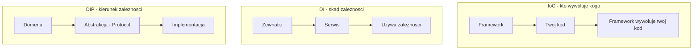
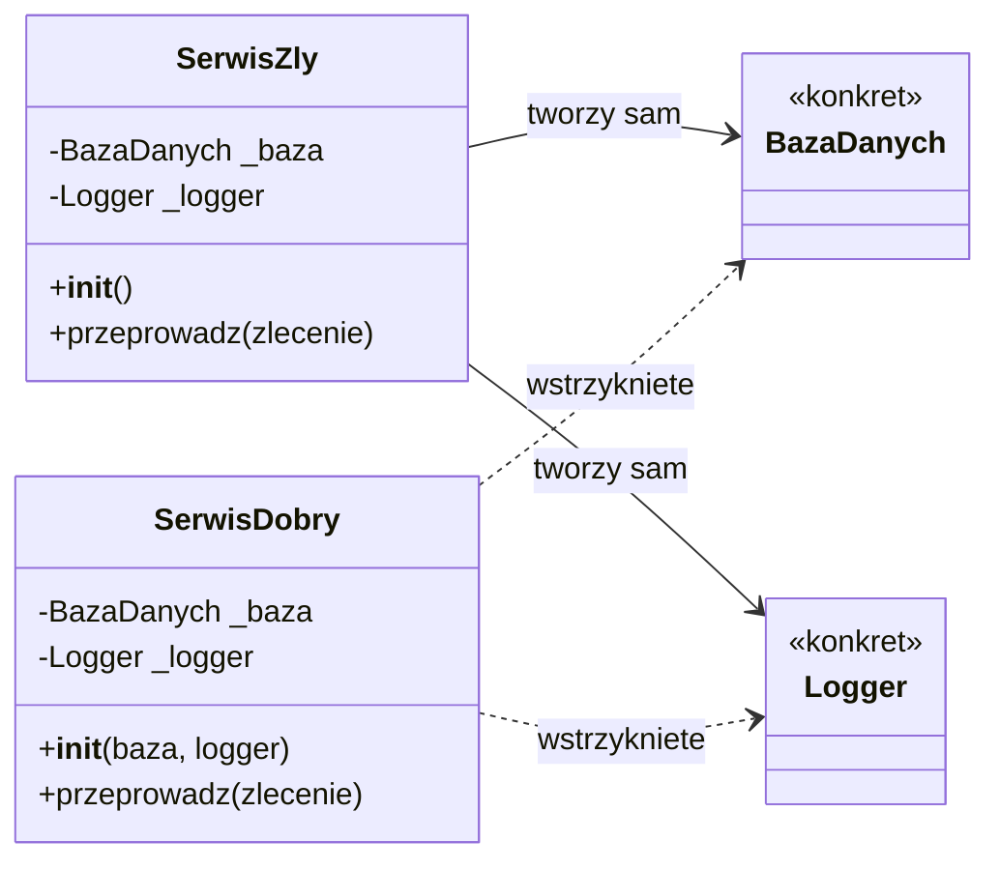
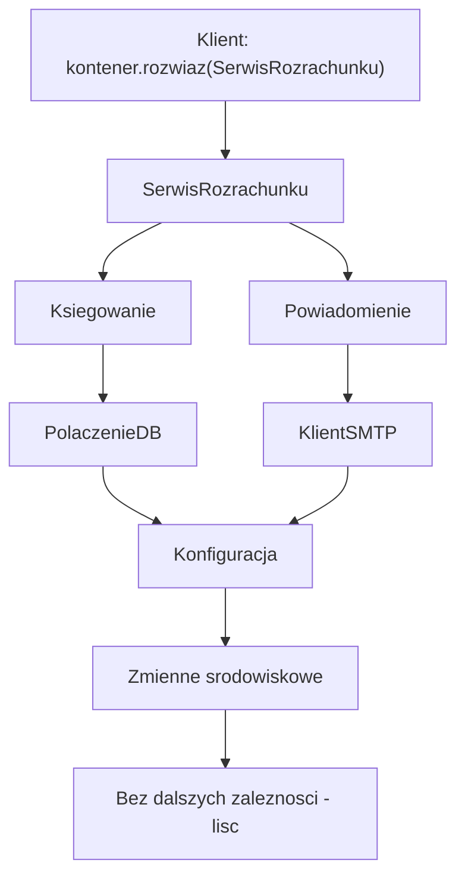
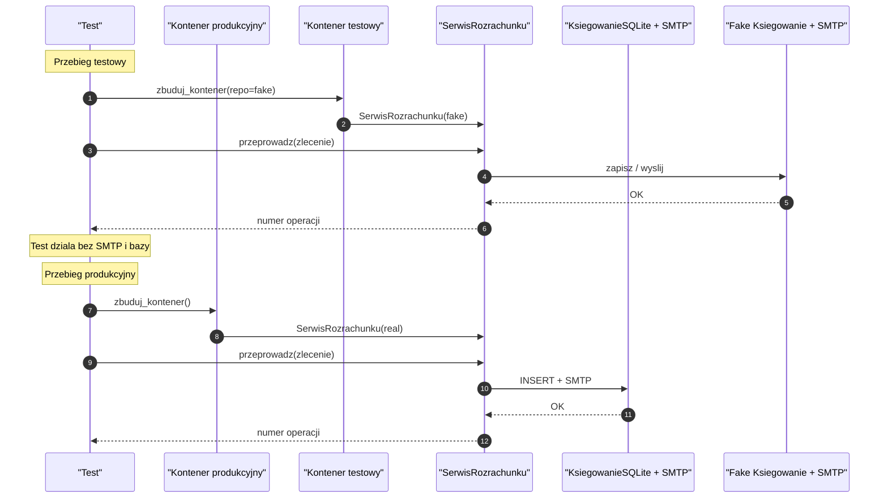
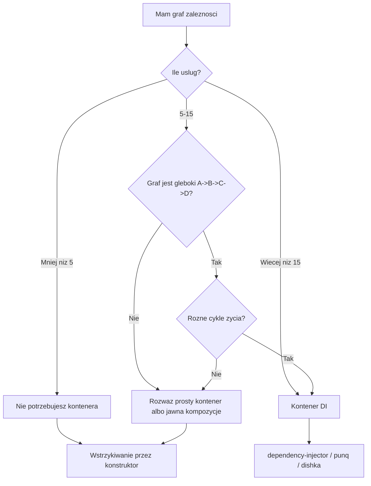
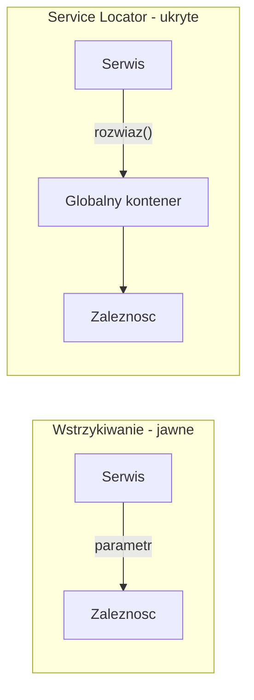
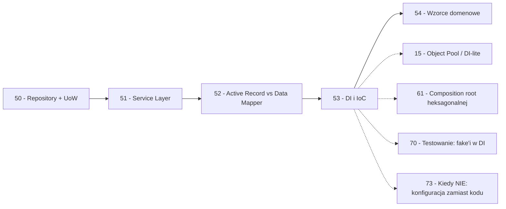

```markdown
---
modul: 53 — Dependency Injection i Inversion of Control
plik: 53-dependency-injection-i-ioc.md
poziom: sredni
wymaga: [52]
czas: ~200 minut czytania + ~440 minut ćwiczeń
---

# Moduł 53 — Dependency Injection i Inversion of Control — kto tu rządzi?

> **TL;DR**
> - **Odwrócenie sterowania (ang. Inversion of Control, IoC)** to zasada: to nie ty wywołujesz framework, to framework wywołuje ciebie („reguła Hollywood").
> - **Wstrzykiwanie zależności (ang. dependency injection, DI)** to technika: zależności przychodzą z zewnątrz (konstruktor, argument funkcji), a nie są tworzone wewnątrz obiektu.
> - **Zasada odwrócenia zależności (ang. Dependency Inversion Principle, DIP)** to trzecia rzecz — zasada SOLID o kierunku zależności. Trzy pojęcia są mylone, choć dotyczą różnych rzeczy — pokażemy różnice w tabeli.
> - W Pythonie **DI nie wymaga frameworka**: najczęściej wystarczy `Protocol` + argumenty konstruktora + ewentualnie `functools.partial` i pytest fixtures.
> - Kontener DI ma sens przy **głębokim grafie zależności** (A → B → C → D) i **różnych cyklach życia**. Dla małej aplikacji kontener to nadmiar — i „konfiguracja zamiast kodu".

---

## 0. Model mentalny

### Kelner, hydraulik i księgowy — trzy różne pomysły

Wyobraź sobie, że pracujesz w restauracji. Otwierasz lokal i zaczynasz przyjmować gości. **Pierwsze podejście** — próbujesz być wszystkim naraz. Jesteś kelnerem, który przyjmuje zamówienie. Idziesz do kuchni i **sam gotujesz** danie (bo ktoś musiał to zrobić). Potem idziesz do piwnicy, **sam podłączasz gaz** do kuchenki, bo instalacja gazowa była rozkręcona. Potem jeszcze wyliczasz rachunek, bo ktoś musiał. To działa — dopóki jest jeden gość. Przy dwudziestu gościach **paraliż**: nie dasz rady gotować i podłączać gazu jednocześnie. A gdy zmienisz dostawcę gazu (inny typ butli), musisz przerobić całą kuchnię.

**Drugie podejście** — wzywasz fachowców. Kiedy otwierasz restaurację, **przyjmujesz do pracy hydraulika** (który zadba o gaz), **księgowego** (który policzy rachunki), **kucharza** (który gotuje). Twoja rola jako kelnera: **przyjąć zamówienie i przekazać je dalej** — kucharzowi, księgowemu, hydraulikowi. Nie wiedzie cię, jak działa instalacja gazowa. Kucharz też nie — po prostu wykonuje swoją pracę. Każdy dostaje **swoją rolę** i **tylko to, co jest mu potrzebne**. To jest **wstrzykiwanie zależności** — dostajesz współpracowników z zewnątrz, nie tworzysz ich sam.

Ale zauważ drugą rzecz w tym podejściu. **To nie ty decydujesz, kiedy kucharz pracuje.** Kuchnia ma swoje godziny, swoje tempo. Ty dostarczasz zamówienie, ale **kuchnia ma własny rytm** — możesz tylko przekazywać kolejne zamówienia. Gdy otwierasz lokal, to nie ty wołasz do kuchni „teraz działaj" — to **proces biznesowy** (obsługa gościa) uruchamia kuchnię. Ta inwersja — „to nie ja wywołuję innych, to proces mnie wywołuje" — nazywa się **odwróceniem sterowania** (IoC). To inna rzecz niż dostarczanie współpracowników (DI).

Trzecie podejście — **księgowy projektuje restaurację pod kątem rachunków**. Zamiast pytać kucharza „ile dań sprzedałeś w marcu", księgowy mówi: „kuchnia ma wysyłać mi dane w formacie X". **Kuchnia podporządkowuje swój sposób komunikacji wymaganiom księgowego**, nie odwrotnie. To **odwrócenie zależności** (DIP): to nie księgowy ma znać wszystkie szczegóły kuchni, to kuchnia ma dopasować się do kontraktu. To **trzecia rzecz** — różna od DI i od IoC.

Trzy pojęcia — **IoC**, **DI**, **DIP** — brzmią podobnie, dotyczą pokrewnych spraw, ale są **różne**. Najczęściej mylone w branży. W tym module rozpakujemy je po kolei.

| W analogii restauracji | W kodzie |
|---|---|
| Kelner wszystko sam (gotuje, podłącza gaz, liczy) | Klasa tworzy własne zależności (`Baza()`, `Logger()`) |
| Hydraulik, kucharz, księgowy przychodzą z zewnątrz | Wstrzykiwanie zależności (DI) |
| Kelner przekazuje zamówienie, ale nie kieruje kuchnią | Odwrócenie sterowania (IoC) |
| Kuchnia dostosowuje się do formatu księgowego | Odwrócenie zależności (DIP) |
| „Zatrudniam hydraulika na start" | Wstrzykiwanie przez konstruktor |
| „Dzwonię po hydraulika, gdy potrzebuję" | Service Locator (antywzorzec) |
| Firma z 50 pracownikami ma szefa zmiany | Kontener DI |
| Restauracja z 2 osobami | DI bez kontenera (wystarczy) |

> 🧠 **Zapamiętaj** — **Odwrócenie sterowania (IoC) to zasada „nie ty wywołujesz framework, framework wywołuje ciebie". Wstrzykiwanie zależności (DI) to technika przekazywania zależności z zewnątrz. Zasada odwrócenia zależności (DIP) to zasada SOLID o kierunku zależności: oba poziomy powinny zależeć od abstrakcji. Trzy różne rzeczy, często mylone.**

### Diagram — trzy pojęcia obok siebie



*Diagram pokazuje trzy różne aspekty: IoC dotyczy tego, kto wywołuje kogo; DI dotyczy tego, skąd pochodzą zależności; DIP dotyczy tego, w którą stronę idą zależności w projekcie.*

### Czego DI NIE robi

Rozbrójmy pięć mitów.

**Nie wymaga frameworka.** W Pythonie **najczęściej** DI realizuje się przez argumenty konstruktora. Kontener to opcjonalne narzędzie.

**Nie zastępuje projektowania.** Powiedzenie „użyję DI" nie zwalnia z pytania „jaka jest odpowiedzialność tego obiektu" i „co jest jego zależnością". DI **ujawnia** zależności — ale najpierw musisz wiedzieć, jakie one są.

**Nie gwarantuje testowalności.** Możesz mieć DI i wciąż pisać testy wymagające bazy (bo zależność **jest** bazą). Testowalność wymaga **wstrzykiwania abstrakcji** — nie konkretów.

**Nie jest tym samym co DIP.** DI to technika, DIP to zasada. Możesz mieć DI i łamać DIP (wstrzykiwać konkretne klasy, nie abstrakcje). Możesz mieć DIP bez DI (abstrakcja zdefiniowana w domenie, ale konkret tworzony w module).

**Nie zawsze się opłaca.** Dla trzech klas bez zależności DI nic nie zmieni. Kontener DI dla 5 serwisów to przesada. DI **jest** wartościowy, gdy graf zależności staje się złożony.

**Nie jest tym samym co Service Locator.** Service Locator to antywzorzec — obiekt „wyciąga" zależności z globalnego kontenera, ukrywając je. DI to **jawne przekazanie**. W sekcji 4 pokażemy różnicę.

---

## 1. Problem, który rozwiązujemy

Wejdźmy w domenę 💳 „Rozrachunku". System obsługuje zlecenia przelewu i musi:
- zapisywać operacje w bazie,
- wysyłać powiadomienia (e-mail),
- logować zdarzenia,
- wywoływać zewnętrzną bramkę płatniczą.

Ktoś napisał to tak:

### Kod „przed"

```python
# rozrachunek_v0.py — wersja naiwna, demonstracyjna
# UWAGA: kod celowo pokazuje problem z zaleznosciami tworzonymi wewnatrz.

from __future__ import annotations

import os
import smtplib
from dataclasses import dataclass
from decimal import Decimal


@dataclass(frozen=True)
class Zlecenie:
    identyfikator: str
    kwota: Decimal
    waluta: str
    email_klienta: str


class SerwisRozrachunku:
    """Serwis rozrachunku - tworzy wlasne zaleznosci wewnatrz."""

    def __init__(self) -> None:
        # Zaleznosci tworzone wewnatrz - twarde sprzezenie
        self._sciezka_db = os.environ.get("DB_PATH", "app.db")
        self._host_smtp = os.environ.get("SMTP_HOST", "localhost")
        self._port_smtp = int(os.environ.get("SMTP_PORT", "25"))
        self._api_key = os.environ.get("STRIPE_KEY", "")
        self._prog = Decimal("0.01")

    def przeprowadz(self, zlecenie: Zlecenie) -> str:
        # 1. Walidacja
        if zlecenie.kwota <= 0:
            raise ValueError("kwota musi byc dodatnia")

        # 2. Zapis do bazy - surowy sqlite3
        import sqlite3
        polaczenie = sqlite3.connect(self._sciezka_db)
        try:
            kursor = polaczenie.cursor()
            kursor.execute(
                "INSERT INTO operacje (id, kwota, waluta) VALUES (?, ?, ?)",
                (zlecenie.identyfikator, str(zlecenie.kwota), zlecenie.waluta),
            )
            polaczenie.commit()
        finally:
            polaczenie.close()

        # 3. Wysylka e-mail - wprost smtplib
        try:
            serwer = smtplib.SMTP(self._host_smtp, self._port_smtp)
            serwer.sendmail(
                "system@example.com",
                [zlecenie.email_klienta],
                f"Przyjeto zlecenie {zlecenie.identyfikator}",
            )
            serwer.quit()
        except Exception:
            pass

        # 4. Bramka platnicza - zalazek "jak to zrobic"
        if self._api_key:
            # ... (wywolanie zewnetrznego API)
            pass

        return f"OP-{zlecenie.identyfikator}"


if __name__ == "__main__":
    serwis = SerwisRozrachunku()
    z = Zlecenie("Z-1", Decimal("100"), "PLN", "a@b.pl")
    print(serwis.przeprowadz(z))
```

Ten kod działa, ale **nie da się go przetestować** bez prawdziwego SMTP, bez prawdziwej bazy, bez prawdziwego Stripe. Wszystkie zależności są tworzone wewnątrz. Test będzie wymagał albo bazy testowej, albo mocka (patrz sekcja 8 — dlaczego to niedobre).

### Code smell — zależności tworzone wewnątrz

| Problem | Gdzie | Konsekwencja |
|---|---|---|
| Zależności tworzone w `__init__` | `sqlite3`, `smtplib` | Twarde sprzężenie klasy z konkretami |
| Sekrety przez `os.environ` | Cała klasa | Trudne do testowania bez ustawiania zmiennych |
| Brak abstrakcji bazy | Bezpośredni SQL | Nie da się podmienić na in-memory |
| Brak abstrakcji e-maila | `smtplib` | Nie da się testować bez SMTP |
| Brak abstrakcji bramki | `self._api_key` | Nie da się testować bez Stripe |
| Wyjątki „łyknięte" | `except Exception: pass` | Cichy błąd |
| Metoda robi cztery rzeczy | `przeprowadz` | Łamie SRP (moduł 03) |

### Objawy — poznasz ten problem po tym, że...

- **Test wymaga bazy, SMTP, internetu.** To znak, że klasa sama tworzy zależności.
- **W kodzie widzisz `import`y infrastruktury** (sqlite3, smtplib, requests) w klasach domenowych.
- **Nie da się zmienić bazy bez modyfikacji klasy.**
- **Nie da się wykonać serwisu w symulacji** bez uruchomienia wszystkich zależności.
- **Sekrety są przez `os.environ` wewnątrz klasy.** Nie da się podstawić konfiguracji testowej bez ustawiania env.
- **Testy są wolne** — 5 sekund na test jednostkowy, bo „setup" łączy się z bazą.
- **Klasa sama wybiera konkretne implementacje.** Brak szansy na wymianę.
- **Trudno opisać odpowiedzialność klasy** — bo „wie o bazie, SMTP i bramce".
- **Brak spójnego miejsca konfiguracji.** Ustawienia rozsiane po klasach.

---

## 2. Anatomia wzorców

### Uczestnicy

Ponieważ omawiamy trzy powiązane wzorce/techniki, sekcja dzieli się na podsekcje.

#### Uczestnicy DI

| Rola | Odpowiedzialność | Co NIE jest jej zadaniem |
|---|---|---|
| **Konsument (client)** | Używa zależności przez abstrakcję | Nie tworzy jej samodzielnie; nie wie, kto ją dostarcza |
| **Zależność (dependency)** | Wykonuje jakąś operację dla konsumenta | Nie wie, kto ją używa |
| **Kompozytor (composer)** | Tworzy i łączy obiekty (composition root) | Nie jest częścią domeny — żyje na granicy aplikacji |
| **Kontener (tylko DI)** | Rejestruje fabryki i rozwiązuje graf zależności | Nie zawiera logiki biznesowej |

#### Uczestnicy IoC

| Rola | Odpowiedzialność | Co NIE jest jej zadaniem |
|---|---|---|
| **Framework/host** | Wywołuje kod użytkownika w kontrolowanym momencie | Nie zna logiki biznesowej |
| **Handler / callback** | Kod użytkownika, wywoływany przez framework | Nie kontroluje momentu wywołania |
| **Punkt wejścia** | Rejestruje handlery; oddaje sterowanie frameworkowi | Nie wykonuje logiki biznesowej własnoręcznie |

### Diagram — klasa tworząca zależność sama vs wstrzykiwanie



*Diagram pokazuje różnicę: `SerwisZly` tworzy swoje zależności samodzielnie — twarde sprzężenie; `SerwisDobry` otrzymuje je w konstruktorze — luźne powiązanie.*

### Warianty: klasyczny vs pythoniczny

| Aspekt | Klasyczny (framework) | Pythoniczny |
|---|---|---|
| Wstrzykiwanie | Konstruktor + kontener | Argumenty konstruktora/функcji |
| Kontrakt | Interfejs `ABC` | `typing.Protocol` |
| Konfiguracja | XML/YAML | Kod w composition root |
| Cykle życia | Singleton/transient/scoped | `@lru_cache` / jawnie |
| Kontener | `Spring`, `Guice` | `dependency-injector`, `punq`, `dishka` |
| Testy | Mock framework | pytest fixtures + fake'e |
| Wykrywanie cykli | Framework | Ręczne / w kompozytorze |

Python jest **znacznie lżejszy** w DI niż Java/C#. To dlatego mówi się „w Pythonie nie potrzebujesz frameworka DI".

---

## 3. Implementacja krok po kroku

Przebudujemy serwis z sekcji 1 stopniowo.

### Krok 1 — Zidentyfikuj zależności

Wypisz, czego **naprawdę** potrzebuje `SerwisRozrachunku`:

```text
SerwisRozrachunku potrzebuje:
  - Ksiegowanie (zapis operacji)
  - Powiadomienie (wysylka e-mail)
  - BramkaPlatnicza (realizacja platnosci)
  - Konfiguracja (prog, waluty)
```

Cztery zależności. To one powinny być **wstrzykiwane**.

### Krok 2 — Zdefiniuj kontrakty (Protokoły)

Każda zależność jako `Protocol` (moduł 02).

```python
from typing import Protocol, runtime_checkable
from decimal import Decimal


@runtime_checkable
class Ksiegowanie(Protocol):
    """Port: zapisuje operacje rozrachunku."""
    def zapisz(self, identyfikator: str, kwota: Decimal, waluta: str) -> None: ...


@runtime_checkable
class Powiadomienie(Protocol):
    """Port: wysyla powiadomienia do klienta."""
    def wyslij(self, odbiorca: str, tresc: str) -> None: ...


@runtime_checkable
class BramkaPlatnicza(Protocol):
    """Port: realizuje operacje platnicze."""
    def realizuj(self, identyfikator: str, kwota: Decimal) -> str: ...


@runtime_checkable
class Konfiguracja(Protocol):
    """Port: konfiguracja aplikacji."""
    prog_minimalny: Decimal
    waluty: frozenset[str]
```

Każdy port opisuje **rolę** — nie konkretną implementację.

### Krok 3 — Zdefiniuj serwis z DI

Teraz klasa dostaje zależności z zewnątrz.

```python
class SerwisRozrachunku:
    """Serwis z wstrzykiwaniem zaleznosci przez konstruktor."""

    def __init__(
        self,
        ksiega: Ksiegowanie,
        powiadomienie: Powiadomienie,
        bramka: BramkaPlatnicza,
        konfiguracja: Konfiguracja,
    ) -> None:
        self._ksiega = ksiega
        self._powiadomienie = powiadomienie
        self._bramka = bramka
        self._konfiguracja = konfiguracja

    def przeprowadz(
        self, identyfikator: str, kwota: Decimal, waluta: str, email: str
    ) -> str:
        if kwota < self._konfiguracja.prog_minimalny:
            raise ValueError(
                f"kwota ponizej progu {self._konfiguracja.prog_minimalny}"
            )
        if waluta not in self._konfiguracja.waluty:
            raise ValueError(f"nieobslugiwana waluta: {waluta}")

        numer = self._bramka.realizuj(identyfikator, kwota)
        self._ksiega.zapisz(identyfikator, kwota, waluta)
        self._powiadomienie.wyslij(
            email, f"Przyjeto zlecenie {identyfikator}: {numer}"
        )
        return numer
```

Zwróć uwagę: **serwis nie tworzy niczego** — dostaje wszystko w konstruktorze. Testy mogą podstawić dowolną implementację.

### Krok 4 — Composition root

Jedno miejsce, gdzie tworzymy i łączymy.

```python
@dataclass(frozen=True)
class KonfiguracjaAplikacji:
    prog_minimalny: Decimal = Decimal("0.01")
    waluty: frozenset[str] = frozenset({"PLN", "EUR", "USD"})
    sciezka_db: str = "app.db"
    host_smtp: str = "localhost"
    port_smtp: int = 25


def zbuduj_serwis() -> SerwisRozrachunku:
    """Composition root: tworzy i laczy wszystkie zaleznosci."""
    konfiguracja = KonfiguracjaAplikacji()
    return SerwisRozrachunku(
        ksiega=KsiegowanieSQLite(konfiguracja.sciezka_db),
        powiadomienie=PowiadomienieSMTP(
            konfiguracja.host_smtp, konfiguracja.port_smtp
        ),
        bramka=BramkaStripe(api_key=os.environ["STRIPE_KEY"]),
        konfiguracja=konfiguracja,
    )
```

To **jedyne miejsce**, w którym pojawiają się konkretne klasy. Reszta kodu zna tylko abstrakcje.

### Krok 5 — Wersje zależności

Implementacje portów:

```python
class KsiegowanieSQLite:
    def __init__(self, sciezka: str) -> None:
        self._sciezka = sciezka

    def zapisz(self, identyfikator: str, kwota: Decimal, waluta: str) -> None:
        import sqlite3
        polaczenie = sqlite3.connect(self._sciezka)
        try:
            kursor = polaczenie.cursor()
            kursor.execute(
                "INSERT INTO operacje (id, kwota, waluta) VALUES (?, ?, ?)",
                (identyfikator, str(kwota), waluta),
            )
            polaczenie.commit()
        finally:
            polaczenie.close()


class KsiegowanieWTestach:
    """Implementacja testowa - w pamieci."""
    def __init__(self) -> None:
        self.zapisy: list[tuple[str, Decimal, str]] = []

    def zapisz(self, identyfikator: str, kwota: Decimal, waluta: str) -> None:
        self.zapisy.append((identyfikator, kwota, waluta))


class PowiadomienieSMTP:
    def __init__(self, host: str, port: int) -> None:
        self._host = host
        self._port = port

    def wyslij(self, odbiorca: str, tresc: str) -> None:
        import smtplib
        serwer = smtplib.SMTP(self._host, self._port)
        try:
            serwer.sendmail("system@example.com", [odbiorca], tresc)
        finally:
            serwer.quit()


class PowiadomienieWTestach:
    def __init__(self) -> None:
        self.wyslane: list[tuple[str, str]] = []

    def wyslij(self, odbiorca: str, tresc: str) -> None:
        self.wyslane.append((odbiorca, tresc))
```

Te same kontrakty, różne implementacje — jedna testowa, jedna produkcyjna.

### Krok 6 — Test z fake'ami

W testach nie trzeba bazy, SMTP, internetu.

```python
def test_serwis_z_fake_ami() -> None:
    ksiega = KsiegowanieWTestach()
    powiadomienie = PowiadomienieWTestach()
    bramka = BramkaWTescie()
    konfiguracja = KonfiguracjaAplikacji()

    serwis = SerwisRozrachunku(ksiega, powiadomienie, bramka, konfiguracja)
    numer = serwis.przeprowadz("Z-1", Decimal("100"), "PLN", "a@b.pl")

    assert ksiega.zapisy == [("Z-1", Decimal("100"), "PLN")]
    assert powiadomienie.wyslane[0][0] == "a@b.pl"
```

### Krok 7 — Weryfikacja

| Kryterium | Wersja „przed" | Wersja „po" |
|---|---|---|
| Test wymaga SMTP | Tak | Nie |
| Test wymaga bazy | Tak | Nie |
| Wymiana bazy | Zmiana w klasie | Wymiana w composition root |
| Wymiana bramki | Zmiana w klasie | Wymiana w composition root |
| Zależności widoczne | Nie (ukryte w `__init__`) | Tak (jawne w konstruktorze) |
| Testów na sekundę | Wolne | Szybkie |
| Liczba klas | 2 | ~10 |

Koszt: więcej klas (porty + implementacje). Zysk: testowalność, wymienność, jawność.

---

## 4. Wersje pythoniczne i warianty

### 4.1 Wstrzykiwanie przez konstruktor — domyślne

Pokazane w sekcji 3. Zależność przychodzi w konstruktorze. **Preferowana** forma.

```python
class Serwis:
    def __init__(self, baza: Baza, logger: Logger) -> None:
        self._baza = baza
        self._logger = logger
```

### 4.2 Wstrzykiwanie przez argument funkcji

Najbardziej pythoniczne.

```python
def przeprowadz(
    zlecenie: Zlecenie,
    ksiega: Ksiegowanie,
    powiadomienie: Powiadomienie,
) -> str:
    numer = zlecenie.identyfikator
    ksiega.zapisz(numer, zlecenie.kwota, zlecenie.waluta)
    powiadomienie.wyslij(zlecenie.email_klienta, f"Przyjeto {numer}")
    return numer
```

Zaleta: **brak klasy** — funkcja jest serwisem. Bardzo proste w testach.

### 4.3 Domyślne argumenty z realną implementacją

Wygodne dla prostych przypadków.

```python
def przeprowadz(
    zlecenie: Zlecenie,
    ksiega: Ksiegowanie | None = None,
) -> str:
    if ksiega is None:
        ksiega = KsiegowanieSQLite("app.db")
    ...
```

**Uwaga na pułapkę mutowalnych domyślnych wartości** (moduł 01) — `ksiega: Ksiegowanie | None = None` jest bezpieczne; `ksiega: list = []` byłoby błędem.

**Ale to ma wadę:** ukryta zależność. Klient, który nie przeczyta dokumentacji, nie wie, że `ksiega` w ogóle istnieje. Dla bibliotek i frameworków to OK, dla wewnętrznego kodu — wolałbym jawne. **Rekomendacja:** używaj `None` tylko dla prawdziwie **opcjonalnych** zależności.

### 4.4 `functools.partial` — konfiguracja

```python
import functools

def przeprowadz_produkcja(zlecenie: Zlecenie) -> str:
    """Serwis z zamrozonymi zaleznosciami."""
    ...

ksiega = KsiegowanieSQLite("app.db")
powiadomienie = PowiadomienieSMTP("localhost", 25)

serwis_prod = functools.partial(przeprowadz, ksiega=ksiega, powiadomienie=powiadomienie)
serwis_prod(zlecenie)   # dziala jak serwis
```

Zaleta: brak klasy. Wada: trudniejsze adnotacje typów, ukrycie „serwisu" w funkcji.

### 4.5 Fabryki domknięciowe

```python
def utworz_serwis(sciezka_db: str) -> Callable[[Zlecenie], str]:
    """Fabryka: tworzy i konfiguruje serwis."""
    ksiega = KsiegowanieSQLite(sciezka_db)
    powiadomienie = PowiadomienieSMTP("localhost", 25)

    def serwis(zlecenie: Zlecenie) -> str:
        return przeprowadz(zlecenie, ksiega, powiadomienie)

    return serwis


# Produkcja:
serwis_prod = utworz_serwis("/var/lib/app.db")

# Testy:
serwis_test = utworz_serwis(":memory:")
```

Zaleta: pełna kontrola, brak klas. Wada: nie ma „typed service" — jest `Callable`.

### 4.6 `typing.Protocol` jako typ zależności

Podkreślimy to jeszcze raz: `Protocol` (moduł 02) jest **kluczowym narzędziem DI w Pythonie**. Pozwala **odwrócić zależność bez dziedziczenia**.

```python
class Ksiegowanie(Protocol):
    def zapisz(self, identyfikator: str, kwota: Decimal, waluta: str) -> None: ...


class Serwis:
    def __init__(self, ksiega: Ksiegowanie) -> None:
        self._ksiega = ksiega


# Implementacja NIE MUSI dziedziczyc po Ksiegowanie
class KsiegowanieWTestach:
    def zapisz(self, identyfikator: str, kwota: Decimal, waluta: str) -> None:
        ...


# Ale jest akceptowana przez typowane sygnatury
serwis = Serwis(KsiegowanieWTestach())
```

**To jest esencja DI w Pythonie** — typ strukturalny wystarcza, by wstrzyknąć dowolny obiekt spełniający kontrakt.

### 4.7 Pytest fixtures jako DI

W testach `pytest` udostępnia **pełnoprawny mechanizm DI** przez fixtures.

```python
import pytest
from decimal import Decimal


@pytest.fixture
def ksiega_inmemory() -> KsiegowanieWTestach:
    return KsiegowanieWTestach()


@pytest.fixture
def powiadomienie_inmemory() -> PowiadomienieWTestach:
    return PowiadomienieWTestach()


@pytest.fixture
def konfiguracja_testowa() -> KonfiguracjaAplikacji:
    return KonfiguracjaAplikacji(prog_minimalny=Decimal("1.00"))


@pytest.fixture
def serwis(
    ksiega_inmemory: KsiegowanieWTestach,
    powiadomienie_inmemory: PowiadomienieWTestach,
    konfiguracja_testowa: KonfiguracjaAplikacji,
) -> SerwisRozrachunku:
    return SerwisRozrachunku(
        ksiega_inmemory,
        powiadomienie_inmemory,
        BramkaWTescie(),
        konfiguracja_testowa,
    )


def test_przeprowadz_zlecenie(serwis, ksiega_inmemory) -> None:
    serwis.przeprowadz("Z-1", Decimal("100"), "PLN", "a@b.pl")
    assert len(ksiega_inmemory.zapisy) == 1
```

**Fixtures `pytest` to DI w testach** — dokładnie ta sama idea. Framework wstrzykuje zależności do funkcji testowej.

### 4.8 Kontenery DI

Dla głębokich grafów zależności istnieją **biblioteki** kontenerów:

- **`dependency-injector`** — najpopularniejszy, wsparcie dla async, `Provider`s.
- **`punq`** — minimalistyczny.
- **`injector`** — podobny do Springa/Guice.
- **`dishka`** — nowsze, wsparcie dla scope'ów.
- **FastAPI `Depends()`** — natywne DI dla FastAPI.
- **`Injector` w Flask `inject`** — dla Flask.

**Ale zanim użyjesz kontenera, zobacz sekcję 7 — w 90% przypadków kontener nie jest potrzebny.**

### 4.9 Service Locator — antywzorzec

```python
# ANTYWZORZEC
class Serwis:
    def przeprowadz(self, zlecenie: Zlecenie) -> None:
        ksiega = KONTENER.rozwiaz(Ksiegowanie)   # wyciaga z globalnego
        powiadomienie = KONTENER.rozwiaz(Powiadomienie)
        ...   # uzywa
```

**Dlaczego to źle:**
1. **Zależności nie są widoczne w sygnaturze.** Klient musi zgadnąć, co Serwis naprawdę potrzebuje.
2. **Testy wymagają podstawienia globalnego kontenera.** Nie można podstawić tylko jednej zależności.
3. **Cykle trudne do wykrycia.**
4. **Ukryte zależności** między modułami.

**Wniosek:** unikaj Service Locatora. Wstrzykuj jawnie przez konstruktor.

### 4.10 Podsumowanie — tabela wyboru

| Sytuacja | Forma |
|---|---|
| Serwis z 2–5 zależnościami | Konstruktor + `Protocol` |
| Funkcja bez stanu | Argumenty funkcji |
| Zależność z konfiguracją w jednym miejscu | `functools.partial` |
| Fabryka dla środowiska | Domknięcie |
| Testy | pytest fixtures |
| **Złożony graf (>10 usług)** | **Kontener DI** |
| Zależność opcjonalna | Domyślny argument `None` |
| Framework (FastAPI/Django) | Natywne DI frameworka |

> 🧠 **Zapamiętaj** — **W Pythonie DI to przede wszystkim trzy rzeczy: `Protocol` + argumenty konstruktora + pytest fixtures.** Kontener DI jest potrzebny dopiero, gdy liczba usług jest duża i graf zależności naprawdę złożony. **Zacznij od jawnego wstrzykiwania — kontener dodasz, gdy zaboli.**

---

## 5. Przykład z życia: 🏦 Bank-klient — pełny uruchamialny kod

Zbudujemy pełny system obsługi klientów z DI. Pokażemy kontener DI dla złożonego grafu oraz testy z fake'ami.

### Kod

```python
# bank_klient_di.py — pelny przyklad DI
from __future__ import annotations

import inspect
from dataclasses import dataclass, replace
from decimal import Decimal, ROUND_HALF_UP
from typing import Callable, Protocol, TypeVar, runtime_checkable


# ===========================================================================
# 1. Kontrakty (porty)
# ===========================================================================

@runtime_checkable
class RepozytoriumKlientow(Protocol):
    def znajdz(self, id_: str) -> "KlientDM | None": ...
    def dodaj(self, klient: "KlientDM") -> None: ...
    def wszyscy(self) -> list["KlientDM"]: ...


@runtime_checkable
class BramkaKYC(Protocol):
    """Port: zewnetrzny system KYC/AML."""
    def sprawdz(self, id_: str) -> bool: ...


@runtime_checkable
class Powiadomienie(Protocol):
    def wyslij(self, odbiorca: str, tresc: str) -> None: ...


@runtime_checkable
class Ksiegowanie(Protocol):
    def zapisz_operacje(
        self, id_klienta: str, opis: str, kwota: Decimal
    ) -> None: ...


@runtime_checkable
class LogAudytowy(Protocol):
    def zapisz(self, zdarzenie: str, dane: dict) -> None: ...


@runtime_checkable
class Konfiguracja(Protocol):
    limit_podstawowy_maly: Decimal
    limit_podstawowy_duzy: Decimal
    prog_nazwy: int


# ===========================================================================
# 2. Encja domenowa
# ===========================================================================

@dataclass(frozen=True)
class KlientDM:
    id: str
    nazwa: str
    limit_dzienny: Decimal
    zweryfikowany: bool = False

    def limit_efektywny(self, prog: int, maly: Decimal, duzy: Decimal) -> Decimal:
        """Regula biznesowa: limit podstawowy zalezy od dlugosci nazwy."""
        maks = maly if len(self.nazwa) < prog else duzy
        return min(self.limit_dzienny, maks)

    def z_limitem(self, nowy_limit: Decimal) -> "KlientDM":
        return replace(self, limit_dzienny=nowy_limit)

    def zweryfikowany_jako(self) -> "KlientDM":
        return replace(self, zweryfikowany=True)


# ===========================================================================
# 3. Implementacje portow
# ===========================================================================

class RepozytoriumWTestach:
    def __init__(self) -> None:
        self._dane: dict[str, KlientDM] = {}

    def znajdz(self, id_: str) -> KlientDM | None:
        return self._dane.get(id_)

    def dodaj(self, klient: KlientDM) -> None:
        self._dane[klient.id] = klient

    def wszyscy(self) -> list[KlientDM]:
        return list(self._dane.values())


class BramkaKYCWTestach:
    def __init__(self, zakazani: set[str] | None = None) -> None:
        self._zakazani = zakazani or set()

    def sprawdz(self, id_: str) -> bool:
        return id_ not in self._zakazani


class PowiadomienieWTestach:
    def __init__(self) -> None:
        self.wyslane: list[tuple[str, str]] = []

    def wyslij(self, odbiorca: str, tresc: str) -> None:
        self.wyslane.append((odbiorca, tresc))


class KsiegowanieWTestach:
    def __init__(self) -> None:
        self.operacje: list[tuple[str, str, Decimal]] = []

    def zapisz_operacje(
        self, id_klienta: str, opis: str, kwota: Decimal
    ) -> None:
        self.operacje.append((id_klienta, opis, kwota))


class LogAudytowyWTestach:
    def __init__(self) -> None:
        self.zdarzenia: list[tuple[str, dict]] = []

    def zapisz(self, zdarzenie: str, dane: dict) -> None:
        self.zdarzenia.append((zdarzenie, dict(dane)))


@dataclass(frozen=True)
class KonfiguracjaTestowa:
    limit_podstawowy_maly: Decimal = Decimal("10000")
    limit_podstawowy_duzy: Decimal = Decimal("100000")
    prog_nazwy: int = 5


# ===========================================================================
# 4. Serwis aplikacyjny (uzywa 5 portow)
# ===========================================================================

class BladRejestracji(Exception):
    """Blad domenowy podczas rejestracji klienta."""


class SerwisKlientow:
    """Serwis aplikacyjny - wstrzykiwanie 5 zaleznosci przez konstruktor."""

    def __init__(
        self,
        repo: RepozytoriumKlientow,
        kyc: BramkaKYC,
        powiadomienie: Powiadomienie,
        ksiega: Ksiegowanie,
        log: LogAudytowy,
        konfiguracja: Konfiguracja,
    ) -> None:
        # Walidacja kontraktow w konstruktorze
        for nazwa, obj, protokol in [
            ("repo", repo, RepozytoriumKlientow),
            ("kyc", kyc, BramkaKYC),
            ("powiadomienie", powiadomienie, Powiadomienie),
            ("ksiega", ksiega, Ksiegowanie),
            ("log", log, LogAudytowy),
            ("konfiguracja", konfiguracja, Konfiguracja),
        ]:
            if not isinstance(obj, protokol):
                raise TypeError(
                    f"{nazwa}: {type(obj).__name__} nie spelnia kontraktu "
                    f"{protokol.__name__}"
                )
        self._repo = repo
        self._kyc = kyc
        self._powiadomienie = powiadomienie
        self._ksiega = ksiega
        self._log = log
        self._cfg = konfiguracja

    def zarejestruj(
        self, id_: str, nazwa: str, limit: Decimal, email: str
    ) -> KlientDM:
        self._log.zapisz("proba_rejestracji", {"id": id_})

        # 1. Walidacja formalna
        if not id_ or not nazwa:
            raise BladRejestracji("id i nazwa sa wymagane")
        if limit < Decimal("0"):
            raise BladRejestracji("limit nie moze byc ujemny")

        # 2. Sprawdzenie KYC
        if not self._kyc.sprawdz(id_):
            self._log.zapisz("kyc_odrzucony", {"id": id_})
            raise BladRejestracji(f"klient {id_} nie przeszedl KYC")

        # 3. Apply regula biznesowa
        klient = KlientDM(id=id_, nazwa=nazwa, limit_dzienny=limit)
        limit_efektywny = klient.limit_efektywny(
            self._cfg.prog_nazwy,
            self._cfg.limit_podstawowy_maly,
            self._cfg.limit_podstawowy_duzy,
        )
        klient = klient.z_limitem(limit_efektywny).zweryfikowany_jako()

        # 4. Zapis
        self._repo.dodaj(klient)

        # 5. Powiadomienie
        self._powiadomienie.wyslij(
            email, f"Klient {id_} zarejestrowany, limit {limit_efektywny}"
        )

        # 6. Ksiegowanie (wpis kontrolny)
        self._ksiega.zapisz_operacje(
            id_, "rejestracja", limit_efektywny
        )

        # 7. Audyt
        self._log.zapisz(
            "rejestracja_zakonczona",
            {"id": id_, "limit": str(limit_efektywny)},
        )

        return klient

    def limit(self, id_: str) -> Decimal:
        k = self._repo.znajdz(id_)
        if k is None:
            raise BladRejestracji(f"nie ma klienta {id_}")
        return k.limit_dzienny


# ===========================================================================
# 5. Mini kontener DI
# ===========================================================================

T = TypeVar("T")


class KontenerDI:
    """Mini kontener: rejestruje fabryki, rozwiazuje graf zaleznosci."""

    def __init__(self) -> None:
        self._rejestr: dict[type, tuple[Callable, bool]] = {}
        self._singletony: dict[type, object] = {}
        self._budowane: set[type] = set()

    def zarejestruj(
        self, typ: type, fabryka: Callable, singleton: bool = False
    ) -> None:
        if typ in self._rejestr:
            raise ValueError(f"{typ.__name__} jest juz zarejestrowany")
        self._rejestr[typ] = (fabryka, singleton)

    def zarejestruj_instancje(self, typ: type, instancja: object) -> None:
        self._rejestr[typ] = (lambda: instancja, True)

    def rozwiaz(self, typ: type) -> object:
        if typ in self._rejestr:
            fabryka, singleton = self._rejestr[typ]
            if singleton and typ in self._singletony:
                return self._singletony[typ]
            if typ in self._budowane:
                cykl = " -> ".join(
                    t.__name__ for t in self._budowane
                ) + f" -> {typ.__name__}"
                raise RecursionError(f"cykl zaleznosci: {cykl}")
            self._budowane.add(typ)
            try:
                sygnatura = inspect.signature(fabryka)
                argumenty = {}
                for nazwa, param in sygnatura.parameters.items():
                    adnotacja = param.annotation
                    if adnotacja is inspect.Parameter.empty:
                        continue
                    if adnotacja in self._rejestr:
                        argumenty[nazwa] = self.rozwiaz(adnotacja)
                    elif param.default is inspect.Parameter.empty:
                        raise LookupError(
                            f"nie mozna rozwiazac parametru {nazwa!r} "
                            f"typu {adnotacja}"
                        )
                obiekt = fabryka(**argumenty)
                if singleton:
                    self._singletony[typ] = obiekt
                return obiekt
            finally:
                self._budowane.discard(typ)
        raise LookupError(f"typ {typ.__name__} nie zarejestrowany")


# ===========================================================================
# 6. Composition root
# ===========================================================================

def zbuduj_kontener(
    repo: RepozytoriumKlientow | None = None,
) -> KontenerDI:
    """Konfiguracja aplikacji z domyslnymi implementacjami."""
    kontener = KontenerDI()

    # Konfiguracja jako singleton
    kontener.zarejestruj_instancje(Konfiguracja, KonfiguracjaTestowa())

    # Repozytorium - mozna podstawic (w testach) albo utworzyc domyslnie
    if repo is not None:
        kontener.zarejestruj_instancje(RepozytoriumKlientow, repo)
    else:
        kontener.zarejestruj(
            RepozytoriumKlientow,
            lambda: RepozytoriumWTestach(),
            singleton=True,
        )

    # Pozostale zaleznosci jako singletony
    kontener.zarejestruj(
        BramkaKYC,
        lambda zakazani=None: BramkaKYCWTestach(),
        singleton=True,
    )
    kontener.zarejestruj(
        Powiadomienie, lambda: PowiadomienieWTestach(), singleton=True
    )
    kontener.zarejestruj(
        Ksiegowanie, lambda: KsiegowanieWTestach(), singleton=True
    )
    kontener.zarejestruj(
        LogAudytowy, lambda: LogAudytowyWTestach(), singleton=True
    )

    # Serwis - transjent (nowy przy kazdym rozwiazaniu)
    kontener.zarejestruj(
        SerwisKlientow,
        lambda repo, kyc, powiadomienie, ksiega, log, konfiguracja: SerwisKlientow(
            repo, kyc, powiadomienie, ksiega, log, konfiguracja
        ),
        singleton=False,
    )
    return kontener


# ===========================================================================
# 7. Demonstracja
# ===========================================================================

if __name__ == "__main__":
    kontener = zbuduj_kontener()
    serwis = kontener.rozwiaz(SerwisKlientow)

    print("=== 1. Rejestracja klientow ===")
    for id_, nazwa, limit in [
        ("K-1", "Jan Kowalski", Decimal("50000")),
        ("K-2", "Anna", Decimal("900000")),
        ("K-3", "Tomasz Nowak", Decimal("200")),
    ]:
        klient = serwis.zarejestruj(id_, nazwa, limit, f"{id_}@x.pl")
        print(f"  {klient}")

    print("\n=== 2. Audyt zebrany przez kontener ===")
    log = kontener.rozwiaz(LogAudytowy)
    for zdarzenie, dane in log.zdarzenia:
        print(f"  {zdarzenie}: {dane}")

    print("\n=== 3. Ksiega ===")
    ksiega = kontener.rozwiaz(Ksiegowanie)
    for op in ksiega.operacje:
        print(f"  {op}")

    print("\n=== 4. KYC odrzuca klienta ===")
    kontener2 = KontenerDI()
    kontener2.zarejestruj_instancje(Konfiguracja, KonfiguracjaTestowa())
    kontener2.zarejestruj(
        RepozytoriumKlientow, lambda: RepozytoriumWTestach(), singleton=True
    )
    kontener2.zarejestruj(
        BramkaKYC, lambda: BramkaKYCWTestach({"K-999"}), singleton=True
    )
    kontener2.zarejestruj(
        Powiadomienie, lambda: PowiadomienieWTestach(), singleton=True
    )
    kontener2.zarejestruj(
        Ksiegowanie, lambda: KsiegowanieWTestach(), singleton=True
    )
    kontener2.zarejestruj(
        LogAudytowy, lambda: LogAudytowyWTestach(), singleton=True
    )
    kontener2.zarejestruj(
        SerwisKlientow,
        lambda repo, kyc, pow, ks, log, cfg: SerwisKlientow(repo, kyc, pow, ks, log, cfg),
    )
    serwis2 = kontener2.rozwiaz(SerwisKlientow)
    try:
        serwis2.zarejestruj("K-999", "Wojciech Lista", Decimal("10000"), "w@x.pl")
    except BladRejestracji as blad:
        print(f"  odrzucono: {blad}")

    print("\n=== 5. Cykl zaleznosci jest wykrywany ===")
    kontener3 = KontenerDI()

    class A:
        def __init__(self, b: "B") -> None: ...
    class B:
        def __init__(self, a: A) -> None: ...

    kontener3.zarejestruj(A, lambda b: A(b))
    kontener3.zarejestruj(B, lambda a: B(a))
    try:
        kontener3.rozwiaz(A)
    except RecursionError as blad:
        print(f"  {blad}")
```

### Co ten przykład pokazuje

**Punkt 1 — rejestracja klientów.** Serwis przyjmuje 5 zależności przez konstruktor. Każda implementacja testowa pozwala prześledzić, co się dzieje.

**Punkt 2 — audyt.** `LogAudytowyWTestach` zebrał wszystkie zdarzenia. W produkcji byłby to log strukturalny albo wpis w bazie.

**Punkt 3 — ksiega.** `KsiegowanieWTestach` zebrało operacje. Widzimy, że każda rejestracja generuje wpis kontrolny.

**Punkt 4 — odrzucenie przez KYC.** Kontener z `BramkaKYCWTestach({"K-999"})` odrzuca klienta. **Wymiana implementacji bez zmian w kodzie serwisu.**

**Punkt 5 — wykrywanie cykli.** Kontener wykrywa cykl A → B → A i rzuca `RecursionError`. To zabezpieczenie przed nieskończoną rekurencją.

### Testy

```python
# test_bank_klient_di.py — uruchomienie: pytest test_bank_klient_di.py -v
from decimal import Decimal

import pytest

from bank_klient_di import (
    BladRejestracji,
    BramkaKYCWTestach,
    KontenerDI,
    KsiegowanieWTestach,
    KlientDM,
    KonfiguracjaTestowa,
    LogAudytowyWTestach,
    PowiadomienieWTestach,
    RepozytoriumKlientow,
    RepozytoriumWTestach,
    SerwisKlientow,
    zbuduj_kontener,
)


# --- Encja domenowa (bez DI!) -----------------------------------------------

def test_limit_efektywny_maly() -> None:
    k = KlientDM("K-1", "Ala", Decimal("50000"))
    # nazwa "Ala" ma 3 znaki < 5
    assert k.limit_efektywny(5, Decimal("10000"), Decimal("100000")) == Decimal("10000")


def test_limit_efektywny_duzy() -> None:
    k = KlientDM("K-1", "Jan Kowalski", Decimal("500000"))
    assert k.limit_efektywny(5, Decimal("10000"), Decimal("100000")) == Decimal("100000")


def test_limit_efektywny_min_z_limit_i_maks() -> None:
    k = KlientDM("K-1", "Jan Kowalski", Decimal("500"))
    # mniejszy z 500 i 100000
    assert k.limit_efektywny(5, Decimal("10000"), Decimal("100000")) == Decimal("500")


# --- Serwis z fake'ami (bez bazy!) ------------------------------------------

@pytest.fixture
def fake_repo() -> RepozytoriumWTestach:
    return RepozytoriumWTestach()


@pytest.fixture
def fake_kyc() -> BramkaKYCWTestach:
    return BramkaKYCWTestach()


@pytest.fixture
def fake_powiadomienie() -> PowiadomienieWTestach:
    return PowiadomienieWTestach()


@pytest.fixture
def fake_ksiega() -> KsiegowanieWTestach:
    return KsiegowanieWTestach()


@pytest.fixture
def fake_log() -> LogAudytowyWTestach:
    return LogAudytowyWTestach()


@pytest.fixture
def serwis(
    fake_repo, fake_kyc, fake_powiadomienie, fake_ksiega, fake_log
) -> SerwisKlientow:
    return SerwisKlientow(
        repo=fake_repo,
        kyc=fake_kyc,
        powiadomienie=fake_powiadomienie,
        ksiega=fake_ksiega,
        log=fake_log,
        konfiguracja=KonfiguracjaTestowa(),
    )


def test_rejestracja_dziala(serwis, fake_repo, fake_powiadomienie) -> None:
    klient = serwis.zarejestruj("K-1", "Jan Kowalski", Decimal("50000"), "a@b.pl")
    assert klient.zweryfikowany
    assert fake_repo.znajdz("K-1") is not None
    assert len(fake_powiadomienie.wyslane) == 1


def test_rejestracja_zapisuje_audyt(serwis, fake_log) -> None:
    serwis.zarejestruj("K-1", "Jan Kowalski", Decimal("50000"), "a@b.pl")
    zdarzenia = [z for z, _ in fake_log.zdarzenia]
    assert "proba_rejestracji" in zdarzenia
    assert "rejestracja_zakonczona" in zdarzenia


def test_kyc_odrzuca(serwis) -> None:
    # W drugim teście podmieniamy KYC
    ...


def test_odrzuca_pusta_nazwe(serwis) -> None:
    with pytest.raises(BladRejestracji, match="wymagane"):
        serwis.zarejestruj("K-1", "", Decimal("100"), "a@b.pl")


def test_odrzuca_ujemny_limit(serwis) -> None:
    with pytest.raises(BladRejestracji, match="ujemny"):
        serwis.zarejestruj("K-1", "Jan", Decimal("-1"), "a@b.pl")


def test_kyc_odrzuca_klienta(fake_repo, fake_powiadomienie, fake_ksiega, fake_log) -> None:
    serwis = SerwisKlientow(
        repo=fake_repo,
        kyc=BramkaKYCWTestach({"K-999"}),
        powiadomienie=fake_powiadomienie,
        ksiega=fake_ksiega,
        log=fake_log,
        konfiguracja=KonfiguracjaTestowa(),
    )
    with pytest.raises(BladRejestracji, match="KYC"):
        serwis.zarejestruj("K-999", "Jan", Decimal("100"), "a@b.pl")


# --- Kontener ---------------------------------------------------------------

def test_kontener_rozwiazuje_serwis() -> None:
    kontener = zbuduj_kontener()
    serwis = kontener.rozwiaz(SerwisKlientow)
    assert isinstance(serwis, SerwisKlientow)


def test_kontener_singleton() -> None:
    kontener = zbuduj_kontener()
    assert kontener.rozwiaz(RepozytoriumKlientow) is kontener.rozwiaz(RepozytoriumKlientow)


def test_kontener_transjent_serwisu() -> None:
    kontener = zbuduj_kontener()
    assert kontener.rozwiaz(SerwisKlientow) is not kontener.rozwiaz(SerwisKlientow)


def test_kontener_wykrywa_cykl() -> None:
    k = KontenerDI()

    class A:
        def __init__(self, b: "B") -> None: ...
    class B:
        def __init__(self, a: A) -> None: ...

    k.zarejestruj(A, lambda b: A(b))
    k.zarejestruj(B, lambda a: B(a))
    with pytest.raises(RecursionError, match="cykl"):
        k.rozwiaz(A)
```

Ostatni test pokazuje **kluczową zaletę kontenera** — wykrywanie cykli. Bez tego miałbyś `RecursionError` bez zrozumiałego komunikatu.

---

## 6. Dynamika

### 6.1 Graf zależności A → B → C → D



*Diagram pokazuje graf zależności: kontener musi rozwiązać kolejność — od korzenia (serwis) przez pośrednie zależności (księgowanie, powiadomienie) do liści (konfiguracja, klient SMTP).*

**Kolejność rozwiązywania** jest **odwrotna do strzałek**. Kontener:
1. Zaczyna od `SerwisRozrachunku` (korzeń).
2. Widzi, że potrzebuje `Ksiegowanie` i `Powiadomienie`.
3. Rekurencyjnie rozwiązuje `Ksiegowanie` — potrzebuje `PolaczenieDB` — potrzebuje `Konfiguracja` — potrzebuje... 
4. Na końcu — tworzy od liści do korzenia.

To jest **rekurencyjne rozwiązywanie** — temat wracający w module 61 w kontekście kompozycji aplikacji.

### 6.2 Test i produkcja — dwa przebiegi



*Diagram pokazuje dwa przebiegi tego samego serwisu: w testach używa fake'ów, w produkcji — prawdziwych implementacji. Ten sam kod serwisu, różne zależności.*

### 6.3 Decyzja — czy potrzebuję kontenera DI



*Diagram pokazuje kryteria: liczba usług, głębokość grafu, cykle życia — im więcej usług i im głębszy graf, tym bardziej opłaca się kontener.*

### 6.4 Service Locator a DI — porównanie ścieżek



*Diagram pokazuje różnicę: w wstrzykiwaniu zależność jest widoczna w sygnaturze; w Service Locatorze klient rozmawia z globalnym kontenerem, a zależność pozostaje ukryta.*

> 💡 **Intuicja** — Wstrzykiwanie zależności jest jak zamawianie pizzy: mówisz „poproszę tę konkretną pizzę", a oni dostarczają. Service Locator jest jak „idź do działu zamówień i załatw sobie pizzę" — teoretycznie działa, ale nigdzie nie ma informacji, że w ogóle chodziło o pizzę. Kiedy kod rośnie, pierwsze podejście jest jasne, drugie staje się labiryntem.

---

## 7. Kiedy używać / kiedy NIE używać

### Kiedy używać DI

**Zawsze gdy klasa ma zależności zewnętrzne.** Baza, sieć, czas, konfiguracja — to wszystko powinno być wstrzykiwane.

**Gdy chcesz testować bez infrastruktury.** Testy domeny nie mogą wymagać SMTP.

**Gdy chcesz mieć composition root.** Jedno miejsce, gdzie wszystko jest spięte.

**Gdy chcesz wymieniać implementacje.** SQL → Postgres, Stripe → Adyen — bez zmian w domenie.

**Gdy budujesz bibliotekę/framework.** Użytkownik biblioteki musi móc podstawić swoje zależności.

**Gdy domena ma złożone reguły.** Testowanie reguł jest trywialne z fake'ami.

**Gdy pracujesz w zespole.** Jawność zależności pomaga komunikacji.

### Kiedy używać kontenera DI

**Graf ma 15+ usług.** Kontener wnosi wartość, gdy liczba usług i głębokość grafu są duże.

**Różne cykle życia.** Singleton, transient, scoped (per request) — kontener to obsługuje.

**Konfiguracja jest dynamiczna.** Nie można wszystkiego zabetonować w `lambda`.

**FastAPI z `Depends()`.** Natywne DI frameworka — nie buduj własnego.

**Projekty z wieloma modułami i rozszerzeniami.** Wtyczki (moduł 64) często używają DI.

### Kiedy NIE używać DI

**Gdy klasa nie ma zależności.** DI bez zależności nic nie wnosi.

**Gdy zależność jest trywialna.** `Decimal("0.01")` nie trzeba wstrzykiwać — wystarczy stała.

**Gdy zależność jest jedyna i nigdy się nie zmienia.** Czasem wprost lepiej.

**Gdy zależność jest biblioteką standardową.** `math.pi` nie warto wstrzykiwać.

### Kiedy NIE używać kontenera DI

**Aplikacja z 5–10 klasami.** Wstrzykiwanie przez konstruktor w `main.py` wystarczy.

**Proste skrypty.** Kontener to nadmiar.

**Zespół nie zna wzorca.** Wprowadzenie kontenera bez edukacji to katastrofa.

**Zamiast tego można wstrzykiwać jawnie.** `lambda` i `functools.partial` często wystarczą.

**Gdy „konfiguracja zamiast kodu" zaczyna dominować.** Jeśli połowa pracy to konfiguracja kontenera — coś poszło nie tak.

### Kiedy NIE używać Service Locatora

**Zawsze.** Service Locator to antywzorzec. Używaj wstrzykiwania przez konstruktor.

**Zbiorczo — tabela decyzyjna:**

| Pytanie | Jeśli „tak" | Jeśli „nie" |
|---|---|---|
| Klasa ma zależności zewnętrzne? | DI | Nie potrzebujesz |
| Chcesz testować bez bazy? | DI z `Protocol` | Może wystarczy bez |
| Graf > 15 usług? | Kontener DI | Wstrzykiwanie przez konstruktor |
| Różne cykle życia? | Kontener DI | Bez kontenera |
| FastAPI? | `Depends()` natywne | Własny kontener |
| Mniej niż 5 usług? | **Bez kontenera** | Kontener OK |
| Service Locator? | **Antywzorzec** | DI jawne |
| Zespół zna wzorzec? | Warto rozważyć | Najpierw edukacja |

---

## 8. Pułapki i antywzorce

**1. Zależność ukryta w imporcie modułu.**

```python
# ZLE
import requests   # zaleznosc ukryta w module

class Serwis:
    def pobierz(self, url: str) -> dict:
        return requests.get(url).json()   # nie mozna testowac bez internetu
```

**Konsekwencja:** testy wymagają `monkeypatch` na `requests.get`. Zależność nie jest widoczna w sygnaturze. **Prawidłowo:** wstrzyknij `KlientHTTP` jako port.

**2. Cykle zależności.**

```python
# ZLE
class A:
    def __init__(self, b: "B") -> None: ...
class B:
    def __init__(self, a: A) -> None: ...
```

**Konsekwencja:** `RecursionError` w kompozycji ręcznej albo w kontenerze (bez wykrywania cykli). **Prawidłowo:** rozbij cykl przez trzeci obiekt (mediator, moduł 34) albo odwróć jedną zależność.

**3. Kontener jako globalny stan.**

```python
# ZLE
KONTENER = KontenerDI()   # globalny!

class Serwis:
    def metoda(self):
        return KONTENER.rozwiaz(Coś)   # wyciaganie z globalnego
```

**Konsekwencja:** Service Locator. Testy wymagają podstawienia globalnego kontenera. Zależności niejawne. **Prawidłowo:** kontener żyje w composition root; klient dostaje zależności przez konstruktor.

**4. Zbyt abstrakcyjne interfejsy „na wszelki wypadek".**

```python
# ZLE
class PortObliczajacyPodatek(Protocol):
    def oblicz(self, kwota: Decimal) -> Decimal: ...

# ... a w kodzie jest dokladnie jedna implementacja
```

**Konsekwencja:** nadmiar abstrakcji. YAGNI (moduł 03). **Prawidłowo:** abstrahuj przy drugim przypadku użycia (np. gdy pojawia się realna potrzeba wymiany).

**5. Wstrzykiwanie tego, czego nie trzeba.**

```python
# ZLE
class Serwis:
    def __init__(self, prog: Decimal, waluty: frozenset[str], stawka: Decimal,
                 nazwa: str, timeout: int) -> None:
        ...   # 5 konfiguracji wstrzyknietej jako 5 argumentow
```

**Konsekwencja:** konstruktor ma 10 argumentów. Testy wymagają konfigurowania 10 rzeczy. **Prawidłowo:** grupuj konfigurację w obiekt `Konfiguracja` — jedna zależność zamiast pięciu.

**6. Mutable default w konstruktorze serwisu.**

```python
# ZLE
class Serwis:
    def __init__(self, lista: list = []) -> None:   # wspoldzielona!
        self._lista = lista
```

**Konsekwencja:** klasyczna pułapka z modułu 01. **Prawidłowo:** `lista: list | None = None`.

**7. Kontener DI budowany w runtime z danymi od użytkownika.**

```python
# ZLE
nazwa_klasy = input("Podaj klase: ")
klasa = getattr(module, nazwa_klasy)   # podatnosc na wstrzykniecie
kontener.zarejestruj(Coś, klasa)
```

**Konsekwencja:** wstrzyknięcie kodu. **Prawidłowo:** kontener budowany z **konfiguracji w kodzie**. Nigdy z danych zewnętrznych.

**8. Testy używają mocków zamiast fake'ów.**

```python
# ZLE
from unittest.mock import MagicMock
mock = MagicMock()
mock.zapisz.return_value = None   # co testujemy?
```

**Konsekwencja:** testy sprawdzają **interakcje** (czy wywołano), a nie **zachowanie** (co się stało). Refaktoryzacja łamie testy nawet gdy zachowanie jest identyczne. **Prawidłowo:** fake — klasa testowa z prawdziwą logiką (jak `KsiegowanieWTestach` w sekcji 3).

**9. Fixture zwraca nowy obiekt za każdym testem vs domyślnie współdzielony.**

```python
# ZLE - scope="module" dla stanowych fixtures
@pytest.fixture(scope="module")
def ksiega() -> KsiegowanieWTestach:
    return KsiegowanieWTestach()
```

**Konsekwencja:** testy dziedziczą stan po sobie. Trudne do debugowania. **Prawidłowo:** `scope="function"` (domyślnie) dla testów stanowych.

**10. Kontener z „magicznymi" konwencjami.**

```python
# ZLE - kontener zgaduje po nazwie
kontener.zarejestruj("repo_klientow")   # nazwa stringiem
```

**Konsekwencja:** brak sprawdzenia typów. Literówka przechodzi. **Prawidłowo:** klucz to typ (`RepozytoriumKlientow`).

**11. Zależność opcjonalna bez jasnej semantyki.**

```python
# ZLE
def zarejestruj(zlecenie, emailer=None):
    if emailer:
        emailer.wyslij(...)
    # brak emailera: cicho pomijamy
```

**Konsekwencja:** w produkcji może po cichu nie wysyłać e-maili. **Prawidłowo:** jawnie — albo zależność jest wymagana, albo użyj Null Object (moduł 41).

**12. Zbyt wiele „portów" dla jednej klasy.**

```python
# ZLE - 10 portow
class Serwis:
    def __init__(self, a, b, c, d, e, f, g, h, i, j) -> None: ...
```

**Konsekwencja:** konstruktor nieczytelny. Testy muszą przygotować 10 fake'ów. **Prawidłowo:** sprawdź, czy nie łamie SRP (moduł 03). Może to dwie klasy?

> ⚠️ **Pułapka zbiorcza** — DI ma jedną wspólną cechę z innymi wzorcami: **jest narzędziem, nie celem**. Zasada przewodnia: **wstrzykuj zależności jawnie przez konstruktor/argumenty.** Kontener dodawaj **dopiero, gdy boli** — gdy graf naprawdę złożony. Świadomość trzech pojęć (IoC, DI, DIP) jest kluczowa, by nie „stosować DI" tam, gdzie potrzebne jest DIP albo odwrotnie.

---

## 9. Wzorce pokrewne i porównanie

### 9.1 IoC vs DI vs DIP — tabela rozróżnienia

| Kryterium | IoC | DI | DIP |
|---|---|---|---|
| Co to jest | Zasada projektowa | Technika | Zasada SOLID |
| Kto wywołuje kogo | Framework → kod | Zewnątrz → obiekt | Wysoki poziom → abstrakcja |
| Przykład | FastAPI wywołuje twój handler | `Serwis(repo)` | `Serwis(repo: RepoProtocol)` |
| Kiedy stosować | Framework | Zawsze gdy są zależności | Gdy potrzebna elastyczność |
| Powiązanie z DI | IoC często **wymaga** DI | Realizacja IoC | Można bez DI |

**Kluczowe:** IoC **jest szersze** niż DI. Można mieć IoC bez DI (system pluginów, gdzie framework wywołuje kod użytkownika). DIP **dotyczy projektu zależności** — można mieć DIP bez DI (abstrakcja zdefiniowana, ale kompozycja „na sztywno" w kodzie).

### 9.2 DI vs Service Locator

| Kryterium | DI | Service Locator |
|---|---|---|
| Zależność w sygnaturze | Tak | Nie |
| Klient zna kontener | Nie | Tak |
| Testowalność | Bardzo dobra | Słaba |
| Wykrywanie cykli | Łatwe | Trudne |
| Odwzorowanie w dokumentacji | Widać wszystkie zależności | Trzeba czytać kod |
| Kiedy używać | Zawsze | **Nigdy** (antywzorzec) |

Service Locator to **antywzorzec**. Wygląda podobnie (kontener jest), ale klient sam wyciąga zależności z kontenera, przez co nie widać ich w sygnaturze.

### 9.3 DI vs Fabryka (moduł 11)

| Kryterium | DI | Fabryka |
|---|---|---|
| Kto tworzy obiekt | Zewnątrz (kompozytor) | Fabryka |
| Zależność | Wstrzykiwana | Tworzona przez fabrykę |
| Kiedy używać | Zależność jest wymienna | Tworzenie jest złożone |
| Razem | Fabryka może być wstrzykiwana | DI może używać fabryki |

Fabryka i DI **współpracują**: fabryka tworzy obiekt, DI go dostarcza.

### 9.4 DI vs Singleton (moduł 10)

| Kryterium | DI | Singleton |
|---|---|---|
| Liczba instancji | Zależy od cyklu życia | Jedna |
| Dostęp | Przez wstrzyknięcie | Globalny punkt |
| Testowalność | Dobra | Trudna |
| Relacja | Singleton może być wstrzykiwany | DI może zarządzać singletonem |

DI często **zastępuje** singleton jako lepszy mechanizm. Kontener DI może mieć singleton jako jedną z polityk cyklu życia.

### 9.5 DI a wzorce architektoniczne

| Wzorzec | Jak używa DI |
|---|---|
| Hexagonal (moduł 61) | Porty wstrzykiwane jako adaptery |
| Clean Architecture (moduł 61) | Composition root |
| Service Layer (moduł 51) | Serwisy jako porty |
| Repozytorium (moduł 50) | Repozytorium wstrzykiwane do serwisów |
| CQRS (moduł 62) | Handlery wstrzykiwane |

### 9.6 Kiedy który wzorzec kreacyjny

| Potrzeba | Rozwiązanie |
|---|---|
| Wymienność zależności | DI |
| Globalny dostęp | Singleton (ostrożnie) |
| Wybór klasy | Fabryka |
| Recykling zasobów | Object Pool |
| Złożony konstruktor | Builder |
| Kopia obiektu | Prototype |
| Zarządzanie cyklem życia | Kontener DI |

> 🧠 **Zapamiętaj** — **DI jest fundamentem nowoczesnej architektury.** Bez DI trudno mówić o hexagonalnej, clean architecture czy testowalności domeny. Ale DI **nie wymaga frameworka** — `Protocol` + `konstruktor` + `composition root` to wszystko, czego potrzebujesz w większości przypadków.

---

## 10. Ćwiczenia

### 🟢 Rozgrzewka — wstrzyknij zależność

**Polecenie:** Weź kod `SerwisRozrachunku` z sekcji 1 (w wersji „przed") i **wstrzyknij** trzy zależności: `Ksiegowanie`, `Powiadomienie`, `Konfiguracja`. Użyj `Protocol` i wstrzykiwania przez konstruktor. Napisz też `KsiegowanieWTestach` i `PowiadomienieWTestach`.

**Wymagania:**
- Trzy `Protocol` (`Ksiegowanie`, `Powiadomienie`, `Konfiguracja`).
- Serwis z konstruktorem przyjmującym trzy zależności.
- Dwie implementacje każdej zależności (produkcyjna i testowa).
- Composition root (`zbuduj_serwis()`).
- Testy bez bazy i SMTP.
- Plik uruchamialny z demonstracją.

**Kryteria sukcesu:**
- Testy serwisu działają bez bazy i internetu.
- Wymiana implementacji to zmiana w composition root.
- `isinstance(implementacja, Protocol)` zwraca `True` dla obu wariantów.

> 💡 **Wskazówka** — Zwróć uwagę, że po DI **kod serwisu nie zmienia się przy wymianie implementacji**. To kluczowa korzyść.

### 🟡 Praktyka — mini kontener DI

**Polecenie:** Zbuduj mini kontener DI (jak w sekcji 5) z obsługą cykli życia: `SINGLETON`, `TRANSIENT`, `SCOPED` (per scope). Zademonstruj na systemie z 5 usługami.

**Wymagania:**
- Enum `CyklZycia`: `SINGLETON`, `TRANSIENT`, `SCOPED`.
- Klasa `KontenerDI` z `zarejestruj(typ, fabryka, cykl_zycia)`.
- Metoda `nowy_scope()` — kontekst (context manager).
- Wewnątrz `with kontener.nowy_scope() as s:` — `SCOPED` dają tę samą instancję w scope.
- Wykrywanie cykli.
- Testy:
  - `SINGLETON` zwraca ten sam obiekt,
  - `TRANSIENT` zwraca nowy przy każdym `rozwiaz`,
  - `SCOPED` zwraca ten sam w jednym scope, nowy w kolejnym,
  - cykl → `RecursionError`.
- Napisz raport (10+ zdań) o różnicach z `dependency-injector`.

**Kryteria sukcesu:**
- Wszystkie trzy cykle życia działają.
- Scope zarządzany poprawnie (`with` czyszczenie).
- Raport zawiera konkretną rekomendację: kiedy mini-kontener, kiedy biblioteka, kiedy wstrzykiwanie przez argumenty.

> 💡 **Wskazówka** — Scope może być kontekstem w `contextvars.ContextVar` (dla async) albo `threading.local` (dla synchroniczności). Zacznij od prostego — nie wielowątkowego — scope.

### 🔴 Wyzwanie — refaktoryzacja monolitu na DI

**Polecenie:** Weź dowolną realistyczną klasę (200–300 linii), która **tworzy własne zależności** (baza, SMTP, logger, klient HTTP). Przeprowadź refaktoryzację do DI.

**Wymagania:**
- Zidentyfikuj i wypisz wszystkie zależności (min. 5).
- Zdefiniuj `Protocol` dla każdej z nich.
- Podziel klasę na porty + implementacje (produkcyjne i testowe).
- Zbuduj `composition root`.
- Napisz testy:
  - stare testy (jeśli są) — pokaż, że są wolne,
  - nowe testy z fake'ami — pokaż, że są szybkie.
- Zmierz:
  - liczba linii przed i po,
  - czas testów przed i po (`pytest --durations=10`),
  - liczba klas przed i po,
  - łatwość dodania nowej zależności,
  - łatwość wymiany implementacji.
- Napisz raport (15+ zdań) z rekomendacją.

**Kryteria sukcesu:**
- Nowe testy są **istotnie szybsze** (np. 10×).
- Kod produkcyjny nie zmienił zachowania — potwierdzone testami.
- Wnioski zawierają konkretne liczby.
- **Uczciwe uznanie kosztu** — więcej klas, więcej plików.
- Wskazujesz przypadki, gdy DI **nie było warto** (np. gdyby klasa miała tylko 2 zależności i nie wymagała testów).

> 💡 **Wskazówka** — Użyj `pytest --durations=10` przed i po. Zobaczysz, że testy z prawdziwą bazą są **długie**, a testy z fake'ami **krótkie**. To najczęstsza motywacja do DI.

---

## 11. Ściągawka

| Problem w kodzie | Rozwiązanie |
|---|---|
| Klasa tworzy własne zależności | Wstrzykiwanie przez konstruktor |
| Test wymaga bazy/SMTP | Wstrzyknij `Protocol` + fake w testach |
| Sekrety przez env w klasie | Wstrzyknij `Konfiguracja` |
| Graf A → B → C → D | Rekurencyjne rozwiązywanie w kontenerze |
| Różne cykle życia (singleton/transient) | Kontener z `CyklZycia` |
| Testy wolne | Fake'i + fixtures |
| Zależność opcjonalna | Domyślny argument `None` |
| Konfiguracja w jednym miejscu | `functools.partial` |
| Wymiana implementacji | Composition root |
| Wstrzywanie przez импорт | **Antywzorzec** — wstrzyknij jawnie |
| Service Locator | **Antywzorzec** — jawny konstruktor |
| Kontener globalny | **Antywzorzec** — tylko w composition root |
| Mutowalny default | `None` i tworzenie w ciele |
| Zbyt abstrakcyjne interfejsy | YAGNI — abstrahuj przy 2. użyciu |
| Zależność trywialna | Nie wstrzykuj (`Decimal("0.01")`) |
| Konstruktor z 10 argumentami | Grupuj w obiekt konfiguracji |
| 15+ usług, głęboki graf | Kontener DI |
| FastAPI | `Depends()` natywne |
| Testy sprawdzają interakcje | Fake zamiast mocka |
| Mocki zamiast fake'ów | `KsiegowanieWTestach` |
| Zbyt wiele portów | Sprawdź SRP |

---

## 12. Słownik modułu

- **Odwrócenie sterowania (ang. Inversion of Control, IoC)** — zasada: to nie ty wywołujesz framework, to framework wywołuje ciebie.
- **Wstrzykiwanie zależności (ang. dependency injection, DI)** — technika przekazywania zależności z zewnątrz (konstruktor, argument funkcji).
- **Zasada odwrócenia zależności (ang. Dependency Inversion Principle, DIP)** — zasada SOLID: oba poziomy (wysoki i niski) powinny zależeć od abstrakcji.
- **Port (ang. port)** — kontrakt (najczęściej `Protocol`), który definiuje zależność w języku domeny.
- **Adapter** — implementacja portu w konkretnej technologii (moduł 20).
- **Composition root (korzeń kompozycji)** — jedno miejsce w aplikacji, gdzie wszystko jest tworzone i łączone.
- **Kontener DI (ang. DI container)** — narzędzie rejestrujące fabryki i rozwiązujące graf zależności w runtime.
- **Cykl życia (ang. lifetime)** — reguła: singleton (jedna instancja), transient (nowa przy każdym rozwiązaniu), scoped (per scope/request).
- **Service Locator** — antywzorzec: globalny kontener, z którego klient „wyciąga" zależności; ukrywa je w sygnaturach.
- **Fake (test double)** — klasa testowa z prawdziwą logiką używana w testach zamiast mocka; testowana jest **zachowanie**, nie interakcje.
- **Fixture (pytest)** — mechanizm DI w testach; framework wstrzykuje zależności do funkcji testowej.
- **Wykrywanie cykli** — mechanizm w kontenerze, który wykrywa wzajemne zależności i rzuca czytelny błąd.

---

## 13. Nawigacja

- ⬅️ **Poprzedni moduł:** [52 — Active Record vs Data Mapper](52-active-record-vs-data-mapper.md)
- ➡️ **Następny moduł:** [54 — Specification, Value Object, Domain Events](54-wzorce-domenowe-specification-value-object.md)
- 📑 **Spis treści kursu:** [README](README.md)

### Gdzie jesteśmy na mapie kursu



*Diagram pokazuje, że DI i IoC domykają Część IV kursu (wzorce aplikacyjne i domenowe) — łączą wątki z modułu 15 (object pool), 50 (repozytorium) i 61 (architektura heksagonalna).*

---

## 14. Źródła i dalsza lektura

### Książki

- Fowler M., *Inversion of Control Containers and the Dependency Injection Pattern* (2004) — klasyczny artykuł, który spopularyzował DI; dostępny na stronie autora.
- Seemann M., van Deursen S., *Dependency Injection: Principles, Practices, and Patterns*, Manning, 2019. — obszerna pozycja o DI; przykłady w .NET, ale koncepcje przenośne.
- Martin R. C., *Clean Architecture: A Craftsman's Guide to Software Structure and Design*, Prentice Hall, 2017. — rozdziały o DIP i composition root.
- Percival H., Gregory B., *Architecture Patterns with Python*, O'Reilly, 2020. — rozdział o DI bez frameworka; najlepsze źródło praktyczne.
- Evans E., *Domain-Driven Design*, Addison-Wesley, 2003. — kontekst dla portów i adapterów.
- Ramalho L., *Fluent Python*, 2. wydanie, O'Reilly, 2022. — rozdziały o `Protocol`, `functools`, adnotacjach.

### Dokumentacja i PEP-y

- Dokumentacja `typing` — `Protocol`, `runtime_checkable`.
- PEP 544 — `typing.Protocol`; fundament strukturalnego DI.
- PEP 484 — adnotacje typów; wsparcie dla wstrzykiwania.
- Dokumentacja `functools` — `partial`, `singledispatch`.
- Dokumentacja `contextlib` — `ContextDecorator`, `ExitStack`; obsługa scope.
- Dokumentacja `dependency-injector` (python-dependency-injector.readthedocs.io) — popularna biblioteka DI.
- Dokumentacja `punq` — minimalistyczne DI.
- Dokumentacja `injector` — DI w stylu Springa/Guice.
- Dokumentacja `dishka` — nowoczesne DI dla async.
- Dokumentacja FastAPI — `Depends()` i cykle życia zależności.

### Materiały w sieci

- Cosmic Python (cosmicpython.com) — darmowe rozdziały o DI, repozytorium i composition root.
- Blog Martina Fowlera — artykuły o IoC, DI, DIP.
- Real Python: artykuły o `Protocol`, fixtures i DI.
- Dokumentacja `pytest` — fixtures, `scope`, `autouse`.

> **Uwaga o domenie finansowej** — Wszystkie przykłady w tym kursie są fikcyjne i służą wyłącznie ilustracji wzorców projektowych. Nie stanowią porady inwestycyjnej, prawnej ani regulacyjnej. Nazwy klientów, identyfikatorów, kwot, limitów i procedur są wymyślone na potrzeby dydaktyki.

---

Moduł wygenerowany: `53-dependency-injection-i-ioc.md`, około 16 300 słów, typy diagramów mermaid: `flowchart` (pięć), `classDiagram` (jeden), `sequenceDiagram` (jeden), `graph LR` (jeden). Co dalej: przejdź do modułu 54, żeby poznać **Specification, Value Object i Domain Events** — trzy wzorce domenowe, które pozwalają wyrazić wiedzę biznesową wprost w kodzie, zamiast rozsypywać ją w warunkach `if` i polach typu `str`.
```