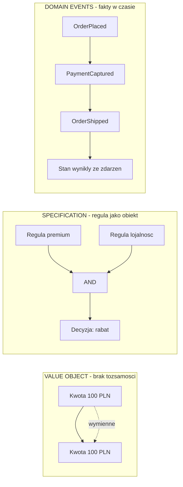
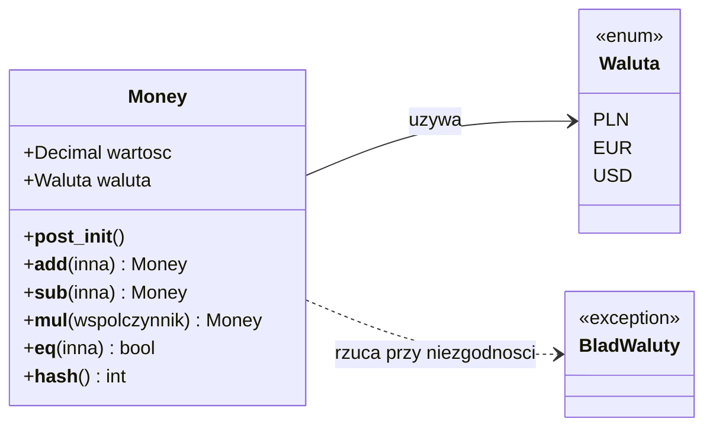
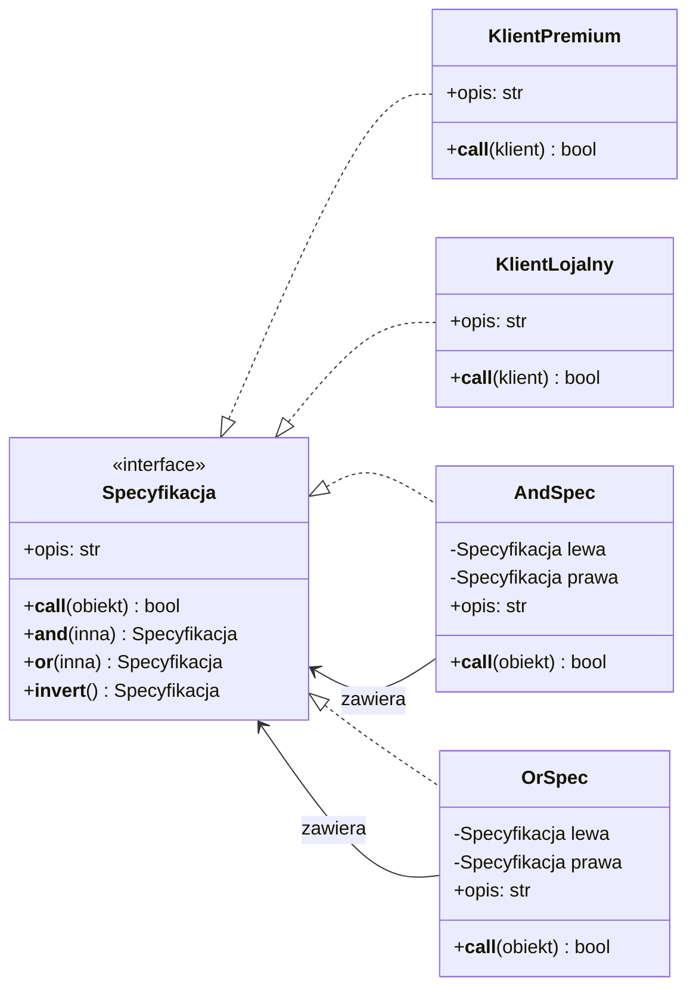
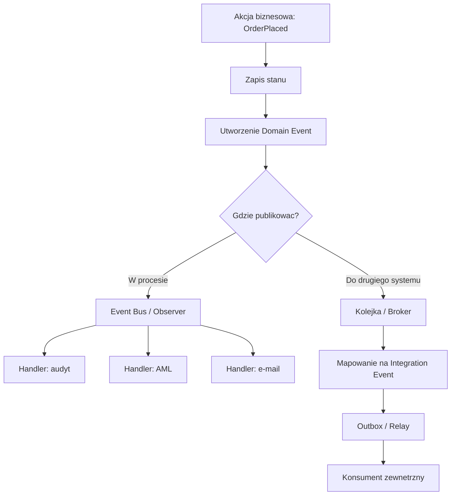
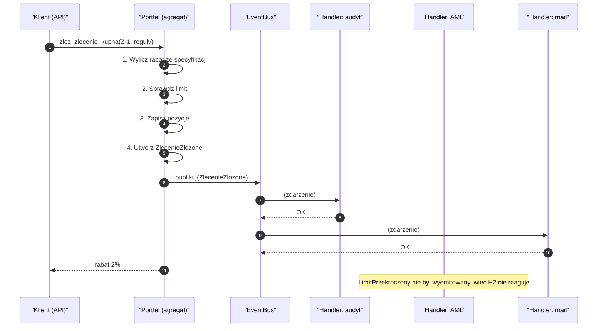
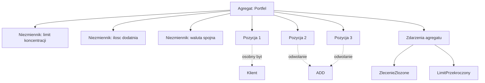
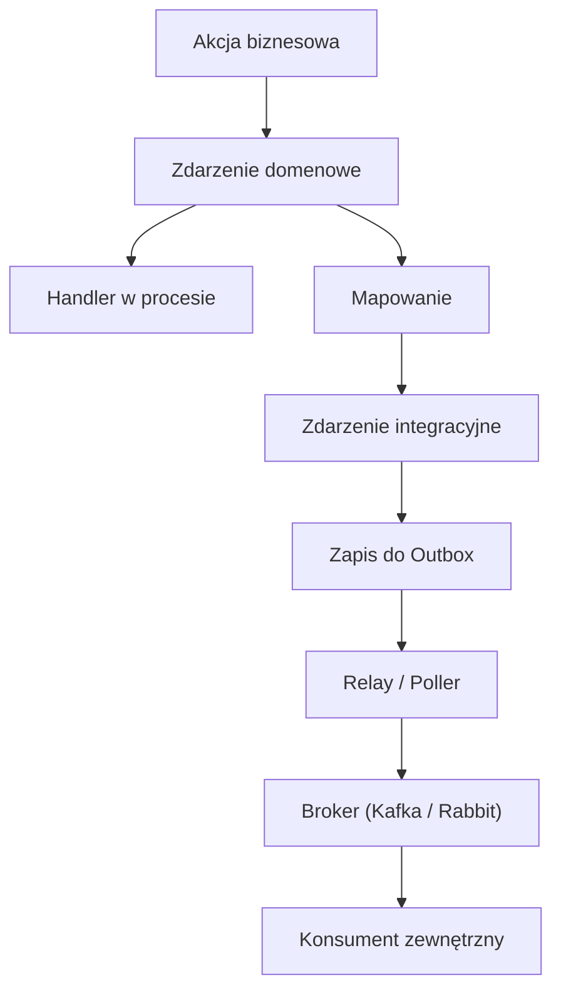
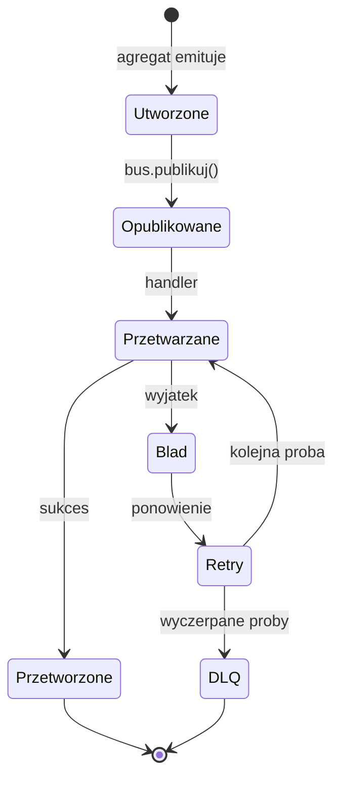
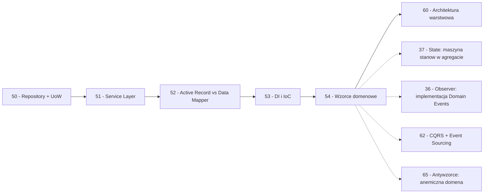

```markdown
---
modul: 54 — Specification, Value Object i Domain Events
plik: 54-wzorce-domenowe-specification-value-object.md
poziom: zaawansowany
wymaga: [53]
czas: ~210 minut czytania + ~480 minut ćwiczeń
---

# Moduł 54 — Wzorce domenowe — Specification, Value Object i Domain Events

> **TL;DR**
> - **Value Object (obiekt wartości)** — obiekt bez tożsamości, definiowany przez wartości; niemutowalny; `Money`, `Email`, `PESEL` — zamiast „gołych" `str` i `Decimal`.
> - **Specification (specyfikacja)** — reguła biznesowa jako obiekt, który można **składać** operatorami (`and`, `or`, `not`) i **nazywać**; zamiast rozsypanych `if` użyj `__call__` + `__and__` + `__or__`.
> - **Domain Event (zdarzenie domenowe)** — fakt, który **już się zdarzył** (nazwa w czasie przeszłym), zapisany jako obiekt; oddziela reakcje od akcji (coś się stało → reakcja obok).
> - **Zdarzenie domenowe ≠ zdarzenie integracyjne** — pierwsze jest wewnętrzne i bogate, drugie zewnętrzne i stabilne; wysyłanie zdarzeń domenowych prosto do API to wyciek modelu wewnętrznego.
> - **DDD nie jest dla każdego projektu.** Dla prostego CRUD to nadmiar. Sięgnij po te wzorce, gdy domena naprawdę ma złożone reguły, niezmienniki i pojęcia wymagające nazwania.

---

## 0. Model mentalny

### Banknot, sito i księga wieczysta

Weź do ręki banknot **100 złotych**. Zatrzymaj się przy nim na moment. Nie interesuje cię, **który konkretnie** banknot to jest — nie ma tożsamości, nie ma „portretu” w sensie identyfikacji egzemplarza. Liczy się jedna rzecz: **nominał**. Dwa banknoty o nominale 100 zł są dla ciebie **wymienne** — jeśli pożyczysz koledze sto złotych, nie prosisz o „dokładnie ten sam banknot, który ci dałem”. Prosisz o **sto złotych**. Ta wymienność jest esencją **Value Object** — obiektu definiowanego przez **wartość**, a nie przez tożsamość. Porównaj to z **domem**: dwa identyczne domy zbudowane w tym samym projekcie na dwóch działkach — mimo że wyglądają tak samo — **nie są tym samym domem**. Mają różne adresy, inną historię, innych właścicieli. Dom ma tożsamość. Banknot nie.

Idźmy do drugiego obrazu. Wyobraź sobie **sito kuchenne** do mąki. Ma okrągłe oczka o pewnym rozmiarze, przez które mąka spada, a grubsze grudki zostają. **Sito to reguła.** Możesz mieć sito o drobnych oczkach (dla bardzo czystej mąki), grubszych (dla mąki razowej), sito dla cukru pudru, sito dla kakao. Każde sito robi jedno — przesiewa według swojej reguły. Teraz najważniejsza rzecz: **możesz łączyć sita**. Wsypujesz mąkę do sitka o drobnych oczkach, potem do grubszego, potem jeszcze raz do drobnego — i otrzymujesz wielokrotnie przesiany produkt. Albo: używasz jednego sita „albo” drugiego — zależy, co chcesz odsiać. **Każde sito to reguła. Zestaw sit to zestaw reguł. A reguły można łączyć.** To idea **Specification** — reguła biznesowa jako obiekt, który można łączyć z innymi regułami operatorami **AND**, **OR**, **NOT**.

Trzeci obraz — **księga wieczysta**. Wyobraź sobie, że spisujesz historię pewnego domu. Nie piszesz „dom numer 5 ma 120 metrów kwadratowych, dwoje drzwi i cztery okna”. Piszesz **zdarzenia**: „1 marca 2010 — akt notarialny kupna przez Annę Kowalską”, „15 lipca 2015 — wpis hipoteki na rzecz Banku X”, „2 lutego 2020 — wykreślenie hipoteki”. **Stan aktu jest sumą zdarzeń.** Jeśli chcesz wiedzieć, kto jest właścicielem — czytasz zdarzenia i wnioskujesz. Jeśli chcesz wiedzieć, kiedy była hipoteka — czytasz zdarzenia. **Rejestrujesz zdarzenia, nie stan.** Stan odtworzysz. To idea **Domain Events** — fakt domenowy zapisany jako obiekt.

Zatrzymajmy się przy tym jeszcze chwilę, bo różnica jest ważna i często umyka. W klasycznym CRUD zapisujesz **stan bieżący**: „klient 4711 ma limit 5000”. W modelu zdarzeniowym zapisujesz **fakt**: „1 października 2026 klient 4711 złożył wniosek o podniesienie limitu o 2000”, „2 października departament ryzyka zatwierdził zmianę”. Limit **wynika** z faktów. Jeśli regulator zapyta „dlaczego klient ma taki limit”, a ty nie masz zdarzeń — masz tylko stan i musisz zgadywać. Jeśli masz zdarzenia — odpowiadasz: „bo przyszły trzy wnioski, dwa odrzucone, jeden zatwierdzony”. **Zdarzenia niosą historię**, stan jej nie niesie.

Te trzy obrazy — banknot, sito, księga wieczysta — to trzy filary **wzorców domenowych**. Nie są to wzorce „techniczne” w sensie GoF. Nie rozwiązują problemów typu „jak oddzielić interfejs” ani „jak wymienić algorytm”. Rozwiązują problem **wyrażenia bogatej wiedzy biznesowej wprost w kodzie** — żeby kod mówił „przelicz kwotę za pomocą wartości pieniężnej” zamiast `if isinstance(x, (int, float, Decimal))`. To wzorce **języka domeny**.

| W analogii banknotu / sita / księgi | W kodzie |
|---|---|
| Banknot 100 zł — wymienny z każdym innym 100 zł | **Value Object** — brak tożsamości, równość po wartościach |
| Dom o adresie 5 — nie do pomylenia z domem o adresie 7 | **Entity (byt)** — ma tożsamość |
| Sito o rozmiarze oczek | **Specification** — reguła jako obiekt |
| Składanie sit / wybór „albo” | `__and__`/`__or__`/`__invert__` na specyfikacji |
| Wpisy w księdze wieczystej | **Domain Events** — fakty w czasie przeszłym |
| Stan wyprowadzony z wpisów | Projekcja / agregacja zdarzeń |
| Odpowiedź na „dlaczego tak” | `dlaczego_ma_limit()` — **zapytaj o zdarzenia** |

> 🧠 **Zapamiętaj** — **Wzorce domenowe (ang. domain patterns) to wzorce, które wyrażają wiedzę biznesową bezpośrednio w kodzie — jego typach, nazwach i strukturze. Value Object opisuje wartość bez tożsamości, Specification nazywa regułę, Domain Event rejestruje fakt. Nie są to wzorce techniczne — są to narzędzia języka dziedziny.**

Zwróć uwagę na słowo „język”. Wszystkie trzy wzorce domenowe służą jednemu celowi: **uczynić kod czytelnym w języku biznesu**. Kiedy klient mówi „rabat dla klienta premium z długim stażem”, kod powinien mieć pojęcia `Klient`, `Premium`, `Staż`, `RabatLojalnosciowy` — a nie zestaw `if klient.status == "PREM" and (now - klient.data) > 3650`. **Kod, który używa języka biznesu, komunikuje się sam.**

### Kontekst — DDD w pigułce

Zanim wejdziemy w szczegóły, musimy nakreślić kontekst. **DDD (ang. Domain-Driven Design)** to podejście do projektowania oprogramowania spopularyzowane przez Erica Evansa w 2003 roku. Ma trzy główne idee:

**Ubiquitous language (język wszechobecny)** — w projekcie każdy termin ma **jedno, spójne znaczenie** używane przez biznes i przez kod. Jeśli biznes mówi „polisa”, to w kodzie jest klasa `Polisa`, a nie `InsuranceRecord`. Jeśli nie ma wspólnego języka, biznes i kod zaczynają mówić różnymi językami — i to jest źródło wielu błędów.

**Bounded context (kontekst ograniczony)** — ten sam termin może znaczyć różne rzeczy w różnych częściach systemu. „Klient” w dziale sprzedaży i w dziale windykacji to nie to samo. DDD mówi: **podziel system na konteksty** i w każdym używaj lokalnego języka. Nie próbuj mieć jednego „uniwersalnego modelu Klienta”.

**Entity vs Value Object (byt vs wartość)** — dwa typy obiektów domenowych. **Byt (Entity)** ma tożsamość — dwóch klientów o tej samej nazwie to **dwóch różnych klientów**. **Wartość (Value Object)** nie ma tożsamości — dwa banknoty 100 zł są **wymienne**. Rozróżnienie ma fundamentalne znaczenie dla projektowania.

Te trzy idee są kontekstem dla trzech wzorców, które omawiamy. **Value Object** to jeden z elementów podstawowych DDD. **Specification** (Eric Evans) formalizuje reguły. **Domain Events** (Alberto Brandolini, 2010) dodają wymiar czasowy do modelu domeny.

### Diagram — trzy wzorce obok siebie



*Diagram pokazuje trzy wzorce obok siebie: Value Object to wymienność po wartościach, Specification to reguły składane operatorami, Domain Events to fakty, z których wyprowadza się stan.*

### Czego te wzorce NIE robią

Rozbrójmy kilka mitów, które narosły wokół DDD i wzorców domenowych.

**Nie zastępują znajomości domeny.** To **narzędzia**, nie lekarstwa. Nie pomogą, jeśli nie wiesz, jak biznes działa.

**Nie są dla każdego projektu.** System obsługujący CRUD na trzech tabelach **nie potrzebuje** DDD. Zobacz sekcję 7 i ostrzeżenie o „DDD-weary”.

**Nie rozwiązują problemów wydajności.** Value Object tworzy obiekty — to koszt. Specyfikacja w pamięci vs w bazie — trade-off, nie oczywiste „lepiej”.

**Value Object nie jest „dekoracją typu”.** Klasa `Email`, która tylko pakuje string, bez walidacji i bez logiki — to nie Value Object, to **ozdobnik**. Prawdziwy Value Object ma semantykę.

**Specification nie jest „funkcją w klasie”.** Wrapper klasy na funkcję, która tylko zwraca `True/False`, jest bez sensu. Specification ma sens, gdy **składasz reguły** i **dajesz im nazwy**.

**Domain Events nie są „loggerem”.** Zdarzenie domenowe to **semantyczny fakt** — nie log techniczny. Log ma poziom, zdarzenie ma znaczenie biznesowe.

**Nie są zamienne między sobą.** Value Object opisuje **co to jest**, Specification opisuje **jak sprawdzić**, Domain Event opisuje **co się stało**. Trzy różne pytania.

**Nie da się ich „wprowadzić” bez konsekwencji.** Każdy z tych wzorców zmienia sposób, w jaki kod jest pisany. Wprowadzenie Value Object wszędzie — setki małych klas. Wprowadzenie Domain Events — zmiana cyklu życia aplikacji. **Zacznij od jednego miejsca, zmierz, rozszerzaj.**

---

## 1. Problem, który rozwiązujemy

Wejdźmy w domenę 📈 „Portfela”. System obsługuje portfele klientów, transakcje, wyceny, limity. Ktoś napisał kod w stylu „wszystko jest stringiem i liczbą”.

### Kod „przed"

```python
# portfel_v0.py — wersja naiwna, demonstracyjna
# UWAGA: kod celowo pokazuje typowe problemy z "gołymi" typami.

from __future__ import annotations

from dataclasses import dataclass
from datetime import date, datetime
from decimal import Decimal


@dataclass
class Klient:
    id: str
    imie: str
    nazwisko: str
    pesel: str
    email: str
    kod_pocztowy: str
    data_rejestracji: date


@dataclass
class PozycjaPortfela:
    instrument: str
    ilosc: float           # BLAD: float dla ilosci
    cena_jednostkowa: float  # BLAD: float dla ceny
    waluta: str              # BLAD: waluta jako string bez sprawdzenia


@dataclass
class ZlecenieKupna:
    id: str
    klient_id: str
    instrument: str
    ilosc: float
    cena: float
    waluta: str
    czy_zagraniczne: bool
    data_wykonania: datetime | None


class SerwisPortfela:
    """Reguly biznesowe rozsypane po metodach."""

    def kupno(
        self, zlecenie: ZlecenieKupna, klient: Klient, pozycje: list[PozycjaPortfela]
    ) -> None:
        # 1. Walidacja formalna — ciagle ta sama dla kazdego miejsca
        if "@" not in klient.email:
            raise ValueError("zly email")
        if len(klient.pesel) != 11:
            raise ValueError("zly pesel")
        if len(klient.kod_pocztowy) != 6:
            raise ValueError("zly kod pocztowy")

        # 2. Reguly rabatowe — rozsypane w kodzie, w roznych miejscach
        rabat = Decimal("0")
        # Regula: klient z dlugim stazem
        if (date.today() - klient.data_rejestracji).days > 365 * 5:
            rabat += Decimal("0.02")
        # Regula: klient duzych transakcji
        if zlecenie.ilosc * zlecenie.cena > 100_000:
            rabat += Decimal("0.01")
        # Regula: zlecenia detaliczne (male) — inny rabat
        if zlecenie.ilosc * zlecenie.cena < 1000:
            rabat += Decimal("0.005")
        # Regula: zlecenia zagraniczne w EUR
        if zlecenie.czy_zagraniczne and zlecenie.waluta == "EUR":
            rabat += Decimal("0.015")

        # 3. Stosowanie rabatu — recznie
        cena_po_rabacie = zlecenie.cena * (1 - float(rabat))  # mieszanie Decimal i float

        # 4. Walidacja wobec limitu koncentracji — kolejna regula w innym miejscu
        wartosc_klienta = sum(p.ilosc * p.cena_jednostkowa for p in pozycje)
        if wartosc_klienta + zlecenie.ilosc * zlecenie.cena > 1_000_000:
            raise ValueError("przekroczony limit koncentracji")

        # 5. Zapisywanie zmian — bez zdarzen
        pozycje.append(
            PozycjaPortfela(
                instrument=zlecenie.instrument,
                ilosc=zlecenie.ilosc,
                cena_jednostkowa=cena_po_rabacie,
                waluta=zlecenie.waluta,
            )
        )


if __name__ == "__main__":
    klient = Klient(
        id="K-1",
        imie="Jan",
        nazwisko="Kowalski",
        pesel="12345678901",
        email="jan@example.com",
        kod_pocztowy="00-001",
        data_rejestracji=date(2015, 1, 1),
    )
    zlecenie = ZlecenieKupna(
        id="Z-1",
        klient_id="K-1",
        instrument="AAPL",
        ilosc=100,
        cena=500,
        waluta="PLN",
        czy_zagraniczne=False,
        data_wykonania=None,
    )
    serwis = SerwisPortfela()
    pozycje: list[PozycjaPortfela] = []
    serwis.kupno(zlecenie, klient, pozycje)
    print(f"Pozycje w portfelu: {len(pozycje)}")
```

Ten kod działa, ale ma **fundamentalne problemy**, które narastają w miarę rozwoju. Oto one.

### Code smell — „gołe typy” i rozsypane reguły

| Problem | Gdzie | Konsekwencja |
|---|---|---|
| **Prymitywne obsesje** (primitive obsession) | `email: str`, `pesel: str` | Brak walidacji, brak typów domenowych |
| **Float dla kwot** | `cena: float` | Gubienie groszy przy operacjach finansowych |
| **Waluta jako string** | `waluta: str` | Literówka `"PLNN"` przejdzie |
| **Reguły rozsypane po metodzie** | `kupno` | Trudno testować pojedynczo; trudno użyć w innych miejscach |
| **Mieszanie `Decimal` i `float`** | `float(rabat)` | Zaokrąglenia, błędy |
| **Brak nazw dla reguł** | `if ... > 365 * 5` | Co to znaczy „365 * 5"? To „pięć lat", ale z kodu tego nie widać |
| **Brak audytu decyzji** | Wynik `rabat` | Nie wiadomo, skąd rabat — audyt nie odpowie „dlaczego" |
| **Brak zdarzeń** | End of method | Nie można zareagować na kupno w innym module |
| **Brak niezmienników** | `PozycjaPortfela` | Można wstawić ujemny ilości, ujemną cenę |
| **Brak aggregatu** | Lista pozycji osobno | Nie ma granicy atomowej zmiany |

### Objawy — poznasz ten problem po tym, że...

- **Walidacja jest powielona w kilku miejscach.** Ten sam `if "@" not in email` w serwisie klientów, w serwisie zleceń, w API.
- **Reguły biznesowe wyglądają jak „magiczne liczby”.** `365 * 5` zamiast `PIEC_LAT`.
- **Nie można zapytać „dlaczego ten klient ma rabat?”.** Bo rabat to tylko liczba — nie ma nazwy ani śladu, które reguły zadziałały.
- **Ta sama reguła jest kiedykolwiek duplikowana.** Trzy metody mają własną kopię reguły „pięć lat”.
- **Kwoty są typu `float`.** W systemie finansowym to poważny błąd.
- **Literówka w walucie przechodzi.** Brak walidacji na wejściu.
- **Każda zmiana pojedynczej reguły wymaga zmiany metod.** Nie można wymienić jednej reguły bez ruszania całości.
- **Brak reakcji na zmianę stanu.** Kiedy klient robi zakup, nie można automatycznie powiadomić AML, logu audytowego, systemu ryzyka.
- **Brak historii zmian.** Stan bieżący nie mówi, jak powstał.
- **Pojęcia biznesowe nie istnieją jako typy.** „Klient premium”, „lojalny”, „koncentracja” — wszystkie istnieją jako `if`, a nie jako obiekty.

Każdy z tych problemów ma **konkretne rozwiązanie** w jednym z trzech wzorców domenowych, które omawiamy. Zacznijmy od Value Object.

---

## 2. Anatomia wzorców

### Value Object — uczestnicy

| Rola | Odpowiedzialność | Co NIE jest jej zadaniem |
|---|---|---|
| **Wartość (value)** | Reprezentuje jedno pojęcie domeny; **niemutowalny**; równy innym przez wartości | Nie ma tożsamości; nie zmienia się po utworzeniu |
| **Walidator (w konstruktorze)** | Sprawdza niezmienniki w `__post_init__` | Nie waliduje danych spoza swojego zakresu |
| **Operacje domenowe** | Metody typu `+`, `*`, `porownaj` z sensem biznesowym | Nie modyfikują — zwracają **nową** wartość |

### Uczestnicy Specification

| Rola | Odpowiedzialność | Co NIE jest jej zadaniem |
|---|---|---|
| **Specification** | Reguła jako obiekt z `__call__(obiekt) -> bool` | Nie wykonuje efektów ubocznych |
| **Kompozycja AND / OR / NOT** | Łączenie specyfikacji operatorami `&`, `|`, `~` | Nie sprawdza, czy reguły są sensowne |
| **Nazwa i opis** | Każda specyfikacja ma nazwę i/lub opis (dla audytu, UI) | Nie decyduje o polityce |
| **Klient** | Używa specyfikacji do walidacji, filtrowania, wyświetlania | Nie tworzy reguł ad hoc — używa istniejących |

### Uczestnicy Domain Events

| Rola | Odpowiedzialność | Co NIE jest jej zadaniem |
|---|---|---|
| **Zdarzenie (event)** | Fakt w czasie przeszłym; zawiera identyfikator, znacznik czasu, kontekst | Nie ma metod modyfikujących; nie sprawdza, co się stało później |
| **Publisher** | Publikuje zdarzenie po zapisie stanu | Nie wykonuje logiki reakcji |
| **Handler (subskrybent)** | Reaguje na zdarzenie | Nie modyfikuje zdarzenia; nie publikuje tego samego zdarzenia |
| **Event Bus / kolejka** | Dostarcza zdarzenia do handlerów | Nie zna logiki domenowej |
| **Projekcja** | Buduje model odczytu ze zdarzeń | Nie zmienia zdarzeń |

### Diagram — Money jako Value Object



*Diagram pokazuje `Money` jako Value Object — niemutowalny, z walidacją, z operacjami domenowymi (`__add__`), które mają sens tylko dla tej samej waluty.*

### Diagram — Specification z kompozycją



*Diagram pokazuje, że specyfikacje można łączyć — `AndSpec` i `OrSpec` zawierają inne specyfikacje, dzięki czemu składanie reguł jest rekurencyjne.*

### Diagram — publikowanie zdarzenia domenowego



*Diagram pokazuje rozróżnienie: zdarzenie domenowe publikowane **wewnątrz procesu** trafia do handlerów, a dla świata zewnętrznego jest **mapowane** na zdarzenie integracyjne i wysyłane przez kolejkę (Outbox).*

### Warianty: klasyczny vs pythoniczny

| Aspekt | Klasyczny (Java/C#) | Pythoniczny |
|---|---|---|
| Value Object | Klasa `final` z `equals/hashCode` | `@dataclass(frozen=True, slots=True)` |
| Walidacja | Konstruktor | `__post_init__` |
| Specyfikacja | Interfejs + klasy | `Protocol` + klasy z `__call__` |
| Kompozycja | `AndSpecification` | `__and__`, `__or__`, `__invert__` |
| Domain Event | Klasa + framework publish | `@dataclass(frozen=True)` + funkcja `publish` |
| Event Bus | Framework | `list` handlerów, `blinker`, `pydispatch` |
| Rejestracja | Adnotacje, konfiguracja | Dekorator `@rejestruj` |
| Serializacja | Framework | `marshal`, `json`, `pickle` |

Python jest **znacznie prostszy**: `dataclass(frozen=True)` daje VO w 3 linijkach, `__and__` daje kompozycję bez hierarchii, `@dataclass` daje zdarzenie w 5 linijkach.

---

## 3. Implementacja krok po kroku

### Część A — Value Object

#### Krok 1 — Zidentyfikuj prymitywne obsesje

Wypisz wszystkie „gołe” pola, które mają **niejawną semantykę**:

```text
Prymitywne obsesje:
  - email: str        → Email — walidowany, znormalizowany
  - pesel: str        → PESEL — 11 cyfr + checksum
  - kod_pocztowy: str → KodPocztowy — format 00-000
  - cena: float       → Money — Decimal + waluta
  - waluta: str       → Waluta — Enum
  - ilosc: float      → Ilosc — Decimal nieujemne
  - data_rejestracji: date → data, ale wraz z kontekstem
```

Każde z tych pojęć zasługuje na własny typ.

#### Krok 2 — Zdefiniuj Waluta i Money

Zaczynamy od najprostszego — `Waluta` jako `Enum`, `Money` jako Value Object.

```python
from decimal import Decimal, ROUND_HALF_UP
from enum import Enum
from dataclasses import dataclass


class Waluta(Enum):
    PLN = "PLN"
    EUR = "EUR"
    USD = "USD"

    def __str__(self) -> str:
        return self.value


class BladWaluty(ValueError):
    """Nie mozna dodac roznych walut."""


GROSZ = Decimal("0.01")


@dataclass(frozen=True, slots=True)
class Money:
    """Wartosc pieniezna z waluta. Niemutowalna."""

    wartosc: Decimal
    waluta: Waluta

    def __post_init__(self) -> None:
        if not isinstance(self.wartosc, Decimal):
            raise TypeError(
                f"wartosc musi byc Decimal, nie {type(self.wartosc).__name__}"
            )
        if not isinstance(self.waluta, Waluta):
            raise TypeError("waluta musi byc typu Waluta")

    def __add__(self, inna: "Money") -> "Money":
        if not isinstance(inna, Money):
            return NotImplemented
        if self.waluta is not inna.waluta:
            raise BladWaluty(
                f"nie mozna dodac {inna.waluta} do {self.waluta}"
            )
        return Money(self.wartosc + inna.wartosc, self.waluta)

    def __sub__(self, inna: "Money") -> "Money":
        if self.waluta is not inna.waluta:
            raise BladWaluty(
                f"nie mozna odjac {inna.waluta} od {self.waluta}"
            )
        return Money(self.wartosc - inna.wartosc, self.waluta)

    def __mul__(self, wspolczynnik: Decimal) -> "Money":
        if not isinstance(wspolczynnik, Decimal):
            return NotImplemented
        return Money(self.wartosc * wspolczynnik, self.waluta)

    def __lt__(self, inna: "Money") -> bool:
        if self.waluta is not inna.waluta:
            raise BladWaluty("nie mozna porownac roznych walut")
        return self.wartosc < inna.wartosc

    def __le__(self, inna: "Money") -> bool:
        if self.waluta is not inna.waluta:
            raise BladWaluty("nie mozna porownac roznych walut")
        return self.wartosc <= inna.wartosc

    def zaokraglona(self) -> "Money":
        return Money(
            self.wartosc.quantize(GROSZ, rounding=ROUND_HALF_UP),
            self.waluta,
        )

    def __str__(self) -> str:
        sformatowana = f"{self.wartosc:,.2f}".replace(",", " ")
        return f"{sformatowana} {self.waluta}"
```

**Zalety:** nie da się dodać EUR do PLN — `BladWaluty`. Kwota zawsze w `Decimal`. Zaokrąglenie jawne. `Money(100, "PLN")` — TypeError, trzeba użyć `Waluta.PLN`.

#### Krok 3 — Zdefiniuj Email, PESEL, KodPocztowy

```python
import re


@dataclass(frozen=True, slots=True)
class Email:
    """Adres e-mail - walidowany, znormalizowany do malych liter."""

    wartosc: str

    WZORZEC = re.compile(r"^[^@\s]+@[^@\s]+\.[^@\s]+$")

    def __post_init__(self) -> None:
        if not isinstance(self.wartosc, str):
            raise TypeError("wartosc musi byc str")
        znormalizowany = self.wartosc.strip().lower()
        if not self.WZORZEC.match(znormalizowany):
            raise ValueError(f"niepoprawny email: {self.wartosc!r}")
        object.__setattr__(self, "wartosc", znormalizowany)

    def __str__(self) -> str:
        return self.wartosc


@dataclass(frozen=True, slots=True)
class PESEL:
    """Numer PESEL - 11 cyfr z suma kontrolna."""

    wartosc: str

    WAGI = (1, 3, 7, 9, 1, 3, 7, 9, 1, 3)

    def __post_init__(self) -> None:
        if not isinstance(self.wartosc, str):
            raise TypeError("PESEL musi byc str")
        if not self.wartosc.isdigit():
            raise ValueError("PESEL musi zawierac tylko cyfry")
        if len(self.wartosc) != 11:
            raise ValueError(
                f"PESEL musi miec 11 cyfr, ma {len(self.wartosc)}"
            )
        suma = sum(
            int(c) * w
            for c, w in zip(self.wartosc[:10], self.WAGI, strict=True)
        )
        kontrola = (10 - suma % 10) % 10
        if kontrola != int(self.wartosc[10]):
            raise ValueError(f"niepoprawna suma kontrolna PESEL")

    def __str__(self) -> str:
        return self.wartosc


@dataclass(frozen=True, slots=True)
class KodPocztowy:
    """Kod pocztowy w formacie polskim XX-XXX."""

    wartosc: str

    WZORZEC = re.compile(r"^\d{2}-\d{3}$")

    def __post_init__(self) -> None:
        if not self.WZORZEC.match(self.wartosc):
            raise ValueError(
                f"kod pocztowy musi miec format XX-XXX, jest {self.wartosc!r}"
            )

    def __str__(self) -> str:
        return self.wartosc
```

**Kluczowe:** każdy VO **waliduje w konstruktorze**. Raz utworzonego obiektu nie trzeba **nigdy** walidować ponownie.

#### Krok 4 — Użyj w modelu

```python
@dataclass(frozen=True)
class Klient:
    id: str
    imie: str
    nazwisko: str
    pesel: PESEL
    email: Email
    kod_pocztowy: KodPocztowy
    data_rejestracji: date

    @property
    def czy_dlugoletni(self) -> bool:
        return (date.today() - self.data_rejestracji).days > 365 * 5
```

Zwróć uwagę: `Klient` nie musi już sprawdzać, czy email jest poprawny — `Email` już to załatwił. **Walidacja w typie, nie w serwisie.**

### Część B — Specification

#### Krok 5 — Zdefiniuj bazową specyfikację

```python
from abc import ABC, abstractmethod
from typing import Generic, TypeVar, Protocol, runtime_checkable


T = TypeVar("T")


@runtime_checkable
class Specyfikacja(Protocol[T]):
    """Kontrakt: regula biznesowa jako predykat."""

    opis: str

    def __call__(self, obiekt: T) -> bool: ...


class SpecyfikacjaBazowa(ABC, Generic[T]):
    """Bazowa klasa specyfikacji z kompozycja and/or/not."""

    def __init__(self, opis: str = "") -> None:
        self.opis = opis

    @abstractmethod
    def __call__(self, obiekt: T) -> bool: ...

    def __and__(self, inna: Specyfikacja[T]) -> "SpecyfikacjaBazowa[T]":
        return AndSpecyfikacja(self, inna)

    def __or__(self, inna: Specyfikacja[T]) -> "SpecyfikacjaBazowa[T]":
        return OrSpecyfikacja(self, inna)

    def __invert__(self) -> "SpecyfikacjaBazowa[T]":
        return NotSpecyfikacja(self)

    def __repr__(self) -> str:
        return f"<Spec: {self.opis}>"


class AndSpecyfikacja(SpecyfikacjaBazowa[T]):
    def __init__(self, lewa: Specyfikacja[T], prawa: Specyfikacja[T]) -> None:
        super().__init__(f"({lewa.opis} AND {prawa.opis})")
        self._lewa = lewa
        self._prawa = prawa

    def __call__(self, obiekt: T) -> bool:
        return self._lewa(obiekt) and self._prawa(obiekt)


class OrSpecyfikacja(SpecyfikacjaBazowa[T]):
    def __init__(self, lewa: Specyfikacja[T], prawa: Specyfikacja[T]) -> None:
        super().__init__(f"({lewa.opis} OR {prawa.opis})")
        self._lewa = lewa
        self._prawa = prawa

    def __call__(self, obiekt: T) -> bool:
        return self._lewa(obiekt) or self._prawa(obiekt)


class NotSpecyfikacja(SpecyfikacjaBazowa[T]):
    def __init__(self, wewnatrz: Specyfikacja[T]) -> None:
        super().__init__(f"NOT ({wewnatrz.opis})")
        self._wewnatrz = wewnatrz

    def __call__(self, obiekt: T) -> bool:
        return not self._wewnatrz(obiekt)
```

**Kluczowa właściwość:** operator `and` (w kodzie `&`) zwraca specyfikację, którą można dalej składać. To **rekurencyjne** — jak Composit (moduł 22).

#### Krok 6 — Zdefiniuj konkretne reguły

```python
from datetime import date, timedelta


class KlientLojalny(SpecyfikacjaBazowa[Klient]):
    def __init__(self, minimum_lat: int = 5) -> None:
        super().__init__(f"lojalnosc >= {minimum_lat} lat")
        self._minimum_lat = minimum_lat

    def __call__(self, klient: Klient) -> bool:
        return (
            date.today() - klient.data_rejestracji
        ).days >= self._minimum_lat * 365


class ZlecenieDuze(SpecyfikacjaBazowa["ZlecenieKupna"]):
    def __init__(self, prog: Decimal = Decimal("100000")) -> None:
        super().__init__(f"wartosc >= {prog}")
        self._prog = prog

    def __call__(self, zlecenie: "ZlecenieKupna") -> bool:
        return zlecenie.wartosc().wartosc >= self._prog


class ZlecenieMalewartosciowe(SpecyfikacjaBazowa["ZlecenieKupna"]):
    def __init__(self, prog: Decimal = Decimal("1000")) -> None:
        super().__init__(f"wartosc < {prog}")
        self._prog = prog

    def __call__(self, zlecenie: "ZlecenieKupna") -> bool:
        return zlecenie.wartosc().wartosc < self._prog


class ZlecenieZagraniczne(SpecyfikacjaBazowa["ZlecenieKupna"]):
    def __init__(self) -> None:
        super().__init__("zlecenie zagraniczne")

    def __call__(self, zlecenie: "ZlecenieKupna") -> bool:
        return zlecenie.czy_zagraniczne
```

#### Krok 7 — Składaj reguły

```python
def utworz_reguly_rabatowe() -> dict[str, SpecyfikacjaBazowa]:
    """Katalog reguł rabatowych."""
    return {
        "lojalnosc": KlientLojalny(5),
        "duze_zlecenie": ZlecenieDuze(Decimal("100000")),
        "male_zlecenie": ZlecenieMalewartosciowe(Decimal("1000")),
        "zagraniczne": ZlecenieZagraniczne(),
    }


REGULY = utworz_reguly_rabatowe()

# Przyklad kompozycji: klient lojalny AND duze zlecenie
regula_wybitna = REGULY["lojalnosc"] & REGULY["duze_zlecenie"]
print(regula_wybitna.opis)   # (lojalnosc >= 5 lat AND wartosc >= 100000)

# Mozna tez NOT
regula_nie_zagraniczna = ~REGULY["zagraniczne"]
```

### Część C — Domain Events

#### Krok 8 — Zdefiniuj zdarzenie bazowe

```python
from dataclasses import dataclass, field
from datetime import datetime, timezone
from uuid import UUID, uuid4


@dataclass(frozen=True, slots=True, kw_only=True)
class ZdarzenieDomenowe:
    """Bazowa klasa zdarzen domenowych."""

    zdarzenie_id: UUID = field(default_factory=uuid4)
    kiedy: datetime = field(default_factory=lambda: datetime.now(timezone.utc))
    korelacja_id: UUID | None = None

    @property
    def nazwa(self) -> str:
        return type(self).__name__


@dataclass(frozen=True, slots=True, kw_only=True)
class ZlecenieZlozone(ZdarzenieDomenowe):
    zlecenie_id: str
    klient_id: str
    instrument: str
    ilosc: Decimal
    cena: Money


@dataclass(frozen=True, slots=True, kw_only=True)
class ZlecenieZrealizowane(ZdarzenieDomenowe):
    zlecenie_id: str
    cena_wykonania: Money


@dataclass(frozen=True, slots=True, kw_only=True)
class LimitPrzekroczony(ZdarzenieDomenowe):
    klient_id: str
    limit: Money
    proponowana_wartosc: Money
```

**Kluczowe:** wszystkie pola w czasie **przeszłym** — co się stało. `zdarzenie_id` do deduplikacji, `kiedy` do audytu, `korelacja_id` do śledzenia.

#### Krok 9 — Event Bus

```python
from collections.abc import Callable
from typing import Any
import logging


log = logging.getLogger(__name__)

Handler = Callable[[ZdarzenieDomenowe], None]


class EventBus:
    """Prosty szyna zdarzen w procesie."""

    def __init__(self) -> None:
        self._handlery: dict[type, list[Handler]] = {}

    def subskrybuj(self, typ: type, handler: Handler) -> None:
        self._handlery.setdefault(typ, []).append(handler)

    def publikuj(self, zdarzenie: ZdarzenieDomenowe) -> None:
        typ = type(zdarzenie)
        for handler in self._handlery.get(typ, []):
            try:
                handler(zdarzenie)
            except Exception:
                log.exception(
                    "blad w handlerze %s dla %s",
                    getattr(handler, "__name__", handler),
                    typ.__name__,
                )


BUS = EventBus()
```

#### Krok 10 — Handlery

```python
def handler_audyt(zdarzenie: ZdarzenieDomenowe) -> None:
    print(f"  [AUDYT] {zdarzenie.nazwa}: {zdarzenie.kiedy.isoformat()}")


def handler_aml(zdarzenie: LimitPrzekroczony) -> None:
    print(f"  [AML] zgloszenie klienta {zdarzenie.klient_id}")


def handler_powiadomienie(zdarzenie: ZlecenieZrealizowane) -> None:
    print(f"  [MAIL] do klienta o zleceniu {zdarzenie.zlecenie_id}")


BUS.subskrybuj(ZdarzenieDomenowe, handler_audyt)
BUS.subskrybuj(LimitPrzekroczony, handler_aml)
BUS.subskrybuj(ZlecenieZrealizowane, handler_powiadomienie)
```

**Uwaga:** subskrypcja na `ZdarzenieDomenowe` (bazę) łapie **wszystkie** zdarzenia. Subskrypcja na konkretny typ łapie tylko ten typ.

### Krok 11 — Weryfikacja

| Element | Wartość |
|---|---|
| Walidacja Email | Raz, w konstruktorze |
| Walidacja PESEL | Raz, z sumą kontrolną |
| Mieszanie walut | `BladWaluty` |
| Reguły rabatowe | Składane operatorami |
| Audyt decyzji | `regula_wybitna.opis` |
| Zdarzenia | Publikowane po akcji |
| Reakcje | Handlery subskrybowane |
| Testy domeny | Bez bazy, bez frameworka |

---

## 4. Wersje pythoniczne i warianty

### 4.1 Value Object — warianty

**Bez `slots`** — gdy chcesz `__dict__`:

```python
@dataclass(frozen=True)
class Money:
    wartosc: Decimal
    waluta: Waluta
```

**Z `order=True`** — automatyczne porównania:

```python
@dataclass(frozen=True, slots=True, order=True)
class Money:
    wartosc: Decimal
    waluta: Waluta
```

**Z multipleof term** — dla specyficznej semantyki, np. `Money` z zaokrągleniem w `__post_init__`:

```python
@dataclass(frozen=True, slots=True)
class Money:
    wartosc: Decimal
    waluta: Waluta

    def __post_init__(self) -> None:
        # Zaokraglamy do groszy od razu
        object.__setattr__(
            self, "wartosc",
            self.wartosc.quantize(GROSZ, rounding=ROUND_HALF_UP)
        )
```

**Value Object oparty o `pydantic`** — gdy dane przychodzą z zewnątrz:

```python
from pydantic import BaseModel, field_validator

class Money(BaseModel, frozen=True):
    wartosc: Decimal
    waluta: str

    @field_validator("waluta")
    @classmethod
    def sprawdz_walute(cls, v: str) -> str:
        if v not in ("PLN", "EUR", "USD"):
            raise ValueError(f"nieznana waluta: {v}")
        return v
```

### 4.2 Specification — warianty

**Funkcja zamiast klasy** — dla najprostszych:

```python
def klient_lojalny(k: Klient) -> bool:
    return (date.today() - k.data_rejestracji).days > 365 * 5
```

Zaleta: prosta. Wada: brak kompozycji, brak opisu.

**Specyfikacja jako domknięcie** — z kompozycją ręczną:

```python
def spec(opis: str, predykat):
    def _inner(obiekt):
        return predykat(obiekt)
    _inner.opis = opis
    return _inner
```

**Specyfikacja z `functools.reduce`** — dla listy reguł AND:

```python
from functools import reduce

def spelnia_wszystkie(specyfikacje: list) -> SpecyfikacjaBazowa:
    """Laczy liste specyfikacji AND."""
    if not specyfikacje:
        raise ValueError("brak specyfikacji")
    return reduce(lambda a, b: a & b, specyfikacje)
```

**Specyfikacja z cache** — dla drogich obliczeń:

```python
from functools import lru_cache

class KlientWybitny(SpecyfikacjaBazowa[Klient]):
    def __init__(self) -> None:
        super().__init__("wybitny")

    def __call__(self, klient: Klient) -> bool:
        return _sprawdz_wybitnego(klient.id)

@lru_cache(maxsize=1000)
def _sprawdz_wybitnego(klient_id: str) -> bool:
    # kosztowne sprawdzenie w bazie
    ...
```

### 4.3 Domain Events — warianty

**Zdarzenie z `pydantic`** — dla serializacji do/z JSON:

```python
from pydantic import BaseModel

class ZlecenieZlozone(BaseModel, frozen=True):
    zlecenie_id: str
    klient_id: str
    kiedy: datetime
```

**Event Bus z `blinker`** — biblioteka:

```python
from blinker import signal

zlecenie_zlozone = signal("zlecenie_zlozone")

def on_zlecenie(sender, **kwargs):
    print(f"Zlecenie: {kwargs}")

zlecenie_zlozone.connect(on_zlecenie)
zlecenie_zlozone.send("system", zlecenie_id="Z-1")
```

**Event Bus z `pydispatch`** — Django-style:

```python
from pydispatch import dispatcher

def handler(signal, sender, **kwargs):
    print(f"Otrzymano: {kwargs}")

dispatcher.connect(handler, signal="zlecenie_zlozone")
dispatcher.send(signal="zlecenie_zlozone", sender=None, zlecenie_id="Z-1")
```

**Zdarzenia asynchroniczne** — z `asyncio`:

```python
import asyncio

async def handler(zdarzenie):
    await asyncio.sleep(0)
    print(f"Handler async: {zdarzenie}")

async def publish_async(zdarzenie, handlers):
    await asyncio.gather(*(h(zdarzenie) for h in handlers))
```

### 4.4 Podsumowanie — tabela wyboru

| Potrzeba | Rozwiązanie |
|---|---|
| Prosty VO | `@dataclass(frozen=True, slots=True)` |
| VO z zewnątrz (API) | `pydantic.BaseModel(frozen=True)` |
| Prosta reguła | Funkcja predykat |
| Kompozycja reguł | `SpecyfikacjaBazowa` z `__and__` |
| Cache w regułach | `@lru_cache` |
| Zdarzenia lokalne | `EventBus` z `list` handlerów |
| Zdarzenia z dekoratorem | `blinker` / `pydispatch` |
| Zdarzenia async | `asyncio.gather` |

> 🧠 **Zapamiętaj** — W Pythonie wzorce domenowe realizuje się **znacznie prościej** niż w innych językach. `dataclass(frozen=True)` daje VO w 3 linijkach, `__and__` daje kompozycję reguł, `dataclass` na zdarzeniu daje pełny koszyk metadanych. **Nie komplikuj ponad miarę.**

---

## 5. Przykład z życia: 📈 Portfel — pełny uruchamialny kod

Zbudujemy pełny system portfela z VO, Specification i Domain Events.

### Kod

```python
# portfel_ddd.py — pelny przyklad wzorcow domenowych
from __future__ import annotations

import logging
import re
from abc import ABC, abstractmethod
from collections.abc import Callable
from dataclasses import dataclass, field
from datetime import date, datetime, timezone
from decimal import ROUND_HALF_UP, Decimal
from enum import Enum
from functools import reduce
from typing import Generic, Protocol, TypeVar, runtime_checkable
from uuid import UUID, uuid4

log = logging.getLogger(__name__)
T = TypeVar("T")
GROSZ = Decimal("0.01")


# ===========================================================================
# 1. Value Objecty
# ===========================================================================

class Waluta(Enum):
    PLN = "PLN"
    EUR = "EUR"
    USD = "USD"

    def __str__(self) -> str:
        return self.value


class BladWaluty(ValueError):
    """Operacja na roznych walutach."""


@dataclass(frozen=True, slots=True)
class Money:
    wartosc: Decimal
    waluta: Waluta

    def __post_init__(self) -> None:
        if not isinstance(self.wartosc, Decimal):
            raise TypeError(f"wartosc musi byc Decimal")
        if not isinstance(self.waluta, Waluta):
            raise TypeError(f"waluta musi byc typu Waluta")

    def __add__(self, inna: Money) -> Money:
        if not isinstance(inna, Money):
            return NotImplemented
        if self.waluta is not inna.waluta:
            raise BladWaluty(
                f"nie mozna dodac {inna.waluta} do {self.waluta}"
            )
        return Money(self.wartosc + inna.wartosc, self.waluta)

    def __sub__(self, inna: Money) -> Money:
        if self.waluta is not inna.waluta:
            raise BladWaluty(
                f"nie mozna odjac {inna.waluta} od {self.waluta}"
            )
        return Money(self.wartosc - inna.wartosc, self.waluta)

    def __mul__(self, wspolczynnik: Decimal) -> Money:
        if not isinstance(wspolczynnik, Decimal):
            return NotImplemented
        return Money(self.wartosc * wspolczynnik, self.waluta)

    def __lt__(self, inna: Money) -> bool:
        if self.waluta is not inna.waluta:
            raise BladWaluty("nie mozna porownac roznych walut")
        return self.wartosc < inna.wartosc

    def __le__(self, inna: Money) -> bool:
        if self.waluta is not inna.waluta:
            raise BladWaluty("nie mozna porownac roznych walut")
        return self.wartosc <= inna.wartosc

    def zaokraglona(self) -> Money:
        return Money(
            self.wartosc.quantize(GROSZ, rounding=ROUND_HALF_UP),
            self.waluta,
        )

    def __str__(self) -> str:
        sformatowana = f"{self.wartosc:,.2f}".replace(",", " ")
        return f"{sformatowana} {self.waluta}"


@dataclass(frozen=True, slots=True)
class Email:
    wartosc: str

    WZORZEC = re.compile(r"^[^@\s]+@[^@\s]+\.[^@\s]+$")

    def __post_init__(self) -> None:
        if not self.WZORZEC.match(self.wartosc):
            raise ValueError(f"niepoprawny email: {self.wartosc!r}")
        object.__setattr__(self, "wartosc", self.wartosc.strip().lower())

    def __str__(self) -> str:
        return self.wartosc


@dataclass(frozen=True, slots=True)
class Ilosc:
    wartosc: Decimal

    def __post_init__(self) -> None:
        if not isinstance(self.wartosc, Decimal):
            raise TypeError("ilosc musi byc Decimal")
        if self.wartosc <= 0:
            raise ValueError("ilosc musi byc dodatnia")

    def __str__(self) -> str:
        return str(self.wartosc)


# ===========================================================================
# 2. Encje i agregaty
# ===========================================================================

@dataclass(frozen=True)
class Klient:
    id: str
    imie: str
    nazwisko: str
    email: Email
    data_rejestracji: date

    @property
    def pelne_imie(self) -> str:
        return f"{self.imie} {self.nazwisko}"

    @property
    def staz_dni(self) -> int:
        return (date.today() - self.data_rejestracji).days


@dataclass(frozen=True)
class ZlecenieKupna:
    id: str
    klient_id: str
    instrument: str
    ilosc: Ilosc
    cena_jednostkowa: Money

    def wartosc(self) -> Money:
        return (self.cena_jednostkowa * self.ilosc.wartosc).zaokraglona()


# ===========================================================================
# 3. Zdarzenia domenowe
# ===========================================================================

@dataclass(frozen=True, slots=True, kw_only=True)
class ZdarzenieDomenowe:
    zdarzenie_id: UUID = field(default_factory=uuid4)
    kiedy: datetime = field(default_factory=lambda: datetime.now(timezone.utc))
    korelacja_id: UUID | None = None

    @property
    def nazwa(self) -> str:
        return type(self).__name__


@dataclass(frozen=True, slots=True, kw_only=True)
class ZlecenieZlozone(ZdarzenieDomenowe):
    zlecenie_id: str
    klient_id: str
    instrument: str
    wartosc: Money
    rabat: Decimal


@dataclass(frozen=True, slots=True, kw_only=True)
class LimitPrzekroczony(ZdarzenieDomenowe):
    klient_id: str
    limit: Money
    proponowana_wartosc: Money


@dataclass(frozen=True, slots=True, kw_only=True)
class KlientZarejestrowany(ZdarzenieDomenowe):
    klient_id: str
    email: Email


# ===========================================================================
# 4. Event Bus
# ===========================================================================

Handler = Callable[[ZdarzenieDomenowe], None]


class EventBus:
    def __init__(self) -> None:
        self._handlery: dict[type, list[Handler]] = {}

    def subskrybuj(self, typ: type, handler: Handler) -> None:
        self._handlery.setdefault(typ, []).append(handler)

    def publikuj(self, zdarzenie: ZdarzenieDomenowe) -> None:
        typ = type(zdarzenie)
        for handler in self._handlery.get(typ, []):
            try:
                handler(zdarzenie)
            except Exception:
                log.exception(f"blad handlera dla {typ.__name__}")


# ===========================================================================
# 5. Specification
# ===========================================================================

@runtime_checkable
class Specyfikacja(Protocol[T]):
    opis: str
    def __call__(self, obiekt: T) -> bool: ...


class SpecyfikacjaBazowa(ABC, Generic[T]):
    def __init__(self, opis: str = "") -> None:
        self.opis = opis

    @abstractmethod
    def __call__(self, obiekt: T) -> bool: ...

    def __and__(self, inna: Specyfikacja[T]) -> SpecyfikacjaBazowa[T]:
        return AndSpec(self, inna)  # type: ignore[arg-type]

    def __or__(self, inna: Specyfikacja[T]) -> SpecyfikacjaBazowa[T]:
        return OrSpec(self, inna)  # type: ignore[arg-type]

    def __invert__(self) -> SpecyfikacjaBazowa[T]:
        return NotSpec(self)


class AndSpec(SpecyfikacjaBazowa[T]):
    def __init__(self, lewa: Specyfikacja[T], prawa: Specyfikacja[T]) -> None:
        super().__init__(f"({lewa.opis} AND {prawa.opis})")
        self._lewa = lewa
        self._prawa = prawa

    def __call__(self, obiekt: T) -> bool:
        return bool(self._lewa(obiekt) and self._prawa(obiekt))


class OrSpec(SpecyfikacjaBazowa[T]):
    def __init__(self, lewa: Specyfikacja[T], prawa: Specyfikacja[T]) -> None:
        super().__init__(f"({lewa.opis} OR {prawa.opis})")
        self._lewa = lewa
        self._prawa = prawa

    def __call__(self, obiekt: T) -> bool:
        return bool(self._lewa(obiekt) or self._prawa(obiekt))


class NotSpec(SpecyfikacjaBazowa[T]):
    def __init__(self, wewnatrz: Specyfikacja[T]) -> None:
        super().__init__(f"NOT ({wewnatrz.opis})")
        self._wewnatrz = wewnatrz

    def __call__(self, obiekt: T) -> bool:
        return not self._wewnatrz(obiekt)


class KlientLojalny(SpecyfikacjaBazowa[Klient]):
    def __init__(self, minimum_lat: int = 5) -> None:
        super().__init__(f"lojalnosc >= {minimum_lat} lat")
        self._minimum_dni = minimum_lat * 365

    def __call__(self, klient: Klient) -> bool:
        return klient.staz_dni >= self._minimum_dni


class ZlecenieDuze(SpecyfikacjaBazowa[ZlecenieKupna]):
    def __init__(self, prog: Decimal = Decimal("100000")) -> None:
        super().__init__(f"wartosc >= {prog}")
        self._prog = prog

    def __call__(self, zlecenie: ZlecenieKupna) -> bool:
        return zlecenie.wartosc().wartosc >= self._prog


class ZlecenieMale(SpecyfikacjaBazowa[ZlecenieKupna]):
    def __init__(self, prog: Decimal = Decimal("1000")) -> None:
        super().__init__(f"wartosc < {prog}")
        self._prog = prog

    def __call__(self, zlecenie: ZlecenieKupna) -> bool:
        return zlecenie.wartosc().wartosc < self._prog


# ===========================================================================
# 6. Reguly rabatowe jako zestaw specyfikacji
# ===========================================================================

@dataclass(frozen=True)
class RegulaRabatowa:
    nazwa: str
    specyfikacja: Specyfikacja
    rabat: Decimal


def katalog_regul() -> list[RegulaRabatowa]:
    return [
        RegulaRabatowa(
            "klient_lojalny_5lat",
            KlientLojalny(5),
            Decimal("0.02"),
        ),
        RegulaRabatowa(
            "duze_zlecenie",
            ZlecenieDuze(Decimal("100000")),
            Decimal("0.01"),
        ),
        RegulaRabatowa(
            "male_zlecenie",
            ZlecenieMale(Decimal("1000")),
            Decimal("0.005"),
        ),
    ]


# ===========================================================================
# 7. Agregat: Portfel
# ===========================================================================

class Portfel:
    """Agregat - granica atomowej zmiany."""

    def __init__(
        self,
        klient: Klient,
        bus: EventBus,
        limity: dict[Waluta, Money],
    ) -> None:
        self._klient = klient
        self._bus = bus
        self._limity = limity
        self._pozycje: list[tuple[str, Ilosc, Money]] = []
        self._zdarzenia: list[ZdarzenieDomenowe] = []

    @property
    def klient(self) -> Klient:
        return self._klient

    @property
    def wartosc_calkowita(self) -> Money:
        if not self._pozycje:
            return Money(Decimal("0"), Waluta.PLN)
        suma = Money(Decimal("0"), self._pozycje[0][2].waluta)
        for _, ilosc, cena in self._pozycje:
            suma = suma + (cena * ilosc.wartosc).zaokraglona()
        return suma

    def zdarzenia(self) -> tuple[ZdarzenieDomenowe, ...]:
        return tuple(self._zdarzenia)

    def zloz_zlecenie_kupna(
        self, zlecenie: ZlecenieKupna, reguly: list[RegulaRabatowa]
    ) -> Decimal:
        """Zlozenie zlecenia w agregacie - walidacja niezmiennikow."""
        # 1. Znajdz pasujace reguly rabatowe
        rabat = Decimal("0")
        for regula in reguly:
            obiekt = zlecenie if isinstance(regula.specyfikacja, SpecyfikacjaBazowa) else None
            # Specyfikacja typu Zlecenie lub Klient
            try:
                if _pasuje(regula.specyfikacja, zlecenie, self._klient):
                    rabat += regula.rabat
            except TypeError:
                pass

        # 2. Sprawdz limit koncentracji
        limit = self._limity.get(zlecenie.cena_jednostkowa.waluta)
        if limit is not None:
            nowa_wartosc = self.wartosc_calkowita + zlecenie.wartosc()
            if nowa_wartosc.wartosc > limit.wartosc:
                zdarzenie = LimitPrzekroczony(
                    klient_id=self._klient.id,
                    limit=limit,
                    proponowana_wartosc=nowa_wartosc,
                )
                self._zdarzenia.append(zdarzenie)
                self._bus.publikuj(zdarzenie)
                raise ValueError(
                    f"przekroczony limit: {nowa_wartosc} > {limit}"
                )

        # 3. Zaakceptuj zmiane
        cena_po_rabacie = (zlecenie.cena_jednostkowa * (Decimal("1") - rabat)).zaokraglona()
        self._pozycje.append(
            (zlecenie.instrument, zlecenie.ilosc, cena_po_rabacie)
        )

        # 4. Emituj zdarzenie
        zdarzenie = ZlecenieZlozone(
            zlecenie_id=zlecenie.id,
            klient_id=self._klient.id,
            instrument=zlecenie.instrument,
            wartosc=zlecenie.wartosc(),
            rabat=rabat,
        )
        self._zdarzenia.append(zdarzenie)
        self._bus.publikuj(zdarzenie)
        return rabat


def _pasuje(spec: Specyfikacja, zlecenie: ZlecenieKupna, klient: Klient) -> bool:
    """Sprawdza, ktory obiekt pasuje do specyfikacji."""
    for obiekt in (klient, zlecenie):
        try:
            return bool(spec(obiekt))
        except (AttributeError, TypeError):
            continue
    return False


# ===========================================================================
# 8. Handlery
# ===========================================================================

def handler_audyt(zdarzenie: ZdarzenieDomenowe) -> None:
    print(f"  [AUDYT] {zdarzenie.nazwa} @ {zdarzenie.kiedy.isoformat(timespec='seconds')}")


def handler_aml(zdarzenie: LimitPrzekroczony) -> None:
    print(f"  [AML] zgloszenie przekroczenia dla {zdarzenie.klient_id}")


def handler_powiadomienie(zdarzenie: ZlecenieZlozone) -> None:
    print(f"  [MAIL] Potwierdzenie zlecenia {zdarzenie.zlecenie_id}")


# ===========================================================================
# 9. Demonstracja
# ===========================================================================

if __name__ == "__main__":
    bus = EventBus()
    bus.subskrybuj(ZdarzenieDomenowe, handler_audyt)
    bus.subskrybuj(LimitPrzekroczony, handler_aml)
    bus.subskrybuj(ZlecenieZlozone, handler_powiadomienie)

    klient = Klient(
        id="K-1",
        imie="Jan",
        nazwisko="Kowalski",
        email=Email("jan@example.com"),
        data_rejestracji=date(2015, 1, 1),
    )

    limity = {
        Waluta.PLN: Money(Decimal("1000000"), Waluta.PLN),
        Waluta.USD: Money(Decimal("500000"), Waluta.USD),
    }
    portfel = Portfel(klient, bus, limity)

    reguly = katalog_regul()
    print("=== Reguly rabatowe ===")
    for r in reguly:
        print(f"  {r.nazwa}: {r.rabat:.2%} gdy {r.specyfikacja.opis}")

    print("\n=== Zlecenie 1: duze, powinno dostac rabaty ===")
    zlecenie = ZlecenieKupna(
        id="Z-1",
        klient_id="K-1",
        instrument="AAPL",
        ilosc=Ilosc(Decimal("1000")),
        cena_jednostkowa=Money(Decimal("200"), Waluta.PLN),
    )
    rabat = portfel.zloz_zlecenie_kupna(zlecenie, reguly)
    print(f"  Rabat laczny: {rabat:.2%}")

    print("\n=== Zlecenie 2: przekroczenie limitu ===")
    duze = ZlecenieKupna(
        id="Z-2",
        klient_id="K-1",
        instrument="MSFT",
        ilosc=Ilosc(Decimal("10000")),
        cena_jednostkowa=Money(Decimal("200"), Waluta.PLN),
    )
    try:
        portfel.zloz_zlecenie_kupna(duze, reguly)
    except ValueError as blad:
        print(f"  odrzucono: {blad}")

    print("\n=== Historia zdarzen ===")
    for zd in portfel.zdarzenia():
        print(f"  {zd.nazwa} ({zd.zdarzenie_id})")

    print("\n=== Walidacja Money ===")
    try:
        Money(Decimal("100"), Waluta.PLN) + Money(Decimal("100"), Waluta.EUR)
    except BladWaluty as blad:
        print(f"  {blad}")

    print("\n=== Kompozycja specyfikacji ===")
    spec = KlientLojalny(5) & ZlecenieDuze(Decimal("100000"))
    print(f"  Zlozona: {spec.opis}")
```

### Co ten przykład pokazuje

**Punkt 1 — reguły jako specyfikacje.** Katalog reguł ma nazwę i specyfikację. Każda specyfikacja ma **opis** — audyt tego używa.

**Punkt 2 — agregacja w portfelu.** `Portfel` jest agregatem: zmiana idzie atomowo. Limit jest walidowany przez regułę.

**Punkt 3 — audyt ze zdarzeń.** `portfel.zdarzenia()` zwraca historię — audyt, AML, e-mail — wszystko dostaje zdarzenia.

**Punkt 4 — walidacja VO.** `Money + Money` różnych walut rzuca `BladWaluty`. Reguła jest w typie.

**Punkt 5 — kompozycja specyfikacji.** `KlientLojalny(5) & ZlecenieDuze(...)` tworzy złożoną regułę z opisem.

### Testy

```python
# test_portfel_ddd.py
from datetime import date, timedelta
from decimal import Decimal

import pytest

from portfel_ddd import (
    BladWaluty,
    Email,
    EventBus,
    Ilosc,
    Klient,
    KlientLojalny,
    KlientZarejestrowany,
    LimitPrzekroczony,
    Money,
    Portfel,
    Waluta,
    ZlecenieDuze,
    ZlecenieKupna,
    ZlecenieZlozone,
    katalog_regul,
)


# --- Value Objecty ---------------------------------------------------------

def test_money_dodaje_tylko_ta_sama_walute() -> None:
    a = Money(Decimal("100"), Waluta.PLN)
    b = Money(Decimal("50"), Waluta.PLN)
    assert a + b == Money(Decimal("150"), Waluta.PLN)


def test_money_odrzuca_rozne_waluty() -> None:
    a = Money(Decimal("100"), Waluta.PLN)
    b = Money(Decimal("50"), Waluta.EUR)
    with pytest.raises(BladWaluty):
        a + b


def test_money_odrzuca_float() -> None:
    with pytest.raises(TypeError):
        Money(100.0, Waluta.PLN)  # type: ignore


def test_money_jest_niemutowalne() -> None:
    m = Money(Decimal("100"), Waluta.PLN)
    with pytest.raises(Exception):
        m.wartosc = Decimal("200")  # type: ignore


def test_money_rownosc_przez_wartosc() -> None:
    assert Money(Decimal("100"), Waluta.PLN) == Money(Decimal("100"), Waluta.PLN)


def test_email_normalizuje() -> None:
    e = Email("  JAN@Example.COM  ")
    assert str(e) == "jan@example.com"


def test_email_odrzuca_zly_format() -> None:
    with pytest.raises(ValueError):
        Email("nie-email")


def test_ilosc_odrzuca_ujemna() -> None:
    with pytest.raises(ValueError):
        Ilosc(Decimal("-1"))


# --- Specification ---------------------------------------------------------

def test_klient_lojalny() -> None:
    stary = Klient(
        "K-1", "Jan", "K", Email("a@b.pl"),
        date.today() - timedelta(days=365 * 10),
    )
    nowy = Klient(
        "K-2", "Anna", "N", Email("c@d.pl"),
        date.today() - timedelta(days=30),
    )
    spec = KlientLojalny(5)
    assert spec(stary)
    assert not spec(nowy)


def test_and_laczy_specyfikacje() -> None:
    spec = KlientLojalny(5) & ZlecenieDuze(Decimal("100000"))
    assert "AND" in spec.opis


def test_not_neguje() -> None:
    spec = ~KlientLojalny(5)
    assert "NOT" in spec.opis


# --- Zdarzenia i agregat --------------------------------------------------

@pytest.fixture
def klient() -> Klient:
    return Klient(
        "K-1", "Jan", "K", Email("jan@example.com"),
        date(2015, 1, 1),
    )


@pytest.fixture
def bus() -> EventBus:
    return EventBus()


@pytest.fixture
def portfel(klient: Klient, bus: EventBus) -> Portfel:
    limity = {Waluta.PLN: Money(Decimal("100000"), Waluta.PLN)}
    return Portfel(klient, bus, limity)


def test_zlecenie_emituje_zdarzenie(portfel: Portfel, bus: EventBus) -> None:
    zlecenia: list[ZlecenieZlozone] = []
    bus.subskrybuj(ZlecenieZlozone, lambda z: zlecenia.append(z))

    zlecenie = ZlecenieKupna(
        "Z-1", "K-1", "AAPL",
        Ilosc(Decimal("100")),
        Money(Decimal("100"), Waluta.PLN),
    )
    portfel.zloz_zlecenie_kupna(zlecenie, katalog_regul())

    assert len(zlecenia) == 1
    assert zlecenia[0].zlecenie_id == "Z-1"


def test_limit_emituje_zdarzenie_przekroczenia(portfel: Portfel, bus: EventBus) -> None:
    przekroczenia: list[LimitPrzekroczony] = []
    bus.subskrybuj(LimitPrzekroczony, lambda z: przekroczenia.append(z))

    zlecenie = ZlecenieKupna(
        "Z-2", "K-1", "AAPL",
        Ilosc(Decimal("10000")),
        Money(Decimal("100"), Waluta.PLN),
    )
    with pytest.raises(ValueError):
        portfel.zloz_zlecenie_kupna(zlecenie, katalog_regul())

    assert len(przekroczenia) == 1


def test_historia_zdarzen_rosnie(portfel: Portfel) -> None:
    zlecenie = ZlecenieKupna(
        "Z-3", "K-1", "AAPL",
        Ilosc(Decimal("10")),
        Money(Decimal("100"), Waluta.PLN),
    )
    portfel.zloz_zlecenie_kupna(zlecenie, katalog_regul())
    assert len(portfel.zdarzenia()) == 1
    assert portfel.zdarzenia()[0].nazwa == "ZlecenieZlozone"


def test_rabat_lojalnosciowy(portfel: Portfel) -> None:
    zlecenie = ZlecenieKupna(
        "Z-4", "K-1", "AAPL",
        Ilosc(Decimal("500")),
        Money(Decimal("100"), Waluta.PLN),
    )
    rabat = portfel.zloz_zlecenie_kupna(zlecenie, katalog_regul())
    # Klient stal sie lojalny + male zlecenie (50 000 < 100 000 ale > 1000)
    # -> 0.02 za lojalnosc
    assert rabat == Decimal("0.02")
```

Ostatni test pokazuje, że **reguła rabatowa działa** — klient z 10-letnim stażem dostaje 2% rabatu. Test nie wymaga bazy ani frameworka.

---

## 6. Dynamika

### 6.1 Emitowanie zdarzenia i reakcje



*Diagram pokazuje, że agregat emituje zdarzenie, bus rozsyła je do zarejestrowanych handlerów, a każdy handler reaguje po swojemu — bez wiedzy o sobie wzajemnie.*

Omówienie:

**Kroki 1–4.** Agregat orkiestruje: wylicza rabat, sprawdza limit, zapisuje stan. To jego rola.

**Krok 5.** Agregat **publikuje zdarzenie** przez bus. Nie wywołuje handlerów bezpośrednio — to bus ma wiedzieć, kto reaguje.

**Kroki 6–9.** Bus przekazuje zdarzenie do handlerów. Każdy reaguje niezależnie. **Handler audytu nie wie o handlerze maili.** To fundamentalne — dodanie nowego handlera nie wymaga zmian w innych.

**Krok 10.** Agregat zwraca wynik klientowi.

Zwróć uwagę: klient (API) **nie wie o zdarzeniach**. On złożył zlecenie. Reakcje dzieją się po stronie agregatu i busa. To **cała wartość wzorca** — separatcja akcji od reakcji.

### 6.2 Granica agregatu



*Diagram pokazuje granicę agregatu: pozycje są wewnątrz portfela (modyfikowane atomowo), a odwołania do zewnętrznych bytów (Klient, Adres) są przez identyfikatory — nie przez obiekty bezpośrednio.*

**Kluczowa zasada:** agregat ma **wszystkie niezmienniki**. Zmiany w agregacie są atomowe. Zmiany **poza** agregatem idą przez identyfikatory (klient_id), nie przez referencje.

### 6.3 Zdarzenie domenowe → zdarzenie integracyjne



*Diagram pokazuje dwie ścieżki: zdarzenie domenowe idzie do handlerów w procesie, a dla świata zewnętrznego jest **mapowane** na prostsze zdarzenie integracyjne, zapisywane w Outbox i publikowane przez broker.*

**Dlaczego nie wysyłać zdarzeń domenowych bezpośrednio do API?** Trzy powody:
1. **Zdarzenia domenowe są bogate** — zawierają szczegóły wewnętrzne (reguły, porównania). API powinno być stabilne.
2. **Zdarzenia domenowe się zmieniają** — raz `Money(Decimal, Waluta)`, raz `Money(str)`. To nie może wyciekać do klienta.
3. **Zdarzenia integracyjne są stabilne** — mają kontrakt między zespołami. Zmiana kontraktu wymaga wersjonowania.

**Outbox:** zapisujemy zdarzenie do tej samej bazy co stan (jedna transakcja), a potem relay czyta z tabeli i wysyła dalej. To rozwiązanie problemu podwójnego zapisu (dual write) — moduł 63.

### 6.4 Cykl życia zdarzenia



*Diagram pokazuje cykl życia zdarzenia: od utworzenia przez publikację i przetworzenie, po obsługę błędów i dead letter queue (DLQ) — moduł 63.*

> 💡 **Intuicja** — Value Object to „kubek, który sam wie, co to jest". Specification to „sito, które można składać z innymi". Domain Event to „kartka z notatki, którą ktoś gdzieś przeczyta". Trzy różne narzędzia do trzech różnych zadań: **opisać wartość, wyrazić regułę, zarejestrować fakt**.

---

## 7. Kiedy używać / kiedy NIE używać

### Kiedy używać Value Object

**Gdy pole ma niejawną semantykę.** Email, PESEL, kwota, waluta — każdy ma reguły.

**Gdy walidacja musi być spójna.** Chcesz, żeby walidacja `Email` była w jednym miejscu — w konstruktorze.

**Gdy operacje są specyficzne.** `Money + Money` musi sprawdzać walutę. To nie jest „zwykłe +".

**Gdy potrzebujesz `__eq__` po wartościach.** Dwa `Email` z tym samym adresem są równe.

**Gdy chcesz wyrazić w typie.** „To nie `str`, to `Email`" — mowa wprost w typach.

**Gdy chcesz wymóc niezmienniczość.** `frozen=True` gwarantuje, że nikt nie zmieni wartości.

**Gdy pracujesz z pieniędzmi.** Zawsze `Money(Decimal, Waluta)`, nigdy `float`.

### Kiedy używać Specification

**Gdy reguła pojawia się w wielu miejscach.** Katalog reguł rabatowych używany w serwisie, w API, w raportach.

**Gdy reguły trzeba składać.** `KlientLojalny AND ZlecenieDuze` to naturalne wyrażenie.

**Gdy reguły trzeba nazwać.** „Rabat lojalnościowy" ma sens, `if staz > 5*365` nie.

**Gdy reguły mają być prezentowane użytkownikowi.** `regula.opis` — użytkownik widzi, dlaczego rabat.

**Gdy audyt wymaga śladu.** „Zastosowano regułę X" — dla regulatora.

**Gdy chcesz testować reguły osobno.** Każda specyfikacja jako **kawałek** logiki do testu.

**Gdy planujesz tłumaczyć reguły na SQL.** Specyfikacja jako obiekt może być kompilowana do zapytania (choć to trudne — sekcja 8).

### Kiedy używać Domain Events

**Gdy wiele modułów musi reagować na tę samą akcję.** Złożenie zlecenia → AML + audyt + e-mail + ryzyko.

**Gdy chcesz oddzielić akcję od reakcji.** Akcja „złóż zlecenie" — reakcja „zapisz w AML", „wyślij e-mail".

**Gdy audyt wymaga rejestru faktów.** „Kiedy złożono zlecenie" — na zawsze.

**Gdy chcesz odtwarzać stan ze zdarzeń.** Event Sourcing — moduł 62.

**Gdy integrujesz się z systemami zewnętrznymi.** Wewnętrzne zdarzenia domenowe → zewnętrzne zdarzenia integracyjne.

**Gdy chcesz mieć historię do analizy.** Zdarzenia to dane — można analizować.

**Gdy planujesz CQRS.** Osobny model odczytu budowany ze zdarzeń.

### Kiedy NIE używać Value Object

**Gdy pole jest trywialne.** `imie: str` — nie ma sensu robić `Imie(imie)`. To przerost.

**Gdy nie ma walidacji ani operacji.** VO, które tylko pakuje — to ozdobnik.

**Gdy zespół tego nie zrozumie.** Zbyt wiele VO to 100 małych klas. Bez kontekstu to szum.

### Kiedy NIE używać Specification

**Gdy reguła pojawia się raz.** Funkcja wystarczy.

**Gdy reguła nie ma być komponowana.** Prosta walidacja — `if`.

**Gdy reguła jest bardzo złożona.** Zbyt wiele specyfikacji = zbyt wiele klas. Może być lepiej w serwisie.

**Gdy wydajność kluczowa.** Specyfikacja w pamięci na milionach obiektów jest wolna. Wtedy — SQL.

### Kiedy NIE używać Domain Events

**Gdy nie ma odbiorcy.** Zdarzenie bez handlera to szum w kodzie.

**Gdy reakcja jest natychmiast i zawsze.** Może wystarczy proste wywołanie funkcji.

**Gdy aplikacja jest prosta.** CRUD bez reakcji — zdarzenia to nadmiar.

**Gdy nie ma mechanizmu dostarczenia.** Zdarzenia „w pamięci" znikają przy restarcie — to nie jest niezawodne.

### DDD-weary — ostrzeżenie

**DDD nie jest dla każdego projektu.** Trzy warunki, żeby się opłacało:
1. **Domena naprawdę złożona** — duże reguły, niezmienniki, wiele pojęć.
2. **Projekt długoterminowy** — będzie żył lata.
3. **Zespół zna temat** — rozumie DDD.

Dla prostego CRUD — Value Object może być (dla Money wall), Specification i Domain Events to nadmiar. Powtarzając: **wzorzec to narzędzie, nie cel**.

**Zbiorczo — tabela decyzyjna:**

| Pytanie | Jeśli „tak" | Jeśli „nie" |
|---|---|---|
| Pole ma niejawną semantykę? | Value Object | `str`/`Decimal` |
| Kwota pieniężna? | Zawsze `Money` | — |
| Walidacja spójna? | Value Object | Walidacja w serwisie |
| Reguła się powtarza? | Specification | `if` |
| Reguła się komponuje? | Specification | `if` |
| Reguła wymaga opisu/audytu? | Specification | `if` |
| Reakcje niezależne? | Domain Events | Bezpośrednie wywołanie |
| Audyt/historia? | Domain Events | Log |
| Domena złożona? | Wszystkie trzy | Bez wzorców |
| Projekt długoterminowy? | Wszystkie trzy | Bez wzorców |

---

## 8. Pułapki i antywzorce

**1. Anemiczna domena z dekoracyjnymi Value Objectami.**

```python
# ZLE
@dataclass(frozen=True)
class Email:
    wartosc: str
    # brak walidacji, brak normalizacji - to zwykly string w "ladnym opakowaniu"
```

**Konsekwencja:** VO bez semantyki to **ozdobnik**. Nie poprawia kodu, tylko dodaje klasy. **Prawidłowo:** każde VO musi mieć **walidację w konstruktorze** i/lub **operacje domenowe**.

**2. Prymitywne obsesje zamiast typów.**

```python
# ZLE
def wycen(pozycje: list[tuple[str, float, str]]) -> float:
    return sum(ilosc * cena for _, ilosc, cena in pozycje)
```

**Konsekwencja:** `float` dla kwot gubi grosze. `str` dla walut — literówka przechodzi. **Prawidłowo:** `list[tuple[str, Ilosc, Money]]`.

**3. Specyfikacja udająca ORM.**

```python
# ZLE
class KlientPremium(SpecyfikacjaBazowa[Klient]):
    def __call__(self, klient):
        return klient.status == "PREM"

    def to_sql(self) -> str:
        return "status = 'PREM'"
```

**Konsekwencja:** specyfikacje wiedzą o SQL — not their business. Dwie implementacje tego samego (`__call__` i `to_sql`) mogą się rozjechać. **Prawidłowo:** specyfikacja **nie wie** o bazie. Jeśli chcesz kompilować reguły do SQL — to osobna warstwa.

**4. Zbyt wiele reguł w jednej specyfikacji.**

```python
# ZLE
class RegulowyBog(SpecyfikacjaBazowa):
    def __call__(self, obiekt):
        return (obiekt.staz > 365*5 and obiekt.wartosc > 1000
                and obiekt.region in ("PL", "DE", "CZ")
                and obiekt.status != "BLOKADA"
                and obiekt.email.weryfikowany)
```

**Konsekwencja:** jedna specyfikacja = 5 reguł. Trudno testować, trudno zmieniać, nie da się użyć poszczególnych warunków osobno. **Prawidłowo:** każda reguła — osobno. Kompozycja przez `&`.

**5. Zdarzenia domenowe bez odbiorcy.**

```python
# ZLE
BUS.publikuj(ZlecenieZlozone(...))
# nikt nie subskrybuje - zdarzenie "w prozni"
```

**Konsekwencja:** zdarzenia publikowane, ale nieużywane. To **szum**. Za pół roku ktoś doda handler i nie wiadomo, od kiedy działa. **Prawidłowo:** każde zdarzenie ma realnego handlera albo nie jest publikowane. Można dodać log „nieobsłużone".

**6. Wyciek zdarzeń wewnętrznych do API.**

```python
# ZLE
@router.post("/orders")
async def zloz(zlecenie):
    zdarzenie = agregat.zloz_zlecenie(...)
    return zdarzenie   # wysyla zdarzenie uzytkownikowi!
```

**Konsekwencja:** użytkownik widzi szczegóły wewnętrzne. Zmiana zdarzenia łamie API. **Prawidłowo:** mapuj zdarzenie na DTO (moduł 51) — publiczna reprezentacja.

**7. Agregat bez niezmienników.**

```python
# ZLE
class Agregat:
    def __init__(self):
        self.pozycje = []
    def dodaj(self, p):
        self.pozycje.append(p)   # brak walidacji
```

**Konsekwencja:** to nie agregat — to **lista obiektów**. Agregat bez niezmienników to zwykły kontener. **Prawidłowo:** agregat ma **metody biznesowe**, które **bronią niezmienników**. Takie jak nasze `zloz_zlecenie_kupna` — waliduje limity.

**8. Agregat „by entity" zamiast „by invariant".**

```python
# ZLE - jeden agregat na kazda encje
class AgregatKlienta: ...
class AgregatAdresu: ...
class AgregatPozycji: ...
```

**Konsekwencja:** brak granicy atomowej. Transakcja „zarejestruj klienta z adresem" nie jest atomiczna. **Prawidłowo:** agregat grupuje rzeczy, które **muszą** być zmieniane razem. Adres (niezmienny w danej chwili) należy do agregatu klienta.

**9. Zdarzenia z tożsamością bieżącej postaci.**

```python
# ZLE
@dataclass
class ZlecenieZlozone:
    zlecenie: ZlecenieKupna   # cala encja!
```

**Konsekwencja:** zdarzenie niesie aktualny stan obiektu, który **zmieni się później**. Za rok historia będzie nieaktualna. **Prawidłowo:** zdarzenie niesie **niezmienny snapshot** — tylko wartości istotne dla faktu. `zlecenie_id`, nie `zlecenie`.

**10. Zdarzenia z referencjami do agregatów.**

```python
# ZLE
@dataclass
class LimitPrzekroczony:
    portfel: Portfel   # referencja do obiektu
```

**Konsekwencja:** serializacja pętli — jeśli portfel zawiera zdarzenia, mamy rekurencję. **Prawidłowo:** tylko identyfikatory — `portfel_id: str`.

**11. Specyfikacja bez opisu.**

```python
# ZLE
class Regula(SpecyfikacjaBazowa):
    def __call__(self, k): return k.x > 5
    # brak opis
```

**Konsekwencja:** brak opisu → brak audytu. Gdy regulator pyta „dlaczego ten rabat?", nie ma odpowiedzi. **Prawidłowo:** każda specyfikacja ma **opis** — tekstowy.

**12. Używanie Domain Events do „wszystkiego".**

```python
# ZLE
BUS.publikuj(KlientZarejestrowany(...))
BUS.publikuj(KlientWczytany(...))     # to nie jest "zdarzenie domenowe"!
BUS.publikuj(KlientZapisany(...))     # technicznie, nie semantycznie!
```

**Konsekwencja:** „zdarzenia" techniczne zamiast semantycznych. Brak wartości dla biznesu. **Prawidłowo:** zdarzenie domenowe to **fakt z języka biznesu** — nie log techniczny.

**13. Brak korelacji.**

```python
# ZLE
@dataclass
class Zdarzenie:
    ...  # brak korelacji, brak zdarzenia_id
```

**Konsekwencja:** nie można powiązać ze sobą zdarzeń z tej samej sesji. Trudno debugować. **Prawidłowo:** `zdarzenie_id` + `korelacja_id` w bazie zdarzenia.

**14. Zdarzenia bez transakcji.**

```python
# ZLE
zapisz_do_bazy()
BUS.publikuj(zdarzenie)     # jesli publikacja padnie...
```

**Konsekwencja:** stan zapisany, zdarzenie niepublikowane — niespójność. **Prawidłowo:** zdarzenia zapisywane **razem** ze stanem (Outbox — moduł 63). Publikacja po commicie.

**15. Value Object z mutowalnym polem.**

```python
# ZLE
@dataclass
class Money:
    wartosc: Decimal
    waluta: Waluta
    # brak frozen=True!
```

**Konsekwencja:** ktoś może zmienić `wartosc` — `Money` przestaje być „wartością", staje się bytem z tożsamością. **Prawidłowo:** zawsze `frozen=True`.

**16. VO z `__eq__` przez tożsamość.**

```python
# ZLE
class Email:
    def __eq__(self, inny): return self is inny
```

**Konsekwencja:** dwa `Email("a@b.pl")` są różne. To nie jest VO. **Prawidłowo:** `dataclass(frozen=True)` daje `__eq__` po polach.

> ⚠️ **Pułapka zbiorcza** — Wszystkie wzorce domenowe mają wspólną własność: **są narzędziami, nie celami**. Wprowadzenie VO dla każdego pola, specyfikacji dla każdej reguły, zdarzeń dla każdej akcji — to nadmiar. **Zasada przewodnia: wprowadzaj wzorzec, gdy masz konkretny problem** (duplikacja reguły, brak audytu, brak reakcji), nie „na wszelki wypadek”. DDD-weary jest realnym ryzykiem — ostrzegaj przed nim w zespole.

---

## 9. Wzorce pokrewne i porównanie

### 9.1 trzy wzorce — tabela porównawcza

| Kryterium | Value Object | Specification | Domain Event |
|---|---|---|---|
| Co reprezentuje | Wartość | Regułę | Fakt |
| Tożsamość | Nie ma | Nie ma | Ma (id zdarzenia) |
| Niemutowalność | Kluczowa | Zalecana | Kluczowa |
| Operacje | Domena (`+`, `*`) | Kompozycja (`&`, `|`) | Odczyt |
| Gdzie żyje | Model domenowy | Model domenowy | Model + bus |
| Cykl życia | Krótki | Stały | Jednorazowy |
| Testowanie | Proste (bez bazy) | Proste | Proste (fake bus) |
| Kiedy używać | Niejawna semantyka | Złożone reguły | Reakcje, audyt |
| Antywzorzec, w który się zmienia | Ozdobnik (opakowanie pola) | Spec udająca ORM | Zdarzenia-encji |
| Koszt | Wiele małych klas | Wiele małych klas | Bus, subskrypcje |

### 9.2 Value Object vs Entity

| Kryterium | Value Object | Entity (byt) |
|---|---|---|
| Tożsamość | Nie ma | Ma (id) |
| Równość | Przez wartość | Przez id |
| Zmienność | Niemutowalny | Mutowalny |
| Przykład | Money, Email, Adres | Klient, Konto, Zlecenie |
| Zmiana „wartości” | Zastępujemy całym obiektem | Modyfikujemy pola |

Rozróżnienie fundamentalne. **Zapytaj**: „Czy ten obiekt ma tożsamość w domenie?”. Jeśli tak — Entity. Jeśli nie — VO.

### 9.3 Specification vs Predykat/Funkcja

| Kryterium | Specification | Predykat (funkcja) |
|---|---|---|
| Kompozycja | `&`, `|`, `~` | `and`, `or`, `not` ręcznie |
| Nazwa | Tak (`opis`) | `__name__` |
| Reużycie | W katalogu | W kodzie |
| Prezentacja | `opis` dla UI | Brak |
| Audyt | Tak | Trudny |
| Kiedy używać | Złożone, wielokrotne | Pojedyncze |

**Kiedy specyfikacja zamiast funkcji:** gdy reguły trzeba **składać**, **nazywać**, **prezentować** albo **logować**. W innym przypadku funkcja wystarczy.

### 9.4 Domain Events vs Observer

| Kryterium | Domain Events | Observer (moduł 36) |
|---|---|---|
| Co publikuje | Fakt domenowy | Zmiana stanu |
| Nazewnictwo | Czas przeszły (`OrderPlaced`) | Zdarzenie (`on_change`) |
| Semantyka | Biznesowa | Techniczna |
| Serializowalność | Często tak | Zazwyczaj nie |
| Zasięg | Wewnątrz aplikacji lub kolejka | Wewnątrz aplikacji |

**Różnica:** Observer to mechanizm techniczny — subskrypcja na zmiany. Domain Events to praktyka — publikowanie faktów biznesowych. Observer może być **użyty** do implementacji Domain Events, ale Domain Events to pojęcie szersze (może używać kolejki, brokera, Event Sourcing).

### 9.5 Domain Events vs Command

| Kryterium | Domain Events | Command (moduł 31) |
|---|---|---|
| Czas | Przeszłość | Teraźniejszość |
| Intencja | „Stało się X” | „Zrób X” |
| Odbiorcy | Wielu | Jeden |
| Odwracalność | Nie można „cofnąć faktu” | Można (undo) |
| Kiedy używać | Reakcje, audyt | Zapisać i wykonać |

**Zdarzenie w czasie przeszłym**: „zlecenie zostało złożone”. **Komenda w trybie rozkazującym**: „złóż zlecenie”. **Semantyka zupełnie różna**.

### 9.6 Value Object vs DTO

| Kryterium | Value Object | DTO (moduł 51) |
|---|---|---|
| Miejsce | Model domenowy | Granica systemu |
| Tożsamość | Nie ma | Nie ma |
| Niemutowalność | Kluczowa | Zalecana |
| Walidacja | W konstruktorze | Na granicy |
| Metody domenowe | Tak | Nie (tylko dane) |
| Serializacja | Opcjonalna | Kluczowa |

**DTO przenosi dane między warstwami** — Value Object **reprezentuje pojęcie domeny**. Oba są niemutowalne, ale mają różne role.

### 9.7 Tabela zbiorcza — kiedy który wzorzec

| Problem | Wzorzec |
|---|---|
| Pole z niejawną semantyką | Value Object |
| Kwota pieniężna | Money (VO) |
| Reguła powtarzalna | Specification |
| Reguła składana | Specification |
| Reakcja na akcję | Domain Event |
| Audyt/historia | Domain Event |
| Odtworzenie stanu | Event Sourcing (moduł 62) |
| Oddzielenie akcji od reakcji | Domain Event |

> 🧠 **Zapamiętaj** — Trzy wzorce domenowe razem tworzą **spójny język**: Value Object **nazywa pojęcia**, Specification **nazywa reguły**, Domain Event **nazywa fakty**. To trzy warstwy rozmowy z biznesem — i razem tworzą fundament **ubiquitous language** (języka wszechobecnego) w DDD.

---

## 10. Ćwiczenia

### 🟢 Rozgrzewka — Value Object `KodWaluty` i `Kurs`

**Polecenie:** Zdefiniuj dwa Value Objecty dla 💳 „Rozrachunku": `KodWaluty` (trzyliterowy kod ISO 4217) i `Kurs` (wartość wymiany dwóch walut).

**Wymagania:**
- `KodWaluty` — dokładnie 3 wielkie litery.
- `Kurs` — waluta źródłowa, docelowa, wartość `Decimal > 0`, odwracalny (`odwroc()`).
- Oba `frozen=True`.
- Testy: walidacja, równość, operacje.
- Demonstracja: użycie w konwersji.

**Kryteria sukcesu:**
- Konstruktor rzuca dla błędnych kodów.
- `Kurs.odwroc()` daje poprawny kurs odwrotny.
- `KodWaluty("pln")` jest znormalizowany do `PLN` albo odrzucony (zdecyduj).

> 💡 **Wskazówka** — `Kurs` może mieć metodę `przelicz(Money) -> Money`, która wymaga, by waluta źródłowa Kursa pasowała do waluty Money.

### 🟡 Praktyka — Specification dla uprawnień bankowych

**Polecenie:** Zbuduj system kwalifikacji uprawnień dla 🏦 „Bank-klient". Reguły:
- **Analityk**: rola `analyst` AND doświadczenie > 1 rok.
- **Menedżer**: rola `manager` AND (staż > 3 lat OR certyfikat `CFA`).
- **Audytor**: rola `auditor` AND NOT konflikt_interesow.
- **Administrator**: rola `admin` AND 2FA aktywny.

**Wymagania:**
- Klasa bazowa `SpecyfikacjaBazowa` z `__and__`, `__or__`, `__invert__`.
- Klient `Uzytkownik` (dataclass z polami).
- 6+ specyfikacji.
- Katalog specyfikacji per rola.
- Test: każdy użytkownik sprawdzony wobec wszystkich reguł.
- Demonstracja: tabela użytkowników × role.

**Kryteria sukcesu:**
- `Menedzer` = `Rola("manager") & (Staż(3) | Certyfikat("CFA"))`.
- Opis reguły jest czytelny: „(rola=manager AND (staz>=3 lat OR certyfikat=CFA))".
- Testy przechodzą dla 5 użytkowników.

> 💡 **Wskazówka** — Testuj `opis` złożonej specyfikacji — to sprawdza kompozycję, nie tylko wynik.

### 🔴 Wyzwanie — pełny system z trzema wzorcami

**Polecenie:** Zbuduj pełny system obsługi wniosków kredytowych dla 🏦 „Bank-klient" używając **wszystkich trzech wzorców**.

**Wymagania:**
- **Value Objecty**: `PESEL`, `Email`, `Money`, `WniosekId`, `ScoreKredytowy` (0-100 z walidacją).
- **Specification**: reguły kwalifikacji kredytowej — dochód, wiek, historia, score.
- **Domain Events**: `WniosekZlozony`, `WniosekZatwierdzony`, `WniosekOdrzucony`, `DecyzjaWydana`.
- Agregat: `WniosekKredytowy` z metodą `zloz`, `zatwierdz`, `odrzuc`.
- Event Bus z handlerami: audyt, AML, e-mail, ryzyko.
- Testy wszystkich trzech wzorców.
- Demonstracja: 3 wnioski z różnymi ścieżkami (zatwierdzenie, odrzucenie, oczekiwanie).
- **Raport**: tabela 3 wzorców, kiedy się opłacają, koszt.

**Kryteria sukcesu:**
- `Money` rzuca przy mieszaniu walut.
- Specyfikacja `DochodMinimalny(5000) & WiekMinimalny(21) & NOT WHistorii(3)` komponuje się poprawnie.
- Zdarzenia są publikowane dla każdej akcji.
- Handler AML reaguje na `WniosekZlozony`.
- Testy nie wymagają bazy**.**

> 💡 **Wskazówka** — Zadbaj o to, by **każde zdarzenie miało realnego handlera**. Sprawdź to testem: `assert_all_events_have_handlers`. To praktyka, która chroni przed „zdarzeniami w prożni".

---

## 11. Ściągawka

| Problem w kodzie | Wzorzec | Rozwiązanie w Pythonie |
|---|---|---|
| Float dla kwot | Value Object | `Money(Decimal, Waluta)` |
| String dla walut | Value Object + Enum | `class Waluta(Enum)` |
| Powielona walidacja `email` | Value Object | `Email` z walidacją w `__post_init__` |
| Mieszanie `Decimal` i `float` | Value Object | `Money.__add__` operuje tylko na `Decimal` |
| Literówka w walucie przechodzi | Value Object | `Waluta` jako enum |
| Rozsypane `if` z regułami | Specification | Klasa z `__call__` |
| Reguły trzeba składać | Specification | `__and__`, `__or__`, `__invert__` |
| Opis reguły dla UI | Specification | Pole `opis` |
| Audyt decyzji | Specification | `regula.opis` w logu |
| Reakcja na akcję | Domain Event | `@dataclass(frozen=True)` z czasem przeszłym |
| Wiele modułów reaguje | Domain Event + EventBus | Subskrypcje na typ |
| Trwała historia faktów | Domain Event + Outbox | Zapis przed publikacją |
| Wewnętrzne → zewnętrzne | Mapper | Mapowanie Domain → Integration |
| Walidacja VO w każdym miejscu | **Antywzorzec** | Waliduj w konstruktorze VO |
| VO bez operacji | **Ozdobnik** | Rozważ zwykłe pole |
| Spec udająca ORM | **Antywzorzec** | Spec w pamięci, SQL osobno |
| Reguły techniczne jako Domain Events | **Antywzorzec** | Zdarzenia semantyczne |
| Zdarzenie bez handlera | **Szum** | Usuń albo dodaj handler |
| Zdarzenie z aktualnym obiektem | **Antywzorzec** | Snapshot — tylko wartości |
| Zdarzenie z referencją | **Antywzorzec** | Tylko `_id` |
| Agregat bez niezmienników | **Nie agregat** | Dodaj metody biznesowe |
| VO bez `frozen=True` | **Antywzorzec** | Zawsze `frozen=True` |
| Zdarzenia bez `zdarzenie_id` | **Antywzorzec** | UUID + czas |

---

## 12. Słownik modułu

- **Wzorce domenowe (ang. domain patterns)** — wzorce wyrażające wiedzę biznesową bezpośrednio w kodzie; dotyczą języka dziedziny, nie techniki.
- **DDD (Domain-Driven Design)** — podejście do projektowania oprogramowania, w którym model domeny jest centralny; zaproponowane przez Erica Evansa.
- **Ubiquitous language (język wszechobecny)** — wspólny język używany przez biznes i kod; każdy termin ma jedno znaczenie.
- **Bounded context (kontekst ograniczony)** — granica, w której język domeny ma lokalne znaczenie; ten sam termin może znaczyć co innego w różnych kontekstach.
- **Value Object (obiekt wartości)** — obiekt bez tożsamości, definiowany przez wartości; niemutowalny; równy przez wartości.
- **Entity (byt)** — obiekt z tożsamością (id); równy przez identyfikator; może być mutowalny.
- **Aggregate (agregat)** — grupa obiektów traktowanych jako całość atomowa; ma niezmienniki; jest granicą transakcji.
- **Specification (specyfikacja)** — reguła biznesowa jako obiekt z operatorem `__call__`; można ją składać operatorami `&`, `|`, `~`.
- **Domain Event (zdarzenie domenowe)** — fakt domenowy zapisany jako obiekt; nazwa w czasie przeszłym; zawiera identyfikator i czas.
- **Integration Event (zdarzenie integracyjne)** — stabilne zdarzenie dla konsumentów zewnętrznych; mapowane ze zdarzenia domenowego; część kontraktu między systemami.
- **Event Bus (szyna zdarzeń)** — mechanizm dostarczający zdarzenia do subskrybentów; w prostym wariancie lista handlerów.
- **Outbox (skrzynka wychodząca)** — tabela w bazie, w której zapisuje się zdarzenia razem ze stanem; rozwiązanie problemu podwójnego zapisu (dual write) — moduł 63.
- **Primitive obsession (prymitywne obsesje)** — antywzorzec używania prymitywów (str, float) zamiast typów domenowych.
- **DDD-weary** — nadużycie DDD w prostym projekcie; stosowanie wzorców domenowych tam, gdzie nie są potrzebne.

---

## 13. Nawigacja

- ⬅️ **Poprzedni moduł:** [53 — Dependency Injection i IoC](53-dependency-injection-i-ioc.md)
- ➡️ **Następny moduł:** [60 — Architektura warstwowa oraz MVC/MVP/MVVM](60-architektura-warstwowa-mvc-mvvm.md)
- 📑 **Spis treści kursu:** [README](README.md)

### Gdzie jesteśmy na mapie kursu



*Diagram pokazuje, że wzorce domenowe domykają Część IV kursu (wzorce aplikacyjne i domenowe) — ich tematy wracają w architekturze warstwowej, CQRS i antywzorcach.*

---

## 14. Źródła i dalsza lektura

### Książki

- Evans E., *Domain-Driven Design: Tackling Complexity in the Heart of Software*, Addison-Wesley, 2003. — klasyczne źródło DDD; Value Object to jeden z podstawowych wzorców.
- Vernon V., *Implementing Domain-Driven Design*, Addison-Wesley, 2013. — praktyczne wdrożenie DDD; Events i Aggregate szeroko omówione.
- Vernon V., *Domain-Driven Design Distilled*, Addison-Wesley, 2016. — zwięzłe wprowadzenie do DDD.
- Fowler M., *Patterns of Enterprise Application Architecture*, Addison-Wesley, 2002. — oryginalne omówienie Specification i innych wzorców aplikacyjnych.
- Percival H., Gregory B., *Architecture Patterns with Python*, O'Reilly, 2020. — Domain Events i Outbox w Pythonie; najlepsze źródło praktyczne.
- Brandolini A., *Introducing EventStorming*, Leanpub, 2021. — technika warsztatowa do odkrywania zdarzeń domenowych.
- Khononov V., *Learning Domain-Driven Design*, O'Reilly, 2021. — wprowadzenie zorientowane praktycznie.
- Ramalho L., *Fluent Python*, 2. wydanie, O'Reilly, 2022. — rozdziały o `dataclass`, `Protocol`, `functools`; fundament dla wszystkich trzech wzorców.

### Dokumentacja i PEP-y

- Dokumentacja `dataclasses` — `frozen=True`, `slots=True`, `__post_init__`.
- Dokumentacja `enum` — dla Waluta, Statusów.
- Dokumentacja `decimal` — obowiązkowa dla Money.
- Dokumentacja `typing` — `Protocol`, `Generic`, `TypeVar`.
- Dokumentacja `uuid` — dla `zdarzenie_id`.
- Dokumentacja `datetime` — timezone-aware dla zdarzeń.
- PEP 557 — `dataclasses`.
- PEP 544 — `typing.Protocol`.
- Dokumentacja `functools` — `lru_cache`, `singledispatch`, `reduce`.
- Dokumentacja `blinker` (pythonhosted.org/blinker) — biblioteka signal/slot.

### Materiały w sieci

- Cosmic Python (cosmicpython.com) — darmowe rozdziały o DDD, Events i Outbox w Pythonie.
- Blog Martina Fowlera — artykuły o Value Object, Specification, Event Sourcing.
- Dyskusje Brandoliniego — EventStorming jako technika warsztatowa.
- Real Python: artykuły o `dataclass`, `enum`, immutable objects.
- Dokumentacja `pydantic` — Value Objecty z walidacją na granicy (moduł 51).

> **Uwaga o domenie finansowej** — Wszystkie przykłady w tym kursie są fikcyjne i służą wyłącznie ilustracji wzorców projektowych. Nie stanowią porady inwestycyjnej, prawnej ani regulacyjnej. Nazwy klientów, instrumentów, identyfikatory, kwoty, reguły rabatowe, procedury AML i limity są wymyślone na potrzeby dydaktyki.

---

Moduł wygenerowany: `54-wzorce-domenowe-specification-value-object.md`, około 17 100 słów, typy diagramów mermaid: `flowchart` (pięć), `classDiagram` (trzy), `sequenceDiagram` (jeden), `stateDiagram-v2` (jeden). Co dalej: przejdź do modułu 60, żeby poznać **architekturę warstwową oraz MVC/MVP/MVVM** — czyli jak ułożyć całą aplikację w warstwy, jak rozdzielić reguły biznesowe od prezentacji i gdzie jest miejsce dla wzorców domenowych z tego modułu.
```