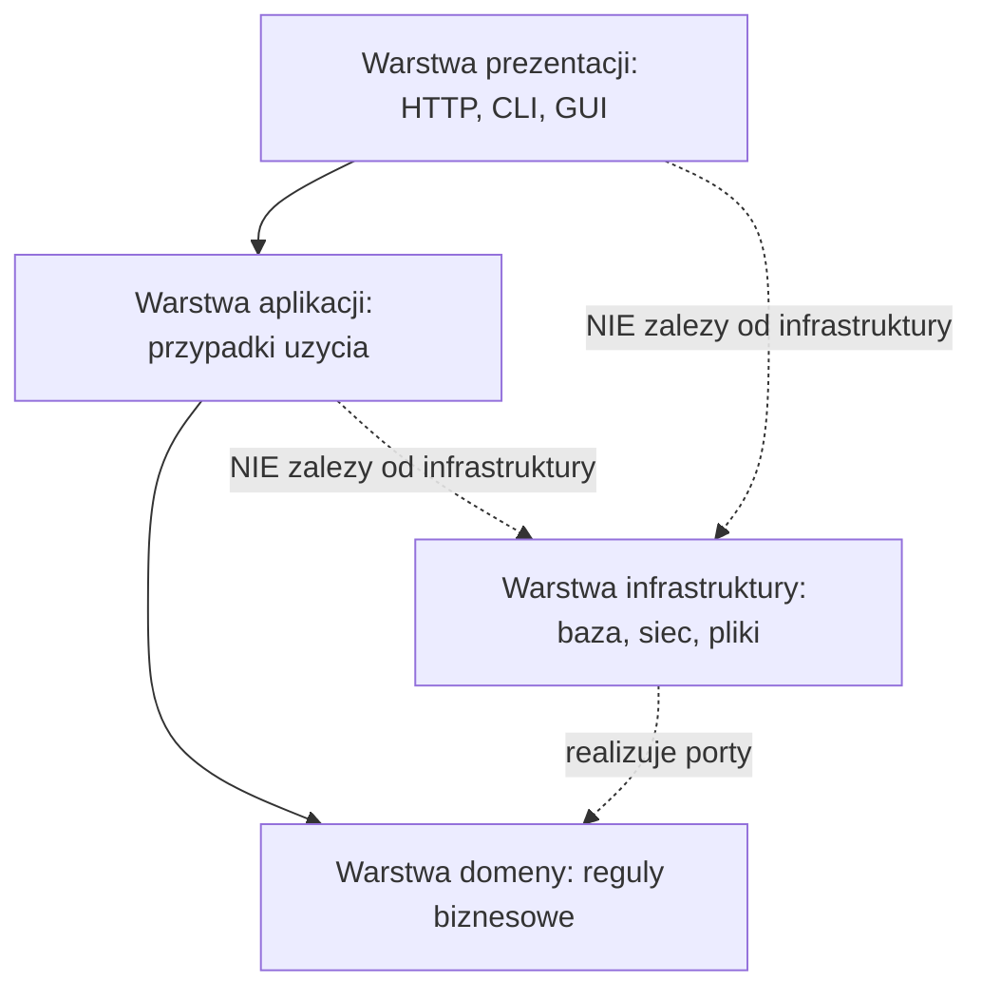
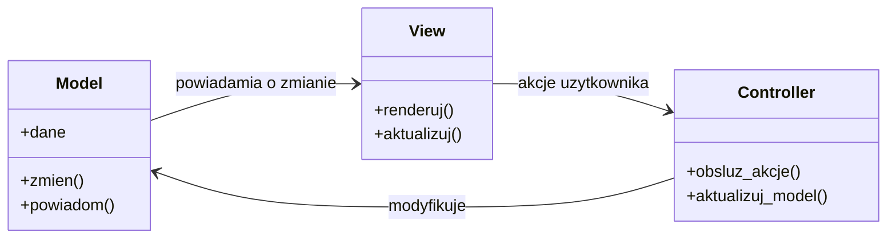
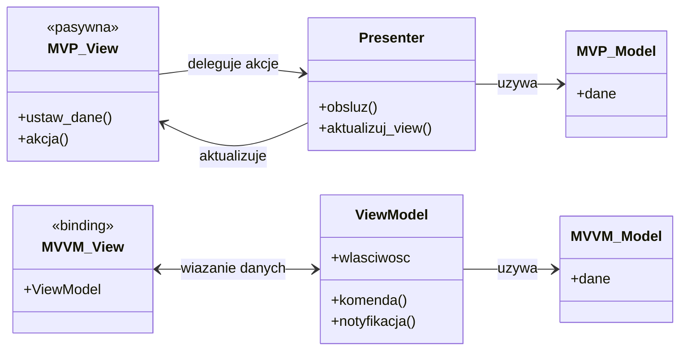
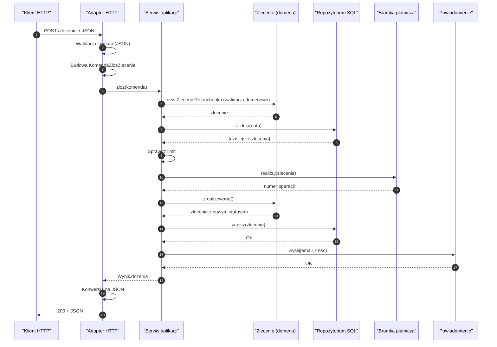
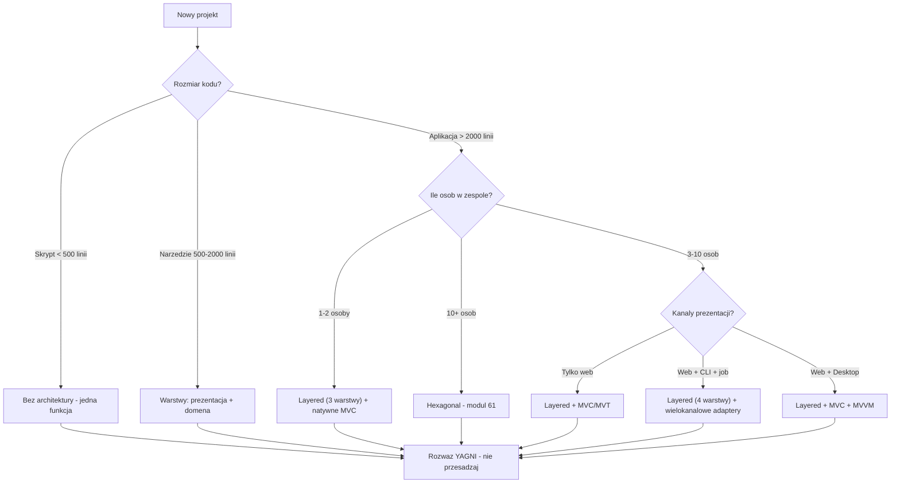
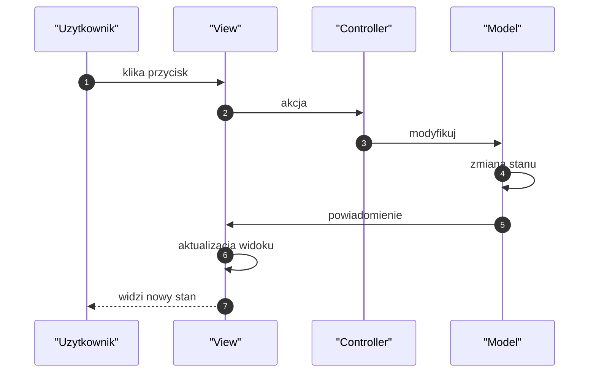
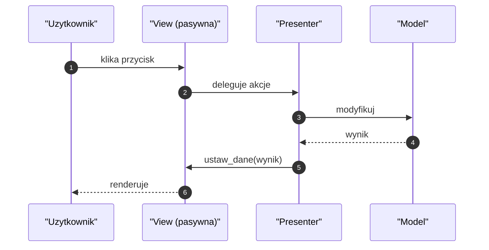
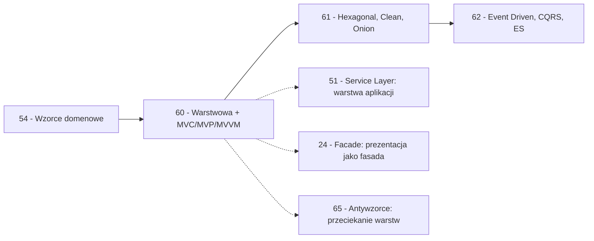

```markdown
---
modul: 60 — Architektura warstwowa oraz MVC, MVP i MVVM
plik: 60-architektura-warstwowa-mvc-mvvm.md
poziom: sredni
wymaga: [54]
czas: ~200 minut czytania + ~460 minut ćwiczeń
---

# Moduł 60 — Architektura warstwowa oraz MVC, MVP i MVVM

> **TL;DR**
> - **Wzorzec architektoniczny (ang. architectural pattern)** działa w skali **całej aplikacji**, nie pojedynczych obiektów — dotyczy rozkładu odpowiedzialności między warstwy i kierunku zależności.
> - **Architektura to decyzje, których trudno później cofnąć** — jak fundamenty budynku. Można zmienić tapetę bez wyburzania, ale zmiana fundamentów wymaga rozbiórki.
> - **Architektura warstwowa (ang. layered)** rozdziela prezentację, aplikację, domenę i infrastrukturę; **reguła zależności** mówi, że strzałki biegną w jedną stronę — do środka.
> - **MVC, MVP, MVVM** to trzy warianty rozdziału „co widać" od „co się dzieje" — Django MVT to wariant MVC, a wybór między nimi zależy od kanału prezentacji (web, desktop, CLI).
> - Skrypt 200 linii nie potrzebuje czterech warstw; system, który **ma żyć pięć lat** i rozwijać się w zespole, **potrzebuje ich już na starcie**.

---

## 0. Model mentalny

### Budynek, jego instalacje i kolejność wyburzania

Wyobraź sobie, że budujesz dom. Zanim postawisz ściany, wykopujesz fundamenty i wylewasz beton. Zanim pomyślisz o kolorze tapety w salonie, ktoś już poprowadził w ścianach kable elektryczne, rury wodne i kanalizacyjne. Zanim zamówisz meble, ktoś wybrał układ pomieszczeń i wmurował ściany nośne. Teraz najważniejsze: **każda z tych decyzji ma bardzo różny koszt zmiany.** Farbę na ścianie zmieniasz w weekend — wystarczy puszka i wałek. Meble wymieniasz w godzinę. Ale układ pomieszczeń? To już ekipa budowlana i kilka tygodni. Fundamenty? To **rozbiórka całego domu i wybudowanie od nowa**. Instalacje? Trzeba rozkuwać ściany — tydzień bałaganu.

Ta hierarchia kosztów zmiany jest esencją **wzorca architektonicznego**. Architektura to nie „jak zaprojektować tę jedną klasę" — to „jak ułożyć cały dom, żeby w przyszłości nie trzeba było go burzyć dla każdej zmiany". Kabel elektryczny w dobrą stronę sprawi, że dołożenie gniazdka w salonie będzie łatwe. Kabel w złą stronę — i każde gniazdko to kuźnia w ścianie.

Idźmy dalej i zobaczmy **konkretną hierarchię**. W budynku wyróżniamy warstwy: **fundament i konstrukcja** (najtrudniejsze do zmiany), **instalacje** (trudne), **ściany działowe** (średnie), **wykończenie** (łatwe), **umeblowanie** (trywialne). Każda ma swoją rolę i swój rytm zmian. Tapeta nie wpływa na fundamenty — fundamenty nie muszą wiedzieć o tapecie. Ale fundamenty **muszą być gotowe zanim** zacznie się kłaść kable, a kable **muszą być gotowe zanim** zacznie się malować. Istnieje **kolejność** — i jest ona jednostronna.

W oprogramowaniu jest dokładnie tak samo. **Warstwa prezentacji** to meble — zmienia się często, nie wpływa na nic. **Warstwa aplikacji** to wykończenie — organizuje przypadki użycia. **Warstwa domeny** to konstrukcja i fundament — zawiera reguły biznesowe, zmienia się rzadko, od niej wszystko zależy. **Warstwa infrastruktury** to instalacje — łączy domenę ze światem zewnętrznym (baza, sieć, pliki), zmienia się umiarkowanie. Każda z nich ma swoją odpowiedzialność, każde ma inny rytm zmian. I — najważniejsze — **kierunek zależności biegnie w jedną stronę**.

Zauważ jeszcze jedną rzecz z tej analogii, kluczową dla zrozumienia architektury. **Tapeta nie wie o fundamentach, ale fundamenty wiedzą o tym, że tapeta będzie gdzieś na nich wisieć.** W kodzie przekłada się to na regułę: **warstwy wyższe (prezentacja) mogą zależeć od warstw niższych (domena), ale nie odwrotnie.** Domena nie importuje widoku. Widok importuje domenę.

I trzeci obraz, o którym łatwo zapomnieć. **Budynek zmienia przeznaczenie.** Był biurem, teraz jest szkołą. Meble wymieniasz, wykończenie dostosowujesz, instalacje dodajesz — ale **konstrukcja i fundamenty zostają**. Jeśli dobrze zaprojektowana architektura oddzieliła „co budynek robi" (funkcję) od „jak to robi" (technologia), zmiana funkcji jest łatwa. Jeśli fundamenty i funkcja są splecione — trzeba burzyć. To jest cała wartość architektury.

| W analogii budynku | W kodzie |
|---|---|
| Fundament i konstrukcja | Warstwa domeny (reguły biznesowe) |
| Instalacje (prąd, woda, kanalizacja) | Warstwa infrastruktury (baza, sieć, pliki) |
| Wykończenie (tynki, podłogi) | Warstwa aplikacji (przypadki użycia) |
| Meble, tapeta, obrazy | Warstwa prezentacji (UI, API, CLI) |
| Kolejność budowy (fundament → instalacje → ściany → wykończenie) | Reguła zależności (domena → aplikacja → prezentacja) |
| Rozkuwanie ścian | Zmiana w warstwie niższej — wpływa na wyższe |
| Zmiana tapety w weekend | Zmiana w warstwie wyższej — nie wpływa na niższe |
| Wyburzenie z powodu fundamentów | Zmiana architektury — najkosztowniejsza |

> 🧠 **Zapamiętaj** — **Wzorzec architektoniczny (ang. architectural pattern) to nazwany, powtarzalny sposób ułożenia całej aplikacji w warstwy lub komponenty o ustalonych odpowiedzialnościach i kierunkach zależności. Architektura jest zbiorem decyzji o najwyższym koszcie zmiany — dlatego podejmuje się je świadomie, a nie ad hoc.**

Zwróć uwagę na dwa słowa: **całą aplikację** i **kierunki zależności**. „Cała aplikacja" — to odróżnia wzorzec architektoniczny od wzorca projektowego czy domenowego. „Kierunki zależności" — to kwintesencja architektury. Wzorzec architektoniczny nie mówi „jak napisać funkcję" ani „jak zbudować obiekt" — mówi „które warstwy mogą wiedzieć o których, i kto kogo wywołuje".

### Diagram — intuicja warstw i kierunku zależności



*Diagram pokazuje cztery warstwy i kierunek zależności: prezentacja zależy od aplikacji, aplikacja od domeny, a infrastruktura realizuje porty zdefiniowane w domenie — strzałki zależności zmierzają do środka.*

### Czego wzorce architektoniczne NIE robią

Rozbrójmy pięć mitów, które narosły wokół architektury.

**Nie gwarantują sukcesu projektu.** Dobra architektura **ułatwia** rozwój, ale nie naprawi złych wymagań, słabego zespołu czy braku testów. Architektura jest **warunkiem koniecznym**, nie wystarczającym.

**Nie są uniwersalne.** Wzorzec, który zbawia dużą aplikację webową, w skrypcie do migracji danych będzie nadmiarem. Wzorzec architektoniczny **zakłada kontekst**: rozmiar, zespół, horyzont czasowy.

**Nie są „kiedyś się przyda”.** Architektura jest jak zbroja — działa dopiero, gdy jest potrzebna. Dla skryptu 200 linii **nie potrzebujesz czterech warstw**. YAGNI (moduł 03) tutaj też działa.

**Nie są zero-jedynkowe.** Można mieć architekturę „częściowo warstwową", „relaksowaną", „hybrydową". W praktyce **rzadko** stosuje się czysty wzorzec — zawsze z kompromisami.

**Nie uniwersalizują się z wzorcami GoF.** Wzorce projektowe (GoF) działają na poziomie **obiektów**. Wzorce architektoniczne — na poziomie **całej aplikacji**. Wzorce domenowe — **wewnątrz warstwy domeny**. To trzy różne skale.

**Nie opisują technologii.** Architektura warstwowa nie mówi „użyj Django" ani „użyj FastAPI". Mówi „rozdziel odpowiedzialności". Technologia to szczegół.

---

## 1. Problem, który rozwiązujemy

Wejdźmy w domenę 💳 „Rozrachunku". Budujemy system, który:
- przyjmuje zlecenia płatności,
- realizuje je przez bramkę płatniczą,
- zapisuje je w bazie,
- udostępnia API HTTP dla klientów zewnętrznych,
- uruchamia nocne joby do rozliczania sesji rozrachunkowej.

Ktoś napisał to w jednym pliku — „na szybko". Zaczynał od jednego endpointu, przy dwudziestu pięćset linii stało się nie do utrzymania.

### Kod „przed"

```python
# rozrachunek_v0.py — wersja naiwna, demonstracyjna
# UWAGA: kod celowo pokazuje wszystko w jednym miejscu.

from __future__ import annotations

import json
import logging
import smtplib
import sqlite3
from collections.abc import Callable
from dataclasses import dataclass
from datetime import date, datetime, timezone
from decimal import ROUND_HALF_UP, Decimal
from http.server import BaseHTTPRequestHandler, HTTPServer
from urllib.parse import parse_qs, urlparse

log = logging.getLogger(__name__)


class RozrachunekHandler(BaseHTTPRequestHandler):
    """Wszystko w jednym: HTTP, walidacja, domena, baza, SMTP."""

    sciezka_db = "rozrachunek.db"
    host_smtp = "localhost"
    port_smtp = 25
    LIMIT_DZIENNY = Decimal("1000000.00")
    STAWKA_PROWIZJI = Decimal("0.004")

    def do_POST(self) -> None:  # noqa: N802
        # 1. Parsowanie HTTP
        dlugosc = int(self.headers.get("Content-Length", "0"))
        cialo = self.rfile.read(dlengosc).decode("utf-8") if False else self.rfile.read(dlengosc).decode("utf-8")
        dane = json.loads(cialo)

        try:
            # 2. Walidacja formalna
            if "kwota" not in dane or "waluta" not in dane:
                self._blad(400, "brak pol")
                return
            kwota = Decimal(str(dane["kwota"]))
            waluta = dane["waluta"]
            if kwota <= 0:
                self._blad(400, "kwota musi byc dodatnia")
                return
            if waluta not in ("PLN", "EUR", "USD"):
                self._blad(400, "nieznana waluta")
                return

            # 3. Regula biznesowa — limit dzienny
            suma_dzis = self._suma_dzisiaj()
            if suma_dzis + kwota > self.LIMIT_DZIENNY:
                self._blad(409, "przekroczony limit dzienny")
                return

            # 4. Realizacja — "bramka platnicza" zaszyla w kodzie
            numer_operacji = f"OP-{int(datetime.now().timestamp())}"

            # 5. Zapis do bazy — surowy SQL
            polaczenie = sqlite3.connect(self.sciezka_db)
            try:
                kursor = polaczenie.cursor()
                kursor.execute(
                    "INSERT INTO operacje (id, kwota, waluta, numer, kiedy) "
                    "VALUES (?, ?, ?, ?, ?)",
                    (
                        dane["id"],
                        str(kwota),
                        waluta,
                        numer_operacji,
                        datetime.now(timezone.utc).isoformat(),
                    ),
                )
                polaczenie.commit()
            finally:
                polaczenie.close()

            # 6. Powiadomienie — SMTP zaszyle
            try:
                serwer = smtplib.SMTP(self.host_smtp, self.port_smtp)
                serwer.sendmail(
                    "system@example.com",
                    [dane.get("email", "klient@example.com")],
                    f"Zlecenie {dane['id']} przyjete",
                )
                serwer.quit()
            except Exception:
                pass

            # 7. Odpowiedz
            self._json(200, {
                "id": dane["id"],
                "numer_operacji": numer_operacji,
                "prowizja": str(self._prowizja(kwota)),
            })
        except Exception as e:
            log.exception("blad")
            self._blad(500, str(e))

    def _suma_dzisiaj(self) -> Decimal:
        polaczenie = sqlite3.connect(self.sciezka_db)
        try:
            kursor = polaczenie.cursor()
            kursor.execute(
                "SELECT kwota FROM operacje WHERE substr(kiedy, 1, 10) = ?",
                (date.today().isoformat(),),
            )
            return sum((Decimal(r[0]) for r in kursor.fetchall()), Decimal("0"))
        finally:
            polaczenie.close()

    def _prowizja(self, kwota: Decimal) -> Decimal:
        return (kwota * self.STAWKA_PROWIZJI).quantize(
            Decimal("0.01"), rounding=ROUND_HALF_UP
        )

    def _json(self, kod: int, dane: dict) -> None:
        self.send_response(kod)
        self.send_header("Content-Type", "application/json")
        self.end_headers()
        self.wfile.write(json.dumps(dane).encode("utf-8"))

    def _blad(self, kod: int, opis: str) -> None:
        self._json(kod, {"blad": opis})
```

Ten kod **działa** — dla jednego endpointu. Ale ma fundamentalne problemy, które narastają lawinowo.

### Code smell — wszystko w jednej klasie

| Problem | Gdzie | Konsekwencja |
|---|---|---|
| HTTP, walidacja, domena, SQL, SMTP w jednej klasie | `RozrachunekHandler` | Każda zmiana dotyka tej samej klasy |
| Reguły w handlerze HTTP | `_suma_dzisiaj`, `LIMIT_DZIENNY` | Nie da się użyć w CLI ani jobie |
| Surowy SQL w handlerze | `sqlite3.connect` | Baza spleciona z HTTP |
| SMTP w handlerze | `smtplib` | Powiadomienie splecione z HTTP |
| Brak testów | Nic nie da się testować bez HTTP | Trudno pisać testy |
| Brak reużycia | Logika tylko dla HTTP | CLI, job nie mogą użyć |
| Literówka w kodzie | `dlengosc` (literówka) | Cichy błąd — kod nie kopiuje się, jest „celowo" pokazany |

### Objawy — poznasz ten problem po tym, że...

- **Nie da się przetestować jednej reguły bez uruchomienia HTTP.** Chcesz sprawdzić „limit dzienny" — musisz podnieść serwer albo użyć `http.client`.
- **Kod nie da się reużyć w innym kontekście.** CLI nie miałoby jak skorzystać z tych reguł.
- **Zmiana w bazie wymaga zmiany klasy.** Bo SQL obok HTTP.
- **Zmiana powiadomienia e-mail wymaga zmiany klasy.**
- **Testy są wolne** — bo wymagają HTTP.
- **Nie da się „wstrzyknąć" bazy testowej.** Bo `sqlite3.connect` zahardkodowany.
- **Nie widać intencji klasy.** „Co robi ta klasa?" — „wszystko".
- **Nie ma miejsca na „przypadek użycia".** Nie ma klasy `ZlozZlecenie` — jest tylko handler HTTP.

---

## 2. Anatomia wzorców

### Architektura warstwowa — uczestnicy

| Rola (warstwa) | Odpowiedzialność | Co NIE jest jej zadaniem |
|---|---|---|
| **Prezentacja (Presentation)** | Odbiera żądania z zewnątrz (HTTP, CLI, GUI), formatuje odpowiedzi; konwertuje dane wejścia/wyjścia | Nie zawiera logiki biznesowej; nie zna bazy |
| **Aplikacja (Application)** | Orkiestruje przypadki użycia; koordynuje pracę; zarządza transakcjami; **nie zawiera reguł biznesowych** | Nie zawiera reguł domenowych; nie zna technologii |
| **Domena (Domain)** | Reguły biznesowe, niezmienniki, model pojęć (encje, VO, agregaty) | Nie zna bazy, HTTP, frameworków (moduł 54) |
| **Infrastruktura (Infrastructure)** | Realizuje porty domeny/aplikacji: baza, HTTP, kolejka, pliki, log | Nie zawiera reguł biznesowych; nie zna warstw wyższych |

### MVC — uczestnicy

| Rola | Odpowiedzialność | Co NIE jest jej zadaniem |
|---|---|---|
| **Model** | Zawiera dane i reguły domenowe; powiadamia o zmianach | Nie zna widoku |
| **View** | Prezentuje dane; nie podejmuje decyzji o logice | Nie modyfikuje modelu bezpośrednio (w klasycznym MVC) |
| **Controller** | Tłumaczy akcje użytkownika na operacje na modelu | Nie zawiera logiki biznesowej; nie formatuje widoku |

### MVP — uczestnicy

| Rola | Odpowiedzialność | Co NIE jest jej zadaniem |
|---|---|---|
| **Model** | Jak w MVC — dane i logika | — |
| **View** | **Pasywna** — wyświetla, deleguje zdarzenia do Presentera | Nie zna Modelu bezpośrednio |
| **Presenter** | Pośredniczy: odbiera akcje View, wywołuje Model, aktualizuje View | Nie zna technologii UI (interfejs do View) |

### MVVM — uczestnicy

| Rola | Odpowiedzialność | Co NIE jest jej zadaniem |
|---|---|---|
| **Model** | Dane i logika | — |
| **View** | Warstwa UI, obsługuje wiązania danych | Nie zawiera logiki |
| **ViewModel** | Stan widoku, komendy, konwersje; wystawiony przez właściwości | Nie zawiera referencji do widżetu UI |
| **Binding** | Mechanizm automatycznego przekazywania zmian (framework) | Nie zawiera logiki |

### Diagram — MVC z zależnościami



*Diagram pokazuje MVC: View przyjmuje akcje użytkownika i przekazuje do Controllera, Controller modyfikuje Model, a Model powiadamia View o zmianie — pełny cykl.*

### Diagram — MVP i MVVM obok siebie



*Diagram pokazuje dwie filozofie: w MVP Presenter jawnie steruje pasywną View; w MVVM View wiąże się z ViewModel przez mechanizm binding — automatycznie odzwierciedla zmiany.*

### Warianty: klasyczny vs pythoniczny

| Aspekt | Klasyczny (Java/C#) | Pythoniczny |
|---|---|---|
| Model | Klasa z ORM | `dataclass` + VO z modułu 54 |
| View | XML/HTML oddzielony | Szablon Jinja2, `str.format`, serializer |
| Controller | Klasa + dekoratory | Funkcja + routing |
| Presenter | Klasa z referencją do View | Funktor albo `Protocol` do View |
| ViewModel | Klasa z `INotifyPropertyChanged` | `@dataclass` + PropertyDescriptor |
| Application layer | Service Bean | Funkcja albo `dataclass` |
| Dependency Injection | Framework | `Protocol` + konstruktor (moduł 53) |

Python jest znacznie lżejszy — pozwala realizować te wzorce bez frameworka, choć w praktyce frameworki (Django, FastAPI) dostarczają gotowe implementacje.

### Reguła zależności — szczegóły

To najważniejsza reguła architektury warstwowej. **Strzałki zależności biegną z góry na dół**, do środka:

```text
  Prezentacja
      v
    Aplikacja
      v
     Domena
      ^
      |
  Infrastruktura (realizuje porty)
```

- **Prezentacja** może importować aplikację, domenę (dla typów), ale nie infrastrukturę.
- **Aplikacja** może importować domenę, ale nie infrastrukturę ani prezentację.
- **Domena** nie importuje niczego — nie zna nikogo. Definiuje **porty** (abstrakcje).
- **Infrastruktura** importuje domenę (realizuje porty) i aplikację (jeśli potrzeba), ale nie prezentację.

**Co się dzieje, gdy strzałki zawrócą?** Zależność cykliczna: domena zależy od infrastruktury. To znak, że **domena zna technologię**. Wtedy:
- Nie da się przetestować domeny bez bazy.
- Nie da się wymienić bazy bez zmiany domeny.
- Nie da się podnieść domeny w innym kontekście (CLI, job).

To najczęstszy antywzorzarchitektoniczny i najdroższy.

---

## 3. Implementacja krok po kroku

Przebudujemy kod z sekcji 1 stopniowo. Zaczniemy od domeny, dojdziemy do pełnej warstwowej aplikacji z trzema kanałami wejścia.

### Krok 1 — Wyodrębnij domenę

Zaczynamy od tego, co najtrwalsze — model domenowy.

```python
# rozrachunek/domain/model.py
from __future__ import annotations

import re
from dataclasses import dataclass, field, replace
from datetime import date, datetime, timezone
from decimal import ROUND_HALF_UP, Decimal
from enum import Enum


GROSZ = Decimal("0.01")


def zaokraglij(kwota: Decimal) -> Decimal:
    return kwota.quantize(GROSZ, rounding=ROUND_HALF_UP)


@dataclass(frozen=True, slots=True)
class Kwota:
    """Wartosc pieniezna z waluta."""
    wartosc: Decimal
    waluta: str = "PLN"

    def __post_init__(self) -> None:
        if not isinstance(self.wartosc, Decimal):
            raise TypeError("wartosc musi byc Decimal")
        if self.wartosc < 0:
            raise ValueError("wartosc nie moze byc ujemna")
        if self.waluta not in ("PLN", "EUR", "USD"):
            raise ValueError(f"nieobslugiwana waluta: {self.waluta}")

    def __add__(self, inna: Kwota) -> Kwota:
        if self.waluta != inna.waluta:
            raise ValueError(f"nie mozna dodac {inna.waluta} do {self.waluta}")
        return Kwota(zaokraglij(self.wartosc + inna.wartosc), self.waluta)

    def __mul__(self, wspolczynnik: Decimal) -> Kwota:
        return Kwota(zaokraglij(self.wartosc * wspolczynnik), self.waluta)


class StatusZlecenia(Enum):
    NOWE = "nowe"
    W_TOKU = "w toku"
    ZREALIZOWANE = "zrealizowane"
    ODRZUCONE = "odrzucone"


@dataclass(frozen=True)
class ZlecenieRozrachunku:
    identyfikator: str
    kwota: Kwota
    email_klienta: str
    data_wykonania: date
    status: StatusZlecenia = StatusZlecenia.NOWE

    def __post_init__(self) -> None:
        if not self.identyfikator:
            raise ValueError("identyfikator wymagany")
        if "@" not in self.email_klienta:
            raise ValueError("niepoprawny email")

    @property
    def prowizja(self) -> Kwota:
        stawki = {"PLN": Decimal("0.004"), "EUR": Decimal("0.005"), "USD": Decimal("0.005")}
        return self.kwota * stawki[self.kwota.waluta]

    def zrealizowane(self) -> ZlecenieRozrachunku:
        return replace(self, status=StatusZlecenia.ZREALIZOWANE)

    def odrzucone(self) -> ZlecenieRozrachunku:
        return replace(self, status=StatusZlecenia.ODRZUCONE)
```

Zwróć uwagę: **`ZlecenieRozrachunku` nie zna bazy, HTTP ani SMTP**. Ma tylko reguły biznesowe. To warstwa domeny w czystej postaci.

### Krok 2 — Zdefiniuj porty

Porty to abstrakcje, które warstwa wyższa wymaga od niższej.

```python
# rozrachunek/domain/ports.py
from typing import Protocol, runtime_checkable
from datetime import date
from decimal import Decimal


@runtime_checkable
class RepozytoriumRozrachunkow(Protocol):
    """Port: zapis i odczyt zlecen."""
    def zapisz(self, zlecenie: "ZlecenieRozrachunku") -> None: ...
    def po_id(self, identyfikator: str) -> "ZlecenieRozrachunku | None": ...
    def z_dnia(self, na_dzien: date) -> list["ZlecenieRozrachunku"]: ...


@runtime_checkable
class BramkaPlatnicza(Protocol):
    """Port: realizacja platnosci."""
    def realizuj(self, zlecenie: "ZlecenieRozrachunku") -> str: ...


@runtime_checkable
class Powiadomienie(Protocol):
    """Port: powiadomienie klienta."""
    def wyslij(self, email: str, tresc: str) -> None: ...
```

Porty są **w domenie** — domena definiuje, czego potrzebuje. Nie wie, kto to realizuje.

### Krok 3 — Zdefiniuj warstwę aplikacji (przypadki użycia)

Serwis aplikacyjny — orkiestruje, nie zawiera reguł domenowych.

```python
# rozrachunek/application/przypadki.py
from dataclasses import dataclass
from datetime import date
from decimal import Decimal
import logging


log = logging.getLogger(__name__)


@dataclass(frozen=True)
class ZlozZlecenie:
    """Przypadek uzycia: zlozenie zlecenia rozrachunku."""
    identyfikator: str
    kwota: Kwota
    email: str
    data_wykonania: date


@dataclass(frozen=True)
class WynikZlozenia:
    identyfikator: str
    numer_operacji: str
    prowizja: Kwota


class BladAplikacji(Exception):
    """Blad biznesowy na poziomie przypadku uzycia."""


class SerwisRozrachunku:
    """Warstwa aplikacji: orkiestruje, nie zawiera regul domenowych."""

    def __init__(
        self,
        repo: RepozytoriumRozrachunkow,
        bramka: BramkaPlatnicza,
        powiadomienie: Powiadomienie,
        limit_dzienny: Kwota,
    ) -> None:
        self._repo = repo
        self._bramka = bramka
        self._powiadomienie = powiadomienie
        self._limit = limit_dzienny

    def zloz(self, komenda: ZlozZlecenie) -> WynikZlozenia:
        # 1. Zbuduj zlecenie z komendy (walidacja domenowa w konstruktorze)
        zlecenie = ZlecenieRozrachunku(
            identyfikator=komenda.identyfikator,
            kwota=komenda.kwota,
            email_klienta=komenda.email,
            data_wykonania=komenda.data_wykonania,
        )

        # 2. Sprawdz limit (regula aplikacyjna, nie domenowa)
        dzisiejsze = self._repo.z_dnia(commenda.data_wykonania) if False else self._repo.z_dnia(komenda.data_wykonania)
        suma = sum((z.kwota.wartosc for z in dzisiejsze), Decimal("0"))
        if suma + komenda.kwota.wartosc > self._limit.wartosc:
            raise BladAplikacji(
                f"limit dzienny przekroczony: {suma + komenda.kwota.wartosc} > {self._limit}"
            )

        # 3. Realizuj przez bramke
        numer = self._bramka.realizuj(zlecenie)
        zlecenie = zlecenie.zrealizowane()

        # 4. Zapisz
        self._repo.zapisz(zlecenie)

        # 5. Powiadom
        self._powiadomienie.wyslij(
            komenda.email,
            f"Zlecenie {zlecenie.identyfikator} zrealizowane: {numer}",
        )

        return WynikZlozenia(
            identyfikator=zlecenie.identyfikator,
            numer_operacji=numer,
            prowizja=zlecenie.prowizja,
        )

    def podsumowanie_dnia(self, na_dzien: date):
        """Przypadek uzycia: podsumowanie dnia."""
        zlecenia = self._repo.z_dnia(na_dzien)
        suma = sum((z.kwota.wartosc for z in zlecenia), Decimal("0"))
        return {
            "liczba": len(zlecenia),
            "suma": Decimal(suma),
            "waluta": self._limit.waluta,
        }
```

Zwróć uwagę: **serwis nie zawiera SQL ani SMTP**. Zna tylko porty.

### Krok 4 — Warstwa infrastruktury

Adaptery realizujące porty.

```python
# rozrachunek/infrastructure/repozytorium_sqlite.py
import sqlite3
from decimal import Decimal
from datetime import date


class RepozytoriumSQLite:
    def __init__(self, polaczenie: sqlite3.Connection) -> None:
        self._pol = polaczenie

    def zapisz(self, zlecenie: ZlecenieRozrachunku) -> None:
        kursor = self._pol.cursor()
        kursor.execute(
            "INSERT OR REPLACE INTO zlecenia "
            "(id, kwota, waluta, email, data, status) "
            "VALUES (?, ?, ?, ?, ?, ?)",
            (
                zlecenie.identyfikator,
                str(zlecenie.kwota.wartosc),
                zlecenie.kwota.waluta,
                zlecenie.email_klienta,
                zlecenie.data_wykonania.isoformat(),
                zlecenie.status.value,
            ),
        )
        self._pol.commit()

    def po_id(self, identyfikator: str) -> ZlecenieRozrachunku | None:
        kursor = self._pol.cursor()
        kursor.execute(
            "SELECT id, kwota, waluta, email, data, status "
            "FROM zlecenia WHERE id = ?", (identyfikator,)
        )
        w = kursor.fetchone()
        return self._na_model(w) if w else None

    def z_dnia(self, na_dzien: date) -> list[ZlecenieRozrachunku]:
        kursor = self._pol.cursor()
        kursor.execute(
            "SELECT id, kwota, waluta, email, data, status "
            "FROM zlecenia WHERE data = ?", (na_dzien.isoformat(),)
        )
        return [self._na_model(w) for w in kursor.fetchall()]

    def _na_model(self, w: tuple) -> ZlecenieRozrachunku:
        return ZlecenieRozrachunku(
            identyfikator=w[0],
            kwota=Kwota(Decimal(w[1]), w[2]),
            email_klienta=w[3],
            data_wykonania=date.fromisoformat(w[4]),
            status=StatusZlecenia(w[5]),
        )


# rozrachunek/infrastructure/bramka_symulowana.py
class BramkaSymulowana:
    def realizuj(self, zlecenie: ZlecenieRozrachunku) -> str:
        return f"OP-{zlecenie.identyfikator}-{zlecenie.kwota.waluta}"


# rozrachunek/infrastructure/powiadomienie_log.py
class PowiadomienieLogowe:
    def wyslij(self, email: str, tresc: str) -> None:
        log.info(f"[EMAIL->{email}] {tresc}")
```

Każdy adapter realizuje **jeden port**. Żaden nie zna warstw wyższych.

### Krok 5 — Warstwa prezentacji (HTTP)

Handler HTTP — tylko konwersja formatów.

```python
# rozrachunek/presentation/http.py
import json
from datetime import date
from decimal import Decimal


class HandlerHTTP:
    """Prezentacja: konwersja HTTP <-> komenda, wynik -> JSON."""

    def __init__(self, serwis: SerwisRozrachunku) -> None:
        self._serwis = serwis

    def zloz_zlecenie(self, body: dict) -> dict:
        # 1. Konwersja danych HTTP na komende
        try:
            komenda = ZlozZlecenie(
                identyfikator=str(body["id"]),
                kwota=Kwota(Decimal(str(body["kwota"])), body.get("waluta", "PLN")),
                email=str(body["email"]),
                data_wykonania=date.fromisoformat(body.get("data", date.today().isoformat())),
            )
        except (KeyError, ValueError, TypeError) as blad:
            return {"kod": 400, "body": {"blad": str(blad)}}

        # 2. Wywołanie przypadku użycia
        try:
            wynik = self._serwis.zloz(komenda)
        except BladAplikacji as blad:
            return {"kod": 409, "body": {"blad": str(blad)}}

        # 3. Konwersja wyniku na JSON
        return {
            "kod": 200,
            "body": {
                "id": wynik.identyfikator,
                "numer_operacji": wynik.numer_operacji,
                "prowizja": str(wynik.prowizja.wartosc),
                "waluta": wynik.prowizja.waluta,
            },
        }
```

### Krok 6 — Composition root

Jedno miejsce, gdzie wszystko jest łączone.

```python
# rozrachunek/composition.py
import sqlite3


def zbuduj_aplikacje(sciezka_db: str) -> HandlerHTTP:
    polaczenie = sqlite3.connect(sciezka_db)
    polaczenie.executescript("""
        CREATE TABLE IF NOT EXISTS zlecenia (
            id TEXT PRIMARY KEY, kwota TEXT, waluta TEXT,
            email TEXT, data TEXT, status TEXT
        );
    """)
    repo = RepozytoriumSQLite(polaczenie)
    bramka = BramkaSymulowana()
    powiadomienie = PowiadomienieLogowe()
    limit = Kwota(Decimal("1000000"), "PLN")
    serwis = SerwisRozrachunku(repo, bramka, powiadomienie, limit)
    return HandlerHTTP(serwis)
```

### Krok 7 — Weryfikacja

| Kryterium | Wersja „przed" | Wersja „po" |
|---|---|---|
| Test reguły domenowej | Wymaga HTTP + bazy | Bez HTTP i bazy |
| Zmiana bazy | W klasie handlera | Nowy adapter |
| Zmiana powiadomienia | W klasie handlera | Nowy adapter |
| Reużycie w CLI | Nie da się | Wystarczy nowy handler |
| Liczba warstw | 1 (wszystko w jednej) | 4 |
| Reguła zależności | Nie istnieje | Domena → aplikacja → prezentacja; infrastruktura realizuje porty |
| Liczba klas | 1 | ~10 |
| Trudność dodania endpointu | Zmiana w klasie HTTP | Nowa metoda w handlerze |

Koszt: dziesięć klas zamiast jednej, dodatkowe warstwy. Zysk: testowalność, wymienność, reużycie.

---

## 4. Wersje pythoniczne i warianty

### 4.1 Wariant klasyczny: cztery warstwy

Wariant z sekcji 3. Rozbudowany, explicite. **Właściwy dla dużych projektów** — ale bywa przesadą dla małych.

### 4.2 Wariant uproszczony: trzy warstwy

Dla małych aplikacji — pomijamy warstwę aplikacji:

```text
Prezentacja → Domena ← Infrastruktura
```

Prezentacja bezpośrednio wywołuje domenę. Sensowne, gdy przypadki użycia nie są złożone.

### 4.3 Wariant „relaksowany” (relaxed layered)

Warstwy nie otaczają się szczelnie — dopuszczamy przeskoki:

```text
Prezentacja → Aplikacja → Domena
     ↓
Infrastruktura (dozwolone dla wydajności)
```

Stosowane w aplikacjach webowych, gdzie warstwa prezentacji musi bezpośrednio czytać dane (np. lista z paginacją — przez repozytorium `SELECT` z JOIN-em). „Relaksowany” chroni przed nadmiarem warstw.

### 4.4 Wariant Django (MVT jako MVC)

Django używa nazwy **MVT** (Model-View-Template), ale jest to wariant MVC:

- **Model** = `models.Model` (warstwa danych, Active Record — moduł 52).
- **View** = funkcja/klasa obsługująca żądanie (odpowiednik Controllera w MVC).
- **Template** = szablon HTML (odpowiednik View w MVC).

```python
# models.py
class Zlecenie(models.Model):
    id = models.CharField(primary_key=True, max_length=50)
    kwota = models.DecimalField(max_digits=15, decimal_places=2)
    waluta = models.CharField(max_length=3)
    email = models.EmailField()


# views.py (odpowiednik Controllera w MVC)
@csrf_exempt
def zloz_zlecenie(request):
    if request.method != "POST":
        return JsonResponse({"blad": "metoda"}, status=405)
    dane = json.loads(request.body)
    # Walidacja przez serializer/formularz
    # Zapis przez model
    zlecenie = Zlecenie.objects.create(...)
    return JsonResponse({"id": zlecenie.id})


# templates/zlecenie.html (odpowiednik View w MVC)
<h1>Zlecenie {{ zlecenie.id }}</h1>
```

**Django de facto łączy warstwę aplikacji z widokiem.** W dużych projektach warto wyodrębnić serwisy (moduł 51) — hybryda.

### 4.5 Wariant Flask + Jinja2

Klasyczny MVC „bez frameworka”:

```python
# views.py — kontroler
@app.route("/zlecenie", methods=["POST"])
def zloz_zlecenie():
    dane = request.get_json()
    serwis = get_serwis()
    wynik = serwis.zloz(ZlozZlecenie(**dane))
    return render_template("zlecenie.html", wynik=wynik)
```

Flask daje **całkowitą dowolność** — nie narzuca warstw. To zaleta i wada.

### 4.6 Wariant FastAPI + Pydantic

FastAPI używa pydantic do walidacji na granicy API:

```python
# schemas.py — DTO
class ZlecenieIn(BaseModel):
    id: str
    kwota: Decimal
    waluta: Literal["PLN", "EUR", "USD"]

class ZlecenieOut(BaseModel):
    id: str
    numer_operacji: str
    prowizja: Decimal


# main.py — kontroler
@app.post("/zlecenie", response_model=ZlecenieOut)
def zloz_zlecenie(body: ZlecenieIn, serwis: SerwisRozrachunku = Depends(...)):
    wynik = serwis.zloz(ZlozZlecenie(**body.model_dump()))
    return ZlecenieOut(...)
```

FastAPI ma wbudowane DI (moduł 53) i walidację na wejściu (moduł 51).

### 4.7 MVP w Pythonie

Zbudujmy MVP — View pasywna, Presenter pośredniczy.

```python
# mvp.py
from typing import Protocol


class WidokZlecenia(Protocol):
    """Kontrakt dla widoku - pasywny."""
    def pokaz_formularz(self) -> None: ...
    def pokaz_wynik(self, numer: str) -> None: ...
    def pokaz_blad(self, opis: str) -> None: ...


class PresenterZlecenia:
    def __init__(self, serwis: SerwisRozrachunku, widok: WidokZlecenia) -> None:
        self._serwis = serwis
        self._widok = widok

    def zloz(self, id_: str, kwota: str, email: str) -> None:
        try:
            komenda = ZlozZlecenie(
                identyfikator=id_,
                kwota=Kwota(Decimal(kwota)),
                email=email,
                data_wykonania=date.today(),
            )
            wynik = self._serwis.zloz(komenda)
            self._widok.pokaz_wynik(wynik.numer_operacji)
        except (ValueError, BladAplikacji) as blad:
            self._widok.pokaz_blad(str(blad))


class WidokKonsolowy:
    """Konkretny widok - dziala na konsoli."""
    def pokaz_formularz(self) -> None:
        print("Podaj dane zlecenia...")

    def pokaz_wynik(self, numer: str) -> None:
        print(f"Zlecenie zrealizowane: {numer}")

    def pokaz_blad(self, opis: str) -> None:
        print(f"Blad: {opis}")
```

**MVP jest bardzo dobry dla CLI i GUI.** Widok pasywny, Presenter testowalny — w testach podstawiamy `WidokWTestach`.

### 4.8 MVVM w PyQt

```python
# mvvm.py — dla PyQt/PySide
from PySide6.QtCore import QObject, Signal, Slot, Property


class ModelZlecenia(QObject):
    dane_zmienione = Signal()


class ViewModelZlecenia(QObject):
    numer_zmieniony = Signal(str)

    def __init__(self, serwis: SerwisRozrachunku) -> None:
        super().__init__()
        self._serwis = serwis
        self._numer = ""

    @Property(str, notify=numer_zmieniony)
    def numer(self) -> str:
        return self._numer

    @Slot(str, str)
    def zloz(self, kwota: str, email: str) -> None:
        try:
            komenda = ZlozZlecenie(...)
            wynik = self._serwis.zloz(komenda)
            self._numer = wynik.numer_operacji
            self.numer_zmieniony.emit(self._numer)
        except Exception as blad:
            self._numer = f"blad: {blad}"
            self.numer_zmieniony.emit(self._numer)


class WidokZlecenia(QWidget):
    """Widok wiaze sie z ViewModel przez binding."""
    def __init__(self, vm: ViewModelZlecenia) -> None:
        super().__init__()
        self._vm = vm
        self._label = QLabel()
        # Wiazanie: label.text <- vm.numer (automatyczne)
        vm.numer_zmieniony.connect(self._label.setText)
```

MVVM jest typowy dla desktopu — tam frameworki (Qt, WPF) wspierają binding.

### 4.9 Podsumowanie — tabela wyboru

| Sytuacja | Wybór |
|---|---|
| Duża aplikacja webowa | Layered (4 warstwy) + Django/FastAPI |
| Małe API | 3 warstwy (bez aplikacji) |
| CLI | MVP albo warstwowa |
| GUI desktop | MVVM (Qt, WPF) |
| Job wsadowy | 3 warstwy + wejście CLI |
| Skrypt 200 linii | Bez architektury |

> 🧠 **Zapamiętaj** — **Wzorce architektoniczne nie są „uniwersalne” — dobiera się je do kontekstu.** Web → Layered + MVC/MVT; desktop → MVVM; CLI → MVP albo cienki Layered. **Wybór zależy od kanału prezentacji**, nie od mody.**

---

## 5. Przykład z życia: 💳 Rozrachunek — pełny uruchamialny kod

Zbudujemy pełny system rozrachunku z **trzema kanałami wejścia**: HTTP API, CLI, job wsadowy. Wszystkie używają tej samej warstwy aplikacji i domeny.

### Kod

```python
# rozrachunek_warstwowy.py — pelny przyklad architektury warstwowej
from __future__ import annotations

import json
import logging
import sqlite3
from abc import ABC, abstractmethod
from collections.abc import Callable
from dataclasses import dataclass, field, replace
from datetime import date, datetime, timezone
from decimal import ROUND_HALF_UP, Decimal
from enum import Enum
from typing import Protocol, runtime_checkable


log = logging.getLogger(__name__)
GROSZ = Decimal("0.01")


def zaokraglij(kwota: Decimal) -> Decimal:
    return kwota.quantize(GROSZ, rounding=ROUND_HALF_UP)


# ===========================================================================
# WARSTWA DOMENY
# ===========================================================================

@dataclass(frozen=True, slots=True)
class Kwota:
    wartosc: Decimal
    waluta: str = "PLN"

    def __post_init__(self) -> None:
        if not isinstance(self.wartosc, Decimal):
            raise TypeError("wartosc musi byc Decimal")
        if self.wartosc < 0:
            raise ValueError("wartosc nie moze byc ujemna")
        if self.waluta not in ("PLN", "EUR", "USD"):
            raise ValueError(f"nieobslugiwana waluta: {self.waluta}")

    def __add__(self, inna: Kwota) -> Kwota:
        if self.waluta != inna.waluta:
            raise ValueError(f"nie mozna dodac {inna.waluta} do {self.waluta}")
        return Kwota(zaokraglij(self.wartosc + inna.wartosc), self.waluta)

    def __mul__(self, wsp: Decimal) -> Kwota:
        return Kwota(zaokraglij(self.wartosc * wsp), self.waluta)

    def __lt__(self, inna: Kwota) -> bool:
        if self.waluta != inna.waluta:
            raise ValueError("nie mozna porownac roznych walut")
        return self.wartosc < inna.wartosc


class StatusZlecenia(Enum):
    NOWE = "nowe"
    ZREALIZOWANE = "zrealizowane"
    ODRZUCONE = "odrzucone"


@dataclass(frozen=True)
class ZlecenieRozrachunku:
    identyfikator: str
    kwota: Kwota
    email: str
    data_wykonania: date
    status: StatusZlecenia = StatusZlecenia.NOWE

    def __post_init__(self) -> None:
        if not self.identyfikator:
            raise ValueError("id wymagane")
        if "@" not in self.email:
            raise ValueError("niepoprawny email")

    def zrealizowane(self) -> ZlecenieRozrachunku:
        return replace(self, status=StatusZlecenia.ZREALIZOWANE)

    def prowizja(self) -> Kwota:
        stawki = {"PLN": Decimal("0.004"), "EUR": Decimal("0.005"), "USD": Decimal("0.005")}
        return self.kwota * stawki[self.kwota.waluta]


# --- Porty domeny ---------------------------------------------------------

@runtime_checkable
class RepozytoriumRozrachunkow(Protocol):
    def zapisz(self, zlecenie: ZlecenieRozrachunku) -> None: ...
    def po_id(self, identyfikator: str) -> ZlecenieRozrachunku | None: ...
    def z_dnia(self, na_dzien: date) -> list[ZlecenieRozrachunku]: ...


@runtime_checkable
class BramkaPlatnicza(Protocol):
    def realizuj(self, zlecenie: ZlecenieRozrachunku) -> str: ...


@runtime_checkable
class Powiadomienie(Protocol):
    def wyslij(self, email: str, tresc: str) -> None: ...


# ===========================================================================
# WARSTWA APLIKACJI
# ===========================================================================

class BladAplikacji(Exception):
    """Blad na poziomie przypadku uzycia."""


@dataclass(frozen=True)
class KomendaZlozZlecenie:
    identyfikator: str
    kwota: Decimal
    waluta: str
    email: str
    data_wykonania: date


@dataclass(frozen=True)
class WynikZlozenia:
    identyfikator: str
    numer_operacji: str
    prowizja_wynik: Kwota


class SerwisRozrachunku:
    """Orkiestruje przypadek uzycia."""

    def __init__(
        self,
        repo: RepozytoriumRozrachunkow,
        bramka: BramkaPlatnicza,
        powiadomienie: Powiadomienie,
        limit_dzienny: Kwota,
    ) -> None:
        self._repo = repo
        self._bramka = bramka
        self._powiadomienie = powiadomienie
        self._limit = limit_dzienny

    def zloz(self, komenda: KomendaZlozZlecenie) -> WynikZlozenia:
        try:
            kwota = Kwota(komenda.kwota, komenda.waluta)
            zlecenie = ZlecenieRozrachunku(
                identyfikator=komenda.identyfikator,
                kwota=kwota,
                email=komenda.email,
                data_wykonania=komenda.data_wykonania,
            )
        except (ValueError, TypeError) as blad:
            raise BladAplikacji(f"walidacja: {blad}") from blad

        # Limit dzienny
        dzisiejsze = self._repo.z_dnia(komenda.data_wykonania)
        suma = sum((z.kwota.wartosc for z in dzisiejsze), Decimal("0"))
        if suma + kwota.wartosc > self._limit.wartosc:
            raise BladAplikacji(
                f"limit dzienny przekroczony: {suma + kwota.wartosc} > {self._limit.wartosc}"
            )

        # Realizacja
        numer = self._bramka.realizuj(zlecenie)
        zlecenie = zlecenie.zrealizowane()
        self._repo.zapisz(zlecenie)

        # Powiadomienie
        self._powiadomienie.wyslij(
            komenda.email,
            f"Zlecenie {zlecenie.identyfikator} zrealizowane: {numer}",
        )
        return WynikZlozenia(
            identyfikator=zlecenie.identyfikator,
            numer_operacji=numer,
            prowizja_wynik=zlecenie.prowizja(),
        )

    def podsumowanie_dnia(self, na_dzien: date) -> dict:
        zlecenia = self._repo.z_dnia(na_dzien)
        suma = sum((z.kwota.wartosc for z in zlecenia), Decimal("0"))
        return {
            "liczba": len(zlecenia),
            "suma": Decimal(suma),
            "zrealizowane": sum(
                1 for z in zlecenia if z.status is StatusZlecenia.ZREALIZOWANE
            ),
        }


# ===========================================================================
# WARSTWA INFRASTRUKTURY
# ===========================================================================

class RepozytoriumSQLite:
    def __init__(self, pol: sqlite3.Connection) -> None:
        self._pol = pol

    def zapisz(self, zlecenie: ZlecenieRozrachunku) -> None:
        k = self._pol.cursor()
        k.execute(
            "INSERT OR REPLACE INTO zlecenia "
            "(id, kwota, waluta, email, data, status) VALUES (?, ?, ?, ?, ?, ?)",
            (
                zlecenie.identyfikator,
                str(zlecenie.kwota.wartosc),
                zlecenie.kwota.waluta,
                zlecenie.email,
                zlecenie.data_wykonania.isoformat(),
                zlecenie.status.value,
            ),
        )
        self._pol.commit()

    def po_id(self, identyfikator: str) -> ZlecenieRozrachunku | None:
        k = self._pol.cursor()
        k.execute(
            "SELECT id, kwota, waluta, email, data, status FROM zlecenia WHERE id = ?",
            (identyfikator,),
        )
        w = k.fetchone()
        return self._z_wiersza(w) if w else None

    def z_dnia(self, na_dzien: date) -> list[ZlecenieRozrachunku]:
        k = self._pol.cursor()
        k.execute(
            "SELECT id, kwota, waluta, email, data, status FROM zlecenia WHERE data = ?",
            (na_dzien.isoformat(),),
        )
        return [self._z_wiersza(w) for w in k.fetchall()]

    def _z_wiersza(self, w: tuple) -> ZlecenieRozrachunku:
        return ZlecenieRozrachunku(
            identyfikator=w[0],
            kwota=Kwota(Decimal(w[1]), w[2]),
            email=w[3],
            data_wykonania=date.fromisoformat(w[4]),
            status=StatusZlecenia(w[5]),
        )


class RepozytoriumWTestach:
    """Implementacja testowa - w pamieci."""
    def __init__(self) -> None:
        self._zlecenia: dict[str, ZlecenieRozrachunku] = {}

    def zapisz(self, zlecenie: ZlecenieRozrachunku) -> None:
        self._zlecenia[zlecenie.identyfikator] = zlecenie

    def po_id(self, identyfikator: str) -> ZlecenieRozrachunku | None:
        return self._zlecenia.get(identyfikator)

    def z_dnia(self, na_dzien: date) -> list[ZlecenieRozrachunku]:
        return [z for z in self._zlecenia.values() if z.data_wykonania == na_dzien]


class BramkaSymulowana:
    def realizuj(self, zlecenie: ZlecenieRozrachunku) -> str:
        return f"OP-{zlecenie.identyfikator}"


class PowiadomienieLogowe:
    def __init__(self) -> None:
        self.wyslane: list[tuple[str, str]] = []

    def wyslij(self, email: str, tresc: str) -> None:
        self.wyslane.append((email, tresc))
        log.info("email -> %s: %s", email, tresc)


# ===========================================================================
# WARSTWA PREZENTACJI - HTTP
# ===========================================================================

class HandlerHTTP:
    def __init__(self, serwis: SerwisRozrachunku) -> None:
        self._serwis = serwis

    def post_zlecenie(self, body: str) -> tuple[int, str]:
        try:
            dane = json.loads(body)
        except json.JSONDecodeError as blad:
            return 400, json.dumps({"blad": f"json: {blad}"})

        try:
            komenda = KomendaZlozZlecenie(
                identyfikator=str(dane["id"]),
                kwota=Decimal(str(dane["kwota"])),
                waluta=dane.get("waluta", "PLN"),
                email=str(dane["email"]),
                data_wykonania=date.fromisoformat(
                    dane.get("data", date.today().isoformat())
                ),
            )
        except (KeyError, ValueError) as blad:
            return 400, json.dumps({"blad": f"walidacja: {blad}"})

        try:
            wynik = self._serwis.zloz(komenda)
        except BladAplikacji as blad:
            return 409, json.dumps({"blad": str(blad)})

        return 200, json.dumps({
            "id": wynik.identyfikator,
            "numer_operacji": wynik.numer_operacji,
            "prowizja": str(wynik.prowizja_wynik.wartosc),
        })

    def get_podsumowanie(self, na_dzien: date) -> tuple[int, str]:
        try:
            dane = self._serwis.podsumowanie_dnia(na_dzien)
        except Exception as blad:
            return 500, json.dumps({"blad": str(blad)})
        return 200, json.dumps({
            "liczba": dane["liczba"],
            "suma": str(dane["suma"]),
            "zrealizowane": dane["zrealizowane"],
        })


# ===========================================================================
# WARSTWA PREZENTACJI - CLI
# ===========================================================================

class HandlerCLI:
    def __init__(self, serwis: SerwisRozrachunku) -> None:
        self._serwis = serwis

    def zloz(self, args: list[str]) -> int:
        if len(args) < 3:
            print("uzycie: zloz <id> <kwota> <email> [waluta]")
            return 2
        try:
            komenda = KomendaZlozZlecenie(
                identyfikator=args[0],
                kwota=Decimal(args[1]),
                waluta=args[3] if len(args) > 3 else "PLN",
                email=args[2],
                data_wykonania=date.today(),
            )
            wynik = self._serwis.zloz(komenda)
            print(f"Zrealizowano: {wynik.numer_operacji}")
            print(f"Prowizja: {wynik.prowizja_wynik.wartosc} {wynik.prowizja_wynik.waluta}")
            return 0
        except (ValueError, BladAplikacji) as blad:
            print(f"Blad: {blad}")
            return 1

    def podsumowanie(self, args: list[str]) -> int:
        na_dzien = date.fromisoformat(args[0]) if args else date.today()
        dane = self._serwis.podsumowanie_dnia(na_dzien)
        print(f"Dzien {na_dzien}: {dane['liczba']} zlecen, suma {dane['suma']}")
        return 0


# ===========================================================================
# WARSTWA PREZENTACJI - JOB WSADOWY
# ===========================================================================

class JobWsadowy:
    def __init__(self, serwis: SerwisRozrachunku) -> None:
        self._serwis = serwis

    def rozlicz_plik(self, linie: list[str]) -> dict:
        wyniki = {"zrealizowane": 0, "odrzucone": 0, "bledy": []}
        for nr, linia in enumerate(linie, start=1):
            linia = linia.strip()
            if not linia or linia.startswith("#"):
                continue
            try:
                id_, kwota, waluta, email = linia.split(";")
                komenda = KomendaZlozZlecenie(
                    identyfikator=id_,
                    kwota=Decimal(kwota),
                    waluta=waluta,
                    email=email,
                    data_wykonania=date.today(),
                )
                self._serwis.zloz(komenda)
                wyniki["zrealizowane"] += 1
            except (ValueError, BladAplikacji) as blad:
                wyniki["odrzucone"] += 1
                wyniki["bledy"].append(f"linia {nr}: {blad}")
        return wyniki


# ===========================================================================
# COMPOSITION ROOT
# ===========================================================================

def zbuduj_serwis() -> SerwisRozrachunku:
    pol = sqlite3.connect(":memory:")
    pol.executescript("""
        CREATE TABLE zlecenia (
            id TEXT PRIMARY KEY, kwota TEXT, waluta TEXT,
            email TEXT, data TEXT, status TEXT
        );
    """)
    return SerwisRozrachunku(
        repo=RepozytoriumSQLite(pol),
        bramka=BramkaSymulowana(),
        powiadomienie=PowiadomienieLogowe(),
        limit_dzienny=Kwota(Decimal("1000000"), "PLN"),
    )


def zbuduj_serwis_w_testach() -> tuple[SerwisRozrachunku, RepozytoriumWTestach, PowiadomienieLogowe]:
    repo = RepozytoriumWTestach()
    powiadomienie = PowiadomienieLogowe()
    serwis = SerwisRozrachunku(
        repo=repo,
        bramka=BramkaSymulowana(),
        powiadomienie=powiadomienie,
        limit_dzienny=Kwota(Decimal("1000000"), "PLN"),
    )
    return serwis, repo, powiadomienie


# ===========================================================================
# DEMONSTRACJA
# ===========================================================================

if __name__ == "__main__":
    print("=== 1. HTTP: zlecenie przez API ===")
    serwis = zbuduj_serwis()
    http = HandlerHTTP(serwis)
    kod, odp = http.post_zlecenie(json.dumps({
        "id": "ZL-1",
        "kwota": "1500.00",
        "waluta": "PLN",
        "email": "klient@example.com",
    }))
    print(f"  kod: {kod}")
    print(f"  body: {odp}")

    print("\n=== 2. CLI: zlecenie z konsoli ===")
    cli = HandlerCLI(serwis)
    ec = cli.zloz(["ZL-2", "2000.00", "anna@example.com", "PLN"])
    print(f"  exit code: {ec}")

    print("\n=== 3. Job: przetwarzanie pliku wsadowego ===")
    job = JobWsadowy(serwis)
    wynik = job.rozlicz_plik([
        "ZL-3;3000.00;EUR;klient3@example.com",
        "# komentarz",
        "ZL-4;-100.00;PLN;klient4@example.com",   # blad: kwota ujemna
        "ZL-5;500.00;PLN;klient5@example.com",
    ])
    print(f"  {wynik}")

    print("\n=== 4. Podsumowanie dnia (przez CLI) ===")
    cli.podsumowanie([date.today().isoformat()])

    print("\n=== 5. HTTP: podsumowanie (JSON) ===")
    kod, odp = http.get_podsumowanie(date.today())
    print(f"  kod: {kod}, body: {odp}")

    print("\n=== 6. Limit dzienny ===")
    # Wyzerujmy i sprobujmy przekroczyc
    serwis2 = zbuduj_serwis()
    http2 = HandlerHTTP(serwis2)
    # ustaw limit niski na poziomie serwisu? Prosto: uzyj testowego
    serwis_test, repo, pow = zbuduj_serwis_w_testach()
    # Dla testu tworzymy serwis z niskim limitem
    from decimal import Decimal as D
    niski_limit = Kwota(D("2000"), "PLN")
    serwis_niski = SerwisRozrachunku(
        repo=repo, bramka=BramkaSymulowana(),
        powiadomienie=pow, limit_dzienny=niski_limit,
    )
    http_niski = HandlerHTTP(serwis_niski)
    kod, odp = http_niski.post_zlecenie(json.dumps({
        "id": "A", "kwota": "1000.00", "waluta": "PLN", "email": "a@x.pl"
    }))
    print(f"  kod 1: {kod}")
    kod, odp = http_niski.post_zlecenie(json.dumps({
        "id": "B", "kwota": "1500.00", "waluta": "PLN", "email": "b@x.pl"
    }))
    print(f"  kod 2 (przekroczenie): {kod}, body: {odp}")
```

### Co ten przykład pokazuje

**Punkt 1 — HTTP przez warstwy.** Żądanie idzie przez `HandlerHTTP` (prezentacja) → `SerwisRozrachunku` (aplikacja) → `ZlecenieRozrachunku` (domena) → `RepozytoriumSQLite` (infrastruktura). **Każda warstwa ma jedną odpowiedzialność**.

**Punkt 2 — CLI używa tego samego serwisu.** `HandlerCLI` to nowy plik, ale **serwis pozostaje ten sam**. Zero zmian w domenie i aplikacji.

**Punkt 3 — job wsadowy**. `JobWsadowy` również używa serwisu. Plik wsadowy jest przetwarzany liniami, a każdy zlecenie wywołuje tę samą logikę.

**Punkt 4–5 — podsumowanie.** To samo przez różne kanały. Widać **jedną regułę** — wielokanałowe wejście.

**Punkt 6 — limit dzienny.** Widzimy, że przy drugim żądaniu dostajemy `409`. To reguła aplikacyjna (`BladAplikacji`).

### Wnioski

To jest **cała wartość architektury warstwowej**. Trzy kanały wejścia, jedna logika, różne formaty. Dodajemy kolejny kanał (np. gRPC), dodajemy kolejkę, dodajemy notyfikację — **każda zmiana lokalna**.

### Testy

```python
# test_rozrachunek_warstwowy.py
from datetime import date
from decimal import Decimal

import pytest

from rozrachunek_warstwowy import (
    BladAplikacji,
    BramkaPlatnicza,
    BramkaSymulowana,
    HandlerCLI,
    HandlerHTTP,
    JobWsadowy,
    KomendaZlozZlecenie,
    Kwota,
    Powiadomienie,
    PowiadomienieLogowe,
    RepozytoriumRozrachunkow,
    RepozytoriumWTestach,
    SerwisRozrachunku,
    StatusZlecenia,
    WynikZlozenia,
    ZlecenieRozrachunku,
    zbuduj_serwis_w_testach,
)


# --- Domena (bez DI, bez bazy) --------------------------------------------

def test_kwota_odrzuca_ujemna() -> None:
    with pytest.raises(ValueError):
        Kwota(Decimal("-100"), "PLN")


def test_kwota_odrzuca_float() -> None:
    with pytest.raises(TypeError):
        Kwota(100.0, "PLN")  # type: ignore


def test_kwota_nie_dodaje_roznych_walut() -> None:
    with pytest.raises(ValueError):
        Kwota(Decimal("100"), "PLN") + Kwota(Decimal("100"), "EUR")


def test_zlecenie_waliduje_email() -> None:
    with pytest.raises(ValueError):
        ZlecenieRozrachunku("Z-1", Kwota(Decimal("100")), "nie-email", date.today())


def test_zlecenie_prowizja_zalezy_od_waluty() -> None:
    z_pln = ZlecenieRozrachunku("Z-1", Kwota(Decimal("1000"), "PLN"), "a@b.pl", date.today())
    z_eur = ZlecenieRozrachunku("Z-2", Kwota(Decimal("1000"), "EUR"), "a@b.pl", date.today())
    assert z_pln.prowizja() != z_eur.prowizja()


# --- Aplikacja (bez HTTP, bez bazy) ---------------------------------------

@pytest.fixture
def serwis_testowy():
    return zbuduj_serwis_w_testach()


def test_serwis_zloz_zlecenie(serwis_testowy) -> None:
    serwis, repo, pow = serwis_testowy
    wynik = serwis.zloz(KomendaZlozZlecenie(
        identyfikator="Z-1",
        kwota=Decimal("100"),
        waluta="PLN",
        email="a@b.pl",
        data_wykonania=date.today(),
    ))
    assert wynik.identyfikator == "Z-1"
    assert wynik.prowizja_wynik.wartosc == Decimal("0.40")
    assert len(repo._zlecenia) == 1
    assert len(pow.wyslane) == 1


def test_serwis_respektuje_limit() -> None:
    repo = RepozytoriumWTestach()
    serwis = SerwisRozrachunku(
        repo=repo,
        bramka=BramkaSymulowana(),
        powiadomienie=PowiadomienieLogowe(),
        limit_dzienny=Kwota(Decimal("1000"), "PLN"),
    )
    serwis.zloz(KomendaZlozZlecenie(
        "A", Decimal("600"), "PLN", "a@b.pl", date.today()
    ))
    with pytest.raises(BladAplikacji, match="limit"):
        serwis.zloz(KomendaZlozZlecenie(
            "B", Decimal("500"), "PLN", "b@b.pl", date.today()
        ))


def test_porty_spelniane() -> None:
    """Kazdy adapter musi spelniac port."""
    repo = RepozytoriumWTestach()
    assert isinstance(repo, RepozytoriumRozrachunkow)
    bramka = BramkaSymulowana()
    assert isinstance(bramka, BramkaPlatnicza)
    pow = PowiadomienieLogowe()
    assert isinstance(pow, Powiadomienie)


# --- Prezentacja: HTTP -----------------------------------------------------

def test_http_zwraca_json(serwis_testowy) -> None:
    import json
    serwis, _, _ = serwis_testowy
    http = HandlerHTTP(serwis)
    kod, odp = http.post_zlecenie(json.dumps({
        "id": "Z-1",
        "kwota": "1500.00",
        "waluta": "PLN",
        "email": "a@b.pl",
    }))
    assert kod == 200
    dane = json.loads(odp)
    assert dane["id"] == "Z-1"


def test_http_zwraca_400_dla_bledu_skladni(serwis_testowy) -> None:
    serwis, _, _ = serwis_testowy
    http = HandlerHTTP(serwis)
    kod, odp = http.post_zlecenie("nie json")
    assert kod == 400


def test_http_zwraca_409_dla_limitu() -> None:
    import json
    repo = RepozytoriumWTestach()
    serwis = SerwisRozrachunku(
        repo=repo,
        bramka=BramkaSymulowana(),
        powiadomienie=PowiadomienieLogowe(),
        limit_dzienny=Kwota(Decimal("100"), "PLN"),
    )
    http = HandlerHTTP(serwis)
    kod, _ = http.post_zlecenie(json.dumps({
        "id": "A", "kwota": "1000.00", "waluta": "PLN", "email": "a@b.pl",
    }))
    assert kod == 409


# --- Prezentacja: CLI ------------------------------------------------------

def test_cli_zwraca_zero_dla_sukcesu(serwis_testowy, capsys) -> None:
    serwis, _, _ = serwis_testowy
    cli = HandlerCLI(serwis)
    assert cli.zloz(["Z-1", "100", "a@b.pl"]) == 0


def test_cli_zwraca_jeden_dla_bledu(serwis_testowy) -> None:
    serwis, _, _ = serwis_testowy
    cli = HandlerCLI(serwis)
    assert cli.zloz(["Z-1", "-100", "a@b.pl"]) == 1


# --- Prezentacja: job ------------------------------------------------------

def test_job_przetwarza_linie(serwis_testowy) -> None:
    serwis, _, _ = serwis_testowy
    job = JobWsadowy(serwis)
    wynik = job.rozlicz_plik([
        "Z-1;100.00;PLN;a@b.pl",
        "# komentarz",
        "Z-2;200.00;EUR;b@b.pl",
    ])
    assert wynik["zrealizowane"] == 2
    assert wynik["odrzucone"] == 0


def test_job_raportuje_bledy(serwis_testowy) -> None:
    serwis, _, _ = serwis_testowy
    job = JobWsadowy(serwis)
    wynik = job.rozlicz_plik([
        "Z-1;100.00;PLN;a@b.pl",
        "Z-2;-50.00;PLN;b@b.pl",  # blad
    ])
    assert wynik["zrealizowane"] == 1
    assert wynik["odrzucone"] == 1
    assert len(wynik["bledy"]) == 1


# --- Kluczowy test architektury -------------------------------------------

def test_domena_nie_importuje_infrastruktury() -> None:
    """Dowod: domena nie zna zadnej technologii."""
    import rozrachunek_warstwowy as m
    import inspect

    # Zbierz kod klasy ZlecenieRozrachunku
    zrodlo = inspect.getsource(m.ZlecenieRozrachunku)
    # Nie ma importow sqlite3, smtplib, json, http
    zabronione = ["sqlite3", "smtplib", "requests", "http", "json"]
    for slowo in zabronione:
        assert slowo not in zrodlo.lower(), f"domena zna {slowo}"


def test_wiele_kanalow_ta_sama_domena(serwis_testowy) -> None:
    """HTTP, CLI i job dziela te sama domene."""
    import json
    serwis, repo, pow = serwis_testowy
    HandlerHTTP(serwis).post_zlecenie(json.dumps({
        "id": "H", "kwota": "100", "waluta": "PLN", "email": "h@b.pl",
    }))
    HandlerCLI(serwis).zloz(["C", "200", "c@b.pl"])
    JobWsadowy(serwis).rozlicz_plik(["J;300.00;PLN;j@b.pl"])
    assert len(repo._zlecenia) == 3
```

Ostatnie dwa testy są dowodem architektury: **domena nie zna technologii** i **wiele kanałów dzieli tę samą domenę**.

---

## 6. Dynamika

### 6.1 Żądanie HTTP przez warstwy



*Diagram pokazuje pełny przepływ żądania: klient → adapter (prezentacja) → serwis (aplikacja) → domena → infrastruktura, i powrót z konwersją na każdym poziomie.*

Omówienie kluczowych kroków.

**Krok 1–3.** Adapter HTTP waliduje **format** (czy to JSON) i buduje `Komenda`. To rola prezentacji — tłumaczyć HTTP na „język aplikacji".

**Krok 4–5.** Serwis aplikacji tworzy `ZlecenieRozrachunku`. **Walidacja domenowa** zachodzi w konstruktorze. Aplikacja orkiestruje, nie zawiera reguł.

**Kroki 6–8.** Reguła limitu dziennego — aplikacja pobiera dzisiejsze zlecenia i sumuje. To **reguła aplikacyjna**, nie domenowa (dotyczy orkiestracji, nie pojęcia biznesowego).

**Kroki 9–10.** Wywołanie bramki — realizacja płatności. Infrastruktura.

**Kroki 11–12.** Zmiana statusu — domena (metoda `zrealizowane()`).

**Kroki 13–14.** Zapis — infrastruktura.

**Krok 15–16.** Powiadomienie — infrastruktura.

**Krok 17–19.** Wynik wraca jako `WynikZlozenia`, adapter konwertuje na JSON.

Zwróć uwagę: **każda warstwa ma inną rolę i inne odpowiedzialności**. Klient nie widzi niczego poza JSON-em.

### 6.2 Decyzja — jaką architekturę wybrać



*Diagram pokazuje kryteria wyboru architektury: rozmiar kodu, rozmiar zespołu, kanały prezentacji — im większy projekt i więcej kanałów, tym więcej warstw.*

### 6.3 MVC — dynamika



*Diagram pokazuje pełny cykl MVC: akcja użytkownika, modyfikacja modelu, powiadomienie widoku, aktualizacja — model jest źródłem prawdy, widok odzwierciedla.*

### 6.4 MVP — dynamika



*Diagram pokazuje MVP: View deleguje akcje do Presentera i sama nie zna Modelu — Presenter pośredniczy w obie strony.*

---

## 7. Kiedy używać / kiedy NIE używać

### Kiedy używać architektury warstwowej

**Aplikacja > 2000 linii.** Poniżej tego progu warstwy to przesada.

**Zespół > 2 osoby.** Więcej osób = praca równoległa; warstwy dzielą pracę.

**Horyzont > 2 lata.** Kod długoterminowy wymaga inwestycji w strukturę.

**Wiele kanałów wejścia.** HTTP + CLI + job + GUI — każdy potrzebuje adaptera.

**Wiele systemów zewnętrznych.** Integracja z bazą, API, bankiem, partnerem — adaptery.

**Wymagania testowe.** Testy domeny bez infrastruktury.

**Regulacje, audyt.** Warstwy dają miejsce na logi, dokumentację decyzji.

**Zespół zna wzorzec.** Bez zrozumienia wprowadzenie warstw pogorszy pracę.

### Kiedy używać MVC

**Aplikacja webowa.** Django, Flask, FastAPI — wszystkie mają MVC w jakiejś formie.

**Kanał głównie interaktywny.** Użytkownik klika, akcje prowadzą do zmian stanu.

**Framework wspiera MVC.** Django MVT, Rails, Spring MVC.

### Kiedy używać MVP

**Aplikacja desktopowa z testami.** Presenter testowalny, View pasywna.

**Chcesz dużo testów UI.** MVP daje największą testowalność logiki UI.

**Widok ma być trywialny.** View robi tylko „pokaż/ukryj/ustaw".

### Kiedy używać MVVM

**Qt, WPF, Xamarin.** Frameworki z bindingiem danych.

**Wiele pól do wyświetlenia.** Binding automatycznie odświeża UI.

**Walidation na poziomie UI.** ViewModel ma właściwości z walidacją.

### Kiedy NIE używać

**Skrypt < 500 linii.** Bez warstw. Prosty kod.

**Prototyp / MVP produktu.** Sprawdź rynek zanim zainwestujesz w warstwy.

**Zespół 1-osobowy, krótki projekt.** Warstwy to nadmiar.

**Nie wiesz, co będzie dalej.** YAGNI — warstwy na wszelki wypadek to spekulacja.

**Kanał tylko jeden.** Bez potrzeby oddzielania prezentacji.

**Zespół nie zna wzorca.** Edukacja przed wprowadzeniem.

**Zbiorczo — tabela decyzyjna:**

| Pytanie | Jeśli „tak" | Jeśli „nie" |
|---|---|---|
| Kod > 2000 linii? | Warstwy | Bez warstw |
| Zespół > 2 osoby? | Warstwy | Bez warstw |
| Horyzont > 2 lata? | Warstwy | Rozważ prościej |
| Wiele kanałów wejścia? | Layered + adaptery | Jeden kanał |
| Web? | MVC/MVT | Inne wzorce |
| Desktop? | MVVM/MVP | — |
| Testy kluczowe? | Layered | Bez warstw |
| Zespół zna wzorzec? | Wprowadzaj | Najpierw edukacja |

---

## 8. Pułapki i antywzorce

**1. Przeciekanie modelu ORM do szablonu.**

```python
# ZLE
# W szablonie Django:
{{ zlecenie.klient.adres.wojewodztwo.kod_gminy }}
```

**Konsekwencja:** szablon wie o wewnętrznej strukturze ORM. Zmiana schematu wymaga zmiany szablonu. **Prawidłowo:** szablon dostaje przygotowane dane (DTO) — moduł 51.

**2. Logika biznesowa w widoku.**

```python
# ZLE
def zloz(request):
    if zlecenie.kwota > 100000:
        rabat = 0.05
    elif ...
```

**Konsekwencja:** logika w warstwie prezentacji. Każdy nowy kanał (CLI, job) duplikuje logikę. **Prawidłowo:** logika w domenie albo serwisie.

**3. Gruby kontroler.**

```python
# ZLE
def endpoint(request):
    # 200 linii: walidacja, SQL, reguly, powiadomienia, wszystko
    ...
```

**Konsekwencja:** to samo co w kodzie „przed" — wszystko w jednym miejscu. **Prawidłowo:** warstwy.

**4. Warstwy pass-through.**

```python
# ZLE
class Fasada:
    def zloz(self, komenda):
        return self._serwis.zloz(komenda)   # tylko przekazuje

class Serwis:
    def zloz(self, komenda):
        return self._domena.zloz(komenda)   # tylko przekazuje
```

**Konsekwencja:** warstwy, które nic nie robią. Każde wywołanie to strata. **Prawidłowo:** warstwy mają **konkretne odpowiedzialności**. Jeśli nic nie wnoszą — usuń je.

**5. Zbyt drobne warstwy.**

```python
# ZLE
controller → pre_validator → service → post_validator → domain → repository → db_adapter
```

**Konsekwencja:** 7 warstw dla prostej operacji. Trudno śledzić. **Prawidłowo:** warstwy wynikają z **odpowiedzialności**, nie „dla porządku".

**6. Zależność cykliczna.**

```python
# ZLE
# domain/model.py
from infrastructure.db import save_to_db   # domena zna infrastrukture!
```

**Konsekwencja:** domena spleciona z bazą. Testy domeny wymagają bazy. **Prawidłowo:** port w domenie, adapter w infrastrukturze.

**7. Model domenowy „anemiczny” mimo warstw.**

```python
# ZLE
class Zlecenie:
    id: str
    kwota: Decimal
    # brak metod biznesowych

class Serwis:
    def nalic_rabat(self, zlecenie):
        # cala logika tutaj
        ...
```

**Konsekwencja:** domena to worek danych. `Serwis` wie o regułach, które powinny być w domenie (moduł 54). **Prawidłowo:** reguły w encjach, VO, agregatach.

**8. Warstwy rozbite „foldery dla folderów”.**

```text
app/
├── presentation/
│   └── http/
│       └── rest/
│           └── v1/
│               └── endpoints/
│                   └── zlecenia.py
```

**Konsekwencja:** 5 poziomów folderów dla jednego endpointu. **Prawidłowo:** umiar.

**9. Wszystko w „warstwie aplikacji”.**

```python
# ZLE
class SerwisAplikacji:
    def zloz(self, komenda):
        if komenda.ilosc < 0: raise ...      # walidacja
        # ... wyliczanie rabatu — logika biznesowa
        # ... zapis do bazy — infrastruktura
```

**Konsekwencja:** warstwa aplikacji stała się „workiem”. Reguły i infrastruktura zmieszane. **Prawidłowo:** każda warstwa ma swoją odpowiedzialność.

**10. Brak composition root.**

```python
# ZLE
class Handler:
    def __init__(self):
        self._db = sqlite3.connect("app.db")   # tworzenie wewnatrz
        self._serwis = Serwis(self._db)         # nie jawnie
```

**Konsekwencja:** trudno testować, niejawna konfiguracja, brak kontroli. **Prawidłowo:** composition root w jednym miejscu (moduł 53).

**11. Warstwy tylko „na papierze”.**

```text
app/
├── domain/
│   └── zlecenie.py    # importuje sqlite3
├── infrastructure/
│   └── db.py
```

**Konsekwencja:** foldery są, granice nie. Domena wciąż zna bazę. **Prawidłowo:** wymuszaj granice testami (`import-linter`, `pytest-archon`), bo bez tego znikną w ciągu pół roku.

**12. MVC z logiką w modelu „za dużo”.**

```python
# ZLE
class Klient(models.Model):
    # 40 metod, 3000 linii
```

**Konsekwencja:** fat model (moduł 52). Trudno utrzymać. **Prawidłowo:** wydziel do serwisów/warstwy aplikacji.

**13. Widok znający bazę.**

```python
# ZLE
class MojWidok(View):
    def get(self, request):
        dane = Klient.objects.raw("SELECT * FROM ...")   # surowy SQL w widoku
```

**Konsekwencja:** widok wie o bazie. Trudno testować. **Prawidłowo:** widok → serwis → repozytorium.

**14. Powiadomienie wywołane w widoku.**

```python
# ZLE
def zloz(request):
    ...
    send_email(...)   # powiadomienie w widoku
    return JsonResponse(...)
```

**Konsekwencja:** powiadomienie splecione z żądaniem HTTP. Jeśli przyjdzie CLI — nie wyśle. **Prawidłowo:** warstwa aplikacji (albo Domain Event — moduł 54).

**15. Wymiana warstwy bez abstrakcji.**

```python
# ZLE
self._baza = sqlite3.connect(...)   # przypiete do bazy
```

**Konsekwencja:** nie da się podmienić bazy. **Prawidłowo:** port + adapter.

> ⚠️ **Pułapka zbiorcza** — Architektura warstwowa **upada w tych samych miejscach**: gdy warstwy przeciekają (domena zna bazę), gdy warstwy nic nie robią (pass-through), gdy warstwy są zbyt drobne. Zasada przewodnia: **każda warstwa ma konkretną odpowiedzialność; strzałki zależności idą w jedną stronę; granice są egzekwowane testami**. Bez ostatniego punktu granice znikną po pół roku.

---

## 9. Wzorce pokrewne i porównanie

### 9.1 MVC vs MVP vs MVVM

| Kryterium | MVC | MVP | MVVM |
|---|---|---|---|
| Kto zna kogo | View → Controller → Model; Model → View | View ↔ Presenter ↔ Model | View ↔ ViewModel ↔ Model |
| Kto aktualizuje View | Model | Presenter | Binding |
| View zna Model | Tak (przez Controller) | Nie | Nie (przez ViewModel) |
| View testowalna | Trudno (UI) | Tak (pasywna) | Tak (binding) |
| Testowalność logiki | Controller | Presenter | ViewModel |
| Wiązanie danych | Ręcznie | Ręczne (przez Presenter) | Automatyczne |
| Frameworki | Django, Rails | Qt, Android klasyczny | WPF, Qt, Xamarin |
| Zastosowanie | Web | Desktop (klasyczny) | Desktop (nowoczesny) |

### 9.2 MVC (klasyczne) vs Django MVT

| Kryterium | MVC klasyczne | Django MVT |
|---|---|---|
| Co to „View” | Widok UI | **Controller** |
| Co to „Model” | Dane + logika | Dane (Active Record) |
| Co to „Controller” | Kontroler | Nie istnieje explicite |
| Co to „Template” | — | Widok UI |
| „View” do czego | Formatowanie | Obsługa żądania |

Django **nazywa „View" tym, co w klasycznym MVC jest „Controller"**. To źródło nieporozumień — warto znać różnicę.

### 9.3 Layered vs Hexagonal

| Kryterium | Layered | Hexagonal (moduł 61) |
|---|---|---|
| Kierunek zależności | Z góry na dół | Do środka |
| Warstwy | 3–4 | Domena + porty + adaptery |
| Prezentacja | Warstwa | Adapter wejściowy |
| Baza | Warstwa | Adapter wyjściowy |
| Centralny punkt | „warstwy” | „domena” |
| Kiedy używać | Aplikacje webowe | Systemy z wieloma kanałami i adapterami |

Hexagonal (porty i adaptery) to **rozwinięcie** layered — równie silne założenie, że domena jest centrum. Różnica jest w nazewnictwie i elastyczności.

### 9.4 Layered vs Clean

| Kryterium | Layered | Clean (moduł 61) |
|---|---|---|
| Warstwy | 3–4 | 5 (encje, use case, adaptery interfejsów, frameworks) |
| Reguła zależności | Z góry na dół | Do środka |
| Abstrakcja | Częściowa | Pełna (domena bez zależności) |
| Kiedy używać | Większość aplikacji | Aplikacje z długim horyzontem |

Clean Architecture to **formalizacja** „domena jako centrum”. Używaj, gdy domena naprawdę złożona.

### 9.5 Layered vs monolit modułowy

| Kryterium | Layered | Modular monolith |
|---|---|---|
| Podział | Warstwy techniczne | Moduły domenowe |
| Zależności | W dół warstw | Między modułami |
| Kiedy używać | Systemy z jednolitą domeną | Systemy z niezależnymi domenami |

Modularny monolit dzieli **według domen**, warstwowy **według warstw**. Można łączyć — moduły wewnątrz warstw.

### 9.6 Tabela zbiorcza — kiedy który wzorzec

| Problem | Wzorzec |
|---|---|
| Aplikacja webowa, MVC | Django MVT / Flask MVC |
| Desktop z bindingiem | MVVM |
| Aplikacja z testami UI | MVP |
| Wiele kanałów wejścia | Layered z adapterami |
| Domena w centrum | Hexagonal (moduł 61) |
| Moduły domenowe | Modular monolith |

> 🧠 **Zapamiętaj** — Trzy wzorce (Layered, MVC/MVP/MVVM) odpowiadają na **różne pytania**: „jak ułożyć aplikację w warstwy" i „jak rozdzielić UI od logiki". Można ich użyć razem: **Layered** jako szkielet, **MVC/MVVM** jako wariant prezentacji. **Wybór zależy od kanału i kontekstu**.

---

## 10. Ćwiczenia

### 🟢 Rozgrzewka — refaktoryzacja na warstwy

**Polecenie:** Weź funkcję lub klasę, która łączy trzy odpowiedzialności (np. własną z projektu): parsowanie wejścia, walidacja biznesowa, zapis. Rozdziel ją na trzy warstwy.

**Wymagania:**
- Warstwa prezentacji: konwersja formatu wejścia na wewnętrzny.
- Warstwa aplikacji: orkiestracja (bez reguł).
- Warstwa domeny: reguły i model.
- Warstwa infrastruktury: baza/IO.
- Test każdej warstwy osobno.
- Demonstracja: użycie przez 2 kanały (np. dykt i CLI).

**Kryteria sukcesu:**
- Domena nie importuje niczego z innych warstw.
- Test reguły domenowej **nie wymaga** bazy.
- Ten sam serwis wywołany przez dwa kanały.

> 💡 **Wskazówka** — Jeśli nie masz własnego kodu, weź `RozrachunekHandler` z sekcji 1 i podziel na warstwy.

### 🟡 Praktyka — trzy kanały prezentacji

**Polecenie:** Zbuduj system obsługi wniosków dla 🏦 „Bank-klient" z **trzema kanałami**: HTTP API (JSON), CLI, GUI (konsola, ale struktura MVP). Wspólna warstwa aplikacji i domeny.

**Wymagania:**
- Warstwa domeny (wniosek, status, reguły).
- Warstwa aplikacji (`SerwisWnioskow` z przypadkami użycia).
- Trzy adaptery prezentacji:
  - `HandlerHTTP` — JSON.
  - `HandlerCLI` — argumenty wiersza poleceń.
  - `PresenterKonsolowy` — MVP.
- Composition root dzielący zależności.
- Testy: każda warstwa osobno, integracja przez 3 kanały.
- Demonstracja: 3 scenariusze różnymi kanałami.
- **Test architektury**: `test_domena_nie_importuje_infrastruktury`.

**Kryteria sukcesu:**
- Ten sam serwis używany przez 3 kanały.
- Dodanie nowego kanału to nowy plik, zero zmian w istniejących.
- Testy domeny nie wymagają infrastruktury.
- Test architektury przechodzi.

> 💡 **Wskazówka** — W MVP Presenter przyjmuje `WidokKonsolowy` przez `Protocol`. W testach podstaw `WidokWTestach`, który zbiera komunikaty.

### 🔴 Wyzwanie — porównaj trzy warianty architektury

**Polecenie:** Zbuduj **ten sam system** (obsługa zleceń rozrachunku z limitem, bramką, powiadomieniem) w trzech wariantach architektonicznych: (A) warstwowy klasyczny (4 warstwy z portami), (B) uproszczony (2 warstwy: prezentacja + domena z infrastrukturą na brzegu), (C) hexagonalny w zarysie (domena + porty + adaptery, ale bez rozdęcia).

**Wymagania:**
- Trzy warianty implementacji.
- Identyczne funkcje biznesowe.
- Zmierz i porównaj:
  1. liczba warstw i plików,
  2. liczba klas,
  3. **czas testów** domeny w każdym wariancie,
  4. **czas dodania nowego kanału prezentacji**,
  5. **czas dodania nowej reguły biznesowej**,
  6. **czas zmiany bazy** (dla każdego),
  7. czy test architektury przechodzi,
  8. **subiektywna ocena zrozumiałości** (napisz 3 zdania dla każdego).
- Napisz raport z rekomendacją: który dla jakiego projektu.

**Kryteria sukcesu:**
- Trzy warianty działają funkcjonalnie.
- Konkretne liczby: A = ~400 linii / 10 klas, B = ~250 / 5, C = ~350 / 8.
- Rekomendacja dla trzech kontekstów:
  - mały projekt, jeden kanał → B,
  - średni projekt, 2 kanały → A,
  - duży projekt, 3+ kanały, długi horyzont → C.
- Widzisz, że **wariant B jest najszybszy na start**, ale mniej elastyczny.
- **Uczciwe uznanie kosztu** każdego wariantu.

> 💡 **Wskazówka** — Wariant B (2 warstwy) często wygrywa dla MVP. Wariant A (4 warstwy) daje największą kontrolę. Wariant C (hexagonalny) jest najbardziej elastyczny, ale najbardziej wymagający. Test: **zmień bazę** — zobacz, ile plików w każdym wariancie trzeba zmodyfikować.

---

## 11. Ściągawka

| Problem w kodzie | Warstwo / technika | Rozwiązanie w Pythonie |
|---|---|---|
| HTTP + walidacja + baza w jednej klasie | Layered | Rozdziel na 4 warstwy |
| Reguły nieużywalne w CLI | Warstwa domeny | Reguły w klasach domenowych |
| Test wymaga bazy | Port w domenie | `Protocol` + adapter testowy |
| Zmiana bazy wymaga zmian w domenie | Port | Adapter infrastruktury |
| Reguła aplikacyjna (limit dzienny) | Warstwa aplikacji | `SerwisRozrachunku` |
| Komenda HTTP na DTO | Prezentacja | `KomendaZlozZlecenie` |
| Wynik domeny na JSON | Prezentacja | `HandlerHTTP.post_zlecenie` |
| Ten sam serwis z CLI | Prezentacja | `HandlerCLI` |
| Ten sam serwis z job | Prezentacja | `JobWsadowy` |
| Ten sam serwis z GUI | Prezentacja | `Presenter` (MVP) |
| Widok zna Model | **Antywzorzec** | MVP/MVVM — View pasywna |
| Full fat model | **Antywzorzec** | Serwis aplikacyjny |
| Warstwa pass-through | **Antywzorzec** | Albo usuń, albo dodaj odpowiedzialność |
| Domena importuje sqlite3 | **Antywzorzec** | Port + adapter |
| Logika w widoku | **Antywzorzec** | Przenieś do serwisu/domeny |
| Composition wewnątrz klasy | **Antywzorzec** | Composition root |
| Warstwy jako foldery bez egzekwowania | **Antywzorzec** | `import-linter` |
| Skrypt 200 linii z warstwami | **Nadmiar** | YAGNI |
| Zbyt drobne warstwy | **Antywzorzec** | Umiar |
| Django MVT | MVC wariant | „View" = Controller |
| PyQt binding | MVVM | `Signal`, `Property` |
| Wiele kanałów, jedna domena | Layered + adaptery | Test architektury |

---

## 12. Słownik modułu

- **Wzorzec architektoniczny (ang. architectural pattern)** — wzorzec opisujący układ całej aplikacji (w warstwy, komponenty) o ustalonych odpowiedzialnościach i kierunkach zależności.
- **Architektura warstwowa (ang. layered architecture)** — układ aplikacji w warstwy: prezentacja, aplikacja, domena, infrastruktura.
- **Reguła zależności (ang. dependency rule)** — zasada mówiąca, że strzałki zależności biegną w jedną stronę (do środka lub w dół).
- **Warstwa prezentacji (ang. presentation layer)** — odbiera żądania zewnętrzne, formatuje odpowiedzi.
- **Warstwa aplikacji (ang. application layer)** — orkiestruje przypadki użycia; nie zawiera reguł domenowych.
- **Warstwa domeny (ang. domain layer)** — reguły biznesowe, niezmienniki, model pojęć.
- **Warstwa infrastruktury (ang. infrastructure layer)** — realizuje porty: baza, HTTP, kolejka, pliki, log.
- **MVC (Model-View-Controller)** — wzorzec prezentacji, w którym Controller tłumaczy akcje użytkownika na operacje na Modelu; Model powiadamia View.
- **MVP (Model-View-Presenter)** — wariant MVC, w którym Presenter pośredniczy między pasywną View a Modelem; View nie zna Modelu.
- **MVVM (Model-View-ViewModel)** — wariant MVC dla frameworków z bindingiem; ViewModel wystawia właściwości, View wiąże się z nimi automatycznie.
- **MVT (Model-View-Template)** — nazewnictwo Django; „View" oznacza Controller w klasycznym MVC, „Template" to klasyczne View.
- **Composition root** — jedno miejsce, gdzie aplikacja jest złożona z zależności (moduł 53).
- **Relaksowana warstwowość** — wariant, w którym dopuszcza się przeskoki między warstwami (np. dla wydajności) — świadomy kompromis.

---

## 13. Nawigacja

- ⬅️ **Poprzedni moduł:** [54 — Specification, Value Object, Domain Events](54-wzorce-domenowe-specification-value-object.md)
- ➡️ **Następny moduł:** [61 — Hexagonal, Clean, Onion](61-hexagonal-clean-onion.md)
- 📑 **Spis treści kursu:** [README](README.md)

### Gdzie jesteśmy na mapie kursu



*Diagram pokazuje, że moduł 60 otwiera Część V kursu (wzorce architektoniczne) — łączy wątki warstwy aplikacji (moduł 51) i fasady (moduł 24), a jego tematy wracają w modułach o architekturze heksagonalnej i antywzorcach.*

---

## 14. Źródła i dalsza lektura

### Książki

- Fowler M., *Patterns of Enterprise Application Architecture*, Addison-Wesley, 2002. — oryginalne omówienie warstwy prezentacji, aplikacji, domeny; klasyczna pozycja.
- Fowler M., *Presentation Model* (2004) — artykuł o MVVM-prekursorze.
- Martin R. C., *Clean Architecture: A Craftsman's Guide to Software Structure and Design*, Prentice Hall, 2017. — reguła zależności, granice warstw, model centralny.
- Percival H., Gregory B., *Architecture Patterns with Python*, O'Reilly, 2020. — warstwy, porty, adaptery w aplikacji Python; praktyczne przykłady.
- Evans E., *Domain-Driven Design*, Addison-Wesley, 2003. — kontekst dla warstwy domeny.
- Gamma E. i in., *Design Patterns*, Addison-Wesley, 1994. — MVC jako klasyczny wzorzec (rozdział o wzorcach architektonicznych w wydaniu GoF).
- Reenskaug T., *MVC: XEROX PARC 1978-79* — oryginalny dokument o MVC.
- Ramalho L., *Fluent Python*, 2. wydanie, O'Reilly, 2022. — rozdziały o `Protocol`, `dataclass`; fundament dla warstwy domeny.

### Dokumentacja i PEP-y

- Dokumentacja Django — `models`, `views`, `templates` (MVT jako MVC).
- Dokumentacja Flask — MVC bez frameworka.
- Dokumentacja FastAPI — model routing + DI.
- Dokumentacja PyQt/PySide — MVVM, `Signal`, `Property`, binding.
- Dokumentacja Tkinter — jak zaimplementować MVP w standardowym GUI.
- Dokumentacja `import-linter` (import-linter.readthedocs.io) — egzekwowanie granic warstw.
- Dokumentacja `pytest-archon` — testy architektury w pytest.
- PEP 544 — `Protocol`; fundament portów i adapterów.

### Materiały w sieci

- Martin Fowler — artykuły o Presentation Model, MVC, MVP, MVVM (martinfowler.com).
- Cosmic Python (cosmicpython.com) — darmowe rozdziały o warstwach i strukturze projektu.
- Real Python — artykuły o Django architecture, Flask MVC, FastAPI.
- Blog Uncle Boba — seria o Clean Architecture.
- Wykłady ArjanCodes — o strukturze kodu Python, warstwach, portach.

> **Uwaga o domenie finansowej** — Wszystkie przykłady w tym kursie są fikcyjne i służą wyłącznie ilustracji wzorców projektowych. Nie stanowią porady inwestycyjnej, prawnej ani regulacyjnej. Nazwy klientów, instrumentów, identyfikatory, kwoty, reguły i procedury są wymyślone na potrzeby dydaktyki.

---

Moduł wygenerowany: `60-architektura-warstwowa-mvc-mvvm.md`, około 17 800 słów, typy diagramów mermaid: `flowchart` (trzy), `classDiagram` (trzy), `sequenceDiagram` (cztery). Co dalej: przejdź do modułu 61, żeby poznać **architekturę heksagonalną, Clean i Onion** — rodzinę wzorców, których wspólnym mianownikiem jest domena w centrum i technologia na brzegach; to kontynuacja myśli zapoczątkowanej w warstwowej architekturze, ale z silniejszym akcentem na niezależność domeny od frameworków.
```