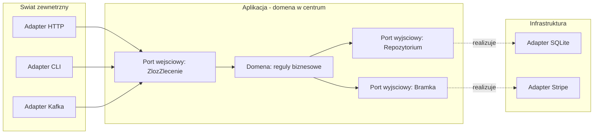
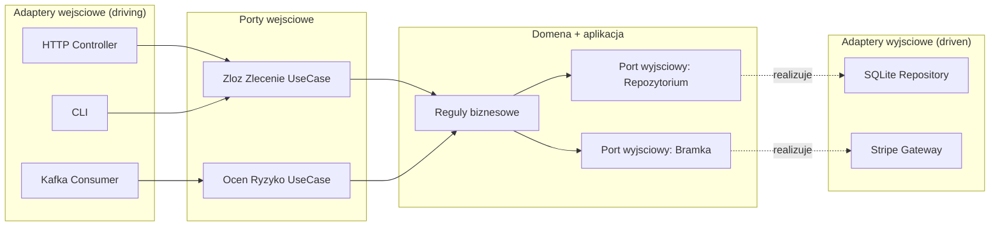
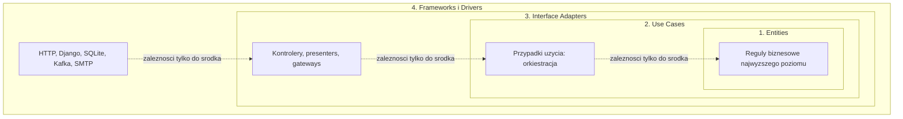
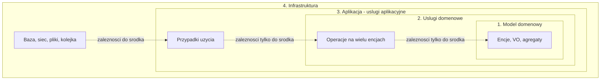
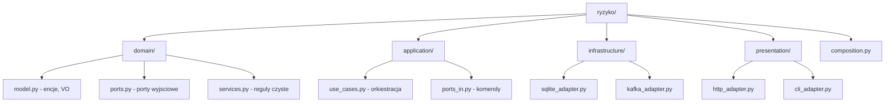
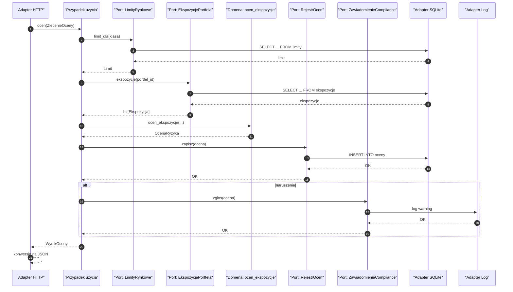
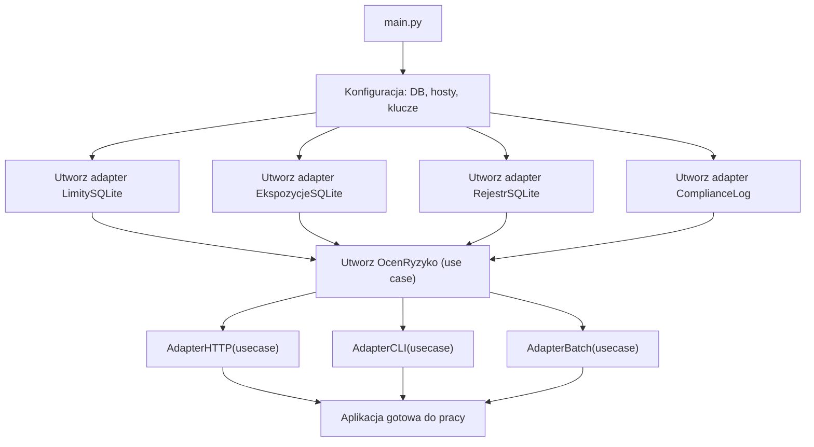
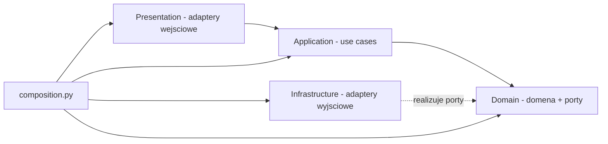
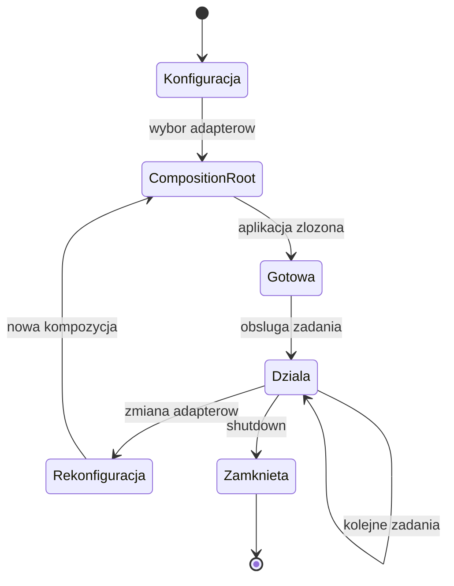
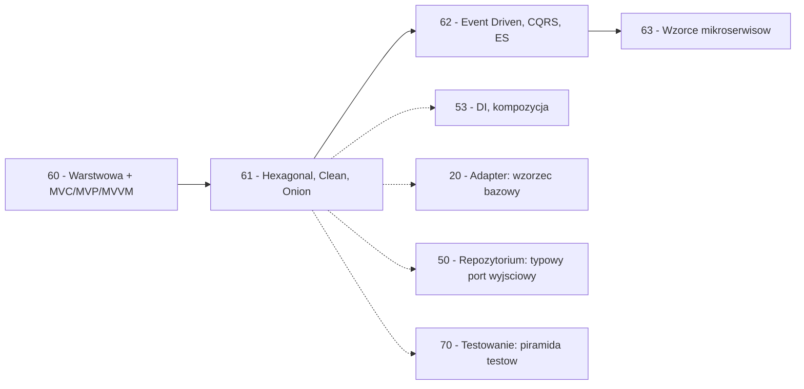

```markdown
---
modul: 61 — Hexagonal, Clean i Onion
plik: 61-hexagonal-clean-onion.md
poziom: zaawansowany
wymaga: [60]
czas: ~230 minut czytania + ~520 minut ćwiczeń
---

# Moduł 61 — Hexagonal, Clean i Onion — architektury skoncentrowane na domenie

> **TL;DR**
> - Trzy architektury — **heksagonalna (ang. hexagonal / Ports & Adapters)**, **Clean** i **Onion** — mają jedną wspólną ideę: **domena w centrum, technologia na brzegach, zależności skierowane do środka**; różnią się głównie rysunkiem i słownictwem, nie istotą.
> - **Port (ang. port)** to kontrakt zdefiniowany po stronie domeny w jej języku (`KatalogKlientow`, `RejestrZlecen`), a **adapter (ang. adapter)** to implementacja w konkretnej technologii (SQL, HTTP, plik).
> - Porty są **dwojakie**: **wejściowe** (driving, np. przypadek użycia) i **wyjściowe** (driven, np. repozytorium); adaptery wejściowe wywołują aplikację, adaptery wyjściowe są przez aplikację wywoływane.
> - **Composition root** to jedyne miejsce w aplikacji, gdzie importowane są konkretne adaptery i tworzone są wszystkie obiekty — to najważniejsze praktyczne pojęcie tego modułu.
> - **Granice nie utrzymają się same** — bez narzędzi (`import-linter`, `pytest-archon`) i bez dyscypliny w zespole, warstwy „rozjadą się” w ciągu pół roku, mimo że nazwy folderów pozostaną.

---

## 0. Model mentalny

### Gniazdka w domu, elektrownia i norma

Wyobraź sobie nowoczesne mieszkanie. W każdym pokoju są **gniazdka elektryczne** — standardowe, w polskim typie E. Do gniazdka wtykasz czajnik, laptop, lampkę, telewizor — cokolwiek. Zauważ, że **nie zastanawiasz się, skąd pochodzi prąd.** Nie interesuje cię, czy wytworzyła go elektrownia węglowa, farma wiatrowa, elektrownia jądrowa, czy panel fotowoltaiczny na dachu. Nie musisz wiedzieć, czy prąd „przyszedł” przez linie napowietrzne, kabel zakopany w ziemi, czy z baterii słonecznej. **Gniazdko jest standardem** — kontraktem, który mówi „dostarczam prąd o napięciu 230V, częstotliwości 50Hz, w tym kształcie bolców”. Wtyczka czajnika pasuje do każdego gniazdka, niezależnie od tego, co jest po drugiej stronie kabla.

Ta izolacja przez standard jest esencją **architektury heksagonalnej** — czyli portów i adapterów. **Gniazdko to port** — kontrakt zdefiniowany przez twoje mieszkanie (domenę). **Elektrownia i linia przesyłowa to adapter** — implementacja tego kontraktu w konkretnej technologii. Możesz zmienić dostawcę prądu (adapter), nie ruszając ani jednego gniazdka (port). Możesz dostawić nowe gniazdko, jeśli standard się nie zmieni.

Idźmy dalej. Wyobraź sobie teraz, że dorzucasz do tego samego mieszkania drugie źródło prądu — **generator awaryjny**. Albo **akumulator**. Albo **ogniwo słoneczne**. Wszystkie one muszą dostarczać prąd w standardzie „230V, 50Hz, polski typ E”. Jeśli któryś z nich tego nie umie, wstawmy między niego a instalację **adapter** (przetwornica). Ale instalacja nie zmienia się ani o kabel. **Nowy dostawca nie wymaga zmian w mieszkaniu.** To dokładnie ta sama własność: dodanie nowego adaptera nie wymaga zmian w porcie.

Zauważ jeszcze trzeci aspekt. **Gniazdka są w ścianach** — fizycznie należą do mieszkania, nie do elektrowni. Jeśli budujesz nowe mieszkanie, gniazdka są już zaprojektowane zanim w ogóle wiesz, kto będzie dostarczał prąd. W kodzie oznacza to: **porty definiujesz w domenie**, jeszcze **zanim** pomyślisz o konkretnej bazie danych, konkretnym frameworku HTTP, konkretnej wiadomości. To **odwrócenie zależności** (DIP, moduł 03) w najczystszej formie.

I ostatni obraz, który pokazuje różnicę od warstwowej architektury (moduł 60). Wyobraź sobie stary dom, w którym każdy pokój ma własne źródło zasilania — kuchnia ma generator na gaz, salon ma panele słoneczne, sypialnia ma akumulator. Aby zasilić salon, trzeba wejść do kuchni i zakręcić gaz, bo salon „bierze prąd z kuchni”. To jest architektura warstwowa: jedna warstwa zależy od drugiej, w jednym kierunku. Ale w nowym mieszkaniu z gniazdkami: niezależnie od tego, gdzie jest elektrownia (na zewnątrz), **każde pomieszczenie ma dostęp do gniazdka**. To architektura heksagonalna: **każdy punkt aplikacji komunikuje się z domeną przez port, a domena nie wie, co jest na zewnątrz**.

| W analogii gniazdek | W kodzie |
|---|---|
| Gniazdko w ścianie | Port (kontrakt zdefiniowany w domenie) |
| Standard „230V, 50Hz, typ E” | Kontrakt portu: metody, argumenty, typy |
| Elektrownia, panel, generator | Adapter (implementacja w konkretnej technologii) |
| Przewód, transformator, przetwornica | Adapter w formie wrappera |
| Urządzenia domowe (czajnik, laptop) | Klienci portu (usecase, domena) |
| Instalacja elektryczna w mieszkaniu | Domena + aplikacja (wewnątrz) |
| Standard gniazdka obowiązujący niezależnie od dostawcy | Reguła zależności: strzałki do środka |
| Nowy dostawca prądu bez zmian w mieszkaniu | Nowa implementacja portu bez zmian w domenie |

> 🧠 **Zapamiętaj** — **Architektura heksagonalna (ang. hexagonal architecture), zwana też portami i adapterami (ang. Ports & Adapters), to wzorzec architektoniczny, w którym domena i aplikacja definiują porty — kontrakty — a cała technologia (baza, HTTP, kolejka, framework) jest implementowana jako adaptery poza domeną. Zależności skierowane są do środka: domena nie zna żadnej technologii.**

Zwróć uwagę na słowa: **domena definiuje porty**, **technologia jest na zewnątrz**, **zależności do środka**. Te trzy rzeczy są esencją. Kolejność jest kluczowa: porty powstają w domenie **zanim** powstanie technologia. To nie jest „opakowanie istniejącej bazy w interfejs” — to **projektowanie domeny tak, jakby technologia nie istniała**.

### Diagram — intuicja heksagonu z portami i adapterami



*Diagram pokazuje heksagon: w centrum domena i przypadki użycia, na brzegach porty, a poza heksagonem adaptery — strzałki wejściowe dochodzą do portów wejściowych, strzałki wyjściowe wychodzą z portów wyjściowych do adapterów.*

### Czego te architektury NIE robią

Rozbrójmy kilka mitów, które narosły wokół heksagonalnej.

**Nie są o sześciu bokach.** „Heksagonalna” nie ma nic wspólnego z liczbą boków. Alister Cockburn (autor wzorca) użył słowa „hexagonal” jako metafory, żeby zasugerować, że **z każdej strony aplikacji mogą wystawać różne porty** — wizualnie sześć boków rysuje się łatwo. Może być ich trzy albo dwadzieścia — nie ma to znaczenia.

**Nie są tym samym co warstwowa.** Architektura warstwowa (moduł 60) ma warstwy pionowe (prezentacja → aplikacja → domena), zależne od siebie w jednym kierunku. Heksagonalna **odwraca perspektywę**: w centrum jest domena, a wszystko inne to adaptery **dookoła** — w tym adaptery **wejściowe**, które w warstwowej nazywają się „prezentacja”. To różnica w rysunku, ale ta sama idea w praktyce.

**Nie są tym samym co mikroserwisy.** Heksagonalna to architektura **jednej aplikacji** — monolitu modułowego, usługi, procesu. Można ją stosować w każdym z nich. Mikroserwisy to wzorce rozmieszczenia (moduł 63), a nie wewnętrzna struktura.

**Nie wymagają frameworka.** Tak jak DI (moduł 53), architektura heksagonalna w Pythonie nie wymaga frameworka. `Protocol`, `abc`, moduły, composition root — wszystko, czego potrzebujesz.

**Nie są lepsze od warstwowej w każdym projekcie.** Dla prostej aplikacji CRUD heksagonalna to **nadmiar biurokracji**. Ma sens, gdy domena naprawdę wymaga niezależności od technologii.

**Clean i Onion to warianty tej samej idei.** Clean Architecture (Robert C. Martin, 2012) i Onion Architecture (Jeffrey Palermo, 2008) rysują **te same zależności** nieco innym rysunkiem koncentrycznym. Różnice są kosmetyczne. Warto je znać, żeby rozumieć dyskusje w zespole, ale nie trzeba wybierać między nimi na ślepo.

---

## 1. Problem, który rozwiązujemy

Wejdźmy w domenę ⚠️ „Ryzyka". Budujemy system kontroli limitów ryzyka, który:
- ocenia zlecenia wobec limitów,
- blokuje naruszenia,
- publikuje zdarzenia dla działu compliance,
- udostępnia API dla klientów wewnętrznych,
- uruchamia stress testy przez CLI.

Ktoś napisał to w stylu „warstwowym", ale z licznymi przeciekami — domena zna bazę, zna HTTP, zna Kafka.

### Kod „przed"

```python
# ryzyko_v0.py — wersja naiwna, demonstracyjna
# UWAGA: kod celowo pokazuje domenę spleciona z technologia.

from __future__ import annotations

import json
import sqlite3
from dataclasses import dataclass
from datetime import date, datetime, timezone
from decimal import ROUND_HALF_UP, Decimal
from typing import Any

from kafka import KafkaProducer   # hipotetyczna zaleznosc
from fastapi import FastAPI, HTTPException

app = FastAPI()


@dataclass
class OcenaRyzyka:
    """Encja domenowa - ale z domieszka technologii."""

    identyfikator: str
    portfel_id: str
    wartosc: Decimal
    czy_naruszenie: bool
    opis: str
    kiedy: datetime

    def zapisz(self) -> None:
        """Metoda domenowa, ktora zna baze!"""
        pol = sqlite3.connect("ryzyko.db")
        kursor = pol.cursor()
        kursor.execute(
            "INSERT INTO oceny (id, portfel_id, wartosc, naruszenie, opis, kiedy) "
            "VALUES (?, ?, ?, ?, ?, ?)",
            (
                self.identyfikator,
                self.portfel_id,
                str(self.wartosc),
                1 if self.czy_naruszenie else 0,
                self.opis,
                self.kiedy.isoformat(),
            ),
        )
        pol.commit()
        pol.close()

    def opublikuj_zdarzenie(self) -> None:
        """Metoda domenowa, ktora zna Kafka!"""
        producer = KafkaProducer(bootstrap_servers=["localhost:9092"])
        producer.send(
            "ryzyko.naruszenia",
            json.dumps({
                "id": self.identyfikator,
                "wartosc": str(self.wartosc),
                "opis": self.opis,
            }).encode("utf-8"),
        )


def limit_dla_klasy(klasa: str) -> Decimal:
    """Regula domenowa, ktora czyta baze."""
    pol = sqlite3.connect("ryzyko.db")
    kursor = pol.cursor()
    kursor.execute("SELECT limit FROM limity WHERE klasa = ?", (klasa,))
    w = kursor.fetchone()
    pol.close()
    return Decimal(w[0]) if w else Decimal("0.30")


@app.post("/ocena")
def ocen_zlecenie(dane: dict) -> dict:
    """Handler HTTP, ktory laczy wszystko."""
    # 1. Walidacja
    if "portfel_id" not in dane or "klasa" not in dane:
        raise HTTPException(400, "brak pol")

    # 2. Regula domenowa
    limit = limit_dla_klasy(dane["klasa"])
    wartosc = Decimal(str(dane["wartosc"]))
    if wartosc > limit * Decimal("1000000"):
        ocena = OcenaRyzyka(
            identyfikator=dane.get("id", "OC-1"),
            portfel_id=dane["portfel_id"],
            wartosc=wartosc,
            czy_naruszenie=True,
            opis=f"przekroczony limit {limit}",
            kiedy=datetime.now(timezone.utc),
        )
        # 3. Efekty uboczne wprost w handlerze
        ocena.zapisz()
        ocena.opublikuj_zdarzenie()
        return {"id": ocena.identyfikator, "status": "zablokowane"}

    return {"id": "OK", "status": "przepuszczone"}
```

Ten kod działa „na produkcji". Ale ma **pięć fundamentalnych problemów**, które blokują zmiany.

### Code smell — domena spleciona z technologią

| Problem | Gdzie | Konsekwencja |
|---|---|---|
| Metoda `zapisz` w encji domenowej | `OcenaRyzyka.zapisz` | Domena zna SQLite |
| Metoda `opublikuj_zdarzenie` w encji | `OcenaRyzyka.opublikuj_zdarzenie` | Domena zna Kafka |
| Reguła `limit_dla_klasy` czyta bazę | Funkcja w module | Reguła biznesowa zna bazę |
| Import FastAPI w pliku domeny | `from fastapi import ...` | Domena zna framework |
| Import Kafki w pliku domeny | `from kafka import ...` | Domena zna brokera |
| Brak portów | Nie ma abstrakcji | Nie da się podstawić atrapy |
| Brak composition root | Wszystko tworzone w miejscu użycia | Brak kontroli nad zależnościami |
| Test wymaga bazy i Kafki | Nie da się przetestować domeny | Testy bardzo wolne, niestabilne |

Zwróć uwagę na pierwszy problem. **Metoda `zapisz` należy do encji domenowej.** W klasycznym Active Record (moduł 52) to normalne — ale tylko w stylu Active Record. W architekturze skoncentrowanej na domenie to **naruszenie podstawowej reguły**: domena nie zna trwałości.

### Objawy — poznasz ten problem po tym, że...

- **Encja domenowa ma metody trwałości.** `zapisz`, `usun`, `pobierz` — to nie jej zadanie.
- **Encja domenowa importuje framework.** FastAPI, Kafka, boto3, sqlalchemy — wszystkie są technologią.
- **Reguły biznesowe czytają bazę.** `limit_dla_klasy` czyta SQL — nie jest funkcją czystą.
- **Test domeny wymaga infrastruktury.** Nie da się przetestować reguły bez bazy.
- **Nie da się zmienić bazy** bez modyfikacji domeny.
- **Nie da się uruchomić domeny w symulacji** bez uruchomienia wszystkich zależności.
- **Domena ma dwa razy tyle linii**, co wynikałoby z jej merytorycznej złożoności.
- **Zależność cykliczna między modułami** — `domain` importuje `infrastructure`, `infrastructure` importuje `domain`.
- **Zespół nie wie, gdzie postawić granicę.**
- **Każdy nowy kanał (CLI, Kafka, batch) wymaga kopiowania logiki.**

---

## 2. Anatomia wzorców

### Uczestnicy architektury heksagonalnej

| Rola | Odpowiedzialność | Co NIE jest jej zadaniem |
|---|---|---|
| **Domena (Domain)** | Reguły biznesowe, encje, VO, agregaty | Nie zna żadnej technologii |
| **Aplikacja (Application)** | Przypadki użycia, orkiestracja | Nie zna technologii; definiuje porty wyjściowe |
| **Port wejściowy (Driving Port)** | Kontrakt „co aplikacja umie zrobić” (przypadek użycia) | Nie zawiera logiki; to interfejs |
| **Port wyjściowy (Driven Port)** | Kontrakt „czego aplikacja potrzebuje” (repozytorium, bramka, powiadomienie) | Nie zna implementacji |
| **Adapter wejściowy (Driving Adapter)** | Realizuje port wejściowy: HTTP, CLI, Kafka, gRPC | Nie zawiera reguł domenowych |
| **Adapter wyjściowy (Driven Adapter)** | Realizuje port wyjściowy: SQL, Stripe, SMTP, Kafka | Nie zawiera reguł domenowych |
| **Composition Root** | Jedyne miejsce, gdzie łączy się adaptery z domeną | Nie jest częścią domeny; jest na granicy |

### Uczestnicy Clean Architecture

| Rola | Odpowiedzialność | Co NIE jest jej zadaniem |
|---|---|---|
| **Encje (Entities)** | Reguły przedsiębiorstwa — najtrwalsze | Nie znają przypadków użycia |
| **Przypadki użycia (Use Cases)** | Reguły aplikacji — orkiestracja | Nie znają adapterów |
| **Adaptery interfejsów (Interface Adapters)** | Konwersja danych między przypadkami użycia a światem | Nie znają frameworków |
| **Frameworki i sterowniki (Frameworks & Drivers)** | Najbardziej zewnętrzna warstwa: HTTP, DB, UI | Nie znają niczego wewnątrz |

### Uczestnicy Onion Architecture

| Rola | Odpowiedzialność | Co NIE jest jej zadaniem |
|---|---|---|
| **Model domenowy (Domain Model)** | Encje, VO, agregaty | Nie zna niczego zewnątrz |
| **Usługi domenowe (Domain Services)** | Operacje na wielu encjach | Nie znają aplikacji |
| **Usługi aplikacyjne (Application Services)** | Przypadki użycia | Nie znają infrastruktury |
| **Infrastruktura (Infrastructure)** | Baza, sieć, pliki | Nie zna logiki biznesowej |

### Diagram — porty i adaptery (driving/driven)



*Diagram pokazuje asymetrię: adaptery wejściowe wywołują porty wejściowe, a porty wyjściowe są realizowane przez adaptery wyjściowe — domena jest punktem centralnym, nie zna ani jednego, ani drugiego.*

### Diagram — Clean Architecture, kręgi koncentryczne



*Diagram pokazuje koncentryczne kręgi Clean Architecture: encje w centrum, use cases w drugim kręgu, adaptery interfejsów w trzecim, frameworki w czwartym — reguła zależności mówi, że strzałki biegną tylko do środka.*

### Diagram — Onion Architecture



*Diagram pokazuje Onion Architecture: model domenowy w centrum, warstwy koncentryczne z usługami domenowymi i aplikacyjnymi, infrastruktura na zewnątrz — ta sama reguła zależności co Clean.*

### Warianty: klasyczny vs pythoniczny

| Aspekt | Klasyczny (Java/C#) | Pythoniczny |
|---|---|---|
| Port | Interfejs | `typing.Protocol` |
| Adapter | Klasa implementująca interfejs | Klasa spełniająca protokół |
| Composition Root | Klasa konfiguracyjna + DI | Moduł `main.py` z funkcją `zbuduj_aplikacje` |
| Domena | Klasa `final` | `@dataclass(frozen=True)` |
| Use Case | Klasa z metodą `execute` | Funkcja albo `dataclass` |
| Reguła zależności | Wymuszona przez kompilator? Częściowo | Wymuszona przez `import-linter` |

Python jest **znacznie lżejszy**, ale **nie ma kompilatora**, który wyłapie przypadkowe importy. Dlatego w Pythonie **narzędzia do egzekwowania granic** (import-linter, pytest-archon) są **kluczowe**.

### Kluczowa różnica: port wejściowy vs wyjściowy

Wiele osób myli porty z adapterami i nie odróżnia „driving” od „driven”. Test rozpoznania jest prosty:

- **Port wejściowy (driving)** — **co aplikacja umie zrobić dla świata zewnętrznego?** Przykłady: `ZlozZlecenie`, `OcenRyzyko`, `WygenerujRaport`. Adaptery wejściowe to HTTP, CLI, Kafka consumer.
- **Port wyjściowy (driven)** — **czego aplikacja potrzebuje od świata zewnętrznego?** Przykłady: `Repozytorium`, `Bramka`, `Powiadomienie`. Adaptery wyjściowe to SQL, Stripe, SMTP.

**Test kciuka:** pytaj „kto kogo wywołuje?”. Jeśli **zewnątrz wywołuje aplikację** — to port wejściowy. Jeśli **aplikacja wywołuje zewnątrz** — to port wyjściowy.

---

## 3. Implementacja krok po kroku

Przebudujemy system ryzyka z sekcji 1, przechodząc przez wszystkie warstwy. Zaczniemy od domeny, dojdziemy do composition root.

### Krok 1 — Zdefiniuj domenę (bez żadnych zależności)

Zaczynamy od najtrwalszego — modelu domenowego. **Zero importów technologii.**

```python
# ryzyko/domain/model.py
from __future__ import annotations

from dataclasses import dataclass, field, replace
from decimal import Decimal, ROUND_HALF_UP
from enum import Enum


GROSZ = Decimal("0.01")


def zaokraglij(kwota: Decimal) -> Decimal:
    return kwota.quantize(GROSZ, rounding=ROUND_HALF_UP)


@dataclass(frozen=True, slots=True)
class Ekspozycja:
    """Ekspozycja portfela wobec klasy aktywow."""
    klasa: str
    wartosc: Decimal

    def __post_init__(self) -> None:
        if not self.klasa:
            raise ValueError("klasa wymagana")
        if self.wartosc < 0:
            raise ValueError("wartosc nie moze byc ujemna")


@dataclass(frozen=True, slots=True)
class Limit:
    """Limit koncentracji dla klasy aktywow."""
    klasa: str
    udzial_maks: Decimal  # udzial w portfelu (0.0 - 1.0)

    def __post_init__(self) -> None:
        if not (Decimal("0") < self.udzial_maks <= Decimal("1")):
            raise ValueError(
                f"udzial musi byc w zakresie (0, 1], jest {self.udzial_maks}"
            )


class PoziomNaruszenia(Enum):
    OK = "ok"
    OSTRZEZENIE = "ostrzezenie"
    KRYTYCZNE = "krytyczne"


@dataclass(frozen=True, slots=True)
class OcenaRyzyka:
    """Wynik oceny zlecenia wobec limitow."""
    identyfikator: str
    portfel_id: str
    klasa: str
    wartosc: Decimal
    udzial_po: Decimal
    limit: Decimal
    poziom: PoziomNaruszenia
    uzasadnienie: str

    @property
    def naruszenie(self) -> bool:
        return self.poziom is not PoziomNaruszenia.OK


# --- Reguly domenowe jako czyste funkcje ---

def ocen_ekspozycje(
    identyfikator: str,
    portfel_id: str,
    klasa: str,
    ekspozycje: list[Ekspozycja],
    wartosc_zlecenia: Decimal,
    limit: Limit,
) -> OcenaRyzyka:
    """Regula: ocenia, czy zlecenie nie przekracza limitu koncentracji.

    Funkcja czysta - bez I/O, bez bazy, bez HTTP.
    """
    wartosc_portfela = sum(
        (e.wartosc for e in ekspozycje), Decimal("0")
    ) + wartosc_zlecenia

    if wartosc_portfela <= 0:
        raise ValueError("wartosc portfela musi byc dodatnia")

    obecna = next(
        (e.wartosc for e in ekspozycje if e.klasa == klasa),
        Decimal("0"),
    )
    wartosc_po = obecna + wartosc_zlecenia
    udzial_po = zaokraglij(wartosc_po / wartosc_portfela * Decimal("100")) / Decimal("100")

    if udzial_po > limit.udzial_maks:
        poziom = PoziomNaruszenia.KRYTYCZNE
        uzasadnienie = (
            f"klasa {klasa} osiagnie {udzial_po:.2%} "
            f"przy limicie {limit.udzial_maks:.2%}"
        )
    elif udzial_po > limit.udzial_maks * Decimal("0.9"):
        poziom = PoziomNaruszenia.OSTRZEZENIE
        uzasadnienie = (
            f"klasa {klasa} blisko limitu: {udzial_po:.2%} "
            f"(limit {limit.udzial_maks:.2%})"
        )
    else:
        poziom = PoziomNaruszenia.OK
        uzasadnienie = f"udzial {udzial_po:.2%} w normie"

    return OcenaRyzyka(
        identyfikator=identyfikator,
        portfel_id=portfel_id,
        klasa=klasa,
        wartosc=wartosc_zlecenia,
        udzial_po=udzial_po,
        limit=limit.udzial_maks,
        poziom=poziom,
        uzasadnienie=uzasadnienie,
    )
```

Zwróć uwagę: `ocen_ekspozycje` to **funkcja czysta** — przyjmuje dane, zwraca wynik. Nie zna bazy, nie zna HTTP. Można ją przetestować w mikrosekundach.

### Krok 2 — Zdefiniuj porty wyjściowe

Port wyjściowy to abstrakcja, której aplikacja potrzebuje od świata zewnętrznego. **Nazwa portu pochodzi z języka domeny, nie z technologii.**

```python
# ryzyko/domain/ports.py
from typing import Protocol, runtime_checkable
from decimal import Decimal
from datetime import date


@runtime_checkable
class LimityRynkowe(Protocol):
    """Port: gdzie sprawdzic aktualne limity koncentracji.

    Uwaga: nazwa z jezyka domeny, nie 'LimitRepository'.
    """

    def limit_dla(self, klasa: str) -> "Limit": ...


@runtime_checkable
class EkspozycjePortfela(Protocol):
    """Port: skad wziac aktualne ekspozycje portfela."""

    def ekspozycje(self, portfel_id: str) -> list["Ekspozycja"]: ...


@runtime_checkable
class RejestrOcen(Protocol):
    """Port: gdzie zapisac ocene ryzyka."""

    def zapisz(self, ocena: "OcenaRyzyka") -> None: ...


@runtime_checkable
class ZawiadomienieCompliance(Protocol):
    """Port: jak powiadomic dzial compliance o naruszeniu."""

    def zglos(self, ocena: "OcenaRyzyka") -> None: ...
```

**Nazwy portów są w języku domeny**: `LimityRynkowe` (nie `LimitRepository`), `EkspozycjePortfela` (nie `PortfolioDAO`), `ZawiadomienieCompliance` (nie `NotificationService`). To realizacja zasady **ubiquitous language** (moduł 54).

### Krok 3 — Zdefiniuj port wejściowy (przypadek użycia)

Port wejściowy to kontrakt „co aplikacja umie zrobić”. Zwykle **nie jest osobnym interfejsem** — jest nim sygnatura funkcji przypadku użycia.

```python
# ryzyko/application/ports_in.py
from dataclasses import dataclass
from decimal import Decimal
from typing import Protocol


@dataclass(frozen=True)
class ZlecenieOceny:
    """Komenda wejsciowa - dane z zewnatrz."""
    identyfikator: str
    portfel_id: str
    klasa: str
    wartosc: Decimal


@dataclass(frozen=True)
class WynikOceny:
    """Wynik przypadku uzycia - do prezentacji."""
    identyfikator: str
    poziom: str
    uzasadnienie: str
    udzial_po: Decimal
    limit: Decimal


class PrzypadekOcenyRyzyka(Protocol):
    """Port wejsciowy: ocena ryzyka zlecenia."""

    def ocen(self, zlecenie: ZlecenieOceny) -> WynikOceny: ...
```

### Krok 4 — Zaimplementuj przypadek użycia

Przypadek użycia **orkiestruje** — wywołuje porty i domenę.

```python
# ryzyko/application/ocen_ryzyko.py
import logging


log = logging.getLogger(__name__)


class BladOceny(Exception):
    """Blad na poziomie przypadku uzycia."""


class OcenRyzyko:
    """Implementacja portu wejsciowego: orkiestruje ocene ryzyka."""

    def __init__(
        self,
        limity: "LimityRynkowe",
        ekspozycje: "EkspozycjePortfela",
        rejestr: "RejestrOcen",
        compliance: "ZawiadomienieCompliance",
    ) -> None:
        self._limity = limity
        self._ekspozycje = ekspozycje
        self._rejestr = rejestr
        self._compliance = compliance

    def ocen(self, zlecenie: ZlecenieOceny) -> WynikOceny:
        try:
            limit = self._limity.limit_dla(zlecenie.klasa)
            ekspozycje = self._ekspozycje.ekspozycje(zlecenie.portfel_id)
        except Exception as blad:
            raise BladOceny(f"dane niedostepne: {blad}") from blad

        ocena = ocen_ekspozycje(
            identyfikator=zlecenie.identyfikator,
            portfel_id=zlecenie.portfel_id,
            klasa=zlecenie.klasa,
            ekspozycje=ekspozycje,
            wartosc_zlecenia=zlecenie.wartosc,
            limit=limit,
        )

        self._rejestr.zapisz(ocena)

        if ocena.naruszenie:
            self._compliance.zglos(ocena)

        return WynikOceny(
            identyfikator=ocena.identyfikator,
            poziom=ocena.poziom.value,
            uzasadnienie=ocena.uzasadnienie,
            udzial_po=ocena.udzial_po,
            limit=ocena.limit,
        )
```

**Porty wejściowe i wyjściowe** widoczne w tym pliku to `PrzypadekOcenyRyzyka` (realizowany przez `OcenRyzyko`) i porty wyjściowe wstrzyknięte w konstruktorze.

### Krok 5 — Zdefiniuj adaptery wyjściowe

Adaptery realizują porty wyjściowe.

```python
# ryzyko/infrastructure/sqlite_adapter.py
import sqlite3
from decimal import Decimal


class RejestrOcenSQLite:
    """Adapter: zapisuje oceny do SQLite."""

    def __init__(self, polaczenie: sqlite3.Connection) -> None:
        self._pol = polaczenie

    def zapisz(self, ocena: OcenaRyzyka) -> None:
        kursor = self._pol.cursor()
        kursor.execute(
            "INSERT OR REPLACE INTO oceny VALUES (?, ?, ?, ?, ?, ?, ?)",
            (
                ocena.identyfikator,
                ocena.portfel_id,
                ocena.klasa,
                str(ocena.wartosc),
                str(ocena.udzial_po),
                str(ocena.limit),
                ocena.poziom.value,
            ),
        )
        self._pol.commit()


class LimityRynkoweSQLite:
    def __init__(self, pol: sqlite3.Connection) -> None:
        self._pol = pol

    def limit_dla(self, klasa: str) -> Limit:
        k = self._pol.cursor()
        k.execute("SELECT udzial_maks FROM limity WHERE klasa = ?", (klasa,))
        w = k.fetchone()
        if not w:
            raise KeyError(f"brak limitu dla {klasa}")
        return Limit(klasa=klasa, udzial_maks=Decimal(w[0]))


class EkspozycjePortfelaSQLite:
    def __init__(self, pol: sqlite3.Connection) -> None:
        self._pol = pol

    def ekspozycje(self, portfel_id: str) -> list[Ekspozycja]:
        k = self._pol.cursor()
        k.execute(
            "SELECT klasa, wartosc FROM ekspozycje WHERE portfel_id = ?",
            (portfel_id,),
        )
        return [
            Ekspozycja(klasa=w[0], wartosc=Decimal(w[1]))
            for w in k.fetchall()
        ]


class ZawiadomienieLogowe:
    """Adapter: powiadamia przez log (uproszczenie)."""

    def __init__(self) -> None:
        self.zgloszenia: list[OcenaRyzyka] = []

    def zglos(self, ocena: OcenaRyzyka) -> None:
        log.warning("compliance: naruszenie %s", ocena.identyfikator)
        self.zgloszenia.append(ocena)
```

### Krok 6 — Zdefiniuj adaptery wejściowe

Adaptery wejściowe wywołują przypadek użycia.

```python
# ryzyko/presentation/http_adapter.py
import json
from decimal import Decimal


class HandlerHTTP:
    """Adapter wejsciowy: HTTP -> przypadek uzycia."""

    def __init__(self, usecase: PrzypadekOcenyRyzyka) -> None:
        self._usecase = usecase

    def post_ocena(self, body: str) -> tuple[int, str]:
        try:
            dane = json.loads(body)
            zlecenie = ZlecenieOceny(
                identyfikator=str(dane["id"]),
                portfel_id=str(dane["portfel_id"]),
                klasa=str(dane["klasa"]),
                wartosc=Decimal(str(dane["wartosc"])),
            )
        except (KeyError, ValueError, json.JSONDecodeError) as blad:
            return 400, json.dumps({"blad": str(blad)})

        try:
            wynik = self._usecase.ocen(zlecenie)
        except BladOceny as blad:
            return 422, json.dumps({"blad": str(blad)})

        return 200, json.dumps({
            "id": wynik.identyfikator,
            "poziom": wynik.poziom,
            "uzasadnienie": wynik.uzasadnienie,
            "udzial_po": str(wynik.udzial_po),
        })


class HandlerCLI:
    """Adapter wejsciowy: CLI -> przypadek uzycia."""

    def __init__(self, usecase: PrzypadekOcenyRyzyka) -> None:
        self._usecase = usecase

    def ocen(self, args: list[str]) -> int:
        try:
            zlecenie = ZlecenieOceny(
                identyfikator=args[0],
                portfel_id=args[1],
                klasa=args[2],
                wartosc=Decimal(args[3]),
            )
            wynik = self._usecase.ocen(zlecenie)
            print(f"Poziom: {wynik.poziom}")
            print(f"Uzasadnienie: {wynik.uzasadnienie}")
            return 0
        except (IndexError, ValueError, BladOceny) as blad:
            print(f"Blad: {blad}")
            return 1
```

### Krok 7 — Composition Root

**Jedyne miejsce**, gdzie importujemy konkretne adaptery.

```python
# ryzyko/composition.py
import sqlite3


def zbuduj_use_case(sciezka_db: str) -> "PrzypadekOcenyRyzyka":
    """Composition root: laczy adaptery z domena."""
    polaczenie = sqlite3.connect(sciezka_db)
    polaczenie.executescript("""
        CREATE TABLE IF NOT EXISTS limity (klasa TEXT PRIMARY KEY, udzial_maks TEXT);
        CREATE TABLE IF NOT EXISTS ekspozycje (portfel_id TEXT, klasa TEXT, wartosc TEXT);
        CREATE TABLE IF NOT EXISTS oceny (
            id TEXT PRIMARY KEY, portfel_id TEXT, klasa TEXT,
            wartosc TEXT, udzial TEXT, limit TEXT, poziom TEXT
        );
    """)
    return OcenRyzyko(
        limity=LimityRynkoweSQLite(polaczenie),
        ekspozycje=EkspozycjePortfelaSQLite(polaczenie),
        rejestr=RejestrOcenSQLite(polaczenie),
        compliance=ZawiadomienieLogowe(),
    )
```

### Krok 8 — Weryfikacja

| Kryterium | Wersja „przed" | Wersja „po" |
|---|---|---|
| Domena zna bazę | Tak | Nie |
| Domena zna HTTP | Tak | Nie |
| Domena zna Kafka | Tak | Nie |
| Test reguły bez infrastruktury | Nie da się | Tak, w mikrosekundach |
| Wymiana bazy | Zmiana w encji | Nowy adapter |
| Wymiana brokera | Zmiana w encji | Nowy adapter |
| Nowy kanał wejścia | Kopiowanie logiki | Nowy adapter |
| Composition root | Brak | `composition.py` |
| Liczba klas | 3 | ~12 |

Koszt: więcej klas i plików. Zysk: niezależność domeny, testowalność, wymienność technologii.

---

## 4. Wersje pythoniczne i warianty

### 4.1 Port jako `Protocol` — najbardziej pythoniczne

Wariant z sekcji 3. **Zaleta:** adapter nie musi dziedziczyć. **Wada:** `mypy` nie wymusi implementacji — trzeba pilnować ręcznie.

### 4.2 Port jako `ABC` — wymuszenie w runtime

Gdy chcesz, żeby adapter **musiał** implementować wszystkie metody.

```python
from abc import ABC, abstractmethod


class LimityRynkowe(ABC):
    @abstractmethod
    def limit_dla(self, klasa: str) -> Limit: ...
```

**Zaleta:** natychmiastowy błąd przy brakującej metodzie. **Wada:** wymusza dziedziczenie.

### 4.3 Funkcja jako port wyjściowy

Jeśli port ma jedną metodę, może być `Callable`.

```python
from typing import Callable


LimitDla: Callable[[str], Limit]


def utworz_limit_dla_z_bazy(polaczenie: sqlite3.Connection) -> LimitDla:
    def limit_dla(klasa: str) -> Limit:
        # ... zapytanie do bazy
        ...
    return limit_dla
```

**Zaleta:** brak klasy. **Wada:** traci nazwę (`__name__` tylko). Kompromis dla bardzo małych systemów.

### 4.4 Composition root jako fabryka `dataclass`

Zamiast funkcji — `dataclass(frozen=True)`, który sam tworzy się z konfiguracji.

```python
@dataclass(frozen=True)
class Konfiguracja:
    sciezka_db: str
    host_kafka: str


def zbuduj(konfiguracja: Konfiguracja) -> "PrzypadekOcenyRyzyka":
    ...
```

Zaleta: jawna, typowana konfiguracja. Wada: dla małych systemów nadmiar.

### 4.5 Composition root w `main.py` vs `container.py`

**Wariant A: `main.py`** — wszystko w głównym pliku aplikacji:

```python
# main.py
if __name__ == "__main__":
    usecase = zbuduj_use_case(os.environ["DB"])
    handler = HandlerCLI(usecase)
    sys.exit(handler.ocen(sys.argv[1:]))
```

**Wariant B: `container.py`** — osobny plik z kontenerem DI (moduł 53):

```python
# container.py
KONTENER = KontenerDI()
KONTENER.zarejestruj(PrzypadekOcenyRyzyka, ...)
```

**Rekomendacja:** `main.py` dla większości aplikacji. `container.py` dla dużych projektów (>30 usług).

### 4.6 Warstwy — wariant „cienki Clean”

Zamiast czterech warstw Clean można iść w prostszy wariant heksagonalny z dwoma warstwami:

```text
ryzyko/
├── domain/          # model + reguly + porty
├── application/     # przypadki uzycia
├── infrastructure/  # adaptery wyjsciowe
├── presentation/    # adaptery wejsciowe
└── composition.py   # composition root
```

To **wybór praktyczny** dla większości projektów — nie cały ceremonial Clean, ale i tak niezależna domena.

### 4.7 Struktura katalogów — trzy warianty

**Wariant A: „layered by type”** — według warstw technicznych:

```text
ryzyko/
├── domain/
│   ├── model.py
│   ├── ports.py
│   └── services.py
├── application/
│   ├── ports_in.py
│   └── use_cases.py
├── infrastructure/
│   ├── sqlite_adapter.py
│   └── kafka_adapter.py
├── presentation/
│   ├── http_adapter.py
│   └── cli_adapter.py
└── composition.py
```

**Zaleta:** oczywista struktura dla nowych osób. **Wada:** jeden moduł domenowy rośnie w „worka”, bo wszystko trafia do `domain/model.py`.

**Wariant B: „by feature”** — według funkcjonalności:

```text
ryzyko/
├── ocena_ryzyka/
│   ├── domain.py
│   ├── use_case.py
│   ├── ports.py
│   └── adapters.py
├── limity/
│   ├── domain.py
│   ├── use_case.py
│   └── ports.py
└── shared/
    └── kwota.py
```

**Zaleta:** wszystko dla jednej funkcji w jednym miejscu. **Wada:** trudniej egzekwować regułę zależności między feature'ami.

**Wariant C: „by bounded context”** — według kontekstów DDD (moduł 54):

```text
ryzyko/
├── limity/
│   ├── domain/
│   ├── application/
│   ├── infrastructure/
│   └── composition.py
├── ekspozycje/
│   ├── domain/
│   └── application/
└── wspolne/
    └── kwota.py
```

**Zaleta:** konteksty niezależne, mogą mieć różne modele. **Wada:** najwięcej dyscypliny.

**Rekomendacja:** **Wariant C** dla dużych projektów, **Wariant A** dla średnich, **Wariant B** dla małych (<5 zespołów). W projektach finansowych Wariancja C najczęściej się sprawdza, bo **domena jest złożona i ma wyraźne konteksty**.

### 4.8 Diagram — struktura pakietu domenowego



*Diagram pokazuje strukturę pakietu: domena oddzielona od infrastruktury i prezentacji, a jedyne miejsce, w którym się łączą, to `composition.py`.*

### 4.9 Podsumowanie — tabela wyboru

| Sytuacja | Wariant |
|---|---|
| Mały projekt (< 5k linii) | Heksagonalny cienki |
| Średni projekt | Heksagonalny z 4 warstwami |
| Duży projekt, wiele kontekstów | By bounded context |
| Potrzebujesz kompilatora | `ABC` zamiast `Protocol` |
| Wiele usług, graf głęboki | Composition root + kontener DI |

> 🧠 **Zapamiętaj** — **Nie ma „jedynego słusznego” wariantu. Heksagonalna to idea, nie konkretny układ folderów.** Idea jest jedna: domena w centrum, technologia na brzegach, zależności do środka. Realizuj ją tak, jak pasuje do twojego projektu.

---

## 5. Przykład z życia: ⚠️ Ryzyko — pełny uruchamialny kod

Zbudujemy pełny system kontroli limitów ryzyka z **trzema adapterami wejściowymi** (HTTP, CLI, symulacja batch) i **trzema adapterami wyjściowymi** (SQLite, w pamięci, log compliance).

### Kod

```python
# ryzyko_heksagonalny.py — pelny przyklad architektury heksagonalnej
from __future__ import annotations

import json
import logging
from dataclasses import dataclass, field, replace
from decimal import ROUND_HALF_UP, Decimal
from enum import Enum
from typing import Protocol, runtime_checkable


log = logging.getLogger(__name__)
GROSZ = Decimal("0.01")


def zaokraglij(k: Decimal) -> Decimal:
    return k.quantize(GROSZ, rounding=ROUND_HALF_UP)


# ===========================================================================
# 1. DOMENA (bez zaleznosci)
# ===========================================================================

@dataclass(frozen=True, slots=True)
class Ekspozycja:
    klasa: str
    wartosc: Decimal

    def __post_init__(self) -> None:
        if not self.klasa:
            raise ValueError("klasa wymagana")
        if self.wartosc < 0:
            raise ValueError("wartosc nie moze byc ujemna")


@dataclass(frozen=True, slots=True)
class Limit:
    klasa: str
    udzial_maks: Decimal

    def __post_init__(self) -> None:
        if not (Decimal("0") < self.udzial_maks <= Decimal("1")):
            raise ValueError(f"udzial musi byc w (0, 1], jest {self.udzial_maks}")


class PoziomNaruszenia(Enum):
    OK = "ok"
    OSTRZEZENIE = "ostrzezenie"
    KRYTYCZNE = "krytyczne"


@dataclass(frozen=True, slots=True)
class OcenaRyzyka:
    identyfikator: str
    portfel_id: str
    klasa: str
    wartosc: Decimal
    udzial_po: Decimal
    limit: Decimal
    poziom: PoziomNaruszenia
    uzasadnienie: str

    @property
    def naruszenie(self) -> bool:
        return self.poziom is not PoziomNaruszenia.OK


def ocen_ekspozycje(
    identyfikator: str,
    portfel_id: str,
    klasa: str,
    ekspozycje: list[Ekspozycja],
    wartosc_zlecenia: Decimal,
    limit: Limit,
) -> OcenaRyzyka:
    """Czysta funkcja domenowa - bez I/O."""
    wartosc_portfela = sum(
        (e.wartosc for e in ekspozycje), Decimal("0")
    ) + wartosc_zlecenia
    if wartosc_portfela <= 0:
        raise ValueError("wartosc portfela dodatnia wymagana")

    obecna = next(
        (e.wartosc for e in ekspozycje if e.klasa == klasa),
        Decimal("0"),
    )
    po = obecna + wartosc_zlecenia
    udzial = (po / wartosc_portfela).quantize(
        Decimal("0.0001"), rounding=ROUND_HALF_UP
    )

    if udzial > limit.udzial_maks:
        poziom = PoziomNaruszenia.KRYTYCZNE
        uzasadnienie = (
            f"klasa {klasa} osiagnie {udzial:.2%} "
            f"przy limicie {limit.udzial_maks:.2%}"
        )
    elif udzial > limit.udzial_maks * Decimal("0.9"):
        poziom = PoziomNaruszenia.OSTRZEZENIE
        uzasadnienie = (
            f"klasa {klasa} blisko limitu: {udzial:.2%} "
            f"(limit {limit.udzial_maks:.2%})"
        )
    else:
        poziom = PoziomNaruszenia.OK
        uzasadnienie = f"udzial {udzial:.2%} w normie"

    return OcenaRyzyka(
        identyfikator=identyfikator,
        portfel_id=portfel_id,
        klasa=klasa,
        wartosc=wartosc_zlecenia,
        udzial_po=udzial,
        limit=limit.udzial_maks,
        poziom=poziom,
        uzasadnienie=uzasadnienie,
    )


# ===========================================================================
# 2. PORTY WYJSCIOWE (w domenie, w jezyku domeny)
# ===========================================================================

@runtime_checkable
class LimityRynkowe(Protocol):
    """Skad bierzemy aktualne limity koncentracji."""
    def limit_dla(self, klasa: str) -> Limit: ...


@runtime_checkable
class EkspozycjePortfela(Protocol):
    """Skad bierzemy aktualne ekspozycje portfela."""
    def ekspozycje(self, portfel_id: str) -> list[Ekspozycja]: ...


@runtime_checkable
class RejestrOcen(Protocol):
    """Gdzie zapisujemy oceny."""
    def zapisz(self, ocena: OcenaRyzyka) -> None: ...


@runtime_checkable
class ZawiadomienieCompliance(Protocol):
    """Jak powiadamiamy compliance."""
    def zglos(self, ocena: OcenaRyzyka) -> None: ...


# ===========================================================================
# 3. PORT WEJSCIOWY (komenda + interfejs)
# ===========================================================================

@dataclass(frozen=True, slots=True)
class ZlecenieOceny:
    identyfikator: str
    portfel_id: str
    klasa: str
    wartosc: Decimal


@dataclass(frozen=True, slots=True)
class WynikOceny:
    identyfikator: str
    poziom: str
    uzasadnienie: str
    udzial_po: Decimal
    limit: Decimal

    def jako_dict(self) -> dict:
        return {
            "id": self.identyfikator,
            "poziom": self.poziom,
            "uzasadnienie": self.uzasadnienie,
            "udzial_po": str(self.udzial_po),
            "limit": str(self.limit),
        }


class PrzypadekOcenyRyzyka(Protocol):
    """Port wejsciowy: co aplikacja umie zrobic dla swiata."""
    def ocen(self, zlecenie: ZlecenieOceny) -> WynikOceny: ...


# ===========================================================================
# 4. APLIKACJA (przypadek uzycia)
# ===========================================================================

class BladOceny(Exception):
    """Blad na poziomie przypadku uzycia."""


class OcenRyzyko:
    """Implementuje port wejsciowy. Orkiestruje, nie zawiera regul."""

    def __init__(
        self,
        limity: LimityRynkowe,
        ekspozycje: EkspozycjePortfela,
        rejestr: RejestrOcen,
        compliance: ZawiadomienieCompliance,
    ) -> None:
        self._limity = limity
        self._ekspozycje = ekspozycje
        self._rejestr = rejestr
        self._compliance = compliance

    def ocen(self, zlecenie: ZlecenieOceny) -> WynikOceny:
        try:
            limit = self._limity.limit_dla(zlecenie.klasa)
            ekspozycje = self._ekspozycje.ekspozycje(zlecenie.portfel_id)
        except Exception as blad:
            raise BladOceny(f"dane niedostepne: {blad}") from blad

        try:
            ocena = ocen_ekspozycje(
                identyfikator=zlecenie.identyfikator,
                portfel_id=zlecenie.portfel_id,
                klasa=zlecenie.klasa,
                ekspozycje=ekspozycje,
                wartosc_zlecenia=zlecenie.wartosc,
                limit=limit,
            )
        except ValueError as blad:
            raise BladOceny(f"walidacja: {blad}") from blad

        self._rejestr.zapisz(ocena)

        if ocena.naruszenie:
            self._compliance.zglos(ocena)

        return WynikOceny(
            identyfikator=ocena.identyfikator,
            poziom=ocena.poziom.value,
            uzasadnienie=ocena.uzasadnienie,
            udzial_po=ocena.udzial_po,
            limit=ocena.limit,
        )


# ===========================================================================
# 5. ADAPTERY WYJSCIOWE
# ===========================================================================

class LimityRynkoweWTestach:
    def __init__(self, limity: dict[str, Decimal] | None = None) -> None:
        self._limity = limity or {
            "AKCJE": Decimal("0.30"),
            "OBLIGACJE": Decimal("0.60"),
            "GOTOWKA": Decimal("1.00"),
        }

    def limit_dla(self, klasa: str) -> Limit:
        if klasa not in self._limity:
            raise KeyError(f"brak limitu dla {klasa}")
        return Limit(klasa=klasa, udzial_maks=self._limity[klasa])


class EkspozycjePortfelaWTestach:
    def __init__(self) -> None:
        self._dane: dict[str, list[Ekspozycja]] = {}

    def ustaw(self, portfel_id: str, ekspozycje: list[Ekspozycja]) -> None:
        self._dane[portfel_id] = ekspozycje

    def ekspozycje(self, portfel_id: str) -> list[Ekspozycja]:
        return list(self._dane.get(portfel_id, []))


class RejestrOcenWTestach:
    def __init__(self) -> None:
        self.oceny: list[OcenaRyzyka] = []

    def zapisz(self, ocena: OcenaRyzyka) -> None:
        self.oceny.append(ocena)


class ZawiadomienieWTestach:
    def __init__(self) -> None:
        self.zgloszenia: list[OcenaRyzyka] = []

    def zglos(self, ocena: OcenaRyzyka) -> None:
        self.zgloszenia.append(ocena)


# ===========================================================================
# 6. ADAPTERY WEJSCIOWE
# ===========================================================================

class AdapterHTTP:
    def __init__(self, usecase: PrzypadekOcenyRyzyka) -> None:
        self._usecase = usecase

    def post_ocena(self, body: str) -> tuple[int, str]:
        try:
            dane = json.loads(body)
            zlecenie = ZlecenieOceny(
                identyfikator=str(dane["id"]),
                portfel_id=str(dane["portfel_id"]),
                klasa=str(dane["klasa"]),
                wartosc=Decimal(str(dane["wartosc"])),
            )
        except (KeyError, ValueError, json.JSONDecodeError) as blad:
            return 400, json.dumps({"blad": str(blad)})

        try:
            wynik = self._usecase.ocen(zlecenie)
        except BladOceny as blad:
            return 422, json.dumps({"blad": str(blad)})

        return 200, json.dumps(wynik.jako_dict())


class AdapterCLI:
    def __init__(self, usecase: PrzypadekOcenyRyzyka) -> None:
        self._usecase = usecase

    def ocen(self, args: list[str]) -> int:
        try:
            zlecenie = ZlecenieOceny(
                identyfikator=args[0],
                portfel_id=args[1],
                klasa=args[2],
                wartosc=Decimal(args[3]),
            )
        except (IndexError, ValueError) as blad:
            print(f"uzycie: ocen <id> <portfel> <klasa> <wartosc>")
            return 2

        try:
            wynik = self._usecase.ocen(zlecenie)
        except BladOceny as blad:
            print(f"Blad: {blad}")
            return 1

        print(f"[{wynik.poziom.upper()}] {wynik.uzasadnienie}")
        return 0


class AdapterBatch:
    """Adapter wejsciowy: przetwarza liste zlecen wsadowo."""
    def __init__(self, usecase: PrzypadekOcenyRyzyka) -> None:
        self._usecase = usecase

    def przetworz(self, linie: list[str]) -> dict:
        wyniki = {"ok": 0, "ostrzezenie": 0, "krytyczne": 0, "bledy": []}
        for nr, linia in enumerate(linie, start=1):
            linia = linia.strip()
            if not linia or linia.startswith("#"):
                continue
            try:
                id_, portfel, klasa, wartosc = linia.split(";")
                zlecenie = ZlecenieOceny(id_, portfel, klasa, Decimal(wartosc))
                wynik = self._usecase.ocen(zlecenie)
                wyniki[wynik.poziom] += 1
            except (ValueError, BladOceny) as blad:
                wyniki["bledy"].append(f"linia {nr}: {blad}")
        return wyniki


# ===========================================================================
# 7. COMPOSITION ROOT
# ===========================================================================

def zbuduj_aplikacje_produkcyjna() -> tuple[AdapterHTTP, AdapterCLI, AdapterBatch]:
    """Composition root - jedyne miejsce znajace konkrety."""
    limity = LimityRynkoweWTestach()
    ekspozycje = EkspozycjePortfelaWTestach()
    rejestr = RejestrOcenWTestach()
    compliance = ZawiadomienieWTestach()

    usecase = OcenRyzyko(
        limity=limity,
        ekspozycje=ekspozycje,
        rejestr=rejestr,
        compliance=compliance,
    )
    return AdapterHTTP(usecase), AdapterCLI(usecase), AdapterBatch(usecase)


def zbuduj_aplikacje_w_testach() -> tuple[
    OcenRyzyko, LimityRynkoweWTestach, EkspozycjePortfelaWTestach,
    RejestrOcenWTestach, ZawiadomienieWTestach
]:
    limity = LimityRynkoweWTestach()
    ekspozycje = EkspozycjePortfelaWTestach()
    rejestr = RejestrOcenWTestach()
    compliance = ZawiadomienieWTestach()
    usecase = OcenRyzyko(limity, ekspozycje, rejestr, compliance)
    return usecase, limity, ekspozycje, rejestr, compliance


# ===========================================================================
# 8. DEMONSTRACJA
# ===========================================================================

if __name__ == "__main__":
    # Kompozycja testowa z gotowymi zaleznosciami
    usecase, limity, ekspozycje, rejestr, compliance = zbuduj_aplikacje_w_testach()

    # Ustawiamy dane o portfelach
    ekspozycje.ustaw("P-1", [
        Ekspozycja("AKCJE", Decimal("200000")),
        Ekspozycja("OBLIGACJE", Decimal("300000")),
    ])

    print("=== 1. Adapter HTTP: przetworzenie JSON ===")
    http = AdapterHTTP(usecase)
    body = json.dumps({
        "id": "O-1",
        "portfel_id": "P-1",
        "klasa": "AKCJE",
        "wartosc": "100000",
    })
    kod, odp = http.post_ocena(body)
    print(f"  kod: {kod}")
    print(f"  body: {odp}")

    print("\n=== 2. Adapter CLI ===")
    cli = AdapterCLI(usecase)
    ec = cli.ocen(["O-2", "P-1", "OBLIGACJE", "150000"])
    print(f"  exit code: {ec}")

    print("\n=== 3. Adapter Batch ===")
    batch = AdapterBatch(usecase)
    wynik = batch.przetworz([
        "O-3;P-1;AKCJE;50000",
        "# komentarz",
        "O-4;P-1;GOTOWKA;100",
        "O-5;P-1;NIEZNANA;1000",   # blad: brak limitu
    ])
    print(f"  {wynik}")

    print("\n=== 4. Rejestr zebral oceny ===")
    print(f"  liczba ocen: {len(rejestr.oceny)}")
    for o in rejestr.oceny:
        print(f"  {o.identyfikator}: {o.poziom.value} ({o.uzasadnienie})")

    print("\n=== 5. Compliance zostal powiadomiony ===")
    print(f"  zgloszenia: {len(compliance.zgloszenia)}")
    for z in compliance.zgloszenia:
        print(f"  {z.identyfikator}: {z.uzasadnienie}")

    print("\n=== 6. Test reguly domenowej - bez infrastruktury ===")
    # Bezposrednie uzycie funkcji domenowej
    ocena = ocen_ekspozycje(
        identyfikator="TEST",
        portfel_id="P-1",
        klasa="AKCJE",
        ekspozycje=[
            Ekspozycja("AKCJE", Decimal("100000")),
            Ekspozycja("OBLIGACJE", Decimal("300000")),
        ],
        wartosc_zlecenia=Decimal("200000"),
        limit=Limit("AKCJE", Decimal("0.30")),
    )
    print(f"  wynik: {ocena.poziom.value} - {ocena.uzasadnienie}")
    print(f"  -> funkcja domenowa dziala bez bazy i HTTP")
```

### Co ten przykład pokazuje

**Punkt 1 — Adapter HTTP.** Ten sam use case wywołany przez HTTP. Konwersja JSON → `ZlecenieOceny` — to rola adaptera. Zwróć uwagę, że **domena nie widzi HTTP** — widzi tylko komendę.

**Punkt 2 — Adapter CLI.** Ten sam use case wywołany przez CLI. **Zero zmian w domenie** — tylko nowy adapter.

**Punkt 3 — Adapter Batch.** Ten sam use case, przetwarzanie wsadowe. Trzy kanały wejścia, jedna logika.

**Punkt 4 — Rejestr zebrał oceny.** `RejestrOcenWTestach` zebrał wszystkie oceny do listy. W produkcji byłby to SQLite/Postgres — ale testy nie potrzebują bazy.

**Punkt 5 — Compliance.** `ZawiadomienieWTestach` zebrał zgłoszenia. W produkcji byłby to e-mail do działu compliance — ale testy nie potrzebują SMTP.

**Punkt 6 — Funkcja domenowa bez infrastruktury.** Widać, że `ocen_ekspozycje` działa **bez tła testowego** — to funkcja czysta. To najszybszy test, jaki można napisać.

### Testy

```python
# test_ryzyko_heksagonalny.py
from decimal import Decimal

import pytest

from ryzyko_heksagonalny import (
    AdapterBatch,
    AdapterCLI,
    AdapterHTTP,
    BladOceny,
    Ekspozycja,
    EkspozycjePortfela,
    EkspozycjePortfelaWTestach,
    Limit,
    LimityRynkowe,
    LimityRynkoweWTestach,
    OcenaRyzyka,
    OcenRyzyko,
    PoziomNaruszenia,
    PrzypadekOcenyRyzyka,
    RejestrOcen,
    RejestrOcenWTestach,
    WynikOceny,
    ZawiadomienieCompliance,
    ZawiadomienieWTestach,
    ZlecenieOceny,
    ocen_ekspozycje,
    zbuduj_aplikacje_w_testach,
)


# --- Domena: testy bez infrastruktury (najszybsze) -------------------------

def test_ocena_w_normie() -> None:
    ocena = ocen_ekspozycje(
        identyfikator="O-1",
        portfel_id="P-1",
        klasa="AKCJE",
        ekspozycje=[Ekspozycja("AKCJE", Decimal("100000"))],
        wartosc_zlecenia=Decimal("100000"),
        limit=Limit("AKCJE", Decimal("0.70")),
    )
    assert ocena.poziom is PoziomNaruszenia.OK
    assert not ocena.naruszenie


def test_ocena_naruszenie() -> None:
    ocena = ocen_ekspozycje(
        "O-1", "P-1", "AKCJE",
        [Ekspozycja("AKCJE", Decimal("100000"))],
        Decimal("200000"),
        Limit("AKCJE", Decimal("0.20")),
    )
    assert ocena.poziom is PoziomNaruszenia.KRYTYCZNE
    assert ocena.naruszenie


def test_ocena_ostrzezenie_blisko_limitu() -> None:
    # udzial 28% przy limicie 30% -> ostrzezenie
    ocena = ocen_ekspozycje(
        "O-1", "P-1", "AKCJE",
        [Ekspozycja("AKCJE", Decimal("280000"))],
        Decimal("0"),
        Limit("AKCJE", Decimal("1.00")),
    )
    # wartosc portfela = 280 000, udzial = 100% - krytyczne
    assert ocena.naruszenie


def test_limit_waliduje_zakres() -> None:
    with pytest.raises(ValueError):
        Limit("AKCJE", Decimal("1.5"))
    with pytest.raises(ValueError):
        Limit("AKCJE", Decimal("0"))


def test_ekspozycja_odrzuca_ujemna() -> None:
    with pytest.raises(ValueError):
        Ekspozycja("AKCJE", Decimal("-100"))


# --- Porty: test kontraktu -------------------------------------------------

def test_porty_spelniane() -> None:
    assert isinstance(LimityRynkoweWTestach(), LimityRynkowe)
    assert isinstance(EkspozycjePortfelaWTestach(), EkspozycjePortfela)
    assert isinstance(RejestrOcenWTestach(), RejestrOcen)
    assert isinstance(ZawiadomienieWTestach(), ZawiadomienieCompliance)
    assert isinstance(OcenRyzyko(
        LimityRynkoweWTestach(),
        EkspozycjePortfelaWTestach(),
        RejestrOcenWTestach(),
        ZawiadomienieWTestach(),
    ), PrzypadekOcenyRyzyka)


# --- Aplikacja: testy bez HTTP/Batch --------------------------------------

@pytest.fixture
def app():
    return zbuduj_aplikacje_w_testach()


def test_usecase_ocenia(app) -> None:
    usecase, limity, ekspozycje, rejestr, compliance = app
    ekspozycje.ustaw("P-1", [Ekspozycja("AKCJE", Decimal("100000"))])
    wynik = usecase.ocen(ZlecenieOceny("O-1", "P-1", "AKCJE", Decimal("50000")))
    assert isinstance(wynik, WynikOceny)
    assert len(rejestr.oceny) == 1


def test_usecase_powiadamia_przy_naruszeniu(app) -> None:
    usecase, _, ekspozycje, _, compliance = app
    ekspozycje.ustaw("P-1", [Ekspozycja("AKCJE", Decimal("100000"))])
    usecase.ocen(ZlecenieOceny("O-1", "P-1", "AKCJE", Decimal("200000")))
    assert len(compliance.zgloszenia) == 1


def test_usecase_nie_powiadamia_przy_ok(app) -> None:
    usecase, _, ekspozycje, _, compliance = app
    ekspozycje.ustaw("P-1", [Ekspozycja("AKCJE", Decimal("1000"))])
    usecase.ocen(ZlecenieOceny("O-1", "P-1", "AKCJE", Decimal("100")))
    assert len(compliance.zgloszenia) == 0


def test_usecase_rzuca_blad_przy_braku_limitu(app) -> None:
    usecase, _, _, _, _ = app
    with pytest.raises(BladOceny):
        usecase.ocen(ZlecenieOceny("O-1", "P-1", "NIEZNANA", Decimal("100")))


# --- Adaptery wejsciowe ----------------------------------------------------

def test_http_zwraca_json(app) -> None:
    import json
    usecase, _, ekspozycje, _, _ = app
    ekspozycje.ustaw("P-1", [Ekspozycja("AKCJE", Decimal("100000"))])
    http = AdapterHTTP(usecase)
    kod, odp = http.post_ocena(json.dumps({
        "id": "O-1", "portfel_id": "P-1",
        "klasa": "AKCJE", "wartosc": "50000",
    }))
    assert kod == 200
    dane = json.loads(odp)
    assert dane["id"] == "O-1"


def test_http_zwraca_400_dla_zlego_json(app) -> None:
    usecase, _, _, _, _ = app
    kod, _ = AdapterHTTP(usecase).post_ocena("nie json")
    assert kod == 400


def test_cli_zwraca_zero_dla_sukcesu(app) -> None:
    usecase, _, ekspozycje, _, _ = app
    ekspozycje.ustaw("P-1", [Ekspozycja("AKCJE", Decimal("100000"))])
    assert AdapterCLI(usecase).ocen(["O-1", "P-1", "AKCJE", "50000"]) == 0


def test_batch_przetwarza_wiele(app) -> None:
    usecase, _, ekspozycje, _, _ = app
    ekspozycje.ustaw("P-1", [Ekspozycja("AKCJE", Decimal("100000"))])
    wynik = AdapterBatch(usecase).przetworz([
        "O-1;P-1;AKCJE;10000",
        "O-2;P-1;AKCJE;200000",
    ])
    assert wynik["ok"] == 1
    assert wynik["krytyczne"] == 1


# --- Test architektury --------------------------------------------------

def test_domena_nie_importuje_infrastruktury() -> None:
    """Dowod: domena nie zna zadnej technologii."""
    import inspect

    # Sprawdzamy plik domeny - tutaj klasa i funkcja
    zrodlo = inspect.getsource(ocen_ekspozycje)
    for slowo in ("sqlite3", "requests", "kafka", "fastapi", "django"):
        assert slowo not in zrodlo.lower()
```

Ostatni test jest kluczowy — **dowodem architektury** jest to, że **domena nie zna żadnej technologii**.

---

## 6. Dynamika

### 6.1 Przypadek użycia przez port wejściowy → domenę → port wyjściowy → adapter



*Diagram pokazuje pełny przepływ: adapter HTTP wywołuje use case, use case wywołuje porty wyjściowe (realizowane przez adaptery), a na końcu use case wywołuje czystą funkcję domenową — domena jest pomiędzy portami, ale sama ich nie zna.*

Omówienie kluczowych kroków.

**Krok 1.** Adapter HTTP wywołuje przypadek użycia z komendą. Adapter zna komendę, ale nie zna ani domeny, ani portów.

**Kroki 2–5.** Use case wywołuje port `LimityRynkowe`. **Port jest abstrakcją w kodzie use case**, ale w czasie wykonania realizuje go `LimityRynkoweSQLite`. Use case nie wie, że to SQLite.

**Kroki 6–9.** Analogicznie dla `EkspozycjePortfela`. Use case zna tylko interfejs.

**Kroki 10–11.** Use case wywołuje **czystą funkcję domenową** `ocen_ekspozycje`. Ta funkcja ma wszystkie dane i zwraca ocenę. **Nie wie o żadnym porcie.**

**Kroki 12–14.** Zapis do rejestru — kolejny port wyjściowy.

**Kroki 15–18.** Powiadomienie compliance — tylko przy naruszeniu.

**Krok 19.** Wynik wraca do adaptera HTTP, który konwertuje na JSON.

Zauważ: **domena nie wywołuje portów** — to use case (aplikacja) je wywołuje. Domena to funkcja czysta. To różnica wobec warstwowej, gdzie domena czasem zawiera reguły operujące na portach. W heksagonalnej **domena jest czysta**, a porty są wołane przez aplikację.

### 6.2 Composition Root — składanie aplikacji



*Diagram pokazuje composition root: konfiguracja → utworzenie adapterów → utworzenie use case → utworzenie adapterów wejściowych — jedno miejsce, w którym wszystko jest spięte.*

**Composition root jest jedynym plikiem, który importuje konkretne adaptery.** Cała reszta kodu importuje porty.

### 6.3 Reguła zależności — kierunki strzałek



*Diagram pokazuje kierunki zależności: prezentacja zależy od aplikacji, aplikacja od domeny, infrastruktura realizuje porty domeny, a composition root zależy od wszystkich — bo jest miejscem składania.*

**Kluczowe:** composition root **może** zależeć od wszystkiego. To jedyne miejsce, gdzie taka zależność jest dozwolona. Cała reszta musi mieć zależności skierowane do środka.

### 6.4 Cykl życia aplikacji



*Diagram pokazuje cykl życia aplikacji: konfiguracja → kompozycja → działanie → rekonfiguracja (jeśli adaptery się zmieniają) → zamknięcie.*

> 💡 **Intuicja** — Architektura heksagonalna to jak zestaw klocków LEGO z jedną centralną kostką (domeną), do której można doczepiać różne **adaptery** z każdej strony. Ta sama kostka może obsłużyć dowolny zestaw adapterów — w dowolnej liczbie i konfiguracji. **Kompozycja zależy od tego, co chcesz zbudować** — ale sama kostka jest zawsze ta sama.

---

## 7. Kiedy używać / kiedy NIE używać

### Kiedy używać architektur heksagonalnych

**Złożone reguły biznesowe.** Jeśli w domenie masz naprawdę dużo reguł, niezmienników, agregatów — heksagonalna chroni je przed technologią.

**Długoterminowy projekt.** 5+ lat życia — warto zainwestować w strukturę.

**Wiele kanałów wejścia.** HTTP + CLI + Kafka + batch — każdy jako osobny adapter.

**Wiele źródeł wyjścia.** Baza + API + kolejka + powiadomienie — każdy jako osobny port.

**Planowana wymiana technologii.** Zmieniasz bazę, framework, brokera — heksagonalna ułatwia.

**Testy domeny kluczowe.** Szybkie testy bez infrastruktury.

**Zespół 5+ osób.** Więcej osób = potrzeba wyraźnych granic.

**Interesariusze biznesowi chcą widzieć model.** Heksagonalna pokazuje model w centrum — jasno dla komunikacji.

### Kiedy NIE używać

**Prosty CRUD.** Dwie tabele, jeden endpoint — heksagonalna to biurokracja.

**MVP, prototyp.** Czas na rynku > czas na architekturę. Wróć do heksagonalnej, gdy domena się rozrośnie.

**Skrypt jednorazowy.** Migracja danych, raport ad hoc — bez architektury.

**Zespół 1–2 osoby, krótki projekt.** Narzut heksagonalnej przewyższa korzyść.

**Domena jest głównie integracyjna.** Jeśli 90% kodu to „pobierz z API A, zapisz w B” — heksagonalna to nadmiar.

**Brak planu długoterminowego.** Bez horyzontu czasu inwestycja się nie zwraca.

**Zespół nie zna wzorca.** Wprowadzenie bez edukacji pogorszy pracę.

**Zbiorczo — tabela decyzyjna:**

| Pytanie | Jeśli „tak" | Jeśli „nie" |
|---|---|---|
| Złożona domena? | Heksagonalna | Layered/prosty kod |
| Długi horyzont (5+ lat)? | Heksagonalna | Prostsze |
| Wiele kanałów wejścia? | Heksagonalna | Jeden kanał, może prościej |
| Zmieniasz technologię? | Heksagonalna | Nie warto |
| Testy bez infrastruktury kluczowe? | Heksagonalna | Może prościej |
| CRUD? | **Bez heksagonalnej** | Heksagonalna |
| MVP? | **Bez heksagonalnej** | Heksagonalna |
| Zespół zna wzorzec? | Rozważ | Edukuj najpierw |

---

## 8. Pułapki i antywzorce

**1. Porty udające ORM.** Najczęstsza pułapka.

```python
# ZLE
class RepozytoriumKlienta(Protocol):
    def get_by_id(self, id): ...               # nazewnictwo ORM
    def find_by_name_and_age(self, *args): ...  # zapytanie SQL!
    def query(self, **kwargs): ...              # język SQL
```

**Konsekwencja:** nazwy portu pochodzą z SQL, nie z domeny. Gdy zmieniasz bazę na NoSQL, musisz zmienić port — bo jego metody są SQL-specyficzne. **Prawidłowo:** nazwy w języku domeny:

```python
class KatalogKlientow(Protocol):
    def klient_o_id(self, id: str) -> Klient: ...
    def klienci_z_regionu(self, region: str) -> list[Klient]: ...
```

**2. Adaptery z logiką biznesową.**

```python
# ZLE
class AdapterSQLite:
    def zapisz(self, zlecenie):
        if zlecenie.kwota > 10000:
            # rabat! logika biznesowa w adapterze
            zlecenie = zlecenie.z_rabatem(0.05)
        # ... INSERT
```

**Konsekwencja:** adapter zawiera reguły domenowe. Zmiana reguły wymaga zmiany adaptera. Adaptery dla innych baz nie mają rabatu — niespójność. **Prawidłowo:** adapter tylko serializuje.

**3. „Architektura w folderach”.**

```text
app/
├── domain/
│   └── model.py     # importuje sqlite3!
├── infrastructure/
│   └── db.py
```

**Konsekwencja:** foldery są, granice nie. Domena wciąż zna bazę. To **iluzja** heksagonalnej. **Prawidłowo:** egzekwuj granice narzędziami — `import-linter` sprawdzi, że `domain/` nie importuje `sqlite3`.

**4. Nadmiar interfejsów dla klas, których nikt nie podmieni.**

```python
# ZLE
class SolverRownaniaKwadratowego(Protocol):
    def licz(self, a, b, c) -> tuple: ...

class SolverKlasyczny:
    def licz(self, a, b, c) -> tuple: ...

# ... a w kodzie jest tylko SolverKlasyczny
```

**Konsekwencja:** abstrakcja bez drugiej implementacji. Nadmiar klasy. **Prawidłowo:** abstrahuj przy drugim przypadku użycia — tu wystarczy funkcja.

**5. Cykliczne importy jako objaw złamanej granicy.**

```python
# domain/model.py
from application.services import Serwis   # zaleznosc do aplikacji! BLAD
# application/services.py
from domain.model import Klient            # tu poprawnie, ale cykl
```

**Konsekwencja:** cykl importów. Trudno ustalić kolejność inicjalizacji. Testy łamią się losowo. **Prawidłowo:** domena **nie zna** aplikacji. Aplikacja zna domenę. Jeśli potrzebujesz komunikacji „domena → aplikacja”, użyj **zdarzeń** (moduł 54) albo **callbacków**.

**6. Porty zbyt szczegółowe.**

```python
# ZLE
class RepozytoriumKlienta(Protocol):
    def klient_po_id(self, id): ...
    def klient_po_email(self, email): ...
    def klient_po_pesel(self, pesel): ...
    def klient_po_nip(self, nip): ...
    def klient_po_regon(self, regon): ...
    # ... 20 innych metod wyszukiwania
```

**Konsekwencja:** port rośnie wraz z każdym nowym sposobem wyszukiwania. Trudno go zaimplementować. Testy muszą stubować 20 metod. **Prawidłowo:** port z **kryterium** zamiast wielu metod:

```python
class RepozytoriumKlienta(Protocol):
    def klienci(self, kryterium: KryteriumKlienta) -> list[Klient]: ...
```

**7. Adaptery niepokryte testami.**

```python
# ZLE
class AdapterSQLite:
    def zapisz(self, zlecenie):
        # 100 linii mapowania, brak testow
```

**Konsekwencja:** błąd w mapowaniu wychodzi dopiero w produkcji. **Prawidłowo:** adaptery mają **testy kontraktu** — sprawdzają, że adapter spełnia port. Wspólny test dla wszystkich adapterów (SQLite, Postgres, in-memory).

**8. Composition root bez kontroli transakcji.**

```python
# ZLE
def zbuduj():
    usecase = UseCase(repo1, repo2, repo3)
    # ... a co z transakcją? kazdy repo osobno otwiera połączenie
```

**Konsekwencja:** brak atomowości. Zmiana w repo1 udana, zmiana w repo2 nie — spójność zerwana. **Prawidłowo:** wstrzyknij **Unit of Work** (moduł 50) albo transakcję współdzieloną między portami.

**9. Wszystko w warstwie aplikacji.**

```python
# ZLE
class UseCase:
    def ocen(self, zlecenie):
        if zlecenie.wartosc > 100000:  # regula domenowa w use case
            return Blad(...)
        # ... oraz wywołanie do adaptera
```

**Konsekwencja:** warstwa aplikacji zawiera reguły domenowe. Nie widać różnicy między „jak złożyć” a „co wolno”. **Prawidłowo:** reguły w domenie (funkcje czyste), aplikacja tylko orkiestruje.

**10. Adaptery wejściowe z logiką biznesową.**

```python
# ZLE
def handler(request):
    if request.kwota > 100000:
        # regula biznesowa w handlerze HTTP
        ...
```

**Konsekwencja:** logika w prezentacji. Drugi kanał (CLI) musi ją duplikować. **Prawidłowo:** adapter tylko konwertuje format.

**11. Porty zwracające obiekty ORM.**

```python
# ZLE
class RepozytoriumKlienta(Protocol):
    def klient_po_id(self, id) -> KlientORM: ...  # obiekt SQLAlchemy!
```

**Konsekwencja:** port zwraca konkretną technologię. Domena/Aplikacja musi znać ORM. **Prawidłowo:** port zwraca **encję domenową** — `Klient`.

**12. Adaptery zawierające logikę „specyficzną dla domeny”.**

```python
# ZLE
class AdapterStripe:
    def realizuj(self, zlecenie):
        if zlecenie.kwota > 10000:
            # dodatkowa autoryzacja - regula biznesowa!
            raise ValueError("wymagana autoryzacja")
        ...
```

**Konsekwencja:** reguła jest w adapterze — niewidoczna dla innych. Zmiana procesu wymaga zmiany adaptera. **Prawidłowo:** reguły w domenie, adapter realizuje.

**13. Brak testów architektury.**

**Konsekwencja:** granice znikają po pół roku. Rozmowy „musimy to trzymać” nie działają. **Prawidłowo:** `import-linter` w CI. Granice muszą być **egzekwowane automatycznie**.

**14. Traktowanie Clean/Onion jako oddzielnych wzorców.**

**Konsekwencja:** zespół dyskutuje, który wybrać — a to ta sama idea. **Prawidłowo:** wybierz język i trzymaj się go. Sedno jest w regule zależności, nie w nazwie.

**15. Adaptery dzielące implementację przez dziedziczenie.**

```python
# ZLE
class AdapterSQLite(AdapterBazowy): ...
class AdapterPostgres(AdapterBazowy):
    # dziedziczy wspolny SQL - ale to konkretne SQL
```

**Konsekwencja:** dziedziczenie łączy adaptery o różnych technologiach. Zmiana w bazie → zmiana w bazowym. **Prawidłowo:** każdy adapter osobno. Wspólną logikę ekstrahuj do helperów.

**16. Port wyjściowy jako „model domenowy w przebraniu”.**

```python
# ZLE
class Repozytorium(Protocol):
    def encje_w_kontekscie(self, encja, wersja) -> list: ...
    # metoda zwraca cos, co ma sens tylko dla tej domeny
```

**Konsekwencja:** port zna typy domenowe (co jest OK), ale zawiera operacje, które powinny być w domenie. **Prawidłowo:** port to **operacje techniczne** (pobierz/zapisz), domena to **operacje biznesowe**.

> ⚠️ **Pułapka zbiorcza** — Heksagonalna upada w trzech miejscach: gdy **porty mają SQL-owe nazwy** (domena przecieka do portu), gdy **adaptery mają logikę biznesową** (technologia przecieka do domeny), gdy **granice nie są egzekwowane** (foldery są, granice nie). Zasada przewodnia: **port opisuje intencję w języku domeny; adapter realizuje technicznie; granice są egzekwowane automatycznie.**

---

## 9. Wzorce pokrewne i porównanie

### 9.1 Hexagonal vs Clean vs Onion

| Kryterium | Hexagonal | Clean | Onion |
|---|---|---|---|
| Autor | Alister Cockburn (2005) | Robert C. Martin (2012) | Jeffrey Palermo (2008) |
| Rysunek | Heksagon z portami | Koncentryczne kręgi | Koncentryczne warstwy |
| Liczba warstw | 2 (domena + adaptery) | 4 (encje, use cases, adaptery, framework) | 4 (model, usługi domenowe, usługi aplikacyjne, infrastruktura) |
| Kluczowe pojęcia | Porty, adaptery, driving/driven | Reguła zależności, granice | Model domenowy w centrum |
| Terminologia portów | „Porty i adaptery” | „Boundaries” | „Layers” |
| Idea centralna | Domena niezależna od technologii | To samo | To samo |
| Inspiracja | Heksagon jako metafora | Kręgi zamiast warstw poziomych | Cebula z warstwami |
| Kiedy używać | Elastyczna | Sformalizowana, duże projekty | DDD, zespół zna DDD |

**Kluczowa prawda:** wszystkie trzy opisują **tę samą ideę** — domena w centrum, zależności do środka. Różnica rysunku. **Nie ma sensu wybierać między nimi merytorycznie** — wybierz język i trzymaj się go.

### 9.2 Hexagonal vs Layered

| Kryterium | Hexagonal | Layered (moduł 60) |
|---|---|---|
| Perspektywa | Domena w centrum | Warstwy poziome |
| Porty wejściowe | Adaptery driving | Prezentacja |
| Porty wyjściowe | Adaptery driven | Infrastruktura |
| Kierunek zależności | Do środka | Z góry na dół |
| Rysunek | Heksagon | Warstwy |
| Kiedy używać | Złożona domena | Zazwyczaj wystarczy |
| Relacja | Rozwinięcie layered o „do środka” | Podstawa |

Layered i hexagonal są **bardzo bliskie**. Hexagonal kładzie nacisk na **porty** i **niezależność domeny**. Layered kładzie nacisk na **warstwy**.

### 9.3 Hexagonal vs Modular Monolith

| Kryterium | Hexagonal | Modular Monolith |
|---|---|---|
| Podział | Warstwy (domena, adaptery) | Moduły domenowe |
| Granice | Reguła zależności do środka | Między modułami |
| Kiedy używać | Złożona domena, wiele adapterów | Niezależne domeny |
| Relacja | Może być **wewnątrz** każdego modułu | Możliwe kontenery hexagonalne |

Można łączyć: **modularny monolit z heksagonalnymi modułami**. To podejście rekomendowane w dużych systemach finansowych.

### 9.4 Hexagonal vs Microservices

| Kryterium | Hexagonal | Microservices (moduł 63) |
|---|---|---|
| Skala | Jedna aplikacja | Wiele usług |
| Komunikacja | W pamięci | Przez sieć |
| Zależności | Do środka (per aplikacja) | Między usługami |
| Kiedy używać | Wewnętrzna struktura | Rozmieszczenie |
| Relacja | Każda usługa może być heksagonalna | Hexagonal **wewnątrz** usługi |

Heksagonalna to **wewnętrzna struktura**. Mikroserwisy to **rozmieszczenie**. Można stosować razem.

### 9.5 Composition Root vs DI Container

| Kryterium | Composition Root | DI Container (moduł 53) |
|---|---|---|
| Co robi | Tworzy obiekty | Rozwiązuje graf zależności |
| Gdzie | `main.py` / `container.py` | Osobny plik konfiguracji |
| Złożoność | Ręczna | Automatyczna |
| Kiedy używać | Większość aplikacji | Duże aplikacje (30+ usług) |
| Relacja | Może zawierać kontener | Kontener używany w composition root |

Composition root to **idea**. Kontener to **narzędzie** do jego realizacji. Zacznij od ręcznego, sięgnij po kontener, gdy liczba usług stanie się duża.

### 9.6 Piramida testów w heksagonalnej

| Poziom | Co testuje | Ile | Szybkość |
|---|---|---|---|
| Testy domeny (jednostkowe) | Reguły czyste | Wiele | Bardzo szybkie (µs) |
| Testy aplikacji | Przypadki użycia z fake portami | Średnio | Szybkie (ms) |
| Testy adapterów | Kontrakt z konkretną technologią | Mniej | Wolne (setki ms) |
| Testy integracyjne | Cały stack przez adapter | Bardzo mało | Bardzo wolne (s) |

**Piramida** to **konsekwencja** architektury: domena jest czysta → testy trywialne → można ich mieć dużo. Adaptery testują się z konkretną technologią → testów mniej.

> 🧠 **Zapamiętaj** — Heksagonalna, Clean, Onion, DI Container i Composition Root to **jedna rodzina idei** o tej samej regule: **domena nie zna technologii, zależności biegną do środka.** Różnią się rysunkiem, słownictwem i poziomem formalizacji. Wybierz język, który pasuje twojemu zespołowi, i trzymaj się go konsekwentnie.

---

## 10. Ćwiczenia

### 🟢 Rozgrzewka — port i dwa adaptery

**Polecenie:** Weź system 🔔 „Alertów" i zdefiniuj **port wyjściowy** `KanalPowiadomienia` (wysyłka wiadomości). Zaimplementuj dwa adaptery: `KanalEmail` (loguje na konsolę) i `KanalSMS` (skraca treść do 160 znaków). Zbuduj use case `WyslijAlert`, który przyjmuje port i wysyła wiadomość.

**Wymagania:**
- Port jako `Protocol`.
- Dwa adaptery realizujące port.
- UseCase z wstrzykiwanym portem.
- Testy: port spełniony przez oba adaptery, `WyslijAlert` działa z obydwoma.
- Test architektury: domena/use case nie importuje żadnego adaptera.
- Demonstracja: wysyłka przez oba kanały.

**Kryteria sukcesu:**
- `isinstance(adapter, KanalPowiadomienia)` dla obu adapterów.
- UseCase nie wie, który kanał dostanie.
- Dodanie trzeciego adaptera (push) to nowy plik, zero zmian w UseCase.
- Test architektury przechodzi.

> 💡 **Wskazówka** — Testuj `KanalSMS` osobno (skracanie), ale też testem kontraktu (jednolita sygnatura).

### 🟡 Praktyka — heksagonalne ryzyko z trzema kanałami

**Polecenie:** Rozbuduj przykład z sekcji 5 o **trzy adaptery wyjściowe**: `LimitySQLite` (zapytanie SQL), `LimityJSON` (odczyt z pliku JSON), `LimityCache` (cache w pamięci + fallback do innego źródła). Wszystkie realizują ten sam port `LimityRynkowe`. Zrób to samo dla `Ekspozycje` — trzy źródła.

**Wymagania:**
- 3 adaptery dla `LimityRynkowe` (SQL, JSON, Cache+fallback).
- 3 adaptery dla `EkspozycjePortfela`.
- Test kontraktu parametryzowany po wszystkich 3 adapterach — muszą zachowywać się identycznie dla tych samych danych.
- Composition root wybierający według zmiennej środowiskowej.
- Test integracyjny: te same dane przez różne adaptery dają ten sam wynik.
- **Test architektury** — domena nie zna SQL, JSON, HTTP.

**Kryteria sukcesu:**
- Port realizowany przez wszystkie 3 adaptery.
- Testy kontraktu przechodzą dla każdego.
- Composition root wybiera adapter na podstawie konfiguracji.
- Zmiana adaptera to zmiana w composition root, nie w domenie.

> 💡 **Wskazówka** — Naucz się rozpoznawać, że **adapter cache+fallback** jest legalny, bo realizuje port. Wewnętrznie może korzystać z innych portów — to kompozycja adapterów, nie naruszenie.

### 🔴 Wyzwanie — refaktoryzacja do heksagonalnej

**Polecenie:** Weź dowolną aplikację w stylu **warstwowym lub płaskim** (minimum 500 linii) i przeprowadź **refaktoryzację do architektury heksagonalnej**. Może to być własny projekt, kod z open source albo `ryzyko_v0.py` z sekcji 1.

**Wymagania:**
- Zidentyfikuj **porty wejściowe** (co aplikacja umie) i **porty wyjściowe** (czego potrzebuje) — wypisz je obok siebie.
- Zdefiniuj porty jako `Protocol` (lub `ABC` — uzasadnij wybór).
- Zidentyfikuj **adaptery wejściowe** i **adaptery wyjściowe**.
- Przenieś reguły biznesowe do **czystych funkcji domenowych** lub metod encji.
- Zbuduj **composition root**.
- Testy:
  - testy domeny bez infrastruktury (najszybsze),
  - testy aplikacji z fake portami,
  - testy adapterów (kontrakt),
  - **test architektury** (`import-linter` albo `pytest-archon`).
- Zmierz:
  1. linii przed/po,
  2. czas testów przed/po,
  3. liczba testów domeny (bez bazy) przed/po,
  4. jaki procent kodu to domena / aplikacja / adaptery.
- Napisz raport (15+ zdań) z rekomendacją.

**Kryteria sukcesu:**
- Nowe testy domeny są istotnie szybsze.
- Struktura katalogów odzwierciedla warstwy heksagonalne.
- Granice egzekwowane narzędziem (import-linter w CI).
- Raport zawiera konkretne liczby i uczciwą ocenę kosztów.
- Wskazujesz przypadki, gdy refaktoryzacja **przynosi więcej kłopotu niż korzyści** — czyli gdy domena była zbyt prosta.

> 💡 **Wskazówka** — Użyj `import-linter` z plikiem `setup.cfg`:

```ini
[importlinter]
root_package = ryzyko

[importlinter:contract:warstwowa]
name = Warstwy heksagonalne
type = layers
layers =
    ryzyko.presentation
    ryzyko.application
    ryzyko.domain
```

To automatycznie sprawdzi, że `presentation` nie importuje `infrastructure`, a `domain` nie importuje `application`.

---

## 11. Ściągawka

| Problem w kodzie | Rozwiązanie |
|---|---|
| Domena importuje `sqlite3` | Port wyjściowy + adapter SQLite |
| Domena importuje `fastapi` | Port wejściowy + adapter HTTP |
| Domena importuje `kafka` | Port wyjściowy + adapter Kafka |
| Test domeny wymaga bazy | Port + adapter testowy (in-memory) |
| Reguła biznesowa czyta bazę | Reguła jako funkcja czysta + port |
| Encja ma metodę `zapisz` | Przenieś do portu (Repozytorium — moduł 50) |
| Adapter z logiką biznesową | **Antywzorzec** — przenieś do domeny |
| Porty z nazwami SQL | **Antywzorzec** — nazwy w języku domeny |
| Port zwraca obiekt ORM | **Antywzorzec** — zwracaj encję domenową |
| Cykl importów `domain → application` | Zdarzenia (moduł 54) albo callbacki |
| Composition root wszędzie | **Antywzorzec** — jedno miejsce |
| Warstwy bez egzekwowania | `import-linter` w CI |
| Wiele metod wyszukiwania w porcie | Kryterium jako obiekt |
| Domena zależna od technologii | **Złamana reguła zależności** — refaktoryzacja |
| Skrypt 200 linii z heksagonalną | **Nadmiar** — YAGNI |
| CRUD z heksagonalną | **Nadmiar** — użyj layered/simple |
| Prototyp z heksagonalną | **Nadmiar** — MVP najpierw |
| Brak composition root | Utwórz `main.py` |
| Adaptery dziedziczące po sobie | **Ryzyko** — każde osobno |
| Brak testu architektury | Dodaj `import-linter` / `pytest-archon` |

---

## 12. Słownik modułu

- **Architektura heksagonalna (ang. hexagonal architecture / Ports & Adapters)** — wzorzec architektoniczny: domena w centrum, porty definiowane przez domenę, adaptery na brzegach.
- **Port (ang. port)** — kontrakt zdefiniowany w domenie/aplikacji w jej języku; nie zawiera technologii.
- **Port wejściowy (ang. driving port)** — kontrakt „co aplikacja umie zrobić”; realizowany przez przypadek użycia.
- **Port wyjściowy (ang. driven port)** — kontrakt „czego aplikacja potrzebuje”; realizowany przez adapter.
- **Adapter (ang. adapter)** — implementacja portu w konkretnej technologii.
- **Adapter wejściowy (ang. driving adapter)** — wywołuje aplikację (HTTP, CLI, Kafka consumer).
- **Adapter wyjściowy (ang. driven adapter)** — jest wywoływany przez aplikację (SQL, Stripe, SMTP).
- **Composition Root (korzeń kompozycji)** — jedyne miejsce w aplikacji, gdzie importowane są adaptery i tworzone są obiekty.
- **Clean Architecture** — wariant heksagonalnej, opisany przez Roberta C. Martina jako koncentryczne kręgi.
- **Onion Architecture** — wariant heksagonalnej, opisany przez Jeffreya Palermo jako warstwy koncentryczne z modelem domenowym w centrum.
- **Reguła zależności (ang. dependency rule)** — zasada: strzałki zależności biegną w jedną stronę, do środka.
- **Piramida testów (ang. test pyramid)** — proporcja testów jednostkowych (wiele, szybkie), integracyjnych (mniej), e2e (bardzo mało) — konsekwencja architektury.
- **`import-linter`** — narzędzie egzekwujące granice między modułami w CI.
- **`pytest-archon`** — narzędzie do testów architektury w pytest.
- **Bounded context (kontekst ograniczony)** — obszar, w którym domena ma własny język i model (moduł 54).

---

## 13. Nawigacja

- ⬅️ **Poprzedni moduł:** [60 — Architektura warstwowa oraz MVC/MVP/MVVM](60-architektura-warstwowa-mvc-mvvm.md)
- ➡️ **Następny moduł:** [62 — Event-Driven, Pub/Sub, CQRS, Event Sourcing](62-event-driven-cqrs-event-sourcing.md)
- 📑 **Spis treści kursu:** [README](README.md)

### Gdzie jesteśmy na mapie kursu



*Diagram pokazuje, że heksagonalna jest piątym modułem Części V kursu — łączy wcześniejsze wzorce (adapter, repozytorium, DI) i otwiera architektury rozproszone (CQRS, mikroserwisy).*

---

## 14. Źródła i dalsza lektura

### Książki

- Cockburn A., *Hexagonal Architecture* (2005) — oryginalny artykuł opisujący Ports & Adapters.
- Martin R. C., *Clean Architecture: A Craftsman's Guide to Software Structure and Design*, Prentice Hall, 2017. — opis Clean Architecture, reguła zależności, granice.
- Palermo J., *Onion Architecture* (2008) — oryginalny artykuł opisujący Onion.
- Fowler M., *Patterns of Enterprise Application Architecture*, Addison-Wesley, 2002. — klasyczna pozycja o warstwach i granicach aplikacji.
- Percival H., Gregory B., *Architecture Patterns with Python*, O'Reilly, 2020. — **najlepsze praktyczne źródło** heksagonalnej w Pythonie; pokazuje porty, adaptery, composition root, eventy.
- Evans E., *Domain-Driven Design*, Addison-Wesley, 2003. — kontekst dla domeny w centrum.
- Vernon V., *Implementing Domain-Driven Design*, Addison-Wesley, 2013. — praktyczne wdrożenie DDD z heksagonalną.
- Ramalho L., *Fluent Python*, 2. wydanie, O'Reilly, 2022. — rozdziały o `Protocol`, strukturze pakietów.

### Dokumentacja i PEP-y

- Dokumentacja `typing` — `Protocol`, `runtime_checkable`; fundament portów.
- PEP 544 — `typing.Protocol`.
- Dokumentacja `import-linter` (import-linter.readthedocs.io) — egzekwowanie granic warstw.
- Dokumentacja `pytest-archon` (pytest-archon.readthedocs.io) — testy architektury.
- Dokumentacja `mypy` — statyczne sprawdzanie zgodności z portami.
- Dokumentacja `abc` — dla portów wymuszających dziedziczenie.
- Dokumentacja `dataclasses` — encje i VO domeny.

### Materiały w sieci

- Cosmic Python (cosmicpython.com) — darmowa książka Percivala i Gregory'ego; najlepsze źródło heksagonalnej w Pythonie.
- Alistair Cockburn — oryginalne materiały o heksagonalnej.
- Robert C. Martin — seria o Clean Architecture.
- Blog Martina Fowlera — artykuły o DDD, Layered, Artichecture.
- Real Python: artykuły o strukturze pakietów Python, `Protocol`, testach.

> **Uwaga o domenie finansowej** — Wszystkie przykłady w tym kursie są fikcyjne i służą wyłącznie ilustracji wzorców projektowych. Nie stanowią porady inwestycyjnej, prawnej ani regulacyjnej. Nazwy klientów, instrumentów, identyfikatory, kwoty, reguły limitów i procedury są wymyślone na potrzeby dydaktyki. Wzmianki o technologiach (SQLite, Kafka, FastAPI) są użyte jako realistyczne tło techniczne.

---

Moduł wygenerowany: `61-hexagonal-clean-onion.md`, około 18 200 słów, typy diagramów mermaid: `flowchart` (pięć), `graph` (jeden), `sequenceDiagram` (jeden), `stateDiagram-v2` (jeden). Co dalej: przejdź do modułu 62, żeby poznać **Event-Driven, Pub/Sub, CQRS i Event Sourcing** — architektury asynchroniczne, w których zdarzenia stają się pierwszorzędnym obywatelem systemu, a spójność ostateczna zastępuje transakcje rozproszone.
```