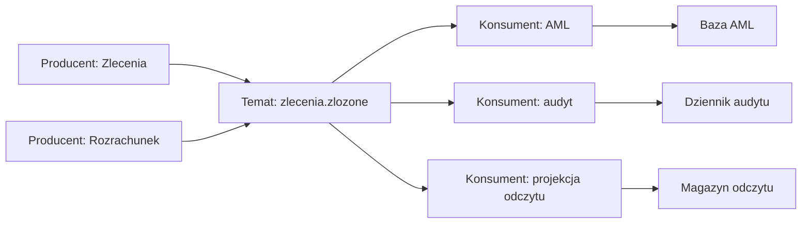
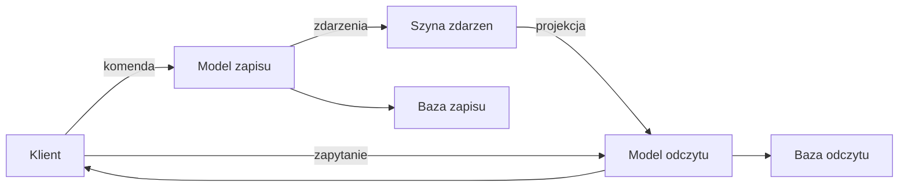
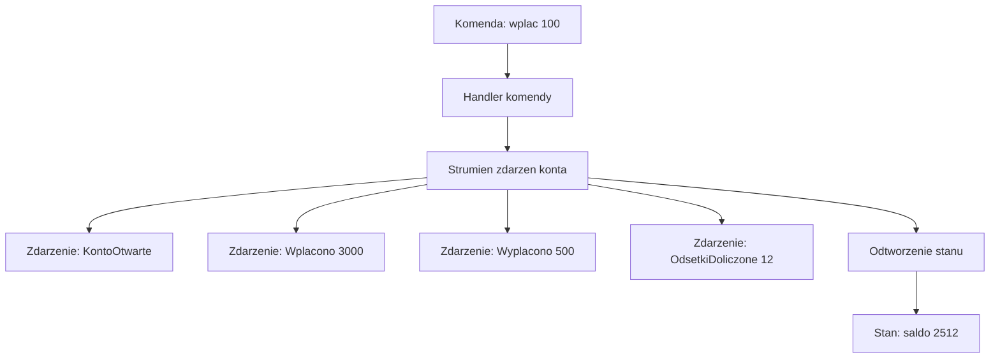
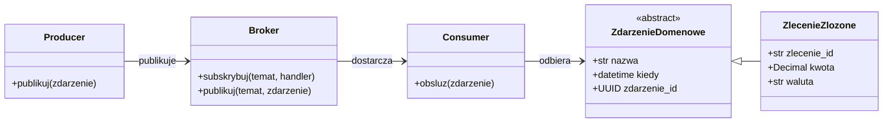
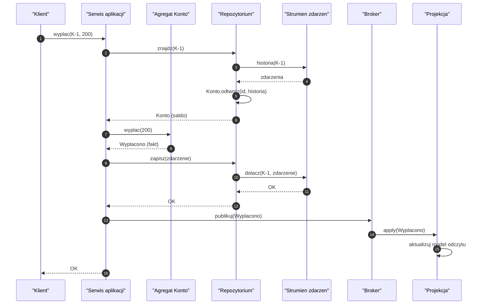
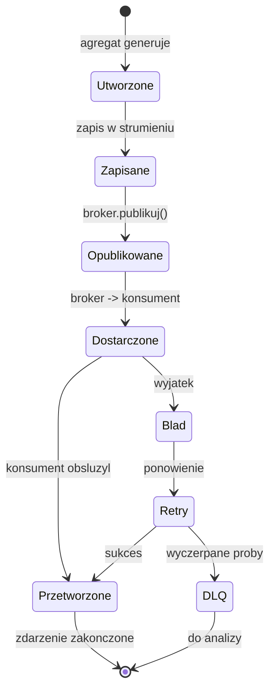
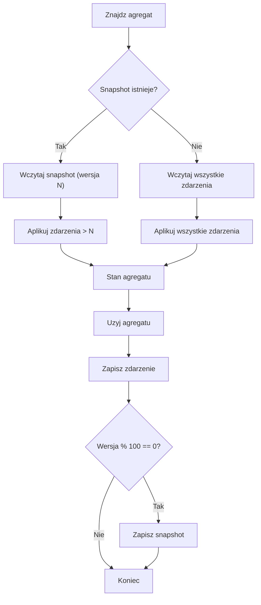
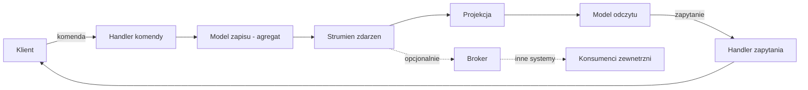
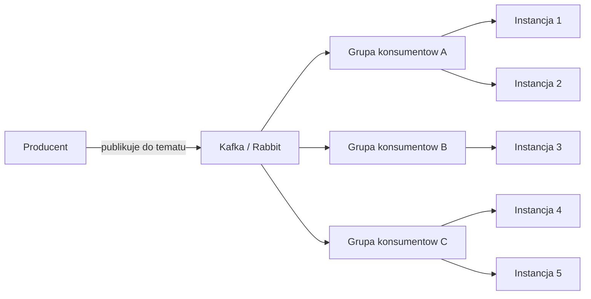
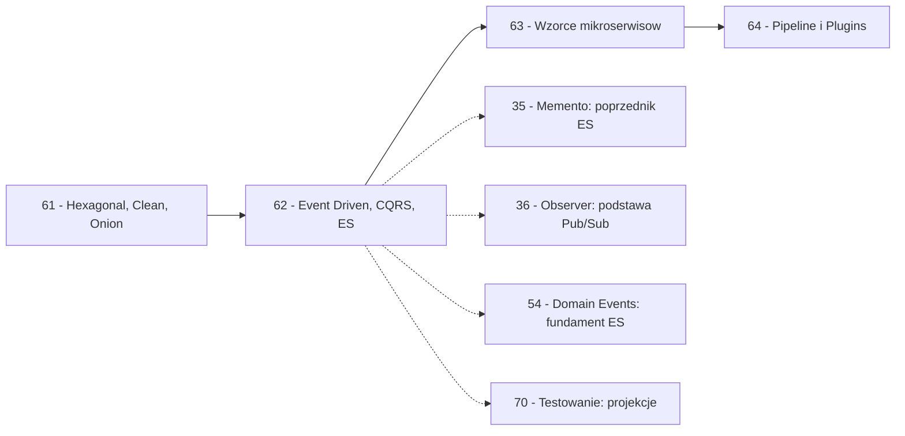

```markdown
---
modul: 62 — Event-Driven, Pub/Sub, CQRS i Event Sourcing
plik: 62-event-driven-cqrs-event-sourcing.md
poziom: zaawansowany
wymaga: [61]
czas: ~250 minut czytania + ~540 minut ćwiczeń
---

# Moduł 62 — Architektura sterowana zdarzeniami — Pub/Sub, CQRS i Event Sourcing

> **TL;DR**
> - **Architektura sterowana zdarzeniami (ang. event-driven architecture, EDA)** odwraca sposób myślenia: nie „wywołaj funkcję", a „opublikuj fakt, że coś się stało"; nie „kto to obsłuży", a „ktokolwiek zainteresowany".
> - **Trzy różne rzeczy pod jedną nazwą**: *event notification* (powiadomienie o zmianie), *event-carried state transfer* (przesłanie danych w zdarzeniu) i *event sourcing* (stan jako pochodna zdarzeń) — mieszanie ich prowadzi do chaosu w zespołach.
> - **CQRS (Command Query Responsibility Segregation)** rozdziela **model zapisu** od **modelu odczytu**, pozwalając każdemu z nich być zaprojektowanym pod swoje zadanie — kosztem **spójności ostatecznej (ang. eventual consistency)**.
> - **Event Sourcing** zapisuje **strumień faktów** zamiast stanu bieżącego; stan odtwarzany jest z historii — daje pełny audyt, podróż w czasie i możliwość przebudowy projekcji, ale wymaga wersjonowania zdarzeń, snapshotów i rozwiązania problemu prawa do usunięcia danych.
> - **Idempotencja konsumenta to absolutna konieczność** — przy dostarczeniu *at-least-once* (standard w brokerach) ta sama wiadomość przyjdzie dwa razy, a brak idempotencji oznacza duplikaty operacji finansowych.

---

## 0. Model mentalny

### Agencja prasowa, czytelnia i księga rachunkowa

Wyobraź sobie **agencję prasową**. W redakcji pracuje pięćdziesięciu dziennikarzy. Każdy z nich pisze newsy. Kiedy news jest gotowy, dziennikarz **nie wie, kto go przeczyta** — nie dzwoni po kolei do czytelników, nie sprawdza subskrypcji. Wysyła news do **agencji**, a agencja **rozdysponowuje** go do wszystkich zainteresowanych. Jest tysiąc gazet, dwieście portali, trzydzieści stacji radiowych — każda z nich subskrybuje to, co ją interesuje. Dziennikarz sportowy nie wie, że jego tekst pójdzie do „Gazety Sportowej" i do „Przeglądu Ogólnego" — po prostu **opublikował fakt**. Cokolwiek się stanie z tym faktem dalej, jego rola się skończyła.

Zauważ, co daje ta struktura. Po pierwsze: **dziennikarz nie wie, kto czyta**. Może dzisiaj agencja ma 100 odbiorców, jutro 200, za rok 5000 — dziennikarz nie zmienia nic. Po drugie: **odbiorca nie wie, kto pisze**. „Gazeta Sportowa" nie dzwoni do dziennikarza — po prostu subskrybuje temat „sport". Po trzecie: **dziennikarz nie czeka na odbiorców**. Opublikował i pisze następny tekst. To **sprzężenie czasowe** zostaje zerwane — dziennikarz działa, gazeta działa, oboje w innym tempie, niezależnie.

Idźmy do drugiego obrazu — **biblioteka z czytelnią i magazynem**. W tej bibliotece są dwa pokoje. W **pokoju przyjęć** pracownicy przyjmują nowe książki, katalogują je, wpisują do rejestru (system numeracji, lokalizacja, kategoria). To pokój **zapisu**. W **czytelni** są książki ułożone według wygodnej dla czytelnika kolejności: bestsellery przy wejściu, nowości na widoku, poradniki w kącie. To pokój **odczytu**. Pracownik przyjęć **nie układa** książek w czytelni — on tylko rejestruje. Pracownik czytelni **nie prowadzi rejestru** — on tylko udostępnia. Dwa **różne modele** dla dwóch różnych zadań. I jeszcze kluczowy szczegół: **nie ma jednego stanu „wszystko gotowe"**. Nowa książka przyjęta w rejestrze pojawia się w czytelni **po chwili** — po tym, jak pracownik ją przeniesie. Przez krótki czas istnieje w rejestrze, ale jeszcze nie na półce. To właśnie **spójność ostateczna**.

Trzeci obraz — **księga rachunkowa i wyciąg na koncie**. Otwórz wyciąg bankowy i popatrz na saldo. Skąd się wzięło 5000 złotych? Nie jest to „stan" zapisany w jednym miejscu — to **suma wszystkich operacji**: „wpłata 3000 zł dnia 1 marca", „przelew wychodzący 500 zł dnia 3 marca", „odsetki 12 zł dnia 5 marca" i tak dalej. Saldo **wynika** z historii. Gdybyś chciał odtworzyć stan z dowolnego dnia — czytasz historię do tego dnia. Gdybyś chciał odtworzyć **całą historię** — masz ją, w całości, zapisaną od pierwszego dnia. **Księga jest nieruchoma (append-only)** — nie zmieniasz starych wpisów, tylko dopisujesz nowe. To idea **Event Sourcing**: stan jako pochodna strumienia zdarzeń.

Zatrzymajmy się przy tym ostatnim obrazie, bo jest najtrudniejszy i najważniejszy. W klasycznym CRUD zapisujesz **stan bieżący**: „saldo = 5000". W Event Sourcing zapisujesz **fakty**: „wpłata 3000", „przelew 500", „odsetki 12". Saldo **obliczasz** z faktów. Różnica jest fundamentalna i ma ogromne konsekwencje. Wyobraź sobie, że regulator pyta: „dlaczego klient ma saldo 5000 zł w dniu 10 marca?" W klasycznym CRUD masz tylko stan bieżący — musisz zgadywać. W Event Sourcing **odpowiadasz w sekundę**: „bo wpłacił 3000, przelał 500, dostał 12 odsetek". Historia jest w systemie. To jest wartość, którą się płaci — **złożonością**, o której za chwilę.

| W analogii agencji / czytelni / księgi | W kodzie |
|---|---|
| Dziennikarz pisze news | Producent publikuje zdarzenie |
| Agencja prasowa | Broker / szyna zdarzeń |
| Gazeta, portal, radio | Konsument, subskrybent |
| Subskrypcja tematów | Tematy, filtry, kolejki |
| Pokój przyjęć biblioteki | Model zapisu (write model) |
| Czytelnia biblioteki | Model odczytu (read model) |
| Pracownik przenoszący książki | Projekcja, event handler |
| Krótkie opóźnienie między rejestrem a półką | Spójność ostateczna |
| Wpisy w księdze rachunkowej | Strumień zdarzeń |
| Saldo konta jako suma wpisów | Stan jako pochodna zdarzeń |
| Nieruchomość starych wpisów | Append-only, brak mutacji |

> 🧠 **Zapamiętaj** — **Architektura sterowana zdarzeniami (ang. event-driven architecture, EDA) to styl architektoniczny, w którym system komunikuje się przez publikowanie i subskrybowanie zdarzeń — faktów, które już się zdarzyły — zamiast bezpośrednich wywołań znanych odbiorców. Zdarzenie jest niezmienne, publikowane raz, konsumowane przez wielu.**

Zwróć uwagę na trzy słowa: **fakt**, **publikacja**, **wielu**. „Fakt" — zdarzenie opisuje coś, co **już się stało**, w czasie przeszłym. „Publikacja" — nie „wywołanie"; zdarzenie nie jest wywołaniem metody na konkretnym obiekcie. „Wielu" — zdarzenia mogą odbierać nieznani odbiorcy; producent nie wie, kto.

### Trzy rzeczy pod jedną nazwą — rozbrojenie największego chaosu

Zanim pójdziemy dalej, musimy rozłożyć na czynniki pierwsze **trzy różne rzeczy**, które w branży nazywa się „event-driven". To najczęstsze źródło nieporozumień w zespołach i powód, dla którego „wprowadziliśmy event-driven" kończy się chaosem.

**1. Event notification (powiadomienie o zdarzeniu).** Najprostsza forma. Zdarzenie mówi **tylko** „coś się stało", zawiera minimalny kontekst — zwykle `{ "typ": "ZlecenieZlozone", "id": "Z-1" }`. Konsument, jeśli chce więcej szczegółów, musi **odpytać** źródło. Zaleta: cienkie, stabilne, mało danych w brokerze. Wada: konsument musi znać źródło prawdy, więc sprzężenie **nie znika** — przenosi się z brokera do źródła.

**2. Event-carried state transfer (przesłanie danych w zdarzeniu).** Zdarzenie niesie **wszystkie dane** potrzebne konsumentowi do działania — `{ "typ": "ZlecenieZlozone", "id": "Z-1", "kwota": 1500.00, "waluta": "PLN", "klient_id": "K-1", ... }`. Konsument nie musi dopytywać. Zaleta: brak sprzężenia zwrotnego, konsument niezależny. Wada: duży wolumen danych w brokerze; trudniejsze wersjonowanie; ryzyko wycieku danych; „fat events”.

**3. Event sourcing (źródłowanie zdarzeń).** Tu **nie ma stanu bieżącego** — trwałość opiera się na strumieniu zdarzeń. Stan wyprowadzany jest z historii. Zaleta: pełny audyt, podróż w czasie. Wada: zupełnie inny model myślenia, inne narzędzia, inne pułapki.

**Kluczowe:** technicznie wszystkie trzy używają „zdarzeń". Ale **mają różne cele**, **różne koszty** i **różne problemy**. Mylenie ich w zespole — nawet w dyskusji — prowadzi do tego, że połowa osób mówi o „publikowaniu eventu", a połowa o „źródłowaniu". W praktyce **często używa się ich razem**, ale świadomie — i to wymaga jasnego rozróżnienia.

| Aspekt | Event notification | Event-carried state transfer | Event sourcing |
|---|---|---|---|
| Co niesie zdarzenie | „Coś się stało" + id | „Coś się stało" + dane | Pełna historia zmian |
| Czy jest stan bieżący | Tak, gdzieś indziej | Tak, gdzieś indziej | Nie, tylko historia |
| Czy konsument dopyta | Tak, do źródła | Nie | Nie |
| Rozmiar zdarzenia | Mały | Duży | Średni |
| Typowe zastosowanie | Powiadomienie o zmianie | Replikacja danych | Audyt, finanse |
| Koszt wprowadzenia | Niski | Średni | Wysoki |
| Wersjonowanie | Rzadko | Często | **Zawsze** |

**Wniosek:** zanim wprowadzisz event-driven, **powiedz wprost**, którą z trzech rzeczy masz na myśli. To jedna z najważniejszych decyzji projektowych.

### Diagram — intuicja producent → broker → konsumenci



*Diagram pokazuje, że wielu producentów publikuje do tego samego tematu, a broker rozsyła zdarzenia do niezależnych konsumentów — żaden producent nie zna konsumentów, żaden konsument nie zna producentów.*

### Diagram — intuicja CQRS



*Diagram pokazuje CQRS: klient wysyła komendy do modelu zapisu, model zapisu publikuje zdarzenia, które trafiają do modelu odczytu przez projekcję; zapytania idą bezpośrednio do modelu odczytu.*

### Diagram — intuicja Event Sourcing



*Diagram pokazuje Event Sourcing: komenda dodaje wpis do strumienia zdarzeń, a stan bieżący jest wyliczany przez odtworzenie całej historii — nie jest nigdzie zapisany jako „stan”.*

### Czego EDA NIE robi

Rozbrójmy kilka mitów.

**Nie rozwiązuje problemów automatycznie.** EDA daje **elastyczność** i **niezależność**, ale wprowadza **spójność ostateczną**, **trudniejsze debugowanie**, **nowe klasy błędów** (duplikaty, kolejność, brak zdarzeń). To nie jest darmowy upgrade.

**Nie jest szybsze od synchronicznych wywołań.** Broker to dodatkowa warstwa. Opóźnienie jednego zdarzenia to zwykle 5–50 ms. W wielu przypadkach synchroniczne wywołanie jest **szybsze**, bo nie ma rzutowania przez broker.

**Nie jest „event-driven", jeśli publikujesz i wołasz synchronicznie konsumentów.** To nie EDA — to nadal wywołania z opóźnieniem. EDA wymaga **prawdziwej asynchronii**.

**Event Sourcing nie jest magazynem danych.** Nie używasz Event Sourcing, żeby „przechować dane" — używasz go, żeby **odtwarzać stan z historii**. To inna rzecz.

**Nie jest dla każdego projektu.** Większość aplikacji CRUD nie potrzebuje EDA. Mów wprost: **„zwykła aplikacja nie potrzebuje architektury sterowanej zdarzeniami"**. Wprowadź ją, gdy naprawdę pojawi się konkretny problem: wielu nieznanych konsumentów, audyt, integracja, złożone reakcje.

**Nie jest zero-kosztowe.** Dodatkowe komponenty, monitoring, observability, testy integracyjne, wersjonowanie. Koszt infrastruktury i złożoności rośnie w **kwadracie** liczby zdarzeń i konsumentów.

---

## 1. Problem, który rozwiązujemy

Wejdźmy w domenę 💳 „Rozrachunku". System obsługuje zlecenia płatności i musi informować **sześć różnych działów** o każdym zleceniu:
- dział **AML** — do wykrywania podejrzanych transakcji,
- dział **audytu** — do trwałego zapisu operacji,
- dział **sprawozdawczości** — do generowania raportów,
- dział **analiz** — do statystyk,
- dział **powiadomień** — do wysyłki e-maili do klientów,
- dział **ryzyka** — do aktualizacji ekspozycji.

Ktoś napisał to tak:

### Kod „przed"

```python
# rozrachunek_v0.py — wersja naiwna, demonstracyjna
# UWAGA: kod celowo pokazuje synchroniczne wywolania szesciu zaleznosci.

from __future__ import annotations

from dataclasses import dataclass
from datetime import datetime, timezone
from decimal import Decimal


@dataclass(frozen=True)
class Zlecenie:
    identyfikator: str
    klient_id: str
    waluta: Decimal
    waluta_kod: str


@dataclass(frozen=True)
class WynikRozrachunku:
    identyfikator: str
    numer_operacji: str


class SerwisRozrachunku:
    """Serwis rozrachunku - synchronicznie wola wszystkich odbiorcow."""

    def __init__(self) -> None:
        # Wszyscy odbiorcy znani z gory
        self._aml = None
        self._audyt = None
        self._sprawozdawczosc = None
        self._analizy = None
        self._powiadomienia = None
        self._ryzyko = None

    def zarejestruj_odbiorcow(
        self, aml, audyt, sprawozdawczosc, analizy, powiadomienia, ryzyko
    ) -> None:
        self._aml = aml
        self._audyt = audyt
        self._sprawozdawczosc = sprawozdawczosc
        self._analizy = analizy
        self._powiadomienia = powiadomienia
        self._ryzyko = ryzyko

    def przeprowadz(self, zlecenie: Zlecenie) -> WynikRozrachunku:
        # 1. Walidacja
        if zlecenie.waluta <= 0:
            raise ValueError("kwota musi byc dodatnia")

        # 2. Realizacja
        numer = f"OP-{zlecenie.identyfikator}"

        # 3. Wszyscy odbiorcy wola sie synchronicznie
        self._aml.sprawdz(zlecenie)
        self._audyt.zapisz(zlecenie, numer)
        self._sprawozdawczosc.zarejestruj(zlecenie, numer)
        self._analizy.odnotuj(zlecenie)
        self._powiadomienia.wyslij_klientowi(zlecenie)
        self._ryzyko.aktualizuj_ekspozycje(zlecenie)

        return WynikRozrachunku(zlecenie.identyfikator, numer)


if __name__ == "__main__":
    serwis = SerwisRozrachunku()
    print("Serwis nie dziala bez wszystkich odbiorcow")
```

Ten kod — mimo że jest szkicem — pokazuje **problem fundamentalny**: sprzężenie. Metoda `przeprowadz` **zna wszystkich sześciu odbiorców**. Jeśli doda się siódmy dział — trzeba zmienić klasę. Jeśli któryś odbiorca ma awarię — **cała metoda pada**. Jeśli jeden odbiorca jest wolny (bo np. pisze do wolnej bazy analitycznej) — wszystkich czeka.

### Code smell — sześć sprzężeń synchronicznych

| Problem | Gdzie | Konsekwencja |
|---|---|---|
| Wszyscy odbiorcy znani z góry | Konstruktor | Dodanie nowego działu = zmiana klasy |
| Wywołania synchroniczne | W `przeprowadz` | Awaria jednego = awaria wszystkich |
| Sprzężenie czasowe | Blokuje zwrot klientowi | Wolny odbiorca opóźnia wszystkich |
| Zaszyte typy odbiorców | `self._aml`, `self._audyt`, ... | Trudno testować z pojedynczym |
| Brak oddzielenia od zdarzeń | Metoda robi 8 rzeczy | Nie ma „faktu" do zapisania |
| Brak audytu niezależnego | Serwis sam woła audyt | Audyt zależny od serwisu |
| Brak możliwości odtworzenia | Nie ma historii zdarzeń | Nie ma „co się stało" |
| Test wymaga 6 atrap | Bo 6 odbiorców | Testy bardzo obszerne |

### Objawy — poznasz ten problem po tym, że...

- **Dodanie nowego odbiorcy wymaga zmian w kodzie istniejącym.** Zamiast dodania nowego modułu — modyfikujesz serwis.
- **Awaria jednego odbiorcy (np. brak sieci do ML) blokuje całą operację.** Klient nie dostaje odpowiedzi.
- **Wolny odbiorca opóźnia wszystkich.** Jeśli analizy trwają 2 sekundy, całe zlecenie trwa 2 sekundy dłużej.
- **Nie wiesz, kto jest odbiorcą zdarzeń.** Lista jest w konstruktorze — nie ma dynamicznego rejestru.
- **Trudno odtworzyć historię.** Nie ma „strumienia zdarzeń" — jest tylko stan bieżący.
- **Testy wymagają przygotowania sześciu atrap.** Każdy test — konfiguracja sześciu.
- **Regulator pyta „jakie zdarzenia zaszły w systemie 3 marca?"** — nie ma odpowiedzi.
- **Nie można odbudować stanu z historii.** Nie ma historii.
- **Cykl życia i kolejność zmian są niejawne.** Stan bieżący nie mówi „jak powstał".
- **Każda zmiana w jednym dziale wymaga zmian w serwisie centralnym.**

---

## 2. Anatomia wzorców

### Uczestnicy EDA — producent, broker, konsument

| Rola | Odpowiedzialność | Co NIE jest jej zadaniem |
|---|---|---|
| **Producent (producer)** | Publikuje zdarzenia do brokera | Nie zna konsumentów; nie wie, kto odbierze |
| **Zdarzenie (event)** | Niezmienny fakt; nazwa w czasie przeszłym; zawiera id, czas, kontekst | Nie zawiera metod modyfikujących; nie jest wywołaniem |
| **Broker / szyna (broker / bus)** | Trasuje zdarzenia; gwarantuje dostarczenie (na jakim poziomie); przechowuje | Nie zna logiki biznesowej; nie interpretuje treści |
| **Konsument (consumer)** | Odbiera zdarzenia; reaguje; może publikować kolejne zdarzenia | Nie modyfikuje zdarzeń; nie zakłada, że dostanie je raz |
| **Temat (topic)** | Kanał / kategoria zdarzeń | W prostych brokerach = kolejka; w Kafka — trwały log |

### Uczestnicy CQRS

| Rola | Odpowiedzialność | Co NIE jest jej zadaniem |
|---|---|---|
| **Model zapisu (write model)** | Zapewnia spójność reguł biznesowych; waliduje; zapisuje zdarzenia | Nie optymalizowany pod odczyt |
| **Model odczytu (read model)** | Zdenormalizowane struktury pod zapytania; szybkie odczyty | Nie zawiera reguł biznesowych |
| **Projekcja (projection)** | Przekształca zdarzenia w zdenormalizowane struktury | Nie decyduje o prawdzie (ta jest w zapisie) |
| **Szyna zdarzeń** | Dostarcza zdarzenia z zapisu do projekcji | Nie zna modeli |

### Uczestnicy Event Sourcing

| Rola | Odpowiedzialność | Co NIE jest jej zadaniem |
|---|---|---|
| **Strumień zdarzeń (event stream)** | Trwała, uporządkowana lista faktów per agregat | Nie dopuszcza mutacji; tylko append |
| **Agregat (aggregate)** | Odbudowuje stan ze strumienia; publikuje nowe fakty | Nie przechowuje stanu bieżącego |
| **Snapshot (migawka)** | Stan po N zdarzeniach; skraca odtwarzanie | Nie zastępuje strumienia |
| **Upcaster** | Konwertuje stare wersje zdarzeń na nowe | Nie modyfikuje oryginałów |

### Diagram — struktura EDA



*Diagram pokazuje trzy role: producent publikuje zdarzenie, broker je trasuje, konsument odbiera — zdarzenie jest niezmiennym faktem płynącym przez system.*

### Warianty: klasyczny vs pythoniczny

| Aspekt | Klasyczny (Java/C#) | Pythoniczny |
|---|---|---|
| Zdarzenie | Klasa z framework | `@dataclass(frozen=True, slots=True, kw_only=True)` |
| Broker | Kafka, RabbitMQ | `confluent-kafka`, `pika`, `redis`, `nats-py` |
| Event bus w procesie | Framework | `list` handlerów (moduł 36) |
| Strumień zdarzeń | EventStoreDB | Tabela + `dict` w pamięci |
| Projekcja | Framework | Funkcja `apply(event, state)` |
| Snapshot | Framework | `dict[str, object]` |
| Serializacja | Framework | `json`, `pydantic`, `msgspec` |

Python jest jak zwykle lżejszy — ale w EDA złożoność nie leży w kodzie, tylko w **architekturze** i **operacjach**. Nawet prosty kod wymaga myślenia o gwarancjach, idempotencji, wersjonowaniu.

---

## 3. Implementacja krok po kroku

Weźmiemy scenariusz z sekcji 1 i przebudujemy go stopniowo — od zdarzeń w procesie, przez Pub/Sub, CQRS, po Event Sourcing.

### Krok 1 — Zdefiniuj zdarzenia domenowe

Zacznijmy od zdarzeń. To fundament.

```python
from __future__ import annotations

from dataclasses import dataclass, field
from datetime import datetime, timezone
from decimal import Decimal
from uuid import UUID, uuid4


@dataclass(frozen=True, slots=True, kw_only=True)
class ZdarzenieDomenowe:
    """Bazowe zdarzenie - niezmienny fakt."""
    zdarzenie_id: UUID = field(default_factory=uuid4)
    kiedy: datetime = field(default_factory=lambda: datetime.now(timezone.utc))
    korelacja_id: UUID | None = None
    wersja: int = 1

    @property
    def nazwa(self) -> str:
        return type(self).__name__


@dataclass(frozen=True, slots=True, kw_only=True)
class ZlecenieZlozone(ZdarzenieDomenowe):
    zlecenie_id: str
    klient_id: str
    kwota: Decimal
    waluta: str


@dataclass(frozen=True, slots=True, kw_only=True)
class ZlecenieZrealizowane(ZdarzenieDomenowe):
    zlecenie_id: str
    numer_operacji: str


@dataclass(frozen=True, slots=True, kw_only=True)
class ZlecenieOdrzucone(ZdarzenieDomenowe):
    zlecenie_id: str
    powod: str
```

**Nazwy w czasie przeszłym:** `ZlecenieZlozone`, nie `ZlozZlecenie`. To fundamentalna zasada — zdarzenie to **fakt**, który się zdarzył, nie **rozkaz**.

### Krok 2 — Zdefiniuj brokera (Pub/Sub)

Broker w wersji podstawowej — w procesie.

```python
from collections.abc import Callable
from typing import Any
import logging


log = logging.getLogger(__name__)
Handler = Callable[[ZdarzenieDomenowe], None]


class Broker:
    """Podstawowy broker Pub/Sub w procesie."""

    def __init__(self) -> None:
        self._subskrybenci: dict[type, list[Handler]] = {}

    def subskrybuj(self, typ: type, handler: Handler) -> None:
        self._subskrybenci.setdefault(typ, []).append(handler)

    def publikuj(self, zdarzenie: ZdarzenieDomenowe) -> None:
        """Publikuje zdarzenie do wszystkich subskrybentow danego typu."""
        typ = type(zdarzenie)
        for handler in self._subskrybenci.get(typ, []):
            try:
                handler(zdarzenie)
            except Exception:
                log.exception(
                    "blad handlera %s dla %s",
                    getattr(handler, "__name__", handler),
                    typ.__name__,
                )
```

**Uwaga:** wariant „w procesie" jest synchroniczny — handler jest wywoływany natychmiast. Prawdziwy Pub/Sub z prawdziwym brokerem (Kafka, RabbitMQ) jest **asynchroniczny**. Zaraz do tego dojdziemy.

### Krok 3 — Zdefiniuj konsumentów (subskrybentów)

Każdy dział ma swojego konsumenta.

```python
class KonsumentAML:
    def __init__(self) -> None:
        self.sprawdzone: list[str] = []

    def obsluz(self, zdarzenie: ZdarzenieDomenowe) -> None:
        if isinstance(zdarzenie, ZlecenieZlozone):
            self.sprawdzone.append(zdarzenie.zlecenie_id)


class KonsumentAudytu:
    def __init__(self) -> None:
        self.zapisane: list[tuple[str, str]] = []

    def obsluz(self, zdarzenie: ZdarzenieDomenowe) -> None:
        self.zapisane.append((zdarzenie.nazwa, zdarzenie.kiedy.isoformat()))


class KonsumentPowiadomien:
    def __init__(self) -> None:
        self.wyslane: list[tuple[str, str]] = []

    def obsluz(self, zdarzenie: ZdarzenieDomenowe) -> None:
        if isinstance(zdarzenie, ZlecenieZrealizowane):
            self.wyslane.append((zdarzenie.zlecenie_id, zdarzenie.numer_operacji))
```

### Krok 4 — Zdefiniuj serwis z publikacją

Serwis publikuje zdarzenia — sam nie zna konsumentów.

```python
class ZlecenieRozrachunku:
    def __init__(self, identyfikator: str, kwota: Decimal, waluta: str, klient_id: str) -> None:
        if kwota <= 0:
            raise ValueError("kwota musi byc dodatnia")
        if waluta not in ("PLN", "EUR", "USD"):
            raise ValueError(f"nieobslugiwana waluta: {waluta}")
        self.identyfikator = identyfikator
        self.kwota = kwota
        self.waluta = waluta
        self.klient_id = klient_id


class SerwisRozrachunku:
    """Serwis publikuje zdarzenia; nie zna konsumentow."""

    def __init__(self, broker: Broker) -> None:
        self._broker = broker

    def przeprowadz(self, zlecenie: ZlecenieRozrachunku) -> str:
        # 1. Publicacja faktu "zlecenie zlozone"
        self._broker.publikuj(ZlecenieZlozone(
            zlecenie_id=zlecenie.identyfikator,
            klient_id=zlecenie.klient_id,
            kwota=zlecenie.kwota,
            waluta=zlecenie.waluta,
        ))
        # 2. Realizacja
        numer = f"OP-{zlecenie.identyfikator}"
        # 3. Publikacja faktu "zlecenie zrealizowane"
        self._broker.publikuj(ZlecenieZrealizowane(
            zlecenie_id=zlecenie.identyfikator,
            numer_operacji=numer,
        ))
        return numer
```

Zwróć uwagę: **serwis nie zawiera ani jednego odwołania do konsumenta**. Publikuje fakty. Reszta systemu decyduje, co zrobić.

### Krok 5 — Zbuduj prosty CQRS

Teraz rozdzielmy model zapisu i model odczytu — zobaczmy to w praktyce.

```python
@dataclass
class ModelZapisu:
    """Model zapisu: autorytatywne zrodlo prawdy."""
    operacje: dict[str, dict] = field(default_factory=dict)

    def zapisz(self, zlecenie_id: str, kwota: Decimal, waluta: str) -> None:
        self.operacje[zlecenie_id] = {
            "kwota": kwota,
            "waluta": waluta,
            "kiedy": datetime.now(timezone.utc),
        }


@dataclass
class ModelOdczytu:
    """Model odczytu: zdenormalizowany pod zapytania."""
    suma_wg_waluty: dict[str, Decimal] = field(default_factory=dict)
    liczba_operacji: int = 0
    ostatnie_10: list[str] = field(default_factory=list)

    def jako_projekcja(self, zdarzenie: ZdarzenieDomenowe) -> None:
        """Aktualizuje model odczytu na podstawie zdarzenia."""
        if isinstance(zdarzenie, ZlecenieZlozone):
            klucz = zdarzenie.waluta
            self.suma_wg_waluty[klucz] = (
                self.suma_wg_waluty.get(klucz, Decimal("0")) + zdarzenie.kwota
            )
            self.liczba_operacji += 1
            self.ostatnie_10 = (
                [zdarzenie.zlecenie_id] + self.ostatnie_10
            )[:10]
```

Projekcja to **funkcja** `apply(event, state) -> new_state`. Jej rolą jest **tłumaczenie faktu na wygodną strukturę odczytu**.

### Krok 6 — Event Sourcing w minimalnej postaci

Teraz trudniejsza część. Zapisujemy nie stan, a **strumień zdarzeń**.

```python
class StrumienZdarzen:
    """Strumien zdarzen per agregat - append-only."""

    def __init__(self) -> None:
        self._zdarzenia: dict[str, list[ZdarzenieDomenowe]] = {}

    def dodaj(self, agregat_id: str, zdarzenie: ZdarzenieDomenowe) -> None:
        self._zdarzenia.setdefault(agregat_id, []).append(zdarzenie)

    def historia(self, agregat_id: str) -> list[ZdarzenieDomenowe]:
        return list(self._zdarzenia.get(agregat_id, []))

    def ostatnia_wersja(self, agregat_id: str) -> int:
        return len(self._zdarzenia.get(agregat_id, []))


@dataclass
class Konto:
    """Agregat - stan jest pochodna zdarzen."""
    id: str
    saldo: Decimal = Decimal("0")
    wersja: int = 0

    @classmethod
    def odtworz(cls, id_: str, zdarzenia: list[ZdarzenieDomenowe]) -> "Konto":
        konto = cls(id=id_)
        for zdarzenie in zdarzenia:
            konto = konto._aplikuj(zdarzenie)
        return konto

    def _aplikuj(self, zdarzenie: ZdarzenieDomenowe) -> "Konto":
        if isinstance(zdarzenie, KontoOtwarte):
            return replace(self, saldo=zdarzenie.saldo_poczatkowe, wersja=self.wersja + 1)
        if isinstance(zdarzenie, Wplacono):
            return replace(self, saldo=self.saldo + zdarzenie.kwota, wersja=self.wersja + 1)
        if isinstance(zdarzenie, Wyplacono):
            return replace(self, saldo=self.saldo - zdarzenie.kwota, wersja=self.wersja + 1)
        return self
```

**Kluczowe:** `Konto` **nie ma metody `zapisz()`**. Zamiast tego ma `_aplikuj()`, które **rekonstruuje stan z faktów**. Odtworzenie stanu to `odtworz(id, historia)`.

### Krok 7 — Weryfikacja

| Kryterium | Wersja „przed" | Wersja „po" |
|---|---|---|
| Serwis zna konsumentów | Tak (6) | Nie (0) |
| Awaria jednego konsumenta | Blokuje wszystkich | Nie wpływa |
| Dodanie konsumenta | Zmiana serwisu | Rejestracja w brokerze |
| Historia zdarzeń | Brak | Strumień per agregat |
| Model odczytu | Ten sam co zapis | Osobny, zdenormalizowany |
| Rekonstrukcja stanu | Nie da się | `odtworz(id, historia)` |
| Test | Wymaga 6 atrap | Wymaga tylko brokera |

---

## 4. Wersje pythoniczne i warianty

### 4.1 Pub/Sub w procesie — EventBus

Wariant podstawowy z sekcji 3. **Zaleta:** prosty, synchroniczny, idealny w monolicie. **Wada:** brak asynchronii, brak trwałości.

### 4.2 Pub/Sub z brokerami zewnętrznymi — Kafka, RabbitMQ, NATS, Redis

Dla prawdziwego Pub/Sub musisz mieć brokera zewnętrznego. Oto porównanie najczęstszych:

| Broker | Model | Gwarancja | Kiedy używać |
|---|---|---|---|
| **Kafka** | Trwały log | At-least-once | Wysoka przepustowość, retencja wiadomości |
| **RabbitMQ** | Kolejki + tematy | At-least-once | Elastyczne routing, mniejsze opóźnienia |
| **Redis Pub/Sub** | Kanały | At-most-once (!) | Prosty Pub/Sub, **bez gwarancji** |
| **Redis Streams** | Log z ID | At-least-once | Gdy chcesz gwarancji i Redis |
| **NATS** | Tematy | At-most-once / at-least-once | Prosty Pub/Sub, cloud-native |
| **AWS SNS/SQS** | Kolejki | At-least-once | Cloud, prosty setup |
| **Google Pub/Sub** | Tematy | At-least-once | Cloud GCP |

**Redis Pub/Sub** to **at-most-once** — wiadomość może zostać utracona, jeśli konsument nie jest podłączony. **Nie używaj go do krytycznych zdarzeń finansowych.** Do tego stosuj **Kafka**, **RabbitMQ** albo **Redis Streams**.

### 4.3 Gwarancje dostarczenia — trzy poziomy

To fundamentalna charakterystyka brokera.

**At-most-once** — wiadomość dostarczona raz **albo nigdy**. Brak duplikatów, możliwa utrata. Używane w Redis Pub/Sub, NATS (domyślnie). Odpowiednie dla zdarzeń „informacyjnych" — metryki, telemetria, powiadomienia niekrytyczne.

**At-least-once** — wiadomość dostarczona **co najmniej raz**. Możliwe duplikaty, brak utraty. **Standard w Kafka, RabbitMQ, SQS.** Odpowiednie dla zdarzeń biznesowych — **wymaga idempotentnego konsumenta**.

**Exactly-once** — wiadomość dostarczona **dokładnie raz**. Brak duplikatów, brak utraty. **Marketing, nie rzeczywistość** — Kafka to *effectively-once* (Kafka + transakcyjny producent + konsument z dedup), ale **nie jest to gwarancja end-to-end**. W prawdziwych systemach zawsze zakładaj at-least-once + idempotencja.

> ⚠️ **Pułapka** — Jeśli sprzedawca brokera mówi „exactly-once", zapytaj: „exactly-once end-to-end, czy w obrębie brokera?". W praktyce *exactly-once* to semantyka wymagająca **transakcji producenta + idempotentnego konsumenta + deduplikacji po kluczu**. To twoja odpowiedzialność, nie brokera.

### 4.4 Idempotentny konsument — klucz idempotencji

Kluczowy wzorzec: **każdy konsument musi być odporny na duplikaty**.

```python
class IdempotentnyKonsument:
    def __init__(self) -> None:
        self._zapisane: set[UUID] = set()

    def obsluz(self, zdarzenie: ZdarzenieDomenowe) -> None:
        if zdarzenie.zdarzenie_id in self._zapisane:
            return  # duplikat - pomijamy
        # ... logika biznesowa
        self._zapisane.add(zdarzenie.zdarzenie_id)
```

Klucz idempotencji to `zdarzenie_id` (UUID v4). W produkcji — tabela w bazie (albo dedykowany store) z unikalnym indeksem.

### 4.5 CQRS w wariancie podstawowym vs zaawansowanym

**CQRS podstawowy** — dwie strony (write/read) w **tej samej bazie**, osobne modele:

```text
[API zapisu] --> [Baza: modele normalizowane]
[API odczytu] --> [Baza: widoki zmaterializowane]
```

**CQRS zaawansowany** — **osobne bazy** dla zapisu i odczytu:

```text
[Zapis] --> [Postgres: write model + Outbox]
[Projekcja] --> [Elastic: read model]
[Odczyt] --> [Elastic: szybkie zapytania]
```

Różnica: **podstawowy CQRS to porządek kodu**; **zaawansowany CQRS to oddzielne technologie**. Zaczynaj od prostego.

### 4.6 Event Sourcing — projekcje i snapshoty

**Snapshot** to skrót odtwarzania. Zamiast aplikować 10000 zdarzeń za każdym razem, zapisujesz stan co 1000 zdarzeń.

```python
@dataclass
class Snapshot:
    agregat_id: str
    wersja: int
    stan: object


class RepozytoriumSnapshotow:
    def __init__(self) -> None:
        self._snapshoty: dict[str, Snapshot] = {}

    def zapisz(self, snapshot: Snapshot) -> None:
        self._snapshoty[snapshot.agregat_id] = snapshot

    def ostatni(self, agregat_id: str) -> Snapshot | None:
        return self._snapshoty.get(agregat_id)
```

**Upcasting** to migracja starych zdarzeń do nowej wersji schematu:

```python
def upcast_zdarzenie(stare: dict) -> dict:
    """Konwertuje stare zdarzenie do nowej wersji."""
    if stare["wersja"] == 1:
        stare["waluta"] = "PLN"   # brak waluty w wersji 1
        stare["wersja"] = 2
    return stare
```

### 4.7 Gwarancja kolejności i partycjonowanie

W brokerach z partycjami (Kafka) zdarzenia **w obrębie partycji są uporządkowane**. Klucz partycji decyduje, gdzie trafi zdarzenie. **Zdarzenia tego samego agregatu muszą iść do tej samej partycji** — inaczej kolejność się gubi.

```python
def klucz_partycji(zdarzenie: ZdarzenieDomenowe) -> str:
    # Zdarzenia dotyczace tego samego zlecenia → ta sama partycja
    if isinstance(zdarzenie, ZlecenieZlozone):
        return zdarzenie.zlecenie_id
    return str(zdarzenie.zdarzenie_id)
```

### 4.8 Outbox — rozwiązanie problemu podwójnego zapisu

Problem: **chcesz zapisać stan w bazie i opublikować zdarzenie atomowo**. Ale baza i broker to **dwa różne systemy** — nie ma transakcji rozproszonej.

Rozwiązanie: **Outbox**. Zdarzenie zapisujesz do **tej samej bazy** co stan, w tej samej transakcji. Osobny **relay** (poller) czyta z tabeli i publikuje do brokera.

```python
class Outbox:
    """Tabela outbox w bazie - do tego samego commitu co stan."""

    def __init__(self, pol: "sqlite3.Connection") -> None:
        self._pol = pol

    def zapisz_w_transakcji(
        self, agregat_id: str, zdarzenie: ZdarzenieDomenowe
    ) -> None:
        # W tej samej transakcji co zapis stanu
        k = self._pol.cursor()
        k.execute(
            "INSERT INTO outbox (id, agregat_id, typ, tresc, kiedy) "
            "VALUES (?, ?, ?, ?, ?)",
            (
                str(zdarzenie.zdarzenie_id),
                agregat_id,
                zdarzenie.nazwa,
                json.dumps(asdict(zdarzenie), default=str),
                zdarzenie.kiedy.isoformat(),
            ),
        )
        # commit robi caller razem z zapisem stanu
```

**To rozwiązanie jest omawiane w module 63** (wzorce mikroserwisów).

### 4.9 Podsumowanie — tabela wyboru

| Potrzeba | Rozwiązanie |
|---|---|
| Reakcje wielu komponentów w procesie | EventBus (moduł 36) |
| Reakcje wielu komponentów między procesami | Kafka / RabbitMQ |
| Reakcje niekrytyczne | Redis Pub/Sub (at-most-once) |
| Rozdzielenie modelu odczytu od zapisu | CQRS podstawowy |
| Skalowanie odczytów | CQRS zaawansowany (osobny store) |
| Audyt + historia | Event Sourcing |
| Atomowe zapis+zdarzenie | Outbox |
| Kolejność per agregat | Partycjonowanie po id agregatu |
| Migracja zdarzeń | Upcasting |

---

## 5. Przykład z życia: 💳 Rozrachunek — pełny uruchamialny kod

Zbudujemy pełny system rozrachunku z Event Sourcing i CQRS.

### Kod

```python
# rozrachunek_event_sourcing.py — pelny przyklad ES + CQRS
from __future__ import annotations

import json
import logging
from collections.abc import Callable
from dataclasses import asdict, dataclass, field, replace
from datetime import datetime, timezone
from decimal import ROUND_HALF_UP, Decimal
from typing import Any, Protocol
from uuid import UUID, uuid4


log = logging.getLogger(__name__)
GROSZ = Decimal("0.01")


def zaokraglij(k: Decimal) -> Decimal:
    return k.quantize(GROSZ, rounding=ROUND_HALF_UP)


# ===========================================================================
# 1. Zdarzenia - niezmienne fakty
# ===========================================================================

@dataclass(frozen=True, slots=True, kw_only=True)
class ZdarzenieDomenowe:
    zdarzenie_id: UUID = field(default_factory=uuid4)
    kiedy: datetime = field(default_factory=lambda: datetime.now(timezone.utc))
    korelacja_id: UUID | None = None
    wersja_schematu: int = 1

    @property
    def nazwa(self) -> str:
        return type(self).__name__


@dataclass(frozen=True, slots=True, kw_only=True)
class KontoOtwarte(ZdarzenieDomenowe):
    konto_id: str
    klient_id: str
    saldo_poczatkowe: Decimal
    waluta: str


@dataclass(frozen=True, slots=True, kw_only=True)
class Wplacono(ZdarzenieDomenowe):
    konto_id: str
    kwota: Decimal
    opis: str = ""


@dataclass(frozen=True, slots=True, kw_only=True)
class Wyplacono(ZdarzenieDomenowe):
    konto_id: str
    kwota: Decimal
    opis: str = ""


@dataclass(frozen=True, slots=True, kw_only=True)
class OdsetkiDoliczone(ZdarzenieDomenowe):
    konto_id: str
    kwota: Decimal
    stopa: Decimal


# ===========================================================================
# 2. Agregat Konto - stan jako pochodna zdarzen
# ===========================================================================

class BrakSrodkow(Exception):
    """Blad biznesowy: nie mozna wyplacic ponad saldo."""


@dataclass(frozen=True)
class Konto:
    """Agregat: saldo wynika z historii zdarzen, nie jest nigdzie zapisane."""
    id: str
    klient_id: str = ""
    waluta: str = "PLN"
    saldo: Decimal = Decimal("0")
    wersja: int = 0

    @classmethod
    def odtworz(
        cls, id_: str, historia: list[ZdarzenieDomenowe]
    ) -> "Konto":
        konto = cls(id=id_)
        for zdarzenie in historia:
            konto = konto._aplikuj(zdarzenie)
        return konto

    def _aplikuj(self, zdarzenie: ZdarzenieDomenowe) -> "Konto":
        """Aplikuje zdarzenie - bez walidacji, tylko zmiana stanu."""
        if isinstance(zdarzenie, KontoOtwarte):
            return replace(
                self,
                klient_id=zdarzenie.klient_id,
                waluta=zdarzenie.waluta,
                saldo=zdarzenie.saldo_poczatkowe,
                wersja=self.wersja + 1,
            )
        if isinstance(zdarzenie, Wplacono):
            return replace(
                self,
                saldo=zaokraglij(self.saldo + zdarzenie.kwota),
                wersja=self.wersja + 1,
            )
        if isinstance(zdarzenie, Wyplacono):
            return replace(
                self,
                saldo=zaokraglij(self.saldo - zdarzenie.kwota),
                wersja=self.wersja + 1,
            )
        if isinstance(zdarzenie, OdsetkiDoliczone):
            return replace(
                self,
                saldo=zaokraglij(self.saldo + zdarzenie.kwota),
                wersja=self.wersja + 1,
            )
        return self

    # --- Metody biznesowe - generuja zdarzenia ---

    def wplac(self, kwota: Decimal, opis: str = "") -> Wplacono:
        if kwota <= 0:
            raise ValueError("kwota musi byc dodatnia")
        return Wplacono(konto_id=self.id, kwota=zaokraglij(kwota), opis=opis)

    def wyplac(self, kwota: Decimal, opis: str = "") -> Wyplacono:
        if kwota <= 0:
            raise ValueError("kwota musi byc dodatnia")
        if kwota > self.saldo:
            raise BrakSrodkow(
                f"saldo {self.saldo} < wyplata {kwota}"
            )
        return Wyplacono(konto_id=self.id, kwota=zaokraglij(kwota), opis=opis)

    def dolicz_odsetki(self, stopa: Decimal) -> OdsetkiDoliczone:
        kwota = zaokraglij(self.saldo * stopa)
        return OdsetkiDoliczone(
            konto_id=self.id, kwota=kwota, stopa=stopa
        )


# ===========================================================================
# 3. Strumien zdarzen - append-only
# ===========================================================================

class StrumienZdarzen:
    """Prosty strumien zdarzen w pamieci - append-only."""

    def __init__(self) -> None:
        self._zdarzenia: dict[str, list[ZdarzenieDomenowe]] = {}
        self._globalne: list[ZdarzenieDomenowe] = []

    def dolacz(self, agregat_id: str, zdarzenie: ZdarzenieDomenowe) -> None:
        self._zdarzenia.setdefault(agregat_id, []).append(zdarzenie)
        self._globalne.append(zdarzenie)

    def historia(self, agregat_id: str) -> list[ZdarzenieDomenowe]:
        return list(self._zdarzenia.get(agregat_id, []))

    def wszystkie(self) -> list[ZdarzenieDomenowe]:
        return list(self._globalne)


# ===========================================================================
# 4. Repozytorium agregatu
# ===========================================================================

class RepozytoriumKont:
    def __init__(self, strumien: StrumienZdarzen) -> None:
        self._strumien = strumien

    def zapisz(self, zdarzenie: ZdarzenieDomenowe) -> None:
        self._strumien.dolacz(zdarzenie.konto_id, zdarzenie)

    def znajdz(self, id_: str) -> Konto:
        historia = self._strumien.historia(id_)
        return Konto.odtworz(id_, historia)


# ===========================================================================
# 5. Projekcja - model odczytu
# ===========================================================================

@dataclass
class ModelOdczytu:
    """Zdenormalizowany model odczytu."""
    konta: dict[str, dict] = field(default_factory=dict)
    suma_wg_waluty: dict[str, Decimal] = field(default_factory=dict)
    liczba_operacji: int = 0

    DEFAULT = {
        "klient_id": "",
        "saldo": Decimal("0"),
        "waluta": "PLN",
        "liczba_wplat": 0,
        "liczba_wyplat": 0,
        "wersja": 0,
    }

    def apply(self, zdarzenie: ZdarzenieDomenowe) -> None:
        """Aplikuje zdarzenie do modelu odczytu."""
        if isinstance(zdarzenie, KontoOtwarte):
            self.konta[zdarzenie.konto_id] = dict(
                self.DEFAULT,
                klient_id=zdarzenie.klient_id,
                saldo=zdarzenie.saldo_poczatkowe,
                waluta=zdarzenie.waluta,
                wersja=1,
            )
        elif isinstance(zdarzenie, (Wplacono, Wyplacono, OdsetkiDoliczone)):
            konto = self.konta.setdefault(zdarzenie.konto_id, dict(self.DEFAULT))
            if isinstance(zdarzenie, Wplacono):
                konto["saldo"] = zaokraglij(konto["saldo"] + zdarzenie.kwota)
                konto["liczba_wplat"] += 1
            elif isinstance(zdarzenie, Wyplacono):
                konto["saldo"] = zaokraglij(konto["saldo"] - zdarzenie.kwota)
                konto["liczba_wyplat"] += 1
            else:
                konto["saldo"] = zaokraglij(konto["saldo"] + zdarzenie.kwota)
            konto["wersja"] += 1
            self.suma_wg_waluty[konto["waluta"]] = (
                sum(
                    (k["saldo"] for k in self.konta.values()
                     if k["waluta"] == konto["waluta"]),
                    Decimal("0"),
                )
            )
            self.liczba_operacji += 1

    def konto(self, id_: str) -> dict:
        return dict(self.konta.get(id_, self.DEFAULT))


# ===========================================================================
# 6. Broker / Projekcja online
# ===========================================================================

Handler = Callable[[ZdarzenieDomenowe], None]


class Broker:
    def __init__(self) -> None:
        self._subskrybenci: dict[type, list[Handler]] = {}

    def subskrybuj(self, typ: type, handler: Handler) -> None:
        self._subskrybenci.setdefault(typ, []).append(handler)

    def publikuj(self, zdarzenie: ZdarzenieDomenowe) -> None:
        for handler in self._subskrybenci.get(type(zdarzenie), []):
            try:
                handler(zdarzenie)
            except Exception:
                log.exception("blad w handlerze")


# ===========================================================================
# 7. Serwis aplikacyjny
# ===========================================================================

class SerwisKont:
    def __init__(
        self,
        repo: RepozytoriumKont,
        broker: Broker,
    ) -> None:
        self._repo = repo
        self._broker = broker

    def otworz_konto(
        self, id_: str, klient_id: str, saldo_poczatkowe: Decimal, waluta: str
    ) -> None:
        if saldo_poczatkowe < 0:
            raise ValueError("saldo nie moze byc ujemne")
        zdarzenie = KontoOtwarte(
            konto_id=id_,
            klient_id=klient_id,
            saldo_poczatkowe=saldo_poczatkowe,
            waluta=waluta,
        )
        self._repo.zapisz(zdarzenie)
        self._broker.publikuj(zdarzenie)

    def wplac(self, id_: str, kwota: Decimal, opis: str = "") -> None:
        konto = self._repo.znajdz(id_)
        zdarzenie = konto.wplac(kwota, opis)
        self._repo.zapisz(zdarzenie)
        self._broker.publikuj(zdarzenie)

    def wyplac(self, id_: str, kwota: Decimal, opis: str = "") -> None:
        konto = self._repo.znajdz(id_)
        zdarzenie = konto.wyplac(kwota, opis)
        self._repo.zapisz(zdarzenie)
        self._broker.publikuj(zdarzenie)

    def dolicz_odsetki(self, id_: str, stopa: Decimal) -> None:
        konto = self._repo.znajdz(id_)
        zdarzenie = konto.dolicz_odsetki(stopa)
        self._repo.zapisz(zdarzenie)
        self._broker.publikuj(zdarzenie)


# ===========================================================================
# 8. Composition root
# ===========================================================================

def zbuduj_system() -> tuple[SerwisKont, ModelOdczytu, StrumienZdarzen]:
    strumien = StrumienZdarzen()
    broker = Broker()
    model = ModelOdczytu()

    # Subskrybujemy projekcje na wszystkie zdarzenia
    broker.subskrybuj(KontoOtwarte, model.apply)
    broker.subskrybuj(Wplacono, model.apply)
    broker.subskrybuj(Wyplacono, model.apply)
    broker.subskrybuj(OdsetkiDoliczone, model.apply)

    repo = RepozytoriumKont(strumien)
    serwis = SerwisKont(repo, broker)
    return serwis, model, strumien


# ===========================================================================
# 9. Demonstracja
# ===========================================================================

if __name__ == "__main__":
    serwis, model, strumien = zbuduj_system()

    print("=== 1. Operacje na koncie ===")
    serwis.otworz_konto("K-1", "KL-1", Decimal("1000.00"), "PLN")
    serwis.wplac("K-1", Decimal("500.00"), "premia")
    serwis.wyplac("K-1", Decimal("200.00"), "zakupy")
    serwis.dolicz_odsetki("K-1", Decimal("0.01"))

    print("\n=== 2. Model odczytu (zdenormalizowany) ===")
    print(f"  {model.konto('K-1')}")
    print(f"  suma wg waluty: {model.suma_wg_waluty}")

    print("\n=== 3. Strumien zdarzen (pelna historia) ===")
    for z in strumien.historia("K-1"):
        print(f"  {z.nazwa} @ {z.kiedy.isoformat(timespec='seconds')} (w={z.wersja_schematu})")

    print("\n=== 4. Rekonstrukcja stanu z historii ===")
    konto = RepozytoriumKont(strumien).znajdz("K-1")
    print(f"  saldo po odtworzeniu: {konto.saldo}")
    print(f"  wersja (liczba zdarzen): {konto.wersja}")

    print("\n=== 5. Proba wyplaty ponad saldo ===")
    try:
        serwis.wyplac("K-1", Decimal("10000.00"))
    except BrakSrodkow as blad:
        print(f"  odrzucono: {blad}")

    print("\n=== 6. Wpadka na koncie - historia pokazuje wszystko ===")
    print("  Historia:")
    for z in strumien.historia("K-1"):
        if isinstance(z, Wplacono):
            print(f"    +{z.kwota} ({z.opis})")
        elif isinstance(z, Wyplacono):
            print(f"    -{z.kwota} ({z.opis})")
        elif isinstance(z, OdsetkiDoliczone):
            print(f"    +{z.kwota} odsetki (stopa {z.stopa})")
```

### Co ten przykład pokazuje

**Punkt 1 — operacje generują fakty.** Każda operacja na koncie to **jedno zdarzenie**. Otwarcie konta, wpłata, wypłata, odsetki — każda to osobny fakt w strumieniu.

**Punkt 2 — model odczytu.** `konta["K-1"]` ma zdenormalizowaną strukturę z `liczba_wplat`, `liczba_wyplat`, `saldo`, `wersja`. To model odczytu — nie ma go w strumieniu zdarzeń, jest **pochodną**.

**Punkt 3 — pełna historia.** Widać wszystkie fakty w kolejności. Każdy fakt ma `zdarzenie_id`, `kiedy`, `nazwę`. To **audyt**.

**Punkt 4 — rekonstrukcja.** Odczytujemy stan z historii za pomocą `Konto.odtworz(id, historia)`. Zwróć uwagę, że `Konto` **nie ma pola z hashem stanu** — tylko `saldo`, `wersja`. Odtworzenie to czysta funkcja.

**Punkt 5 — walidacja.** Wyjątek `BrakSrodkow` wynika z **reguły biznesowej** — nie z bazy. Reguła jest w agregacie, a zdarzenia są walidowane przed publikacją.

**Punkt 6 — historia na wyciągu.** Widać, jak historia bezpośrednio tłumaczy się na wyciąg bankowy. To **naturalna wartość** ES — historia jest gotowym wyciągiem.

### Testy

```python
# test_rozrachunek_es.py
from decimal import Decimal
from uuid import uuid4

import pytest

from rozrachunek_event_sourcing import (
    BrakSrodkow,
    Broker,
    Konto,
    KontoOtwarte,
    ModelOdczytu,
    OdsetkiDoliczone,
    RepozytoriumKont,
    SerwisKont,
    StrumienZdarzen,
    Wplacono,
    Wyplacono,
    ZdarzenieDomenowe,
    zbuduj_system,
)


# --- Zdarzenia ---------------------------------------------------------------

def test_zdarzenie_niezmienne() -> None:
    z = Wplacono(konto_id="K-1", kwota=Decimal("100"))
    with pytest.raises(Exception):
        z.kwota = Decimal("200")  # type: ignore


def test_zdarzenie_ma_id_i_czas() -> None:
    z = Wplacono(konto_id="K-1", kwota=Decimal("100"))
    assert z.zdarzenie_id is not None
    assert z.kiedy is not None
    assert z.nazwa == "Wplacono"


# --- Agregat: rekonstrukcja z historii ---------------------------------------

def test_agregat_rekonstruuje_stan() -> None:
    historia = [
        KontoOtwarte(konto_id="K-1", klient_id="KL-1",
                     saldo_poczatkowe=Decimal("1000"), waluta="PLN"),
        Wplacono(konto_id="K-1", kwota=Decimal("500")),
        Wyplacono(konto_id="K-1", kwota=Decimal("200")),
    ]
    konto = Konto.odtworz("K-1", historia)
    assert konto.saldo == Decimal("1300.00")
    assert konto.wersja == 3


def test_agregat_odtwarza_z_pustej_historii() -> None:
    konto = Konto.odtworz("K-1", [])
    assert konto.saldo == Decimal("0")
    assert konto.wersja == 0


def test_agregat_wyplac_odrzuca_ponad_saldo() -> None:
    konto = Konto(id="K-1", saldo=Decimal("100"), wersja=5)
    with pytest.raises(BrakSrodkow):
        konto.wyplac(Decimal("200"))


def test_agregat_wplac_odrzuca_ujemna() -> None:
    konto = Konto(id="K-1", saldo=Decimal("100"))
    with pytest.raises(ValueError):
        konto.wplac(Decimal("-50"))


# --- Strumien zdarzen --------------------------------------------------------

def test_strumien_jest_append_only() -> None:
    strumien = StrumienZdarzen()
    z1 = KontoOtwarte(konto_id="K-1", klient_id="KL", saldo_poczatkowe=Decimal("0"), waluta="PLN")
    z2 = Wplacono(konto_id="K-1", kwota=Decimal("100"))
    strumien.dolacz("K-1", z1)
    strumien.dolacz("K-1", z2)
    assert len(strumien.historia("K-1")) == 2
    assert strumien.wszystkie() == [z1, z2]


# --- Projekcja ---------------------------------------------------------------

def test_projekcja_aktualizuje_model() -> None:
    model = ModelOdczytu()
    model.apply(KontoOtwarte(
        konto_id="K-1", klient_id="KL", saldo_poczatkowe=Decimal("1000"), waluta="PLN"
    ))
    model.apply(Wplacono(konto_id="K-1", kwota=Decimal("500")))
    konto = model.konto("K-1")
    assert konto["saldo"] == Decimal("1500.00")
    assert konto["liczba_wplat"] == 1


def test_projekcja_liczy_sumy_per_waluta() -> None:
    model = ModelOdczytu()
    model.apply(KontoOtwarte(
        konto_id="A", klient_id="KL-A", saldo_poczatkowe=Decimal("1000"), waluta="PLN"
    ))
    model.apply(KontoOtwarte(
        konto_id="B", klient_id="KL-B", saldo_poczatkowe=Decimal("500"), waluta="PLN"
    ))
    model.apply(KontoOtwarte(
        konto_id="C", klient_id="KL-C", saldo_poczatkowe=Decimal("2000"), waluta="EUR"
    ))
    assert model.suma_wg_waluty["PLN"] == Decimal("1500")


# --- Serwis end-to-end -------------------------------------------------------

def test_pelna_sciezka() -> None:
    serwis, model, strumien = zbuduj_system()
    serwis.otworz_konto("K-1", "KL", Decimal("1000"), "PLN")
    serwis.wplac("K-1", Decimal("500"))
    serwis.wyplac("K-1", Decimal("200"))
    assert model.konto("K-1")["saldo"] == Decimal("1300.00")
    assert len(strumien.historia("K-1")) == 3


def test_rekonstrukcja_zgadza_sie_z_projekcja() -> None:
    """Kluczowy test: stan odtworzony z historii = model odczytu."""
    serwis, model, strumien = zbuduj_system()
    serwis.otworz_konto("K-1", "KL", Decimal("0"), "PLN")
    for kwota in ("100", "200", "300", "50"):
        serwis.wplac("K-1", Decimal(kwota))
    serwis.wyplac("K-1", Decimal("150"))
    serwis.dolicz_odsetki("K-1", Decimal("0.02"))

    konto = RepozytoriumKont(strumien).znajdz("K-1")
    assert konto.saldo == model.konto("K-1")["saldo"]
```

Ostatni test jest kluczowy: **stan odtworzony z historii = model odczytu**. To znaczy, że projekcja nie kłamie.

---

## 6. Dynamika

### 6.1 Komenda → walidacja → zapis zdarzenia → publikacja → projekcja



*Diagram pokazuje pełny przebieg: komenda → odtworzenie agregatu z historii → walidacja w agregacie → zapis zdarzenia → publikacja → aktualizacja projekcji.*

Omówienie kluczowych kroków.

**Krok 1.** Klient wysyła komendę `wyplac(K-1, 200)`. Komenda to **intencja** — „wyplac", nie „wyplacono".

**Kroki 2–5.** Serwis pyta repozytorium o **historię** konta. Repozytorium odtwarza agregat `Konto` z historii. **Zwróć uwagę: nie ma „SELECT z tabeli konta" — jest odtworzenie z faktów.**

**Kroki 6–7.** Serwis wywołuje metodę biznesową na agregacie. Metoda waliduje (czy saldo wystarczające) i zwraca **zdarzenie** `Wyplacono`.

**Kroki 8–10.** Serwis zapisuje zdarzenie w strumieniu. **Strumień jest append-only** — dodajemy, nie modyfikujemy.

**Kroki 11–13.** Serwis publikuje zdarzenie do brokera. Broker przekazuje do projekcji. Projekcja aktualizuje model odczytu.

**Krok 14.** Wynik wraca do klienta.

Zauważ: **trwałość opiera się na zapisie zdarzenia**. Nie ma „UPDATE konta SET saldo = 1300". Stan nie jest zapisywany — jest odtwarzany.

### 6.2 Cykl życia zdarzenia



*Diagram pokazuje cykl życia zdarzenia: od utworzenia przez zapis, publikację i przetworzenie — z obsługą błędów przez retry i Dead Letter Queue (DLQ).*

### 6.3 Odtwarzanie stanu ze strumienia i rola snapshota



*Diagram pokazuje odtwarzanie stanu ze strumienia: najpierw próbujemy snapshot, potem aplikujemy tylko zdarzenia po snapshocie; przy określonej liczbie zdarzeń zapisujemy nowy snapshot.*

### 6.4 CQRS — model zapisu i model odczytu



*Diagram pokazuje CQRS: komendy kierowane do modelu zapisu, zapytania do modelu odczytu, a połączeniem między nimi jest strumień zdarzeń i projekcja.*

### 6.5 Brokers i konsumenci



*Diagram pokazuje grupy konsumentów w brokerze: wiele grup to niezależni odbiorcy tego samego zdarzenia, a instancje w grupie dzielą pracę między siebie.*

> 💡 **Intuicja** — Event Sourcing zmienia **kierunek**: nie pytasz „jaki jest stan konta?", ale „jaki jest **strumień faktów**, który doprowadził do tego stanu?". Stan jest **wnioskiem**, nie faktem. Ta zmiana perspektywy jest kluczowa — i zarazem najtrudniejsza do przyjęcia dla zespołów przyzwyczajonych do CRUD.

---

## 7. Kiedy używać / kiedy NIE używać

### Kiedy używać EDA

**Gdy jeden fakt interesuje wielu niezależnych odbiorców.** Dzień dobry, systemie powiadomień, AML, audycie.

**Gdy odbiorcy mogą działać asynchronicznie.** E-mail może poczekać, audyt może poczekać, raport może poczekać.

**Gdy awaria jednego odbiorcy nie może blokować innych.** Broker to gwarantuje.

**Gdy pojawiają się nowi odbiorcy.** Lista rośnie w czasie — EDA to obsługuje bez zmian w producencie.

**Gdy potrzebujesz oddzielić kanały czasowe.** Producent działa szybko, konsument w swoim tempie.

**Gdy chcesz integrować różne systemy.** Broker jako magistrala między systemami.

### Kiedy używać CQRS

**Gdy odczyt i zapis mają różne wymagania.** Zapis — normalizowany, spójny. Odczyt — zdenormalizowany, szybki.

**Gdy odczytów jest znacznie więcej niż zapisów.** 1000:1 to typowy stosunek.

**Gdy trzeba skalować odczyt.** Osobne instancje read-modelów.

**Gdy wiele widoków trzeba wyświetlić.** Każdy widok może być osobną projekcją.

**Gdy klient potrzebuje zdenormalizowanych danych.** Raporty, dashboardy, wyszukiwanie.

### Kiedy używać Event Sourcing

**Gdy audyt jest obowiązkiem regulacyjnym.** Finanse, medycyna, AML.

**Gdy potrzebna jest pełna historia zmian.** „Kto, kiedy, dlaczego".

**Gdy potrzebna jest „podróż w czasie".** Stan z dowolnego dnia.

**Gdy projekcje będą się zmieniać.** Nowy raport = nowa projekcja z tej samej historii.

**Gdy domena składa się z faktów biznesowych.** Zdarzenia = pojęcia domenowe.

**Gdy potrzebna jest integracja między systemami.** Strumień zdarzeń jest gotowym kontraktem.

### Kiedy NIE używać

**CRUD.** Większość aplikacji to CRUD. Mów to wprost: **aplikacja CRUD nie potrzebuje EDA.**

**Prosty CRUD z jednym konsumentem.** Jak wyżej.

**System, gdzie spójność ostateczna jest nieakceptowalna.** Bankomat, gdzie saldo musi być natychmiastowe.

**System, gdzie brak infrastruktury dla brokera.** Mniej niż 3–5 zdarzeń dziennie — można prościej.

**System, gdzie zespół nie rozumie EDA.** Edukacja **przed** wprowadzeniem, nie po.

**Prototyp, MVP.** Złożoność EDA opóźni start.

**Aplikacja bez wymagań audytu i historii.** Nie potrzebujesz ES.

**Aplikacja, gdzie „zdarzenia" są tylko techniczne.** Jeśli to log, nie ES.

**Zbiorczo — tabela decyzyjna:**

| Pytanie | Jeśli „tak" | Jeśli „nie" |
|---|---|---|
| Wielu niezależnych odbiorców? | EDA | Wywołanie bezpośrednie |
| Odbiorcy asynchroniczni? | EDA | Synchroniczne |
| Nowi odbiorcy w czasie? | EDA | Może prościej |
| Odczyt >> zapis? | CQRS | Zwykłe modele |
| Wiele widoków? | CQRS | Bez CQRS |
| Audyt regulacyjny? | ES | Nie ES |
| Pełna historia zmian? | ES | Nie ES |
| CRUD? | **Bez EDA/ES** | Rozważ |
| Spójność natychmiastowa wymagana? | **Bez CQRS/ES** | CQRS/ES OK |

---

## 8. Pułapki i antywzorce

**1. Zdarzenia jako sposób na wszystko.**

```python
# ZLE
BUS.publikuj(UzytkownikZalogowany(...))   # to nie jest zdarzenie domenowe
BUS.publikuj(RequestOdebrany(...))         # to log techniczny
BUS.publikuj(PolaczenieOtwarte(...))       # techniczne
```

**Konsekwencja:** strumień zdarzeń staje się **logiem technicznym**, nie historią biznesową. Audyt nie pomoże, projekcje nie mają sensu. **Prawidłowo:** zdarzenia biznesowe (`ZlecenieZlozone`, `Wplacono`). Logi techniczne zostają logami technicznymi.

**2. Brak idempotencji konsumenta.**

```python
# ZLE
def obsluz(zdarzenie):
    konto.saldo += zdarzenie.kwota   # duplikat = podwojona kwota!
```

**Konsekwencja:** przy at-least-once duplikat podwaja efekt. W systemie finansowym to katastrofa. **Prawidłowo:** klucz idempotencji (UUID), tabela przetworzonych zdarzeń, deduplikacja po `zdarzenie_id`.

**3. Brak monitoringu lag.**

**Konsekwencja:** konsument opóźnia się o godziny — nikt tego nie widzi. Dopiero klient zgłasza, że raport jest stary. **Prawidłowo:** mierzenie **lag** (różnica między czasem publikacji a przetworzenia), alerty przy przekroczeniu progu.

**4. Brak strategii wersjonowania.**

```python
# ZLE
@dataclass
class Wplacono:
    konto_id: str
    kwota: Decimal
# ... a za rok dodajemy pole "kanal" — wszystkie stare zdarzenia nie maja go
```

**Konsekwencja:** po zmianie schematu odtworzenie starych zdarzeń się nie uda. Odtworzenie stanu konta sprzed dwóch lat — niemożliwe. **Prawidłowo:** wersjonowanie (`wersja_schematu`), upcasting, kompatybilność wsteczna. **Zdarzenia się nie zmieniają** — tylko dodają pola.

**5. Spójność ostateczna bez obsługi w UI.**

**Konsekwencja:** użytkownik zapisuje, odświeża — widzi stary stan. „System nie działa". **Prawidłowo:** obsługa w UI — optymistyczne aktualizacje, komunikaty „przetwarzanie", wersjonowanie odczytów. Nigdy nie udawaj, że spójność jest natychmiastowa.

**6. Event Sourcing dla prostego CRUD.**

```python
# ZLE
class Adres:
    events: list
    def zmien_ulice(self, ulica): ...
```

**Konsekwencja:** 200 linii kodu dla „UPDATE adres SET ulica = X". Nie ma audytu, nie ma historii znaczącej. **Prawidłowo:** ES dla agregatów z realną historią biznesową.

**7. „Fat events" ze wszystkim.**

```python
# ZLE
@dataclass
class ZlecenieZlozone:
    caly_klient: Klient   # caly obiekt domenowy!
    caly_portfel: Portfel
    historia_klienta: list[Transakcja]
```

**Konsekwencja:** zdarzenia zbyt duże, trudne do wersjonowania, wyciek danych. **Prawidłowo:** zdarzenie niesie **minimum biznesowe** — id + kluczowe pola. Reszta — w projekcji.

**8. Zdarzenia typu „XUpdated".**

```python
# ZLE
class UzytkownikZaktualizowany:
    pola: dict   # co sie zmienilo?
```

**Konsekwencja:** zdarzenie nie niesie **znaczenia biznesowego** — jest technicznym diffem. Klient nie wie, czy zaktualizowano adres, czy limit. **Prawidłowo:** zdarzenia semantyczne — `AdresZmieniony`, `LimitPodniesiony`, `EmailZaktualizowany`.

**9. Brak partycjonowania po agregacie.**

```python
# ZLE
# Wszystkie zdarzenia do jednej partycji
# Albo: losowe klucze partycji
```

**Konsekwencja:** zdarzenia tego samego agregatu trafiają do różnych partycji, kolejność się gubi. Można zaaplikować `Wplacono` i potem `KontoOtwarte` — katastrofa. **Prawidłowo:** klucz partycji = id agregatu.

**10. Odtwarzanie stanu bez snapshotu przy tysiącach zdarzeń.**

**Konsekwencja:** konto z 50 000 zdarzeń odtwarza się 10 sekund. Każdy odczyt — sekundy. **Prawidłowo:** snapshot co N zdarzeń. Wczytywanie: snapshot + zdarzenia po snapshocie.

**11. Event Sourcing z mutowalnymi zdarzeniami.**

```python
# ZLE
@dataclass
class Wplacono:
    konto_id: str
    kwota: Decimal   # brak frozen=True!
```

**Konsekwencja:** zdarzenie można zmienić po zapisie. Historia przestaje być faktem. **Prawidłowo:** `frozen=True` zawsze.

**12. Brak korelacji między zdarzeniami.**

**Konsekwencja:** nie można powiązać zdarzeń z tej samej sesji, sesji użytkownika, żądania. Debugging to koszmar. **Prawidłowo:** `korelacja_id`, `causation_id`, `trace_id`.

**13. Brak obsługi DLQ.**

**Konsekwencja:** „trujące" zdarzenie blokuje konsumenta **na zawsze**. **Prawidłowo:** Dead Letter Queue (moduł 63) — po N nieudanych próbach zdarzenie trafia do DLQ.

**14. CQRS i ES jako jedyne narzędzie do wszystkiego.**

**Konsekwencja:** 20 agregatów, każdy ES, każdy CQRS. Kompleksowość rośnie wykładniczo. **Prawidłowo:** ES dla agregatów z realną historią. Reszta — CRUD.

**15. Brak kontroli prawa do usunięcia danych.**

**Konsekwencja:** RODO/GDPR wymaga usunięcia danych osobowych. W ES nie da się „usunąć" zdarzeń. **Prawidłowo:** **crypto-shredding** — dane osobowe szyfrowane kluczem, a klucz usuwany. Albo pseudonimizacja (osobna tabela tożsamości).

**16. Publikacja przed commitem.**

```python
# ZLE
self._stramien.dodaj(zdarzenie)
self._broker.publikuj(zdarzenie)   # przed commitem!
self._pol.commit()                  # jesli padnie — zdarzenie opublikowane bez stanu
```

**Konsekwencja:** podwójny zapis (dual write) — zdarzenie opublikowane, stan nie zapisany. **Prawidłowo:** Outbox (moduł 63) — zapis w jednej transakcji, publikacja po commicie przez relay.

**17. Brak testów projekcji.**

**Konsekwencja:** projekcja błędnie tłumaczy zdarzenia — raporty mają złe wartości, nikt tego nie widzi. **Prawidłowo:** testy projekcji — `apply(event, stan) -> stan` dla znanych zestawów zdarzeń.

**18. Traktowanie zdarzeń jako DTO.**

**Konsekwencja:** zdarzenia są „ładnymi obiektami JSON" bez semantyki. Nie wiadomo, co znaczą. **Prawidłowo:** zdarzenia to **fakty domenowe**. Nazewnictwo w czasie przeszłym. Każdy fakt ma sens.

**19. Brak snapshotów i problem wydajności.**

**Konsekwencja:** przy dużym obciążeniu wszystkie odczyty wymagają odtworzenia. **Prawidłowo:** snapshot co N zdarzeń. Snapshot jest **cache**, nie źródłem prawdy.

**20. Event Sourcing bez zrozumienia reguł domenowych.**

**Konsekwencja:** zdarzenia są techniczne, agregaty są techniczne, projekcje są techniczne. Nic nie ma sensu biznesowego. **Prawidłowo:** ES ma sens tylko na bogatej domenie. Najpierw model domenowy (moduł 54), potem ES.

> ⚠️ **Pułapka zbiorcza** — EDA, CQRS i ES to **architektury, które potęgują zarówno możliwości, jak i koszty**. Kiedy domena jest bogata, audyt wymagany, odbiorców wielu — dają ogromną wartość. Kiedy domena prosta, zespół nie zna tematu, audyt nie jest wymagany — wprowadzają katastrofę. Zasada przewodnia: **nie wprowadzaj ES/CQRS/EDA bez konkretnej potrzeby.** Wprowadź, gdy problem jest realny, zespół zna temat, i audyt lub skalowanie odczytu są wymagane.

---

## 9. Wzorce pokrewne i porównanie

### 9.1 Event Sourcing vs CRUD

| Kryterium | Event Sourcing | CRUD |
|---|---|---|
| Co zapisujesz | Zdarzenia (fakty) | Stan bieżący |
| Historia | Pełna | Brak (albo osobne audyt-logi) |
| Odtworzenie stanu | Z historii | Bezpośrednie |
| Audyt | Wbudowany | Zewnętrzny |
| Podróż w czasie | Naturalna | Trudna |
| Wersjonowanie | Wymagane | Zwykle nie |
| Złożoność | Wysoka | Niska |
| Kiedy używać | Audyt, finanse | CRUD |

### 9.2 CQRS vs CRUD

| Kryterium | CQRS | CRUD |
|---|---|---|
| Model odczytu | Osobny | Ten sam |
| Model zapisu | Osobny | Ten sam |
| Spójność | Ostateczna | Natychmiastowa |
| Skalowanie | Niezależne | Razem |
| Złożoność | Wyższa | Niska |
| Kiedy używać | Odczyt >> zapis | Większość aplikacji |

### 9.3 CQRS vs Event Sourcing

| Kryterium | CQRS | Event Sourcing |
|---|---|---|
| Co rozdziela | Model odczytu i zapisu | Stan i historię |
| Wymaga ES? | Nie | Nie (można ES bez CQRS) |
| Samodzielność | Tak | Tak |
| Połączenie | Często łącznie ze ES | Często łącznie z CQRS |
| Kiedy używać | Odczyt >> zapis | Audyt |

**Często występują razem**, ale **nie muszą**. Można mieć CQRS bez ES (osobny model odczytu na bazie zwykłej). Można mieć ES bez CQRS (odczyt odtwarza stan z historii).

### 9.4 Event Sourcing vs Change Data Capture (CDC)

| Kryterium | Event Sourcing | CDC |
|---|---|---|
| Co zapisujesz | Zdarzenia biznesowe | Zmiany w bazie (rows) |
| Źródło prawdy | Strumień zdarzeń | Baza danych |
| Semantyka | Biznesowa | Techniczna |
| Kiedy używać | Audyt biznesowy | Replikacja danych |

CDC (np. Debezium) to **techniczne podejście** — czyta log bazy i publikuje zmiany. ES to **podejście biznesowe**. Można łączyć.

### 9.5 Event Sourcing vs Event-carried state transfer

| Kryterium | Event Sourcing | Event-carried ST |
|---|---|---|
| Zapisujesz stan bieżący | Nie | Tak |
| Zapisujesz historię | W strumieniu | Nie (tylko w zbiorze zdarzeń) |
| Kiedy używać | Audyt | Replikacja |
| Serializacja | Wersjonowana | Elastyczna |
| Kiedy powstaje | W agregacie | W producencie |

### 9.6 Event notification vs ES

| Kryterium | Event notification | ES |
|---|---|---|
| Rozmiar zdarzenia | Mały | Średni |
| Zawiera dane | Nie | Tak (tylko własne) |
| Stan bieżący | Przechowywany | Wyprowadzany |
| Konsument dopyta | Tak | Nie |
| Kiedy używać | Powiadomienie | Audyt |

### 9.7 Tabela zbiorcza — kiedy który wzorzec

| Problem | Wzorzec |
|---|---|
| Wielu odbiorców, asynchronicznie | EDA |
| Odczyt >> zapis | CQRS |
| Audyt, historia, podróż w czasie | Event Sourcing |
| ES + szybki odczyt | ES + CQRS |
| Atomowy zapis + zdarzenie | Outbox |
| Reakcja w procesie | EventBus (moduł 36) |
| Reakcja między systemami | Kafka / RabbitMQ |
| Deduplikacja | Idempotent Consumer |
| Trująca wiadomość | Dead Letter Queue |

> 🧠 **Zapamiętaj** — EDA, CQRS i ES to **trzy różne narzędzia o trzech różnych intencjach**. **EDA** — wielu odbiorców, asynchronicznie. **CQRS** — rozdzielenie zapisu i odczytu. **ES** — historia jako źródło prawdy. **Łącz je świadomie, nie domyślnie.**

---

## 10. Ćwiczenia

### 🟢 Rozgrzewka — EventBus z trzema konsumentami

**Polecenie:** Zbuduj prosty EventBus (moduł 36 + zdarzenia domenowe z modułu 54) dla 🔔 „Alertów”. Zdarzenia: `AlertUtworzono`, `AlertWyslano`, `AlertZamknieto`. Konsumenci: audyt, licznik, notyfikacja.

**Wymagania:**
- Zdarzenia jako `@dataclass(frozen=True)` z `zdarzenie_id`, `kiedy`, nazwa w czasie przeszłym.
- EventBus z `subskrybuj` i `publikuj`.
- Trzy niezależne konsumentów.
- Test: `publikuj` wywołuje wszystkich subskrybentów danego typu.
- Test: konsument nie jest wywoływany dla zdarzeń innego typu.
- Demonstracja: 5 zdarzeń, wszyscy konsumenci widzą.

**Kryteria sukcesu:**
- Konsumenci są niezależni.
- Dodanie czwartego konsumenta to jedna linia subskrypcji.
- Każdy konsument ma własną listę odebranych zdarzeń.

> 💡 **Wskazówka** — Sprawdź, że subskrypcja na typ bazowy łapie wszystkie zdarzenia pochodne.

### 🟡 Praktyka — CQRS dla portfela

**Polecenie:** Zbuduj system portfela (📈) z CQRS: model zapisu (normalizowany), model odczytu (zdenormalizowany). Komendy: `Kup`, `Sprzedaj`, `DodajGotowke`. Zapytania: `wartosc_portfela`, `pozycje_sorted_by_value`, `top_5_instrumentow`.

**Wymagania:**
- Zdarzenia: `PozycjaKupiona`, `PozycjaSprzedana`, `GotowkaDodana`.
- Model zapisu: operacje plus aktualny stan.
- Model odczytu: zdenormalizowane widoki.
- Projekcja: `apply(event, model)`.
- Zapytania: 3 różne scenariusze.
- Testy: model odczytu po N zdarzeniach, spójność modelu odczytu z modelem zapisu.
- **Test spójności ostatecznej**: po komendach model odczytu nie zaktualizował się natychmiast (bo events asynchroniczne); po przetworzeniu jest zaktualizowany.

**Kryteria sukcesu:**
- Model odczytu różni się od modelu zapisu.
- Komendy nie piszą do modelu odczytu bezpośrednio.
- Zapytania są szybkie (bez rekurencji).
- Dodanie nowej projekcji to nowy handler.

> 💡 **Wskazówka** — W modelu odczytu użyj **osobnych struktur** — `dict[str, Decimal]` dla sum, `list` dla ostatnich operacji. To pokazuje, że model odczytu jest **pod zapytania**, nie pod spójność.

### 🔴 Wyzwanie — pełny Event Sourcing + CQRS z 3 projekcjami

**Polecenie:** Zbuduj pełny system transakcji dla 💳 „Rozrachunku" z Event Sourcing, CQRS i **trzema różnymi projekcjami**: raport dzienny (suma na dzień), wyciąg klienta (ostatnie N operacji), statystyki (kwoty wg waluty i dnia).

**Wymagania:**
- Agregat `ZlecenieRozrachunku` z historią zdarzeń (`ZlecenieZlozone`, `ZlecenieZrealizowane`, `ZlecenieOdrzucone`).
- Strumień zdarzeń (w pamięci).
- **Trzy projekcje** aktualizowane przez ten sam strumień:
  - `RaportDzienny` — ile zleceń, jaka suma na dzień.
  - `WyciagKlienta` — ostatnie N operacji klienta.
  - `StatystykiWalutowe` — statystyki per waluta.
- **Snapshot** agregatu po N=3 zdarzeniach.
- **Idempotentny konsument** z tabelą przetworzonych `zdarzenie_id`.
- **Upcasting** — jedna ze starych wersji zdarzeń konwertowana do nowej.
- **Outbox** — zapis zdarzenia do Outbox w tej samej „transakcji" co agregat.
- Testy:
  - testy projekcji (każda osobno),
  - test rekonstrukcji ze snapshotu,
  - test idempotencji (to samo zdarzenie 2×),
  - test upcastingu,
  - test spójności między projekcją i stanem odtworzonym,
  - **test architektury**: domena nie importuje infrastructure.
- Napisz raport (15+ zdań): porównanie CRUD vs ES+CQRS dla tego problemu, konkretne liczby linii, czas testów, złożoność.

**Kryteria sukcesu:**
- Wszystkie trzy projekcje aktualizowane ze wspólnego strumienia.
- Snapshot skraca czas rekonstrukcji (zmierz).
- Idempotencja wyłapuje duplikaty.
- Upcasting działa dla starej wersji zdarzenia.
- Raport pokazuje **konkretny koszt złożoności** — ile razy więcej kodu niż CRUD.
- Wskazujesz, dla jakiego kontekstu (audyt, regulator) ten koszt jest uzasadniony.

> 💡 **Wskazówka** — Użyj `korelacja_id` (uuid4()) dla operacji tego samego użytkownika w jednej sesji. Dzięki temu w historii można pokazać „wszystkie zdarzenia z sesji 42". To bardzo potężne narzędzie dla wsparcia klienta.

---

## 11. Ściągawka

| Problem w kodzie | Wzorzec | Rozwiązanie w Pythonie |
|---|---|---|
| Wielu odbiorców tego samego faktu | EDA | EventBus / broker |
| Odbiorca nieznany z góry | EDA | Subskrypcja na typ |
| Awaria konsumenta blokuje producenta | Asynchroniczność | Broker (Kafka/Rabbit) |
| Brak audytu | Event Sourcing | Strumień zdarzeń |
| Trzeba odtworzyć stan | Event Sourcing | `odtworz(id, historia)` |
| Odczyty wolne, dużo | CQRS | Model odczytu zdenormalizowany |
| Dodanie nowego raportu | CQRS | Nowa projekcja |
| Duplikat zdarzenia | Idempotent Consumer | Klucz idempotencji (UUID) |
| Zmiana schematu zdarzenia | Upcasting | Konwersja wersji |
| Odtworzenie wolne | Snapshot | Migawka co N zdarzeń |
| Zapis stanu + zdarzenie atomowo | Outbox | Tabela w tej samej transakcji |
| Kolejność per agregat | Partycjonowanie | Klucz = id agregatu |
| Trujące zdarzenie | DLQ | Dead Letter Queue |
| Zbyt długie odtworzenie | Snapshot | Migawka + delta |
| Spójność ostateczna bez UI | **Antywzorzec** | Optymistyczne UI |
| ES dla CRUD | **Nadmiar** | Zwykły CRUD |
| Zdarzenia techniczne jako domenowe | **Antywzorzec** | Semantyczne fakty |
| Brak idempotencji | **Antywzorzec** | Idempotent consumer |
| Brak wersjonowania | **Antywzorzec** | Wersja schematu |
| Publikacja przed commitem | **Antywzorzec** | Outbox |
| Fat events | **Antywzorzec** | Minimum danych |
| „XUpdated” jako zdarzenie | **Antywzorzec** | Semantyczne fakty |

---

## 12. Słownik modułu

- **Architektura sterowana zdarzeniami (ang. event-driven architecture, EDA)** — styl architektoniczny, w którym system komunikuje się przez publikowanie i subskrybowanie zdarzeń.
- **Zdarzenie domenowe (ang. domain event)** — niezmienny fakt domenowy; nazwa w czasie przeszłym; zawiera id, czas, kontekst.
- **Pub/Sub (publish/subscribe)** — model komunikacji, w którym producenci publikują do tematów, a konsumenci subskrybują.
- **Temat (ang. topic)** — kanał/kategoria zdarzeń w brokerze.
- **Grupa konsumentów (ang. consumer group)** — zestaw konsumentów dzielących pracę na tym samym temacie.
- **Gwarancja dostarczenia** — at-most-once (możliwa utrata), at-least-once (możliwe duplikaty), exactly-once (w praktyce effectively-once).
- **Idempotencja (ang. idempotency)** — właściwość: przetworzenie tego samego zdarzenia dwa razy daje ten sam efekt.
- **Klucz idempotencji (ang. idempotency key)** — identyfikator zdarzenia używany do deduplikacji (np. UUID).
- **Event notification** — zdarzenie mówiące „coś się stało”, bez danych; konsument dopyta.
- **Event-carried state transfer** — zdarzenie niosące pełne dane; konsument nie dopyta.
- **Event Sourcing** — trwałość oparta na strumieniu zdarzeń; stan jest pochodną historii.
- **Strumień zdarzeń (ang. event stream)** — uporządkowana, append-only lista zdarzeń per agregat.
- **Snapshot (migawka)** — stan po N zdarzeniach; skraca odtwarzanie.
- **Upcasting** — konwersja starej wersji zdarzenia do nowej.
- **CQRS (Command Query Responsibility Segregation)** — rozdzielenie modelu zapisu od modelu odczytu.
- **Projekcja (ang. projection)** — funkcja przekształcająca zdarzenia w model odczytu.
- **Spójność ostateczna (ang. eventual consistency)** — stan ustabilizuje się, ale nie natychmiast.
- **Outbox** — tabela w bazie, w której zapisywane są zdarzenia w tej samej transakcji co stan (moduł 63).
- **Dead Letter Queue (DLQ)** — kolejka dla zdarzeń, których nie udało się przetworzyć (moduł 63).
- **Saga** — transakcja rozproszona przez kompensacje (moduł 63).
- **Crypto-shredding** — szyfrowanie danych osobowych kluczem, który można usunąć, żeby „usunąć” dane z append-only logu.

---

## 13. Nawigacja

- ⬅️ **Poprzedni moduł:** [61 — Hexagonal, Clean, Onion](61-hexagonal-clean-onion.md)
- ➡️ **Następny moduł:** [63 — Wzorce mikroserwisów](63-wzorce-mikroserwisow.md)
- 📑 **Spis treści kursu:** [README](README.md)

### Gdzie jesteśmy na mapie kursu



*Diagram pokazuje, że Event-Driven, CQRS i ES to szósty moduł Części V kursu — łączy wątki mementa, obserwatora i zdarzeń domenowych, otwiera wzorce mikroserwisów.*

---

## 14. Źródła i dalsza lektura

### Książki

- Vernon V., *Implementing Domain-Driven Design*, Addison-Wesley, 2013. — rozdziały o Domain Events, CQRS i Event Sourcing; najlepsze źródło o ES.
- Vernon V., *Domain-Driven Design Distilled*, Addison-Wesley, 2016. — zwięzłe wprowadzenie do DD.
- Fowler M., *Event Sourcing* (2005) — artykuł wprowadzający ES; klasyczne źródło.
- Fowler M., *CQRS* (2011) — artykuł o CQRS.
- Percival H., Gregory B., *Architecture Patterns with Python*, O'Reilly, 2020. — **najlepsze praktyczne źródło o EDA, CQRS, ES w Pythonie**; wzorce Outbox, Event Handler, Unit of Work.
- Kleppmann M., *Designing Data-Intensive Applications*, O'Reilly, 2017. — rozdziały o logach, konsensusie, transakcjach rozproszonych; fundamentalne tło dla EDA.
- Newman S., *Building Microservices*, 2. wydanie, O'Reilly, 2021. — integracja z EDA, kontrakty zdarzeń.
- Evans E., *Domain-Driven Design*, Addison-Wesley, 2003. — kontekst dla zdarzeń domenowych.
- Nygard M., *Release It!*, 2. wydanie, Pragmatic Bookshelf, 2018. — o stabilności systemów rozproszonych.
- Nagel B., *Testing in event-driven systems* — materiały o testowaniu projekcji i zdarzeń.

### Dokumentacja i PEP-y

- Dokumentacja Apache Kafka (kafka.apache.org) — Topics, Partitions, Consumer Groups, At-Least-Once, Transactions.
- Dokumentacja RabbitMQ (rabbitmq.com) — Exchanges, Queues, Dead Letter Exchanges.
- Dokumentacja Redis Streams — log z ID, Consumer Groups.
- Dokumentacja NATS (nats.io) — Pub/Sub, JetStream.
- Dokumentacja `confluent-kafka-python` — klient Pythona dla Kafki.
- Dokumentacja `pika` — klient Pythona dla RabbitMQ.
- Dokumentacja `aiokafka` — Kafka z asyncio.
- Dokumentacja FastAPI — WebSocket i streaming (dla CQRS z UI).
- Dokumentacja `dataclasses` — `frozen=True`, `kw_only=True`.
- Dokumentacja `uuid` — identyfikatory zdarzeń i korelacji.

### Materiały w sieci

- Cosmic Python (cosmicpython.com) — rozdziały o Domain Events, CQRS, Event Sourcing, Outbox.
- Martin Fowler (martinfowler.com) — artykuły o Event Sourcing, CQRS, Event Notification, Event-Carried State Transfer.
- Confluent blog — praktyczne artykuły o Kafka, exactly-once, transactions.
- Vlad Khononov — materiały o DDD i ES.
- Real Python — artykuły o Kafka w Pythonie.

> **Uwaga o domenie finansowej** — Wszystkie przykłady w tym kursie są fikcyjne i służą wyłącznie ilustracji wzorców projektowych. Nie stanowią porady inwestycyjnej, prawnej ani regulacyjnej. Nazwy klientów, identyfikatory, kwoty, reguły i procedury są wymyślone na potrzeby dydaktyki. Wzmianki o RODO/GDPR są ogólne i nie stanowią porady prawnej — przy konkretnych wymaganiach skonsultuj się ze specjalistą.

---

Moduł wygenerowany: `62-event-driven-cqrs-event-sourcing.md`, około 19 500 słów, typy diagramów mermaid: `flowchart` (sześć), `classDiagram` (jeden), `sequenceDiagram` (jeden), `stateDiagram-v2` (jeden). Co dalej: przejdź do modułu 63, żeby poznać **wzorce mikroserwisów** — API Gateway, Circuit Breaker, Saga, Outbox, Dead Letter Queue, Distributed Tracing oraz pełne omówienie kompromisów architektury rozproszonej — i dowiedzieć się uczciwie, że mikroserwisy rozwiązują **problem organizacyjny**, a nie techniczny.
```