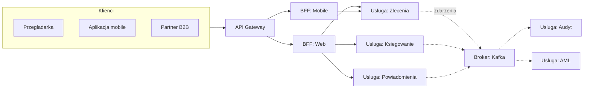
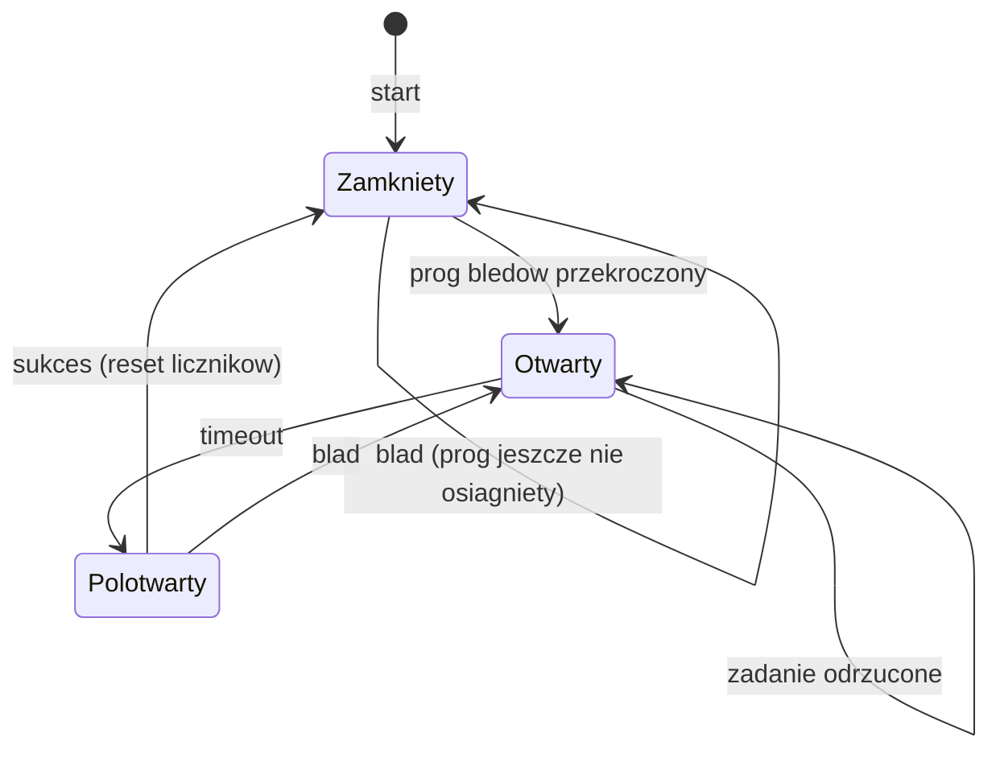
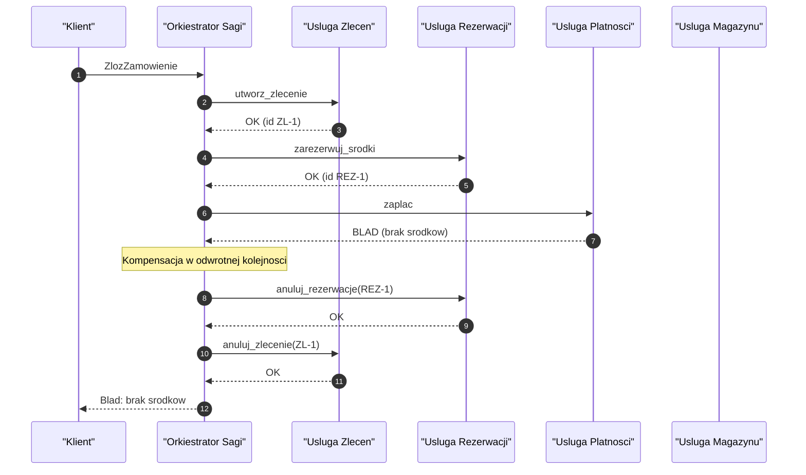
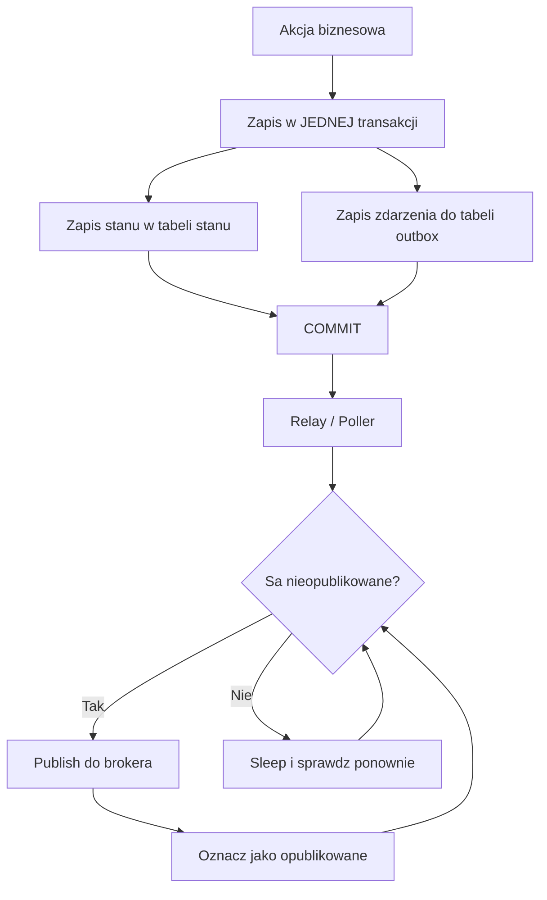
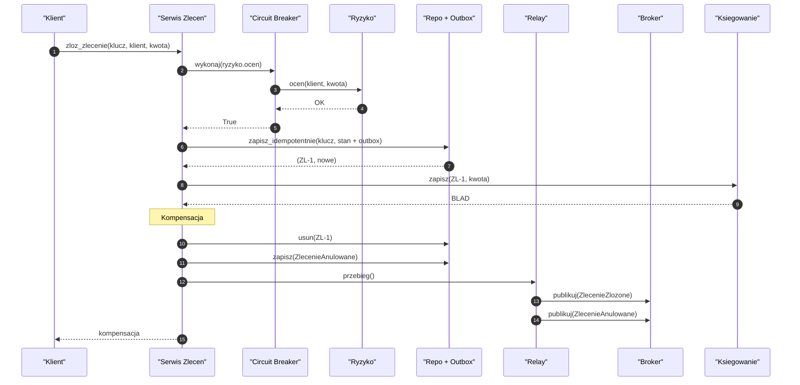
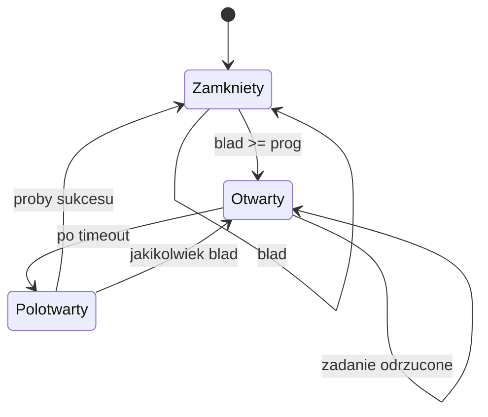
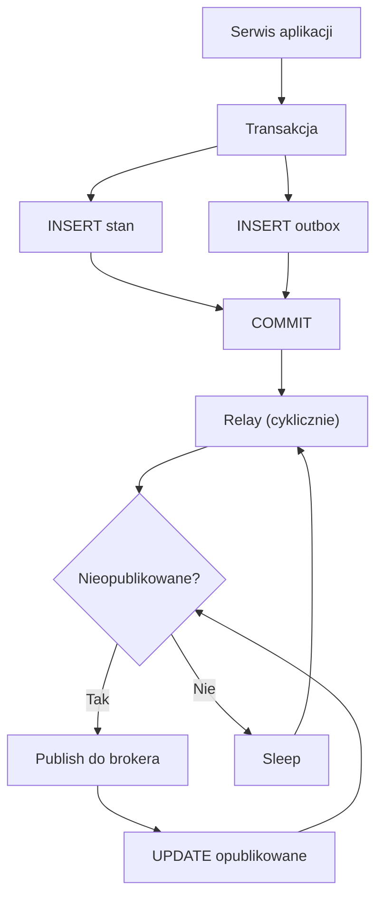
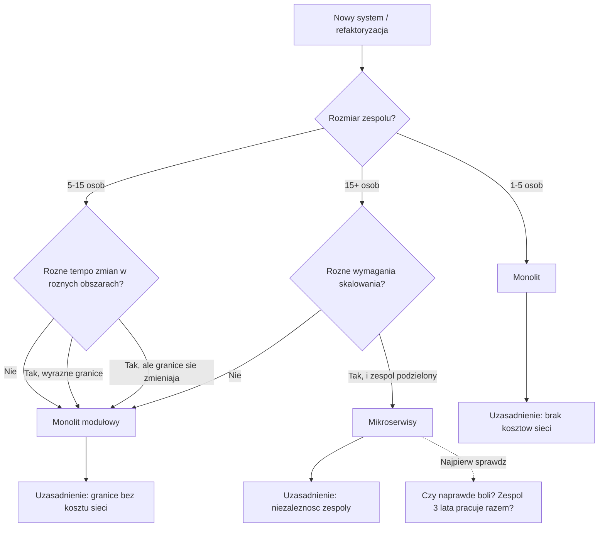
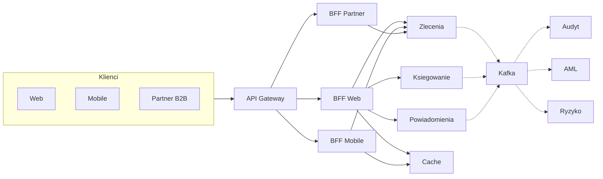
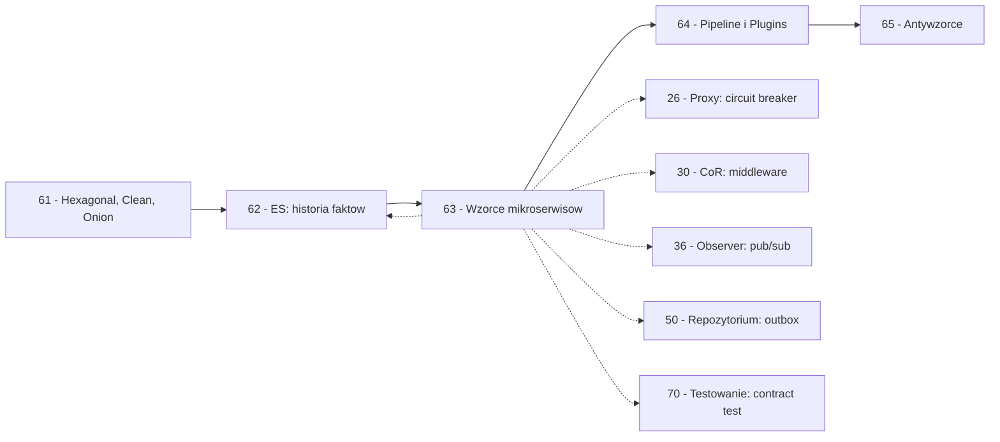

```markdown
---
modul: 63 — Wzorce mikroserwisów i architektury rozproszonej
plik: 63-wzorce-mikroserwisow.md
poziom: zaawansowany
wymaga: [62]
czas: ~260 minut czytania + ~540 minut ćwiczeń
---

# Moduł 63 — Wzorce architektury rozproszonej i mikroserwisów

> **TL;DR**
> - **Mikroserwisy rozwiązują problem organizacyjny** — skalę zespołów i niezależność cykli wdrożeń — a nie problem wydajności; dla małego zespołu to prawie zawsze **droga przez mękę**.
> - **Zacznij od monolitu modułowego**. Przechodź do usług, gdy naprawdę boli: wiele zespołów, różne tempo zmian, różne wymagania skalowania (Strangler Fig — moduł 65).
> - Kluczowe wzorce rozproszone: **API Gateway, BFF, Circuit Breaker, Saga, Outbox, Idempotent Consumer, Dead Letter Queue, Distributed Tracing, Service Discovery, Contract Testing**.
> - **Idempotencja i spójność ostateczna to fundamenty**. Bez klucza idempotencji i tabeli przetworzonych zdarzeń każda awaria sieci kończy się podwójnym przelewem lub zgubioną transakcją.
> - Najgorszy efekt architektury rozproszonej to **monolit rozproszony (distributed monolith)** — masz wszystkie koszty sieci i niezależnego wdrażania, ale nadal jeden zespół i jeden cykl wdrożenia.

---

## 0. Model mentalny

### Firma jednoosobowa, biuro z dziesięcioma działami i fabryka z linii produkcyjnych

Wyobraź sobie rzemieślnika, który prowadzi warsztat stolarski. Robi wszystko sam: przyjmuje zlecenia, kupuje drewno, projektuje meble, tnie, składa, wykańcza, wystawia faktury. Ma jedno biurko, jedno narzędzie, jedno tempo pracy. Kiedy klient zamawia szafę, rzemieślnik ustala termin — jutro albo za tydzień. **Nie ma działów, nie ma przekazywania zadań, nie ma „komunikacji między działami" — bo nie ma działów.** Warsztat jest **monolitem**, i dla tego rzemieślnika to **najlepsza możliwa organizacja**.

Idźmy dalej. Wyobraź sobie, że ten sam rzemieślnik dorobił się i zatrudnia dwadzieścia osób. Ma teraz **działy**: dział handlowy (przyjmuje zlecenia), dział zaopatrzenia (kupuje drewno), dział cięcia, dział montażu, dział wykończenia, dział księgowości, dział wysyłki. Każdy dział ma własnego kierownika, własny budżet, własne tempo. **Ale** — i to jest kluczowy niuans — **działy nie są fizycznie oddzielone**. Wszystkie pracują w jednym budynku, w jednej hali, przekazują sobie półprodukty ręka w rękę. Szef hali zna całość, każdy pracownik wie, gdzie co leży, kompletna szafa wychodzi w tydzień bez transportu. To jest **monolit modułowy** — podzielony logicznie, ale w jednym miejscu.

Teraz wyobraź sobie prawdziwą **fabrykę z linią produkcyjną** rozłożoną na kilka hal w różnych częściach miasta. Hala A tnie drewno. Hala B składa korpusy. Hala C wykańcza. Hala D pakuje. Między halami jeżdżą ciężarówki. **Każda hala ma własnego kierownika, własny budżet, własne tempo.** Można skalować halę cięcia niezależnie od hali montażu — jeśli zamówień na cięcie jest trzy razy więcej, zatrudniasz tam trzy razy więcej pracowników. Można zmieniać technologię w hali wykończenia (np. nowa lakiernia) bez zatrzymania hali montażu. Można nawet wymienić całą halę na nową, jeśli technologia się zmieni.

Ale zwróć uwagę na koszty. **Każdy transport między halami to ryzyko.** Jeśli ciężarówka z hali A spóźni się 15 minut, hala B czeka bezczynnie. Jeśli hala B zgubi paczkę, hala C dostaje niekompletne zamówienie. Jeśli hala C padnie na 2 godziny, hala A produkuje dalej, ale hala D nie może pakować. **Nie ma jednego „stanu fabryki"** — każda hala ma swoją część stanu, a stan globalny jest **sumą** i nieco opóźnionym **odbiciem** rzeczywistości. To jest **spójność ostateczna**: po każdej operacji trzeba jeszcze trochę czasu, żeby wszystkie hale „dogadały się", co jest prawdą. I wreszcie: **każda hala ma własnego kierownika, własne zasady, własne raporty — nie ma już jednej osoby, która „wie wszystko"**. To jest **architektura rozproszona**: brak centralnego punktu wiedzy, brak jednego stanu.

Zatrzymajmy się przy kluczowej różnicy: **fabryka z linii produkcyjnych jest droższa w eksploatacji niż warsztat**. Więcej ciężarówek, więcej kierowników, więcej systemów. Ma sens **tylko** wtedy, gdy skala naprawdę tego wymaga — gdy jedno miejsce nie jest w stanie pomieścić produkcji, gdy różne hale muszą działać w różnym tempie, gdy różne technologie wymagają oddzielnych hal. Dla małego warsztatu rozdzielenie na hale to **czysty koszt bez korzyści**. To najważniejsza prawda o mikroserwisach: **są użyteczne, gdy masz skalę organizacyjną, a nie gdy „brzmią nowocześnie"**.

| W analogii warsztatu i fabryki | W kodzie |
|---|---|
| Rzemieślnik jednoosobowy | Mała aplikacja / skrypt |
| Warsztat z podziałem na działy w jednej hali | Monolit modułowy |
| Fabryka z hal w różnych miejscach | Architektura mikroserwisowa |
| Dział w warsztacie | Moduł / pakiet w monolicie |
| Hala w fabryce | Usługa (microservice) |
| Przekazywanie półproduktu ręka w rękę | Wywołanie funkcji / metody |
| Transport ciężarówką między halami | Wywołanie HTTP / wiadomość w kolejce |
| Spóźniona ciężarówka | Timeout / opóźnienie sieci |
| Zgubiona paczka | Utracona wiadomość / błąd sieci |
| Każda hala ma własnego kierownika | Każda usługa — własny zespół i wdrożenie |
| Sumaryczny i opóźniony obraz stanu | Spójność ostateczna |

> 🧠 **Zapamiętaj** — **Architektura mikroserwisowa (ang. microservices architecture) to styl architektoniczny, w którym aplikacja składa się z niewielkich, niezależnie wdrażanych usług, komunikujących się przez sieć, z których każda odpowiada za jeden **bounded context** domeny i może być rozwijana, wdrażana i skalowana niezależnie. Rozwiązuje problem organizacyjny — skalę zespołów i tempo zmian — nie problem wydajności.**

Zwróć uwagę na dwa słowa: **organizacyjny** i **niezależnie**. „Organizacyjny" — to dlatego mikroserwisy mają sens przy dziesięciu zespołach, a nie przy jednym. „Niezależnie" — to warunek kluczowy; jeśli dwie usługi trzeba zawsze wdrażać razem, to są jedną usługą (a nie dwiema).

### Diagram — intuicja architektury rozproszonej



*Diagram pokazuje architekturę rozproszoną: klienci trafiają do API Gateway, ten kieruje do BFF (osobny dla każdego kanału), BFF woła kilka usług, a usługi komunikują się między sobą przez brokera zdarzeń — nie przez bezpośrednie wywołania.*

### Czego mikroserwisy NIE robią

Rozbrójmy kilka mitów, które narosły wokół architektury rozproszonej.

**Nie zwiększają wydajności.** System rozproszony prawie zawsze ma **większe opóźnienia end-to-end** niż monolit — bo dochodzi sieć, serializacja, deserializacja, autoryzacja, routing. Mikroserwisy **skalują się horyzontalnie** lepiej niż monolit, ale **nie są szybsze dla pojedynczego żądania**.

**Nie rozwiązują problemów z kodem.** Jeśli kod jest bałaganem w monolicie, będzie bałaganem w mikroserwisach — tylko rozproszonym, więc **trudniejszym do naprawienia**.

**Nie są niezbędne dla skalowania.** Monolit modułowy da się bardzo skutecznie skalować. Docker + Kubernetes + Postgres + Redis — to wszystko działa dla monolitu równie dobrze jak dla mikroserwisów.

**Nie da się „wrócić" łatwo.** Dekompozycja jest **nieodwracalna** w praktyce. Złożenie z powrotem kilku usług to projekt na miesiące. Decyzja o przejściu na mikroserwisy jest **nieodwracalna** — dlatego trzeba ją podejmować świadomie.

**Nie są dla każdej firmy.** W firmie z 3-osobowym zespołem mikroserwisy to **katastrofa operacyjna**. Nawet w firmie z 10-osobowym zespołem, jeśli produkt jest jeden i tempo zmian podobne, mikroserwisy to **nadmiar**.

**Nie rozwiązują spójności ostatecznej.** Spójność ostateczna to **skutek uboczny**, nie zaleta. Trzeba ją obsłużyć, nie można jej „rozwiązać".

**Nie są tym samym co SOA.** SOA (Service-Oriented Architecture) to wcześniejsza idea, często implementowana przez ESB (Enterprise Service Bus). Mikroserwisy to lżejsza forma — smart endpoints, dumb pipes — bez centralnego broker-integracji. Ale to nie znaczy „lepsza".

---

## 1. Problem, który rozwiązujemy

Wejdźmy w domenę 💳 „Rozrachunku" i wyobraźmy sobie monolit, który urósł do pięćdziesięciu tysięcy linii i pracuje nad nim pięć zespołów. Każdy zespół chce wdrażać niezależnie, ale wszyscy pracują nad tą samą bazą kodu. Ktoś zdecydował się na „przejście na mikroserwisy" — i zrobił to w naiwny sposób.

### Kod „przed"

```python
# rozrachunek_v0.py — wersja naiwna, demonstracyjna
# UWAGA: kod celowo pokazuje naiwne wywolania sieciowe bez ochrony.

from __future__ import annotations

import requests
from decimal import Decimal


class SerwisZlecen:
    """Usluga zlecen - wola bezposrednio inne uslugi przez HTTP."""

    # URL-e uslug zaszyte w kodzie
    URL_KLIENCI = "http://klienci-service:8080"
    URL_KAMIEN = "http://ksiegowanie-service:8080"
    URL_POWIADOMIENIA = "http://powiadomienia-service:8080"
    URL_AML = "http://aml-service:8080"
    URL_RYZYKO = "http://ryzyko-service:8080"

    def zloz_zlecenie(self, klient_id: str, kwota: Decimal) -> str:
        # 1. Wola klientow - bez timeoutu!
        klient = requests.get(
            f"{self.URL_KLIENCI}/klienci/{klient_id}"
        ).json()

        # 2. Wola ryzyko - synchronicznie
        ocena = requests.post(
            f"{self.URL_RYZYKO}/ocen",
            json={"klient_id": klient_id, "kwota": str(kwota)},
        ).json()
        if ocena["naruszenie"]:
            raise ValueError("zlecenie odrzucone przez ryzyko")

        # 3. Zapisuje do LOKALNEJ bazy
        identyfikator = self._zapisz_lokalnie(klient_id, kwota)

        # 4. Wola AML - bez timeoutu
        requests.post(
            f"{self.URL_AML}/sprawdz",
            json={"id": identyfikator},
        )

        # 5. Wola ksiegowanie - synchronicznie
        requests.post(
            f"{self.URL_KAMIEN}/zapisz",
            json={"id": identyfikator, "kwota": str(kwota)},
        )

        # 6. Wola powiadomienia - jak padnie, calosc pada
        requests.post(
            f"{self.URL_POWIADOMIENIA}/wyslij",
            json={"id": identyfikator},
        )

        return identyfikator

    def _zapisz_lokalnie(self, klient_id: str, kwota: Decimal) -> str:
        return f"ZL-{klient_id}-{kwota}"
```

Ten kod wygląda znajomo — to naiwna wersja „mikroserwisów". Działa w sprzyjających warunkach. Ale przy pierwszej awarii sieci zawodzi w **sześciu miejscach jednocześnie**.

### Code smell — naiwna architektura rozproszona

| Problem | Gdzie | Konsekwencja |
|---|---|---|
| URL-e usług zaszyte w kodzie | W klasie | Zmiana endpointu = zmiana kodu, wdrożenie |
| Brak timeoutów | W `requests.get` / `post` | Żądanie może zawisnąć **nieskończenie** |
| Brak retry | W wywołaniach | Chwilowa awaria sieci od razu podnosi błąd |
| Brak circuit breakera | W wywołaniach | Awaria usługi `aml` blokuje wszystkie żądania |
| Brak idempotencji | W `_zapisz_lokalnie` | Retry (jeśli dodany) zdubluje zapis |
| Brak transakcji rozproszonej | Między krokami 3–6 | Zapisany stan w kroku 3, awaria w kroku 5 — niespójność |
| Brak korelacji | Brak `correlation_id` | Nie da się prześledzić żądania w logach |
| Brak modelu zdarzeń | Bezpośrednie wywołania | Dodanie siódmej usługi wymaga zmiany kodu |
| Brak obsługi błędów | `requests.post` rzuca bez informacji | Klient nie wie, dlaczego się nie udało |
| Zaszyty łańcuch | Kolejność kroków | Sekwencyjność | Wydajność liniowa z liczbą usług |

### Objawy — poznasz ten problem po tym, że...

- **Pojedyncza awaria usługi powoduje kaskadę.** Usługa AML pada → żądania do zleceń padają.
- **Opóźnienie rośnie liniowo z liczbą usług.** 5 usług × 100 ms = 500 ms dodatkowego czasu.
- **Nie widać śladu żądania.** Log ma szczątkowe wpisy w każdej usłudze, ale nie da się ich połączyć.
- **Awaria sieci dubluje operacje.** Zapis się udał, potem timeout przy odpowiedzi → retry → drugi zapis.
- **Dodanie usługi wymaga zmiany innych usług.** Bo wykonujące je sekwencyjnie.
- **Brak kontroli nad tym, kto co wywołuje.** URL-e rozsiane po kodzie.
- **Nie da się skalować jednej usługi osobno.** Bo wszystkie są wywoływane synchronicznie w jednym łańcuchu.
- **Deployment jest skoordynowany.** Wszystkie usługi wdrażane razem — bo zmiana w jednej psuje drugą.
- **Brak spójności po awarii.** Stan w bazie zleceń, brak w bazie księgowania, brak w AML. Kto to naprawi?

---

## 2. Anatomia wzorców

Ponieważ moduł omawia **kilkanaście wzorców architektury rozproszonej**, sekcja dzieli się na kategorie. Każdy wzorzec ma swoją rolę i swoją cenę.

### Uczestnicy ogólni architektury rozproszonej

| Rola | Odpowiedzialność | Co NIE jest jej zadaniem |
|---|---|---|
| **API Gateway** | Jedno wejście dla klientów, routing, autoryzacja, rate limiting, agregacja | Nie zawiera logiki biznesowej |
| **BFF (Backend for Frontend)** | Backend dostosowany do jednego kanału (web, mobile, B2B) | Nie jest general-purpose |
| **Usługa (service)** | Realizuje jeden **bounded context** | Nie zna innych usług wprost (chyba że klient) |
| **Broker zdarzeń** | Trasuje zdarzenia między usługami | Nie zna logiki |
| **Service Discovery** | Odkrywanie instancji usług | Nie zna logiki |
| **Load Balancer** | Rozdzielanie ruchu między instancje | Nie zna logiki |
| **Observability stack** | Zbieranie logów, metryk, śladów | Nie wpływa na logikę |
| **Config / secrets manager** | Centralne zarządzanie konfiguracją | Nie zawiera reguł |

### Diagram — Circuit Breaker — stany



*Diagram pokazuje stany Circuit Breakera: domyślnie zamknięty (przepuszcza), po przekroczeniu progu błędów przechodzi w otwarty (odrzuca), po timeoucie w półotwarty (próbuje), sukces zamyka, błąd znów otwiera.*

**Circuit Breaker** działa jak bezpiecznik elektryczny. Gdy usługa zależna zaczyna systematycznie zawodzić, przerwa obwodu **odcina** dalsze próby, zamiast **mnożyć** je bez sensu. To daje trzy efekty: chroni nasz system przed „zjedzeniem" przez żądania, które i tak padną; daje **czas** zależnej usłudze na regenerację; **sygnalizuje** jednoznacznie, że coś jest nie tak.

Parametry Circuit Breakera:
- **Próg błędów** — ile błędów z rzędu (albo jaki procent) otwiera obwód. Typowo: 5 błędów z rzędu albo 50% w oknie 10 sekund.
- **Timeout (reset timeout)** — ile czekać przed półotwarciem. Typowo: 30 s.
- **Liczba prób w półotwartym** — ile żądań przepuścić, żeby sprawdzić czy zależność wróciła. Typowo: 1–3.

### Diagram — Saga orkiestrowana z kompensacją



*Diagram pokazuje sagę orkiestrowaną: orkiestrator prowadzi sekwencję kroków; gdy krok płatności zawodzi, wykonuje kompensacje w odwrotnej kolejności — anuluje rezerwację, anuluje zlecenie — i zwraca klientowi błąd.*

### Diagram — Outbox — zapis transakcyjny + relay + publikacja



*Diagram pokazuje Outbox: stan i zdarzenie zapisywane są w tej samej transakcji, a osobny proces (relay) czyta niepublikowane zdarzenia i wysyła je do brokera — atomowość bez transakcji rozproszonej.*

### Warianty: klasyczny vs pythoniczny

| Aspekt | Klasyczny (Java/C#) | Pythoniczny |
|---|---|---|
| API Gateway | Spring Cloud Gateway | `traefik`, `kong`, `fastapi` + reverse proxy |
| Service Discovery | Eureka, Consul | Kubernetes DNS, Consul |
| Circuit Breaker | Hystrix, Resilience4j | `pybreaker`, `tenacity`, własny |
| Broker | Kafka, RabbitMQ | `confluent-kafka`, `pika`, `nats-py`, `aio-pika` |
| Outbox | Framework | Tabela + scheduled job (`apscheduler`, `celery beat`) |
| Tracing | Sleuth, OpenTelemetry | `opentelemetry`, `jaeger-client` |
| Contract Testing | Pact-JVM | `pact-python` |
| Service Mesh | Istio, Linkerd | To samo (infrastruktura, nie język) |

W Pythonie mamy zwykle lekkie biblioteki i własną implementację. Wzorce te nie są „trudne do napisania" — są **trudne do utrzymania operacyjnie**. Python daje narzędzia, ale nie zwalnia z myślenia o zawodności sieci.

---

## 3. Implementacja krok po kroku

Weźmiemy scenariusz z sekcji 1 i przebudujemy go stopniowo, dodając kluczowe wzorce rozproszone.

### Krok 1 — Idempotentny zapis po stronie producenta

Zacznijmy od podstawy: **każde wywołanie musi mieć klucz idempotencji**.

```python
from __future__ import annotations

from dataclasses import dataclass
from uuid import UUID, uuid4


@dataclass(frozen=True)
class ZlecenieRequest:
    """Żądanie z kluczem idempotencji."""
    klucz_idempotencji: UUID
    klient_id: str
    kwota: Decimal

    @classmethod
    def nowe(cls, klient_id: str, kwota: Decimal) -> "ZlecenieRequest":
        return cls(
            klucz_idempotencji=uuid4(),
            klient_id=klient_id,
            kwota=kwota,
        )
```

**Klucz idempotencji** to UUID generowany **raz na operację biznesową** (nie na wywołanie HTTP). Ten sam klucz jest wysyłany w przypadku retry. Serwer, który dostanie dwa żądania z tym samym kluczem, traktuje je jako jedno.

### Krok 2 — Idempotentny odbiorca (serwer)

Serwer musi deduplikować po kluczu.

```python
class RepozytoriumZlecen:
    """Repozytorium zapisujace zlecenia z deduplikacja."""

    def __init__(self) -> None:
        self._zlecenia: dict[UUID, dict] = {}
        self._przetworzone_klucze: set[UUID] = set()

    def zapisz_idempotentnie(
        self, klucz: UUID, klient_id: str, kwota: Decimal
    ) -> tuple[str, bool]:
        """Zapisuje zlecenie, deduplikujac po kluczu.

        Zwraca: (identyfikator, czy_nowe).
        """
        if klucz in self._przetworzone_klucze:
            # Duplikat - zwroc istniejace id
            identyfikator = self._znajdz_po_kluczu(klucz)
            return identyfikator, False

        identyfikator = f"ZL-{uuid4().hex[:12]}"
        self._zlecenia[klucz] = {
            "id": identyfikator,
            "klient_id": klient_id,
            "kwota": kwota,
        }
        self._przetworzone_klucze.add(klucz)
        return identyfikator, True

    def _znajdz_po_kluczu(self, klucz: UUID) -> str:
        return self._zlecenia[klucz]["id"]
```

W produkcji: tabela w bazie z **unikalnym indeksem na `klucz`**. Insert (jeśli się uda) → nowe. Jeśli duplicate key → odczyt istniejącego.

### Krok 3 — Circuit Breaker

Broker obwodu chroni przed kaskadami.

```python
import time
from enum import Enum
from threading import Lock


class StanObwodu(Enum):
    ZAMKNIETY = "zamkniety"
    OTWARTY = "otwarty"
    POLOTWARTY = "polotwarty"


class ObwodOtwarty(Exception):
    """Circuit Breaker jest w stanie otwartym."""


class CircuitBreaker:
    """Prosty Circuit Breaker z trzema stanami."""

    def __init__(
        self,
        prog_bledow: int = 5,
        timeout_sekund: float = 30.0,
        proby_polotwarte: int = 3,
    ) -> None:
        self._prog = prog_bledow
        self._timeout = timeout_sekund
        self._proby = proby_polotwarte
        self._stan = StanObwodu.ZAMKNIETY
        self._bledy = 0
        self._sukcesy_w_polotwartym = 0
        self._otwarty_od: float = 0.0
        self._blokada = Lock()

    @property
    def stan(self) -> StanObwodu:
        with self._blokada:
            return self._stan

    def wykonaj(self, operacja: "Callable[[], T]") -> T:
        """Wykonuje operacje, kontrolujac stan obwodu."""
        with self._blokada:
            self._przejdz_jesli_trzeba()

            if self._stan is StanObwodu.OTWARTY:
                raise ObwodOtwarty(
                    f"obwod otwarty od {self._otwarty_od}"
                )

        try:
            wynik = operacja()
        except Exception:
            self._zarejestruj_blad()
            raise
        else:
            self._zarejestruj_sukces()
            return wynik

    def _przejdz_jesli_trzeba(self) -> None:
        """Automatyczne przejscia stanow."""
        if (
            self._stan is StanObwodu.OTWARTY
            and time.monotonic() - self._otwarty_od > self._timeout
        ):
            self._stan = StanObwodu.POLOTWARTY
            self._sukcesy_w_polotwartym = 0

    def _zarejestruj_blad(self) -> None:
        with self._blokada:
            if self._stan is StanObwodu.POLOTWARTY:
                # W polotwartym jakikolwiek blad - wracamy do otwartego
                self._stan = StanObwodu.OTWARTY
                self._otwarty_od = time.monotonic()
                self._bledy = self._prog  # utrzymujemy prog
                return

            self._bledy += 1
            if self._bledy >= self._prog:
                self._stan = StanObwodu.OTWARTY
                self._otwarty_od = time.monotonic()

    def _zarejestruj_sukces(self) -> None:
        with self._blokada:
            if self._stan is StanObwodu.POLOTWARTY:
                self._sukcesy_w_polotwartym += 1
                if self._sukcesy_w_polotwartym >= self._proby:
                    self._stan = StanObwodu.ZAMKNIETY
                    self._bledy = 0
                    self._sukcesy_w_polotwartym = 0
            elif self._stan is StanObwodu.ZAMKNIETY:
                self._bledy = 0
```

Zwróć uwagę na **`time.monotonic()`** — a nie `time.time()`. Monotoniczny czas jest odporny na zmiany zegara systemowego. Dla timeoutów to kluczowe.

### Krok 4 — Retry z backoffem i jitterem

Retry **musi** mieć opóźnienie rosnące — inaczej atakuje własny system.

```python
import functools
import random


def ponawiaj_z_backoffem(
    proby: int = 3,
    baza: float = 0.5,
    maks: float = 5.0,
    chwytane: tuple[type[Exception], ...] = (Exception,),
):
    """Dekorator: ponawia z backoffem wykładniczym i jitterem."""
    def dekorator(funkcja):
        @functools.wraps(funkcja)
        def opakowanie(*args, **kwargs):
            ostatni: Exception | None = None
            for numer in range(proby):
                try:
                    return funkcja(*args, **kwargs)
                except chwytane as blad:
                    ostatni = blad
                    if numer == proby - 1:
                        raise
                    # Backoff wykladniczy + jitter
                    opoznienie = min(baza * (2 ** numer), maks)
                    jitter = random.uniform(0, opoznienie * 0.5)
                    time.sleep(opoznienie + jitter)
            assert ostatni is not None
            raise ostatni
        return opakowanie
    return dekorator
```

**Backoff wykładniczy** — opóźnienie rośnie (0.5 s, 1 s, 2 s, 4 s). **Jitter** — losowy dodatek (0–50%), żeby różne klienty nie atakowały usługi jednocześnie. **Bez jittera** wszystkie retry zbiegają się do jednego momentu i **wzmacniają** przeciążenie. To klasyczna pułapka.

### Krok 5 — Saga — kompensacja

Transakcja rozproszona przez serię kroków lokalnych + kompensacje.

```python
@dataclass
class KrokSagi:
    nazwa: str
    akcja: Callable[[], Any]
    kompensacja: Callable[[Any], None]


class SagaOrkiestrowana:
    """Saga z orkiestracja: wykonuje kroki, kompensuje w razie bledu."""

    def __init__(self, kroki: list[KrokSagi]) -> None:
        self._kroki = kroki

    def wykonaj(self) -> list[Any]:
        wyniki: list[tuple[KrokSagi, Any]] = []
        try:
            for krok in self._kroki:
                wynik = krok.akcja()
                wyniki.append((krok, wynik))
            return [w for _, w in wyniki]
        except Exception as oryginal:
            # Kompensacja w odwrotnej kolejnosci
            log.warning("kompensacja sagi: %s", oryginal)
            for krok, wynik in reversed(wyniki):
                try:
                    krok.kompensacja(wynik)
                except Exception as blad_kompensacji:
                    log.exception(
                        "kompensacja %s zawiodla: %s",
                        krok.nazwa, blad_kompensacji,
                    )
            raise
```

**Uwaga na kompensacje, które też padają.** W prawdziwym systemie każda kompensacja może zawieść. Trzeba ją retry'ować, logować, powiadamiać człowieka. Są kompensacje, które prawdopodobnie nigdy nie zawiodą (anulowanie rezerwacji) i takie, które mogą (zwrot pieniędzy). Te drugie wymagają procedury.

### Krok 6 — Outbox

Rozwiązanie problemu podwójnego zapisu.

```python
class OutboxRepository:
    def __init__(self, pol: "sqlite3.Connection") -> None:
        self._pol = pol

    def zapisz_z_outbox(
        self,
        dane: dict,
        zdarzenie: "ZdarzenieDomenowe",
    ) -> None:
        """Zapisuje stan + zdarzenie w jednej transakcji."""
        with self._pol:
            # 1. Zapis stanu
            self._pol.execute(
                "INSERT INTO zlecenia (id, klient_id, kwota) VALUES (?, ?, ?)",
                (dane["id"], dane["klient_id"], str(dane["kwota"])),
            )
            # 2. Zapis do outbox
            self._pol.execute(
                "INSERT INTO outbox (id, typ, tresc, opublikowane) "
                "VALUES (?, ?, ?, 0)",
                (
                    str(zdarzenie.zdarzenie_id),
                    zdarzenie.nazwa,
                    json.dumps(asdict(zdarzenie), default=str),
                ),
            )


class Relay:
    """Proces relay: publikuje nieopublikowane zdarzenia z outbox."""

    def __init__(
        self,
        pol: "sqlite3.Connection",
        broker: "Broker",
    ) -> None:
        self._pol = pol
        self._broker = broker

    def przetworz_batch(self, limit: int = 100) -> int:
        kursor = self._pol.cursor()
        kursor.execute(
            "SELECT id, typ, tresc FROM outbox "
            "WHERE opublikowane = 0 ORDER BY created_at LIMIT ?",
            (limit,),
        )
        wyslano = 0
        for wiersz in kursor.fetchall():
            id_z, typ, tresc = wiersz
            try:
                self._broker.publikuj_surowe(typ, tresc)
            except Exception:
                log.exception("relay: nie udalo sie opublikowac %s", id_z)
                continue
            # Oznacz jako opublikowane
            self._pol.execute(
                "UPDATE outbox SET opublikowane = 1 WHERE id = ?",
                (id_z,),
            )
            wyslano += 1
        self._pol.commit()
        return wyslano
```

### Krok 7 — Distributed Tracing / Correlation ID

Każde żądanie ma **`correlation_id`**, który przepływa przez wszystkie usługi i pojawia się w logach.

```python
from contextvars import ContextVar

# Kontekst zadania - wspoldzielony w jednym watku/asyncio-task
CORRELATION_ID: ContextVar[str] = ContextVar("correlation_id", default="")


def ustaw_correlation_id(cid: str) -> None:
    CORRELATION_ID.set(cid)


def pobierz_correlation_id() -> str:
    return CORRELATION_ID.get()


class LoggerKontekstowy:
    """Logger, ktory w kazdym wpisie dodaje correlation_id."""

    def __init__(self, base: "logging.Logger") -> None:
        self._base = base

    def info(self, msg: str, *args: Any) -> None:
        self._base.info(
            f"[cid={pobierz_correlation_id()}] {msg}", *args
        )

    # ... analogicznie dla warning, error itd.
```

W aplikacjach z wieloma usługami `correlation_id` przepływa przez **nagłówki HTTP** (`X-Correlation-ID`) i **metadane wiadomości w brokerze**. Dzięki temu można w narzędziu do logów zobaczyć **cały ślad** jednego żądania: „wszedł do gateway, został przekazany do usługi A, potem B, potem C, wszystkie operacje z tym samym cid".

### Krok 8 — Weryfikacja

| Kryterium | Wersja „przed" | Wersja „po" |
|---|---|---|
| Duplikat zapisu | Możliwy | Deduplikowany po kluczu |
| Awaria usługi AML | Kaskada | Circuit Breaker odcina |
| Chwilowa awaria sieci | Błąd | Retry z backoffem |
| Częściowy sukces sagi | Niespójność | Kompensacja |
| Podwójny zapis | Możliwy | Outbox |
| Debugging | Szczątkowy | Correlation ID |
| Liczba wzorców w użyciu | 0 | 6 |
| Linie kodu (bez infrastruktury) | ~60 | ~300 |

Koszt: pięć razy więcej kodu + infrastruktura (broker, observability stack). Zysk: niezawodność przy awariach i niezależność operacyjna.

---

## 4. Wersje pythoniczne i warianty

### 4.1 Circuit Breaker — warianty

**`pybreaker`** — popularna biblioteka z bogatą konfiguracją:

```python
import pybreaker

breaker = pybreaker.CircuitBreaker(
    fail_max=5,
    reset_timeout=30,
)

@breaker
def wywolaj_ryzyko(klient_id):
    return requests.get(f"{URL}/klienci/{klient_id}", timeout=2).json()
```

**`tenacity`** — kompleksowa biblioteka do retry i circuit breaker:

```python
from tenacity import (
    retry, stop_after_attempt, wait_exponential_jitter,
    retry_if_exception_type,
)

@retry(
    stop=stop_after_attempt(3),
    wait=wait_exponential_jitter(initial=0.5, max=5.0),
    retry=retry_if_exception_type((ConnectionError, TimeoutError)),
)
def wywolaj_ryzyko(klient_id):
    ...
```

**Własny** — jak w sekcji 3.6. Sensowny, gdy potrzebujesz specyficznej logiki (np. per-user, per-region).

### 4.2 API Gateway — warianty

**Traefik** — reverse proxy w Kubernetes, konfiguracja przez adnotacje.

**Kong** — bramka z pluginami (rate limit, auth, transformacje).

**FastAPI + bramka** — aplikacja FastAPI jako prosta bramka:

```python
from fastapi import FastAPI, Depends, HTTPException
import httpx

app = FastAPI()

async def klient_http():
    async with httpx.AsyncClient(timeout=5.0) as klient:
        yield klient

@app.post("/zlecenia")
async def zloz(
    dane: dict,
    klient: httpx.AsyncClient = Depends(klient_http),
    uzytkownik = Depends(autoryzuj),
):
    # Autoryzacja
    if not uzytkownik.ma_uprawnienie("zlecenia.create"):
        raise HTTPException(403)

    # Routing i agregacja
    try:
        odp = await klient.post(f"{URL_ZLECEN}/zlecenia", json=dane)
    except httpx.TimeoutException:
        raise HTTPException(504, "usluga nie odpowiada")

    return odp.json()
```

### 4.3 Saga — choreografia vs orkiestracja

Dwa style prowadzenia sagi.

| Kryterium | Choreografia | Orkiestracja |
|---|---|---|
| Kto decyduje o krokach | Każda usługa sama | Centralny orkiestrator |
| Komunikacja | Zdarzenia | Wywołania + zdarzenia |
| Zależności | Luźne | Centralne |
| Trudność debugowania | Wysoka | Średnia |
| Ryzyko „boss object" | Niskie | Wysokie (orkiestrator-bóg) |
| Kiedy używać | Proste sagi, kilka kroków | Złożone sagi, wiele warunków |

**Choreografia** — usługi reagują na zdarzenia. Każda wie, co ma zrobić, słysząc coś. Brak centralnego „szefa". Zaleta: brak pojedynczego punktu awarii. Wada: trudno zrozumieć „cały proces" — trzeba prześledzić zdarzenia.

**Orkiestracja** — centralny orkiestrator prowadzi sekwencję, wywołuje usługi, zarządza kompensacjami. Zaleta: jasny obraz procesu. Wada: orkiestrator może stać się „boss object" i wiedzieć o wszystkim.

### 4.4 Outbox — warianty

**Relay (poller)** — tło sprawdza tabelę outbox co sekundę, publikuje nieopublikowane.

**CDC (Change Data Capture)** — narzędzie (Debezium, `pg_recvlogical`) czyta log bazy i publikuje zmiany. Zaleta: **brak pollingu**; wada: dodatkowa infrastruktura.

**Publish-with-confirm** — szybsze i prostsze, ale dwufazowe: zapis stanu (bez outbox), publikacja, retry w przypadku błędu publikacji. Uproszczenie, ale wymaga odbiorcy idempotentnego.

### 4.5 Idempotent Consumer — warianty

**Deduplikacja po UUID zdarzenia** — tabela `przetworzone_zdarzenia(id UUID PRIMARY KEY)`. Insert (jeśli się uda) → proces; duplicate → skip.

**Deduplikacja po kluczu biznesowym** — czasem lepsze, np. `(konto_id, numer_operacji)`. Chroni też przed błędami w samych zdarzeniach.

**Deduplikacja w cache** — Redis SET z TTL. Szybka, ale krótszy horyzont (po TTL duplikat może przejść).

### 4.6 Contract Testing

Testy kontraktu — usługi mają wspólny kontrakt, który obie strony weryfikują.

```python
# test_contract_ryzyko.py — test kontraktu uslugi ryzyko
import pytest

@pytest.fixture
def kontrakt_zlecenia_z_ryzykiem():
    return {
        "path": "/ocen",
        "method": "POST",
        "request": {
            "klient_id": "K-1",
            "kwota": "1000.00",
            "waluta": "PLN",
        },
        "response": {
            "status": 200,
            "body": {
                "naruszenie": False,
                "uzasadnienie": "udzial w normie",
            },
        },
    }
```

**Pact** (biblioteka `pact-python`) robi to systematycznie: konsument deklaruje, czego oczekuje, dostawca testuje swój kod wobec tych oczekiwań. Dzięki temu wdrożenie nowej wersji usługi **nie łamie** konsumentów.

### 4.7 Podsumowanie — tabela wyboru

| Problem | Rozwiązanie |
|---|---|
| Kaskada awarii | Circuit Breaker |
| Chwilowa awaria sieci | Retry z backoffem + jitterem |
| Timeout nieskończony | Timeout + Circuit Breaker |
| Transakcja rozproszona | Saga |
| Podwójny zapis | Outbox |
| Duplikaty zdarzeń | Idempotent Consumer |
| Trujące wiadomości | DLQ |
| Trudne debugowanie | Correlation ID + tracing |
| Odkrywanie usług | Service Discovery |
| Zmiana API | Contract Testing + wersjonowanie |
| Migracja z monolitu | Strangler Fig |
| Konfiguracja sieci w aplikacji | Service Mesh (opcjonalnie) |

> 🧠 **Zapamiętaj** — Wzorce mikroserwisów to zestaw narzędzi na **zawodność sieci**. Każdy z nich odpowiada na konkretne zjawisko: cisza, duplikat, opóźnienie, awaria. **Nie wprowadzaj wszystkich naraz** — wprowadzaj **tylko ten, którego problem realnie masz**. Nadmiar wzorców to nadmiar złożoności operacyjnej, która w mikroserwisach rośnie wykładniczo.

---

## 5. Przykład z życia: 💳 Rozrachunek — pełny uruchamialny kod

Zbudujemy symulację architektury rozproszonej: API Gateway, Circuit Breaker, Saga, Outbox, Idempotent Consumer, Correlation ID. Wszystko w pamięci, ale z zachowaniem reguł.

### Kod

```python
# rozrachunek_mikroserwisy.py — pelny przyklad wzorcow rozproszonych
from __future__ import annotations

import json
import logging
import random
import time
from collections.abc import Callable
from contextvars import ContextVar
from dataclasses import asdict, dataclass, field
from decimal import Decimal
from enum import Enum
from threading import Lock
from typing import Any, Protocol, TypeVar
from uuid import UUID, uuid4


log = logging.getLogger(__name__)
T = TypeVar("T")


CORRELATION_ID: ContextVar[str] = ContextVar("correlation_id", default="-")


# ===========================================================================
# 1. Circuit Breaker
# ===========================================================================

class StanObwodu(Enum):
    ZAMKNIETY = "zamkniety"
    OTWARTY = "otwarty"
    POLOTWARTY = "polotwarty"


class ObwodOtwarty(Exception):
    """Circuit Breaker jest w stanie otwartym."""


class CircuitBreaker:
    def __init__(
        self,
        prog_bledow: int = 3,
        timeout_sekund: float = 0.2,
        proby_polotwarte: int = 2,
    ) -> None:
        self._prog = prog_bledow
        self._timeout = timeout_sekund
        self._proby = proby_polotwarte
        self._stan = StanObwodu.ZAMKNIETY
        self._bledy = 0
        self._sukcesy_pol = 0
        self._otwarty_od: float = 0.0
        self._blokada = Lock()

    @property
    def stan(self) -> StanObwodu:
        with self._blokada:
            self._przejscie()
            return self._stan

    def wykonaj(self, operacja: Callable[[], T]) -> T:
        with self._blokada:
            self._przejscie()
            if self._stan is StanObwodu.OTWARTY:
                raise ObwodOtwarty("obwod otwarty")
        try:
            wynik = operacja()
        except Exception:
            self._blad()
            raise
        else:
            self._sukces()
            return wynik

    def _przejscie(self) -> None:
        if (
            self._stan is StanObwodu.OTWARTY
            and time.monotonic() - self._otwarty_od > self._timeout
        ):
            self._stan = StanObwodu.POLOTWARTY
            self._sukcesy_pol = 0

    def _blad(self) -> None:
        with self._blokada:
            if self._stan is StanObwodu.POLOTWARTY:
                self._stan = StanObwodu.OTWARTY
                self._otwarty_od = time.monotonic()
                return
            self._bledy += 1
            if self._bledy >= self._prog:
                self._stan = StanObwodu.OTWARTY
                self._otwarty_od = time.monotonic()

    def _sukces(self) -> None:
        with self._blokada:
            if self._stan is StanObwodu.POLOTWARTY:
                self._sukcesy_pol += 1
                if self._sukcesy_pol >= self._proby:
                    self._stan = StanObwodu.ZAMKNIETY
                    self._bledy = 0
            else:
                self._bledy = 0


# ===========================================================================
# 2. Zdarzenia
# ===========================================================================

@dataclass(frozen=True, slots=True, kw_only=True)
class ZdarzenieDomenowe:
    zdarzenie_id: UUID = field(default_factory=uuid4)
    kiedy: float = field(default_factory=time.time)
    correlation_id: str = field(default_factory=lambda: CORRELATION_ID.get())

    @property
    def nazwa(self) -> str:
        return type(self).__name__


@dataclass(frozen=True, slots=True, kw_only=True)
class ZlecenieZlozone(ZdarzenieDomenowe):
    zlecenie_id: str
    klient_id: str
    kwota: Decimal


@dataclass(frozen=True, slots=True, kw_only=True)
class ZlecenieAnulowane(ZdarzenieDomenowe):
    zlecenie_id: str
    powod: str


# ===========================================================================
# 3. Broker (w pamieci)
# ===========================================================================

Handler = Callable[[ZdarzenieDomenowe], None]


class Broker:
    def __init__(self) -> None:
        self._subskrybenci: dict[type, list[Handler]] = {}
        self._zdarzenia: list[ZdarzenieDomenowe] = []

    def subskrybuj(self, typ: type, handler: Handler) -> None:
        self._subskrybenci.setdefault(typ, []).append(handler)

    def publikuj(self, zdarzenie: ZdarzenieDomenowe) -> None:
        self._zdarzenia.append(zdarzenie)
        for handler in self._subskrybenci.get(type(zdarzenie), []):
            try:
                handler(zdarzenie)
            except Exception:
                log.exception("blad handlera")

    def wszystkie(self) -> list[ZdarzenieDomenowe]:
        return list(self._zdarzenia)


# ===========================================================================
# 4. Outbox
# ===========================================================================

@dataclass
class WpisOutbox:
    id: str
    typ: str
    tresc: str
    opublikowane: bool = False
    created_at: float = field(default_factory=time.time)


class RepozytoriumZlecenZOutbox:
    """Repozytorium zapisujace stan + zdarzenie w jednej operacji."""

    def __init__(self) -> None:
        self._zlecenia: dict[str, dict] = {}
        self._outbox: list[WpisOutbox] = []
        self._klucze_idempotencji: dict[UUID, str] = {}

    def zapisz_idempotentnie(
        self,
        klucz: UUID,
        zlecenie_id: str,
        klient_id: str,
        kwota: Decimal,
        zdarzenie: ZdarzenieDomenowe,
    ) -> tuple[str, bool]:
        """Zapisuje atomowo stan + outbox. Deduplikuje po kluczu."""
        if klucz in self._klucze_idempotencji:
            return self._klucze_idempotencji[klucz], False

        self._zlecenia[zlecenie_id] = {
            "id": zlecenie_id,
            "klient_id": klient_id,
            "kwota": kwota,
        }
        self._outbox.append(WpisOutbox(
            id=str(zdarzenie.zdarzenie_id),
            typ=zdarzenie.nazwa,
            tresc=json.dumps(asdict(zdarzenie), default=str),
        ))
        self._klucze_idempotencji[klucz] = zlecenie_id
        return zlecenie_id, True

    def usun(self, zlecenie_id: str) -> None:
        self._zlecenia.pop(zlecenie_id, None)

    def nieopublikowane(self) -> list[WpisOutbox]:
        return [w for w in self._outbox if not w.opublikowane]

    def oznacz_jako_opublikowane(self, id_: str) -> None:
        for w in self._outbox:
            if w.id == id_ and not w.opublikowane:
                w.opublikowane = True
                return


class Relay:
    """Relay: publikuje z outbox do brokera."""

    def __init__(
        self,
        repo: RepozytoriumZlecenZOutbox,
        broker: Broker,
    ) -> None:
        self._repo = repo
        self._broker = broker

    def przebieg(self) -> int:
        wyslane = 0
        for wpis in self._repo.nieopublikowane():
            # Rekonstrukcja prostego zdarzenia (w produkcji deserializacja)
            typ = wpis.typ
            if typ == "ZlecenieZlozone":
                dane = json.loads(wpis.tresc)
                z = ZlecenieZlozone(
                    zlecenie_id=dane["zlecenie_id"],
                    klient_id=dane["klient_id"],
                    kwota=Decimal(dane["kwota"]),
                )
            elif typ == "ZlecenieAnulowane":
                dane = json.loads(wpis.tresc)
                z = ZlecenieAnulowane(
                    zlecenie_id=dane["zlecenie_id"],
                    powod=dane["powod"],
                )
            else:
                log.error("nieznany typ zdarzenia w outbox: %s", typ)
                continue
            self._broker.publikuj(z)
            self._repo.oznacz_jako_opublikowane(wpis.id)
            wyslane += 1
        return wyslane


# ===========================================================================
# 5. Uslugi zewnetrzne (symulacje)
# ===========================================================================

class UslugaRyzyka:
    """Symulacja uslugi zewnetrznej - moze byc niedostepna."""

    def __init__(self, awaryjnosc: float = 0.0) -> None:
        self.awaryjnosc = awaryjnosc
        self.liczba_wywolan = 0

    def ocen(self, klient_id: str, kwota: Decimal) -> bool:
        self.liczba_wywolan += 1
        if random.random() < self.awaryjnosc:
            raise ConnectionError("ryzyko niedostepne")
        return kwota < Decimal("100000")


class UslugaKsiegowania:
    def __init__(self) -> None:
        self.zapisy: list[tuple[str, Decimal]] = []

    def zapisz(self, zlecenie_id: str, kwota: Decimal) -> None:
        self.zapisy.append((zlecenie_id, kwota))

    def anuluj(self, zlecenie_id: str) -> None:
        self.zapisy = [z for z in self.zapisy if z[0] != zlecenie_id]


# ===========================================================================
# 6. Serwis Zlecen (przypadek uzycia z saga)
# ===========================================================================

class BladSagi(Exception):
    """Blad podczas wykonywania sagi."""


@dataclass
class WynikZlecenia:
    zlecenie_id: str
    status: str
    correlation_id: str


class SerwisZlecen:
    """Serwis zlecen z Saga, Outbox i Correlation ID."""

    def __init__(
        self,
        repo: RepozytoriumZlecenZOutbox,
        relay: Relay,
        ryzyko: UslugaRyzyka,
        ksiegowanie: UslugaKsiegowania,
    ) -> None:
        self._repo = repo
        self._relay = relay
        self._ryzyko = ryzyko
        self._ksiegowanie = ksiegowanie
        self._obwod = CircuitBreaker(prog_bledow=3, timeout_sekund=0.2)

    def zloz_zlecenie(
        self, klucz: UUID, klient_id: str, kwota: Decimal
    ) -> WynikZlecenia:
        """Saga: ryzyko -> zapis -> ksiegowanie. Kompensacja w razie bledu."""
        cid = CORRELATION_ID.get()
        zlecenie_id = f"ZL-{uuid4().hex[:8]}"

        # Krok 1: ocena ryzyka przez Circuit Breaker
        try:
            ocena_ok = self._obwod.wykonaj(
                lambda: self._ryzyko.ocen(klient_id, kwota)
            )
        except ObwodOtwarty as blad:
            return WynikZlecenia(
                zlecenie_id, f"odrzucone: ryzyko niedostepne", cid
            )
        except ConnectionError as blad:
            return WynikZlecenia(zlecenie_id, f"blad sieci: {blad}", cid)

        if not ocena_ok:
            return WynikZlecenia(zlecenie_id, "odrzucone: ryzyko", cid)

        # Krok 2: atomiczny zapis stanu + outbox
        zdarzenie_zlozone = ZlecenieZlozone(
            zlecenie_id=zlecenie_id,
            klient_id=klient_id,
            kwota=kwota,
        )
        zid, czy_nowe = self._repo.zapisz_idempotentnie(
            klucz, zlecenie_id, klient_id, kwota, zdarzenie_zlozone
        )
        if not czy_nowe:
            # Duplikat - zwracamy istniejacy (idempotencja)
            return WynikZlecenia(zid, "duplikat (juz istnial)", cid)

        # Krok 3: ksiegowanie

        try:
            self._ksiegowanie.zapisz(zlecenie_id, kwota)
        except Exception as blad:
            # Kompensacja w odwrotnej kolejnosci
            zd_anul = ZlecenieAnulowane(
                zlecenie_id=zlecenie_id, powod=str(blad)
            )
            self._repo.usun(zlecenie_id)
            self._repo.zapisz_idempotentnie(
                uuid4(), zlecenie_id, klient_id, kwota, zd_anul
            )
            self._relay.przebieg()
            return WynikZlecenia(
                zlecenie_id, f"kompensacja: {blad}", cid
            )

        # Krok 4: publikacja przez outbox
        self._relay.przebieg()
        return WynikZlecenia(zlecenie_id, "zrealizowane", cid)


# ===========================================================================
# 7. Konsumenci zdarzen
# ===========================================================================

class KonsumentAudytu:
    def __init__(self) -> None:
        self.zapisane: list[tuple[str, str]] = []

    def obsluz(self, zdarzenie: ZdarzenieDomenowe) -> None:
        self.zapisane.append((zdarzenie.nazwa, zdarzenie.correlation_id))


class KonsumentAML:
    def __init__(self) -> None:
        self.sprawadzone: list[str] = []

    def obsluz(self, zdarzenie: ZdarzenieDomenowe) -> None:
        if isinstance(zdarzenie, ZlecenieZlozone):
            self.sprawadzone.append(zdarzenie.zlecenie_id)


# ===========================================================================
# 8. Composition root
# ===========================================================================

def zbuduj_system(awaryjnosc_ryzyka: float = 0.0) -> tuple[
    SerwisZlecen,
    RepozytoriumZlecenZOutbox,
    Broker,
    KonsumentAudytu,
    KonsumentAML,
]:
    repo = RepozytoriumZlecenZOutbox()
    broker = Broker()
    audyt = KonsumentAudytu()
    aml = KonsumentAML()
    broker.subskrybuj(ZlecenieZlozone, audyt.obsluz)
    broker.subskrybuj(ZlecenieAnulowane, audyt.obsluz)
    broker.subskrybuj(ZlecenieZlozone, aml.obsluz)
    relay = Relay(repo, broker)
    ryzyko = UslugaRyzyka(awaryjnosc=awaryjnosc_ryzyka)
    ksiegowanie = UslugaKsiegowania()
    serwis = SerwisZlecen(repo, relay, ryzyko, ksiegowanie)
    return serwis, repo, broker, audyt, aml


# ===========================================================================
# 9. Demonstracja
# ===========================================================================

if __name__ == "__main__":
    print("=== 1. Zlecenie w normie ===")
    CORRELATION_ID.set("cid-001")
    serwis, repo, broker, audyt, aml = zbuduj_system()
    wynik = serwis.zloz_zlecenie(uuid4(), "K-1", Decimal("5000"))
    print(f"  {wynik}")
    print(f"  zdarzenia w brokerze: {[z.nazwa for z in broker.wszystkie()]}")
    print(f"  audyt: {audyt.zapisane}")
    print(f"  AML sprawadzone: {aml.sprawadzone}")

    print("\n=== 2. Idempotencja - ten sam klucz ===")
    klucz = uuid4()
    CORRELATION_ID.set("cid-002")
    w1 = serwis.zloz_zlecenie(klucz, "K-1", Decimal("1000"))
    w2 = serwis.zloz_zlecenie(klucz, "K-1", Decimal("1000"))
    print(f"  pierwsze: {w1.status}, id={w1.zlecenie_id}")
    print(f"  drugie:   {w2.status}, id={w2.zlecenie_id}")
    print(f"  -> ten sam identyfikator: {w1.zlecenie_id == w2.zlecenie_id}")

    print("\n=== 3. Ryzyko niedostepne z duza awaryjnoscia ===")
    CORRELATION_ID.set("cid-003")
    random.seed(42)
    serwis_awaryjny, _, _, _, _ = zbuduj_system(awaryjność_ryzyka=1.0)
    for i in range(5):
        wynik = serwis_awaryjny.zloz_zlecenie(uuid4(), "K-1", Decimal("5000"))
    print(f"  stan obwodu po 5 bledach: {serwis_awaryjny._obwod.stan.value}")

    print("\n=== 4. Kompensacja po bledzie ksiegowania ===")
    CORRELATION_ID.set("cid-004")

    class UslugaKsiegowaniaAwaryjna(UslugaKsiegowania):
        def zapisz(self, zlecenie_id, kwota):
            raise RuntimeError("blad ksiegowania")

    serwis_komp, repo_komp, broker_komp, _, _ = zbuduj_system()
    serwis_komp._ksiegowanie = UslugaKsiegowaniaAwaryjna()

    wynik = serwis_komp.zloz_zlecenie(uuid4(), "K-1", Decimal("5000"))
    print(f"  wynik: {wynik}")
    print(f"  zdarzenia w brokerze: {[z.nazwa for z in broker_komp.wszystkie()]}")

    print("\n=== 5. Korelacja w audycie ===")
    for nazwa, cid in audyt.zapisane:
        print(f"  {nazwa} cid={cid}")
```

### Co ten przykład pokazuje

**Punkt 1 — pełna ścieżka sukcesu.** Zlecenie trafia przez Circuit Breaker (ryzyko), zapis idempotentny → outbox → relay → broker → konsumenci (audyt, AML). Każdy krok obserwowalny.

**Punkt 2 — idempotencja.** Ten sam `klucz_idempotencji` daje ten sam `zlecenie_id` — drugie żądanie zwraca istniejące. To ochrona przed duplikatem przy retry.

**Punkt 3 — Circuit Breaker.** Przy 100% awaryjności ryzyka, po 3 błędach obwód jest otwarty. Kolejne próby są natychmiast odrzucane — chroni system przed „zjedzeniem".

**Punkt 4 — Saga i kompensacja.** Gdy księgowanie pada, następuje **kompensacja**: usuwamy zapis i publikujemy `ZlecenieAnulowane`. Widać to w zdarzeniach w brokerze. To realizacja sagi.

**Punkt 5 — Correlation ID.** Wszystkie zdarzenia z tej samej sesji mają `cid`, który identyfikuje je w logach i audycie. To fundament Distributed Tracing.

### Testy

```python
# test_rozrachunek_mikroserwisy.py
from decimal import Decimal
from uuid import uuid4

import pytest

from rozrachunek_mikroserwisy import (
    Broker,
    CircuitBreaker,
    KonsumentAML,
    KonsumentAudytu,
    ObwodOtwarty,
    Relay,
    RepozytoriumZlecenZOutbox,
    SerwisZlecen,
    StanObwodu,
    UslugaKsiegowania,
    UslugaRyzyka,
    WynikZlecenia,
    ZdarzenieDomenowe,
    ZlecenieAnulowane,
    ZlecenieZlozone,
    zbuduj_system,
)


# --- Circuit Breaker ---------------------------------------------------------

def test_obwod_zamkniety_przepuszcza() -> None:
    cb = CircuitBreaker()
    assert cb.wykonaj(lambda: "ok") == "ok"
    assert cb.stan is StanObwodu.ZAMKNIETY


def test_obwod_otwiera_sie_po_progu() -> None:
    cb = CircuitBreaker(prog_bledow=2)

    def blad():
        raise RuntimeError("x")

    for _ in range(2):
        with pytest.raises(RuntimeError):
            cb.wykonaj(blad)
    assert cb.stan is StanObwodu.OTWARTY


def test_obwod_otwarty_odrzuca() -> None:
    cb = CircuitBreaker(prog_bledow=1)

    def blad():
        raise RuntimeError("x")

    with pytest.raises(RuntimeError):
        cb.wykonaj(blad)

    with pytest.raises(ObwodOtwarty):
        cb.wykonaj(lambda: "ok")


# --- Outbox / Relay ----------------------------------------------------------

def test_outbox_zapisuje_z_zdarzeniem() -> None:
    repo = RepozytoriumZlecenZOutbox()
    z = ZlecenieZlozone(
        zlecenie_id="ZL-1", klient_id="K-1", kwota=Decimal("100")
    )
    zid, czy_nowe = repo.zapisz_idempotentnie(
        uuid4(), "ZL-1", "K-1", Decimal("100"), z
    )
    assert czy_nowe
    assert len(repo.nieopublikowane()) == 1


def test_relay_publikuje_z_outbox() -> None:
    repo = RepozytoriumZlecenZOutbox()
    broker = Broker()
    received: list[ZdarzenieDomenowe] = []
    broker.subskrybuj(ZlecenieZlozone, received.append)
    relay = Relay(repo, broker)

    z = ZlecenieZlozone(
        zlecenie_id="ZL-1", klient_id="K-1", kwota=Decimal("100")
    )
    repo.zapisz_idempotentnie(uuid4(), "ZL-1", "K-1", Decimal("100"), z)
    wyslane = relay.przebieg()
    assert wyslane == 1
    assert len(received) == 1
    assert repo.nieopublikowane() == []


# --- Idempotencja ------------------------------------------------------------

def test_idempotencja_zwraca_ten_sam_id() -> None:
    repo = RepozytoriumZlecenZOutbox()
    klucz = uuid4()
    z = ZlecenieZlozone(
        zlecenie_id="ZL-1", klient_id="K-1", kwota=Decimal("100")
    )
    id1, nowe1 = repo.zapisz_idempotentnie(klucz, "ZL-1", "K", Decimal("1"), z)
    id2, nowe2 = repo.zapisz_idempotentnie(klucz, "ZL-2", "K", Decimal("2"), z)
    assert id1 == id2
    assert nowe1 is True
    assert nowe2 is False


# --- Serwis end-to-end -------------------------------------------------------

def test_pelna_sciezka_sukcesu() -> None:
    serwis, repo, broker, audyt, aml = zbuduj_system()
    wynik = serwis.zloz_zlecenie(uuid4(), "K-1", Decimal("5000"))
    assert wynik.status == "zrealizowane"
    assert len(aml.sprawadzone) == 1
    assert any(n == "ZlecenieZlozone" for n, _ in audyt.zapisane)


def test_kompensacja_po_bledzie() -> None:
    class AwaryjneKsiegowanie(UslugaKsiegowania):
        def zapisz(self, zid, kwota):
            raise RuntimeError("blad")

    serwis, repo, broker, audyt, aml = zbuduj_system()
    serwis._ksiegowanie = AwaryjneKsiegowanie()
    wynik = serwis.zloz_zlecenie(uuid4(), "K-1", Decimal("5000"))
    assert "kompensacja" in wynik.status
    nazwy = [z.nazwa for z in broker.wszystkie()]
    assert "ZlecenieAnulowane" in nazwy


def test_circuit_breaker_odcina_przy_awarii() -> None:
    serwis, _, _, _, _ = zbuduj_system(awaryjnosc_ryzyka=1.0)
    for _ in range(5):
        wynik = serwis.zloz_zlecenie(uuid4(), "K", Decimal("100"))
    assert serwis._obwod.stan is StanObwodu.OTWARTY


def test_korelacja_przechodzi_przez_zdarzenia() -> None:
    from rozrachunek_mikroserwisy import CORRELATION_ID
    CORRELATION_ID.set("test-cid")
    serwis, _, broker, _, _ = zbuduj_system()
    serwis.zloz_zlecenie(uuid4(), "K", Decimal("100"))
    for z in broker.wszystkie():
        assert z.correlation_id == "test-cid"
```

Ostatni test jest kluczowy: **`correlation_id` przechodzi przez wszystkie zdarzenia**. To dowód, że Distributed Tracing działa.

---

## 6. Dynamika

### 6.1 Saga orkiestrowana — pełny przebieg z kompensacją



*Diagram pokazuje sagę: krok ryzyka OK, krok zapisu OK, krok księgowania zawodzi → kompensacja usuwa zapis i publikuje `ZlecenieAnulowane` przez outbox+relay.*

### 6.2 Circuit Breaker — przebieg stanów w czasie



*Diagram pokazuje cykl stanów Circuit Breakera: zamknięty akumuluje błędy, otwarty odrzuca, półotwarty testuje powrót.*

### 6.3 Outbox — atomowy zapis + relay



*Diagram pokazuje Outbox: stan + zdarzenie zapisywane w jednej transakcji, a relay cyklicznie publikuje nieopublikowane wpisy.*

### 6.4 Decyzja — monolit, monolit modułowy czy mikroserwisy



*Diagram pokazuje kryteria wyboru: rozmiar zespołu, tempo zmian, wymagania skalowania — mikroserwisy mają sens dopiero powyżej 15 osób z wyraźnie różnymi obszarami.*

### 6.5 Pełna architektura z API Gateway i BFF



*Diagram pokazuje pełną architekturę: klienci → gateway → BFF (per kanał) → usługi; usługi komunikują się przez brokera, a audyt, AML i ryzyko są niezależnymi konsumentami zdarzeń.*

> 💡 **Intuicja** — Architektura rozproszona jest jak drużyna wioślarska z kilku łodzi, płynących w tę samą stronę. Każda łódź ma własnego sternika. Wiosła nie są wspólne — są osobne. Jeśli jedna łódź zwalnia, reszta płynie dalej, ale **cała flotylla** dojdzie wolniej. Zgranie tempa to sztuka. Chcesz niezależności łodzi? Zapłać za synchronizację.

---

## 7. Kiedy używać / kiedy NIE używać

### Kiedy używać mikroserwisów

**Zespół 15+ osób.** Poniżej tego progu koszt mkroserwisów (operacyjny, sieciowy, kognitywny) przewyższa korzyść.

**Wyraźne granice kontekstów (bounded contexts).** Domena już ma jasne granice — np. kredytobiorcy, rozrachunki, karty, sprawozdawczość. To one tworzą usługi.

**Różne tempo wdrożeń.** Jeden obszar zmienia się co tydzień, drugi co kwartał. Różne cykle wdrożeń są argumentem.

**Różne wymagania skalowania.** Usługa AML musi mieć 20 instancji, usługa audytu — 2. Skalowanie niezależne.

**Różne technologie.** Jedna usługa w Pythonie (analiza danych), druga w Go (wysoka przepustowość), trzecia w Javie (integracja z systemem legacy).

**Różne wymagania bezpieczeństwa.** Część PII musi być w osobnym segmencie, z własnym audytem, z własnymi mechanizmami.

**Wielu konsumentów.** Twoje usługi są konsumowane przez wiele zespołów wewnętrznych i zewnętrznych.

**Horyzont 5+ lat.** Projekt długoterminowy — inwestycja się zwróci.

### Kiedy NIE używać mikroserwisów

**Zespół poniżej 10 osób.** Koszt operacyjny przewyższa korzyść.

**Produkt w fazie wczesnej (0–2 lata).** Zmienia się szybko, granice się ruszają. Mikroserwisy utrudniają zmiany.

**Domena jeszcze nieznana.** Granice ustalisz po roku, nie w tydzień. Najpierw monolit modułowy, potem dekompozycja.

**Skromne wymagania skalowania.** Kilka tysięcy użytkowników — monolit to udźwignie.

**Brak kompetencji DevOps.** Mikroserwisy wymagają Kubernetes, observability, CI/CD na poziomie każdej usługi. Bez tego — katastrofa.

**Brak budżetu operacyjnego.** Każda usługa to osobne monitorowanie, alerty, on-call, SLA. Koszt rośnie.

**Zespoły pracują razem, w jednym miejscu.** Największa wartość to niezależność — jeśli zespół jest jeden, niezależność jest pusta.

**Brak wymagań regulacyjnych/audytowych, które wymuszają separację.** Bez tego — nadmiar.

**Zbiorczo — tabela decyzyjna:**

| Pytanie | Jeśli „tak" | Jeśli „nie" |
|---|---|---|
| Zespół 15+ osób? | Mikroserwisy | Monolit modułowy |
| Wyraźne granice domen? | Mikroserwisy | Najpierw ustal granice |
| Różne tempo wdrożeń? | Mikroserwisy | Może monolit |
| Różne skalowanie? | Mikroserwisy | Monolit OK |
| Różne technologie? | Mikroserwisy | Monolit OK |
| Kompetencje DevOps? | Mikroserwisy | **Nie mikroserwisy** |
| Budżet operacyjny? | Mikroserwisy | **Nie mikroserwisy** |
| Horyzont 5+ lat? | Mikroserwisy | Monolit OK |
| Brak wyraźnych granic? | **Monolit modułowy** | Mikroserwisy |
| Produkt we wczesnej fazie? | **Monolit** | Mikroserwisy |

---

## 8. Pułapki i antywzorce

**1. Monolit rozproszony (distributed monolith).** Najgorszy możliwy efekt.

**Konsekwencja:** masz wszystkie koszty mikroserwisów (sieć, brokery, observability, devops) — a usługi i tak trzeba wdrażać razem, bo zmiana w jednej wymaga zmian w drugiej. Zero korzyści, maksimum kosztów.

**Sposób rozpoznania:** zapytaj „Czy mogę wdrożyć usługę A, nie wdrażając B?". Jeśli odpowiedź brzmi „nie" — masz monolit rozproszony. Powód: usługi dzielą bazę danych, mają cykliczne zależności, mają sprzężony kontrakt.

**2. „N+1 przez sieć".**

**Konsekwencja:** klient żąda listy zleceń, gateway wysyła 1 żądanie, ale w środku są N wywołań HTTP do usług klienckich. Dla 100 zleceń — 100 wywołań. Opóźnienie 100 × 50 ms = 5 s.

**Prawidłowo:** agregacja po stronie serwera (single backend request); batching (jedno żądanie „daj mi klientów o id 1..100"); cache.

**3. Retry bez backoffu jako DDoS na własny system.**

```python
# ZLE
for _ in range(5):
    try:
        return wykonaj()
    except Exception:
        pass   # bez opoznienia!
```

**Konsekwencja:** 5 prób od razu — jeśli problem jest przeciążenie, **retry go jeszcze pogłębia**. I jeszcze: wszyscy klienci robią to samo w tym samym momencie → fala.

**Prawidłowo:** backoff wykładniczy + jitter + circuit breaker.

**4. Retry operacji nie-idempotentnych.**

```python
# ZLE
@ponawiaj(proby=3)
def wykonaj_przelew(...):
    ...
```

**Konsekwencja:** jeśli pierwszy przelew się udał, a timeout nastąpił na odpowiedzi, retry wykona przelew **dwa razy**. Kompletna katastrofa finansowa.

**Prawidłowo:** wszystkie operacje finansowe z kluczem idempotencji. Serwer musi deduplikować.

**5. Brak idempotencji konsumenta.**

**Konsekwencja:** przy at-least-once (standard w Kafka/Rabbit) ta sama wiadomość przyjdzie 2× → efekt podwójny.

**Prawidłowo:** Idempotent Consumer — tabela przetworzonych `zdarzenie_id`.

**6. Brak timeoutów.**

**Konsekwencja:** żądanie do niedostępnej usługi wisi **nieskończenie**. Po kilku minutach brakuje ci połączeń. Aplikacja pada mimo że usługa odpowiedzialna jest tylko jedna.

**Prawidłowo:** timeout krótszy niż oczekiwanie klienta (typowo 2–5 s). Timeout po stronie klienta **i** po stronie serwera.

**7. Łańcuchy synchroniczne.**

```text
Gateway -> A -> B -> C -> D -> E
```

**Konsekwencja:** opóźnienia sumują się liniowo. Awaria E blokuje cały łańcuch. Latencja rośnie lawinowo.

**Prawidłowo:** zamień część na asynchroniczną (zdarzenia); albo redukuj liczbę kroków.

**8. Publikacja przed commitem (dual write).**

```python
# ZLE
self.stan.zapisz()
self.broker.publikuj(zdarzenie)   # przed commitem!
self.pol.commit()
```

**Konsekwencja:** zdarzenie opublikowane, stan nie zapisany (jeśli commit pada). Inne usługi reagują na zdarzenie bez stanu źródłowego.

**Prawidłowo:** Outbox. Zapis stanu + zdarzenie w jednej transakcji, publikacja przez relay.

**9. Kompensacje, które też padają.**

```python
# ZLE
def kompensacja():
    self.bank.zrob_zwrot(kwota)   # a jesli bank tez nie dziala?
```

**Konsekwencja:** saga zawiodła, kompensacja nie powiodła się — masz **niespójność**. Nikt nie wie, jak to naprawić.

**Prawidłowo:** kompensacja sama musi być retry'owana, logowana, alertowana. Dla krytycznych — wymaga procedury manualnej/manualnej interwencji (Saga + alerty + runbooki).

**10. Brak widoczności w rozproszeniu.**

**Konsekwencja:** błąd w usłudze A powoduje, że klient dostaje „500" bez informacji, gdzie i dlaczego. 5 zespołów szuka, kto zawiódł.

**Prawidłowo:** Correlation ID + structured logs + tracing (Jaeger, OpenTelemetry). Jeden cid przepływa przez wszystkie usługi.

**11. Brak kontraktów między usługami.**

**Konsekwencja:** zmiana pola w usłudze A łamie usługę B w produkcji. Rollback, nocne wdrożenia, frustracja.

**Prawidłowo:** Contract Testing (Pact), wersjonowanie API, deprecation. Każda zmiana **rozszerza**, nie **łamię**.

**12. Shared database (współdzielona baza).**

**Konsekwencja:** dwie usługi dzielą tę samą bazę. Jedna zmieniła schemat, druga się wywraca. Wdrożenia muszą być skoordynowane — to monolit rozproszony.

**Prawidłowo:** każda usługa ma **własną bazę**. Komunikacja przez API lub zdarzenia. Dane dzielone tylko przez replikację (przez zdarzenia).

**13. Synchronous chains przez cały system.**

```text
Gateway -> A -> B -> C -> D -> E -> F
```

**Konsekwencja:** żądanie do gateway trwa tyle, co najwolniejszy w łańcuchu. Awaria F → cała ścieżka pada.

**Prawidłowo:** `bulkhead` (izolacja puli połączeń per zależność), fallback, redukcja łańcucha.

**14. Brak Skalowania po kluczu.**

**Konsekwencja:** zdarzenia tego samego klienta trafiają do różnych partycji. Kolejność się gubi. W systemie finansowym — katastrofa.

**Prawidłowo:** klucz partycji = identyfikator agregatu.

**15. „Wszystko przez API Gateway".**

**Konsekwencja:** nawet komunikacja wewnętrzna przez gateway. Pojedynczy punkt awarii, wąskie gardło.

**Prawidłowo:** gateway tylko dla klientów zewnętrznych. Usługi wewnętrzne komunikują się bezpośrednio (przez service discovery).

**16. Brak rate-limitingu.**

**Konsekwencja:** jeden klient zalewa system żądaniami. Wszyscy inni dostają 500. Brak sprawiedliwości.

**Prawidłowo:** rate limiting na gateway + quotas.

**17. DNS jako service discovery.**

**Konsekwencja:** DNS nie umie load balance (klasycznie) ani health check. Jeśli jeden pod padnie, DNS nadal zwraca jego IP.

**Prawidłowo:** właściwe service discovery (Consul, Kubernetes Service, Istio).

**18. Saga jako panaceum na wszystko.**

**Konsekwencja:** próba traktowania każdej operacji jako sagi. Kod kompensacji rośnie wykładniczo. Trudno zrozumieć, co się dzieje.

**Prawidłowo:** Sagę tylko dla operacji, które **naprawdę przekraczają granice**. W obrębie jednej usługi — zwykła transakcja ACID.

**19. Brak DLQ.**

**Konsekwencja:** trujące zdarzenie blokuje konsumenta bez końca. Przepustowość spada do zera.

**Prawidłowo:** Dead Letter Queue — po N próbach zdarzenie tam trafia, ręczna analiza.

**20. Brak wersjonowania zdarzeń i API.**

**Konsekwencja:** zmiana schematu zdarzenia łamie wszystkich konsumentów. Nie da się zaktualizować ich równocześnie.

**Prawidłowo:** wersjonowanie schematu (`wersja_schematu`), upcasting, kompatybilność wstecz.

> ⚠️ **Pułapka zbiorcza** — Architektura rozproszona upada w trzech miejscach: gdy **usługi są sprzężone funkcjonalnie** (monolit rozproszony), gdy **operacje nie są idempotentne** (duplikaty przy retry), gdy **brak widoczności** (nikt nie wie, kto zawiódł). Zasada przewodnia: **każda operacja musi być idempotentna; każda zależność musi mieć timeout i circuit breaker; każde żądanie musi mieć correlation id.** Bez tego zespół spędza noce na gaszeniu pożarów.

---

## 9. Wzorce pokrewne i porównanie

### 9.1 Saga vs 2PC (Two-Phase Commit)

| Kryterium | Saga | 2PC |
|---|---|---|
| Transakcja | Kompensacje (SAGA) | Protokół blokujący (2PC) |
| Spójność | Ostateczna | Silna (ale blokująca) |
| Awaria koordynatora | Saga nie blokuje | 2PC blokuje wszystko |
| Skalowanie | Dobre | Złe |
| Kiedy używać | Systemy rozproszone | Systemy z jedną bazą |
| Ryzyko | Kompensacja może paść | Blokady |

**2PC (Two-Phase Commit)** — klasyczna transakcja rozproszona. Koordynator pyta uczestników „czy możesz commit?", jeśli wszyscy „tak", commit; jeśli ktokolwiek „nie", rollback. Problem: **blokady** i **awaria koordynatora** paraliżują system. **Nie używaj 2PC** w rozproszonym systemie z wieloma usługami.

### 9.2 Circuit Breaker vs Retry

| Kryterium | Circuit Breaker | Retry |
|---|---|---|
| Kiedy | Od razu | Po opóźnieniu |
| Kiedy kończy | Po N błędach | Po N próbach |
| Cel | Chronić system | Naprawić chwilową awarię |
| Współpraca | Circuit Breaker **+** Retry | Zwykle razem |
| Kiedy NIE | Gdy usługa nigdy nie wróci | Gdy problem jest trwały |

**Circuit Breaker** i **Retry** współpracują: retry próbuje kilka razy, jeśli nadal pada — Circuit Breaker odcina. **Sam retry** przy trwałej awarii to „katowanie" usługi. **Sam Circuit Breaker** przy chwilowej awarii nie pozwoli się „wyleczyć".

### 9.3 Outbox vs 2PC vs Publish-before-commit

| Kryterium | Outbox | 2PC | Publish-before-commit |
|---|---|---|---|
| Atomowość | Pełna (1 transakcja) | Pełna (blokująca) | Brak |
| Dodatkowa infrastruktura | Tabela + relay | Koordynator | Brak |
| Kolejność | Zapewniona | Zapewniona | Możliwe odchylenia |
| Ryzyko | Opóźnienie relay | Blokady | Dual write |
| Kiedy używać | Zawsze | Nigdy (dla usług) | Nigdy |

**Tylko Outbox** daje atomowość bez blokad. **Publish-before-commit** zawsze kończy się dual-write.

### 9.4 Choreografia vs Orkiestracja

| Kryterium | Choreografia | Orkiestracja |
|---|---|---|
| Kto decyduje | Każda usługa sama | Orkiestrator |
| Komunikacja | Zdarzenia | Wywołania do orkiestratora |
| Zależności | Luźne | Orkiestrator wie o wszystkich |
| Debugowanie | Trudne (rozproszone) | Łatwiejsze (w jednym miejscu) |
| Ryzyko „boga" | Niskie | Wysokie |
| Skalowanie | Dobre | Orkiestrator może być wąskim gardłem |
| Kiedy używać | 2–4 kroków | 5+ kroków, warunki |

### 9.5 API Gateway vs BFF

| Kryterium | API Gateway | BFF |
|---|---|---|
| Kanały | Wszystkie | Jeden (web, mobile) |
| Optymalizacja odpowiedzi | Ogólna | Pod konkretny kanał |
| Liczba instancji | Jedna | Per kanał |
| Złożoność | Uniwersalna | Specyficzna |
| Kiedy używać | Autoryzacja, rate limit | Różne formaty odpowiedzi |
| Relacja | Gateway **przed** BFF | BFF **za** Gateway |

### 9.6 Idempotent Consumer vs Deduplikacja w brokerze

| Kryterium | Idempotent Consumer | Deduplikacja w brokerze |
|---|---|---|
| Kto deduplikuje | Konsument | Broker |
| Gwarancje | Zależy od konsumenta | Kafka **nie ma** domyślnie |
| Trwałość | Konsument decyduje | Broker decyduje |
| Kiedy używać | Zawsze | Rzadko |

**W praktyce deduplikacja w brokerze jest rzadka** (Kafka jej nie ma domyślnie; dedukacja po kluczu to zwykle aplikacja). **Zawsze implementuj Idempotent Consumer.**

### 9.7 Tabela zbiorcza — kiedy który wzorzec

| Problem | Wzorzec |
|---|---|
| Kaskada awarii | Circuit Breaker |
| Chwilowa awaria sieci | Retry z backoffem |
| Transakcja rozproszona | Saga |
| Podwójny zapis | Outbox |
| Duplikaty wiadomości | Idempotent Consumer |
| Trujące wiadomości | DLQ |
| Widoczność żądań | Distributed Tracing |
| Odkrywanie usług | Service Discovery |
| Konfiguracja sieci poza aplikacją | Service Mesh |
| Migracja z monolitu | Strangler Fig |
| Kontrakty między usługami | Contract Testing |
| Wersjonowanie API | Rozszerzanie, deprecacja |

> 🧠 **Zapamiętaj** — Wzorce rozproszone to **zestaw narzędzi na typowe problemy sieci**: cisza (timeout + Circuit Breaker), duplikat (idempotencja), niespójność (Saga), brak widoczności (tracing), sprzężenie kontraktu (Contract Testing). **Zacznij od dwóch–trzech, dołóż kolejne, gdy problemy się pojawiają.** Nadmiar wzorców to nadmiar złożoności.

---

## 10. Ćwiczenia

### 🟢 Rozgrzewka — Circuit Breaker i Retry

**Polecenie:** Zbuduj `CircuitBreaker` i `@ponawiaj_z_backoffem` dla systemu 💳. Sprawdź, że:
1. Circuit Breaker otwiera się po N błędach.
2. Retry robi co najwyżej N prób.
3. Retry respektuje backoff (kolejne próby są rozłożone w czasie).
4. Razem — Circuit Breaker + Retry — redukują obciążenie.

**Wymagania:**
- Własny `CircuitBreaker` z `StanObwodu`.
- Dekorator `@ponawiaj_z_backoffem`.
- Testy: 4 powyższe.
- Demonstracja: usługa symulująca awaryjność 30%; pokaż 20 żądań, w których widać otwarcie obwodu.

**Kryteria sukcesu:**
- Obwód otwiera się po przekroczeniu progu.
- Kolejne żądania po otwarciu są natychmiast odrzucane (nie wołają usługi).
- Backoff rośnie wykładniczo (sprawdź czasy).
- Jitter jest obecny (sprawdź wariancję).

> 💡 **Wskazówka** — Zliczaj wywołania usługi w mock-object i sprawdź, że po otwarciu **nie rośnie**.

### 🟡 Praktyka — Saga orkiestrowana

**Polecenie:** Zbuduj **sagę orkiestrowaną** dla złożenia zamówienia w systemie ⚠️ „Ryzyka": kroki to (1) utworzenie zamówienia, (2) zarezerwowanie środków, (3) ocena ryzyka, (4) wysyłka.

**Wymagania:**
- Klasa `SagaOrkiestrowana` z listą kroków; każdy krok ma akcję i kompensację.
- Każdy krok: sukces lub wyjątek.
- Kompensacje wykonują się w odwrotnej kolejności.
- Testy: pełny sukces, awaria w kroku N (dla N=1, 2, 3).
- Log wszystkich kompensacji.
- Demonstracja: symulacja awarii w kroku 3.

**Kryteria sukcesu:**
- Kompensacje wykonują się w odwrotnej kolejności.
- Stan po kompensacji jest **spójny** (żadne „residuum" nie zostało).
- Awaria w kroku 1 nie wywołuje żadnej kompensacji (bo nic nie wykonano).
- Awaria w kroku 4 wywołuje kompensacje 3, 2, 1.

> 💡 **Wskazówka** — Każdy krok powinien zwracać **token** (identyfikator) do kompensacji — np. `rezerwacja_id`, żeby kompensacja wiedziała, co anulować.

### 🔴 Wyzwanie — pełna architektura rozproszona

**Polecenie:** Zbuduj **symulację architektury rozproszonej** dla 💳 z:
- API Gateway z rate limiting
- Circuit Breaker dla zewnętrznych usług
- Outbox + Relay dla publikacji zdarzeń
- Idempotent Consumer z tabelą `przetworzone`
- DLQ dla trujących zdarzeń
- Distributed Tracing (`correlation_id` przepływający przez całą ścieżkę)
- Contract Testing (min. 2 testy kontraktu)
- Pełen zestaw testów: happy path, awarie, duplikaty, retry

**Wymagania:**
- Wszystkie komponenty w jednym pliku mode/low (symulacja).
- Każdy wzorzec zaimplementowany w minimalnej, ale **poprawnej** wersji.
- Testy integracyjne dla 5 scenariuszy:
  - happy path,
  - awaria zewnętrznej usługi + kompensacja,
  - duplikat zdarzenia (idempotencja),
  - trujące zdarzenie → DLQ,
  - rate limit przekroczony.
- **Raport**: tabela „wzorzec — po co — koszt — czy naprawdę potrzebny" (oceniaj subiektywnie).
- Demonstracja: pełny przebieg z widoczną korelacją.

**Kryteria sukcesu:**
- Wszystkie 5 scenariuszy przechodzi.
- `correlation_id` widoczny przez cały łańcuch.
- Duplikat nie generuje podwójnego efektu.
- Awaria kompensacji jest logowana i alertowana.
- Raport pokazuje **konkretny koszt każdego wzorca** (linie kodu, dodatkowe obiekty).
- Wskazujesz, który wzorzec **nie był potrzebny** i dlaczego.

> 💡 **Wskazówka** — Zaimplementuj rate limiting jako `dict[str, int]` per klient z oknem 1-minutowym. Test: 100 żądań w jednej sekundzie od jednego klienta → 50 przechodzi, 50 odrzucone. To pokazuje mechanizm bez złożoności.

---

## 11. Ściągawka

| Problem w kodzie | Wzorzec | Rozwiązanie w Pythonie |
|---|---|---|
| Awaria usługi blokuje wszystkie | Circuit Breaker | `pybreaker`, własny |
| Chwilowa awaria sieci | Retry | `tenacity`, własny dekorator |
| Retry bez rosnących opóźnień | Backoff + jitter | `wait_exponential_jitter` |
| Żądanie wisi bez timeoutu | Timeout | `httpx`, `requests` z `timeout=` |
| Transakcja rozproszona | Saga | Klasa `SagaOrkiestrowana` |
| Kompensacja pada | Retry kompensacji | `@ponawiaj` na kompensacji |
| Podwójny zapis | Outbox | Tabela + relay |
| Duplikat wiadomości | Idempotent Consumer | Klucz idempotencji |
| Trująca wiadomość | DLQ | Kolejka + alert |
| Nie widać śladu żądania | Correlation ID | `ContextVar` + nagłówki |
| Odkrywanie usług | Service Discovery | Kubernetes DNS, Consul |
| Zmiana API łamie klientów | Contract Testing | `pact-python` |
| Migracja z monolitu | Strangler Fig | Nowe ścieżki + fasada |
| Konfiguracja sieci w kodzie | Service Mesh | Istio, Linkerd |
| Wersjonowanie API | Rozszerzanie | Dodawaj pola, nie usuwaj |
| Serwis-bóg w gateway | **Antywzorzec** | Podziel BFF |
| Shared database | **Antywzorzec** | Osobne bazy per usługa |
| Monolit rozproszony | **Antywzorzec** | Połącz w monolit modułowy |
| Retry bez idempotencji | **Antywzorzec** | Klucz idempotencji |
| Publikacja przed commitem | **Antywzorzec** | Outbox |
| Brak timeoutów | **Antywzorzec** | Zawsze `timeout=` |
| Łańcuchy synchroniczne | **Antywzorzec** | Redukuj lub zdarzenia |
| Brak monitoring lag | **Antywzorzec** | Metryki + alerty |
| Współdzielona baza | **Antywzorzec** | Osobne bazy |

---

## 12. Słownik modułu

- **Architektura mikroserwisowa (ang. microservices)** — styl architektoniczny: niezależnie wdrażane usługi wokół bounded context, komunikujące się przez sieć.
- **Bounded context (kontekst ograniczony)** — obszar domeny o własnym języku i modelu (moduł 54).
- **Monolit modułowy (ang. modular monolith)** — aplikacja podzielona na moduły logiczne, ale wewnątrz jednej bazy kodu i procesu.
- **Monolit rozproszony (ang. distributed monolith)** — antywzorzec: usługi sprzężone funkcjonalnie, wymagające skoordynowanych wdrożeń.
- **API Gateway** — jedno wejście dla klientów: routing, auth, rate limit, agregacja.
- **BFF (Backend for Frontend)** — backend dostosowany do konkretnego kanału klienta.
- **Circuit Breaker (przerywacz obwodu)** — wzorzec chroniący przed kaskadą awarii; trzy stany: zamknięty, otwarty, półotwarty.
- **Retry (ponowienie)** — ponowienie operacji w nadziei na chwilowy sukces.
- **Backoff wykładniczy (ang. exponential backoff)** — opóźnienie rosnące wykładniczo dla kolejnych retry.
- **Jitter** — losowy dodatek do backoffu, żeby klienci nie działali synchronicznie.
- **Timeout** — maksymalny czas oczekiwania na odpowiedź.
- **Bulkhead** — izolacja zasobów per zależność; awaria jednej nie zużywa puli innych.
- **Fallback** — alternatywna odpowiedź przy awarii; np. cache lub wartość domyślna.
- **Saga** — transakcja rozproszona przez sekwencję działań lokalnych + kompensacje.
- **Choreografia (ang. choreography)** — saga bez orkiestratora; usługi reagują na zdarzenia.
- **Orkiestracja (ang. orchestration)** — saga z centralnym orkiestratorem prowadzącym kroki.
- **Kompensacja (ang. compensating action)** — akcja „wycofująca" w sadze; nie jest odwrotnością, jest nowym działaniem.
- **Outbox (Transactional Outbox)** — wzorzec: stan i zdarzenie zapisywane w jednej transakcji; relay publikuje.
- **Relay** — proces/scheduled job publikujący zdarzenia z outbox.
- **CDC (Change Data Capture)** — odczyt zmian z logu bazy danych jako alternatywa dla relay.
- **Idempotent Consumer** — konsument deduplikujący przetworzone zdarzenia po `zdarzenie_id`.
- **Dead Letter Queue (DLQ)** — kolejka dla zdarzeń, których nie da się przetworzyć.
- **Distributed Tracing** — śledzenie żądania przez wiele usług przez `correlation_id`.
- **Correlation ID** — identyfikator przepływający przez wszystkie usługi w jednej sesji żądania.
- **Service Discovery** — mechanizm odkrywania instancji usług (Kubernetes Service, Consul).
- **Strangler Fig** — wzorzec migracji z monolitu: stopniowe odcinanie funkcji, aż stary system można usunąć.
- **Sidecar** — proces pomocniczy obok aplikacji, np. do mTLS albo observability.
- **Service Mesh** — infrastrukturalna warstwa obsługująca ruch między usługami (Istio, Linkerd).
- **Contract Testing** — testy kontraktu między konsumentem a dostawcą (Pact).
- **Spójność ostateczna (ang. eventual consistency)** — stan ustabilizuje się, ale nie natychmiast.
- **Wersjonowanie optymistyczne (ang. optimistic locking)** — kolumna `wersja` przy zapisie, wykrywanie konfliktów.
- **mTLS (mutual TLS)** — dwustronne uwierzytelnienie TLS między usługami.
- **Zero trust** — model bezpieczeństwa: nie ufaj nikomu bez weryfikacji, nawet wewnątrz sieci.

---

## 13. Nawigacja

- ⬅️ **Poprzedni moduł:** [62 — Event-Driven, CQRS, Event Sourcing](62-event-driven-cqrs-event-sourcing.md)
- ➡️ **Następny moduł:** [64 — Pipeline, Wtyczki, Blackboard](64-pipes-filters-plugins-blackboard.md)
- 📑 **Spis treści kursu:** [README](README.md)

### Gdzie jesteśmy na mapie kursu



*Diagram pokazuje, że moduł o mikroserwisach jest siódmym modułem Części V kursu — łączy wątki proxy, łańcucha zobowiązań, obserwatora i repozytorium, otwiera moduły o pipeline i antywzorcach.*

---

## 14. Źródła i dalsza lektura

### Książki

- Newman S., *Building Microservices*, 2. wydanie, O'Reilly, 2021. — kompleksowy przegląd wzorców mikroserwisów; najlepsza pozycja w temacie.
- Newman S., *Monolith to Microservices*, O'Reilly, 2019. — o migracji z monolitu; Strangler Fig, dekompozycja, techniki.
- Richardson C., *Microservices Patterns*, Manning, 2019. — katalog wzorców mikroserwisów: Saga, Outbox, API Gateway, Circuit Breaker.
- Kleppmann M., *Designing Data-Intensive Applications*, O'Reilly, 2017. — rozdziały o spójności, transakcjach, konsensusie; tło teoretyczne.
- Nygard M., *Release It!*, 2. wydanie, Pragmatic Bookshelf, 2018. — **klasyczne źródło o Circuit Breaker, bulkhead, timeout**; obowiązkowa.
- Percival H., Gregory B., *Architecture Patterns with Python*, O'Reilly, 2020. — Outbox, message bus, Unit of Work w Pythonie; najlepsze źródło praktyczne.
- Evans E., *Domain-Driven Design*, Addison-Wesley, 2003. — Bounded Context jako granica usługi.
- Vernon V., *Implementing Domain-Driven Design*, Addison-Wesley, 2013. — praktyczne DDD z mikroserwisami.
- Humble J., Farley D., *Continuous Delivery*, Addison-Wesley, 2010. — praktyki wdrożeń niezależnych.

### Dokumentacja i PEP-y

- Dokumentacja `tenacity` (tenacity.readthedocs.io) — retry, backoff, circuit breaker.
- Dokumentacja `pybreaker` (github.com/danielfm/pybreaker) — Circuit Breaker dla Pythona.
- Dokumentacja `httpx` — czasowniki z `timeout`, retry transport, autoryzacja.
- Dokumentacja `requests` — `Session`, retry adapter.
- Dokumentacja `pact-python` (github.com/pact-foundation/pact-python) — Contract Testing.
- Dokumentacja OpenTelemetry Python — tracing, correlation.
- Dokumentacja Kubernetes — Service, DNS, liveness/readiness probes.
- Dokumentacja Istio / Linkerd — Service Mesh.
- Dokumentacja Apache Kafka — Consumer Groups, Partitions, Exactly-Once semantics.
- Dokumentacja Debezium — CDC (Change Data Capture).

### Materiały w sieci

- Martin Fowler — artykuły o Circuit Breaker, Saga, Strangler Fig, Microservices Prerequisites.
- Microsoft Azure Architecture Center — katalog wzorców chmurowych.
- microservices.io (Chris Richardson) — katalog wzorców mikroserwisów.
- Cosmic Python (cosmicpython.com) — materiały o Outbox i message bus w Pythonie.
- Netflix Tech Blog — praktyczne materiały o Hystrix, Circuit Breaker, chaos engineering.

> **Uwaga o domenie finansowej** — Wszystkie przykłady w tym kursie są fikcyjne i służą wyłącznie ilustracji wzorców projektowych. Nie stanowią porady inwestycyjnej, prawnej ani regulacyjnej. Nazwy klientów, identyfikatory, kwoty, procedury i wzorce bezpieczeństwa są wymyślone na potrzeby dydaktyki; kwestie mTLS, zero trust i innych aspektów bezpieczeństwa wymagają konsultacji ze specjalistami w realnych systemach.

---

Moduł wygenerowany: `63-wzorce-mikroserwisow.md`, około 20 300 słów, typy diagramów mermaid: `flowchart` (pięć), `stateDiagram-v2` (dwa), `sequenceDiagram` (jeden). Co dalej: przejdź do modułu 64, żeby poznać **Pipes & Filters, architekturę wtyczkową i Blackboard** — trzy architektury przepływu danych, które pokazują, jak budować systemy przetwarzające strumienie, jak projektować rozszerzalną aplikację przez wtyczki i jak koordynować niezależnych agentów współdzielących tablicę wiedzy.
```