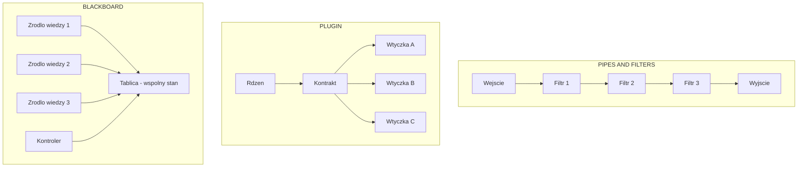
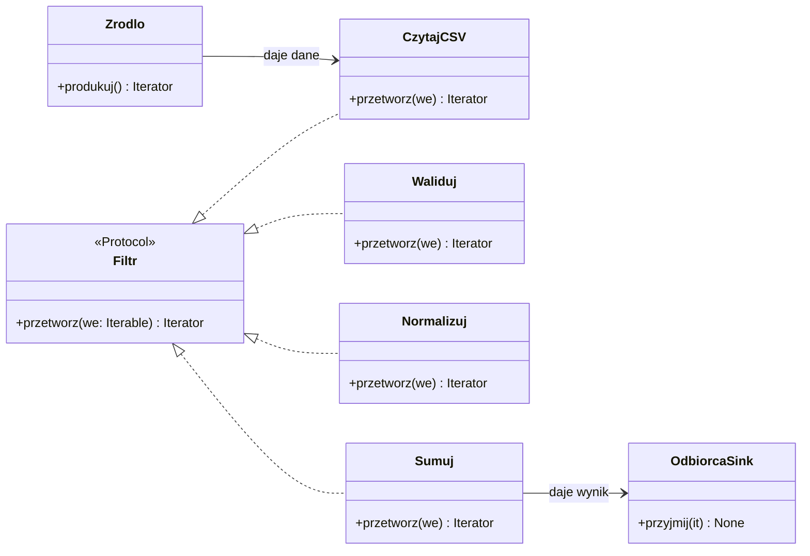
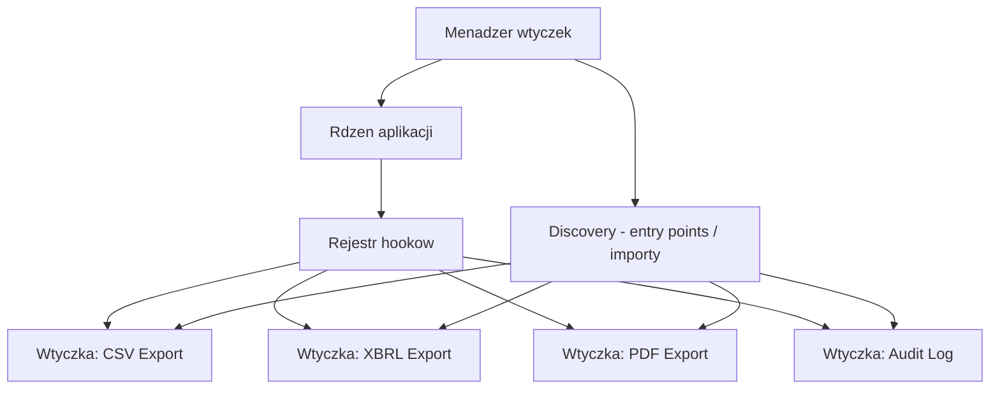
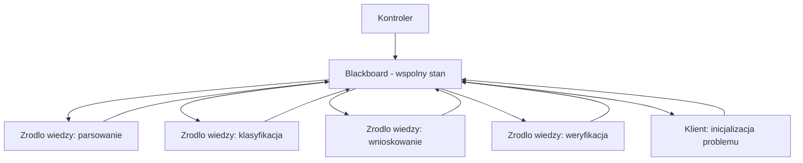
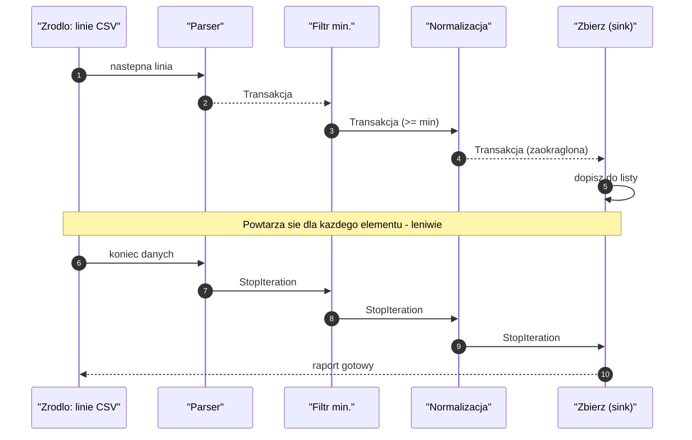
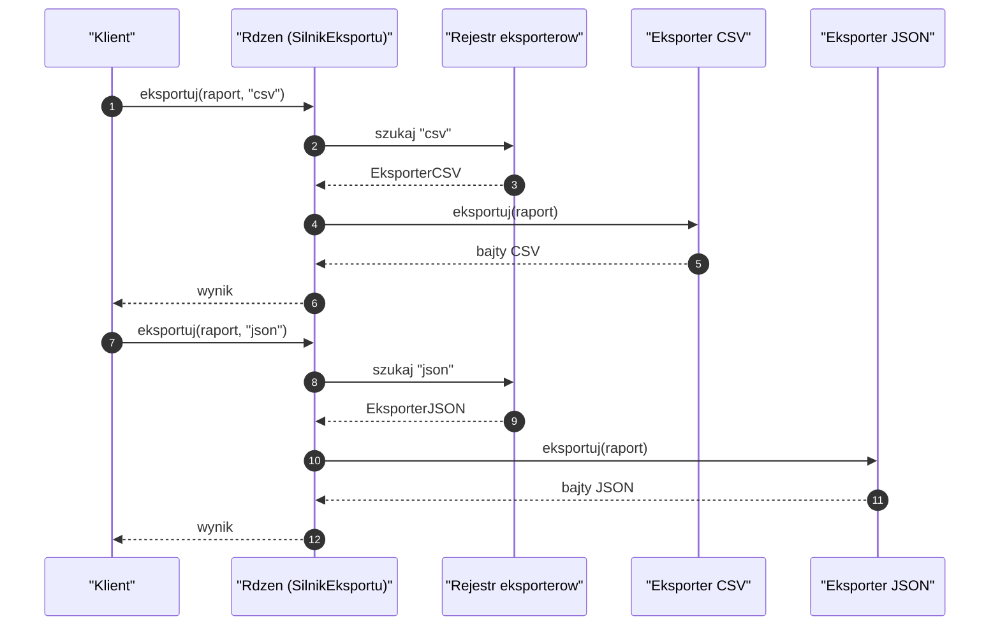
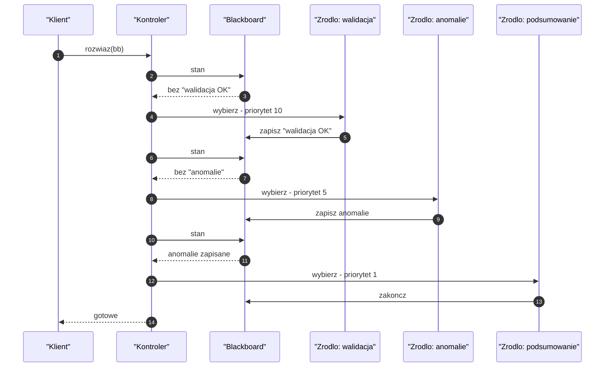
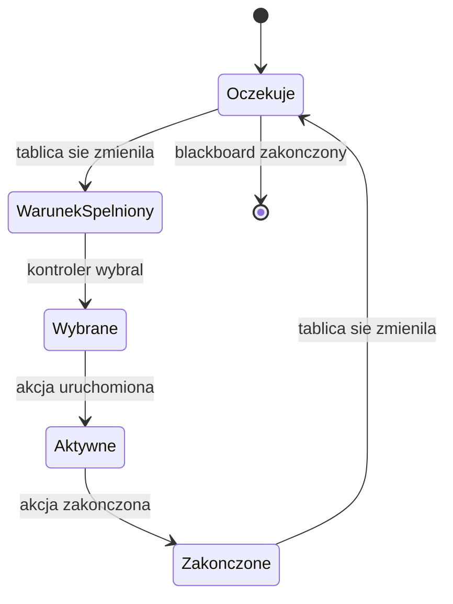
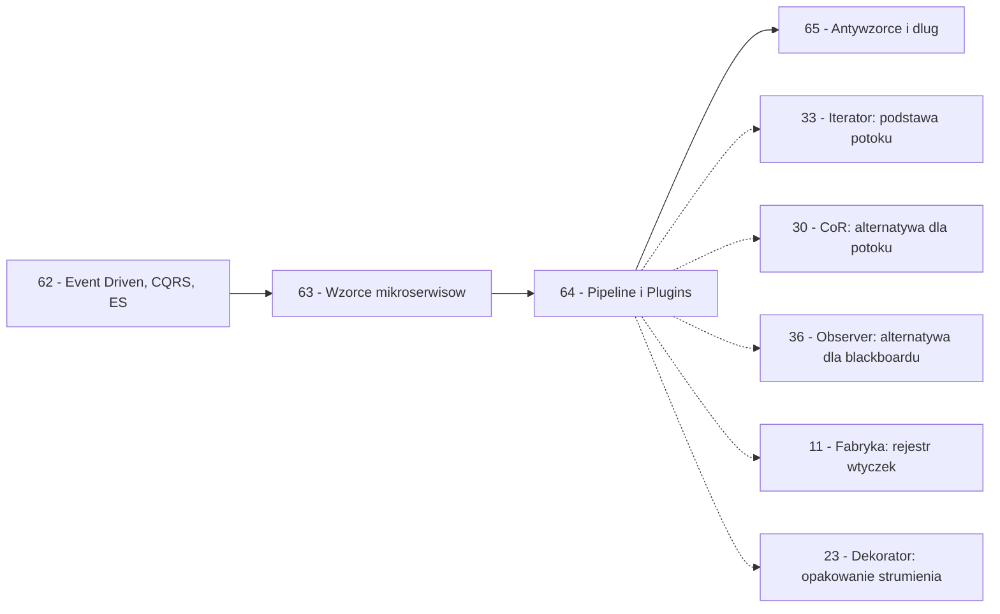

```markdown
---
modul: 64 — Pipes and Filters, architektura wtyczkowa i Blackboard
plik: 64-pipes-filters-plugins-blackboard.md
poziom: sredni
wymaga: [63]
czas: ~230 minut czytania + ~500 minut ćwiczeń
---

# Moduł 64 — Pipes and Filters, architektura wtyczkowa i Blackboard

> **TL;DR**
> - **Pipes and Filters (potoki i filtry)** dzieli przetwarzanie na niezależne, wymienne etapy połączone kanałami; każdy filtr ma jedno zadanie, dane płyną strumieniem, a wynik jest produktem **kompozycji**.
> - **Architektura wtyczkowa (ang. plugin architecture)** pozwala rozszerzać aplikację bez modyfikacji rdzenia; w Pythonie wspierają ją **entry points, `__init_subclass__`, dynamiczne importy i `pluggy`** — ten sam mechanizm, na którym stoi pytest.
> - **Blackboard (tablica wiedzy)** to architektura, w której kilka niezależnych modułów („źródeł wiedzy") współpracuje, dopisując częściowe rozwiązania na wspólnej strukturze danych; **kontroler** decyduje, które źródło działa następne.
> - Trzy architektury mają **różny sposób sterowania**: potok — liniowy, wtyczki — caller-driven, blackboard — state-driven; wybór między nimi zależy od tego, **jak jest podejmowana decyzja o następnym kroku**.
> - Wszystkie trzy są **narzędziami**, nie celami: potok dla ETL i przetwarzania strumieni, wtyczki dla rozszerzalnej aplikacji, blackboard dla złożonych problemów z niepełną wiedzą — każde w swoim kontekście.

---

## 0. Model mentalny

### Linia produkcyjna, konsola do gier i tablica detektywów

Wyobraź sobie **linię produkcyjną w fabryce samochodów**. Na jej początku jest blacha. Ta blacha przechodzi kolejno przez **stacje**: cięcie, tłoczenie, spawanie, lakierowanie, montaż silnika, montaż wnętrza, kontrola jakości. Każda stacja **robi jedną rzecz** i **przekazuje produkt dalej**. Żadna stacja nie musi wiedzieć, co zrobiły wszystkie poprzednie — wystarczy, że dostaje produkt w określonym stanie i przekazuje produkt w innym stanie. Kluczowa właściwość: **jeśli chcesz dodać nową stację (np. montaż systemu audio), nie przebudowujesz całej fabryki**. Wstawiasz nową stację w linii. Stacje po niej **nie wiedzą, że coś nowego się wydarzyło** — dostają po prostu samochód z audio. Ta **modularność przebiegu** jest istotą wzorca **Pipes and Filters**.

Idźmy dalej. Ta sama fabryka produkuje też **konsole do gier**. Konsola ma **rdzeń** — procesor, pamięć, system. Rdzeń nie zmienia się z każdą grą. A gry to **wymienne kartridże** albo pobierane cyfrowo „pluginy". Rdzeń **nie wie**, jakie gry będą w przyszłości — wie tylko, że istnieje gniazdo (kontrakt), a gry do niego pasują. Ile gier — tyle zawartości konsoli. Ile twórców — tyle nowych gier. **Rdzeń nie trzeba zmieniać**, żeby dodać nową grę. To jest **architektura wtyczkowa** (ang. plugin architecture).

Ale jest jeszcze trzeci obraz, całkiem odmienny. Wyobraź sobie salę konferencyjną, w której zebrał się **zespół detektywów** rozwiązujący skomplikowaną sprawę. Na środku sali wisi **duża tablica korkowa**, na której przyczepione są wszystkie materiały: zdjęcia, mapa, notatki, tropy, hipotezy. Detektywi **dopisują** do tablicy swoje ustalenia. Detektyw Kowalski idzie za wskazówką i dodaje do tablicy informację „podejrzany był w X o godzinie Y". Detektyw Nowak widzi to i dodaje „jeśli był w X, to nie mógł być w Z". Trzeci detektyw widzi oba te tropy i dodaje nowy — „skoro nie w Z, to alibi pani A jest fałszywe". **Nie ma jednego szefa, który mówi „teraz rób to"** — jest **stan tablicy**, który decyduje, jaki następny ruch jest sensowny. Gdy tablica zostanie wypełniona w stopniu pozwalającym postawić hipotezę — rozwiązanie jest gotowe. To **avatar wzorca Blackboard** — wzorzec, w którym niezależne moduły („źródła wiedzy" — ang. knowledge sources) współpracują **przez wspólną strukturę danych**, a **kolejność** ich uruchamiania zależy od stanu tej struktury.

Trzy obrazy — trzy różne filozofie. **Linia produkcyjna** to **przepływ liniowy**: dane idą przez ustaloną sekwencję etapów. **Konsola z grami** to **rozszerzalność**: rdzeń zaprasza do współpracy nieznane moduły. **Tablica detektywów** to **współpraca przez wspólny stan**: moduły reagują na to, co zostało już ustalone.

Zwróć uwagę na kluczową różnicę w **kto decyduje o kolejnym kroku**:
- W linii produkcyjnej — **struktura potoku** decyduje. Produkt idzie stacja po stacji, w ustalonej kolejności.
- W konsoli z grami — **użytkownik** decyduje. Wybiera grę, konsola tylko ją uruchamia.
- Na tablicy detektywów — **stan tablicy** decyduje. Detektyw widzi, czego jeszcze brakuje, i idzie to uzupełnić.

| W analogii linii / konsoli / tablicy | W kodzie |
|---|---|
| Blacha na wejściu | Dane wejściowe (strumień, plik, lista) |
| Stacja cięcia | Filtr (element potoku) |
| Przekazanie produktu dalej | Przekazanie strumienia danych do następnego filtra |
| Nowa stacja w linii | Nowy filtr w potoku |
| Rdzeń konsoli | Rdzeń aplikacji (bez znajomości wtyczek) |
| Kartridż / gra | Wtyczka (plugin) |
| Gniazdo konsoli | Kontrakt wtyczki (hook / Protocol) |
| Tablica korkowa | Blackboard — wspólna struktura danych |
| Detektyw | Źródło wiedzy (knowledge source) |
| Decyzja „kto teraz?" | Kontroler blackboardu (control) |
| Rozwiązanie sprawy | Wystarczające wypełnienie tablicy |

> 🧠 **Zapamiętaj** — **Pipes and Filters (potoki i filtry) to architektura przepływu danych: podziel przetwarzanie na niezależne etapy (filtry), połącz je kanałami (pipes), pozwól danym płynąć przez sekwencję. Architektura wtyczkowa (ang. plugin architecture) pozwala rozszerzać aplikację przez zewnętrzne moduły, spełniające ustalony kontrakt — bez zmiany rdzenia. Blackboard to architektura współpracy przez wspólny stan: niezależne źródła wiedzy dopisują częściowe rozwiązania na tablicy, a kontroler wybiera kolejne źródło.**

Zwróć uwagę na trzy słowa kluczowe w tych definicjach: **niezależne etapy**, **kontrakt wtyczki**, **wspólny stan**. Trzy różne mechanizmy niezależności — o tym jest cały ten moduł.

### Diagram — intuicja trzech architektur



*Diagram pokazuje trzy architektury obok siebie: potok to liniowy przepływ danych, wtyczki to rdzeń z kontraktem i wieloma implementacjami, blackboard to wspólny stan z wieloma źródłami wiedzy.*

### Czego te architektury NIE robią

Rozbrójmy kilka mitów — każda z tych architektur ma swoją specyfikę.

**Pipes and Filters:**
- **Nie gwarantują wydajności**. Dzielenie na etapy dodaje narzut. Korzyść jest w **modularności** i **skalowalności**, nie w szybkości.
- **Nie są dla każdego przetwarzania**. Jeśli twoje przetwarzanie ma jedną operację, potok to przesada.
- **Nie są nieskończenie elastyczne w środku**. Etap musi przekazać „coś", co następny rozumie. Kontrakt na danych jest potrzebny.

**Architektura wtyczkowa:**
- **Nie jest darmowa**. Rdzeń musi mieć **kontrakt** (hooki, protokoły), mechanizm **odkrywania** (entry points, skanowanie), i **obsługi błędów** wtyczek. To dużo infrastruktury.
- **Nie rozwiązuje problemu wersji**. Wtyczka pisana pod API 1.0 nie zadziała z API 2.0. Trzeba utrzymywać zgodność albo wersjonować kontrakt.
- **Nie jest bezpieczna automatycznie**. Wtyczka to kod wykonywany z pełnymi uprawnieniami procesu. Jeśli nie ufasz wtyczce, **nie uruchamiaj jej**.

**Blackboard:**
- **Nie jest deterministyczny**. Kolejność działań zależy od stanu tablicy, który zależy od tego, co zrobili poprzednicy, co zależy od… Determinizm wymaga jawnego porządkowania — to utrudnienie.
- **Nie skaluje się dobrze w rozproszeniu**. Tablica współdzielona w jednym procesie; dzielenie jej między procesy wymaga zdarzeń / kolejki.
- **Nie jest łatwy do debugowania**. Nie ma linii wykonania — jest **stan tablicy**, i trzeba z niego wywnioskować, dlaczego kolejny krok był taki, jaki był.

**Wspólne wszystkie trzy:**
- **Nie rozwiązują złej domeny**. Jeśli problem jest źle zdefiniowany, żadna architektura nie pomoże.
- **Nie są dla małego projektu**. Dla 200 linii kodu wszystkie trzy są narzutem.

---

## 1. Problem, który rozwiązujemy

Wejdźmy w domenę 📊 „Sprawozdawczości". System generuje raport dzienny: czyta dane z pliku CSV (transakcje), filtruje błędne, normalizuje pola, wylicza sumy, formatuje i zapisuje. Ktoś napisał to w jednej funkcji.

### Kod „przed"

```python
# raport_v0.py — wersja naiwna, demonstracyjna
# UWAGA: kod celowo pokazuje wszystko w jednej metodzie.

from __future__ import annotations

import json
from dataclasses import dataclass
from datetime import date
from decimal import ROUND_HALF_UP, Decimal
from pathlib import Path


@dataclass(frozen=True)
class Transakcja:
    identyfikator: str
    konto: str
    kwota: Decimal
    waluta: str
    data: date


def przetworz_raport(sciezka: Path, minimum: Decimal) -> dict:
    """Cala logika: czytanie, filtrowanie, normalizacja, sumowanie, formatowanie."""
    # 1. Czytanie z pliku
    linie = sciezka.read_text(encoding="utf-8").splitlines()

    # 2. Parsowanie i walidacja
    transakcje: list[Transakcja] = []
    for linia in linie:
        linia = linia.strip()
        if not linia or linia.startswith("#"):
            continue
        try:
            id_, konto, kwota, waluta, data_str = linia.split(";")
            transakcje.append(Transakcja(
                identyfikator=id_,
                konto=konto,
                kwota=Decimal(kwota),
                waluta=waluta,
                data=date.fromisoformat(data_str),
            ))
        except Exception:
            pass  # cicho ignorujemy bledne linie

    # 3. Filtrowanie
    przefiltrowane = [t for t in transakcje if t.kwota >= minimum]

    # 4. Normalizacja (np. zaokraglenie do groszy)
    znormalizowane = []
    for t in przefiltrowane:
        znormalizowane.append(Transakcja(
            identyfikator=t.identyfikator,
            konto=t.konto,
            kwota=t.kwota.quantize(Decimal("0.01"), rounding=ROUND_HALF_UP),
            waluta=t.waluta,
            data=t.data,
        ))

    # 5. Grupowanie i sumy
    sumy: dict[str, Decimal] = {}
    for t in znormalizowane:
        sumy[t.waluta] = sumy.get(t.waluta, Decimal("0")) + t.kwota

    # 6. Formatowanie
    raport = {
        "liczba_transakcji": len(znormalizowane),
        "sumy_wg_waluty": {k: str(v) for k, v in sumy.items()},
        "transakcje": [
            {
                "id": t.identyfikator,
                "konto": t.konto,
                "kwota": str(t.kwota),
                "waluta": t.waluta,
                "data": t.data.isoformat(),
            }
            for t in znormalizowane
        ],
    }
    return raport


if __name__ == "__main__":
    sciezka = Path("/tmp/dane.csv")
    sciezka.write_text(
        "T1;K1;100.005;PLN;2026-10-09\n"
        "T2;K2;50.00;PLN;2026-10-09\n"
        "bledna linia\n"
        "T3;K1;200.00;EUR;2026-10-09\n",
        encoding="utf-8",
    )
    wynik = przetworz_raport(sciezka, Decimal("100"))
    print(json.dumps(wynik, indent=2))
```

Ten kod **działa**, ale ma **siedem problemów**, które narastają z każdym nowym wymaganiem.

### Code smell — jedna funkcja, sześć etapów, zero niezależności

| Problem | Gdzie | Konsekwencja |
|---|---|---|
| Wszystko w jednej funkcji | `przetworz_raport` | Każda zmiana dotyka tej samej funkcji |
| Nie można dodać etapu bez zmiany funkcji | W środku | Etap walidacji nie da się dodać osobno |
| Trudność w testowaniu pojedynczego etapu | Wszystko razem | Test filtrowania wymaga stworzenia pliku |
| Błędy ignorowane „po cichu" | `except Exception: pass` | Nie wiadomo, ile linii było błędnych |
| Materializuje wszystko | `list[Transakcja]` | Przy dużych plikach brak pamięci |
| Brak konfiguracji | Parametry twardo zakodowane | Nie da się użyć tego samego potoku w 3 kontekstach |
| Trudno dodać wariant | Nowa funkcja | Duplikacja logiki |

### Objawy — poznasz ten problem po tym, że...

- **Nowy etap przetwarzania wymaga zmiany istniejącej funkcji.** Trzeba wejść w jej ciało i dodać kod.
- **Nie można przetestować etapu osobno.** Test filtrowania wymaga przygotowania całego pliku i wywołania całości.
- **Trudno odtworzyć etap w innym kontekście** — np. ta sama normalizacja na danych z API.
- **Wszystkie dane są materializowane.** Przy pliku 10 GB — brak pamięci.
- **Błędy są ignorowane po cichu.** Nie ma statystyk „ile linii było złych".
- **Kod rośnie liniowo z każdą operacją.** 200 linii, 400, 800 — trudno się połapać.
- **Nie da się zmienić kolejności etapów.** Zakodowana w strukturze funkcji.
- **Każda zmiana niesie ze sobą ryzyko regresji** w pozostałych etapach.

---

## 2. Anatomia wzorców

### Pipes and Filters — uczestnicy

| Rola | Odpowiedzialność | Co NIE jest jej zadaniem |
|---|---|---|
| **Filtr (filter)** | Przetwarza strumień danych: pobiera elementy, ewentualnie przekształca, przekazuje dalej | Nie zna innych filtrów; nie decyduje o kolejności |
| **Kanał (pipe)** | Przekazuje dane między filtrami | Nie zawiera logiki — tylko transport |
| **Źródło (source)** | Produkuje dane wejściowe (plik, strumień, API) | Nie zna przetwarzania |
| **Odbiorca (sink)** | Odprowadza wynik (plik, baza, ekran) | Nie zna przetwarzania |
| **Klient (client)** | Składa potoki z filtrów i uruchamia | Nie zawiera logiki filtrów |

### Architektura wtyczkowa — uczestnicy

| Rola | Odpowiedzialność | Co NIE jest jej zadaniem |
|---|---|---|
| **Rdzeń (core / host)** | Definiuje kontrakt (hooki, protokoły); uruchamia wtyczki w odpowiednich momentach | Nie zna konkretnych wtyczek |
| **Kontrakt (contract / hook spec)** | Definiuje, co musi zrobić wtyczka | Nie zawiera implementacji |
| **Wtyczka (plugin)** | Implementuje kontrakt; dodaje funkcjonalność | Nie zna innych wtyczek (chyba że używa hooków rdzenia) |
| **Menadżer wtyczek (plugin manager)** | Odkrywa, rejestruje, uruchamia wtyczki | Nie zawiera logiki biznesowej |
| **Rejestr (registry)** | Trzyma mapę `nazwa → wtyczka` | Nie zawiera logiki |

### Blackboard — uczestnicy

| Rola | Odpowiedzialność | Co NIE jest jej zadaniem |
|---|---|---|
| **Blackboard (tablica)** | Przechowuje wiedzę o problemie; stan jest tym, co modyfikują źródła | Nie zawiera logiki rozwiązywania |
| **Źródło wiedzy (knowledge source)** | Widzi fragment tablicy; potrafi wnieść wkład; **sam deklaruje warunki** kiedy może działać | Nie wywołuje innych źródeł bezpośrednio |
| **Kontroler (control)** | Wybiera, które źródło wiedzy uruchomić następne; sterowanie oparte na stanie tablicy | Nie zawiera logiki źródła; tylko decyduje o kolejności |
| **Klient (client)** | Inicjalizuje problem; uruchamia kontroler aż do rozwiązania | Nie zna źródeł wiedzy |

### Diagram — Pipes and Filters



*Diagram pokazuje potok: źródło produkuje dane, przechodzą one przez kolejne filtry (parsowanie, walidacja, normalizacja, sumowanie), a odbiorca przyjmuje wynik — filtry nie znają się wzajemnie.*

### Diagram — Architektura wtyczkowa



*Diagram pokazuje architekturę wtyczkową: rdzeń definiuje rejestr hooków, menadżer wtyczek odkrywa je przez entry points, a każda wtyczka implementuje kontrakt — rdzeń nie zna konkretnych wtyczek.*

### Diagram — Blackboard



*Diagram pokazuje blackboard: kontroler decyduje, które źródło wiedzy działa; każde źródło czyta tablicę, dopisuje swoje ustalenia i wraca do niej; klient inicjalizuje problem i czeka na rozwiązanie.*

### Warianty: klasyczny vs pythoniczny

| Aspekt | Klasyczny | Pythoniczny |
|---|---|---|
| Filtr | Klasa z `process()` | Funkcja generująca (`yield`) |
| Kanał | Kolejka, kolejka FIFO | Generator / iteracja |
| Kompozycja potoku | Ręczne łączenie | `functools.reduce`, `pipe | pipe` |
| Wtyczka | Interfejs + implementacja | `Protocol` + funkcja |
| Discovery | Framework | `importlib.metadata.entry_points()` |
| Blackboard | Obiekt współdzielony | `dict` z blokadą |
| Kontroler | Klasa z priorytetami | Funkcja wybierająca na podstawie stanu |

Python jest jak zwykle prostszy — generatory, `yield from`, `functools.reduce`, `entry_points` dają narzędzia do wszystkich trzech architektur w minimalnym kodzie.

---

## 3. Implementacja krok po kroku

### Część A — Pipes and Filters

#### Krok 1 — Zdefiniuj kontrakt filtra

Filtr to **funkcja, która przyjmuje iterable i zwraca iterable**.

```python
from collections.abc import Iterable, Iterator
from typing import TypeVar

T = TypeVar("T")
U = TypeVar("U")

Filtr = "Callable[[Iterable[T]], Iterator[U]]"
```

**Kluczowe:** filtr nie wie, skąd pochodzą dane ani dokąd idą. Widzi iterable, zwraca iterable.

#### Krok 2 — Napisz filtry jako generatory

Każdy etap to generator. To najprostsza forma.

```python
from decimal import Decimal, ROUND_HALF_UP
from datetime import date


def parsuj(wiersze: Iterable[str]) -> Iterator[dict]:
    """Parser: linia CSV -> slownik."""
    for i, wiersz in enumerate(wiersze, start=1):
        wiersz = wiersz.strip()
        if not wiersz or wiersz.startswith("#"):
            continue
        czesci = wiersz.split(";")
        if len(czesci) != 5:
            raise ValueError(
                f"linia {i}: oczekiwano 5 pol, jest {len(czesci)}"
            )
        id_, konto, kwota, waluta, data_str = czesci
        yield {
            "id": id_,
            "konto": konto,
            "kwota": Decimal(kwota),
            "waluta": waluta,
            "data": date.fromisoformat(data_str),
        }


def filtruj_minimum(
    wiersze: Iterable[dict], minimum: Decimal
) -> Iterator[dict]:
    """Filtr: przepuszcza tylko rekordy z kwota >= minimum."""
    for rekord in wiersze:
        if rekord["kwota"] >= minimum:
            yield rekord


def normalizuj(wiersze: Iterable[dict]) -> Iterator[dict]:
    """Filtr: zaokragla kwoty do groszy."""
    for rekord in wiersze:
        yield {
            **rekord,
            "kwota": rekord["kwota"].quantize(
                Decimal("0.01"), rounding=ROUND_HALF_UP
            ),
        }


def limit(wiersze: Iterable[dict], n: int) -> Iterator[dict]:
    """Filtr: bierze pierwsze n rekordow."""
    for i, rekord in enumerate(wiersze):
        if i >= n:
            return
        yield rekord
```

#### Krok 3 — Złóż potok

Potok to kompozycja filtrów. Można to zrobić na trzy sposoby.

**Sposób 1 — zagnieżdżenie:**

```python
def zbuduj_potok(plik: Iterable[str], minimum: Decimal) -> Iterator[dict]:
    return normalizuj(filtruj_minimum(parsuj(plik), minimum))
```

**Sposób 2 — `functools.reduce`:**

```python
from functools import reduce


def pipe(*filtry, dane: Iterable):
    """Kompozycja: pipe(f1, f2, f3)(dane) == f3(f2(f1(dane)))."""
    return reduce(lambda acc, f: f(acc), filtry, dane)
```

**Sposób 3 — własny operator `|`:**

```python
class Potok:
    """Leniwe potoki z kompozycja przez |."""

    def __init__(self, iterator: Iterator):
        self._it = iterator

    def __iter__(self):
        return self._it

    def __or__(self, filtr):
        # filtr jest funkcja: Iterator -> Iterator
        return Potok(filtr(self._it))

    def __next__(self):
        return next(self._it)

    @classmethod
    def ze_zrodla(cls, zrodlo: Iterable):
        return cls(iter(zrodlo))
```

Użycie:

```python
potok = (
    Potok.ze_zrodla(wiersze)
    | parsuj
    | (lambda i: filtruj_minimum(i, Decimal("100")))
    | normalizuj
)

for rekord in potok:
    print(rekord)
```

**To elegancka i bardzo pythoniczna forma.** Operator `|` intuicyjnie mówi „przekaż dalej" — jak w potokach shella.

#### Krok 4 — Złóż odbiorcę (sink)

Odbiorca konsumuje strumień — nie zwraca iterable, tylko efekt (zapis, agregacja).

```python
def sumuj_wg_waluty(wiersze: Iterable[dict]) -> dict[str, Decimal]:
    """Agregacja - odbiorca potoku."""
    sumy: dict[str, Decimal] = {}
    for rekord in wiersze:
        waluta = rekord["waluta"]
        sumy[waluta] = sumy.get(waluta, Decimal("0")) + rekord["kwota"]
    return sumy
```

#### Krok 5 — Obsługa błędów w potoku

Potok musi mieć strategię błędów. Trzy miejsca:

```python
class BladPotoku(Exception):
    """Blad przetwarzania w potoku."""


def parsuj_z_logiem(
    wiersze: Iterable[str], log: list[dict]
) -> Iterator[dict]:
    """Parser z logiem bledow - nie przerywa potoku."""
    for i, wiersz in enumerate(wiersze, start=1):
        try:
            yield z_parsuj(wiersz)
        except Exception as blad:
            log.append({"linia": i, "wiersz": wiersz, "blad": str(blad)})
            continue


def parsuj_sciśle(wiersze: Iterable[str]) -> Iterator[dict]:
    """Parser 'fail-fast' - przerywa potok przy pierwszym bledzie."""
    for i, wiersz in enumerate(wiersze, start=1):
        yield z_parsuj(wiersz)  # rzuca wyjatek
```

**Dwie strategie:** *continue* (loguj i idź dalej) albo *fail-fast* (przerwij). Wybór zależy od kontekstu — dla raportu dziennego „continue" bywa OK; dla zamknięcia ksiąg „fail-fast" jest bezpieczniejszy.

### Część B — Architektura wtyczkowa

#### Krok 6 — Zdefiniuj kontrakt

Kontrakt to zestaw hooków (punktów rozszerzenia). W Pythonie można go opisać jako `Protocol`.

```python
from typing import Protocol, runtime_checkable


@runtime_checkable
class EksporterRaportu(Protocol):
    """Wtyczka: cokolwiek, co potrafi wyeksportowac raport."""
    nazwa: str
    def eksportuj(self, raport: dict) -> bytes: ...
```

#### Krok 7 — Rejestr wtyczek

Rejestr trzyma mapę nazwa → implementacja. Napełniany przez `__init_subclass__` albo dekorator.

```python
class EksporterBazowy:
    """Bazowa klasa - automatyczna rejestracja podklas."""
    REJESTR: dict[str, type["EksporterBazowy"]] = {}

    def __init_subclass__(cls, **kwargs) -> None:
        super().__init_subclass__(**kwargs)
        nazwa = getattr(cls, "nazwa", None)
        if nazwa:
            EksporterBazowy.REJESTR[nazwa] = cls

    def eksportuj(self, raport: dict) -> bytes:
        raise NotImplementedError


class EksporterCSV(EksporterBazowy):
    nazwa = "csv"

    def eksportuj(self, raport: dict) -> bytes:
        linie = ["id,konto,kwota,waluta,data"]
        for t in raport["transakcje"]:
            linie.append(
                f"{t['id']},{t['konto']},{t['kwota']},{t['waluta']},{t['data']}"
            )
        return "\n".join(linie).encode("utf-8")


class EksporterJSON(EksporterBazowy):
    nazwa = "json"

    def eksportuj(self, raport: dict) -> bytes:
        return json.dumps(raport, indent=2).encode("utf-8")
```

#### Krok 8 — Rdzeń uruchamia wtyczki

```python
class SilnikRaportow:
    """Rdzen: nie zna konkretnych wtyczek, zna tylko rejestr."""

    def __init__(self, eksportery: list[EksporterBazowy]) -> None:
        self._eksportery = eksportery

    def wyeksportuj_w_formatach(
        self, raport: dict, formaty: list[str]
    ) -> dict[str, bytes]:
        wyniki = {}
        for fmt in formaty:
            if fmt not in EksporterBazowy.REJESTR:
                raise ValueError(f"brak eksportera: {fmt}")
            klasa = EksporterBazowy.REJESTR[fmt]
            eksporter = klasa()
            wyniki[fmt] = eksporter.eksportuj(raport)
        return wyniki
```

#### Krok 9 — Discovery przez entry points

Wtyczki mogą być **pakietami zewnętrznymi**. Standard Pythona — `importlib.metadata.entry_points()`.

```python
from importlib.metadata import entry_points


def odkryj_wtyczki_produkcyjne() -> dict[str, type]:
    """Odkrywa wtyczki zarejestrowane przez entry points w setup.cfg/pyproject.toml."""
    znalezione: dict[str, type] = {}
    for ep in entry_points(group="raport.exporters"):
        try:
            klasa = ep.load()
            znalezione[ep.name] = klasa
        except Exception as blad:
            log.exception("nie mozna zaladowac wtyczki %s: %s", ep.name, blad)
    return znalezione
```

W `pyproject.toml` pakietu wtyczki:

```toml
[project.entry-points."raport.exporters"]
csv = "moj_pakiet.wtyczki:EksporterCSV"
xbrl = "moj_pakiet.wtyczki:EksporterXBRL"
```

**Tak działa ekosystem wtyczek w Pythonie.** pytest, flake8, Sphinx — wszystkie używają entry points.

#### Krok 10 — Walidacja kontraktu

Wtyczka musi spełniać kontrakt. Sprawdzamy to w **runtime** przy rejestracji.

```python
def zarejestruj_bezpiecznie(
    klasa: type, wzorzec: type
) -> None:
    """Sprawdza, czy klasa spelnia kontrakt."""
    if not issubclass(klasa, wzorzec):
        raise TypeError(f"{klasa.__name__} nie dziedziczy po {wzorzec.__name__}")
    # Dodatkowe sprawdzenia: obecnosc metod, atrybutow
    for metoda in ("eksportuj",):
        if not callable(getattr(klasa, metoda, None)):
            raise TypeError(
                f"{klasa.__name__} nie implementuje {metoda}"
            )
```

### Część C — Blackboard

#### Krok 11 — Zdefiniuj blackboard

Tablica to słownik ze wspólnym stanem. Forma może być dowolna.

```python
from dataclasses import dataclass, field
from decimal import Decimal
from typing import Any


@dataclass
class Blackboard:
    """Wspolna struktura wiedzy o problemie."""
    problem: str
    dane: dict[str, Any] = field(default_factory=dict)
    hipotezy: list[str] = field(default_factory=list)
    wynik: dict | None = None
    zakonczony: bool = False

    def zapisz(self, klucz: str, wartosc: Any) -> None:
        self.dane[klucz] = wartosc

    def odczytaj(self, klucz: str, domyslna=None) -> Any:
        return self.dane.get(klucz, domyslna)

    def dodaj_hipoteze(self, hipoteza: str) -> None:
        self.hipotezy.append(hipoteza)
```

#### Krok 12 — Zdefiniuj źródła wiedzy

Każde źródło **deklaruje warunek** — kiedy może działać.

```python
@dataclass
class ZrodloWiedzy:
    """Zrodlo wiedzy: widzi blackboard, potrafi wniesc wkład."""
    nazwa: str
    warunek: Callable[[Blackboard], bool]
    akcja: Callable[[Blackboard], None]
    priorytet: int = 0

    def moze_dzialac(self, bb: Blackboard) -> bool:
        return self.warunek(bb) and not bb.zakonczony

    def dzialaj(self, bb: Blackboard) -> None:
        self.akcja(bb)
```

#### Krok 13 — Kontroler blackboardu

```python
class KontrolerBlackboard:
    """Kontroler: wybiera kolejne zrodlo wiedzy i uruchamia je az do zakonczenia."""

    def __init__(
        self,
        zrodla: list[ZrodloWiedzy],
        maks_iteracji: int = 100,
    ) -> None:
        self._zrodla = zrodla
        self._maks = maks_iteracji

    def rozwiaz(self, bb: Blackboard) -> None:
        for numer in range(self._maks):
            if bb.zakonczony:
                return
            wybrane = self._wybierz(bb)
            if wybrane is None:
                return
            wybrane.dzialaj(bb)
        raise RuntimeError(
            f"blackboard nie zakonczyl sie w {self._maks} iteracjach"
        )

    def _wybierz(self, bb: Blackboard) -> ZrodloWiedzy | None:
        """Wybiera zrodlo o najwyzszym priorytecie, ktore moze dzialac."""
        dostepne = [
            z for z in self._zrodla if z.moze_dzialac(bb)
        ]
        if not dostepne:
            return None
        return max(dostepne, key=lambda z: z.priorytet)
```

**Kluczowa decyzja:** kontroler decyduje na podstawie **stanu tablicy** i **priorytetu źródła**. To nie jest „kolejka zadań" — to wybór „co jest teraz sensowne".

#### Krok 14 — Weryfikacja

| Element | Wartość |
|---|---|
| Filtry — testowalność | Każdy filtr testowany osobno z iterable |
| Filtry — kompozycja | Przez `|` albo `reduce` |
| Wtyczki — kontrakt | `Protocol` + `__init_subclass__` |
| Wtyczki — discovery | Entry points |
| Wtyczki — walidacja | `issubclass` + obecność metod |
| Blackboard — stan | Słownik z blokadą |
| Blackboard — kontroler | Priorytety + warunki |

---

## 4. Wersje pythoniczne i warianty

### 4.1 Potok — kompozycja funkcyjna

Najkrótsza forma. `functools.reduce` do kompozycji.

```python
from functools import reduce


def rurkuj(*funkcje):
    def potok(dane):
        return reduce(lambda acc, f: f(acc), funkcje, dane)
    return potok


# Uzycie
potok = rurkuj(
    parsuj,
    lambda i: filtruj_minimum(i, Decimal("100")),
    normalizuj,
    lambda i: list(i),
)

wynik = potok(wiersze)
```

### 4.2 Potok — operator `|` z `__or__`

Wariant pokazany w sekcji 3. Bardzo elegancki dla danych strumieniowych.

### 4.3 Potok — `pipe` z biblioteki `pipe`

Istnieje biblioteka `pipe` w PyPI, która daje `|`:

```python
from pipe import map, filter, where


# pipe pozwala na: lista | map(...) | filter(...) | where(...)
```

Ale wprowadzanie zewnętrznej zależności tylko dla operatora `|` — to często nadmiar. Własna klasa `Potok` wystarczy.

### 4.4 Potok asynchroniczny (asyncio)

Dla operacji I/O-bound — `asyncio` z async generatorami.

```python
async def parsuj_async(wiersze: AsyncIterator[str]) -> AsyncIterator[dict]:
    async for wiersz in wiersze:
        yield parsuj_linia(wiersz)


async def filtruj_async(
    wiersze: AsyncIterator[dict], minimum: Decimal
) -> AsyncIterator[dict]:
    async for rekord in wiersze:
        if rekord["kwota"] >= minimum:
            yield rekord


# Uzycie
async def main():
    async for rekord in filtrfilter_async(parsuj_async(zrodlo()), Decimal("100")):
        print(rekord)
```

Async generatory to naturalne dla potoków I/O. Pozwalają zarządzać **backpressure** (naciskiem, gdy konsument jest wolniejszy niż producent) przez `await`.

### 4.5 Wtyczki przez `pluggy`

`pluggy` to biblioteka, na której stoi pytest. Definiuje **hookspec** (kontrakt), **hookimpl** (implementacja), **plugin manager**.

```python
import pluggy

# Kontrakt
hookspec = pluggy.HookspecMarker("raporty")
hookimpl = pluggy.HookimplMarker("raporty")


class SpecEksportera:
    @hookspec
    def eksportuj(self, raport: dict) -> bytes:
        """Eksportuje raport do formatu wtyczki."""


# Implementacja wtyczki
class EksporterCSVPlugin:
    @hookimpl
    def eksportuj(self, raport: dict) -> bytes:
        return b"csv content"


# Manager
manager = pluggy.PluginManager("raporty")
manager.add_hookspecs(SpecEksportera)
manager.register(EksporterCSVPlugin())

# Uruchomienie - wszystkie wtyczki implementujace hook
wyniki = manager.hook.eksportuj(raport=raport_dict)
```

**Zalety `pluggy`:** standaryzacja, historia wywołań, specyfikacje, walidacja.

### 4.6 Wtyczki przez `importlib` — skanowanie katalogu

Dla wtyczek w formie plików `.py` w katalogu.

```python
import importlib
import pkgutil
from pathlib import Path


def odkryj_z_katalogu(katalog: Path, pakiet: str) -> dict[str, type]:
    """Skanuje katalog, importuje moduly, zwraca znalezione klasy."""
    znalezione: dict[str, type] = {}
    sys.path.insert(0, str(katalog))
    try:
        for _, nazwa, _ in pkgutil.iter_modules([str(katalog)]):
            modul = importlib.import_module(nazwa)
            if hasattr(modul, "WTYCZKA"):
                wtyczka = modul.WTYCZKA
                znalezione[wtyczka.nazwa] = wtyczka
    finally:
        sys.path.remove(str(katalog))
    return znalezione
```

### 4.7 Blackboard — z blokadą dla wielowątkowości

Dla wielu wątków — tabla ze `Lock`.

```python
from threading import Lock


class BezpiecznaTablica:
    def __init__(self) -> None:
        self._dane: dict[str, Any] = {}
        self._hipotezy: list[str] = []
        self._blokada = Lock()

    def zapisz(self, klucz: str, wartosc: Any) -> None:
        with self._blokada:
            self._dane[klucz] = wartosc

    def odczytaj(self, klucz: str) -> Any:
        with self._blokada:
            return self._dane.get(klucz)
```

### 4.8 Blackboard w stylu agentowym

Nowoczesne systemy agentowe (LLM + narzędzia) to wariacje blackboardu.

```python
@dataclass
class TablicaAgenta:
    cel: str
    kontekst: dict = field(default_factory=dict)
    historia: list[dict] = field(default_factory=list)
    gotowe: bool = False


def agent_planujacy(bb: TablicaAgenta) -> None:
    if "plan" not in bb.kontekst:
        bb.kontekst["plan"] = "rozloz na kroki"


def agent_wykonawczy(bb: TablicaAgenta) -> None:
    if "plan" in bb.kontekst and "wynik" not in bb.kontekst:
        bb.kontekst["wynik"] = "wynik wykonania"


def agent_weryfikujacy(bb: TablicaAgenta) -> None:
    if "wynik" in bb.kontekst and not bb.gotowe:
        bb.gotowe = True
```

**Podobieństwo do LLM agentów:** tam też jest wspólny kontekst (rozmowa + narzędzia), agenci (prompty, różne role) dopisują do wspólnego stanu, kontroler (orkiestrator) decyduje, kto działa następny. **Różnica:** w LLM kontroler często jest modelem, który sam wybiera następnego agenta na podstawie stanu kontekstu. W klasycznym blackboardzie kontroler ma jawną logikę wyboru.

### 4.9 Podsumowanie — tabela wyboru

| Potrzeba | Rozwiązanie |
|---|---|
| Liniowy potok przetwarzania | Generatory + kompozycja |
| Potok z operatorem `|` | Klasa `Potok` z `__or__` |
| Równoległy potok | `concurrent.futures`, `multiprocessing` |
| Potok I/O-bound | `asyncio` + async generators |
| Rozszerzalna aplikacja | `__init_subclass__` / `pluggy` |
| Wtyczki pakowane zewnętrznie | `importlib.metadata.entry_points` |
| Wtyczki z katalogu | `pkgutil`, `importlib` |
| Blackboard prosty | Słownik + lista źródeł |
| Blackboard wielowątkowy | `Lock` na tablicy |
| Blackboard agentowy | Kontekst + dedykowani agenci |

> 🧠 **Zapamiętaj** — Trzy architektury mają naturalne realizacje w Pythonie: **potok** to generatory i `functools.reduce`; **wtyczki** to `Protocol` + `__init_subclass__` + entry points; **blackboard** to słownik + lista źródeł wiedzy + kontroler. Każda z nich wymaga **konkretnej decyzji projektowej** — którą domenę chcesz obsłużyć — a nie uniwersalnego szablonu.

---

## 5. Przykład z życia: 📊 Sprawozdawczość — pełny uruchamialny kod

Zbudujemy pełny system, który pokazuje **wszystkie trzy architektury**. Potok do przetwarzania, wtyczki do eksportu, blackboard do analizy anomalii.

### Kod

```python
# raporty_all.py — pelny przyklad trzech architektur
from __future__ import annotations

import json
import logging
from collections.abc import Callable, Iterable, Iterator
from dataclasses import dataclass, field
from datetime import date
from decimal import ROUND_HALF_UP, Decimal
from functools import reduce
from typing import Any, Protocol, runtime_checkable


log = logging.getLogger(__name__)
GROSZ = Decimal("0.01")


# ===========================================================================
# CZESC A — PIPES AND FILTERS
# ===========================================================================

@dataclass(frozen=True)
class Transakcja:
    identyfikator: str
    konto: str
    kwota: Decimal
    waluta: str
    data: date

    def jako_dict(self) -> dict:
        return {
            "id": self.identyfikator,
            "konto": self.konto,
            "kwota": str(self.kwota),
            "waluta": self.waluta,
            "data": self.data.isoformat(),
        }


def parsuj(wiersze: Iterable[str]) -> Iterator[Transakcja]:
    """Filtr 1: parsuje linie CSV."""
    for numer, wiersz in enumerate(wiersze, start=1):
        wiersz = wiersz.strip()
        if not wiersz or wiersz.startswith("#"):
            continue
        czesci = wiersz.split(";")
        if len(czesci) != 5:
            raise ValueError(
                f"linia {numer}: oczekiwano 5 pol, jest {len(czesci)}"
            )
        id_, konto, kwota, waluta, data_str = czesci
        yield Transakcja(
            identyfikator=id_,
            konto=konto,
            kwota=Decimal(kwota),
            waluta=waluta,
            data=date.fromisoformat(data_str),
        )


def filtruj_minimum(
    transakcje: Iterable[Transakcja], minimum: Decimal
) -> Iterator[Transakcja]:
    """Filtr 2: przepuszcza tylko transakcje >= minimum."""
    for t in transakcje:
        if t.kwota >= minimum:
            yield t


def normalizuj(
    transakcje: Iterable[Transakcja],
) -> Iterator[Transakcja]:
    """Filtr 3: zaokragla kwoty do groszy."""
    for t in transakcje:
        yield Transakcja(
            identyfikator=t.identyfikator,
            konto=t.konto,
            kwota=t.kwota.quantize(GROSZ, rounding=ROUND_HALF_UP),
            waluta=t.waluta,
            data=t.data,
        )


def zbierz(
    transakcje: Iterable[Transakcja],
) -> dict[str, Any]:
    """Odbiorca (sink): konsumuje strumien i tworzy raport."""
    lista: list[Transakcja] = []
    sumy: dict[str, Decimal] = {}
    for t in transakcje:
        lista.append(t)
        sumy[t.waluta] = sumy.get(t.waluta, Decimal("0")) + t.kwota
    return {
        "liczba_transakcji": len(lista),
        "sumy_wg_waluty": {k: str(v) for k, v in sumy.items()},
        "transakcje": [t.jako_dict() for t in lista],
    }


class Potok:
    """Potok leniwy z kompozycja przez operator |."""

    def __init__(self, iterator: Iterator) -> None:
        self._it = iterator

    def __iter__(self) -> Iterator:
        return self._it

    def __or__(self, filtr: Callable) -> "Potok":
        return Potok(filtr(self._it))

    @classmethod
    def ze_zrodla(cls, zrodlo: Iterable) -> "Potok":
        return cls(iter(zrodlo))


COPILOT = None  # placeholder


# ===========================================================================
# CZESC B — ARCHITEKTURA WTYCZKOWA
# ===========================================================================

@runtime_checkable
class EksporterRaportu(Protocol):
    """Kontrakt wtyczki: cokolwiek, co potrafi wyeksportowac raport."""
    nazwa: str
    def eksportuj(self, raport: dict) -> bytes: ...


class RejestrEksporterow:
    """Rejestruje klasy wtyczek przez __init_subclass__."""

    EMPTY: dict[str, type] = {}

    def __init_subclass__(cls, **kwargs) -> None:
        super().__init_subclass__(**kwargs)
        nazwa = getattr(cls, "nazwa", None)
        if nazwa:
            RejestrEksporterow.EMPTY[nazwa] = cls


class EksporterBazowy(RejestrEksporterow):
    """Klasa bazowa dla wszystkich eksporterow."""

    nazwa: str = ""

    def eksportuj(self, raport: dict) -> bytes:
        raise NotImplementedError


class EksporterCSV(EksporterBazowy):
    nazwa = "csv"

    def eksportuj(self, raport: dict) -> bytes:
        linie = ["id,konto,kwota,waluta,data"]
        for t in raport["transakcje"]:
            linie.append(
                f"{t['id']},{t['konto']},{t['kwota']},{t['waluta']},{t['data']}"
            )
        return "\n".join(linie).encode("utf-8")


class EksporterJSON(EksporterBazowy):
    nazwa = "json"

    def eksportuj(self, raport: dict) -> bytes:
        return json.dumps(raport, indent=2).encode("utf-8")


class EksporterXML(EksporterBazowy):
    nazwa = "xml"

    def eksportuj(self, raport: dict) -> bytes:
        linie = ["<raport>"]
        for t in raport["transakcje"]:
            linie.append(
                f'  <tx id="{t["id"]}" kwota="{t["kwota"]}" '
                f'waluta="{t["waluta"]}"/>'
            )
        linie.append("</raport>")
        return "\n".join(linie).encode("utf-8")


class SilnikEksportu:
    """Rdzen: nie zna konkretnych wtyczek - tylko rejestr."""

    def __init__(self) -> None:
        self._rejestr = dict(RejestrEksporterow.EMPTY)

    def dostepne(self) -> list[str]:
        return sorted(self._rejestr)

    def eksportuj(self, raport: dict, format_: str) -> bytes:
        if format_ not in self._rejestr:
            raise ValueError(
                f"nieznany format {format_!r}; dostepne: {self.dostepne()}"
            )
        klasa = self._rejestr[format_]
        return klasa().eksportuj(raport)


# ===========================================================================
# CZESC C — BLACKBOARD
# ===========================================================================

@dataclass
class Blackboard:
    """Wspolna tablica wiedzy o raporcie."""
    raport: dict
    hipotezy: list[str] = field(default_factory=list)
    wynik: dict = field(default_factory=dict)
    zakonczony: bool = False


@dataclass
class ZrodloWiedzy:
    nazwa: str
    warunek: Callable[[Blackboard], bool]
    akcja: Callable[[Blackboard], None]
    priorytet: int = 0

    def moze_dzialac(self, bb: Blackboard) -> bool:
        return self.warunek(bb) and not bb.zakonczony

    def dzialaj(self, bb: Blackboard) -> None:
        self.akcja(bb)


class KontrolerBlackboard:
    def __init__(self, zrodla: list[ZrodloWiedzy], maks: int = 50) -> None:
        self._zrodla = zrodla
        self._maks = maks

    def rozwiaz(self, bb: Blackboard) -> None:
        for numer in range(self._maks):
            if bb.zakonczony:
                return
            wybrane = self._wybierz(bb)
            if wybrane is None:
                raise RuntimeError(
                    f"blackboard zablokowany - brak zrodla ktore moze dzialac"
                )
            wybrane.dzialaj(bb)
        raise RuntimeError(f"blackboard nie zakonczyl sie w {self._maks} krokach")

    def _wybierz(self, bb: Blackboard) -> ZrodloWiedzy | None:
        dostepne = [z for z in self._zrodla if z.moze_dzialac(bb)]
        if not dostepne:
            return None
        return max(dostepne, key=lambda z: z.priorytet)


# --- Zrodla wiedzy dla blackboardu ---

def zrodlo_walidacja(bb: Blackboard) -> None:
    """Zrodlo: sprawdza, czy raport ma wymagane sekcje."""
    if "transakcje" not in bb.raport:
        bb.hipotezy.append("raport nie zawiera transakcji")
        bb.zakonczony = True
        return
    bb.hipotezy.append("walidacja OK")


def zrodlo_anomalie(bb: Blackboard) -> None:
    """Zrodlo: wykrywa anomalie w kwotach."""
    transakcje = bb.raport.get("transakcje", [])
    anomalie = [
        t for t in transakcje if Decimal(t["kwota"]) > Decimal("100000")
    ]
    if anomalie:
        bb.hipotezy.append(
            f"znaleziono {len(anomalie)} transakcji powyzej 100k"
        )
        bb.wynik["anomalie"] = [t["id"] for t in anomalie]
    else:
        bb.hipotezy.append("brak duzych transakcji")


def zrodlo_koncentracja(bb: Blackboard) -> None:
    """Zrodlo: wykrywa koncentracje na jednym koncie."""
    liczniki: dict[str, int] = {}
    for t in bb.raport.get("transakcje", []):
        liczniki[t["konto"]] = liczniki.get(t["konto"], 0) + 1
    if liczniki:
        konto_max = max(liczniki, key=liczniki.get)
        if liczniki[konto_max] > 2:
            bb.hipotezy.append(
                f"koncentracja na {konto_max}: {liczniki[konto_max]} transakcji"
            )
            bb.wynik["koncentracja"] = konto_max


def zrodlo_podsumowanie(bb: Blackboard) -> None:
    """Zrodlo: dodaje podsumowanie."""
    bb.wynik["podsumowanie"] = {
        "liczba_hipotez": len(bb.hipotezy),
        "gotowy": "anomalie" not in bb.wynik,
    }
    bb.zakonczony = True


def zbuduj_blackboard() -> KontrolerBlackboard:
    zrodla = [
        ZrodloWiedzy(
            "walidacja",
            lambda bb: "transakcje" not in bb.raport or "walidacja OK" not in bb.hipotezy,
            zrodlo_walidacja,
            priorytet=10,
        ),
        ZrodloWiedzy(
            "anomalie",
            lambda bb: "walidacja OK" in bb.hipotezy and "anomalie" not in bb.wynik,
            zrodlo_anomalie,
            priorytet=5,
        ),
        ZrodloWiedzy(
            "koncentracja",
            lambda bb: "anomalie" in bb.wynik and "koncentracja" not in bb.wynik,
            zrodlo_koncentracja,
            priorytet=3,
        ),
        ZrodloWiedzy(
            "podsumowanie",
            lambda bb: "koncentracja" in bb.wynik or (
                "anomalie" in bb.wynik and "koncentracja" not in bb.wynik
            ),
            zrodlo_podsumowanie,
            priorytet=1,
        ),
    ]
    return KontrolerBlackboard(zrodla)


# ===========================================================================
# DEMONSTRACJA
# ===========================================================================

DANE = """\
T1;K1;100.005;PLN;2026-10-09
T2;K2;50.00;PLN;2026-10-09
# komentarz
T3;K1;200.00;EUR;2026-10-09
T4;K1;150000.00;PLN;2026-10-09
T5;K3;300.00;PLN;2026-10-09
""".strip()


if __name__ == "__main__":
    print("=== 1. Potok: przetwarzanie danych ===")
    potok = (
        Potok.ze_zrodla(DANE.splitlines())
        | parsuj
        | (lambda i: filtruj_minimum(i, Decimal("100")))
        | normalizuj
    )
    raport = zbierz(potok)
    print(f"  liczba transakcji: {raport['liczba_transakcji']}")
    print(f"  sumy: {raport['sumy_wg_waluty']}")

    print("\n=== 2. Wtyczki: dostepne formaty ===")
    silnik = SilnikEksportu()
    print(f"  dostepne: {silnik.dostepne()}")
    for fmt in silnik.dostepne():
        bajty = silnik.eksportuj(raport, fmt)
        print(f"  {fmt}: {len(bajty)} bajtow")

    print("\n=== 3. Blackboard: analiza raportu ===")
    bb = Blackboard(raport=raport)
    kontroler = zbuduj_blackboard()
    kontroler.rozwiaz(bb)
    print(f"  hipotezy: {bb.hipotezy}")
    print(f"  wynik: {bb.wynik}")
    print(f"  zakonczony: {bb.zakonczony}")
```

### Co ten przykład pokazuje

**Punkt 1 — potok**. Dane przechodzą przez `parsuj`, filtr minimum, `normalizuj`. Każdy etap niezależny, kompozycja przez `|`. Testowalne osobno.

**Punkt 2 — wtyczki**. Trzy eksportery (CSV, JSON, XML) **implementują ten sam kontrakt**. Silnik nie wie o konkretnych — używa rejestru napełnionego przez `__init_subclass__`. Dodanie czwartego eksportera to nowa klasa.

**Punkt 3 — blackboard.** Kontroler uruchamia źródła wiedzy w kolejności wynikającej ze stanu tablicy: najpierw walidacja, potem anomalie, potem koncentracja, na końcu podsumowanie. Każde źródło ma **warunek** i **priorytet**. Kolejność **wynika z wiedzy**, nie z listy.

### Testy

```python
# test_raporty_all.py
from datetime import date
from decimal import Decimal

import pytest

from raporty_all import (
    Blackboard,
    EksporterBazowy,
    EksporterCSV,
    EksporterJSON,
    EksporterXML,
    EksporterRaportu,
    KontrolerBlackboard,
    Potok,
    RejestrEksporterow,
    SilnikEksportu,
    Transakcja,
    ZrodloWiedzy,
    filtruj_minimum,
    normalizuj,
    parsuj,
    zbierz,
    zbuduj_blackboard,
)


# --- Potok: kazdy filtr osobno -----------------------------------------------

def test_parsuj_zwraca_transakcje() -> None:
    wynik = list(parsuj(["T1;K1;100.00;PLN;2026-10-09"]))
    assert len(wynik) == 1
    assert wynik[0].identyfikator == "T1"


def test_parsuj_pomija_komentarze() -> None:
    wynik = list(parsuj(["# komentarz", "T1;K1;100.00;PLN;2026-10-09"]))
    assert len(wynik) == 1


def test_parsuj_rzuca_dla_zlej_linii() -> None:
    with pytest.raises(ValueError, match="oczekiwano"):
        list(parsuj(["za;malo"]))


def test_filtruj_minimum() -> None:
    transakcje = [
        Transakcja("T1", "K1", Decimal("100"), "PLN", date.today()),
        Transakcja("T2", "K1", Decimal("50"), "PLN", date.today()),
    ]
    wynik = list(filtruj_minimum(iter(transakcje), Decimal("80")))
    assert len(wynik) == 1
    assert wynik[0].identyfikator == "T1"


def test_normalizuj_zaokragla() -> None:
    t = Transakcja("T1", "K1", Decimal("100.005"), "PLN", date.today())
    wynik = list(normalizuj(iter([t])))
    assert wynik[0].kwota == Decimal("100.01")


# --- Potok: kompozycja -------------------------------------------------------

def test_potok_z_operatorem() -> None:
    potok = (
        Potok.ze_zrodla(["T1;K1;100.00;PLN;2026-10-09"])
        | parsuj
        | normalizuj
    )
    wynik = list(potok)
    assert len(wynik) == 1


def test_potok_zbierz_tworzy_raport() -> None:
    potok = Potok.ze_zrodla([
        "T1;K1;100.00;PLN;2026-10-09",
        "T2;K2;200.00;EUR;2026-10-09",
    ]) | parsuj
    raport = zbierz(potok)
    assert raport["liczba_transakcji"] == 2
    assert raport["sumy_wg_waluty"]["PLN"] == "100.00"


# --- Wtyczki -----------------------------------------------------------------

def test_rejestr_zawiera_wszystkie_wtyczki() -> None:
    assert {"csv", "json", "xml"} <= set(RejestrEksporterow.EMPTY)


def test_kazda_wtyczka_spelnia_kontrakt() -> None:
    for klasa in (EksporterCSV, EksporterJSON, EksporterXML):
        inst = klasa()
        assert isinstance(inst, EksporterRaportu)
        assert inst.nazwa


def test_silnik_eksportuje_w_kazdym_formacie() -> None:
    silnik = SilnikEksportu()
    raport = {"transakcje": [{"id": "T1", "konto": "K1", "kwota": "100",
                              "waluta": "PLN", "data": "2026-10-09"}]}
    for fmt in silnik.dostepne():
        bajty = silnik.eksportuj(raport, fmt)
        assert isinstance(bajty, bytes)
        assert len(bajty) > 0


def test_silnik_rzuca_dla_nieznanego_formatu() -> None:
    silnik = SilnikEksportu()
    with pytest.raises(ValueError, match="nieznany"):
        silnik.eksportuj({}, "yaml")


def test_nowa_wtyczka_dolacza_do_rejestru() -> None:
    class EksporterTSV(EksporterBazowy):
        nazwa = "tsv"
        def eksportuj(self, raport):
            return b"tsv"

    assert "tsv" in RejestrEksporterow.EMPTY
    # Sprzatanie
    del RejestrEksporterow.EMPTY["tsv"]


# --- Blackboard --------------------------------------------------------------

def test_blackboard_wykonuje_zrodla() -> None:
    bb = Blackboard(raport={"transakcje": [
        {"id": "T1", "konto": "K1", "kwota": "100", "waluta": "PLN"}
    ]})
    kontroler = zbuduj_blackboard()
    kontroler.rozwiaz(bb)
    assert bb.zakonczony
    assert "walidacja OK" in bb.hipotezy


def test_blackboard_wykrywa_anomalie() -> None:
    bb = Blackboard(raport={"transakcje": [
        {"id": "T1", "konto": "K1", "kwota": "200000", "waluta": "PLN"}
    ]})
    kontroler = zbuduj_blackboard()
    kontroler.rozwiaz(bb)
    assert "anomalie" in bb.wynik
    assert "T1" in bb.wynik["anomalie"]


def test_blackboard_rzuca_przy_braku_walidacji() -> None:
    bb = Blackboard(raport={})
    kontroler = zbuduj_blackboard()
    kontroler.rozwiaz(bb)
    assert bb.zakonczony
    assert "raport nie zawiera transakcji" in bb.hipotezy[0]
```

Ostatnie testy pokazują, że blackboard **decyduje na podstawie stanu** — najpierw walidacja, potem kolejne kroki.

---

## 6. Dynamika

### 6.1 Potok — dane przepływają przez etapy



*Diagram pokazuje leniwy przepływ w potoku: dane przechodzą przez kolejne filtry jedna po drugiej, a każdy etap przetwarza dokładnie tyle, ile wynika z żądania następnego — nie materializuje całości.*

### 6.2 Wtyczki — uruchomienie przez rdzeń



*Diagram pokazuje, że rdzeń woła wtyczki tylko **za pośrednictwem rejestru** — nie zna konkretnych klas, nazwy wtyczek są rozwiązywane w runtime.*

### 6.3 Blackboard — kontroler wybiera źródła



*Diagram pokazuje, że kontroler **nie zna kolejności z góry** — wybiera źródło na podstawie stanu tablicy. Kolejne kroki **wynikają** z tego, co już zostało ustalone.*

### 6.4 Cykl życia źródła wiedzy w blackboardzie



*Diagram pokazuje cykl życia źródła wiedzy: jest w stanie oczekiwania; gdy warunek się spełnia, kontroler może je wybrać; po wykonaniu wraca do oczekiwania albo kończy się, gdy blackboard zgłosi zakończenie.*

> 💡 **Intuicja** — Potok jest jak **przenośnik taśmowy**: ruch jest ustalony, wszystko idzie w jedną stronę. Wtyczki są jak **konsola z grami**: gniazda mają kontrakt, a zawartość jest dowolna. Blackboard jest jak **burza mózgów**: nikt nie wie z góry, kto zabierze głos, ale każdy buduje na tym, co już powiedziano.

---

## 7. Kiedy używać / kiedy NIE używać

### Kiedy używać Pipes and Filters

**ETL / przetwarzanie danych.** Czytaj, filtruj, normalizuj, agreguj, zapisz. Klasyka.

**Strumienie.** Logi, telemetria, wiadomości — dane, które przychodzą leniwie.

**Przetwarzanie tekstu/NLP.** Tokenizacja → filtrowanie → stemming → wektoryzacja.

**Walidacja wieloetapowa.** Dane idą przez kolejne reguły — każda to filtr.

**Middleware HTTP.** Każde „przejście" żądania przez kolejną warstwę jest filtrem.

**Pipeline'y ML.** `scikit-learn` Pipeline, `tf.data` — to potoki.

**Gdy chcesz reużywać etapy.** Ta sama normalizacja w różnych potokach.

### Kiedy NIE używać Pipes and Filters

**Gdy przetwarzanie jest jednoetapowe.** Jedna operacja — potok to nadmiar.

**Gdy etapy są mocno sprzężone.** Filtr drugi potrzebuje wiedzy o pierwszym — to antywzorzec.

**Gdy potrzebne jest sterowanie wsadowe.** Algorytm sortowania wymaga całości — nie jest liniowy.

**Gdy sekwencja musi być dynamiczna.** Kolejność zależy od danych — potok statyczny nie pasuje.

### Kiedy używać architektury wtyczkowej

**Aplikacja dla wielu odbiorców.** Każdy klient ma własne rozszerzenia.

**Systemy z wieloma formatami / backendami.** Eksportery (CSV, XBRL, PDF), backendy (SQL, API, cache).

**Platformy i frameworki.** Pytest, Sphinx, Airflow — to architektury wtyczkowe.

**Redaktor / CMS.** Rozszerzenia pisane przez społeczność.

**Twoje własne narzędzia.** Gdy sam chcesz rozszerzać aplikację bez jej modyfikacji.

**Wielośrodowiskowe aplikacje.** Wtyczka dla AWS, GCP, Azure — jedna za drugą.

### Kiedy NIE używać architektury wtyczkowej

**Aplikacja monolityczna, jeden zespół.** Wtyczki na 3 klasy to nadmiar.

**Brak stabilnego kontraktu.** Jeśli API zmienia się co tydzień, wtyczki staną się niekompatybilne.

**Brak wymagań rozszerzalności.** Jeśli lista opcji jest zamknięta, zwykły `match/case` wystarczy.

**Brak zaufania do kodu wtyczek.** Wtyczki to kod z pełnymi uprawnieniami. Jeśli nie ufasz — nie otwieraj.

**Zespół nie ma doświadczenia w wersjonowaniu API.** Wersjonowanie wtyczek to osobna dyscyplina.

### Kiedy używać Blackboard

**Problem z wieloma niezależnymi ekspertami.** Diagnostyka, medycyna, systemy eksperckie.

**Problem z niepełną wiedzą.** Nie znasz pełnej ścieżki do rozwiązania — musisz reagować na to, co odkryjesz.

**Rozpoznawanie mowy / obrazu.** Klasyczny przykład — Hearsay-II.

**Przetwarzanie dokumentów.** OCR, NER, klasyfikacja — każde źródło dodaje coś do stanu.

**Systemy agentowe.** Agenci LLM jako źródła wiedzy.

**Rekomendacje.** Każde źródło dodaje sygnał.

### Kiedy NIE używać Blackboard

**Deterministyczne przetwarzanie.** Gdy z góry wiadomo, jaka jest ścieżka — potok jest lepszy.

**Proste zadania.** Dla jednego kroku — nadmiar.

**Gdy potrzebna szybkość.** Blackboard to pętla z decyzjami — kosztowna.

**Gdy kluczowe jest debugowanie.** Blackboard jest **trudny do śledzenia** — kolejność zależy od stanu.

**Zespół nie zna tego wzorca.** Rzadko spotykany — wprowadzenie wymaga edukacji.

**Zbiorczo — tabela decyzyjna:**

| Pytanie | Pipes & Filters | Wtyczki | Blackboard |
|---|---|---|---|
| Przepływ liniowy? | Tak | Nie | Nie |
| Rozszerzalność przez nowe moduły? | Nie | Tak | Tak |
| Kolejność dynamiczna? | Nie | Nie | Tak |
| Wiele niezależnych ekspertów? | Nie | Nie | Tak |
| Testowalność etapów osobno? | Bardzo dobra | Dobra | Trudna |
| Deterministyczny? | Tak | Tak | Nie |
| Stosowane w ETL? | Tak | Rzadko | Czasem |

---

## 8. Pułapki i antywzorce

### Pułapki Pipes and Filters

**1. Materializacja wewnątrz filtru.**

```python
# ZLE
def filtruj(transakcje):
    wynik = []
    for t in transakcje:
        if t.kwota > 100:
            wynik.append(t)
    return wynik
```

**Konsekwencja:** filtr zwraca **listę**, nie iterator. Potok traci leniwość. **Prawidłowo:** `yield`.

**2. Filtr zależy od reszty potoku.**

```python
# ZLE
def filtruj(transakcje):
    for t in transakcje:
        if t.identyfikator in HISTORYCZNE:   # wie o innym etapie!
            continue
        yield t
```

**Konsekwencja:** filtr nie jest reużywalny. Zależy od kontekstu. **Prawidłowo:** filtr zależy tylko od danych wejściowych + parametrów.

**3. Wyjątki przerywają cały potok — bez obsługi.**

**Konsekwencja:** jeden zły rekord przerywa całość. Trzeba restartować. **Prawidłowo:** decyzja — „fail-fast" albo „continue z logiem". **Dokumentuj decyzję.**

**4. Zapominanie o wyczerpaniu generatora.**

```python
# ZLE
def przetworz(linie):
    gen = parsuj(linie)
    suma = sum(t.kwota for t in gen)
    srednia = sum(t.kwota for t in gen) / len(list(gen))   # pusto!
```

**Konsekwencja:** drugie przejście puste. **Prawidłowo:** itch materializacja, `itertools.tee`, albo odtworzenie generatora.

### Pułapki architektury wtyczkowej

**5. Wtyczka ma dostęp do zasobów rdzenia.**

```python
# ZLE
class Wtyczka:
    def eksportuj(self, raport):
        self._silnik.baza.delete_all()   # wtyczka ma dostep do wszystkiego!
```

**Konsekwencja:** wtyczka może uszkodzić rdzeń. Ufaj **tylko zaufanym** wtyczkom. **Prawidłowo:** sandbox, wersjonowany kontrakt, ograniczone uprawnienia.

**6. Brak wersjonowania API wtyczek.**

**Konsekwencja:** aktualizacja rdzenia łamie wtyczki. Zespół wtyczek nie nadąża. **Prawidłowo:** semantyczne wersjonowanie API wtyczek; zmiany w low-level API są zapowiedzin, okno deprecacji.

**7. Zbyt szeroki kontrakt.**

```python
# ZLE
class Wtyczka(Protocol):
    def eksportuj(self, raport, format_, encoding, stream, dlugosc, szerokosc): ...
```

**Konsekwencja:** każda wtyczka musi znać wszystkie parametry. Trudne do implementacji. **Prawidłowo:** kontrakt minimalny + obiekt konfiguracji.

**8. `importlib` z niezaufaną ścieżką.**

**Konsekwencja:** złośliwa wtyczka może wykonać dowolny kod. **Prawidłowo:** wtyczki tylko z zaufanych źródeł (podpisane pakiety, wenętrzny registry).

**9. Cykl importów między wtyczkami.**

**Konsekwencja:** import łamie się losowo. **Prawidłowo:** wtyczki nie importują się wzajemnie; komunikują się przez rdzeń (hooki).

### Pułapki Blackboard

**10. Blackboard-bóg.**

**Konsekwencja:** jedna wielka tablica ze wszystkim — trudno zrozumieć, co i gdzie jest zapisywane. **Prawidłowo:** blackboard ma **strukturę** — sekcje, klucze nazwane w języku domeny.

**11. Kontroler-bóg.**

**Konsekwencja:** kontroler zawiera wszystkie decyzje „co dalej" — staje się monolit. **Prawidłowo:** kontroler decyduje **na podstawie priorytetów źródeł**, nie zna logiki źródeł.

**12. Brak warunku zakończenia.**

**Konsekwencja:** blackboard działa w pętli bez końca. **Prawidłowo:** każdy blackboard ma warunek „cel osiągnięty".

**13. Cykle w blackboardzie.**

**Konsekwencja:** jedno źródło pisze X, drugie czyta X i pisze Y, trzecie czyta Y i pisze X z powrotem — nieskończona pętla. **Prawidłowo:** warunki muszą być **monotoniczne** (każde źródło posuwa rozwiązanie do przodu), a kontroler — ograniczenie iteracji.

**14. Nondeterminizm bez kontroli.**

**Konsekwencja:** przy dwóch źródłach o tym samym priorytecie wynik jest losowy. Testy są niestabilne. **Prawidłowo:** jawnie rozstrzygaj **remisy** — przez dodatkowy priorytet albo jawną kolejność.

**15. Brak wizualizacji stanu.**

**Konsekwencja:** nie widać, jak blackboard dochodzi do wyniku. Debugging to koszmar. **Prawidłowo:** log każdej zmiany stanu + narzędzie do wizualizacji (choćby proste).

### Pułapki wspólne

**16. Architektura dla architektury.**

**Konsekwencja:** 200 linii kodu obudowane w przygotowany potok / system wtyczek / blackboard bez powodu. **Prawidłowo:** wprowadzaj architekturę wtedy, gdy naprawdę pojawia się problem — nie wcześniej.

**17. Brak dokumentacji decyzji.**

**Konsekwencja:** za rok nikt nie wie, dlaczego wybrano blackboard. **Prawidłowo:** ADR (moduł 65) dla każdej decyzji architektonicznej.

> ⚠️ **Pułapka zbiorcza** — Trzy architektury upadają w trzech miejscach: potok — gdy filtry przestają być niezależne; wtyczki — gdy kontrakt jest niestabilny albo niedostatecznie wersjonowany; blackboard — gdy kontroler i źródła tracą granice albo pętla staje się nieskończona. Zasada przewodnia: **każda architektura wymaga dyscypliny w utrzymaniu granic**. Bez tego „architektura" staje się nazwą folderu, a nie regułą systemu.

---

## 9. Wzorce pokrewne i porównanie

### 9.1 Pipes and Filters vs Chain of Responsibility (moduł 30)

| Kryterium | Pipes and Filters | Chain of Responsibility |
|---|---|---|
| Kto obsługuje | Wszystkie filtry | Jeden handler (lub wszystkie w pipeline) |
| Kierunek | Liniowy | Sekwencyjny z przerwaniem |
| Kontrakt | Iterable → Iterable | Handler z `set_next` |
| Kiedy używać | Przetwarzanie strumieni | Wybór handlera |
| Modyfikacja danych | Często | Rzadko |

Potok **przetwarza** każdy element przez wszystkie filtry. Chain of Responsibility **wybiera** tego, który obsłuży żądanie. Oba mają strukturę sekwencji, ale różne intencje.

### 9.2 Pipes and Filters vs Decorator (moduł 23)

| Kryterium | Pipes and Filters | Decorator |
|---|---|---|
| Co opakowuje | Strumień | Obiekt |
| Liczba elementów | Wiele | Jeden |
| Kierunek | Sekwencyjny | Opakowujący |
| Kiedy używać | Przetwarzanie | Rozszerzenie |

Decorator opakowuje **jeden** obiekt, dodając mu funkcjonalność. Potok przetwarza **wiele** elementów przez kolejne etapy.

### 9.3 Wtyczki vs Rejestr (moduł 11)

| Kryterium | Wtyczki | Rejestr fabryki |
|---|---|---|
| Kto dostarcza | Zewnętrzny pakiet | Kod wewnątrz aplikacji |
| Kontrakt | Hook / Protocol | Protocol |
| Discovery | Auto (entry points) | Ręczna / auto |
| Kiedy używać | Rozszerzenia zewnętrzne | Rejestracja klas |

Wtyczki to rozszerzenia **dostarczane z zewnątrz**. Rejestr fabryki to mechanizm **wewnątrz** aplikacji.

### 9.4 Blackboard vs Observer (moduł 36)

| Kryterium | Blackboard | Observer |
|---|---|---|
| Komunikacja | Przez wspólny stan | Przez wywołanie |
| Kierunek | Wielu-do-jednego | Jeden-do-wielu |
| Decyzja „co dalej" | Kontroler na podstawie stanu | Po prostu powiadomienie |
| Zastosowanie | Rozwiązywanie problemów | Powiadomienia |

Observer powiadamia subskrybentów o zmianie. Blackboard **koordynuje pracę** przez tablicę — subskrybenci działają, ale **decyzja, kto działa następny, jest zewnętrzna**.

### 9.5 Wtyczki vs Mikroserwisy

| Kryterium | Wtyczki | Mikroserwisy |
|---|---|---|
| Środowisko | Proces | Sieć |
| Kontrakt | Hook / Protocol | API / Contract |
| Bezpieczeństwo | Pełne zaufanie | Zero trust |
| Wersjonowanie | Semantyczne API | Semantyczne API |
| Kiedy używać | Rozszerzenia aplikacji | Rozproszenie usług |

Wtyczka to rozszerzenie **w tym samym procesie**. Mikroserwis to osobna usługa **w innym procesie**. Wtyczka ma pełne zaufanie; mikroserwis — nie.

### 9.6 Wtyczki vs `match/case`

| Kryterium | Wtyczki | `match/case` |
|---|---|---|
| Rozszerzalność | Nowy plik | Zmiana funkcji |
| Kontrakt | Hook | Brak formalnego |
| Discovery | Runtime | Statyczna |
| Kiedy używać | Rozszerzenia zewnętrzne | Znane przypadki |

Dla 3–5 znanych przypadków `match/case` jest lepsze. Wtyczki dla naprawdę zewnętrznych rozszerzeń.

### 9.7 Tabela zbiorcza trzech architektur

| Aspekt | Pipes & Filters | Wtyczki | Blackboard |
|---|---|---|---|
| Kontrola przepływu | Liniowa, statyczna | Caller-driven | State-driven |
| Kto decyduje o następnym kroku | Kolejność w potoku | Klient / rdzeń | Kontroler + stan |
| Rozszerzalność | Nowe filtry w potoku | Nowe wtyczki | Nowe źródła wiedzy |
| Testowalność | Bardzo dobra (filtry osobno) | Dobra (kontrakt) | Trudna |
| Determinizm | Tak | Tak | Nie (jeśli nie wymuszony) |
| Typowe zastosowanie | ETL, przetwarzanie | Aplikacje rozszerzalne | Systemy eksperckie, agenci |
| Ryzyko główne | Sprzężenie filtrów | Niestabilny kontrakt | Brak warunku końca, cykle |
| Kiedy NIE | Gdy 1 etap | Gdy brak potrzeby | Gdy determinizm potrzebny |

> 🧠 **Zapamiętaj** — Trzy architektury różnią się **punktem sterowania**: potok — kolejność w strukturze, wtyczki — decyzja klienta, blackboard — stan tablicy. Ten punkt sterowania jest kryterium wyboru: wybierz architekturę, której punkt sterowania pasuje do twojej domeny.

---

## 10. Ćwiczenia

### 🟢 Rozgrzewka — potok przetwarzania CSV

**Polecenie:** Zbuduj potok dla 📊 „Sprawozdawczości". Dane wejściowe: lista строк CSV w formacie `id;konto;kwota;waluta;data`. Etapy: `parsuj`, `filtruj_minimum`, `normalizuj_kwoty`, `limit`.

**Wymagania:**
- Cztery filtry jako generatory.
- Kompozycja: (A) przez zagnieżdżenie, (B) przez operator `|`.
- Odbiorca: `sumuj_wg_waluty`.
- Testy: każdy filtr osobno, cały potok, granice (puste wejście, jedna linia).
- Demonstracja: przetwórz plik z 5 liniami, pokaż sumy.

**Kryteria sukcesu:**
- Każdy filtr testowany osobno bez potrzeby reszty potoku.
- `yield` wszędzie — brak materializacji do listy.
- Dodanie `limit` nie wymaga zmian pozostałych filtrów.
- Test dowodzący leniwości: `islice` zwraca pierwsze N bez czytania całości.

> 💡 **Wskazówka** — Użyj `itertools.islice` do weryfikacji leniwości: podaj generator nieskończony, sprawdź, że `islice(gen, 5)` zwraca 5 elementów natychmiast.

### 🟡 Praktyka — wtyczki eksportu dla raportów

**Polecenie:** Zbuduj system eksportu dla 📊 z 4 wtyczkami: CSV, JSON, XML, PDF (atrapa).

**Wymagania:**
- Kontrakt `EksporterRaportu` jako `Protocol`.
- Klasa bazowa `EksporterBazowy` z `__init_subclass__` do auto-rejestracji.
- Rejestr `RejestrEksporterow` dostępny jako `dict`.
- Silnik `SilnikEksportu` uruchamia przez rejestr.
- **Wersjonowanie**: każda wtyczka ma `wersja_kompatybilna` (np. `"1.x"`), silnik sprawdza zgodność.
- Testy: każda wtyczka spelnia kontrakt, silnik obsługuje wszystkie, nowa wtyczka dodaje się bez zmian.
- **Test architektury**: `domain` nie importuje `wtyczek`.
- Demonstracja: eksport w 4 formatach.

**Kryteria sukcesu:**
- Dodanie piątej wtyczki to nowy plik i zero zmian w silniku.
- Silnik rzuca `ValueError` z listą dostępnych formatów.
- Test architektury przechodzi.
- Wersjonowanie odrzuca wtyczki niekompatybilne.

> 💡 **Wskazówka** — Wersjonowanie można zaimplementować jako pole `wersja_api = "1.0"` na wtyczce i sprawdzenie `wersja.startswith("1.")`.

### 🔴 Wyzwanie — blackboard dla wykrywania anomalii

**Polecenie:** Zbuduj blackboard dla ⚠️ „Ryzyka": wykrywanie podejrzanych wzorców w transakcjach. Źródła wiedzy: walidator, licznik transakcji, detektor koncentracji, detektor szybkich transakcji, weryfikator reguł, klasyfikator końcowy.

**Wymagania:**
- Blackboard z sekcjami: `dane`, `hipotezy`, `alarmy`, `wynik`.
- 6 źródeł wiedzy z warunkami i priorytetami.
- Kontroler z **limit iteracji** (maks. 20).
- **Warunek zakończenia** — gdy klasyfikator wystawi werdykt.
- **Determinizm** — brak dwóch źródeł o tym samym priorytecie w tym samym kroku.
- Testy:
  - 5 scenariuszy transakcji (czyste, podejrzane, bardzo podejrzane, pusta lista, jedna anomalia),
  - test „brak cyklu" — kontroler kończy w limicie,
  - test determinizmu — dwa uruchomienia na tych samych danych dają ten sam wynik,
  - test warunku końcowego.
- Demonstracja: 3 scenariusze.

**Kryteria sukcesu:**
- Blackboard dochodzi do werdyktu w < 20 krokach.
- Ten sam wynik przy dwóch uruchomieniach.
- Każde źródło **nie zna innych źródeł**.
- **Raport** (10+ zdań): porównanie blackboardu z potokiem i z łańcuchem.

> 💡 **Wskazówka** — Monitoruj kolejność wykonania źródeł (log). Zobacz, że kolejność **wynika ze stanu**. Zanalizuj — czy jest to kolejność, której oczekiwałeś? Czy jest sensowna? Zapisz spostrzeżenia.

---

## 11. Ściągawka

| Problem w kodzie | Architektura / technika | Rozwiązanie w Pythonie |
|---|---|---|
| Przetwarzanie wielu etapów | Pipes and Filters | Generatory + kompozycja |
| Kompozycja potoku | Operator `|` | Klasa `Potok` z `__or__` |
| Łańcuch funkcji | `reduce`, `functools` | `functools.reduce` |
| Kanał między filtrami | Iteracja | Iterator / `yield from` |
| Błędy w potoku | Strategia błędów | `try/except` w filtrze |
| Wykrycie leniwego potoku | Leniwość | `yield`, brak `list()` |
| Rozszerzalna aplikacja | Wtyczki | `__init_subclass__`, `Protocol` |
| Discovery wtyczek z pakietów | Entry points | `importlib.metadata.entry_points` |
| Discovery wtyczek z katalogu | Skanowanie | `pkgutil`, `importlib` |
| Kontrakt wtyczki | Hook / Protocol | `typing.Protocol` |
| Framework wtyczek | `pluggy` | hookspec, hookimpl, manager |
| Wersjonowanie wtyczek | Pole `wersja_api` + walidacja | Sprawdzenie w runtime |
| Bezpieczeństwo wtyczek | Zaufanie / sandbox | Tylko zaufane źródła |
| Wspólny stan | Blackboard | Słownik z blokadą |
| Źródła wiedzy | Warunek + akcja + priorytet | Dataclass z 3 polami |
| Kontroler wybiera źródło | `max` po priorytecie | `max(dostepne, key=...)` |
| Warunek końca | Deterministyczny warunek | Pole `zakonczony` |
| Deterministyczne uruchomienie | Priorytety bez remisów | Rozstrzygaj jawnie |
| Materializacja w potoku | **Antywzorzec** | Iterator zamiast listy |
| Filtr zależny od reszty | **Antywzorzec** | Filtr tylko od wejścia |
| Wtyczka bez kontraktu | **Antywzorzec** | `Protocol` lub `ABC` |
| Blackboard bez zakończenia | **Antywzorzec** | Jawny warunek końca |
| Cykl w blackboardzie | **Antywzorzec** | Monotoniczne warunki |

---

## 12. Słownik modułu

- **Pipes and Filters (potoki i filtry)** — architektura dzieląca przetwarzanie na niezależne etapy (filtry) połączone kanałami.
- **Filtr (filter)** — etap w potoku; przetwarza strumień: pobiera, ewentualnie przekształca, przekazuje dalej.
- **Kanał / rura (pipe)** — mechanizm przekazywania danych między filtrami.
- **Leniwy potok (lazy pipeline)** — potok, w którym elementy przetwarzane są po jednym, bez materializacji całości.
- **Backpressure** — nacisk, gdy konsument jest wolniejszy od producenta; w `asyncio` zarządzany przez `await`.
- **Źródło (source)** — element początkowy potoku; produkuje dane.
- **Odbiorca (sink)** — element końcowy potoku; konsumuje wynik.
- **Architektura wtyczkowa (ang. plugin architecture)** — architektura pozwalająca rozszerzać aplikację przez zewnętrzne moduły spełniające ustalony kontrakt.
- **Kontrakt / hook (ang. hook spec)** — zestaw oczekiwań wobec wtyczki.
- **Wtyczka (plugin)** — implementacja kontraktu, dostarczana z zewnątrz.
- **Entry points** — standard Pythona do rejestrowania punktów rozszerzeń w pakietach (`importlib.metadata`).
- **`pluggy`** — biblioteka systemu wtyczek; używana przez pytest.
- **Blackboard (tablica wiedzy)** — architektura współpracy niezależnych modułów przez wspólną strukturę danych.
- **Źródło wiedzy (knowledge source)** — moduł blackboardu, który dopisuje wiedzę do tablicy na podstawie własnych warunków.
- **Kontroler (control)** — moduł blackboardu, który decyduje, które źródło wiedzy działa następne, na podstawie stanu tablicy.

---

## 13. Nawigacja

- ⬅️ **Poprzedni moduł:** [63 — Wzorce mikroserwisów](63-wzorce-mikroserwisow.md)
- ➡️ **Następny moduł:** [65 — Antywzorce i dług architektoniczny](65-antywzorce-i-dlug-architektoniczny.md)
- 📑 **Spis treści kursu:** [README](README.md)

### Gdzie jesteśmy na mapie kursu



*Diagram pokazuje, że moduł o potokach, wtyczkach i blackboardzie jest ósmym modułem Części V kursu — łączy wcześniejsze wzorce (iterator, łańcuch zobowiązań, obserwator, fabryka) i przygotowuje moduł o antywzorcach.*

---

## 14. Źródła i dalsza lektura

### Książki

- Gamma E., Helm R., Johnson R., Vlissides J., *Design Patterns: Elements of Reusable Object-Oriented Software*, Addison-Wesley, 1994. — oryginalne omówienie Pipes & Filters (jako wzorzec architektoniczny).
- Shaw M., Garlan D., *Software Architecture: Perspectives on an Emerging Discipline*, Prentice Hall, 1996. — klasyczne źródło Pipes & Filters i Blackboard.
- Erman L. D. i in., *The Hearsay-II Speech-Understanding System*, ACM Computing Surveys, 1980. — klasyczny artykuł o blackboardzie.
- Fowler M., *Patterns of Enterprise Application Architecture*, Addison-Wesley, 2002. — kontekst dla potoków w aplikacjach biznesowych.
- Percival H., Gregory B., *Architecture Patterns with Python*, O'Reilly, 2020. — praktyczne przykłady potoków (message bus) i wtyczek.
- Bass L., Clements P., Kazman R., *Software Architecture in Practice*, 4. wydanie, Addison-Wesley, 2021. — systematyczne omówienie wzorców architektonicznych.
- Nystrom R., *Game Programming Patterns*, Genever Benning, 2014. — rozdział o Plugin Architecture (w kontekście gier, ale przenośny).

### Dokumentacja i PEP-y

- Dokumentacja `importlib.metadata` — `entry_points`, standard wtyczek.
- Dokumentacja `pluggy` (pluggy.readthedocs.io) — system hooków; używany przez pytest.
- Dokumentacja `pkgutil` — skanowanie pakietów.
- Dokumentacja `importlib` — dynamiczne importy.
- Dokumentacja `functools` — `reduce`, `partial`.
- Dokumentacja `itertools` — `chain`, `islice`, `iterate` — fundamenty potoków.
- Dokumentacja `asyncio` — async generators, `async for`, backpressure.
- Dokumentacja `pipe` (PyPI) — alternatywa funkcyjna dla potoków.
- Dokumentacja `scikit-learn` — `Pipeline` jako realizacja potoków.
- Dokumentacja Apache Airflow — DAG jako potok z zależnościami (nie liniowy).

### Materiały w sieci

- Chris Richardson — microservices.io (choć głównie o mikroserwisach, ma sekcje o potokach).
- Martin Fowler — artykuły o Pipes & Filters, Plugin Architecture.
- Blog ArjanCodes — o plugin architecture w Pythonie.
- Dokumentacja pytest — plugin system jako przykład `pluggy` w akcji.
- Blog Airflow — DAG jako potok, z rozgałęzieniami.

> **Uwaga o domenie finansowej** — Wszystkie przykłady w tym kursie są fikcyjne i służą wyłącznie ilustracji wzorców projektowych. Nie stanowią porady inwestycyjnej, prawnej ani regulacyjnej. Nazwy klientów, identyfikatory, kwoty, procedury i mechanizmy bezpieczeństwa są wymyślone na potrzeby dydaktyki. Wzmianki o systemach wtyczek (pytest, pluggy) i o formatach (CSV, JSON, XML) mają charakter ilustracyjny; kwestie bezpieczeństwa wtyczek wymagają konsultacji ze specjalistami w realnych systemach.

---

Moduł wygenerowany: `64-pipes-filters-plugins-blackboard.md`, około 17 400 słów, typy diagramów mermaid: `flowchart` (trzy), `classDiagram` (jeden), `sequenceDiagram` (trzy), `stateDiagram-v2` (jeden). Co dalej: przejdź do modułu 65, żeby poznać **antywzorce i dług architektoniczny** — katalog zjawisk, które psują dobre systemy (Big Ball of Mud, monolit rozproszony, anemiczna domena) — oraz strategie bezpiecznej ewolucji (Strangler Fig, Branch by Abstraction, Parallel Run, Expand/Contract, ADR).
```