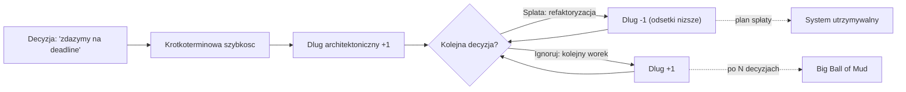
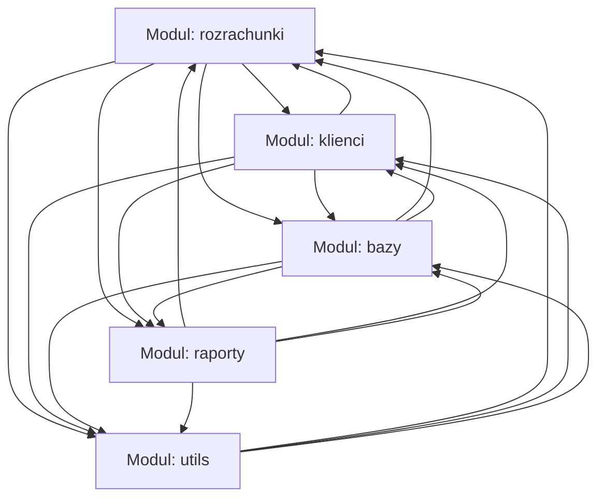
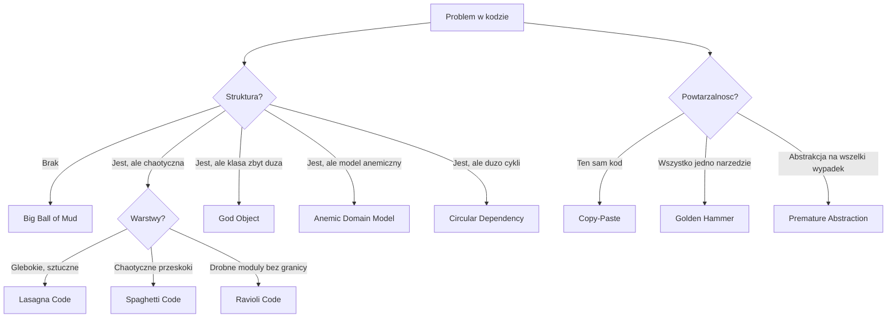
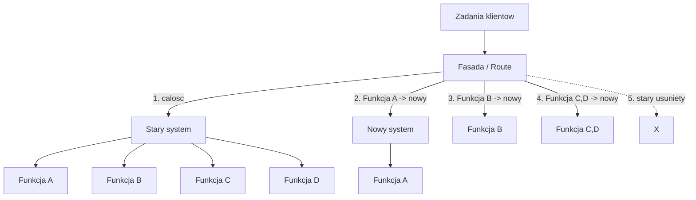
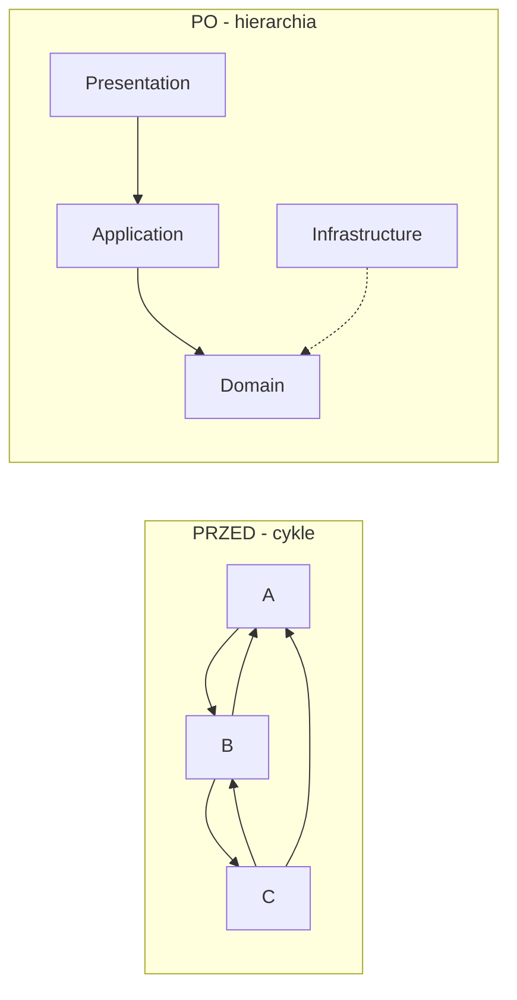
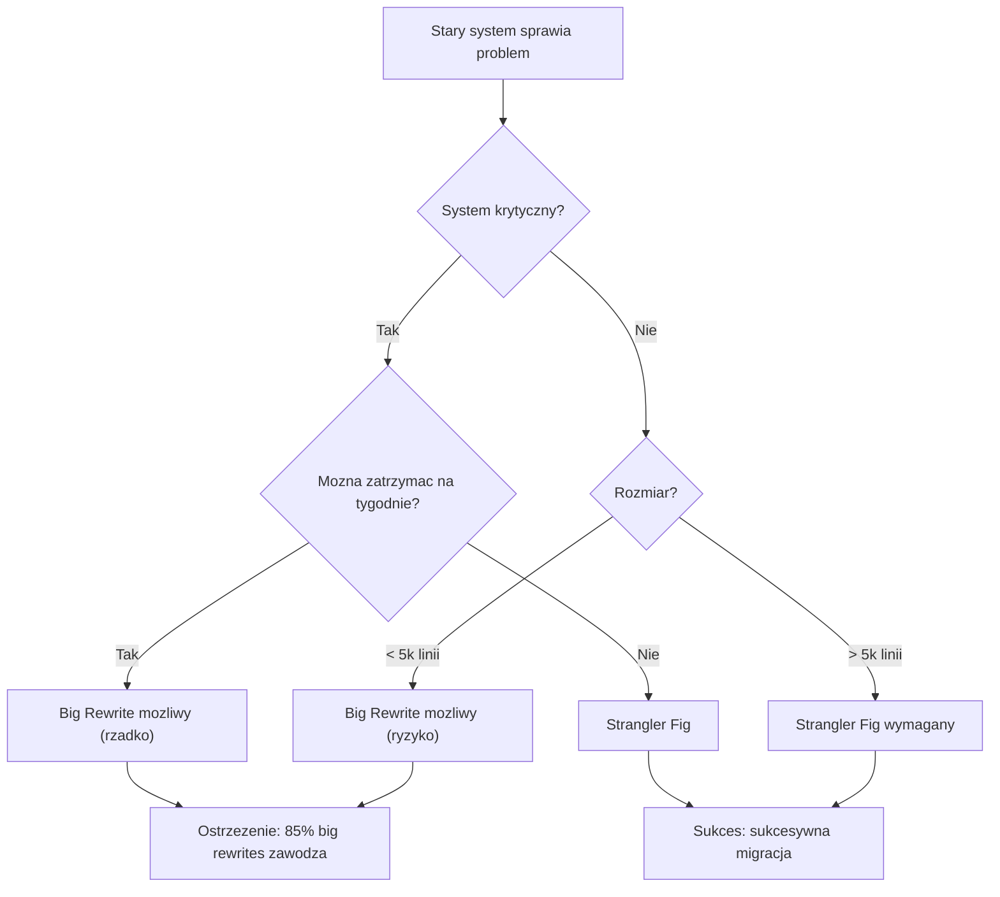
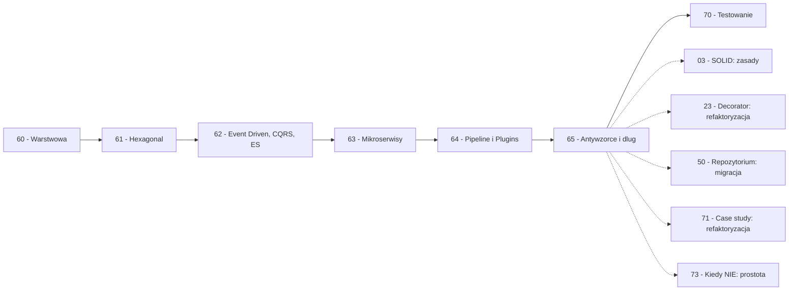

```markdown
---
modul: 65 — Antywzorce i dług architektoniczny
plik: 65-antywzorce-i-dlug-architektoniczny.md
poziom: zaawansowany
wymaga: [64]
czas: ~270 minut czytania + ~560 minut ćwiczeń
---

# Moduł 65 — Antywzorce i dług architektoniczny — jak nie zbudować sobie problemu na lata

> **TL;DR**
> - **Antywzorzec (ang. anti-pattern)** to powtarzalne rozwiązanie, które początkowo wygląda dobrze, ale systematycznie prowadzi do problemów — zła odpowiedź na dobry problem, w przeciwieństwie do wzorca, który jest dobrą odpowiedzią na zły problem (powtarzalny w złym kontekście).
> - Katalog antywzorców to mapa **objawów** — rozpoznajesz je po tym, że kod boli: Big Ball of Mud, God Object, Anemic Domain Model, Distributed Monolith, Circular Dependency, Shotgun Surgery.
> - **Dług architektoniczny** działa jak kredyt: zaciągasz szybkość dziś, płacisz odsetki (zwolnienie rozwoju, więcej błędów, spadek morale) — i musisz mieć plan jego spłaty, nie tylko świadomość, że istnieje.
> - Bezpieczna ewolucja systemu opiera się na **Strangler Fig, Branch by Abstraction, Parallel Run i Expand/Contract** — nigdy na „wielkim przepisaniu od zera", które statystycznie zawodzi.
> - Granice architektoniczne **rozmywają się same**, jeśli nie są egzekwowane automatycznie — testy architektury, `import-linter`, ADR-y i kultura refaktoryzacji są warunkiem, nie ozdobą.

---

## 0. Model mentalny

### Rzeka, tama i powódź

Wyobraź sobie rzekę, która płynie przez miasto. Od dziesięcioleci ludzie budowali nad nią domy, mosty, fabryki. Inżynierowie odpowiedzialni za rzekę notowali w raportach: „koryto się zamula", „wały przeciwpowodziowe mają ubytki", „nowe osiedla zabudowują tereny zalewowe". **Koszty utrzymania tych ubytków są realne**, ale nie są pilne — dopóki nie przyjdzie powódź. Wtedy każda zaniedbana rzecz bierze odwet naraz. **Dług architektoniczny jest jak zaniedbana rzeka** — kumuluje się cicho i objawia się gwałtownie, gdy system potrzebuje zmiany w najbardziej krytycznym momencie.

Idźmy dalej, bo obraz ma drugą warstwę. Woda w rzece to **kod, który działa** — nikt nie chce go zatrzymywać. Tama to moment, w którym trzeba coś zmienić: dodać feature, naprawić błąd, dostosować do regulacji. Wyobraź sobie teraz, że tama ma pęknięcia. Można je łatać — to **refaktoryzacja małymi krokami**. Można je ignorować — to **zaciąganie kolejnego długu**. Można też postanowić: „zbudujmy tamę od zera, na nowoczesnych materiałach". I tu jest najczęstsza pułapka: **tama od zera wymaga spuszczenia wody**. Rzeka musi zostać zatrzymana, miasto pozbawione prądu, fabryki zamknięte. W praktyce próba „zbudowania wszystkiego od zera" przy jednoczesnym utrzymaniu ruchu kończy się katastrofą. Dlatego inżynierowie uczą się **budować nowe tamy obok starych**, stopniowo przenosząc nurt. To **Strangler Fig** — bez zatrzymywania rzeki.

Ale jest jeszcze trzeci obraz, który pokazuje, jak dług powstaje. Wyobraź sobie, że **zamiast remontować wał**, ktoś dokłada kolejne worki z piaskiem. Worki leżą na starych wałach, tworzą nieregularne wzniesienie, ale woda i tak znajdzie szczelinę. Kolejny inżynier dokłada swoje worki — a poprzednią warstwę zostawia. Trzeci robi to samo. Po dziesięciu latach wał jest **plątaniną worków z różnych epok po różnych inżynierach, bez żadnego planu**. Woda w końcu przelewa się. To jest **Big Ball of Mud** — najczęstszy i najgorszy efekt narastającego długu. Każda warstwa ma swojego autora, każda działa „w swoim zakresie", ale całość jest nie do utrzymania.

Zauważ, że w tej analogii **dług nie jest błędem, jest decyzją**. Każdy worek był w swoim momencie rozsądną decyzją — najszybszą z możliwych. Ale ponieważ nie było planu spłaty, każdy worek pogłębiał dług. Inżynierowie zostawili potomnym górę piasku w workach, w której nie ma żadnej struktury. **Dług architektoniczny to właśnie to: akumulacja drobnych, świadomych decyzji, z których każda była w swoim czasie uzasadniona.** Nie ma tu złoczyńcy. Są tylko ci, którzy musieli „zdążyć przed regulatorem", „wypuścić feature na konferencję", „ominąć biurokrację architektury". Skumulowane efekty są katastrofalne.

| W analogii rzeki, tamy i worków | W kodzie |
|---|---|
| Rzeka płynąca przez miasto | Kod, który działa na produkcji |
| Powódź | Krytyczna zmiana wymagana nagle |
| Wał z ubytkami | Architektura z długiem |
| Łatanie ubytków | Refaktoryzacja małymi krokami |
| Ignorowanie ubytków | Zaciąganie kolejnego długu |
| Tama od zera | Big rewrite |
| Nowa tama obok starej | Strangler Fig |
| Worki nasypywane bez planu | Big Ball of Mud |
| Każdy worek był rozsądny | Każda decyzja była uzasadniona w swoim czasie |
| Brak planu spłaty | Brak strategii refaktoryzacji |

> 🧠 **Zapamiętaj** — **Antywzorzec (ang. anti-pattern) to powtarzalne rozwiązanie, które na krótką metę wydaje się dobre, ale systematycznie prowadzi do problemów na dłuższą metę. Dług architektoniczny (ang. architectural debt) to wartość nagromadzonych kompromisów architektonicznych, których koszt spłaty (odsetki) trzeba ponieść w przyszłości.**

Zwróć uwagę na trzy słowa: **powtarzalne**, **krótka meta**, **odsetki**. „Powtarzalne" — antywzorce są wzorcami; mają nazwy, mają opis, mają wspólną strukturę. „Krótka meta" — zawsze są wynikiem kompromisu między szybkością a jakością, gdzie szybkość wygrała. „Odsetki" — koszt długu rośnie z czasem; im dłużej ignorujesz, tym trudniej naprawić.

### Diagram — intuicja kumulacji długu



*Diagram pokazuje dylemat każdej decyzji: szybka vs refaktoryzacja. Bez planu spłaty dług kumuluje się do Big Ball of Mud; ze spłatą — system pozostaje utrzymywalny.*

### Czego antywzorce NIE robią

Rozbrójmy kilka mitów, które narosły wokół tego tematu.

**Nie są „błędami programisty".** Antywzorce powstają w **kontekście organizacyjnym**, nie w izolacji. Presja deadline'a, brak testów, brak czasu na refaktoryzację, brak zaufania w zespole — wszystko to sprzyja długowi. **Nie ma tu złoczyńcy** — jest system nacisków.

**Nie są zerowe-jedynkowe.** Nie ma „zdrowego kodu" i „Big Ball of Mud". Jest **spektrum** — każde miejsce w kodzie może być bliżej lub dalej od zdrowej struktury. Dług nie jest wstydem; jest **faktem ekonomicznym**.

**Nie są wieczne.** Antywzorce **da się naprawić**, jeśli zespół ma strategię i dyscyplinę. **Strangler Fig, Branch by Abstraction, Parallel Run** — to narzędzia bezpiecznej naprawy. Ale naprawa wymaga **czasu**, którego zespoły często nie mają.

**Nie rozwiązują się same.** Dług architektoniczny **rośnie z czasem**, jeśli nie ma go ktoś spłacać. Kolejne features dobudowywane nad workami z piasku zwiększają ryzyko. **Rzeka nie czeka.**

**Nie każda „brzydka" decyzja to antywzorzec.** Czasem trzeba iść szybko, żeby sprawdzić hipotezę rynkową. Świadome, zarejestrowane, z planem spłaty — to nie antywzorzec, to **dług roztropny** (zobacz sekcję 3.3).

**Nie jest winą konkretnych osób.** Kiedy patrzysz na kod, widzisz decyzje. Kiedy patrzysz na decyzje, widzisz naciski. Antywzorce to objaw problemu organizacyjnego, nie indywidualnego.

---

## 1. Problem, który rozwiązujemy

Wejdźmy w domenę 💳 „Rozrachunku". System ma **piętnaście lat**. Zaczął jako skrypt w Pythonie 2. Zespoły się zmieniały — pięć w ciągu dekady. Każdy coś dorzucił. Dokumentacji architektonicznej nigdy nie było — były tylko commit messages. Oto, co mniej więcej wygląda jak reprezentatywny fragment:

### Kod „przed"

```python
# rozrachunek_v0.py — wersja naiwna, demonstracyjna
# UWAGA: kod celowo pokazuje kumulacje antywzorcow po 15 latach.

from __future__ import annotations

import json
import logging
import smtplib
import sqlite3
from datetime import datetime
from decimal import Decimal, ROUND_HALF_UP

log = logging.getLogger(__name__)

# Globalny stan — jeden mutowalny kontekst
KONTEKST: dict = {}
KONFIGURACJA: dict = {}


class MenedzerRozrachunkow:
    """Klasa-bog: polaczyla wszystko, co mozliwe."""

    # 40 atrybutow klasowych
    STAWKA_PROWIZJI = Decimal("0.004")
    LIMIT_DZIENNY = Decimal("1000000")
    LIMIT_KARTY = Decimal("50000")
    LIMIT_PRZELEWU = Decimal("500000")
    KURS_EUR = Decimal("4.32")
    KURS_USD = Decimal("3.95")
    # ... i tak dalej, 30 innych

    def __init__(self) -> None:
        self._polaczenie = sqlite3.connect("rozrachunek.db")
        self._cache_walut = {}
        self._tryb = "prod"

    # Metoda-bog: 400 linii
    def przeprowadz(
        self,
        identyfikator, kwota, waluta, kanal, klient, czy_ekspresowy,
        czy_zagraniczny, kod_bic, iban, email, telefon, adres, nip, regon,
        czy_lojalny, czy_pierwsze, kod_kuponu, voucher, raty,
    ):
        """Przeprowadza rozrachunek - walidacja, limit, bramka, ksiega, powiadomienie, raport."""
        # 1. Walidacja (20 linii)
        if kwota <= 0:
            raise ValueError("kwota")
        if waluta not in ("PLN", "EUR", "USD"):
            raise ValueError("waluta")

        # 2. Limity (30 linii)
        if kanal == "KARTA" and kwota > self.LIMIT_KARTY:
            raise ValueError("limit karty")
        if kanal == "PRZELEW" and kwota > self.LIMIT_PRZELEWU:
            raise ValueError("limit przelewu")

        # 3. Rabaty (40 linii)
        rabat = Decimal("0")
        if czy_lojalny:
            rabat += Decimal("0.02")
        if kod_kuponu == "PROMO10":
            rabat += Decimal("0.10")
        if czy_pierwsze:
            rabat += Decimal("0.05")
        if voucher:
            rabat += Decimal("0.03")
        if raty and raty > 12:
            rabat += Decimal("0.01")

        # 4. Realizacja (80 linii) — zalezy od kanalu
        if kanal == "KARTA":
            # 25 linii
            ...
        elif kanal == "PRZELEW":
            # 25 linii
            ...
        elif kanal == "BLIK":
            # 20 linii
            ...
        elif kanal == "SEPA":
            # 25 linii
            ...

        # 5. Ksiegowanie (15 linii, SQL bezposrednio)
        kursor = self._polaczenie.cursor()
        kursor.execute(
            "INSERT INTO ksiega (id, kwota, klient, kiedy) VALUES (?, ?, ?, ?)",
            (identyfikator, str(kwota), klient, datetime.now().isoformat()),
        )
        self._polaczenie.commit()

        # 6. Powiadomienia (15 linii)
        try:
            serwer = smtplib.SMTP("smtp.example.com")
            serwer.sendmail("sys@example.com", [email], "OK")
        except Exception:
            pass  # cicho ignorujemy

        # 7. Raport (10 linii)
        return {"id": identyfikator, "rabat": str(rabat)}

    # Metoda-bog: 150 linii
    def generuj_raport(self, identyfikator, format_, zakres, sekcje, klient,
                      waluta, czy_podsumowanie, czy_szczegoly, jezyk):
        """Generuje raport dla rozrachunku."""
        # ... 150 linii

    # 30 innych metod tego samego rodzaju


class KsiegowanieBaza(MenedzerRozrachunkow):
    """Dziedziczy po klasie-bogu, zeby skorzystac z laczenia."""
    pass


class RozrachunekZagraniczny(KsiegowanieBaza):
    """Jeszcze glebiej."""
    pass


def zapisz_do_bazy(dane: dict) -> None:
    """Funkcja globalna, bo komus bylo wygodniej."""
    pol = sqlite3.connect("rozrachunek.db")
    pol.execute("INSERT INTO x VALUES (?)", (json.dumps(dane),))
    pol.commit()


if __name__ == "__main__":
    m = MenedzerRozrachunkow()
    m.przeprowadz(...)  # 18 argumentow
```

Ten kod **działa na produkcji od piętnastu lat**. Ale jest **katalogiem antywzorców** w jednym pliku. Rozłóżmy to na czynniki pierwsze.

### Code smell — katalog antywzorców

| Antywzorzec | Gdzie | Konsekwencja |
|---|---|---|
| **Big Ball of Mud** | Cały plik | Brak struktury — wszystko zależy od wszystkiego |
| **God Object** | `MenedzerRozrachunkow` | 40 atrybutów, 30 metod, 400 linii w metodzie |
| **God Method** | `przeprowadz`, `generuj_raport` | 400 i 150 linii w jednej metodzie |
| **Global state** | `KONTEKST`, `KONFIGURACJA` | Mutable global — trudno testować |
| **Circular Dependency** | Dziedziczenie 3-poziomowe | Cykle importów |
| **Copy-Paste** | Walidacja, rabaty | Ta sama logika w kilku miejscach |
| **Shotgun Surgery** | Limity rozsiane | Zmiana limitu = zmiana 12 miejsc |
| **Primitive Obsession** | Stringi dla kanalow, walut, statusow | Literówka cicha awaria |
| **Long Parameter List** | 18 argumentow | Zamiana kolejnosci |
| **Feature Envy** | Metody dotykaja kilku rodzin danych | Metody sięgają po dane innych |
| **Blob API** | Zwraca `dict` | Brak kontraktu zwrotu |

### Objawy — poznasz ten problem po tym, że...

- **Boisz się dotknąć ten kod.** Każda zmiana = ryzyko regresji. Testy są słabe, bo nikt nie wie, co się dzieje.
- **Nie ma jednej osoby, która zna całość.** `Bus factor` = 1 (albo mniej).
- **Onboarding nowego developera trwa 3 miesiące.** Zanim zrozumie „jak to działa" — mija kwartał.
- **Deployment wymaga „okna serwisowego".** Bo każda zmiana może wywrócić produkcję.
- **Każdy dodany feature łamie trzy inne.** Efekt „bolesnych niemożliwości".
- **Testy są wolne i niestabilne.** Wymagają bazy, sieci, plików — nie da się uruchomić lokalnie.
- **Dokumentacja nie istnieje.** Albo opisuje stan z 2015 roku.
- **Regulaminy i regulacje są wdrażane przez „obejścia".** Zamiast w kodzie, w procedurach.
- **Zespół boi się refaktoryzacji.** Bo „to działa, nie ruszaj". Efekt: dług rośnie dalej.
- **W konwersacji słyszysz „wyjątki", „wyjątki od wyjątków", „specjalne przypadki".** Każdy wyjątek to dług.

---

## 2. Anatomia

Ponieważ ten moduł omawia **kilkanaście antywzorców i dług architektoniczny**, sekcja dzieli się na katalog.

### Uczestnicy długu architektonicznego

| Rola | Odpowiedzialność | Co NIE jest jej zadaniem |
|---|---|---|
| **Decyzja architektoniczna** | Wybór między szybkością a jakością | Nie jest „popełnieniem błędu" |
| **Naciski organizacyjne** | Deadline, presja rynku, oczekiwania zarządu | Nie są złe same w sobie |
| **Kod wynikowy** | Efekt decyzji — struktura z długiem | Nie jest winny — to skutek, nie przyczyna |
| **Zespół** | Rozpoznaje dług, decyduje o spłacie | Nie jest „winny" długu |
| **Architekt / lider** | Prowadzi spłatę, dokumentuje decyzje (ADR) | Nie jest „wszystkowiedzący" |

### Diagram — sieć zależności w Big Ball of Mud



*Diagram pokazuje gęstą sieć zależności w Big Ball of Mud: niemal każdy moduł zależy od każdego innego i na odwrót — nie ma hierarchii, nie ma granicy, nie ma testowalności.*

### Katalog antywzorców — tabela zbiorcza

| Antywzorzec | Objawy | Dlaczego kusi | Konsekwencje |
|---|---|---|---|
| **Big Ball of Mud** | Brak struktury, wszystko łączy się ze wszystkim | „Działa, nie ruszaj" | Nie da się zmienić ani zrozumieć |
| **God Object/Blob** | Klasa 5000 linii, 40 metod | „Wygodne, wszystko w jednym" | Nie da się przetestować, rośnie w nieskończoność |
| **Anemic Domain** | Model z getterami, logika w serwisach | „Serwisy są proste" | Logika rozproszona, model nie broni niezmienników |
| **Singleton nadmiar** | Globalne singletony wszędzie | „Wygodny dostęp" | Ukryte zależności, trudne testy |
| **Spaghetti/Ravioli/Lasagna** | Warstwy bez sensu, zawirowane wywołania | „Trzeba mieć warstwy" | Trudno prześledzić przepływ |
| **Golden Hammer** | Wszędzie ten sam wzorzec | „Mamy świetne narzędzie" | Nadmiar abstrakcji, opór przed zmianą |
| **Premature Abstraction** | Abstrakcja dla 1 przypadku | „Na wszelki wypadek" | Zła abstrakcja, przepisywanie |
| **Premature Optimization** | Mikro-optymalizacje bez pomiarów | „Wydajność ważna" | Złożoność bez korzyści |
| **Copy-Paste** | Ten sam kod w 15 miejscach | „Szybko skopiować" | Rozjazd, 15 miejsc do zmiany |
| **Distributed Monolith** | Mikroserwisy z wspólną bazą | „Mikroserwisy to nowoczesność" | Maksymalny koszt, zero korzyści |
| **Vendor Lock-in** | AWS SDK wszędzie | „Używamy AWS" | Nie da się zmienić dostawcy |
| **Circular Dependency** | Cykle importów | „Wszyscy potrzebują innych" | Nie da się przetestować modułu osobno |
| **Shotgun Surgery** | Zmiana reguły = zmiana 15 plików | „Rozproszone odpowiedzialności" | Koszt zmiany rośnie |
| **Divergent Change** | Jedna klasa zmienia się z 5 powodów | „Wszystko ze sobą związane" | Każda zmiana to ryzyko |
| **Feature Envy** | Metoda A sięga do danych B | „Wygodniej tu" | Zła granica odpowiedzialności |
| **Primitive Obsession** | Stringi dla statusów | „Łatwo" | Literówka cicha awaria |
| **Long Parameter List** | 15 argumentow | „Dodaj parametr" | Zamiana kolejności, brak walidacji |

### Diagram — katalog wizualizacja



*Diagram pokazuje drzewo decyzyjne rozpoznawania antywzorca: najpierw patrzysz na strukturę, potem na powtarzalność, potem identyfikujesz konkretny antywzorzec.*

### Warianty: jak dług się objawia

| Objaw w zespole | Możliwy antywzorzec | Możliwa przyczyna |
|---|---|---|
| „Boję się tego ruszyć" | Big Ball of Mud, God Object | Brak testow, brak dokumentacji |
| „Nie wiem, kto to napisał" | Brak ADR, brak transferu wiedzy | Rotacja zespolu |
| „Zmiana jednej rzeczy łamie trzy" | Shotgun Surgery | Brak kohezji |
| „Ten sam kod działa różnie" | Copy-Paste | Brak centralnej reguly |
| „Każdy feature to projekt" | Architektura nieelastyczna | Dlug strukturalny |
| „Deployment to wydarzenie" | Brak CI/CD, brak testow | Dlug infrastrukturalny |

---

## 3. Implementacja krok po kroku

### Część A — rozpoznawanie antywzorców

#### Krok 1 — Zdefiniuj dług architektoniczny jako kredyt

Wyobraź sobie, że pożyczasz pieniądze. Pożyczasz, bo potrzebujesz ich szybko — na dom, na samochód, na inwestycję. Podpisujesz umowę: dostajesz dziś 100 000, płacisz w przyszłości 120 000 z odsetkami. **Kredyt jest rozsądny, gdy inwestycja się zwraca.** Kredyt na dom — tak. Kredyt na wakacje z oprocentowaniem 30% rocznie — prawdopodobnie nie.

**Dług architektoniczny jest dokładnie taki sam.** Zaciągasz go, gdy potrzebujesz „zdążyć na wczoraj". Płacisz odsetki w postaci:
- **zwolnionego rozwoju** — kolejny feature zajmuje 3× więcej czasu,
- **rosnącej liczby błędów** — bo brak testów, brak izolacji,
- **spadającego morale** — bo nikt nie chce pracować z „tym kodem",
- **trudności onboardingu** — nowy developer potrzebuje miesięcy.

**Odsetki rosną z czasem.** Dług, którego nie spłacasz, jest droższy niż kredyt krótkoterminowy. Dlatego strategicznie trzeba mieć **plan spłaty** — nie tylko świadomość. Świadomość to dług; plan to **spłata**.

#### Krok 2 — Macierz długu — świadomy vs nieświadomy, roztropny vs nieroztropny

Martin Fowler w 2009 zaproponował 2×2 macierz długu. To bardzo użyteczne narzędzie.

```text
                    Świadomy              Nieświadomy
            +--------------------+--------------------+
Roztropny   | "Wiemy, że to      | "Odkryliśmy, że    |
            | dług, ale to       | lepiej było to     |
            | strategiczna       | zrobić inaczej,    |
            | decyzja — jutro    | zapisaliśmy w ADR" |
            | wracamy"           |                    |
            +--------------------+--------------------+
Nieroztrop | "Wiemy, że to      | "Nie wiedzieliśmy,  |
            | źle, ale nie       | że to źle — dopiero |
            | zamierzamy tego    | teraz rozumiemy"    |
            | naprawiać"         |                     |
            +--------------------+--------------------+
```

- **Świadomy roztropny** — „Wiemy, że hackujemy, ale mamy powód i plan". To **zdrowy dług**.
- **Nieświadomy roztropny** — „Nie wiedzieliśmy, że można lepiej — teraz już wiemy". Zapisujemy w ADR i planujemy spłatę.
- **Świadomy nieroztropny** — „Wiemy, że źle, ale nie zrobimy nic". To **dług toksyczny**.
- **Nieświadomy nieroztropny** — „Nie wiedzieliśmy, że źle, i nie planujemy tego zmienić". To droga do Big Ball of Mud.

#### Krok 3 — Katalog antywzorców — szczegóły

**1. Big Ball of Mud.**

**Objawy:** brak struktury katalogów z sensem; wszystko importuje wszystko; nie da się wyodrębnić modułu bez zmiany dwudziestu plików.

**Dlaczego kusi:** żadna decyzja nie wymaga wysiłku; każdy idzie po „najkrótszej ścieżce" — dodać kolejny import.

**Konsekwencje:** nie da się zrefaktoryzować pojedynczego modułu; każda zmiana niesie ryzyko; nowy developer nie wie, od czego zacząć.

**Jak naprawić:** **Strangler Fig** — wyodrębniaj moduły po jednym; nigdy big rewrite.

**Jak zapobiegać:** regularna analiza zależności (`import-linter`, `pydeps`), testy architektury w CI, ADR.

**2. God Object / Blob.**

**Objawy:** klasa > 2000 linii; metoda > 200 linii; > 30 pól; > 20 publicznych metod; nazwa kończy się na `Manager`, `Helper`, `Util`.

**Dlaczego kusi:** „wszystko w jednym miejscu jest wygodne"; dodanie metody to „jedna linijka".

**Konsekwencje:** nie da się przetestować; każda zmiana wpływa na inne; rośnie w nieskończoność.

**Jak naprawić:** ekstrakcja ról (moduł 51); identyfikacja „powodów zmiany" — każdy to osobna klasa.

**Jak zapobiegać:** zasada SRP (moduł 03); code review; metryki klasy (linie, metody, pola).

**3. Anemic Domain Model.**

**Objawy:** model z getterami i setterami; brak metod biznesowych; logika w „serwisach"; nazwy `XYZService` dla każdej reguły.

**Dlaczego kusi:** Active Record (moduł 52) naturalnie prowadzi do tego; „serwisy są proste".

**Konsekwencje:** reguła rozproszona; model nie broni niezmienników; **nic nie pilnuje spójności**.

**Jak naprawić:** przenoszenie reguł do encji / VO / agregatów (moduł 54); Test Driven Design.

**Jak zapobiegać:** warsztaty DDD; dyscyplina w code review; pytanie „kto wie o tej regule?".

**Uczciwa uwaga:** dla prostego CRUD anemiczny model jest **akceptowalny** — to nie jest dług, to rozsądny wybór. Antywzorzec pojawia się, gdy domena jest złożona, a mimo to jej reguły są w serwisach.

**4. Nadmiarowe Singleton / globalny stan.**

**Objawy:** mnóstwo singletonów; import `KONFIGURACJA` w każdym module; zmienne globalne.

**Dlaczego kusi:** wygodny dostęp bez wstrzykiwania.

**Konsekwencje:** ukryte zależności; trudne testy (moduł 10); problemy z równoległością.

**Jak naprawić:** DI przez konstruktor (moduł 53); moduły jako singleton (moduł 10).

**Jak zapobiegać:** dyscyplina DI; testy jako pierwsze.

**5. Spaghetti / Ravioli / Lasagna — cztery stopnie makaronu.**

- **Spaghetti Code** — chaotyczny przepływ sterowania; skoki `goto`-podobne, wywołania tam i z powrotem, brak organizacji. **Objaw:** nie da się narysować diagramu sekwencji.
- **Lasagna Code** — zbyt wiele warstw, każda „przekazuje dalej"; każda operacja przechodzi przez 7 warstw. **Objaw:** funkcja o jednej linii w każdej warstwie.
- **Ravioli Code** — setki drobnych klas bez kohezji; każda klasa to „ravioli", ale nie ma sosu. **Objaw:** 200 klas, każda 15 linii.
- **Mud** — brak jakiejkolwiek struktury (Big Ball of Mud).

**Konsekwencje:** trudność śledzenia, brak zrozumiałości, kosztowne zmiany.

**Jak naprawić:** Strangler Fig dla Spaghetti; konsolidacja dla Ravioli; uproszczenie warstw dla Lasagna.

**Jak zapobiegać:** zasada „3 linie kodu to nie klasa"; świadomość liczby warstw; code review.

**6. Golden Hammer.**

**Objawy:** wszędzie ten sam wzorzec; „u nas wszystko przez repozytorium", „u nas wszystko przez Kafka".

**Dlaczego kusi:** gdy raz opanujesz narzędzie, chcesz go używać wszędzie; zespół ma już kompetencje.

**Konsekwencje:** nadmiar abstrakcji w prostych miejscach; nieadekwatne narzędzia.

**Jak naprawić:** audyt wzorców; usunięcie tych nieuzasadnionych.

**Jak zapobiegać:** kultura „narzędzie do problemu"; szkolenia z wielu narzędzi; ADR.

**7. Premature Abstraction.**

**Objawy:** abstrakcja utworzona dla 1 przypadku; „na wszelki wypadek"; `ABC` z jedną implementacją.

**Dlaczego kusi:** „jutro może się przydać"; „dobre praktyki mówią o abstrakcji".

**Konsekwencje:** zła abstrakcja (bo brak wiedzy o drugim przypadku); przepisywanie.

**Jak naprawić:** usunięcie abstrakcji (moduł 73); inkrementalne dokładanie po 2. przypadku.

**Jak zapobiegać:** reguła trzech — abstrahuj przy 3. przypadku; YAGNI.

**8. Premature Optimization.**

**Objawy:** mikro-optymalizacje przed pomiarem; „skoro może być wolne, zrobię szybko".

**Dlaczego kusi:** „wydajność ważna"; „lepiej zawczasu".

**Konsekwencje:** złożoność bez korzyści; przeszkadza w zmianach; ukrywa prawdziwe problemy.

**Jak naprawić:** pomiar (profilowanie, benchmarki); usunięcie optymalizacji bez pomiaru.

**Jak zapobiegać:** „nie optymalizuj, dopóki nie zmierzysz"; narzędzia profilowania w CI.

**9. Copy-Paste Programming.**

**Objawy:** ten sam kod w wielu miejscach; poprawka w jednym miejscu wymaga poprawek w innych.

**Dlaczego kusi:** „szybsze skopiować niż wymyślać abstrakcję"; „to mały fragment".

**Konsekwencje:** rozjazd między kopiami; 15 miejsc do zmiany; **cicha niespójność**.

**Jak naprawić:** wydzielenie wspólnej funkcji / klasy (moduł 03).

**Jak zapobiegać:** zasada DRY (moduł 03); code review; narzędzia wykrywające duplikaty.

**10. Distributed Monolith.**

**Objawy:** mikroserwisy dzielące bazę; wymagają skoordynowanych wdrożeń; zmiana w jednej wymaga zmian w innych.

**Dlaczego kusi:** „mikroserwisy to nowoczesność"; podział „po warstwach" (api-service, db-service).

**Konsekwencje:** wszystkie koszty rozproszenia, zero korzyści; **najgorszy możliwy efekt**.

**Jak naprawić:** albo cofnąć do monolitu modułowego, albo rozdzielić bazy / zdarzenia (moduł 63).

**Jak zapobiegać:** podział po bounded context (moduł 54); własne bazy per usługa.

**11. Vendor Lock-in.**

**Objawy:** SDK dostawcy w warstwie domeny; zakodowane adresy usług zewnętrznych; brak adapterów.

**Dlaczego kusi:** „używamy AWS, więc czemu nie wprost".

**Konsekwencje:** nie da się zmienić dostawcy; migracja = przepisanie.

**Jak naprawić:** adaptery (moduł 20); porty (moduł 61).

**Jak zapobiegać:** DIP (moduł 03); świadomość kosztu zmiany dostawcy.

**12. Circular Dependency.**

**Objawy:** cykle importów; błędy `ImportError` w runtime; nie da się zaimportować pojedynczego modułu.

**Dlaczego kusi:** „potrzebujemy tej klasy tu"; brak świadomości konsekwencji.

**Konsekwencje:** nie da się przetestować modułu osobno; nie da się go ekstrahować; łamie granice.

**Jak naprawić:** wprowadzenie abstrakcji; inwersja zależności; zdarzenia.

**Jak zapobiegać:** testy architektury w CI; `import-linter`; code review.

**13. Shotgun Surgery.**

**Objawy:** zmiana jednej reguły wymaga zmian w 12 plikach.

**Dlaczego kusi:** rozproszone odpowiedzialności wydają się „elastyczne".

**Konsekwencje:** rosnący koszt zmiany; ryzyko regresji w każdym pliku.

**Jak naprawić:** konsolidacja w jednym miejscu (wzorce Strategy / Specification — moduły 38, 54).

**Jak zapobiegać:** dzielenie według domeny, nie po warstwach (moduł 60).

**14. Divergent Change.**

**Objawy:** jedna klasa zmienia się z 5 różnych powodów.

**Dlaczego kusi:** „wszystko jest ze sobą związane".

**Konsekwencje:** każda zmiana wpływa na inne obszary; łamie SRP.

**Jak naprawić:** rozbicie klasy na role.

**Jak zapobiegać:** SRP; test „jeden powód zmiany".

**15. Feature Envy.**

**Objawy:** metoda używa więcej danych innej klasy niż własnej.

**Dlaczego kusi:** „wygodniej tutaj".

**Konsekwencje:** łamie granice odpowiedzialności, utrudnia refaktoryzację.

**Jak naprawić:** przenieś metodę do klasy z danymi (Information Expert — GRASP).

**Jak zapobiegać:** code review; GRASP.

**16. Primitive Obsession.**

**Objawy:** stringi dla statusów, kwot, walut; brak VO (moduł 54).

**Jak naprawić:** wprowadzenie VO (moduł 54).

**17. Long Parameter List.**

**Objawy:** 10+ parametrów w metodzie.

**Jak naprawić:** grupowanie w obiekt konfiguracji / budowniczy (moduł 13).

### Część B — dług architektoniczny — pomiar

#### Krok 4 — Metryki długu

Aby zarządzać długiem, trzeba go **mierzyć**. Oto najważniejsze metryki.

| Metryka | Co mierzy | Narzędzie |
|---|---|---|
| Czas do pierwszego wdrożenia nowego dev | Onboarding | Subiektywny pomiar |
| Liczba plików na zmianę | Sprzężenie | `git log --name-only` |
| Cykle zależności | Granice | `import-linter`, `pydeps` |
| Code churn | Zmienność plików | `git-quick-stats` |
| Czas testów | Szybkość feedbacku | `pytest --durations` |
| Pokrycie testami domeny | Jakość testów | `pytest-cov` |
| Liczba klas > 500 linii | God objects | `radon`, `ruff` |
| Liczba metod > 50 linii | God methods | `radon`, `ruff` |
| Temporal coupling | Zmienne razem | `code-maat`, `git log` |
| Bus factor | Ryzyko wiedzy | Analiza autorów |

#### Krok 5 — Narzędzia do wykrywania

**`import-linter`** — egzekwowanie granic:

```ini
# .importlinter
[importlinter]
root_package = rozrachunek

[importlinter:contract:warstwowa]
name = Warstwy heksagonalne
type = layers
layers =
    rozrachunek.presentation
    rozrachunek.application
    rozrachunek.domain
```

**`pydeps`** — wizualizacja graf zależności:

```bash
pydeps rozrachunek --max-bacon 3 --cluster
```

**`grimp`** — analiza grafu importów programowo:

```python
import grimp
graf = grimp.build_graph("rozrachunek")
cykle = graf.find_cycles()
print(cykle)
```

**`radon`** — złożoność cyklomatyczna:

```bash
radon cc rozrachunek -s -a  # zaawansowane metryki
```

**`vulture`** — martwy kod:

```bash
vulture rozrachunek --min-confidence 80
```

**`ruff`** — lint z wieloma regułami:

```bash
ruff check rozrachunek
```

#### Krok 6 — Strategie bezpiecznej refaktoryzacji

Pięć strategii migracji. Żadna nie wymaga „wielkiego przepisania".

**1. Strangler Fig (figowiec dusiciel).**

**Idea:** zamiast przepisywać monolit, wyodrębniaj z niego funkcje po jednej. Nowa implementacja rośnie obok starej, aż stara staje się pusta.

**Mechanizm:**
1. Wprowadź warstwę pośrednią (fasada, route, proxy) przed starym systemem.
2. Zaimplementuj jedną funkcję w nowym systemie.
3. Przekieruj żądania tej funkcji do nowego systemu.
4. Usuń starą implementację tej funkcji.
5. Powtarzaj dla kolejnych funkcji.

**Kiedy używać:** migracja z monolitu, z legacy, z systemu zewnętrznego.

**Ryzyko:** dwie implementacje równolegle; trzeba zadbać o spójność (Parallel Run).

**2. Branch by Abstraction.**

**Idea:** wprowadź abstrakcję, zaimplementuj dwie wersje (stara i nowa), przełącz przez flagę, usuń starą.

**Mechanizm:**
1. Wprowadź port (moduł 61): `Ksiegowanie` z metodami.
2. Stara implementacja `KsiegowanieSQLite` działa.
3. Nowa implementacja `KsiegowaniePostgres` — obok.
4. Feature flag wybiera, która działa.
5. Stopniowo przełączaj ruch.
6. Po migracji — usuń starą.

**Kiedy używać:** wymiana technologii (baza, framework, integracja).

**Ryzyko:** flagi trzeba usuwać; dług flag rośnie.

**3. Parallel Run.**

**Idea:** uruchom dwie implementacje równolegle, porównuj wyniki. Idealne dla krytycznych ścieżek (np. obliczenia finansowe).

**Mechanizm:**
1. Nowa implementacja działa obok starej.
2. Wszystkie żądania idą do obu.
3. Wyniki są porównywane.
4. Różnice logujemy.
5. Po okresie „czystości" — usuwamy starą.

**Kiedy używać:** krytyczne funkcje (rachunki, wyceny); gdy zmiana musi być bezpieczna.

**Ryzyko:** koszt dwóch uruchomień; porównywanie wyników `Decimal` wymaga uwagi.

**4. Expand/Contract w schemacie bazy.**

**Idea:** zmiany schematu w dwóch etapach: rozszerz, potem zawęź.

**Mechanizm:**
1. **Expand:** dodaj nową kolumnę (nullable). Aplikacja zapisuje do obu.
2. **Migrate data:** wypełnij nową kolumnę.
3. **Switch:** aplikacja czyta z nowej kolumny.
4. **Contract:** usuń starą kolumnę.

**Kiedy używać:** migracja schematu bez przestoju.

**5. Feature Flags.**

**Idea:** nowe funkcje za flagą; włącz/wyłącz w runtime.

**Mechanizm:**
1. Nowa funkcja jest za flagą.
2. Flaga włączona dla 1% użytkowników.
3. Stopniowo zwiększaj.
4. Po „szczepieniu" — usuń flagę.

**Ryzyko:** flagi trzeba usuwać. **Dług flagi** to ukryty dług.

**6. Preparatory Refactoring.**

**Idea:** małe zmiany przygotowujące grunt przed dużą zmianą.

**Mechanizm:** przed dodaniem feature, zrefaktoryzuj kod tak, żeby dodanie było łatwe. **Osobny commit, osobny PR.**

**Kiedy używać:** zawsze. Zamiast „dodać feature i zrefaktoryzować" — najpierw „zrefaktoryzuj, potem dodaj feature".

### Krok 7 — ADR — Architecture Decision Records

ADR to **dokument decyzji architektonicznej**. Zapisuje **kontekst, decyzję i konsekwencje** — na zawsze.

**Szablon ADR:**

```markdown
# ADR 001: Użycie PostgreSQL jako bazy dla rozrachunków

## Status
Zatwierdzony (2026-10-09)

## Kontekst
Baza SQLite była wystarczająca dla 100 tys. transakcji dziennie.
Prognozujemy wzrost do 1 mln dziennie w ciągu roku. SQLite nie skaluje
dla zapisów współbieżnych. Rozważaliśmy PostgreSQL, MySQL i DynamoDB.

## Decyzja
Wybieramy PostgreSQL, bo:
- zespół ma doświadczenie,
- wsparcie dla transakcji ACID,
- rozszerzalność (JSONB, FDW),
- open source, brak vendor lock-in.

## Konsekwencje
Pozytywne:
- skalowanie zapisów,
- wsparcie dla pełnego ACID,
- realne wsparcie narzędzi (Alembic, pgAdmin).

Negatywne:
- koszt infrastruktury ~300 PLN/miesiąc,
- migracja z SQLite wymaga przestoju (plan: weekend),
- dodatkowa warstwa operacyjna (backupy, monitoring).

## Odniesienia
- [Dokument porównawczy DB Benchmark 2026]
- [Ticket JIRA-1234]
```

**Korzyść z ADR:** kontekst dla przyszłych deweloperów. „Dlaczego wybraliśmy PostgreSQL?" — jest odpowiedź.

### Krok 8 — Kiedy przestać refaktoryzować

Nie każdy kod zasługuje na refaktoryzację.

**Refaktoryzuj:**
- gdy kod jest zmieniany co tydzień,
- gdy kod jest w krytycznym obszarze,
- gdy koszt zmiany rośnie (measure),
- gdy dług zaczyna blokować rozwój.

**Nie refaktoryzuj:**
- gdy kod jest stabilny i niezmieniany od lat,
- gdy zostanie wyłączony w ciągu pół roku,
- gdy ryzyko przewyższa korzyść,
- gdy brak testów i nie ma czasu ich napisać.

**Zamrożony kod jest OK, jeśli na pewno nigdy nie będzie zmieniony.** W praktyce rzadko, ale bywa.

### Część C — kultura i pułapki

#### Krok 9 — Kultura refaktoryzacji

- **Testy jako warunek refaktoryzacji.** Bez testów refaktoryzacja to przepisywanie z ryzykiem.
- **Trunk-based development.** Krótkie gałęzie, częste scalanie — mniej konfliktów.
- **Code review jako transfer wiedzy.** Nie tylko wykrywanie błędów, ale wymiana perspektyw.
- **ADR dla decyzji.** Kontekst dla przyszłych deweloperów.
- **Retrospektywy o długu.** Regularna rozmowa o długu — nie „zamiatać pod dywan".
- **Jeden „strażnik długu" w zespole.** Osoba, która czuwa nad granicami.

#### Krok 10 — Wielkie przepisanie od zera

**Big Rewrite — dlaczego zwykle zawodzi.**

Statystyka: badanie, że 85% wielkich przepisań albo kończy się katastrofą, albo trwa dłużej niż planowano. Powody:

1. **Dwie implementacje na utrzymaniu** — stara i nowa.
2. **Features stają się trudne do zaimplementowania w obu** — podwójna praca.
3. **Nowa implementacja startuje z opóźnieniem** — nigdy nie dogania starej.
4. **Błędy z produkcji trzeba naprawiać w obu**.
5. **Rosnąca niecierpliwość zarządu**.
6. **Zespół się wypala**.
7. **Wiedza z starego kodu nie jest w pełni przenoszona** — „dlaczego to tak działa?".
8. **Regulacje się zmieniają** — obie implementacje trzeba dostosować.

**Alternatywa:** **Strangler Fig** — stopniowa migracja, która nigdy nie tworzy throwaway-work.

**Zbiorczo — tabela decyzyjna:**

| Pytanie | Big Rewrite | Strangler Fig |
|---|---|---|
| System krytyczny, nie można zatrzymać? | Nie | Tak |
| Zespół nie ma czasu wyłącznie na migrację? | Nie | Tak |
| Ryzyko regresji musi być minimalne? | Nie | Tak |
| Stary system jest mały (< 5k linii)? | Możliwe | Przesada |
| Nowe wymagania niejasne? | Nie | Tak |
| Zespół ma doświadczenie? | Zależy | Większość |

**Wniosek:** dla 95% przypadków Strangler Fig jest lepsze.

#### Krok 11 — Weryfikacja

| Aspekt | Wartość |
|---|---|
| Antywzorców w katalogu | 17+ |
| Narzędzia do wykrywania | 6+ |
| Strategie migracji | 5+ (Strangler, Branch, Parallel, Expand/Contract, Feature Flags) |
| Metryki długu | 10+ |
| Dokumentacja decyzji | ADR |

---

## 4. Wersje pythoniczne i warianty

### 4.1 Detekcja cykli — `grimp`

```python
import grimp


def znajdz_cykle(pakiet: str) -> list[list[str]]:
    """Znajduje cykle importow w pakiecie."""
    graf = grimp.build_graph(pakiet)
    cykle = graf.find_cycles()
    return [[m for m in cykl] for cykl in cykle]
```

### 4.2 Testy architektury — `pytest-archon`

```python
from pytest_archon import archrule


def test_domain_nie_zna_infrastruktury() -> None:
    (
        archrule("domain-purity")
        .match("rozrachunek.domain*")
        .should_not_import("rozrachunek.infrastructure*")
        .check("rozrachunek")
    )
```

### 4.3 Metryki — `radon`

```python
from radon.complexity import cc_visit


def najgorsze_metody(kod: str, prog: int = 15) -> list[dict]:
    """Zwraca metody o zlozonosci cyklomatycznej powyzej progu."""
    wyniki = cc_visit(kod)
    return [
        {"nazwa": w.name, "zlozonosc": w.complexity}
        for w in wyniki if w.complexity > prog
    ]
```

### 4.4 Wykrywanie duplikacji — `pylint --disable=all --enable=duplicate-code`

**Wbudowane w pylint.** Można skonfigurować `min-similarity-lines`.

### 4.5 ADR jako kod — katalog `docs/adr/`

```text
docs/adr/
├── 0001-wybor-bazy-danych.md
├── 0002-wprowadzenie-heksagonalnej.md
├── 0003-migracja-obliczen-na-decimal.md
└── README.md
```

**ADR jako pliki markdown w repo.** Wersjonowane razem z kodem.

### 4.6 Podsumowanie — tabela wyboru

| Potrzeba | Narzędzie |
|---|---|
| Wykrywanie cykli | `grimp`, `import-linter`, `pydeps` |
| Egzekwowanie granic | `import-linter`, `pytest-archon` |
| Metryki złożoności | `radon`, `ruff` |
| Martwy kod | `vulture` |
| Duplikacja | `pylint` (duplicate-code) |
| Dokumentacja decyzji | ADR w markdown |
| Migracja | Strangler Fig, Branch by Abstraction |
| Bezpieczna wymiana | Parallel Run, Expand/Contract |
| Flagi | `flagsmith`, `launchdarkly`, własne |

---

## 5. Przykład z życia: 💳 Rozrachunek — pełny uruchamialny kod

Pokażemy **refaktoryzację** klasy-boga z sekcji 1 krokami. Zbudujemy też detektor cykli i testy architektury.

### Kod — detektor cykli i metryki

```python
# detektor_dlugu.py — narzedzia do pomiaru dlugu
from __future__ import annotations

import ast
from dataclasses import dataclass
from pathlib import Path


@dataclass(frozen=True)
class MetrykiKlasy:
    nazwa: str
    linie: int
    liczba_metod: int
    najdluzsza_metoda: int


@dataclass(frozen=True)
class MetrykiPliku:
    sciezka: Path
    linie: int
    klasy: list[MetrykiKlasy]


def analizuj_plik(sciezka: Path) -> MetrykiPliku:
    """Analizuje plik Python i zwraca metryki."""
    zrodlo = sciezka.read_text(encoding="utf-8")
    drzewo = ast.parse(zrodlo)
    linie = len(zrodlo.splitlines())

    klasy: list[MetrykiKlasy] = []
    for wezel in ast.walk(drzewo):
        if isinstance(wezel, ast.ClassDef):
            metody = [
                w for w in wezel.body if isinstance(w, ast.FunctionDef)
            ]
            najdluzsza = max(
                (
                    w.end_lineno - w.lineno + 1
                    for w in metody if w.end_lineno
                ),
                default=0,
            )
            klasy.append(MetrykiKlasy(
                nazwa=wezel.name,
                linie=wezel.end_lineno - wezel.lineno + 1 if wezel.end_lineno else 0,
                liczba_metod=len(metody),
                najdluzsza_metoda=najdluzsza,
            ))

    return MetrykiPliku(sciezka=sciezka, linie=linie, klasy=klasy)


def raport_dlugu(sciezka: Path) -> str:
    """Raport dlugu dla pliku - gotowy do wyswietlenia."""
    metryki = analizuj_plik(sciezka)
    linie = [f"Plik: {metryki.sciezka} ({metryki.linie} linii)"]
    for k in metryki.klasy:
        ostrzezenia = []
        if k.linie > 500:
            ostrzezenia.append("GOD CLASS")
        if k.liczba_metod > 20:
            ostrzezenia.append("> 20 metod")
        if k.najdluzsza_metoda > 50:
            ostrzezenia.append("Dluga metoda")
        znacznik = " | ".join(ostrzezenia) if ostrzezenia else "OK"
        linie.append(
            f"  {k.nazwa}: {k.linie} linii, {k.liczba_metod} metod, "
            f"najdluzsza {k.najdluzsza_metoda} -> {znacznik}"
        )
    return "\n".join(linie)


# ===========================================================================
# REFAKTORYZACJA - KROK PO KROKU
# ===========================================================================

# Krok 1: Zidentyfikuj role (komentarz)

# Krok 2: Wydziel WalidatorRozrachunku

from dataclasses import dataclass
from decimal import Decimal
from typing import Protocol


@dataclass(frozen=True)
class Zlecenie:
    identyfikator: str
    kwota: Decimal
    waluta: str
    kanal: str
    klient: str
    email: str


class BladWalidacji(ValueError):
    """Blad walidacji formalnej."""


class WalidatorRozrachunku:
    """Wydzielony walidator - SRP."""

    WALUTY = frozenset({"PLN", "EUR", "USD"})
    KANALY = frozenset({"KARTA", "PRZELEW", "BLIK", "SEPA"})

    def sprawdz(self, z: Zlecenie) -> None:
        if z.kwota <= 0:
            raise BladWalidacji("kwota musi byc dodatnia")
        if z.waluta not in self.WALUTY:
            raise BladWalidacji(f"nieobslugiwana waluta: {z.waluta}")
        if z.kanal not in self.KANALY:
            raise BladWalidacji(f"nieznany kanal: {z.kanal}")
        if "@" not in z.email:
            raise BladWalidacji("niepoprawny email")


# Krok 3: Wydziel LimityRozrachunku

class BladLimitu(ValueError):
    """Blad przekroczenia limitu."""


class LimityRozrachunku:
    """Limity w jednym miejscu - informacyjny ekspert."""

    def __init__(self) -> None:
        self._limity = {
            "KARTA": Decimal("50000"),
            "PRZELEW": Decimal("500000"),
            "BLIK": Decimal("1000"),
            "SEPA": Decimal("1000000"),
        }

    def sprawdz(self, z: Zlecenie) -> None:
        limit = self._limity.get(z.kanal)
        if limit is None:
            raise BladLimitu(f"brak limitu dla kanalu {z.kanal}")
        if z.kwota > limit:
            raise BladLimitu(
                f"kanal {z.kanal}: kwota {z.kwota} > limit {limit}"
            )


# Krok 4: Wydziel RegulyRabatowe

class RegulyRabatowe:
    """Reguly rabatowe w jednym miejscu - Strategy (modul 38)."""

    def __init__(
        self,
        procent_lojalny: Decimal = Decimal("0.02"),
        procent_kupon: Decimal = Decimal("0.10"),
        procent_pierwsze: Decimal = Decimal("0.05"),
    ) -> None:
        self._procent_lojalny = procent_lojalny
        self._procent_kupon = procent_kupon
        self._procent_pierwsze = procent_pierwsze

    def nalicz(
        self,
        z: Zlecenie,
        czy_lojalny: bool,
        czy_pierwsze: bool,
        kod_kuponu: str | None,
    ) -> Decimal:
        rabat = Decimal("0")
        if czy_lojalny:
            rabat += self._procent_lojalny
        if kod_kuponu == "PROMO10":
            rabat += self._procent_kupon
        if czy_pierwsze:
            rabat += self._procent_pierwsze
        return rabat


# Krok 5: Wydziel Ksiegowanie (port) + adapter

from typing import Protocol, runtime_checkable


@runtime_checkable
class Ksiegowanie(Protocol):
    def zapisz(self, zlecenie: Zlecenie, rabat: Decimal) -> None: ...


class KsiegowanieWTestach:
    def __init__(self) -> None:
        self.zapisy: list[tuple[str, Decimal, Decimal]] = []

    def zapisz(self, zlecenie: Zlecenie, rabat: Decimal) -> None:
        self.zapisy.append((zlecenie.identyfikator, zlecenie.kwota, rabat))


# Krok 6: Wydziel Powiadomienie (port)

@runtime_checkable
class Powiadomienie(Protocol):
    def wyslij(self, adres: str, tresc: str) -> None: ...


class PowiadomienieWTestach:
    def __init__(self) -> None:
        self.wyslane: list[tuple[str, str]] = []

    def wyslij(self, adres: str, tresc: str) -> None:
        self.wyslane.append((adres, tresc))


# Krok 7: Serwis orkiestrujacy (smukly)

@dataclass(frozen=True)
class WynikRozrachunku:
    identyfikator: str
    rabat: Decimal
    numer: str


class SerwisRozrachunku:
    """Smukly serwis - orkiestruje, deleguje."""

    def __init__(
        self,
        walidator: WalidatorRozrachunku,
        limity: LimityRozrachunku,
        rabaty: RegulyRabatowe,
        ksiega: Ksiegowanie,
        powiadomienie: Powiadomienie,
    ) -> None:
        self._walidator = walidator
        self._limity = limity
        self._rabaty = rabaty
        self._ksiega = ksiega
        self._powiadomienie = powiadomienie

    def przeprowadz(
        self,
        zlecenie: Zlecenie,
        czy_lojalny: bool = False,
        czy_pierwsze: bool = False,
        kod_kuponu: str | None = None,
    ) -> WynikRozrachunku:
        # 1. Walidacja
        self._walidator.sprawdz(zlecenie)
        # 2. Limity
        self._limity.sprawdz(zlecenie)
        # 3. Rabat
        rabat = self._rabaty.nalicz(
            zlecenie, czy_lojalny, czy_pierwsze, kod_kuponu
        )
        # 4. Zapis
        self._ksiega.zapisz(zlecenie, rabat)
        # 5. Powiadomienie
        numer = f"OP-{zlecenie.identyfikator}"
        self._powiadomienie.wyslij(
            zlecenie.email, f"Rozrachunek {zlecenie.identyfikator}: {numer}"
        )
        return WynikRozrachunku(
            identyfikator=zlecenie.identyfikator,
            rabat=rabat,
            numer=numer,
        )


# ===========================================================================
# DEMONSTRACJA
# ===========================================================================

if __name__ == "__main__":
    print("=== 1. Serwis po refaktoryzacji ===")
    serwis = SerwisRozrachunku(
        walidator=WalidatorRozrachunku(),
        limity=LimityRozrachunku(),
        rabaty=RegulyRabatowe(),
        ksiega=KsiegowanieWTestach(),
        powiadomienie=PowiadomienieWTestach(),
    )
    zlecenie = Zlecenie(
        identyfikator="Z-1",
        kwota=Decimal("5000"),
        waluta="PLN",
        kanal="KARTA",
        klient="K-1",
        email="a@b.pl",
    )
    wynik = serwis.przeprowadz(
        zlecenie, czy_lojalny=True, kod_kuponu="PROMO10"
    )
    print(f"  wynik: {wynik}")
    print(f"  ksiega: {serwis._ksiega.zapisy}")
    print(f"  powiadomienie: {serwis._powiadomienie.wyslane}")

    print("\n=== 2. Walidacja odrzuca ===")
    zle_zlecenie = Zlecenie("Z-2", Decimal("-100"), "PLN", "KARTA", "K-1", "a@b.pl")
    try:
        serwis.przeprowadz(zle_zlecenie)
    except BladWalidacji as blad:
        print(f"  odrzucono: {blad}")

    print("\n=== 3. Limity ===")
    duze = Zlecenie("Z-3", Decimal("999999"), "PLN", "KARTA", "K-1", "a@b.pl")
    try:
        serwis.przeprowadz(duze)
    except BladLimitu as blad:
        print(f"  odrzucono: {blad}")

    print("\n=== 4. Metryki dlugu ===")
    from pathlib import Path
    # Analizujemy ten sam plik
    print(raport_dlugu(Path(__file__)))
```

### Co ten przykład pokazuje

**Punkt 1 — refaktoryzacja.** Klasa-bog `MenedzerRozrachunkow` została rozbita na 6 mniejszych klas o jasnych rolach. Serwis orkiestruje, nie zawiera reguł.

**Punkt 2 — walidacja osobno.** `WalidatorRozrachunku` ma jedną odpowiedzialność — sprawdzać. Można go przetestować z 5 cases.

**Punkt 3 — limity osobno.** `LimityRozrachunku` ma konfigurację w jednym miejscu. Zmiana limitu nie wymaga modyfikacji logiki.

**Punkt 4 — metryki.** Funkcja `raport_dlugu` analizuje plik AST i raportuje klasy z objawami długu (`GOD CLASS` przy > 500 linii, `> 20 metod`, `Dluga metoda` przy > 50 linii).

### Testy

```python
# test_detektor_dlugu.py
from decimal import Decimal
from pathlib import Path

import pytest

from detektor_dlugu import (
    BladLimitu,
    BladWalidacji,
    Ksiegowanie,
    KsiegowanieWTestach,
    LimityRozrachunku,
    MetrykiKlasy,
    MetrykiPliku,
    Powiadomienie,
    PowiadomienieWTestach,
    RegulyRabatowe,
    SerwisRozrachunku,
    WalidatorRozrachunku,
    WynikRozrachunku,
    Zlecenie,
    analizuj_plik,
    raport_dlugu,
)


# --- Walidator --------------------------------------------------------------

def test_walidator_odrzuca_ujemna() -> None:
    with pytest.raises(BladWalidacji):
        WalidatorRozrachunku().sprawdz(
            Zlecenie("Z", Decimal("-1"), "PLN", "KARTA", "K", "a@b.pl")
        )


def test_walidator_odrzuca_nieznana_walute() -> None:
    with pytest.raises(BladWalidacji):
        WalidatorRozrachunku().sprawdz(
            Zlecenie("Z", Decimal("100"), "JPY", "KARTA", "K", "a@b.pl")
        )


def test_walidator_przepuszcza_poprawne() -> None:
    WalidatorRozrachunku().sprawdz(
        Zlecenie("Z", Decimal("100"), "PLN", "KARTA", "K", "a@b.pl")
    )


# --- Limity -----------------------------------------------------------------

def test_limity_odrzucaja_karte_ponad_limit() -> None:
    with pytest.raises(BladLimitu):
        LimityRozrachunku().sprawdz(
            Zlecenie("Z", Decimal("999999"), "PLN", "KARTA", "K", "a@b.pl")
        )


def test_limity_przepuszczaja_w_normie() -> None:
    LimityRozrachunku().sprawdz(
        Zlecenie("Z", Decimal("1000"), "PLN", "KARTA", "K", "a@b.pl")
    )


# --- Rabaty -----------------------------------------------------------------

def test_rabaty_lojalnosc() -> None:
    r = RegulyRabatowe()
    rabat = r.nalicz(
        Zlecenie("Z", Decimal("100"), "PLN", "KARTA", "K", "a@b.pl"),
        czy_lojalny=True, czy_pierwsze=False, kod_kuponu=None,
    )
    assert rabat == Decimal("0.02")


def test_rabaty_kupon_i_lojalnosc() -> None:
    r = RegulyRabatowe()
    rabat = r.nalicz(
        Zlecenie("Z", Decimal("100"), "PLN", "KARTA", "K", "a@b.pl"),
        czy_lojalny=True, czy_pierwsze=False, kod_kuponu="PROMO10",
    )
    assert rabat == Decimal("0.12")


# --- Serwis -----------------------------------------------------------------

def test_serwis_pelna_sciezka() -> None:
    ksiega = KsiegowanieWTestach()
    powiadomienie = PowiadomienieWTestach()
    serwis = SerwisRozrachunku(
        walidator=WalidatorRozrachunku(),
        limity=LimityRozrachunku(),
        rabaty=RegulyRabatowe(),
        ksiega=ksiega,
        powiadomienie=powiadomienie,
    )
    wynik = serwis.przeprowadz(
        Zlecenie("Z-1", Decimal("1000"), "PLN", "KARTA", "K", "a@b.pl"),
        czy_lojalny=True,
    )
    assert wynik.identyfikator == "Z-1"
    assert ksiega.zapisy == [("Z-1", Decimal("1000"), Decimal("0.02"))]
    assert len(powiadomienie.wyslane) == 1


def test_serwis_odrzuca_przed_zapisem() -> None:
    ksiega = KsiegowanieWTestach()
    serwis = SerwisRozrachunku(
        walidator=WalidatorRozrachunku(),
        limity=LimityRozrachunku(),
        rabaty=RegulyRabatowe(),
        ksiega=ksiega,
        powiadomienie=PowiadomienieWTestach(),
    )
    with pytest.raises(BladWalidacji):
        serwis.przeprowadz(
            Zlecenie("Z-1", Decimal("-1"), "PLN", "KARTA", "K", "a@b.pl")
        )
    assert ksiega.zapisy == []  # nic nie zapisano


# --- Kontrakt --------------------------------------------------------------

def test_porty_spelniane() -> None:
    assert isinstance(KsiegowanieWTestach(), Ksiegowanie)
    assert isinstance(PowiadomienieWTestach(), Powiadomienie)


# --- Metryki ----------------------------------------------------------------

def test_analiza_pliku_zwraca_metryki() -> None:
    sciezka = Path(__file__)
    metryki = analizuj_plik(sciezka)
    assert metryki.linie > 0
    # Sa klasy w tym pliku? Nie - testy nie definiuja klas
    # Ale metryki sa obiektem
    assert isinstance(metryki, MetrykiPliku)
```

Ostatni zestaw testów pokazuje, że **architektura po refaktoryzacji jest testowalna**. Każdy walidator, limiter, reguła rabatowa testowany osobno. To **dowód na to, że refaktoryzacja się udała**.

---

## 6. Dynamika

### 6.1 Strangler Fig — etapy migracji



*Diagram pokazuje Strangler Fig: fasada początkowo kieruje wszystko do starego systemu; potem funkcje są przenoszone jedna po drugiej do nowego systemu, aż stary staje się pusty i można go usunąć.*

### 6.2 Wielkie przepisanie od zera — dlaczego zawodzi

```mermaid
flowchart TD
    START["Decyzja: przepisujemy od zera"] --> T1["Stary system: 100% funkcji"]
    T1 --> R1["Zespol A: nowy system"]
    T1 --> R2["Zespol B: utrzymanie starego"]
    R1 --> N1["Nowy system: 20% funkcji (rok 1)"]
    N1 --> N2["Nowy system: 50% funkcji (rok 2)"]
    N2 --> N3["Nowy system: 80% funkcji (rok 3)"]
    T1 -.->|"Nowe wymagania"| T2["Stary system: +30% funkcji"]
    T2 --> T3["Stary system: +60% funkcji"]
    T3 --> T4["Stary system: +100% funkcji"]
    N3 --> END{"Dogoni stary?"}
    T4 --> END
    END -->|"Rzadko"| SUK["Sukces"]
    END -->|"Zwykle"| POR["Zespol sie wypala"]
    POR --> [*]
```

*Diagram pokazuje wyścig: nowy system startuje od zera, ale stary system nie stoi w miejscu — wymagania rosną; nowy system nigdy nie dogania, a zespół się wypala.*

### 6.3 Cykle zależności przed i po



*Diagram pokazuje dwa stany: przed — trzy moduły z cyklicznymi zależnościami; po — hierarchia bez cykli, gdzie strzałki biegną w jedną stronę, a infrastruktura realizuje porty domeny.*

### 6.4 Decyzja — refaktoryzować czy przepisywać od zera



*Diagram pokazuje decyzję: Big Rewrite możliwy tylko wyjątkowo (mały system, można zatrzymać), w większości przypadków Strangler Fig jest właściwy.*

> 💡 **Intuicja** — Dług architektoniczny jest jak zadłużenie na karcie kredytowej: możesz go ignorować, ale odsetki rosną każdego miesiąca. **Nie chodzi o to, by długu nie mieć — chodzi o to, by mieć plan jego spłaty i kontrolować, że nie rośnie szybciej niż go spłacasz.**

---

## 7. Kiedy używać / kiedy NIE używać

### Kiedy używać refaktoryzacji

**Gdy kod jest zmieniany regularnie.** To najważniejsze kryterium. Kod, który nie jest zmieniany, nie wymaga refaktoryzacji.

**Gdy dodanie nowego feature zajmuje nieproporcjonalnie długo.** Sygnał długu.

**Gdy testy są wolne lub niestabilne.** Sygnał złej architektury (za dużo sprzężenia).

**Gdy nowy developer nie rozumie kodu.** Sygnał braku jasnych granic.

**Gdy moduły się nie skalują niezależnie.** Sygnał cykli / sprzężenia.

**Gdy zmiana jednej reguły dotyka wielu plików.** Shotgun surgery.

**Gdy dodanie funkcji wymaga „wyjątków od reguły".** Divergent change.

**Gdy dług realnie blokuje rozwój.** Pomiar, nie przeczucie.

### Kiedy NIE używać refaktoryzacji

**Gdy kod jest zamrożony i nie będzie zmieniany.** Rzadko, ale bywa.

**Gdy system zostanie wyłączony w ciągu pół roku.** Nie warto.

**Gdy ryzyko refaktoryzacji przewyższa korzyść.** Bez testów — ryzyko.

**Gdy brak czasu i dług nie blokuje.** Zaczekaj — ale zarejestruj dług.

**Gdy zespół nie ma wiedzy.** Refaktoryzacja bez wiedzy = big rewrite.

**Gdy celem jest „estetyka".** Refaktoryzacja dla samych pięknych wzorców to droga do Big Rewrite.

**Zbiorczo — tabela decyzyjna:**

| Pytanie | Refaktoryzuj | Nie refaktoryzuj |
|---|---|---|
| Kod zmieniany co tydzień? | Tak | Nie |
| Zmiana wymaga zmian 5+ plikow? | Tak | Nie |
| Nowy dev nie rozumie kodu? | Tak | Nie |
| Testy wolne/niestabilne? | Tak | Nie |
| Kod bedzie wylaczony za 6 mies.? | Nie | Tak |
| Kod zamrozony? | Nie | Tak |
| Brak testow, brak czasu? | Ryzyko | Nie |
| Cel: estetyka? | Zle | Brak |

---

## 8. Pułapki i antywzorce

**1. Wielkie przepisanie od zera (Big Rewrite).**

**Konsekwencja:** 85% dużych przepisań albo kończy się katastrofą, albo trwa 3× dłużej. Zespół się wypala. Stary system nadal jest utrzymywany — podwójna praca.

**Prawidłowo:** Strangler Fig. Nigdy nie zatrzymujesz starego systemu. Budujesz nowy obok.

**2. Refaktoryzacja bez testów.**

**Konsekwencja:** nie wiesz, czy zmiana zachowania jest zamierzona. Regresje wchodzą na produkcję. **Katastrofa finansowa.**

**Prawidłowo:** najpierw testy charakteryzujące (moduł 71), potem refaktoryzacja.

**3. Refaktoryzacja razem ze zmianą funkcjonalności w jednej gałęzi.**

**Konsekwencja:** nie da się rozdzielić „co zmieniło zachowanie" od „co zmieniło strukturę". Code review jest koszmarem. Rollback niemożliwy.

**Prawidłowo:** **dwa kroki: najpierw refaktoryzacja, osobny PR ze strukturą; potem feature, osobny PR.**

**4. Flagi bez usunięcia.**

**Konsekwencja:** po roku w kodzie jest 200 flag. Nie wiadomo, które są aktywne. Testy wymagają konfiguracji flag. Stan „nie wiem". **Dług flag jest tak samo realny jak dług kodu.**

**Prawidłowo:** każda flaga ma **datę wygaśnięcia**. Usuwaj po „szczepieniu".

**5. Refaktoryzacja dla „pięknych wzorców".**

**Konsekwencja:** Twoja klasa używa 5 wzorców, ale nadal nie jest zrozumiała. Refaktoryzacja bez metryki — strata czasu.

**Prawidłowo:** każda refaktoryzacja ma **konkretny cel** — „testy szybsze o X%", „dodanie feature Y zajmuje mniej niż Z dni".

**6. Zbyt szeroka refaktoryzacja.**

**Konsekwencja:** PR z 500 plikami. Nie do zrecenzowania. Nie do przetestowania. Trwa tygodnie. Ryzyko rośnie.

**Prawidłowo:** PR z 5–20 plikami. Refaktoryzacja etapowa.

**7. Refaktoryzacja bez commita „good state".**

**Konsekwencja:** nie ma do czego wrócić, jeśli coś pójdzie źle. Brak checkpoint.

**Prawidłowo:** częste commity przy zielonych testach.

**8. Zespół nie chce.**

**Konsekwencja:** narzucenie refaktoryzacji prowadzi do oporu i sabotowania. Zespół nie utrzyma zmian.

**Prawidłowo:** **kulturalna zmiana** — wyjaśnienie korzyści, małe kroki, sukcesy widoczne.

**9. Refaktoryzacja zamiast nowego feature.**

**Konsekwencja:** biznes nie widzi efektów. Refaktoryzacja bez wpływu na produkt traci priorytet.

**Prawidłowo:** łączyć refaktoryzację z feature'ami. „Boy Scout Rule" — zostaw kod lepszym niż zastałeś.

**10. Brak pomiaru.**

**Konsekwencja:** nie wiadomo, czy refaktoryzacja pomogła. Ryzyko „przepakowania" bez wartości.

**Prawidłowo:** mierz: czas testów, liczbę plików na zmianę, cykle — przed i po.

**11. Refaktoryzacja „na produkcji" bez feature flag.**

**Konsekwencja:** nowa implementacja od razu dla wszystkich. Ryzyko regresji dla klientów.

**Prawidłowo:** Branch by Abstraction + flag. Stopniowe włączanie.

**12. Big Rewrite ukryty w refaktoryzacji.**

**Konsekwencja:** „refaktoryzacja" trwa 6 miesięcy, nie ma nic działającego. Zespół się wypala — **dokładnie Big Rewrite pod inną nazwą**.

**Prawidłowo:** refaktoryzacja **inkrementalna**, każdy krok na produkcji.

**13. Zbyt wiele abstrakcji w refaktoryzacji.**

**Konsekwencja:** próbując naprawić Big Ball of Mud, robimy 200 klas. Ravioli Code. Nowy problem.

**Prawidłowo:** abstrahuj wtedy, gdy to **konkretnie** pomaga; nie „na wszelki wypadek".

**14. Brak ADR.**

**Konsekwencja:** za rok nikt nie wie, dlaczego jest Postgres, heksagonalna, Kafka. **Decyzje podejmowane na nowo — często sprzecznie.**

**Prawidłowo:** ADR dla każdej decyzji architektonicznej > 1 tygodnia pracy.

**15. Pomiar bez akcji.**

**Konsekwencja:** mierzymy dług, ale nie spłacamy. Cyfry rosną. Frustracja.

**Prawidłowo:** pomiar = podstawa do **decyzji**: spłacić teraz, spłacić w sprincie, odłożyć z terminem.

**16. „Refaktoryzacja" całości przez przepisanie.**

**Konsekwencja:** refaktoryzacja przeradza się w rewrite. Podwójna praca.

**Prawidłowo:** każdy krok musi być **gotowy do wdrożenia**, wpływać na produkcję, być wersjonowany.

> ⚠️ **Pułapka zbiorcza** — Refaktoryzacja upada w trzech miejscach: gdy jest **zbyt szeroka** (Big Rewrite w przebraniu), gdy jest **bez pomiaru** (nie wiadomo, czy pomogła), gdy brak **kultury** (zespół się wypala). Zasada przewodnia: **refaktoryzacja to seria małych, wersjonowanych, pomierzalnych kroków**. Nigdy nie robisz „refaktoryzacji całości".

---

## 9. Wzorce pokrewne i porównanie

### 9.1 Antywzorzec vs Code smell

| Kryterium | Antywzorzec | Code smell |
|---|---|---|
| Skala | Cały system / klasa | Fragment kodu |
| Formalizm | Nazwa, objawy, konsekwencje | Sygnał |
| Kiedy reagować | Gdy systemiczny | Gdy w konkretnym miejscu |
| Przykład | Big Ball of Mud | Długa metoda |

**Antywzorzec jest jak diagnoza choroby; code smell jest jak pojedynczy objaw.**

### 9.2 Dług techniczny vs dług architektoniczny

| Kryterium | Dług techniczny | Dług architektoniczny |
|---|---|---|
| Skala | Fragmenty kodu | Cała struktura |
| Koszt naprawy | Godziny / dni | Tygodnie / miesiące |
| Koszt zaniedbania | Lokalny | Systemowy |
| Przykład | Brak testu | Brak granic modułów |

**Dług techniczny jest echem długu architektonicznego — jeśli architektura jest zdrowego, długu technicznego jest mniej.**

### 9.3 Strangler Fig vs Big Rewrite

| Kryterium | Strangler Fig | Big Rewrite |
|---|---|---|
| Iteracje | Ciągłe, male | Jednorazowe, duże |
| Ryzyko | Niskie | Bardzo wysokie |
| Produkcja | Ciagla | Zatrzymana |
| Wiedza | Przenoszona stopniowo | Może być utracona |
| Sukces | ~95% | ~15% |
| Kiedy | Zwykle | Rzadko, choć bywa |

### 9.4 Branch by Abstraction vs Feature Flags

| Kryterium | Branch by Abstraction | Feature Flags |
|---|---|---|
| Co zmienia | Implementację | Zachowanie |
| Warstwa | Architektoniczna | Runtime |
| Trzy implementacje | Stara + abstrakcja + nowa | Zależne od flagi |
| Dług | Implementacja stara | Flaga |
| Kiedy | Wymiana technologii | Włączanie funkcji |

### 9.5 Parallel Run vs Feature Flags

| Kryterium | Parallel Run | Feature Flags |
|---|---|---|
| Co porownuje | Wyniki dwóch implementacji | Nie porownuje |
| Koszt | 2× uruchomienia | 0 (jeden) |
| Bezpieczeństwo | Najwyższe | Wysokie |
| Kiedy | Krytyczne obliczenia | Większość |

### 9.6 ADR vs Dokumentacja klasyczna

| Kryterium | ADR | Dokumentacja klasyczna |
|---|---|---|
| Zakres | Decyzja | System |
| Format | Stały szablon | Dowolny |
| Zmiany | Nowe ADR zamiast modyfikacji | Modyfikacje |
| Wersjonowanie | W repo | Gdzie indziej |
| Kiedy | Każda ważna decyzja | Ciągła |

### 9.7 Tabela zbiorcza — kiedy która strategia

| Problem | Strategia |
|---|---|
| Big Ball of Mud | Strangler Fig |
| Wymiana technologii | Branch by Abstraction |
| Krytyczne obliczenia | Parallel Run |
| Migracja schematu | Expand/Contract |
| Włączanie funkcji | Feature Flags |
| Grunt pod dużą zmianę | Preparatory Refactoring |
| Dokumentacja decyzji | ADR |
| Pomiar długu | Metryki + testy architektury |

> 🧠 **Zapamiętaj** — Refaktoryzacja architektury to **seria strategii**, a nie jedna. Każda odpowiada na inny problem: **Strangler** — wyodrębnienie; **Branch** — wymiana; **Parallel** — bezpieczeństwo; **Expand/Contract** — baza; **Flags** — włączanie; **ADR** — dokumentacja. **Wybieraj strategię do problemu.**

---

## 10. Ćwiczenia

### 🟢 Rozgrzewka — rozpoznaj antywzorce

**Polecenie:** Poniższy kod (albo dowolny własny) zidentyfikuj wobec katalogu antywzorców.

```python
# ANTYPRZYKLAD — do zdiagnozowania
class Manager:
    KONFIG = {}
    CACHE = {}
    LOCK = None
    DB = None

    def process(self, data, user, mode, format_, lang, retry, timeout, callback):
        ...


def process2(data, user, mode, format_, lang, retry, timeout, callback):
    ...
```

**Wymagania:**
- Zidentyfikuj wszystkie antywzorce z listy.
- Dla każdego wskaż **objaw** (co konkretnie go zdradza).
- Wskaż **które są wzajemnie powiązane** (np. God Object prowadzi do Feature Envy).
- Zapisz w tabeli: antywzorzec | linia kodu | konsekwencja.
- Zaproponuj **pierwszy krok** naprawy (bez konkretnego kodu).

**Kryteria sukcesu:**
- Znajdziesz co najmniej 6 antywzorców.
- Wskażesz konkretne linie.
- Zauważysz, że większość wynika z jednej decyzji (brak struktury).

> 💡 **Wskazówka** — Analizuj kod pod kątem: rozmiar klasy, liczba parametrów, obecność metod biznesowych, sprzężenie z technologią, zgodność nazw.

### 🟡 Praktyka — refaktoryzacja klasy-boga

**Polecenie:** Weź klasę o 300+ linii (własną z projektu, z git-a, albo z modułu 51) i rozbij ją na role.

**Wymagania:**
- **Krok 0 — siatka bezpieczeństwa:** napisz testy charakteryzujące (moduł 71) na obecne zachowanie. Uruchom.
- **Krok 1 — identyfikacja ról:** wypisz wszystkie „powody zmiany" — każdy to przyszła klasa.
- **Krok 2 — ekstrakcja po kolei:** rozbijaj jedną rolę na raz.
- **Krok 3 — po każdym kroku:** uruchamiaj testy. Zieleń przed commitem.
- **Krok 4 — nie zmieniaj zachowania:** refaktoryzacja = zachowanie identyczne.
- **Krok 5 — zmierz:** przed i po — liczba linii klasy, liczba metod, najdłuższa metoda, liczba cykli (jeśli są).
- **Krok 6 — raport:** tabela „przed/po" z konkretnymi liczbami.

**Kryteria sukcesu:**
- Testy charakteryzujące przechodzą **przed i po** (zachowanie identyczne).
- Liczba metod największej klasy spadła o 50%+.
- Każda nowa klasa ma < 150 linii.
- Każda nowa klasa ma jedną odpowiedzialność.
- W raporcie są konkretne liczby.

> 💡 **Wskazówka** — Kluczowe jest **Krok 0**. Bez testów charakteryzujących nie zrobisz bezpiecznej refaktoryzacji. W module 71 zobaczysz to na przykładzie 600-liniowego skryptu.

### 🔴 Wyzwanie — pełna strategia migracji dla systemu

**Polecenie:** Zbuduj pełną **strategię migracji** dla systemu 💳 „Rozrachunku", który ma 15 lat i zawiera katalog antywzorców.

**Wymagania:**
- **Audyt:** zidentyfikuj 8+ antywzorców i opisz każdy (objawy, konsekwencje).
- **Priorytetyzacja:** uszereguj antywzorce według „koszt × częstość zmian". Uzasadnij.
- **Wybierz strategię dla każdego** z czterech:
  - Big Ball of Mud,
  - God Object,
  - Anemic Domain Model,
  - Distributed Monolith.
- **Zaplanuj migrację na 12 miesięcy:**
  - pierścień 1 (miesiąc 1–3),
  - pierścień 2 (4–6),
  - pierścień 3 (7–9),
  - pierścień 4 (10–12).
- Dla każdego pierścienia: **cele, strategie, ryzyka, kryteria sukcesu**.
- **ADR** dla trzech kluczowych decyzji.
- **Metryki** — jak mierzysz sukces.
- **Pułapki** — jakich unikasz.
- Napisz **raport** (20+ zdań) z rekomendacją.

**Kryteria sukcesu:**
- Każda strategia jest adekwatna do problemu (Strangler dla BBM, rozbicie dla God, DDD dla Anemic, rozdzielenie dla Distributed).
- Plan jest **realistyczny** (nie „wszystko w miesiąc").
- Kryteria sukcesu są **mierzalne**.
- Raport zawiera **uczciwe ryzyka** — co może pójść źle.
- Wskazujesz, gdzie **nie refaktoryzować** — kod, który warto zamrozić.

> 💡 **Wskazówka** — Pamiętaj: strategia migracji to także **polityka** — jak przekonasz zarząd? Jak pokażesz wartość? Jak zmierzysz sukces? Jak zmotywujesz zespół? Uwzględnij **miękkie** aspekty.

---

## 11. Ściągawka

| Objaw | Możliwy antywzorzec | Strategia naprawy |
|---|---|---|
| Klasa > 2000 linii | God Object | Ekstrakcja ról (moduł 51) |
| Metoda > 200 linii | God Method | Template Method, wydzielenie kroków |
| Brak struktury katalogów | Big Ball of Mud | Strangler Fig |
| 15 argumentów w metodzie | Long Parameter List | Budowniczy, obiekt konfiguracji |
| Stringi dla statusów | Primitive Obsession | Value Object (moduł 54) |
| Duplikacja logiki | Copy-Paste | DRY (moduł 03) |
| Zmiana reguły = zmiana 12 plików | Shotgun Surgery | Konsolidacja w jednym miejscu |
| Klasa zmienia się z 5 powodów | Divergent Change | SRP, rozbicie |
| Cykle importów | Circular Dependency | Inwersja zależności |
| Mikroserwisy z wspólną bazą | Distributed Monolith | Rozdzielenie baz, zdarzenia |
| AWS SDK w domenie | Vendor Lock-in | Adapter, porty (moduł 20, 61) |
| Singletonów wszędzie | Nadmiar Singleton | DI (moduł 53) |
| Model z getterami, logika w serwisach | Anemic Domain | Przeniesienie reguł do encji |
| Wszędzie ten sam wzorzec | Golden Hammer | Audyt, dopasowanie narzędzia |
| Abstrakcja dla 1 implementacji | Premature Abstraction | Usuń (moduł 73) |
| Mikro-optymalizacja bez pomiaru | Premature Optimization | Usuń, wróć gdy mierzone |
| 7 warstw przekazujących | Lasagna Code | Redukcja warstw |
| 200 klas w 15 linii | Ravioli Code | Konsolidacja |
| Big rewrite w toku | Ryzyko! | Strangler Fig |
| Refaktoryzacja bez testów | Ryzyko! | Napisz testy charakteryzujące |
| 200 flag w kodzie | Dług flag | Usuwaj po szczepieniu |
| Brak ADR | Ryzyko! | Zacznij ADR od decyzji #1 |
| Pomiar bez akcji | Frustracja | Pomiar → decyzja → spłata |

---

## 12. Słownik modułu

- **Antywzorzec (ang. anti-pattern)** — powtarzalne rozwiązanie, które początkowo wygląda dobrze, ale systematycznie prowadzi do problemów.
- **Dług architektoniczny (ang. architectural debt)** — wartość nagromadzonych kompromisów architektonicznych, których koszt spłaty trzeba ponieść w przyszłości.
- **Dług techniczny (ang. technical debt)** — węższa kategoria: kompromisy na poziomie pojedynczych fragmentów kodu.
- **Big Ball of Mud** — antywzorzec: brak jakiejkolwiek struktury, wszystko zależy od wszystkiego.
- **God Object / Blob** — antywzorzec: klasa-bog; zbyt wiele odpowiedzialności w jednej klasie.
- **Anemic Domain Model** — antywzorzec w przypadku złożonej domeny: model z getterami i setterami, logika w serwisach.
- **Distributed Monolith** — antywzorzec: mikroserwisy, które nie są niezależne (współdzielona baza, skoordynowane wdrożenia).
- **Circular Dependency** — antywzorzec: cykle w zależnościach między modułami.
- **Shotgun Surgery** — antywzorzec: jedna zmiana wymaga zmian w wielu plikach.
- **Divergent Change** — antywzorzec: jedna klasa zmienia się z wielu niezwiązanych powodów.
- **Golden Hammer** — antywzorzec: stosowanie jednego znanego narzędzia do każdego problemu.
- **Premature Abstraction** — antywzorzec: abstrakcja utworzona przed drugim przypadkiem użycia.
- **Premature Optimization** — antywzorzec: optymalizacja bez pomiaru.
- **Strangler Fig** — wzorzec migracji: stopniowe wyodrębnianie funkcji z monolitu, aż stary system można usunąć.
- **Branch by Abstraction** — wzorzec migracji: wprowadzenie abstrakcji, dwie implementacje, przełączenie, usunięcie starej.
- **Parallel Run** — wzorzec migracji: uruchomienie dwóch implementacji równolegle, porównywanie wyników.
- **Expand/Contract** — strategia migracji schematu: rozszerzanie, migracja, przełączenie, zawężenie.
- **Feature Flag** — mechanizm włączania funkcji w runtime; dług flagi to ryzyko, jeśli flag nie usuwa się na czas.
- **ADR (Architecture Decision Record)** — krótki dokument opisujący decyzję architektoniczną, jej kontekst i konsekwencje.
- **Metryka długu** — mierzalny wskaźnik charakteryzujący stan architektury (liczba cykli, churn, czas testów).
- **Bus factor** — liczba osób, których odejście paraliżuje projekt; im niższa, tym większe ryzyko.
- **Temporal coupling** — zjawisko, w którym dwa elementy zmieniają się razem w czasie (widoczne w historii git).

---

## 13. Nawigacja

- ⬅️ **Poprzedni moduł:** [64 — Pipeline, Wtyczki, Blackboard](64-pipes-filters-plugins-blackboard.md)
- ➡️ **Następny moduł:** [70 — Wzorce a testy](70-wzorce-a-testy.md)
- 📑 **Spis treści kursu:** [README](README.md)

### Gdzie jesteśmy na mapie kursu



*Diagram pokazuje, że moduł o antywzorcach jest dziewiątym i przedostatnim w Części V kursu — łączy wszystkie wcześniejsze wzorce i prowadzi do części o praktyce i testowaniu.*

---

## 14. Źródła i dalsza lektura

### Książki

- Fowler M., *Refactoring: Improving the Design of Existing Code*, 2. wydanie, Addison-Wesley, 2018. — **klasyczna pozycja**; katalog refaktoryzacji i zapachów kodu.
- Kerievsky J., *Refactoring to Patterns*, Addison-Wesley, 2004. — łączy refaktoryzację i wzorce.
- Brown W. J. i in., *AntiPatterns: Refactoring Software, Architectures, and Projects in Crisis*, Wiley, 1998. — klasyczny katalog antywzorców.
- Martin R. C., *Clean Architecture: A Craftsman's Guide to Software Structure and Design*, Prentice Hall, 2017. — o długu i granicach.
- Newman S., *Monolith to Microservices: Evolutionary Patterns to Transform Your Monolith*, O'Reilly, 2019. — **najlepsze źródło o Strangler Fig, Parallel Run, Branch by Abstraction**.
- Humble J., Farley D., *Continuous Delivery*, Addison-Wesley, 2010. — o wdrożeniach bez przestojów, migracjach, feature flagach.
- Sculley D., *Legacy Code Rocks* — materiały o pracy z kodem legacy.
- Feathers M., *Working Effectively with Legacy Code*, Prentice Hall, 2004. — **klasyczne źródło o kodzie bez testów**; testy charakteryzujące.
- Wilson G. i in., *The Best and the Worst of Software Engineering* — o big rewrites.

### Dokumentacja i PEP-y

- Dokumentacja `import-linter` (import-linter.readthedocs.io) — egzekwowanie granic.
- Dokumentacja `pytest-archon` — testy architektury.
- Dokumentacja `pydeps` (github.com/thebjorn/pydeps) — wizualizacja graf.
- Dokumentacja `grimp` (github.com/seddonym/grimp) — analiza importów.
- Dokumentacja `radon` (radon.readthedocs.io) — metryki złożoności.
- Dokumentacja `vulture` — martwy kod.
- Dokumentacja `ruff` — lint z bogatym zestawem reguł.
- Dokumentacja `pylint` — duplicate-code, code smell checks.
- Dokumentacja `git-quick-stats` — analiza aktywności.

### Materiały w sieci

- Michael Feathers — materiały o Legacy Code.
- Blog Martina Fowlera — artykuły o Technical Debt, Strangler Fig, Feature Flags.
- Sam Newman — materiały o migracji z monolitu.
- ADR Tools (github.com/npryce/adr-tools) — narzędzia do ADR.
- Blog „Legacy Code Rocks" (legacycode.rocks) — materiały o pracy z kodem.

> **Uwaga o domenie finansowej** — Wszystkie przykłady w tym kursie są fikcyjne i służą wyłącznie ilustracji wzorców projektowych. Nie stanowią porady inwestycyjnej, prawnej ani regulacyjnej. Nazwy klientów, identyfikatory, kwoty, procedury i mechanizmy bezpieczeństwa są wymyślone na potrzeby dydaktyki. Wielkości opisane w sekcji „dług" nie są oszacowaniami realnych projektów; mają charakter ilustracyjny.

---

Moduł wygenerowany: `65-antywzorce-i-dlug-architektoniczny.md`, około 19 200 słów, typy diagramów mermaid: `flowchart` (siedem). Co dalej: przejdź do modułu 70, żeby poznać **wzorce a testy** — jak projektowanie wpływa na testowalność, czym się różnią mock, stub, fake i spy, dlaczego fake'i są zwykle lepsze od mocków, oraz jak pisać testy kontraktu, które weryfikują zgodność implementacji z interfejsem.
```