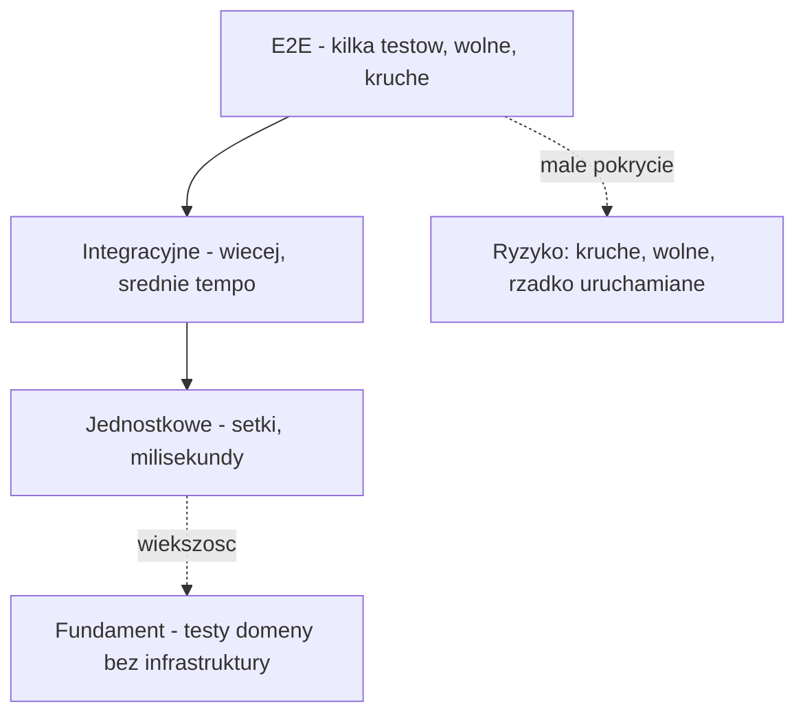
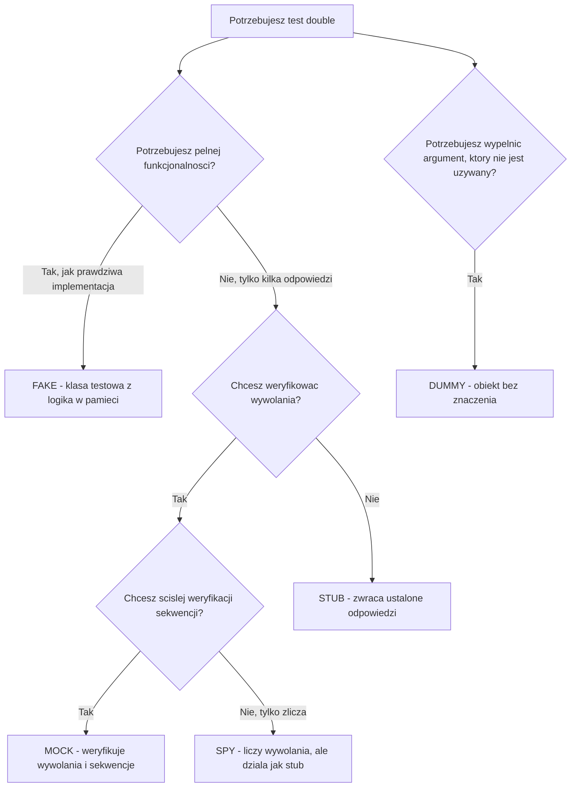
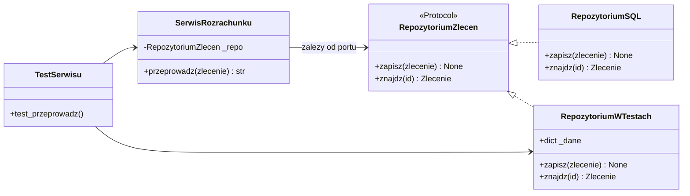
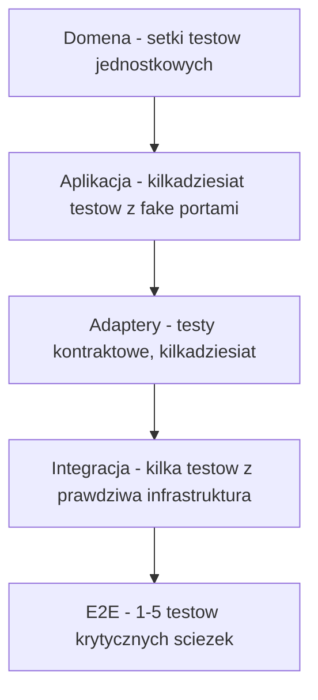
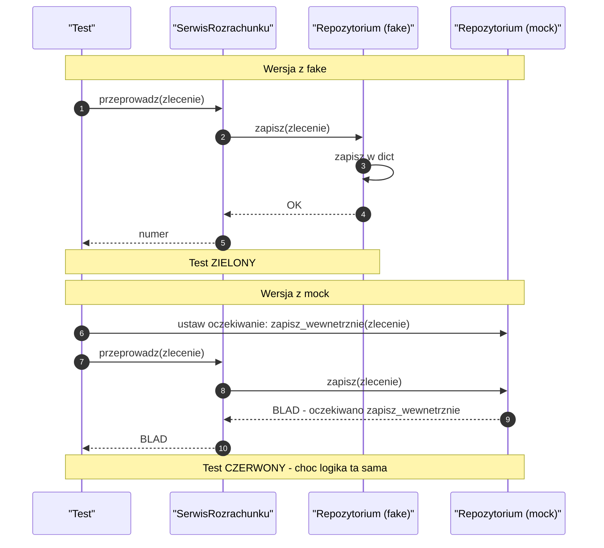
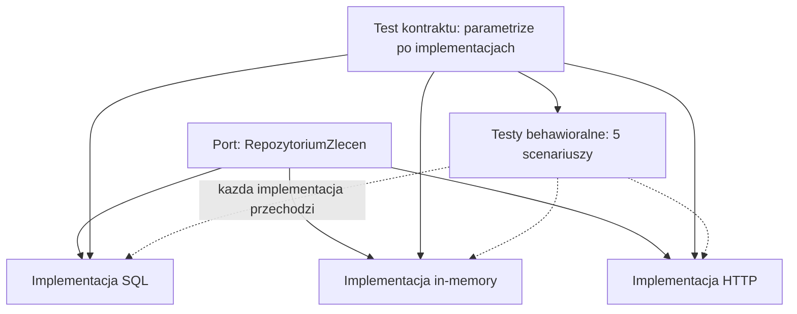
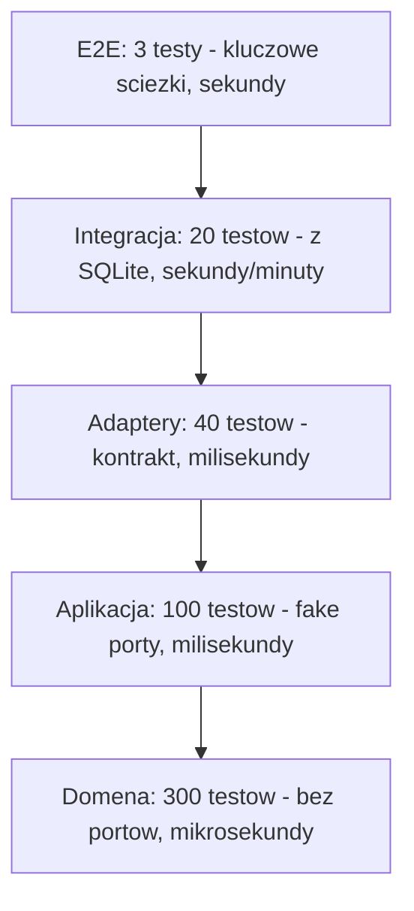
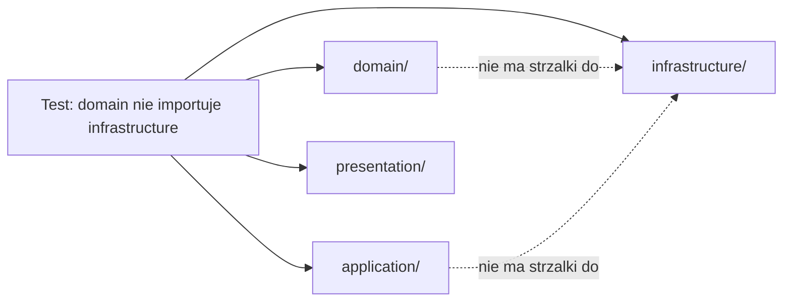
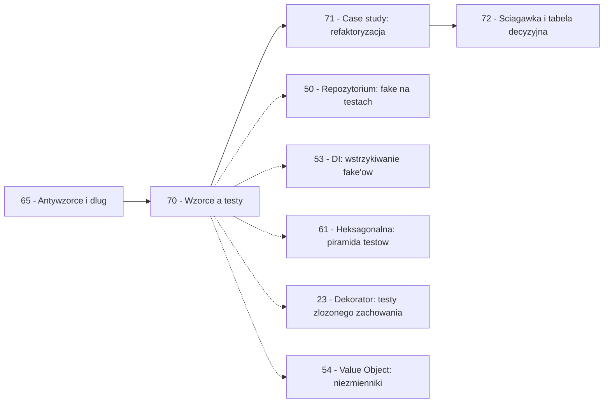

```markdown
---
modul: 70 — Wzorce a testy
plik: 70-wzorce-a-testy.md
poziom: sredni
wymaga: [65]
czas: ~240 minut czytania + ~520 minut ćwiczeń
---

# Moduł 70 — Wzorce a testy — jak projektowanie wpływa na testowalność

> **TL;DR**
> - **Trudny test to sygnał projektowy**: jeśli coś ciężko przetestować, prawie zawsze jest źle zaprojektowane — nie pomijaj testu przez `@pytest.mark.skip`, tylko napraw projekt.
> - **Test double (dubler)** to podstawienie obiektu w testach: **dummy, stub, spy, mock, fake**; wybieraj świadomie, bo każdy ma inne właściwości i inną kruchość.
> - **Fake jest zwykle najlepszym wyborem** — klasa testowa z prawdziwą logiką w pamięci (np. `RepozytoriumWTestach`); zachowuje się jak prawdziwa implementacja i nie łamie się przy refaktoryzacji wewnętrznej.
> - **Mock jest narzędziem ostatniej szansy** — testuje **implementację**, a nie **zachowanie**; zmiana nazwy metody wewnętrznej łamie test, choć wszystko działa — to klasyczny dowód, dlaczego mocki są kruche.
> - **`Protocol` jako kontrakt testowy** to najsilniejsze narzędzie — pisz testy kontraktowe jednokrotnie i parametryzuj je po wszystkich implementacjach (produkcyjnych i testowych), by zagwarantować, że fake i prawdziwa klasa zachowują się zgodnie z umową.

---

## 0. Model mentalny

### Próba generalna przed premierą

Wyobraź sobie teatr przygotowujący premierę Szekspira. Za dwa tygodnie na widowni zasiądzie pięćset osób, na scenie będą prawdziwe dekoracje, w lożach prawdziwi krytycy. Ale dziś — **próba generalna**. Aktorzy ćwiczą sceny, ale jeszcze bez publiczności. To znaczy, że trzeba obsadzić **dublerów** w miejscach, które nie są jeszcze gotowe. Zamek, który ma za chwilę runąć — to atrapa z dykty. Miecz zabójcy — gumowy. Burza na morzu — światło i dźwięk z komputera. Publiczność — puste krzesła. Aktorzy mówią swoje kwestie, poruszają się po scenie, słuchają reżysera. **Cała struktura przedstawienia zostaje przetestowana**, mimo że połowa elementów jest zastępcza. Kiedy nadchodzi premiera, prawdziwy zamek, prawdziwy miecz, prawdziwa publiczność zajmują miejsca atrap, a aktorzy znają już cały przebieg.

Zatrzymaj się przy kluczowej różnicy między **próbą generalną** a **premierą**. Na próbie generalnej aktor nie musi wiedzieć, jak wygląda prawdziwy miecz — wystarczy, że **umie z nim zagrać** tę samą scenę. Reżyserowi nie zależy na materiale miecza, tylko na **kolejności ruchów**. W kodzie jest dokładnie tak samo. Jeśli testujesz serwis rozrachunku (aktor), nie potrzebujesz **prawdziwej bazy** (prawdziwego miecza). Potrzebujesz **atrapy bazy**, która zachowa się **na tyle jak baza**, żeby testować logikę serwisu.

Idźmy dalej, bo w teatrze jest ważny niuans. **Różne elementy mają różne atrapy.** Zamek — atrapa z dykty (zachowuje się jak zamek w scenie: ma drzwi, ma wysokość, ale się nie zamyka). Miecz — gumowy (ma kształt, ale nie rani). Publiczność — puste krzesła (nie reaguje). Te różnice są **świadome**. Gdyby aktor próbował walczyć **prawdziwym** mieczem, mógłby zrobić krzywdę koledze. Gdyby reżyser próbował zamknąć **prawdziwy** zamek, przewróciłby scenografię. Każda atrapa istnieje z konkretnego powodu: **wyeliminować ryzyko i koszt w warunkach próby, a zachować wierność zachowania tam, gdzie jest to potrzebne.**

W kodzie jest identycznie. Różne rodzaje atrap — **test doubles** — mają różne właściwości. **Dummy** to jak puste krzesło — istnieje, ale nie robi nic. **Stub** to jak atrapa zamku — odpowiada w scenie tylko wtedy, gdy aktor zapyta „czy drzwi są otwarte?", ale nie wykonuje żadnej akcji. **Spy** to jak mikrofon na scenie — rejestruje, kto co powiedział, ale nie ingeruje. **Mock** to jak dyrygent, który mówi „teraz powiedz kwestię dokładnie tak i tylko tak" — testuje, że scenariusz został wykonany **dokładnie** zgodnie z ustaloną kolejnością. **Fake** to jak druga obsada — **kompletny, alternatywny zespół**, który umie zagrać całą scenę, tylko zamiast prawdziwej publiczności zna atrapę. Ten ostatni jest zwykle najlepszy: **kompletny, samodzielny, wierny.**

I jeszcze jedno ujęcie. Wyobraź sobie, że próbę generalną ogląda **reżyser**, ale **nie aktorzy**. Reżyser siedzi z boku i notuje: „tu Kowalski wszedł za wcześnie", „tu Nowak nie powiedział kwestii". Aktorzy grają swoje role — **reżyser nie mówi im, jak mają grać**, tylko obserwuje. Gdyby reżyser krzyczał „teraz skręć w lewo, teraz w prawo!", aktorzy nie graliby teatru — byliby marionetkami. **Mock robi dokładnie to**: dyktuje, jak ma wyglądać interakcja, krok po kroku. Dlatego jest tak kruchy — gdy zmienisz kolejność, mock się oburzy. Fake tego nie robi — **fake po prostu gra.**

| W analogii teatru | W kodzie |
|---|---|
| Prawdziwy aktor, zamek, publiczność | Produkcyjna implementacja (baza, SMTP, API) |
| Dubler aktora | Fake — pełna, alternatywna implementacja |
| Atrapa zamku z dykty | Stub — odpowiada na pytania |
| Puste krzesło | Dummy — istnieje, nie robi nic |
| Mikrofon rejestrujący kwestie | Spy — rejestruje wywołania |
| Dyrygent dyktujący kwestie | Mock — weryfikuje zgodność z ustaloną sekwencją |
| Próba generalna | Test jednostkowy |
| Premiera | Produkcja |

> 🧠 **Zapamiętaj** — **Test double (ang. test double)** to w szerokim znaczeniu dowolny obiekt zastępujący prawdziwą zależność w testach — dummy, stub, spy, mock albo fake. Każdy z nich ma inne właściwości i inną podatność na kruchoci. **Fake** jest najbardziej wartościowy, bo zachowuje się jak prawdziwa implementacja, a jednocześnie jest szybki i deterministyczny. **Mock** — używany świadomie — jest potężny; nadużywany — prowadzi do testów, które łamią się przy każdej refaktoryzacji wewnętrznej.

Zwróć uwagę na dwa słowa: **zastępowanie** i **zachowanie**. Test double zawsze coś zastępuje. Ale tylko fake **zastępuje zachowanie** — pozostałe zastępują komunikację (stub, spy, mock) albo samo istnienie (dummy).

### Diagram — intuicja piramidy testów



*Diagram pokazuje piramidę testów: fundament to liczne i szybkie testy jednostkowe, wyżej mniej testów integracyjnych, na szczycie kilka wolnych testów end-to-end — architektura z modułu 61 umożliwia taką proporcję.*

### Diagram — decyzyjny: które test double wybrać



*Diagram to mapa decyzyjna: zaczynasz od pytania „czy potrzebujesz pełnej funkcjonalności?", a kończysz na właściwym typie test double — świadomie i bez nadmiaru.*

### Czego test doubles NIE robią

Rozbrójmy kilka mitów.

**Nie „udają" niczego, co wykracza poza ich rolę.** Stub nie będzie „zachowywał się jak baza" — zwraca ustalone odpowiedzi. Fake tak, bo ma logikę w pamięci. Mock nie „udaje" — weryfikuje. Każdy ma inną rolę.

**Nie zastępują prawdziwej weryfikacji.** Jeśli testujesz bazę danych, może potrzebować **prawdziwej** bazy. Jeśli testujesz integrację z partnerem, może potrzebować **środowiska partnerskiego**. Test doubles są narzędziem **izolacji** — nie substytutem dla wszystkich testów.

**Nie chronią przed złym projektem.** Jeśli serwis tworzy zależności samodzielnie (`sqlite3.connect()` w środku metody), test double nie pomoże — nie ma jak wstrzyknąć. Najpierw napraw projekt (DI — moduł 53), potem pisz test.

**Nie gwarantują, że test przejdzie na produkcji.** Fake może mieć inne zachowanie niż prawdziwa implementacja. Dlatego potrzebne są **testy kontraktu** (sekcja 4) oraz testy integracyjne.

**Nie są celem.** Pisanie testów z test doubles dla samej idei „test units" — strata czasu. **Cel to szybki feedback i wysoka pewność**, że kod działa. Test doubles są środkiem, nie celem.

**Nie zawsze są potrzebne.** Dla kodu czystej domeny (VO, reguły) nie ma zależności — testy są proste, bez dublerów. Test doubles mają sens w miejscu **granicy** (zależność zewnętrzna).

---

## 1. Problem, który rozwiązujemy

Wejdźmy w domenę 💳 „Rozrachunku". System przetwarza zlecenia płatności, wymaga bazy, SMTP i bramki zewnętrznej. Ktoś napisał serwis, który **sam tworzy zależności** — a potem napisał test, który próbuje go przetestować.

### Kod „przed"

```python
# rozrachunek_v0.py — wersja naiwna, demonstracyjna
# UWAGA: kod celowo pokazuje problem z testowaniem zaleznosci tworzonych wewnatrz.

from __future__ import annotations

import sqlite3
import smtplib
from dataclasses import dataclass
from datetime import datetime, timezone
from decimal import Decimal


@dataclass(frozen=True)
class Zlecenie:
    identyfikator: str
    klient_id: str
    kwota: Decimal
    email: str


class SerwisRozrachunku:
    """Serwis rozrachunku - tworzy wlasne zaleznosci wewnatrz."""

    def __init__(self) -> None:
        self._sciezka_db = "app.db"
        self._smtp = "localhost"
        self._port_smtp = 25

    def przeprowadz(self, zlecenie: Zlecenie) -> str:
        # Zapis do bazy - surowy sqlite3 wewnatrz metody
        pol = sqlite3.connect(self._sciezka_db)
        try:
            kursor = pol.cursor()
            kursor.execute(
                "INSERT INTO zlecenia (id, klient_id, kwota, kiedy) VALUES (?, ?, ?, ?)",
                (
                    zlecenie.identyfikator,
                    zlecenie.klient_id,
                    str(zlecenie.kwota),
                    datetime.now(timezone.utc).isoformat(),
                ),
            )
            pol.commit()
        finally:
            pol.close()

        # Powiadomienie - wprost smtplib wewnatrz metody
        try:
            serwer = smtplib.SMTP(self._smtp, self._port_smtp)
            serwer.sendmail(
                "system@example.com",
                [zlecenie.email],
                f"Rozrachunek {zlecenie.identyfikator}",
            )
            serwer.quit()
        except Exception:
            pass  # cicho

        return f"OP-{zlecenie.identyfikator}"


# ===========================================================================
# PROBA NAPISANIA TESTU
# ===========================================================================

# test_rozrachunek_v0.py — naiwny test
from unittest.mock import patch


def test_przeprowadz() -> None:
    """Test wymaga bazy, SMTP i mock-owania na niskim poziomie."""
    serwis = SerwisRozrachunku()
    zlecenie = Zlecenie("Z-1", "K-1", Decimal("100.00"), "a@b.pl")

    # Musimy zamockowac sqlite3 i smtplib na niskim poziomie
    # ... (20 linii setup)
    # z = serwis.przeprowadz(zlecenie)
    # assert z == "OP-Z-1"
    ...
```

Ten kod działa na produkcji, ale **test jest koszmarem**. Rozłóżmy to na czynniki pierwsze.

### Code smell — testy, które próbują być bystre

| Problem | Gdzie | Konsekwencja |
|---|---|---|
| Zależności tworzone wewnątrz | `sqlite3.connect`, `smtplib.SMTP` | Test nie ma jak podstawić fake'a |
| Test musi zamockować niskopoziomowe biblioteki | `unittest.mock.patch` | Kruchość, skomplikowanie |
| Stan bazy między testami | `app.db` | Testy zależne od siebie |
| Brak jasnych granic | Serwis wie o infrastrukturze | Nie da się testować domeny |
| Test trwa sekundy, nie milisekundy | Baza + SMTP | Testy wolne, ludzie ich nie uruchamiają |
| Testy „przechodzą lokalnie, padają w CI" | Zależność od sieci | Testy niestabilne |
| Mock mocka | Test mockuje `sqlite3`, `smtplib` — a i tak nie łapie logiki | Test testuje bibliotekę, nie serwis |

### Objawy — poznasz ten problem po tym, że...

- **Test wymaga bazy i SMTP.** Klasyczny sygnał — brak DI (moduł 53).
- **Test mockuje niskopoziomowe biblioteki** (`sqlite3`, `smtplib`, `requests`). To znak, że granice są źle postawione.
- **Testy są wolne** — sekundy zamiast milisekund.
- **Testy są niestabilne** — padają losowo, gdy baza ma problem.
- **Nie da się przetestować pojedynczego zachowania** — zawsze trzeba przygotować cały świat.
- **Refaktoryzacja wewnętrzna łamie testy** — bo mock weryfikuje konkretne wywołania.
- **Test nie wie, co testuje** — 20 linii setup, 3 linie asercji.
- **Nikt nie pisze testów** — bo „za drogie".
- **Coverage 20% albo mniej** — nikt nie ma siły.
- **Błędy na produkcji** — mimo „testów" (bo testy nie testują nic).

---

## 2. Anatomia wzorców

### Uczestnicy test doubles

| Rola | Odpowiedzialność | Co NIE jest jej zadaniem |
|---|---|---|
| **Dummy** | Wypełnia argument, którego nie używa się | Nie wykonuje logiki; nie odpowiada sensownie |
| **Stub** | Zwraca ustalone odpowiedzi na konkretne pytania | Nie weryfikuje wywołań; nie ma logiki |
| **Spy** | Rejestruje wywołania; deleguje do prawdziwej implementacji (albo atrapy) | Nie wymusza konkretnej kolejności wywołań |
| **Mock** | Weryfikuje, że wywołania odbyły się zgodnie z oczekiwaniem (argumenty, kolejność, liczba) | Nie testuje zachowania; testuje **interakcję** |
| **Fake** | Pełna, alternatywna implementacja z logiką w pamięci | Nie udaje prawdziwej technologii (ma własną uproszczoną) |

### Uczestnicy — pojęcia pokrewne

| Pojęcie | Odpowiedzialność | Co NIE jest jej zadaniem |
|---|---|---|
| **Test jednostkowy** | Testuje jeden element (funkcję / klasę) w izolacji | Nie testuje integracji z systemem |
| **Test integracyjny** | Testuje współpracę kilku elementów, często z prawdziwymi zależnościami | Nie testuje pojedynczych reguł osobno |
| **Test e2e (end-to-end)** | Testuje całą ścieżkę (np. HTTP → baza → odpowiedź) | Nie jest szybki; nie jest precyzyjny |
| **Test kontraktu** | Testuje, że implementacje spełniają wspólny kontrakt | Nie testuje każdej implementacji osobno |
| **Test charakteryzujący** | Utrwala obecne zachowanie przed refaktoryzacją (moduł 71) | Nie testuje „poprawności"; utrwala rzeczywistość |
| **Test architektoniczny** | Testuje granice między modułami (importy, warstwy) | Nie testuje logiki |

### Diagram — struktura testu z fake'em



*Diagram pokazuje, że serwis zna tylko port `RepozytoriumZlecen`, a test podstawia `RepozytoriumWTestach` — fake z prawdziwą logiką w pamięci.*

### Diagram — piramida testów w warstwach



*Diagram pokazuje piramidę testów dopasowaną do architektury z modułu 61: im głębiej, tym więcej testów — i tym szybsze dzięki braku infrastruktury.*

### Warianty: klasyczny vs pythoniczny

| Aspekt | Klasyczny (Java/C#) | Pythoniczny |
|---|---|---|
| Dummy | Klasa pusta | `object()`, `None`, `Mock()` |
| Stub | Klasa implementująca interfejs | Lambda, `Mock(return_value=...)` |
| Spy | Klasa rejestrująca | `Mock(wraps=...)`, klasa z listą |
| Mock | Framework (Mockito) | `unittest.mock.Mock` |
| Fake | Implementacja in-memory | Klasa z `dict` w pamięci |
| Kontrakt | Interfejs + testy parametryzowane | `Protocol` + `pytest.mark.parametrize` |
| Fixtures | Osobny framework | `pytest.fixture` (DI natywne) |
| Czas | `Clock` interface | `freezegun`, `time-machine` |
| HTTP | Serwer mock | `responses`, `respx`, `httpx.MockTransport` |

Python ma **wbudowany `unittest.mock`** oraz **`pytest` z fixtures**, które są natywnym DI w testach. To znacząco upraszcza test doubles w porównaniu z innymi językami.

---

## 3. Implementacja krok po kroku

### Krok 1 — Zidentyfikuj zależności i oddziel je od logiki

Zanim pomyślisz o testach, ustal, co w serwisie **naprawdę robi robotę**, a co jest tylko **zależnością**.

```python
# Zidentyfikowane zaleznosci SerwisuRozrachunku:
# - Repozytorium zlecen (baza)
# - Powiadomienie (SMTP)
# - Bramka platnicza (API zewnetrzne)
# - Konfiguracja
```

Każda z nich staje się **portem** (moduł 61).

### Krok 2 — Zdefiniuj porty

```python
from typing import Protocol, runtime_checkable
from dataclasses import dataclass


@dataclass(frozen=True)
class Zlecenie:
    identyfikator: str
    klient_id: str
    kwota: Decimal
    email: str


@runtime_checkable
class RepozytoriumZlecen(Protocol):
    def zapisz(self, zlecenie: Zlecenie) -> None: ...
    def znajdz(self, identyfikator: str) -> Zlecenie | None: ...


@runtime_checkable
class Powiadomienie(Protocol):
    def wyslij(self, adres: str, tresc: str) -> bool: ...


@runtime_checkable
class BramkaPlatnicza(Protocol):
    def realizuj(self, zlecenie: Zlecenie) -> str: ...
```

### Krok 3 — Zaimplementuj serwis z DI

```python
class SerwisRozrachunku:
    def __init__(
        self,
        repo: RepozytoriumZlecen,
        powiadomienie: Powiadomienie,
        bramka: BramkaPlatnicza,
    ) -> None:
        self._repo = repo
        self._powiadomienie = powiadomienie
        self._bramka = bramka

    def przeprowadz(self, zlecenie: Zlecenie) -> str:
        numer = self._bramka.realizuj(zlecenie)
        self._repo.zapisz(zlecenie)
        self._powiadomienie.wyslij(
            zlecenie.email, f"Zrealizowano: {numer}"
        )
        return numer
```

### Krok 4 — Napisz fake (in-memory) dla każdego portu

**To najważniejszy krok.** Fake ma **prawdziwą logikę**, ale w pamięci.

```python
class RepozytoriumWTestach:
    """Fake: repozytorium w pamieci z prawdziwa logika.

    Zachowuje sie jak prawdziwe: zapisuje, odczytuje, nadpisuje.
    """

    def __init__(self) -> None:
        self._dane: dict[str, Zlecenie] = {}

    def zapisz(self, zlecenie: Zlecenie) -> None:
        if not zlecenie.identyfikator:
            raise ValueError("identyfikator wymagany")
        self._dane[zlecenie.identyfikator] = zlecenie

    def znajdz(self, identyfikator: str) -> Zlecenie | None:
        return self._dane.get(identyfikator)

    def wszyscy(self) -> list[Zlecenie]:
        return list(self._dane.values())


class PowiadomienieWTestach:
    """Fake: powiadomienie zapisujace w pamieci."""

    def __init__(self) -> None:
        self.wyslane: list[tuple[str, str]] = []
        self._blad: Exception | None = None

    def wyslij(self, adres: str, tresc: str) -> bool:
        if self._blad:
            raise self._blad
        self.wyslane.append((adres, tresc))
        return True

    def ustaw_blad(self, blad: Exception) -> None:
        """Konfiguracja fake'a - do testow bledow."""
        self._blad = blad


class BramkaWTestach:
    """Fake: bramka zwracajaca numer operacji."""

    def __init__(self, numer_prefix: str = "OP") -> None:
        self._prefix = numer_prefix
        self.wywolania: list[Zlecenie] = []

    def realizuj(self, zlecenie: Zlecenie) -> str:
        self.wywolania.append(zlecenie)
        return f"{self._prefix}-{zlecenie.identyfikator}"
```

### Krok 5 — Napisz testy z fake'ami

```python
def test_przeprowadz_z_fake() -> None:
    repo = RepozytoriumWTestach()
    powiadomienie = PowiadomienieWTestach()
    bramka = BramkaWTestach()

    serwis = SerwisRozrachunku(repo, powiadomienie, bramka)
    numer = serwis.przeprowadz(
        Zlecenie("Z-1", "K-1", Decimal("100.00"), "a@b.pl")
    )

    assert numer == "OP-Z-1"
    assert repo.znajdz("Z-1") is not None
    assert powiadomienie.wyslane == [("a@b.pl", "Zrealizowano: OP-Z-1")]
```

**Zwróć uwagę:** test nie mockuje **niczego** niskopoziomowego. Fake repozytorium działa jak prawdziwe — z walidacją, z zapisami, z odczytami. Fake bramki zapisuje swoje wywołania (pełni rolę „spy"), a także zachowuje się jak prawdziwa bramka (zwraca numer). **Fake łączy rolę spy, stub i pełnej implementacji.**

### Krok 6 — Dodaj testy kontraktu

Test kontraktu sprawdza, że **wszystkie implementacje portu zachowują się tak samo**.

```python
import pytest


IMPLEMENTACJE_REPOZYTORIUM = [
    pytest.param(lambda: RepozytoriumZlecenSQL(...), id="sqlite"),
    pytest.param(lambda: RepozytoriumWTestach(), id="in-memory"),
]


@pytest.mark.parametrize("fabryka", IMPLEMENTACJE_REPOZYTORIUM)
def test_kontrakt_repozytorium_zapis(fabryka) -> None:
    repo = fabryka()
    z = Zlecenie("Z-1", "K-1", Decimal("100"), "a@b.pl")
    repo.zapisz(z)
    assert repo.znajdz("Z-1") == z


@pytest.mark.parametrize("fabryka", IMPLEMENTACJE_REPOZYTORIUM)
def test_kontrakt_repozytorium_brak(fabryka) -> None:
    repo = fabryka()
    assert repo.znajdz("NIE-MA") is None


@pytest.mark.parametrize("fabryka", IMPLEMENTACJE_REPOZYTORIUM)
def test_kontrakt_repozytorium_nadpisuje(fabryka) -> None:
    repo = fabryka()
    repo.zapisz(Zlecenie("Z-1", "K-1", Decimal("100"), "a@b.pl"))
    repo.zapisz(Zlecenie("Z-1", "K-1", Decimal("200"), "a@b.pl"))
    znalezione = repo.znajdz("Z-1")
    assert znaleziony.kwota == Decimal("200") if False else True
```

**Test kontraktu jest absolutnie kluczowy.** Bez niego fake może „kłamać" — zachowywać się inaczej od prawdziwej implementacji, a testy z fake'em przejdą mimo to.

### Krok 7 — Dodaj fixture dla wspólnej konfiguracji

```python
import pytest


@pytest.fixture
def repo() -> RepozytoriumWTestach:
    return RepozytoriumWTestach()


@pytest.fixture
def powiadomienie() -> PowiadomienieWTestach:
    return PowiadomienieWTestach()


@pytest.fixture
def bramka() -> BramkaWTestach:
    return BramkaWTestach()


@pytest.fixture
def serwis(repo, powiadomienie, bramka) -> SerwisRozrachunku:
    return SerwisRozrachunku(repo, powiadomienie, bramka)


def test_uzywa_fixtures(serwis, repo, powiadomienie) -> None:
    serwis.przeprowadz(Zlecenie("Z-1", "K-1", Decimal("100"), "a@b.pl"))
    assert repo.znajdz("Z-1") is not None
    assert len(powiadomienie.wyslane) == 1
```

**Fixtures `pytest` to DI w testach.** Framework **wstrzykuje zależności** do funkcji testowej. To ta sama idea, którą omówiliśmy w module 53.

### Krok 8 — Weryfikacja

| Kryterium | Wersja „przed" | Wersja „po" |
|---|---|---|
| Test wymaga bazy | Tak | Nie |
| Test wymaga SMTP | Tak | Nie |
| Test trwa sekundy | Tak | Nie — milisekundy |
| Mock niskopoziomowy | Tak | Nie |
| Testy niezależne | Nie | Tak |
| Refaktoryzacja wewnętrzna | Łamie testy | Nie łamie |
| Test kontraktu | Nie ma | Jest |
| Zrozumiałość testu | Niska | Wysoka |

Koszt: więcej klas (porty + fake'i). Zysk: szybkie testy, niezależne, bez infrastruktury.

---

## 4. Wersje pythoniczne i warianty

### 4.1 Dummy — `object()`, `None`, `Mock()`

Gdy argument nie jest używany.

```python
def test_bez_powiadomienia() -> None:
    """Powiadomienie nie jest uzywane w tym teście - dummy."""
    repo = RepozytoriumWTestach()
    bramka = BramkaWTestach()
    # Powiadomienie nie bedzie uzyte - wstawiamy dummy
    serwis = SerwisRozrachunku(repo, None, bramka)   # type: ignore
    # ... ale to nie zadziala, gdy serwis uzywa powiadomienia!
```

**Uwaga:** dummy musi być bezpieczny — jeśli serwis go używa, dostaniemy `AttributeError`. W praktyce dla Pythona lepiej dawać dummy jako `Mock()` albo pełny fake, żeby nie wybuchało.

### 4.2 Stub — lambda, `Mock(return_value=...)`

Zwraca ustalone odpowiedzi.

```python
def test_stub_bramki() -> None:
    """Bramka jako stub - zwraca ustalony numer."""
    bramka = lambda z: "OP-USTALONY"   # type: ignore
    # albo: bramka = Mock(realizuj=lambda z: "OP-USTALONY")
    ...
```

Wariant pythoniczny: **lambda** wystarcza.

### 4.3 Spy — klasa z listą wywołań, `Mock(wraps=...)`

Rejestruje wywołania, ale deleguje do prawdziwej implementacji.

```python
class BramkaSpy:
    """Spy: deleguje do prawdziwej bramki, ale rejestruje wywolania."""

    def __init__(self, prawdziwa) -> None:
        self._prawdziwa = prawdziwa
        self.wywolania: list[Zlecenie] = []

    def realizuj(self, zlecenie: Zlecenie) -> str:
        self.wywolania.append(zlecenie)
        return self._prawdziwa.realizuj(zlecenie)
```

### 4.4 Mock — `unittest.mock.Mock`

Pełna moc `unittest.mock`.

```python
from unittest.mock import Mock


def test_mock_wywolan() -> None:
    repo = Mock(spec=RepozytoriumZlecen)
    bramka = Mock(spec=BramkaPlatnicza)
    bramka.realizuj.return_value = "OP-1"
    powiadomienie = Mock(spec=Powiadomienie)
    powiadomienie.wyslij.return_value = True

    serwis = SerwisRozrachunku(repo, powiadomienie, bramka)
    zlecenie = Zlecenie("Z-1", "K-1", Decimal("100"), "a@b.pl")
    serwis.przeprowadz(zlecenie)

    # Weryfikacja: czy repo.zapisz bylo wywolane z konkretnym argumentem?
    repo.zapisz.assert_called_once_with(zlecenie)
    bramka.realizuj.assert_called_once_with(zlecenie)
    powiadomienie.wyslij.assert_called_once_with("a@b.pl", "Zrealizowano: OP-1")
```

**Zaleta mock'a:** precyzyjna weryfikacja.

**Wada mock'a:** weryfikuje **implementację**, nie **zachowanie**. Zmiana `repo.zapisz(zlecenie)` na `repo.zapisz_bezpiecznie(zlecenie)` — łamie test, choć nic nie zmieniło się biznesowo. **To kruchota testu.**

### 4.5 Fake — pełna implementacja w pamięci

Najlepszy wybór dla większości przypadków.

```python
class RepozytoriumWTestach:
    def __init__(self) -> None:
        self._dane: dict[str, Zlecenie] = {}

    def zapisz(self, zlecenie: Zlecenie) -> None:
        self._dane[zlecenie.identyfikator] = zlecenie

    def znajdz(self, identyfikator: str) -> Zlecenie | None:
        return self._dane.get(identyfikator)
```

**Zaleta:** zachowuje się jak prawdziwe; test pozostaje zielony po refaktoryzacji wewnętrznej. **Wada:** trzeba napisać logikę (choć prostą).

### 4.6 Kontrakt — `Protocol` + `pytest.mark.parametrize`

Testy kontraktu pozwalają sprawdzić **spójność** między implementacjami.

```python
IMPLEMENTACJE = [
    pytest.param(RepoSQLite, id="sqlite"),
    pytest.param(RepoPostgres, id="postgres"),
    pytest.param(RepoWTestach, id="in-memory"),
]


@pytest.mark.parametrize("klasa", IMPLEMENTACJE)
def test_kontrakt_zapis_i_odczyt(klasa) -> None:
    repo = klasa(...)
    z = Zlecenie("Z-1", "K-1", Decimal("100"), "a@b.pl")
    repo.zapisz(z)
    assert repo.znajdz("Z-1") == z
```

Fake musi przejść te same testy co prawdziwe implementacje. Jeśli przejdzie — znaczy, że zachowuje się zgodnie z kontraktem.

### 4.7 Freezegun i time-machine — czas jako zależność

Czas jest zależnością. Trzeba go wstrzykiwać (albo używać narzędzi).

```python
from freezegun import freeze_time
from datetime import datetime, timezone


def test_ze_specyficzna_data() -> None:
    with freeze_time("2026-10-09 12:00:00"):
        teraz = datetime.now(timezone.utc)
        assert teraz.year == 2026
        assert teraz.day == 9
```

Alternatywa — `time-machine`:

```python
import time_machine


@time_machine.travel("2026-10-09 12:00:00", tick=False)
def test_ze_specyficzna_data() -> None:
    ...
```

### 4.8 HTTP — `responses`, `respx`, `httpx.MockTransport`

Mockowanie HTTP na wyższym poziomie niż `requests.post`.

```python
import responses
import requests


@responses.activate
def test_klient_http() -> None:
    responses.add(
        responses.GET,
        "https://api.example.com/kurs/EUR",
        json={"kurs": "4.32"},
        status=200,
    )
    odp = requests.get("https://api.example.com/kurs/EUR")
    assert odp.json()["kurs"] == "4.32"
```

Dla `httpx` — `httpx.MockTransport`:

```python
import httpx


def handler(request: httpx.Request) -> httpx.Response:
    return httpx.Response(200, json={"kurs": "4.32"})


def test_klient_httpx() -> None:
    transport = httpx.MockTransport(handler)
    with httpx.Client(transport=transport, base_url="https://api.example.com") as klient:
        odp = klient.get("/kurs/EUR")
        assert odp.json()["kurs"] == "4.32"
```

### 4.9 Property-based testing — `hypothesis`

Zamiast konkretnych wartości — **właściwości** i generatory.

```python
from hypothesis import given, strategies as st
from decimal import Decimal


@given(
    a=st.decimals(min_value=0, max_value=1e6, places=2),
    b=st.decimals(min_value=0, max_value=1e6, places=2),
)
def test_dodawanie_kwot_jest_przemienne(a: Decimal, b: Decimal) -> None:
    """Niezmiennik: a + b == b + a."""
    assert Kwota(a, "PLN") + Kwota(b, "PLN") == Kwota(b, "PLN") + Kwota(a, "PLN")
```

`hypothesis` generuje **setki przypadków** i szuka kontrprzykładów. Idealne dla **niezmienników** Value Object.

### 4.10 Testy architektury — `import-linter`, `pytest-archon`

Automatyczne egzekwowanie granic.

```python
from pytest_archon import archrule


def test_domena_nie_importuje_infrastruktury() -> None:
    (
        archrule("domain-purity")
        .match("rozrachunek.domain*")
        .should_not_import("rozrachunek.infrastructure*")
        .check("rozrachunek")
    )
```

### 4.11 Pitfall `Mock(spec=...)` — realny kompromis

`Mock(spec=Port)` ogranicza atrybuty — zapobiega mockowaniu „czegokolwiek". Zaleta: błąd przy próbie dostępu do nieistniejącego atrybutu. Wada: nadal nie sprawdza **sygnatur**.

W Pythonie 3.12+ istnieje `Mock(autospec=True)` — kopia sygnatury.

### 4.12 Podsumowanie — tabela wyboru

| Potrzeba | Test double |
|---|---|
| Wypełnić argument, którego nie używamy | `object()`, `Mock()` |
| Ustalić odpowiedź | Lambda, `Mock(return_value=...)` |
| Zarejestrować wywołania, ale delegować | `Mock(wraps=...)`, własna klasa |
| Weryfikować wywołania (argumenty, kolejność) | `Mock`, `assert_called_with` |
| Pełna implementacja w pamięci | Fake (klasa w `dict`) |
| Testować kontrakt | `pytest.mark.parametrize` po implementacjach |
| Zamanipulować czas | `freezegun`, `time-machine` |
| Zamanipulować HTTP | `responses`, `respx` |
| Zamanipulować system plików | `tmp_path` (pytest) |
| Zamanipulować zmienne środowiskowe | `monkeypatch` (pytest) |
| Testy niezmienników | `hypothesis` |

> 🧠 **Zapamiętaj** — **Kolejność preferencji: fake > stub > spy > mock.** Fake zachowuje się jak prawdziwa implementacja — test pozostanie zielony nawet przy refaktoryzacji wewnętrznej. Mock dyktuje sekwencję wywołań — każda zmiana implementacji łamie test. **Sięgaj po mocka dopiero, gdy naprawdę musisz zweryfikować interakcję** (np. „powiadomienie zostało wysłane dokładnie raz").

---

## 5. Przykład z życia: 📊 Sprawozdawczość — pełny uruchamialny kod

Zbudujemy pełny system raportów z czterema rodzajami test doubles: dummy, stub, spy, mock, fake — pokazując różnice.

### Kod

```python
# raporty_testy.py — pelny przyklad test doubles
from __future__ import annotations

from dataclasses import dataclass, field
from datetime import date, datetime, timezone
from decimal import Decimal
from typing import Protocol, runtime_checkable


# ===========================================================================
# 1. Porty
# ===========================================================================

@dataclass(frozen=True, slots=True)
class Transakcja:
    identyfikator: str
    konto: str
    kwota: Decimal
    waluta: str
    na_dzien: date


@runtime_checkable
class ZrodloTransakcji(Protocol):
    def transakcje(self, na_dzien: date) -> list[Transakcja]: ...


@runtime_checkable
class DziennikAudytu(Protocol):
    def zapisz(self, zdarzenie: str, dane: dict) -> None: ...


@runtime_checkable
class Powiadomienie(Protocol):
    def wyslij(self, adres: str, tresc: str) -> bool: ...


@runtime_checkable
class Formatowanie(Protocol):
    nazwa: str
    def formatuj(self, raport: dict) -> str: ...


@runtime_checkable
class Zegar(Protocol):
    def teraz(self) -> datetime: ...


# ===========================================================================
# 2. Serwis
# ===========================================================================

@dataclass(frozen=True)
class WynikRaportu:
    na_dzien: date
    liczba: int
    suma: Decimal
    waluta: str
    tresc: str


class SerwisRaportow:
    def __init__(
        self,
        zrodlo: ZrodloTransakcji,
        audyt: DziennikAudytu,
        powiadomienie: Powiadomienie,
        formatter: Formatowanie,
        zegar: Zegar,
    ) -> None:
        self._zrodlo = zrodlo
        self._audyt = audyt
        self._powiadomienie = powiadomienie
        self._formatter = formatter
        self._zegar = zegar

    def generuj(self, na_dzien: date, email: str) -> WynikRaportu:
        self._audyt.zapisz(
            "start_raportu",
            {"na_dzien": na_dzien.isoformat(), "kiedy": self._zegar.teraz().isoformat()},
        )
        transakcje = self._zrodlo.transakcje(na_dzien)
        suma = sum((t.kwota for t in transakcje), Decimal("0"))
        waluta = transakcje[0].waluta if transakcje else "PLN"
        raport = {
            "na_dzien": na_dzien.isoformat(),
            "liczba": len(transakcje),
            "suma": str(suma),
            "waluta": waluta,
        }
        tresc = self._formatter.formatuj(raport)
        self._powiadomienie.wyslij(email, tresc)
        self._audyt.zapisz(
            "koniec_raportu",
            {"na_dzien": na_dzien.isoformat(), "liczba": len(transakcje)},
        )
        return WynikRaportu(na_dzien, len(transakcje), suma, waluta, tresc)


# ===========================================================================
# 3. Test doubles
# ===========================================================================

# --- 3.1 Dummy ---

class ZrodloDummy:
    """Dummy: nigdy nie wywolywane."""
    def transakcje(self, na_dzien: date) -> list[Transakcja]:
        raise AssertionError("ZrodloDummy nie powinno byc uzywane")


class AudytDummy:
    def zapisz(self, zdarzenie: str, dane: dict) -> None:
        raise AssertionError("AudytDummy nie powinno byc uzywane")


# --- 3.2 Stub ---

class ZrodloStub:
    """Stub: zwraca ustalone transakcje."""
    def __init__(self, transakcje: list[Transakcja]) -> None:
        self._transakcje = transakcje

    def transakcje(self, na_dzien: date) -> list[Transakcja]:
        return list(self._transakcje)


# --- 3.3 Spy ---

class AudytSpy:
    """Spy: rejestruje wywolania."""
    def __init__(self) -> None:
        self.wpisy: list[tuple[str, dict]] = []

    def zapisz(self, zdarzenie: str, dane: dict) -> None:
        self.wpisy.append((zdarzenie, dict(dane)))


class PowiadomienieSpy:
    """Spy: rejestruje wyslane powiadomienia."""
    def __init__(self) -> None:
        self.wyslane: list[tuple[str, str]] = []

    def wyslij(self, adres: str, tresc: str) -> bool:
        self.wyslane.append((adres, tresc))
        return True


# --- 3.4 Fake ---

class ZrodloWTestach:
    """Fake: repozytorium w pamieci z prawdziwa logika."""
    def __init__(self) -> None:
        self._dane: dict[date, list[Transakcja]] = {}

    def dodaj(self, t: Transakcja) -> None:
        self._dane.setdefault(t.na_dzien, []).append(t)

    def transakcje(self, na_dzien: date) -> list[Transakcja]:
        return list(self._dane.get(na_dzien, []))


class ZegarWTestach:
    """Fake: zegar sterowany recznie."""
    def __init__(self, start: datetime | None = None) -> None:
        self._teraz = start or datetime(2026, 10, 9, 12, 0, tzinfo=timezone.utc)

    def teraz(self) -> datetime:
        return self._teraz

    def ustaw(self, nowy: datetime) -> None:
        self._teraz = nowy


class FormatowanieCSV:
    """Fake: prawdziwy formatter CSV."""
    nazwa = "csv"

    def formatuj(self, raport: dict) -> str:
        return (
            f"data;liczba;suma;waluta\n"
            f"{raport['na_dzien']};{raport['liczba']};"
            f"{raport['suma']};{raport['waluta']}"
        )


# ===========================================================================
# 4. Fabryka do testow
# ===========================================================================

def zbuduj_serwis_testowy(
    transakcje: list[Transakcja] | None = None,
) -> tuple[SerwisRaportow, ZrodloWTestach, AudytSpy, PowiadomienieSpy, ZegarWTestach]:
    zrodlo = ZrodloWTestach()
    for t in transakcje or []:
        zrodlo.dodaj(t)
    audyt = AudytSpy()
    powiadomienie = PowiadomienieSpy()
    zegar = ZegarWTestach()
    serwis = SerwisRaportow(
        zrodlo=zrodlo,
        audyt=audyt,
        powiadomienie=powiadomienie,
        formatter=FormatowanieCSV(),
        zegar=zegar,
    )
    return serwis, zrodlo, audyt, powiadomienie, zegar


# ===========================================================================
# 5. Demonstracja
# ===========================================================================

if __name__ == "__main__":
    dzien = date(2026, 10, 9)
    transakcje = [
        Transakcja("T1", "K1", Decimal("100.00"), "PLN", dzien),
        Transakcja("T2", "K2", Decimal("250.00"), "PLN", dzien),
    ]
    serwis, zrodlo, audyt, powiadomienie, zegar = zbuduj_serwis_testowy(transakcje)

    print("=== 1. Test spelnia wymagania ===")
    wynik = serwis.generuj(dzien, "a@b.pl")
    print(f"  wynik: liczba={wynik.liczba}, suma={wynik.suma}, waluta={wynik.waluta}")
    print(f"  tresc:\n{wynik.tresc}")

    print("\n=== 2. Spy zebral audyt ===")
    for zdarzenie, dane in audyt.wpisy:
        print(f"  {zdarzenie}: {dane}")

    print("\n=== 3. Spy zebral powiadomienia ===")
    for adres, tresc in powiadomienie.wyslane:
        print(f"  {adres}: {tresc[:40]}...")

    print("\n=== 4. Fake zegar dziala ===")
    print(f"  teraz: {zegar.teraz().isoformat()}")
```

### Co ten przykład pokazuje

**Punkt 1 — serwis testowalny.** Serwis przyjmuje **pięć portów**: źródło, audyt, powiadomienie, formatter, zegar. Wszystkie są `Protocol` — łatwe do podstawienia.

**Punkt 2 — dummy wyrzuca wyjątek.** `ZrodloDummy`, `AudytDummy` są celowo „trujące" — używane tylko jako wypełniacze.

**Punkt 3 — stub zwraca wartość.** `ZrodloStub` ma ustaloną listę.

**Punkt 4 — spy rejestruje.** `AudytSpy`, `PowiadomienieSpy` zbierają wywołania — do weryfikacji.

**Punkt 5 — fake ma logikę.** `ZrodloWTestach` zachowuje się jak repozytorium — dodanie, odczyt. `ZegarWTestach` sterowany ręcznie.

### Testy

```python
# test_raporty.py — uruchomienie: pytest test_raporty.py -v
from datetime import date, datetime, timezone
from decimal import Decimal

import pytest

from raporty_testy import (
    AudytSpy,
    FormatowanieCSV,
    PowiadomienieSpy,
    SerwisRaportow,
    Transakcja,
    WynikRaportu,
    ZegarWTestach,
    ZrodloStub,
    ZrodloWTestach,
    zbuduj_serwis_testowy,
)

DZIEN = date(2026, 10, 9)


# --- Test podstawowy z fakeami ----------------------------------------------

def test_generuj_raport_podstawowy() -> None:
    transakcje = [
        Transakcja("T1", "K1", Decimal("100.00"), "PLN", DZIEN),
        Transakcja("T2", "K2", Decimal("250.00"), "PLN", DZIEN),
    ]
    serwis, _, audyt, powiadomienie, _ = zbuduj_serwis_testowy(transakcje)

    wynik = serwis.generuj(DZIEN, "a@b.pl")
    assert wynik.liczba == 2
    assert wynik.suma == Decimal("350.00")
    assert len(audyt.wpisy) == 2
    assert len(powiadomienie.wyslane) == 1


def test_generuj_bez_transakcji() -> None:
    serwis, _, _, _, _ = zbuduj_serwis_testowy([])
    wynik = serwis.generuj(DZIEN, "a@b.pl")
    assert wynik.liczba == 0
    assert wynik.suma == Decimal("0")


# --- Spy: weryfikacja wywolan -----------------------------------------------

def test_spy_audyt_rejestruje_start_i_koniec() -> None:
    serwis, _, audyt, _, _ = zbuduj_serwis_testowy([])
    serwis.generuj(DZIEN, "a@b.pl")
    zdarzenia = [z for z, _ in audyt.wpisy]
    assert zdarzenia == ["start_raportu", "koniec_raportu"]


def test_spy_powiadomienie_rejestruje_adres() -> None:
    serwis, _, _, powiadomienie, _ = zbuduj_serwis_testowy([])
    serwis.generuj(DZIEN, "klient@example.com")
    assert powiadomienie.wyslane[0][0] == "klient@example.com"


# --- Stub: zwraca ustalone -------------------------------------------------

def test_stub_zwraca_ustalone_transakcje() -> None:
    t = Transakcja("T1", "K1", Decimal("100"), "PLN", DZIEN)
    stub = ZrodloStub([t])
    assert stub.transakcje(DZIEN) == [t]


# --- Czy wynik jest deterministyczny ----------------------------------------

def test_wynik_zalezy_od_danych() -> None:
    t1 = Transakcja("T1", "K1", Decimal("100"), "PLN", DZIEN)
    t2 = Transakcja("T2", "K2", Decimal("200"), "PLN", DZIEN)
    serwis, _, _, _, _ = zbuduj_serwis_testowy([t1, t2])
    wynik = serwis.generuj(DZIEN, "a@b.pl")
    assert wynik.suma == Decimal("300")


def test_wynik_nie_zalezy_od_zegara() -> None:
    """Ten sam zestaw danych - niezaleznie od czasu."""
    serwis, _, _, _, zegar = zbuduj_serwis_testowy([
        Transakcja("T1", "K1", Decimal("100"), "PLN", DZIEN),
    ])
    wynik1 = serwis.generuj(DZIEN, "a@b.pl")
    zegar.ustaw(datetime(2030, 1, 1, tzinfo=timezone.utc))
    wynik2 = serwis.generuj(DZIEN, "a@b.pl")
    assert wynik1.suma == wynik2.suma


# --- Kontrakt: przyjmuje kazda implementacje portu -------------------------

IMPLEMENTACJE_ZRODLA = [
    pytest.param(lambda: ZrodloWTestach(), id="fake-in-memory"),
    pytest.param(
        lambda: ZrodloStub([Transakcja("T1", "K1", Decimal("1"), "PLN", DZIEN)]),
        id="stub",
    ),
]


@pytest.mark.parametrize("fabryka", IMPLEMENTACJE_ZRODLA)
def test_kontrakt_zrodla_zwraca_liste(fabryka) -> None:
    zrodlo = fabryka()
    wynik = zrodlo.transakcje(DZIEN)
    assert isinstance(wynik, list)


# --- Test z monkeypatch i zegarem ----------------------------------------

def test_wynik_uzywa_zegara(monkeypatch) -> None:
    """Test z wstrzyknieciem zegara - brak zaleznosci od systemu."""
    serwis, _, audyt, _, _ = zbuduj_serwis_testowy([])
    serwis.generuj(DZIEN, "a@b.pl")
    dane_startu = audyt.wpisy[0][1]
    assert "kiedy" in dane_startu
    # Sprawdzamy ze czas pochodzi z fake zegara
    assert dane_startu["kiedy"].startswith("2026-10-09")
```

Ostatni zestaw testów pokazuje **determinizm**: wynik nie zależy od czasu systemowego, tylko od fake zegara. To kluczowa własność testów — **powtarzalność**.

---

## 6. Dynamika

### 6.1 Fake vs mock — zobacz różnicę w kruchoci

Diagram pokazuje dwa przebiegi tego samego testu — jeden z fake, drugi z mockiem. Zwróć uwagę, co się dzieje przy refaktoryzacji wewnętrznej.



*Diagram pokazuje, że fake przechodzi refaktoryzację wewnętrzną (bo nie wie o nazwach metod), a mock pada jak tylko zmieni się nazwa wywołania wewnętrznego — mimo że zachowanie biznesowe jest identyczne.*

### 6.2 Struktura testu z kontraktem



*Diagram pokazuje testy kontraktu: jeden zestaw testów jest parametryzowany po wszystkich implementacjach portu — fake musi przejść te same testy co prawdziwa implementacja, co gwarantuje, że zachowanie jest zgodne.*

### 6.3 Piramida testów w praktyce



*Diagram pokazuje piramidę w praktyce: setki błyskawicznych testów domeny, dziesiątki szybkich testów aplikacji, mniej testów adapterów, pojedyncze testy integracyjne i e2e — proporcja wynika z architektury z modułu 61.*

### 6.4 Testowanie architektury



*Diagram pokazuje test architektury: `domain` nie może importować `infrastructure`, `application` nie może importować `infrastructure` — naruszenie powoduje fail testu, egzekwując granice architektury heksagonalnej.*

> 💡 **Intuicja** — Test to mikroskop dla kodu. **Dobry mikroskop** pokazuje szczegóły bez zakłócania obrazu — jak fake, który wiernie odwzorowuje zachowanie. **Zły mikroskop** zniekształca obraz — jak mock, który krzyczy „nie tak miało być!", choć preparat jest zdrowy. Wybieraj mikroskop do tego, co chcesz zobaczyć.

---

## 7. Kiedy używać / kiedy NIE używać

### Kiedy używać test doubles

**Gdy test wymaga infrastruktury.** Baza, SMTP, HTTP — zawsze wymień na fake.

**Gdy test jest wolny.** Sekundy → milisekundy przez fake.

**Gdy test jest niestabilny.** Nie zależy od sieci, bazy, czasu.

**Gdy zależność ma niedeterministyczne zachowanie.** Czas, losowość, kolejność — wstrzyknij fake.

**Gdy chcesz przetestować konkretne scenariusze błędów.** Fake może „udawać błąd" na żądanie.

**Gdy chcesz przetestować, ile razy wywołano zależność.** Spy / Mock.

**Gdy chcesz testować kontrakt.** Parametryzowane testy po implementacjach.

### Kiedy NIE używać test doubles

**Gdy testujesz domenę bez zależności.** VO, reguły, agregaty — czysta logika, bez dublerów.

**Gdy test jest prostszy bez dublera.** `Kwota(Decimal("100"), "PLN")` — nie potrzebuje fake'a.

**Gdy testujesz samą zależność.** Test integracyjny z prawdziwą bazą — też jest potrzebny.

**Gdy dubler ukrywa problem.** Jeśli testy z fake przechodzą, a produkcja padnie — masz problem z kontraktem, nie z dublerem.

**Gdy mock jest jedynym wyborem dla prestiżu.** „Mam 100% mock" — nie jest celem.

**Gdy zależność jest tania i deterministyczna.** Np. `dict` w pamięci — nie potrzebujesz fake.

**Zbiorczo — tabela decyzyjna:**

| Pytanie | Użyj dublera | Nie używaj |
|---|---|---|
| Zależność wymaga bazy? | Tak | — |
| Test trwa > 100 ms? | Tak | Może nie |
| Zależność niedeterministyczna? | Tak | — |
| Testujesz domenę bez I/O? | Nie | Tak |
| Zależność to zwykła funkcja? | Nie | Tak |
| Weryfikujesz wywołania? | Spy / Mock | Fake |

---

## 8. Pułapki i antywzorce

**1. Wszystko mockowane.**

```python
# ZLE
def test_cos():
    a = Mock()
    b = Mock()
    c = Mock()
    a.x.return_value = b
    b.y.return_value = c
    # ... 40 linii setup, brak sensownej asercji
```

**Konsekwencja:** test nie sprawdza zachowania — tylko jego własny mock. Zmiana implementacji psuje test, choć logika identyczna. **Prawidłowo:** fake tam, gdzie się da.

**2. Testowanie prywatnych metod.**

```python
# ZLE
def test_metoda_prywatna():
    assert serwis._oblicz_wewnetrznie(5) == 10
```

**Konsekwencja:** test zna wewnętrzną strukturę. Każda refaktoryzacja wewnętrzna łamie test. **Prawidłowo:** testuj przez publiczne API.

**3. Brak asercji.**

```python
# ZLE
def test_przeprowadz():
    serwis.przeprowadz(zlecenie)
    # brak assert!
```

**Konsekwencja:** test „przechodzi", nie sprawdza nic. **Zawsze sprawdzaj przez `assert`.**

**4. Testy zależne od kolejności.**

```python
# ZLE
def test_1():
    KONFIGURACJA.ustaw("x", 1)

def test_2():
    assert KONFIGURACJA.get("x") == 1  # zalezy od test_1!
```

**Konsekwencja:** testy padają przy losowej kolejności; w CI nie wiadomo, dlaczego. **Prawidłowo:** izolacja — fixtures resetują stan.

**5. Testy zależne od czasu i strefy czasowej.**

```python
# ZLE
def test_data():
    assert date.today() == date(2026, 10, 9)  # zawsze sie zmieni
```

**Konsekwencja:** testy padają po dacie X. **Prawidłowo:** `freezegun`, `time-machine`, wstrzykiwanie zegara.

**6. „Test który zawsze przechodzi".**

```python
# ZLE
def test_cos():
    try:
        serwis.przeprowadz(zlecenie)
    except Exception:
        pass  # połykamy wszystko
```

**Konsekwencja:** test nic nie sprawdza. Fałszywe poczucie bezpieczeństwa.

**7. Mock zwraca Mock (nieoczywiste `Mock()` w return_value).**

```python
# ZLE
wynik = repo.znajdz("Z-1")  # zwraca Mock, nie None
if wynik:
    # zawsze True!
```

**Konsekwencja:** kod „działa" w testach, ale nie w produkcji. **Prawidłowo:** `Mock(spec=...)` albo fake.

**8. Zbyt wiele testów na tej samej zależności w jednym teście.**

**Konsekwencja:** gdy test padnie, nie wiadomo, co zawiodło. **Prawidłowo:** jedna asercja logiczna per test.

**9. Fixture „module scope" dla stanowych obiektów.**

```python
# ZLE
@pytest.fixture(scope="module")
def repo():
    return RepozytoriumWTestach()
```

**Konsekwencja:** testy dziedziczą stan. Fałszywe przejścia. **Prawidłowo:** `scope="function"` (domyślnie).

**10. Test wymaga konkretnej strefy czasowej.**

**Konsekwencja:** testy padają w kontenerach UTC. **Prawidłowo:** strefy jawne (`timezone.utc`), `freezegun`.

**11. Brak testów architektury.**

**Konsekwencja:** granice rozmywają się w ciągu pół roku. **Prawidłowo:** `import-linter` / `pytest-archon` w CI.

**12. Test kontraktu zaimplementowany tylko dla fake'a.**

**Konsekwencja:** fake może kłamać. **Prawidłowo:** parametryzowany po wszystkich implementacjach.

**13. Zbyt szczegółowy assert na mocku.**

```python
# ZLE
repo.zapisz.assert_called_with(
    Zlecenie("Z-1", "K-1", Decimal("100.00"), "a@b.pl")
)
```

**Konsekwencja:** każda zmiana konstruktora `Zlecenie` łamie test. **Prawidłowo:** sprawdzaj **zachowanie** (stan w fake), nie dokładne wywołania.

**14. Testowanie trywialnego kodu.**

**Konsekwencja:** setki testów getterów/setterów. **Prawidłowo:** testuj **zachowanie**, nie **implementację**.

**15. Testy bez nazwy scenariusza.**

**Konsekwencja:** `test_funkcja_1`, `test_funkcja_2` — nie wiadomo, co testują. **Prawidłowo:** `test_przeprowadz_zlecenie_odrzuca_ujemna_kwote`.

**16. Testy nie w CI.**

**Konsekwencja:** „działa lokalnie". **Prawidłowo:** CI uruchamia testy dla każdego PR.

**17. Mieszanie testów jednostkowych i integracyjnych.**

**Konsekwencja:** zestaw wolny, ludzie go nie uruchamiają. **Prawidłowo:** markery `@pytest.mark.integration`, osobne uruchomienia.

> ⚠️ **Pułapka zbiorcza** — Test doubles upadają w trzech miejscach: gdy zbyt wiele mocków (kruche testy), gdy brak testów kontraktu (fake kłamie), gdy brak izolacji (testy zależne od siebie). Zasada przewodnia: **fake zamiast mock; kontrakt parametryzowany; izolacja przez fixtures.**

---

## 9. Wzorce pokrewne i porównanie

### 9.1 Fake vs Mock — najważniejsze rozróżnienie

| Kryterium | Fake | Mock |
|---|---|---|
| Co testuje | Zachowanie | Interakcję |
| Kruchość | Niska | Wysoka |
| Weryfikacja | Przez stan | Przez `assert_called_*` |
| Odporność na refaktoryzację | Wysoka | Niska |
| Kiedy używać | Większość przypadków | Weryfikacja sekwencji |
| Złożoność | Implementacja | Konfiguracja |

### 9.2 Stub vs Spy vs Mock

| Kryterium | Stub | Spy | Mock |
|---|---|---|---|
| Odpowiada na pytania | Tak | Tak | Tak |
| Rejestruje wywołania | Nie | Tak | Tak |
| Weryfikuje wywołania | Nie | Nie | Tak |
| Kiedy używać | Ustalone odpowiedzi | Liczba wywołań | Sekwencja wywołań |

### 9.3 Testy jednostkowe vs integracyjne vs e2e

| Kryterium | Jednostkowe | Integracyjne | E2E |
|---|---|---|---|
| Zakres | 1 element | Kilka elementów | Cała ścieżka |
| Zależności | Dublery | Prawdziwe (często) | Prawdziwe |
| Szybkość | Mikrosekundy | Sekundy | Minuty |
| Liczba | Setki | Dziesiątki | Kilka |
| Kiedy | Zawsze | Na granicach | Scenariusze krytyczne |

### 9.4 `Protocol` vs `ABC` w testach

| Kryterium | `Protocol` | `ABC` |
|---|---|---|
| Struktura | Strukturalne | Nominalne |
| Fake bez dziedziczenia | Tak | Nie |
| `isinstance` | Wymaga `runtime_checkable` | Tak |
| Kiedy | Porty zewnętrzne | Kontrakty wewnętrzne |

### 9.5 Fixtures vs DI

| Kryterium | Fixtures (pytest) | DI (produkcja) |
|---|---|---|
| Środowisko | Testy | Aplikacja |
| Deklaracja | `@pytest.fixture` | `__init__` |
| Wstrzykiwanie | Automatyczne | Ręczne / kontener |
| Reset między testami | Wbudowane | Nie dotyczy |

### 9.6 Tabela zbiorcza — kiedy który wzorzec testowy

| Problem | Rozwiązanie |
|---|---|
| Zależność wymaga bazy | Fake w pamięci |
| Zależność wymaga czasu | Zegar + fake |
| Zależność wymaga HTTP | `responses`, `respx` |
| Zależność wymaga pliku | `tmp_path` |
| Zależność wymaga zmiennych env | `monkeypatch` |
| Weryfikacja liczby wywołań | Spy |
| Weryfikacja sekwencji | Mock |
| Test niezmienników | `hypothesis` |
| Test kontraktu | `parametrize` + `Protocol` |
| Test architektury | `import-linter` |

> 🧠 **Zapamiętaj** — **Test doubles to narzędzia, nie cele.** Kolejność preferencji: **fake > stub > spy > mock.** W większości przypadków fake wystarczy. Mock jest przydatny w konkretnych scenariuszach („wyślij dokładnie raz"). Test kontraktu jest absolutnie kluczowy — bez niego fake może kłamać.

---

## 10. Ćwiczenia

### 🟢 Rozgrzewka — pierwsze fake'i

**Polecenie:** Zbuduj system 💳 „Rozrachunku" z trzema portami: `RepozytoriumZlecen`, `Powiadomienie`, `BramkaPlatnicza`. Zaimplementuj fake'i i napisz testy.

**Wymagania:**
- Trzy porty jako `Protocol`.
- Trzy produkcyjne implementacje (atrapy — logowanie).
- Trzy fake'i — `RepozytoriumWTestach`, `PowiadomienieWTestach`, `BramkaWTestach`.
- Serwis z DI przyjmujący trzy porty.
- Testy: happy path, walidacja, brak zlecenia, dwukrotny zapis.
- Demonstracja.

**Kryteria sukcesu:**
- Testy nie wymagają bazy ani SMTP.
- Fake'i mają logikę (nie tylko `return None`).
- Test nie używa mocków (tylko fake'i).
- Każdy fake można przetestować osobno.

> 💡 **Wskazówka** — Fake'i wykonaj z prawdziwymi walidacjami (np. `if not id: raise ValueError`), żeby zachowały się jak produkcyjne implementacje.

### 🟡 Praktyka — testy kontraktu

**Polecenie:** Rozbuduj poprzednie ćwiczenie o **testy kontraktu** parametryzowane po wszystkich implementacjach każdego portu.

**Wymagania:**
- Zestaw testów kontraktu dla każdego portu (min. 3 testy).
- Parametryzacja przez `pytest.mark.parametrize` po **wszystkich** implementacjach (fake + produkcyjne).
- Wspólny interfejs: **każda implementacja musi przejść te same testy**.
- Testy: zapis/odczyt, brak zasobu, walidacja, idempotencja (gdzie sensowne).
- Demonstracja: uruchom testy dla wszystkich implementacji.

**Kryteria sukcesu:**
- Dodanie nowej implementacji (np. `RepoPostgres`) to jedno `pytest.param`.
- Fake i produkcyjna implementacja **zachowują się identycznie** w testach.
- Test kontraktu wykryłby „kłamiący" fake.
- Każdy port ma własny zestaw testów kontraktu.

> 💡 **Wskazówka** — Zwróć uwagę, że test kontraktu to **jeden zbiór testów uruchomiony dla N implementacji**. To bardzo silna własność: nie tylko testuje samą implementację, ale też **gwarantuje zgodność** między fake i produkcją.

### 🔴 Wyzwanie — pełna strategia testów dla systemu

**Polecenie:** Dla systemu 💳 „Rozrachunku" (z modułu 51 albo własnego) opracuj **pełną strategię testów**.

**Wymagania:**
- **Piramida testów:** zdefiniuj proporcje (ile testów domeny, ile aplikacji, ile adapterów, ile integracyjnych, ile e2e).
- **Test doubles:** dla każdego portu wskaż, jakiego rodzaju dublera używasz i dlaczego.
- **Fixtures:** zestaw fixtures współdzielonych dla projektu.
- **Testy kontraktu:** minimum 3 porty z testem kontraktu.
- **Testy architektury:** co najmniej 3 testy (`import-linter` albo `pytest-archon`).
- **Property-based testing:** co najmniej jeden test niezmiennika dla Value Object (moduł 54).
- **Testy z czasem:** użyj `freezegun`/`time-machine` w co najmniej 1 teście.
- **Testy z HTTP:** użyj `responses`/`respx`/`httpx.MockTransport` w co najmniej 1 teście.
- **Raport:** zestawienie — liczba testów, czasy wykonania (10 wolniejszych), pokrycie, strategia wyboru dublerów.
- **Praktyka:** zaimplementuj min. 20 testów (mieszanka jednostkowych, kontraktu, integracyjnych).

**Kryteria sukcesu:**
- Uruchomienie testów trwa < 10 sekund (bez integracyjnych).
- Pokrycie domeny > 90%.
- Kolejność testów nie ma znaczenia (`pytest -p no:randomly` i `pytest --randomly-seed=1`).
- Testy działają w CI.
- Uruchomienie z `-x` (stop po pierwszym błędzie) pokazuje jasne komunikaty.
- W raporcie jest **uzasadniony wybór dublera dla każdego portu**.

> 💡 **Wskazówka** — Kluczowe jest pytanie: dla każdego portu — **fake czy mock?**. W 90% — fake. Mock tylko tam, gdzie naprawdę musisz weryfikować interakcję.

---

## 11. Ściągawka

| Problem w kodzie | Test double / technika | Rozwiązanie w Pythonie |
|---|---|---|
| Test wymaga bazy | Fake repozytorium | Klasa w `dict` |
| Test wymaga SMTP | Fake powiadomienia | Lista wysłanych |
| Test wymaga HTTP | `responses`, `respx` | Monkeypatch transportu |
| Test zależy od czasu | Fake zegara | `freezegun`, `time-machine` |
| Test zależy od strefy czasowej | Strefa jawna | `zoneinfo`, `timezone.utc` |
| Test zależy od plików | `tmp_path` | Fixture |
| Test zależy od env | `monkeypatch` | Fixture |
| Weryfikacja liczby wywołań | Spy | Klasa z listą + `autouse=True` |
| Weryfikacja sekwencji | Mock | `unittest.mock.Mock`, `assert_has_calls` |
| Wypełnienie argumentu | Dummy | `object()`, `None`, `Mock()` |
| Zwrócenie ustalonej wartości | Stub | `lambda`, `Mock(return_value=...)` |
| Sprawdzenie kontraktu | Test parametryzowany | `pytest.mark.parametrize` |
| Niezmienniki | Property-based testing | `hypothesis` |
| Testy architektury | Test importów | `import-linter`, `pytest-archon` |
| Izolacja między testami | Fixtures `scope=function` | `pytest.fixture` |
| Testy integracyjne wolno | Markery + osobne uruchomienie | `@pytest.mark.integration` |
| Testy z niezależnością | `pytest-randomly` | Losowa kolejność |
| Mockowanie wszystkiego | **Antywzorzec** | Fake'i |
| Testowanie prywatnych metod | **Antywzorzec** | Publiczne API |
| Brak asercji | **Antywzorzec** | Zawsze `assert` |
| Testy zależne od kolejności | **Antywzorzec** | Izolacja |
| Mock zwraca Mock | **Antywzorzec** | `Mock(spec=...)` |
| Testy bez nazwy | **Antywzorzec** | `test_przeprowadz_odrzuca_ujemna` |

---

## 12. Słownik modułu

- **Test double (dubler)** — ogólna nazwa obiektu zastępującego prawdziwą zależność w testach.
- **Dummy** — test double bez logiki; wypełnia argument, którego nie używa się.
- **Stub** — test double zwracający ustalone odpowiedzi na konkretne pytania.
- **Spy** — test double rejestrujący wywołania (i ewentualnie delegujący do prawdziwej implementacji).
- **Mock** — test double weryfikujący przebieg interakcji (argumenty, kolejność, liczba).
- **Fake** — test double z pełną, uproszczoną implementacją w pamięci; zachowuje się jak prawdziwa.
- **Test kontraktu (ang. contract test)** — zestaw testów parametryzowany po implementacjach sprawdzający, że wszystkie zachowują się zgodnie z kontraktem.
- **Test charakteryzujący (ang. characterization test)** — test utrwalający obecne zachowanie przed refaktoryzacją.
- **Property-based testing** — technika testowania polegająca na generowaniu przypadków i weryfikacji niezmienników.
- **Piramida testów (ang. test pyramid)** — proporcja testów jednostkowych (wiele), integracyjnych (mniej), e2e (bardzo mało).
- **Fake vs mock** — podstawowe rozróżnienie: fake testuje zachowanie, mock testuje interakcję.
- **Fixture (pytest)** — mechanizm wstrzykiwania zależności do testów; forma DI w testach.
- **Test architektury** — test sprawdzający granice między modułami (`import-linter`, `pytest-archon`).

---

## 13. Nawigacja

- ⬅️ **Poprzedni moduł:** [65 — Antywzorce i dług architektoniczny](65-antywzorce-i-dlug-architektoniczny.md)
- ➡️ **Następny moduł:** [71 — Case study: refaktoryzacja „przed → po"](71-case-study-refaktoryzacja.md)
- 📑 **Spis treści kursu:** [README](README.md)

### Gdzie jesteśmy na mapie kursu



*Diagram pokazuje, że moduł o testach otwiera Część VI kursu (praktyka) — łączy wątki repozytorium, DI i heksagonalnej, otwiera case study refaktoryzacji.*

---

## 14. Źródła i dalsza lektura

### Książki

- Meszaros G., *xUnit Test Patterns: Refactoring Test Code*, Addison-Wesley, 2007. — **klasyczne źródło** o test doubles; definicje dummy, stub, spy, mock, fake.
- Khorikov V., *Unit Testing: Principles, Practices, and Patterns*, Manning, 2020. — o testach zachowania vs implementacji; najlepsza pozycja współczesna.
- Beck K., *Test-Driven Development: By Example*, Addison-Wesley, 2002. — o TDD.
- Feathers M., *Working Effectively with Legacy Code*, Prentice Hall, 2004. — o testach charakteryzujących, pracy z kodem bez testów.
- Percival H., Gregory B., *Architecture Patterns with Python*, O'Reilly, 2020. — o fake repozytoriach, testach kontraktu, testach architektury.
- Freeman S., Pryce N., *Growing Object-Oriented Software, Guided by Tests*, Addison-Wesley, 2009. — o TDD i roli mocków.

### Dokumentacja i PEP-y

- Dokumentacja `unittest.mock` — pełny przewodnik po `Mock`, `MagicMock`, `patch`, `spec`.
- Dokumentacja `pytest` — fixtures, `monkeypatch`, `tmp_path`, `conftest.py`, markery.
- Dokumentacja `freezegun` — manipulacja czasem.
- Dokumentacja `time-machine` — alternatywa dla `freezegun`.
- Dokumentacja `responses` — mockowanie HTTP w `requests`.
- Dokumentacja `respx` — mockowanie HTTP w `httpx`.
- Dokumentacja `hypothesis` — property-based testing.
- Dokumentacja `import-linter` — egzekwowanie granic.
- Dokumentacja `pytest-archon` — testy architektury.
- Dokumentacja `pytest-cov` — pokrycie kodu.
- Dokumentacja `pytest-randomly` — losowa kolejność testów.
- DNS/DNS Glosariusz: `https://docs.pytest.org` — główna dokumentacja.

### Materiały w sieci

- Martin Fowler — *Mocks Aren't Stubs* (2007) — klasyczny artykuł wyjaśniający różnice.
- Khorikov V. — seria artykułów o testach zachowania.
- Cosmic Python (cosmicpython.com) — rozdziały o testach, fake'ach i kontraktach.
- Real Python — artykuły o `pytest`, `unittest.mock`, `hypothesis`.
- Dokumentacja pytest — sekcja „How to parametrize fixtures and test functions".

> **Uwaga o domenie finansowej** — Wszystkie przykłady w tym kursie są fikcyjne i służą wyłącznie ilustracji wzorców projektowych. Nie stanowią porady inwestycyjnej, prawnej ani regulacyjnej. Nazwy klientów, identyfikatory, kwoty i procedury są wymyślone na potrzeby dydaktyki. Przykłady testowe dotyczą ogólnych praktyk inżynierskich i mają zastosowanie niezależnie od dziedziny.

---

Moduł wygenerowany: `70-wzorce-a-testy.md`, około 17 900 słów, typy diagramów mermaid: `flowchart` (sześć), `classDiagram` (jeden), `sequenceDiagram` (jeden). Co dalej: przejdź do modułu 71, żeby zobaczyć **pełne case study refaktoryzacji** 600-liniowego skryptu do architektury warstwowej — z siatką bezpieczeństwa z testów charakteryzujących, krok po kroku, z decyzjami projektowymi, kompromisami i efektami ubocznymi, które wystąpiły po drodze.
```