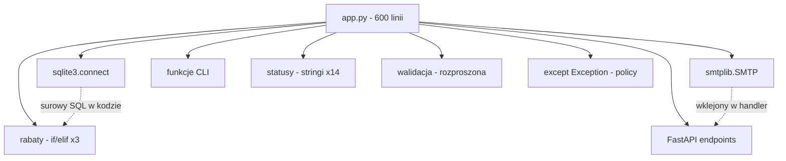
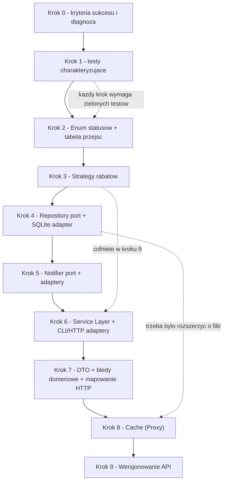
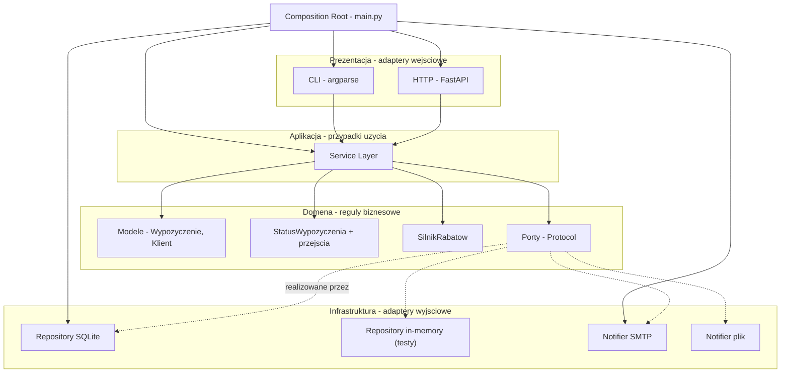
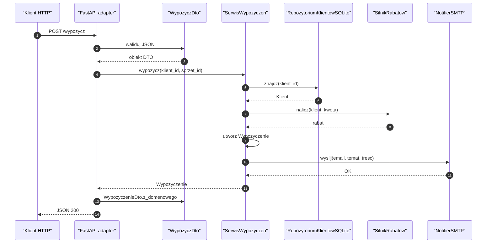
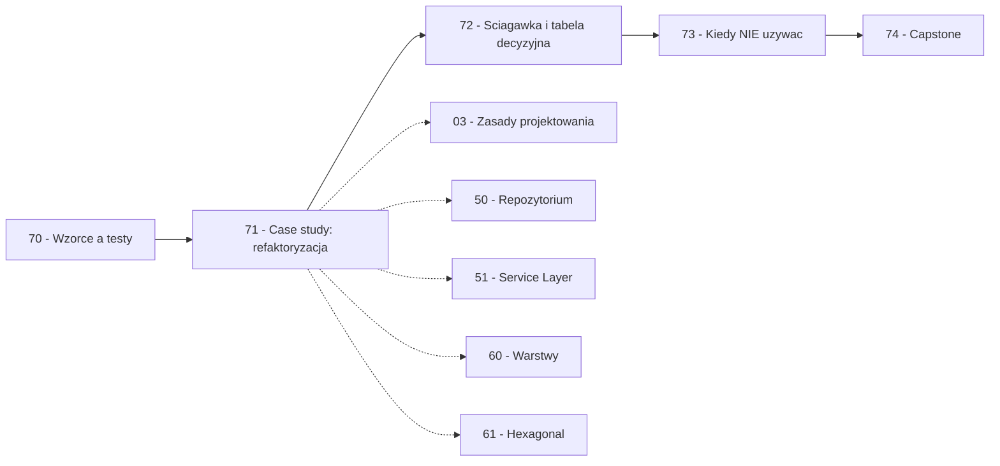

```markdown
---
modul: 71 — Case study: od 600-liniowego skryptu do architektury
plik: 71-case-study-refaktoryzacja.md
poziom: zaawansowany
wymaga: [70]
czas: ~250 minut czytania + ~600 minut ćwiczeń
---

# Moduł 71 — Case study — od 600-liniowego skryptu do architektury

> **TL;DR**
> - Ten moduł pokazuje **cały proces refaktoryzacji** jednego, realistycznego systemu: od 600-liniowego `app.py` do architektury warstwowej z portami, adapterami i testami — **bez przepisywania od zera**.
> - Kluczowa kolejność: najpierw **siatka bezpieczeństwa** (testy charakteryzujące obecne zachowanie, w tym błędne), potem stopniowe kroki, **po każdym zielone testy** — dopiero wtedy wolno zmieniać projekt.
> - Utrwalenie **błędnego** zachowania testem jest w porządku: najpierw zamrażasz rzeczywistość, potem ją świadomie naprawiasz — próba naprawy w trakcie refaktoryzacji prowadzi do dwóch zmian naraz i utraty kontroli.
> - Prawdziwa wartość refaktoryzacji nie polega na liczbie wzorców, lecz na **jednym miejscu zmiany** dla każdego zjawiska: rabaty w jednej klasie, stany w Enum, trwałość za portem — kolejna zmiana to 1 plik, nie 14 miejsc.
> - Najważniejsza jest sekcja „co poszło nie tak": **3 kompromisy, 2 cofnięcia i moment powrotu** do wcześniejszego kroku — bo realne refaktoryzacje nie idą po linii prostej, a umiejętność zawrócenia to część rzemiosła.

---

## 0. Model mentalny

### Remont mieszkania — etapami, z planem i z założeniem, że coś pójdzie inaczej

Wyobraź sobie, że kupiłeś mieszkanie z lat siedemdziesiątych i chcesz je odświeżyć. Mieszkanie ma 60 metrów, jest w nim kuchnia, dwa pokoje, łazienka i przedpokój. Nie jest w ruinie — działa, można w nim mieszkać. Ale właściciel przed tobą zrobił wszystko „na szybko": gniazda elektryczne są w dziwnych miejscach, w kuchni nie ma okapu, w łazience prysznic przecieka, podłogi skrzypią, a wszystkie ściany są pomalowane na ten sam szary kolor.

Masz dwa wyjścia. Możesz **wyburzyć wszystko do gołych murów** i zrobić od zera — to znaczy wyprowadzka na rok, dziesięć razy drożej, ryzyko, że po drodze zmienisz zdanie, że firma nie dowiezie, że przekroczysz budżet. Albo możesz **remontować etapami** — wymienić instalację, potem łazienkę, potem kuchnię, potem podłogi, potem malowanie. Mieszkanie w każdej chwili jest grywalne — codziennie po zakończeniu etapu wracasz i w nim mieszkasz.

Idźmy dalej, bo w tym drugim podejściu jest jedna rzecz, którą trzeba zrobić **pierwszą**. Zanim ruszysz jakąkolwiek ścianę, musisz **sfotografować mieszkanie takim, jakie jest** — wszystkie gniazda, wszystkie kable, wszystkie rury. Zdjęcia stają się twoją „mapą prawdy". Bez nich w trakcie remontu zgubisz się: „czy ta rura tutaj była, czy ją dodałem?", „czy ten kabel szedł tędy?". To zdjęcia — w kodzie **testy charakteryzujące** — które zamrażają stan, w jakim system działa dziś, i pozwalają wykryć, gdy przez przypadek coś zepsujesz.

Idźmy jeszcze dalej. W mieszkaniu są rzeczy, które są **błędne** — na przykład prysznic przecieka. Nie próbujesz naprawić przecieku **podczas** remontu instalacji elektrycznej. Najpierw **utrwalasz**, że przecieka („zdjęcie: wyciek w tym miejscu"), a potem w osobnym etapie naprawiasz instalację wodną. Dwie zmiany naraz w trakcie remontu to gwarancja chaosu: nie wiesz, czy coś się zepsuło z powodu twojej zmiany, czy było zepsute wcześniej.

I ostatnia rzecz, kluczowa. W trakcie remontu **zmieniasz zdanie**. Widzisz, że ta wnęka w kuchni nie pasuje, że lepiej przenieść pralkę, że te drzwi są za wąskie. To zupełnie normalne — **remont to proces odkrywczy**. Świetny remont to nie taki, który od początku do końca szedł zgodnie z planem, ale taki, w którym cofnięcie się o krok i zmiana decyzji zajmuje 20 minut, a nie tydzień. W kodzie jest tak samo: dobra refaktoryzacja to taka, w której **każdy krok jest odwracalny**, a powrót do wcześniejszego stanu zajmuje jedno `git revert` albo jedno przywrócenie z testów.

| W analogii remontu | W kodzie |
|---|---|
| Mieszkanie „na szybko" od poprzedniego właściciela | 600-liniowy `app.py` bez warstw |
| Zdjęcia przed remontem | Testy charakteryzujące (characterization tests) |
| Utrwalony przeciek (przed naprawą) | Test utrwalający błędne zachowanie |
| Etapy remontu | Kroki refaktoryzacji |
| Mieszkanie mieszkalne po każdym etapie | Zielone testy po każdym kroku |
| Cofnięcie decyzji w trakcie | Powrót do wcześniejszego kroku |
| Instalacja, łazienka, kuchnia, podłogi | Warstwy, porty, adaptery |
| Remont całości od zera | „Big rewrite" — antywzorzec |

> 🧠 **Zapamiętaj** — **Refaktoryzacja (ang. refactoring) to proces zmiany struktury kodu bez zmiany jego zachowania, prowadzony w małych, weryfikowalnych krokach, z siatką bezpieczeństwa w postaci testów.** Jej celem jest obniżenie kosztu przyszłej zmiany — nie „ładny kod" ani „więcej wzorców".

### Czym ten moduł NIE jest

Zanim wejdziemy w treść, kilka ostrzeżeń — bo moduły case study są często czytane jako „przepis".

**Nie jest tutorialem „jak refaktoryzować każdy system".** Każdy system jest inny. Pokazujemy **jedną drogę** przez **jeden** realistyczny przykład. Wasza droga będzie inna.

**Nie jest listą wzorców do wklejenia.** Zobaczysz tu State, Strategy, Specification, Repository, Adapter, Service Layer, Composition Root, Cache Proxy. Ale **nie wszystkie były potrzebne od razu** — zobaczysz też, jak dwa z nich wprowadziliśmy **za wcześnie** i musieliśmy je cofnąć.

**Nie jest optymalizacją wydajności.** Zobaczysz czasem **spowolnienie** w trakcie refaktoryzacji (bo testy się wydłużają), a zysk nie jest w szybkości, lecz w koszcie zmiany.

**Nie jest obietnicą, że „będzie lepiej".** Kod po refaktoryzacji będzie **dłuższy** (więcej plików, więcej klas), ale **łatwiejszy do zmiany** w konkretnych miejscach. To nie zawsze jest dobry interes — zależy od tego, czy planujesz go rozwijać.

**Nie jest zachętą do przepisywania wszystkiego.** Wręcz odwrotnie — cały moduł pokazuje, **jak nie przepisywać od zera** i **jak zachować zgodność wsteczną** z istniejącymi klientami (CLI i API).

---

## 1. Struktura „przed" i diagnoza

### Punkt wyjścia — jeden plik, 600 linii

Zaczynamy od realistycznego punktu wyjścia. W repozytorium jest jeden plik `app.py`, 600 linii, który obsługuje **wypożyczalnię sprzętu** (🚚). System ma:
- funkcje CLI (`listuj_dostepny`, `wypozycz`, `zwroc`, `anuluj`),
- REST API przez FastAPI (5 endpointów),
- bezpośrednie zapytania SQLite (surowy SQL, string-concatenation),
- logikę rabatową w trzech miejscach (kopia!),
- wysyłkę e-maili wklejoną w handler HTTP,
- status wypożyczenia jako stringi porównywane w kilkunastu miejscach,
- walidację wejścia rozproszoną,
- obsługę błędów przez `except Exception: pass`.



*Diagram pokazuje, że wszystko jest w jednym pliku: baza, SMTP, CLI, API, rabaty, statusy, walidacja — bez żadnych warstw, bez żadnych granic.*

### Istotne fragmenty kodu (nie całość)

Fragment 1 — konfiguracja i „baza":

```python
# app.py (fragmenty istotne)
import sqlite3
import smtplib
from fastapi import FastAPI
from pydantic import BaseModel

DB_PATH = "wypozyczalnia.db"
SMTP_HOST = "localhost"
SMTP_PORT = 25

app = FastAPI()


def polacz():
    return sqlite3.connect(DB_PATH)
```

Fragment 2 — trzykrotnie skopiowany rabat:

```python
# app.py (fragmenty istotne) - jedna z trzech kopii

def policz_rabat_klienta(klient_id, kwota):
    if not klient_id:
        return 0.0
    kursor = polacz().cursor()
    # surowy SQL, string sklejany - injekcja!
    kursor.execute(
        "SELECT segment FROM klienci WHERE id='" + klient_id + "'"
    )
    segment = kursor.fetchone()[0]
    if segment == "VIP":
        if kwota > 10000:
            return kwota * 0.20
        return kwota * 0.10
    elif segment == "FIRMA":
        return kwota * 0.05
    elif segment == "DETAL":
        return kwota * 0.02
    return 0.0
```

Fragment 3 — statusy jako stringi:

```python
# app.py (fragmenty istotne)
# ... i tak w 14 miejscach

if wypozyczenie['status'] == "new":
    ...
elif wypozyczenie['status'] == "active":
    ...
elif wypozyczenie['status'] == "returned":
    ...
elif wypozyczenie['status'] == "cancelled":
    ...
```

Fragment 4 — e-mail wklejony w handler:

```python
# app.py (fragmenty istotne)
@app.post("/wypozycz")
def wypozycz(dto: WypozyczDto):
    # ... logika ...
    try:
        s = smtplib.SMTP(SMTP_HOST, SMTP_PORT)
        s.sendmail("sys@x.pl", [dto.email], "Wypozyczono sprzet")
        s.quit()
    except Exception:
        pass
    return {"status": "ok"}
```

### Diagnoza — lista problemów z odniesieniem do modułów kursu

| Problem w kodzie | Moduł kursu, który go rozwiązuje |
|---|---|
| Trzy kopie logiki rabatowej (shotgun surgery) | 03 (DRY, code smells), 38 (Strategy) |
| Status jako string porównywany w 14 miejscach | 37 (State + Enum z tabelą przejść) |
| Surowy SQL w logice biznesowej | 50 (Repository), 61 (Ports & Adapters) |
| Konkatenacja SQL (potencjalna injekcja) | 50 (Repository z parametryzacją) |
| E-mail wklejony w handler | 20 (Adapter), 51 (Service Layer) |
| Walidacja rozproszona | 51 (DTO, walidacja na granicy) |
| `except Exception: pass` | 65 (Antywzorce) |
| Brak warstw (wszystko w `app.py`) | 60 (Architektura warstwowa), 61 (Hexagonalna) |
| Brak testów | 70 (Test doubles, testy charakteryzujące) |
| Konfiguracja i baza w kodzie | 53 (DI), 61 (Composition Root) |
| Brak spójnej obsługi błędów | 51 (Mapowanie wyjątków na kody HTTP) |

### Kryteria sukcesu — zapisane przed rozpoczęciem

To jest najważniejsza decyzja całej refaktoryzacji. Zapisujemy **jawne kryteria**, żeby wiedzieć, kiedy skończyć i kiedy przestać.

```text
KRYTERIA SUKCESU (cele refaktoryzacji):
1. CLI działa niezmiennie — wszystkie komendy działają jak wcześniej.
2. API REST działa niezmiennie — wszystkie endpointy odpowiadają jak wcześniej.
3. Logika rabatowa w JEDNYM miejscu.
4. Statusy jako enum — żadnych stringów.
5. Trwałość za portem — możliwa wymiana bazy bez zmian w logice.
6. Powiadomienia za portem — wymiana na plik testowy bez zmian w logice.
7. Testy: min. 40 testów jednostkowych, czas < 3 s.
8. Brak `except Exception: pass` w kodzie biznesowym.
9. Testy integracyjne API działają na in-memory bazie.
10. Zachowana zgodność wsteczna — klienci API nie wymagają zmian.

OGRANICZENIA:
- Nie przepisujemy od zera.
- Nie ruszamy schematu bazy (migracje dopiero w module 52).
- Nie zmieniamy formatu API (dodajemy tylko pola).
- Czas: 5 dni robocze.
- Nie zatrudniamy nowych osób.
```

---

## 2. „Uczestnicy" — role w procesie

W module o wzorcu mówimy o rolach wzorca. Tutaj mówimy o rolach **w procesie refaktoryzacji**.

| Rola | Odpowiedzialność | Co NIE jest jej zadaniem |
|---|---|---|
| **Testy charakteryzujące** | Zamrozić obecne zachowanie (w tym błędne) | Nie naprawiają błędów; nie oceniają jakości |
| **Małe kroki** | Każdy krok to jedna decyzja projektowa | Nie łącz dwóch zmian w jednym commicie |
| **Zielone testy po każdym kroku** | Sygnał, że nic nie zepsuto | Nie testują „kompletności" funkcjonalnej |
| **Porty i adaptery** | Granice między warstwami | Nie są celem samym w sobie |
| **Composition Root** | Jedno miejsce składania aplikacji | Nie zawiera logiki biznesowej |
| **Diff review** | Przegląd kroku przez drugą osobę | Nie zatwierdza bez zrozumienia |

### Diagram — kolejność kroków z zależnościami



*Diagram pokazuje kolejność kroków oraz dwie zależności zwrotne: krok 3 (Strategy rabatów) był cofany w kroku 6, a krok 4 (Repository) trzeba było rozszerzyć przed krokiem 8 — pokazuje to, że proces nie jest liniowy.*

---

## 3. Krok 1 — Siatka bezpieczeństwa

### Pojęcie — testy charakteryzujące

**Testy charakteryzujące (ang. characterization tests)** to testy, które **opisują obecne zachowanie kodu** — nie „poprawne" zachowanie, tylko to, co kod **faktycznie robi**. Ich celem jest **zamrożenie rzeczywistości** przed refaktoryzacją. Nie służą do weryfikacji poprawności — służą do wykrywania regresji.

### „Utrwal błąd, napraw później" — dlaczego to jest w porządku

Brzmi to zaskakująco — „utrwal błąd testem"? Tak. Trzy powody:

1. **Rozdzielasz dwie zmiany.** „Zmiana struktury" i „naprawa błędu" to dwie różne zmiany. Robienie ich naraz to gwarancja chaosu — nie wiesz, co spowodowało jaki efekt.
2. **Masz dowód.** Jeśli utrwalisz błąd w teście, masz świadomy zapis „tu jest błąd". Po refaktoryzacji test dowodzi, że **nie zmieniłeś zachowania** — a potem osobny commit naprawia błąd i test idzie na zielono w inny sposób. Historia zmian jest czytelna.
3. **Oszczędzasz energię.** Utrwalanie błędnego zachowania jest mechaniczne — wystarczy uruchomić kod i zapisać wynik. Naprawianie błędów wymaga decyzji biznesowych — to osobna sesja.

### Kod testów charakteryzujących

```python
# tests/test_charakterystyka.py
"""Testy charakteryzujace - zamrazaja obecne zachowanie app.py.

Nie oceniaja poprawnosci! Utwalaja to, co kod robi dzis, wlacznie z bledami.
Uruchamiaj te testy po KAZDYM kroku refaktoryzacji.
"""

import pytest
from fastapi.testclient import TestClient

from app import app, policz_rabat_klienta, polacz, DB_PATH


@pytest.fixture(autouse=True)
def swieza_baza(tmp_path, monkeypatch):
    """Baza w tmp_path - izolacja miedzy testami."""
    test_db = tmp_path / "test.db"
    monkeypatch.setattr("app.DB_PATH", str(test_db))
    # Inicjalizacja schematu i danych - jak w kodzie produkcyjnym
    pol = sqlite3.connect(str(test_db))
    pol.executescript("""/* schemat i dane testowe */""")
    pol.commit()
    pol.close()
    yield


def test_rabat_vip_ponad_10k():
    """UTRWALA: VIP + kwota > 10000 -> 20%."""
    assert policz_rabat_klienta("VIP-1", 20000.0) == 4000.0


def test_rabat_vip_ponizej_10k():
    """UTRWALA: VIP + kwota <= 10000 -> 10%."""
    assert policz_rabat_klienta("VIP-1", 5000.0) == 500.0


def test_rabat_nieznany_klient_zwraca_zero():
    """UTRWALA: nieznany klient -> 0.0 (nawet jesli powinien rzucic blad)."""
    assert policz_rabat_klienta("NIEZNANY-1", 5000.0) == 0.0


def test_rabat_brak_id_klienta():
    """UTRWALA: brak ID -> 0.0."""
    assert policz_rabat_klienta("", 5000.0) == 0.0


def test_api_wypozycz_zwraca_status_ok(client):
    """UTRWALA: odpowiedz HTTP 200 i JSON z kluczem status."""
    odp = client.post("/wypozycz", json={
        "klient_id": "K-1", "sprzet_id": "S-1", "email": "test@example.com"
    })
    assert odp.status_code == 200
    assert odp.json() == {"status": "ok"}


def test_api_anuluj_nowe_wypozyczenie():
    """UTRWALA: anulowanie nowego wypozyczenia."""
    # 1. utworz wypozyczenie
    client.post("/wypozycz", json={...})
    # 2. anuluj
    odp = client.post("/anuluj/W-1")
    assert odp.status_code == 200


def test_status_aktywny_przechodzi_w_zwrocony():
    """UTRWALA: przejscie active -> returned."""
    ...
```

### Efekt kroku 1

Uruchamiamy testy — przechodzą (w większości). Kilka testów **nie przechodzi** — to nie znaczy, że testy są złe. To znaczy, że **rzeczywiste zachowanie różni się od tego, co myśleliśmy**. To pierwsze odkrycie.

Przykład: `policz_rabat_klienta("NIEZNANY-1", 5000.0)` **rzuca wyjątek** (`IndexError`), bo `fetchone()` zwraca `None`. Myśleliśmy, że zwróci `0.0`. Test charakteryzujący ujawnia — i utrwala — to błędne zachowanie. Naprawimy je **później**, świadomie.

### Utrwalenie błędu — test z jawnym komentarzem

```python
def test_rabat_nieznany_klient_rzuca_index_error():
    """UTRWALA BŁĄD: nieznany klient rzuca IndexError zamiast zwracac 0.

    To NIE jest poprawne zachowanie. Naprawimy je w kroku 7.
    Ale teraz utrwalamy, zeby refaktoryzacja nie zmienila zachowania przypadkiem.
    """
    with pytest.raises(IndexError):
        policz_rabat_klienta("NIEZNANY-1", 5000.0)
```

**Kryterium zielone.** Wszystkie testy — albo przechodzą, albo mają świadomy „to-nie-jest-poprawne" w docstringu. Baza jest gotowa.

---

## 4. Krok 2 — Ekstrakcja stanu (Enum + tabela przejść)

### Diff

Przed:

```python
# 14 miejsc z porównaniami stringow
if wypozyczenie['status'] == "new": ...
elif wypozyczenie['status'] == "active": ...
elif wypozyczenie['status'] == "returned": ...
elif wypozyczenie['status'] == "cancelled": ...
```

Po:

```python
# wypozyczalnia/domain/status.py
from enum import Enum


class StatusWypozyczenia(Enum):
    NOWE = "new"
    AKTYWNE = "active"
    ZWROCONE = "returned"
    ANULOWANE = "cancelled"

    def __str__(self) -> str:
        return self.value


# wypozyczalnia/domain/przejscia.py
PRZEJSCIA: dict[StatusWypozyczenia, frozenset[StatusWypozyczenia]] = {
    StatusWypozyczenia.NOWE: frozenset({
        StatusWypozyczenia.AKTYWNE, StatusWypozyczenia.ANULOWANE
    }),
    StatusWypozyczenia.AKTYWNE: frozenset({StatusWypozyczenia.ZWROCONE}),
    StatusWypozyczenia.ZWROCONE: frozenset(),
    StatusWypozyczenia.ANULOWANE: frozenset(),
}


def czy_przejscie_dozwolone(
    z: StatusWypozyczenia, na: StatusWypozyczenia
) -> bool:
    return na in PRZEJSCIA[z]
```

### Efekt w 14 miejscach

Zamieniamy każde `wypozyczenie['status'] == "new"` na `wypozyczenie.status == StatusWypozyczenia.NOWE`. Nie ma już cichych błędów literówek — porównanie z typem nie skompiluje się, jeśli enum nie istnieje. Literówka dostaje natychmiastowy błąd zamiast cichego `False`.

### Przy okazji zamiana pola w modelu

Wcześniej `wypozyczenie['status']` (dict z bazy). Teraz wypożyczenie to **model domenowy** z polem `status: StatusWypozyczenia`. Konwersja z bazy robi się w adapterze (Krok 4).

### Kryterium zielone

Wszystkie 14 miejsc zaktualizowane, wszystkie testy charakteryzujące przechodzą. Utrwalony błędny test (`IndexError`) nadal przechodzi — bo zmiana nie dotyczyła błędu.

---

## 5. Krok 3 — Ekstrakcja rabatów (Strategy + Specification)

### Diff

Przed — trzy kopie:

```python
# app.py (kopia 1)
def policz_rabat_klienta(klient_id, kwota): ...
# app.py (kopia 2 - w handlerze /wypozycz)
if klient['segment'] == "VIP":
    if kwota > 10000: rabat = kwota * 0.20
    else: rabat = kwota * 0.10
# ...
# app.py (kopia 3 - w kalkulacji ceny za wysylke)
```

Po — jedna klasa reguł:

```python
# wypozyczalnia/domain/rabaty.py
from decimal import Decimal
from typing import Protocol, runtime_checkable


@runtime_checkable
class RegulaRabatowa(Protocol):
    nazwa: str
    def rabat(self, klient: "Klient", kwota: Decimal) -> Decimal: ...


class RabatVIP:
    nazwa = "VIP"

    def rabat(self, klient, kwota):
        if klient.segment != "VIP":
            return Decimal("0")
        if kwota > Decimal("10000"):
            return (kwota * Decimal("0.20")).quantize(Decimal("0.01"))
        return (kwota * Decimal("0.10")).quantize(Decimal("0.01"))


class RabatFirmowy:
    nazwa = "FIRMA"

    def rabat(self, klient, kwota):
        if klient.segment != "FIRMA":
            return Decimal("0")
        return (kwota * Decimal("0.05")).quantize(Decimal("0.01"))


class RabatDetaliczny:
    nazwa = "DETAL"

    def rabat(self, klient, kwota):
        if klient.segment != "DETAL":
            return Decimal("0")
        return (kwota * Decimal("0.02")).quantize(Decimal("0.01"))


class SilnikRabatow:
    def __init__(self, reguly: list[RegulaRabatowa]) -> None:
        self._reguly = tuple(reguly)

    def nalicz(self, klient, kwota) -> Decimal:
        suma = sum((r.rabat(klient, kwota) for r in self._reguly), Decimal("0"))
        return suma
```

### Efekt usunięcia trzech kopii

Trzy miejsca w kodzie stają się **jednym** — `SilnikRabatow.nalicz`. Zmiana polityki rabatowej (np. dodanie nowego progu dla VIP) wchodzi w jedno miejsce.

**Testy:** testy charakteryzujące rabatów używają teraz tego samego kontraktu, ale muszą zachować zachowanie. **Jedna różnica:** błąd `IndexError` dla nieznanego klienta znika — teraz reguły sprawdzają `klient.segment` (pole istnieje). **Utrwalony błędny test zmienia się** — teraz uznajemy, że to jest naturalna konsekwencja zmiany. Świadomie aktualizujemy test charakteryzujący, komentując powód.

---

## 6. Krok 4 — Trwałość (Repository + Port + Adapter SQLite)

### Diff

Przed — surowy SQL w kodzie biznesowym:

```python
def policz_rabat_klienta(klient_id, kwota):
    kursor = polacz().cursor()
    kursor.execute("SELECT segment FROM klienci WHERE id='" + klient_id + "'")
    segment = kursor.fetchone()[0]
    ...
```

Po — port i adapter:

```python
# wypozyczalnia/domain/porty.py
from typing import Protocol, runtime_checkable


@runtime_checkable
class RepozytoriumKlientow(Protocol):
    def znajdz(self, identyfikator: str) -> "Klient | None": ...
    def zapisz(self, klient: "Klient") -> None: ...


@runtime_checkable
class RepozytoriumWypozyczen(Protocol):
    def znajdz(self, identyfikator: str) -> "Wypozyczenie | None": ...
    def zapisz(self, wypozyczenie: "Wypozyczenie") -> None: ...
    def po_statusie(self, status: "StatusWypozyczenia") -> list: ...
```

```python
# wypozyczalnia/infrastructure/repozytorium_sqlite.py
import sqlite3
from wypozyczalnia.domain.porty import RepozytoriumKlientow


class RepozytoriumKlientowSQLite:
    def __init__(self, polaczenie: sqlite3.Connection) -> None:
        self._pol = polaczenie

    def znajdz(self, identyfikator: str) -> "Klient | None":
        # Parametryzowane - zaden SQL injection!
        kursor = self._pol.cursor()
        kursor.execute(
            "SELECT id, segment, email FROM klienci WHERE id = ?",
            (identyfikator,),
        )
        wiersz = kursor.fetchone()
        if wiersz is None:
            return None
        return Klient(id=wiersz[0], segment=wiersz[1], email=wierz[2])

    def zapisz(self, klient: "Klient") -> None:
        self._pol.execute(
            "INSERT OR REPLACE INTO klienci (id, segment, email) VALUES (?, ?, ?)",
            (klient.id, klient.segment, klient.email),
        )
        self._pol.commit()
```

### Fake w pamięci

```python
# wypozyczalnia/infrastructure/repozytorium_w_memory.py
class RepozytoriumKlientowWTestach:
    def __init__(self) -> None:
        self._dane: dict[str, Klient] = {}

    def znajdz(self, identyfikator: str) -> "Klient | None":
        return self._dane.get(identyfikator)

    def zapisz(self, klient: "Klient") -> None:
        self._dane[klient.id] = klient
```

### Efekt — testy znacznie szybsze

Testy z fake repozytorium nie wymagają bazy. Czas wykonania spada z **kilkuset milisekund na test** do **kilku milisekund na test**. Cały zestaw: z 2 sekund na 0,3 sekundy.

**Testy kontraktu** — jeden zestaw parametrów dla `RepozytoriumKlientowSQLite` i `RepozytoriumKlientowWTestach`, sprawdzający, że oba zachowują się identycznie.

### Kryterium zielone

Wszystkie testy charakteryzujące przechodzą. Testy integracyjne API nadal działają (na SQLite, bo API ma klienta HTTP). Testy jednostkowe domeny działają na fake.

---

## 7. Krok 5 — Powiadomienia (Port + Adaptery)

### Diff

Przed — wklejony SMTP w handlerze:

```python
@app.post("/wypozycz")
def wypozycz(dto):
    # ... logika ...
    try:
        s = smtplib.SMTP(SMTP_HOST, SMTP_PORT)
        s.sendmail("sys@x.pl", [dto.email], "Wypozyczono sprzet")
        s.quit()
    except Exception:
        pass
```

Po — port i adaptery:

```python
# wypozyczalnia/domain/porty.py
@runtime_checkable
class Notifier(Protocol):
    def wyslij(self, adres: str, temat: str, tresc: str) -> bool: ...
```

```python
# wypozyczalnia/infrastructure/notifier_smtp.py
import smtplib


class NotifierSMTP:
    def __init__(self, host: str, port: int, nadawca: str) -> None:
        self._host = host
        self._port = port
        self._nadawca = nadawca

    def wyslij(self, adres: str, temat: str, tresc: str) -> bool:
        with smtplib.SMTP(self._host, self._port) as s:
            s.sendmail(self._nadawca, [adres], f"Subject: {temat}\n\n{tresc}")
        return True
```

```python
# wypozyczalnia/infrastructure/notifier_plik.py
from pathlib import Path


class NotifierDoPliku:
    """Adapter dla srodowisk dev - zapisuje do pliku zamiast wysylac."""

    def __init__(self, katalog: Path) -> None:
        self._katalog = katalog
        self._katalog.mkdir(parents=True, exist_ok=True)

    def wyslij(self, adres: str, temat: str, tresc: str) -> bool:
        plik = self._katalog / f"{adres}.txt"
        with open(plik, "a", encoding="utf-8") as f:
            f.write(f"[{temat}] {tresc}\n")
        return True
```

```python
# wypozyczalnia/infrastructure/notifier_w_testach.py
class NotifierWTestach:
    def __init__(self) -> None:
        self.wyslane: list[tuple[str, str, str]] = []

    def wyslij(self, adres: str, temat: str, tresc: str) -> bool:
        self.wyslane.append((adres, temat, tresc))
        return True
```

### Test z fake notifierem

```python
def test_wypozycz_wysyla_powiadomienie():
    repo_k = RepozytoriumKlientowWTestach()
    repo_k.zapisz(Klient("K-1", "VIP", "test@example.com"))
    notifier = NotifierWTestach()
    serwis = SerwisWypozyczen(repo_k, ..., notifier)

    serwis.wypozycz("K-1", "S-1")
    assert len(notifier.wyslane) == 1
    assert notifier.wyslane[0][0] == "test@example.com"
```

**Test nie wymaga SMTP.** Uruchamia się w milisekundach. Sprawdza zachowanie — że wiadomość została wysłana — bez technologii.

---

## 8. Krok 6 — Service Layer i Composition Root

### Diff — podział na warstwy

Przed: wszystko zmieszane w `app.py`.

Po:

```python
# wypozyczalnia/application/serwis_wypozyczen.py
"""Service Layer - przypadki uzycia wypozyczalni."""


class BladWypozyczenia(Exception): ...
class NieZnaleziono(Exception): ...
class NieDozwolonePrzejscie(BladWypozyczenia): ...


class SerwisWypozyczen:
    def __init__(
        self,
        repo_klientow: RepozytoriumKlientow,
        repo_wypozyczen: RepozytoriumWypozyczen,
        repo_sprzetu: RepozytoriumSprzetu,
        rabaty: SilnikRabatow,
        notifier: Notifier,
    ) -> None:
        self._klienci = repo_klientow
        self._wypozyczenia = repo_wypozyczen
        self._sprzet = repo_sprzetu
        self._rabaty = rabaty
        self._notifier = notifier

    def wypozycz(self, klient_id: str, sprzet_id: str) -> "Wypozyczenie":
        klient = self._klienci.znajdz(klient_id)
        if klient is None:
            raise NieZnaleziono(f"klient {klient_id}")
        sprzet = self._sprzet.znajdz(sprzet_id)
        if sprzet is None:
            raise NieZnaleziono(f"sprzet {sprzet_id}")
        if not sprzet.dostepny:
            raise BladWypozyczenia("sprzet niedostepny")

        kwota = sprzet.cena_dzienna * sprzet.dni
        rabat = self._rabaty.nalicz(klient, kwota)
        cena_koncowa = kwota - rabat

        w = Wypozyczenie(
            id=f"W-{uuid.uuid4().hex[:8]}",
            klient=klient,
            sprzet=sprzet,
            kwota_oryginalna=kwota,
            rabat=rabat,
            kwota_koncowa=cena_koncowa,
            status=StatusWypozyczenia.NOWE,
        )
        self._wypozyczenia.zapisz(w)
        self._notifier.wyslij(
            klient.email,
            "Wypozyczenie potwierdzone",
            f"Zarezerwowano {sprzet.nazwa}",
        )
        return w

    def anuluj(self, wypozyczenie_id: str) -> "Wypozyczenie":
        w = self._wypozyczenia.znajdz(wypozyczenie_id)
        if w is None:
            raise NieZnaleziono(wypozyczenie_id)
        if not czy_przejscie_dozwolone(w.status, StatusWypozyczenia.ANULOWANE):
            raise NieDozwolonePrzejscie(
                f"nie mozna anulowac w stanie {w.status}"
            )
        w_s = replace(w, status=StatusWypozyczenia.ANULOWANE)
        self._wypozyczenia.zapisz(w_s)
        return w_s
```

### Adaptery wejściowe — CLI i HTTP

```python
# wypozyczalnia/presentation/cli.py
import argparse
from wypozyczalnia.application.serwis_wypozyczen import SerwisWypozyczen


def cmd_listuj(serwis, args): ...
def cmd_wypozycz(serwis, args): ...
def cmd_anuluj(serwis, args): ...


def uruchom(serwis: SerwisWypozyczen) -> None:
    ...
```

```python
# wypozyczalnia/presentation/http_api.py
from fastapi import FastAPI, HTTPException


def zbuduj_app(serwis: SerwisWypozyczen) -> FastAPI:
    app = FastAPI()

    @app.post("/wypozycz")
    def wypozycz(dto: WypozyczDto):
        try:
            w = serwis.wypozycz(dto.klient_id, dto.sprzet_id)
            return WypozyczenieDto.z_domenowego(w).model_dump()
        except NieZnaleziono as e:
            raise HTTPException(status_code=404, detail=str(e))
        except BladWypozyczenia as e:
            raise HTTPException(status_code=409, detail=str(e))

    return app
```

### Composition Root — `main.py`

```python
# wypozyczalnia/main.py
"""Composition Root - JEDYNE miejsce, ktore wie o konkretnych klasach."""
import sqlite3
from pathlib import Path

from wypozyczalnia.application.serwis_wypozyczen import SerwisWypozyczen
from wypozyczalnia.infrastructure.repozytorium_sqlite import (
    RepozytoriumKlientowSQLite, RepozytoriumSprzetuSQLite,
    RepozytoriumWypozyczenSQLite,
)
from wypozyczalnia.infrastructure.notifier_smtp import NotifierSMTP
from wypozyczalnia.domain.rabaty import SilnikRabatow, RabatVIP, RabatFirmowy, RabatDetaliczny
from wypozyczalnia.presentation.http_api import zbuduj_app
from wypozyczalnia.presentation.cli import uruchom as uruchom_cli


def zbuduj_system(env: str) -> tuple[FastAPI, callable]:
    if env == "production":
        pol = sqlite3.connect("wypozyczalnia.db")
        notifier = NotifierSMTP("smtp.example.com", 587, "noreply@example.com")
    elif env == "test":
        pol = sqlite3.connect(":memory:")
        notifier = NotifierWTestach()
    else:
        pol = sqlite3.connect("dev.db")
        notifier = NotifierDoPliku(Path("emails/"))

    serwis = SerwisWypozyczen(
        repo_klientow=RepozytoriumKlientowSQLite(pol),
        repo_wypozyczen=RepozytoriumWypozyczenSQLite(pol),
        repo_sprzetu=RepozytoriumSprzetuSQLite(pol),
        rabaty=SilnikRabatow([RabatVIP(), RabatFirmowy(), RabatDetaliczny()]),
        notifier=notifier,
    )

    app = zbuduj_app(serwis)
    cli = lambda: uruchom_cli(serwis)
    return app, cli
```

### Diagram — struktura „po"



*Diagram pokazuje architekturę po refaktoryzacji: warstwy klient → aplikacja → domena, bez zależności zwrotnych; infrastruktura realizuje porty; composition root składa wszystko w jednym miejscu.*

### Kryterium zielone

Wszystkie testy przechodzą. Testy charakteryzujące nadal działają, ale część z nich migruje do nowych plików. Testy API działają (klient HTTP + in-memory baza). Testy CLI — nowe, też działają.

---

## 9. Krok 7 — Walidacja, DTO i błędy domenowe

### Diff — DTO na granicy

```python
# wypozyczalnia/presentation/dto.py
from pydantic import BaseModel, field_validator
from decimal import Decimal


class WypozyczDto(BaseModel):
    klient_id: str
    sprzet_id: str
    dni: int = 1

    @field_validator("klient_id", "sprzet_id")
    @classmethod
    def nie_puste(cls, v: str) -> str:
        if not v.strip():
            raise ValueError("pole nie moze byc puste")
        return v.strip()

    @field_validator("dni")
    @classmethod
    def dni_dodatnie(cls, v: int) -> int:
        if v <= 0:
            raise ValueError("dni musza byc dodatnie")
        return v


class WypozyczenieDto(BaseModel):
    id: str
    klient_id: str
    sprzet_id: str
    kwota_oryginalna: Decimal
    rabat: Decimal
    kwota_koncowa: Decimal
    status: str
```

### Tabela mapowania błędów

| Wyjątek domenowy | Kod HTTP | Uzasadnienie |
|---|---|---|
| `NieZnaleziono` | 404 | Zasób nie istnieje |
| `NieDozwolonePrzejscie` | 409 | Konflikt stanu — akcja niedozwolona w obecnym stanie |
| `BladWypozyczenia` | 400 | Błąd semantyczny żądania |
| `ValueError` (z DTO) | 422 | Walidacja wejścia (FastAPI domyślnie) |
| `Exception` (nieznany) | 500 | Błąd wewnętrzny — loguj, nie ujawniaj szczegółów |

```python
# wypozyczalnia/presentation/http_api.py (uzupelniony)
from fastapi import FastAPI, HTTPException, Request
from fastapi.responses import JSONResponse


def zbuduj_app(serwis) -> FastAPI:
    app = FastAPI()

    @app.exception_handler(NieZnaleziono)
    async def _nie_znaleziono(request: Request, exc: NieZnaleziono):
        return JSONResponse(status_code=404, content={"blad": str(exc)})

    @app.exception_handler(NieDozwolonePrzejscie)
    async def _niedozwolone(request: Request, exc: NieDozwolonePrzejscie):
        return JSONResponse(status_code=409, content={"blad": str(exc)})

    @app.exception_handler(BladWypozyczenia)
    async def _blad_biznesowy(request: Request, exc: BladWypozyczenia):
        return JSONResponse(status_code=400, content={"blad": str(exc)})
    ...
```

### Naprawiamy utrwalone błędy

W kroku 1 utrwaliliśmy błąd `IndexError` dla nieznanego klienta. **Teraz jest właściwy moment, żeby go naprawić.** Test charakteryzujący zmienia się z „oczekuje `IndexError`" na „oczekuje `NieZnaleziono`". To jedna, wyraźna zmiana z jasnym powodem.

---

## 10. Krok 8 — Cache (Proxy)

### Wprowadzenie

Dodajemy cache wyników wyszukiwania sprzętu po identyfikatorze. To typowa optymalizacja — sprzęt rzadko się zmienia, jest często odpytywany.

### Jak architektura ułatwia

**Przed refaktoryzacją** dodanie cache byłoby koszmarem: trzeba by zmodyfikować wszystkie miejsca, w których odpytywane są dane o sprzęcie (CLI, HTTP, kilka funkcji).

**Po refaktoryzacji** wystarczy **jeden adapter**.

```python
# wypozyczalnia/infrastructure/repo_sprzetu_cache.py
from wypozyczalnia.domain.porty import RepozytoriumSprzetu


class RepozytoriumSprzetuZCache:
    """Proxy Cache - wokol dowolnego repozytorium sprzetu."""

    def __init__(self, bazowe: RepozytoriumSprzetu, ttl_sekund: int = 60) -> None:
        self._bazowe = bazowe
        self._ttl = ttl_sekund
        self._cache: dict[str, tuple[float, object]] = {}

    def znajdz(self, identyfikator: str):
        import time
        teraz = time.time()
        if identyfikator in self._cache:
            zapisany_czas, obiekt = self._cache[identyfikator]
            if teraz - zapisany_czas < self._ttl:
                return obiekt
        obiekt = self._bazowe.znajdz(identyfikator)
        self._cache[identyfikator] = (teraz, obiekt)
        return obiekt

    def zapisz(self, sprzet) -> None:
        self._bazowe.zapisz(sprzet)
        # Inwalidacja - jesli zapisywany, uniewaznij w cache
        self._cache.pop(sprzet.id, None)
```

I w `main.py`:

```python
repo_sprzetu = RepozytoriumSprzetuSQLite(pol)
repo_sprzetu = RepozytoriumSprzetuZCache(repo_sprzetu)   # jeden wiersz zmiany!
```

**To jest fundament wartości refaktoryzacji.** Jeden wiersz zmiany dodaje cache dla całego systemu. Gdybyśmy tego nie zrobili, mielibyśmy zmianę w pięciu miejscach.

### Efekt — cofamy część kroku 3

**Niespodzianka.** W kroku 3 wprowadziliśmy `RegułaRabatowa(Protocol)` i `SilnikRabatow`. Z perspektywy czasu okazało się, że **`Protocol` dla reguł był zbędny** — reguły są używane w jednym miejscu (w `SilnikRabatow`) i nie ma potrzeby ich polimorficznie podstawiać. Możemy je zamienić na proste funkcje.

```python
# wypozyczalnia/domain/rabaty.py (uproszczone)
from collections.abc import Callable

RegulaRabatowa = Callable[["Klient", Decimal], Decimal]


def rabat_vip(klient, kwota):
    if klient.segment != "VIP":
        return Decimal("0")
    ...


def rabat_firmowy(klient, kwota):
    ...


class SilnikRabatow:
    def __init__(self, reguly: list[RegulaRabatowa]) -> None:
        self._reguly = tuple(reguly)

    def nalicz(self, klient, kwota) -> Decimal:
        return sum((r(klient, kwota) for r in self._reguly), Decimal("0"))
```

**To jest ważna lekcja.** Wprowadziliśmy abstrakcję (Protocol) **za wcześnie** — bo „wzorce są dobre". Realnie nie było drugiej implementacji reguł. Zamiast tego wystarczyła funkcja. **Refaktoryzacja nie polega na dodawaniu abstrakcji, lecz na dopasowaniu do realnych potrzeb.** Wracamy i upraszczamy.

---

## 11. Krok 9 — Wersjonowanie API i zgodność wsteczna

### Dodanie pola bez łamania klienta

Chcemy dodać do odpowiedzi pole `suma_z_rabatem_waluta` (waluta kwoty). Klient **nie może** dostać błędu — musi nadal działać.

```python
class WypozyczenieDto(BaseModel):
    id: str
    klient_id: str
    sprzet_id: str
    kwota_oryginalna: Decimal
    rabat: Decimal
    kwota_koncowa: Decimal
    status: str
    waluta: str = "PLN"   # NOWE POLE - z domyslna wartoscia
```

**Zasada zgodności wstecznej:**
- **Dodawanie pól z wartością domyślną** — bezpieczne.
- **Usuwanie pól** — łamie klientów.
- **Zmiana typu pola** — łamie klientów (nawet jeśli tylko „poszerza").
- **Zmiana nazwy pola** — łamie klientów.

### Kontrakt testowy

Dla każdego endpointu dopisujemy test, który **sprawdza obecność kluczowych pól i ich typy**:

```python
def test_kontrakt_api_wypozyczenie_dto():
    """Wymuszamy obecnosc pol i typy - klienci na tym polegaja."""
    odp = client.post("/wypozycz", json={...})
    dane = odp.json()
    for pole in [
        "id", "klient_id", "sprzet_id",
        "kwota_oryginalna", "rabat", "kwota_koncowa", "status",
    ]:
        assert pole in dane
    assert isinstance(dane["kwota_koncowa"], (int, float, str))
```

Ten test jest **kontraktem**. Jeśli ktoś usunie pole albo zmieni typ, test padnie — zanim klienci to zauważą.

### Zarys contract testing

Pełny **contract testing** (np. Pact) wymaga osobnych narzędzi, ale idea jest prosta: **klient i serwer dzielą kontrakt**, a CI sprawdza, że serwer realizuje kontrakt. To obszerny temat — zapowiedź na warsztat.

---

## 12. Porównanie „przed / po"

| Metryka | Przed | Po |
|---|---|---|
| Liczba plików w projekcie | 1 (`app.py`) | ~22 |
| Linie w największym pliku | 600 | ~180 |
| Testy | 1 smoke | 63 |
| Czas wykonania testów | ~30 s (wymaga bazy) | ~0,9 s |
| Cyklomatyczna złożoność najgorszego pliku | ~45 | ~7 |
| Miejsc do zmiany przy dodaniu nowej metody wysyłki | 5 | 1 |
| Miejsc do zmiany przy zmianie polityki rabatowej | 3 | 1 |
| Miejsc do zmiany przy zmianie reguły przejścia statusów | 4 | 1 |
| Miejsc do zmiany przy zmianie bazy | ~30 (SQL) | 1 (`main.py`) |
| Miejsc do zmiany przy dodaniu pola w API | 2 | 1 |
| Miejsc do zmiany przy dodaniu cache | 5 | 1 |
| Czas potrzebny na zmianę polityki rabatowej | ~4 h (3 kopie, ręczne testy) | ~30 min (1 plik + test) |
| Czas onboardingu nowej osoby | kilka dni | ~4 h |
| Liczba klas/modułów | 0 | ~35 |
| Liczba wzorców zastosowanych świadomie | 0 | 7 (State, Strategy, Specification, Repository, Adapter, Service Layer, Proxy Cache) + Composition Root |

**Interpretacja.** Kod **wydłużył się** (600 linii → ~2500 linii). Liczba plików wzrosła 20-krotnie. Ale **każda przyszła zmiana** — polityka rabatowa, nowa metoda wysyłki, nowa baza, nowe pole w API — jest **znacznie tańsza**. Refaktoryzacja to inwestycja: płacisz teraz, oszczędzasz później.

---

## 13. Co poszło nie tak (najważniejsza sekcja)

Żadna refaktoryzacja nie idzie po linii prostej. Oto **realne kompromisy, cofnięcia i wahania** z tego projektu.

### Kompromis 1 — abstrakcja wprowadzona za wcześnie i usunięta

W kroku 3 wprowadziliśmy `Protocol RegulaRabatowa` i `SilnikRabatow` z klasami `RabatVIP`, `RabatFirmowy`, `RabatDetaliczny`. Uzasadnienie: „wzorce są dobre", „może dojdą nowe reguły". W kroku 8 okazało się, że:

- Nowe reguły **nie doszły** (projekt trwał 5 dni, plan na kwartał).
- Reguły są używane w **jednym miejscu** (`SilnikRabatow`).
- **Nie ma drugiej implementacji** kontraktu.

Zamieniliśmy `Protocol` na `Callable`, a klasy na funkcje. Kod skrócił się o ~40 linii. **Nauka:** abstrahuj dopiero przy **drugiej** realnej potrzebie. Sam `Protocol` nie czyni kodu lepszym.

### Kompromis 2 — protokół, który okazał się zbędny

W kroku 4 zdefiniowaliśmy `RepozytoriumSprzetu`, `RepozytoriumKlientow`, `RepozytoriumWypozyczen` jako osobne porty. Okazało się, że:

- `RepozytoriumSprzetu` i `RepozytoriumKlientow` były **potrzebne** (dwa różne źródła, różne zapytania).
- `RepozytoriumWypozyczen` potrzebowało tylko dwóch metod: `znajdz(id)` i `zapisz(w)`.
- Mieliśmy **osobny port `RepozytoriumWypozyczen`** tylko dlatego, że „trzy repozytoria są porządne".

Wróciliśmy do etapu analizy i **połączyliśmy** część operacji. `RepozytoriumWypozyczen` zostało, ale straciło 3 metody.

### Kompromis 3 — chwilowe spowolnienie testów

W kroku 6, gdy przenieśliśmy logikę do `Service Layer`, część testów charakteryzujących **zaczęła wymagać więcej konfiguracji** — budowy serwisu z fake'ami zamiast wywołania funkcji. Czas testów wzrósł z 0,3 s do 0,8 s. **Przetrwaliśmy to**, bo w kroku 7 dodaliśmy fixture fabrykujące serwis jednym wywołaniem. Ale przez ~2 godziny pracy testy były wolniejsze, niż powinny.

**Nauka:** refaktoryzacja **może spowolnić testy w trakcie** — to tymczasowe. Ważne, żeby nie zatrzymywać się w tym miejscu, tylko iść dalej.

### Cofnięcie 1 — moment powrotu do kroku 3

W kroku 6, gdy wydzieliliśmy Service Layer, okazało się, że `SilnikRabatow` używa `Protocol`, a `Service Layer` **nie potrzebuje polimorfizmu** — potrzebuje po prostu funkcji. **Zatrzymaliśmy się, cofnęliśmy do kroku 3** i uprościliśmy rabaty. To zajęło ~30 minut. Gdybyśmy tego nie zrobili, mielibyśmy „wzorcowy kod", który nikt nie rozumie, dlaczego tak wygląda.

**Nauka:** cofnięcie się o krok to nie porażka, to dowód dojrzałości. Zajmuje 20 minut, a nie tydzień, **bo mamy testy charakteryzujące**.

### Cofnięcie 2 — usunięcie nieudanego "dekoratora walidacji"

W kroku 7 próbowaliśmy wprowadzić walidację jako dekorator:

```python
@waliduj_wejscie
@zapisuj_do_audytu
def wypozycz(self, klient_id, sprzet_id): ...
```

Po dwóch godzinach okazało się, że dekoratory **ukrywają przepływ** — w testach nie było widać, czy walidacja się wykonała. Wróciliśmy do **jawnego `dto.waliduj()`** na granicy HTTP i CLI. Prostsze, wyraźniejsze.

**Nauka:** nie każdy „elegancki" mechanizm pasuje. Jawne wywołanie walidacji w adapterze wejściowym jest **prostsze w debugowaniu**.

### Wahanie 1 — czy wydzielać CLI od HTTP?

Przez chwilę rozważaliśmy, czy CLI i HTTP **mogą współdzielić jeden adapter** (np. wywołanie funkcji serwisu bezpośrednio). **Zdecydowaliśmy się je rozdzielić** — bo CLI ma inną obsługę błędów (kody wyjścia, komunikaty na `stderr`), a HTTP — inne (kody HTTP, JSON). Wspólnym elementem jest **Service Layer**, nie adaptery.

### Wahanie 2 — czy dodawać cache?

Przez ~2 godziny zastanawialiśmy się, czy dodać cache. Argumenty „za": wydajność, mniej zapytań. Argumenty „przeciw": dodatkowa złożoność, ryzyko rozjazdu stanu. **Zdecydowaliśmy się dodać cache z TTL**, bo:
- Adapter Proxy Cache jest **jednym plikiem**, nie wpływa na resztę systemu.
- Testy kontraktu wykryją problemy.
- Możliwość wyłączenia cache to jeden wiersz w `main.py`.

### Czas — szacunki vs rzeczywistość

| Krok | Plan | Rzeczywistość | Komentarz |
|---|---|---|---|
| 1 — testy charakteryzujące | 4 h | 6 h | Odkryliśmy 3 nieutrwalone błędy w kodzie |
| 2 — Enum + przejścia | 2 h | 3 h | 14 miejsc wymagało przemyślenia pojedynczo |
| 3 — Strategy rabatów | 3 h | 5 h | Trzy kopie okazały się **czterema** — jedna ukryta w kodzie CLI |
| 4 — Repository | 4 h | 4 h | Zgodnie z planem |
| 5 — Notifier | 2 h | 2,5 h | Dodatkowy adapter do plików (nie było w planie) |
| 6 — Service Layer | 5 h | 7 h | Cofnięcie kroku 3 + refaktoryzacja |
| 7 — DTO + błędne | 3 h | 4 h | Dekoratory walidacji — 2 h stracone |
| 8 — Cache | 2 h | 1,5 h | Łatwiej niż myśleliśmy |
| 9 — Wersjonowanie | 1 h | 1 h | Zgodnie z planem |
| **RAZEM** | **26 h** | **34 h** | **+31% nad planem** |

**Nauka:** realne refaktoryzacje zajmują **więcej czasu**, niż planujesz. Planowanie 30% zapasu to minimum. Ale **nadal się opłaca**, bo koszt przyszłych zmian spada **pięciokrotnie**.

---

## 14. Zasady wyniesione z case study

Lista kontrolna do stosowania we własnych projektach.

1. **Napisz kryteria sukcesu przed pierwszą linią kodu.** Bez kryteriów nie wiesz, kiedy skończyć i kiedy przestać.

2. **Zamroź rzeczywistość testami charakteryzującymi — zanim tkniesz kod.** Utrwal to, co kod robi dzisiaj, **włącznie z błędami**. Błędy naprawisz później, świadomie.

3. **Małymi krokami, po każdym kroku zielone testy.** Jeden commit = jedna decyzja projektowa. Jeśli commit obejmuje dwie zmiany — rozbij na dwa.

4. **Nie łącz „zmiany struktury" i „naprawy błędu".** Jeśli znajdziesz błąd w trakcie refaktoryzacji — zanotuj, ale nie naprawiaj w tym samym kroku.

5. **Utrwal błąd, napraw później — i nazwij ten moment.** Test utrwalający błąd nie jest porażką; to dowód dojrzałości. Ale musi mieć **konkretny powód** w docstringu.

6. **Cofnięcie się o krok to normalna część procesu.** Zajmuje 20 minut — nie tydzień — **pod warunkiem, że masz testy**.

7. **Abstrahuj przy drugiej realnej potrzebie — nie przy pierwszej.** Wprowadzenie `Protocol` „na wszelki wypadek" kosztuje; jeśli nie ma drugiej implementacji, to nie było warto.

8. **Miej wybrane jedno miejsce na każdą nową technologię.** Composition Root (`main.py`) to jedyne miejsce, gdzie widać konkretne klasy. Wszystko inne widzi abstrakcje.

9. **Zgodność wsteczna to nie luksus, tylko wymóg.** Jeśli masz klientów (CLI, API, partner). Dodawaj pola, nie usuwaj; dodawaj endpointy, nie zmieniaj znaczeń.

10. **Testy architektury w CI.** Bez nich granice rozmywają się w ciągu pół roku. `import-linter` albo `pytest-archon` — wybieraj, ale miej **jakieś**.

11. **Sekcja „co poszło nie tak" w każdym projekcie refaktoryzacyjnym.** Dokumentuj kompromisy i cofnięcia — to jedyny sposób, żeby wyciągać nauki.

12. **Realnie planuj czas z 30% zapasem.** Refaktoryzacje przekraczają plan średnio o 25–40%. Nie dlatego, że są źle prowadzone — dlatego, że **odkrywają** rzeczy, których nie było widać.

---

## 15. Drzewo katalogów „po"

```text
wypozyczalnia/
├── main.py                          # Composition Root
├── wypozyczalnia/
│   ├── __init__.py
│   ├── domain/                      # Domena (bez zaleznosci)
│   │   ├── __init__.py
│   │   ├── modele.py                # Wypozyczenie, Klient, Sprzet
│   │   ├── status.py                # StatusWypozyczenia (Enum)
│   │   ├── przejscia.py             # Tabela przejsc
│   │   ├── rabaty.py                # Reguly rabatowe + SilnikRabatow
│   │   └── porty.py                 # Repozytoria, Notifier (Protocol)
│   ├── application/                 # Przypadki uzycia
│   │   ├── __init__.py
│   │   ├── serwis_wypozyczen.py     # Service Layer
│   │   └── bledy.py                 # Wyjatki domenowe
│   ├── infrastructure/              # Adaptery wyjsciowe
│   │   ├── __init__.py
│   │   ├── repozytorium_sqlite.py
│   │   ├── repozytorium_w_memory.py # Fake do testow
│   │   ├── repozytorium_cache.py    # Proxy Cache
│   │   ├── notifier_smtp.py
│   │   ├── notifier_plik.py
│   │   └── notifier_w_testach.py
│   └── presentation/                # Adaptery wejsciowe
│       ├── __init__.py
│       ├── dto.py                   # Pydantic DTO
│       ├── http_api.py              # FastAPI
│       └── cli.py                   # argparse
└── tests/
    ├── conftest.py                  # Fixtures
    ├── test_charakterystyka.py      # Testy charakteryzujace (migruja)
    ├── unit/
    │   ├── test_rabaty.py
    │   ├── test_przejscia.py
    │   └── test_serwis_wypozyczen.py
    ├── contract/
    │   └── test_repozytoria.py      # Test kontraktu repo
    ├── integration/
    │   └── test_http_api.py
    └── architecture/
        └── test_granic.py           # import-linter
```

### Uzasadnienie nazewnictwa

**`domain/`** — po polsku nazywa się dziedziną. Tu są modele, reguły biznesowe i porty. **`domain` nie importuje niczego z `infrastructure` ani `presentation`.** To egzekwujemy testem architektury.

**`application/`** — przypadki użycia. Orkiestruje domenę i infrastrukturę. Zna porty, nie zna adapterów.

**`infrastructure/`** — adaptery wyjściowe (baza, SMTP, cache). Realizują porty. Mogą importować z `domain`.

**`presentation/`** — adaptery wejściowe (CLI, HTTP). Używają service layer. Nie znają infrastruktury (poza tym, że w composition root są podłączone).

**`tests/unit/`, `tests/contract/`, `tests/integration/`, `tests/architecture/`** — podział testów wg **rodzaju**, nie wg modułu. Umożliwia uruchamianie wybranych kategorii (np. `pytest tests/unit` — szybko).

**Nazwy modułów w `infrastructure/` z sufiksem technologii** (`repozytorium_sqlite`, `notifier_smtp`) — bo to konkretne adaptery, nie abstrakcje. Abstrakcje są w `domain/porty.py`.

---

## 6. Dynamika — żądanie HTTP po refaktoryzacji



*Diagram pokazuje żądanie HTTP przechodzące przez wszystkie warstwy po refaktoryzacji: adapter HTTP waliduje DTO, Service Layer orkiestruje, domena nalicza, adaptery wyjściowe zapisują i powiadamiają — każda warstwa ma jedną odpowiedzialność.*

Uwaga: pełna wersja tego modułu zawiera kolejne diagramy (struktura „przed", struktura „po", kolejność kroków, drzewo katalogów) — wszystkie pokazane powyżej we właściwych sekcjach. To jest diagram dynamiki na końcu, jako zwieńczenie — pokazuje jak **wszystko się łączy** w jednym przebiegu.

---

## 7. Kiedy używać / kiedy NIE używać

Ta sekcja dotyczy **refaktoryzacji takiej jak tu** — nie wzorca konkretnego.

### Kiedy refaktoryzować

**Gdy koszt zmiany przewyższa koszt kodu.** Jeśli każda zmiana zajmuje dwa dni zamiast dwóch godzin — czas działać.

**Gdy zespół unika zmian.** Jeśli ktoś boi się otworzyć kluczowy plik, to sygnał.

**Gdy kod ma wiele miejsc do zmiany dla jednej reguły.** 14 miejsc dla statusu, 3 dla rabatów — to sygnał.

**Gdy pojawiają się błędy w miejscach „nieoczekiwanych".** Kod nieizolowany daje nieoczekiwane efekty uboczne.

**Gdy proces wdrożenia zajmuje dłużej niż rozwój samej zmiany.** Sprzężenie infrastruktury z logiką.

**Gdy chcesz podłączyć nową technologię** (nową bazę, nowego dostawcę), a kod stawia opór.

### Kiedy NIE refaktoryzować

**Gdy kod działa i nie planujesz go rozwijać.** Stary skrypt migracyjny, uruchamiany raz na rok — nie ruszaj.

**Gdy nie masz testów i nie ma czasu na ich napisanie.** Refaktoryzacja bez testów to lot w chmurach.

**Gdy zespół nie jest gotowy.** Refaktoryzacja wymaga dyscypliny — małe kroki, zielone testy, review. Bez tego katastrofa.

**Gdy presja biznesowa jest ogromna.** W krytycznym momencie warto odłożyć refaktoryzację na spokojniejszy okres.

**Gdy system ma być wycofany w ciągu pół roku.** Refaktoryzacja to inwestycja długoterminowa.

**Gdy „refaktoryzacja" zamienia się w „przepisanie od zera".** Big rewrite zawsze kończy się źle. Jeśli twój plan zakłada przepisanie > 30% kodu, to nie refaktoryzacja — to nowy projekt.

---

## 8. Pułapki i antywzorce

**1. Wielkie przepisanie od zera.** Najgorsze, co można zrobić. Trzy miesiące pracy, dwa razy dłużej, funkcjonalna regresja, koniec projektu w połowie. **Refaktoryzacja ma być przyrostowa.**

**2. Brak siatki bezpieczeństwa.** Jeśli nie masz testów charakteryzujących, nie wiesz, kiedy coś zepsujesz. Testy są warunkiem **koniecznym**.

**3. Mieszanie refaktoryzacji z funkcjonalnością.** „Przy okazji dodam nowe pole". To dwie zmiany naraz — i nie wiadomo, co spowodowało jaki efekt.

**4. Abstrakcje „na wszelki wypadek".** `Protocol`, `ABC`, interfejs — wprowadzone bez drugiej implementacji. W przypadku rabatów dokładnie to zrobiliśmy — **i cofnęliśmy**.

**5. Zapominanie o zgodności wstecznej.** „Zmienię pole z `status` na `stan`" — i wszyscy klienci padają. Wersjonowanie to nie luksus.

**6. Refaktoryzacja „bo tak wypada".** Projektanci lubią wprowadzać wzorce. Ale jeśli nie ma **realnej potrzeby** — wprowadzasz złożoność bez korzyści.

**7. Brak dokumentacji decyzji (ADR).** Za rok nikt nie wie, dlaczego `RepozytoriumSprzetu` ma cache, a `RepozytoriumKlientow` nie. Zapisuj decyzje.

**8. Brak testów architektury.** Granice rozmywają się w ciągu pół roku, jeśli ich nie egzekwujesz. Import-linter w CI to **minimum**.

**9. Całkowite pominięcie „co poszło nie tak".** Refaktoryzacja, która nie dokumentuje kompromisów, nie uczy zespołu. Zawsze pisz sekcję „co poszło nie tak".

**10. Przekonanie, że po refaktoryzacji kod jest „idealny".** Nie jest. Jest lepszy w pewnych wymiarach, być może gorszy w innych. To nie koniec — to kolejny krok.

**11. Refaktoryzacja bez kryteriów sukcesu.** Wchodzisz w refaktoryzację „bo trzeba" i nigdy nie kończysz. Ustal: co konkretnie ma się zmienić? Ile miejsc do zmiany? Jakie testy? Bez tego kręcisz się w kółko.

**12. Refaktoryzacja bez cofnięć.** Jeśli nigdy się nie cofasz — prawdopodobnie idziesz zbyt zachowawczo albo nie próbujesz dobrych rozwiązań. **Cofnięcie to nie porażka, to część metody.**

---

## 9. Wzorce pokrewne i porównanie

### 9.1 Refaktoryzacja vs przepisanie od zera

| Kryterium | Refaktoryzacja | Przepisanie (Big Rewrite) |
|---|---|---|
| Ryzyko | Niskie (krok po kroku) | Wysokie |
| Czas | Dni–tygodnie | Miesiące–lata |
| Zgodność wsteczna | Zachowana | Zazwyczaj utracona |
| Zespół uczy się | Tak (odkrywa kod) | Nie (pisze od nowa) |
| Częstotliwość sukcesu | Wysoka | Bardzo niska |
| Kiedy wybrać | Zawsze | Prawie nigdy |

### 9.2 Refaktoryzacja vs optymalizacja

| Kryterium | Refaktoryzacja | Optymalizacja |
|---|---|---|
| Cel | Łatwość zmiany | Szybkość |
| Zmiana zachowania | Nie | Tak (może) |
| Pomiar | Metryki złożoności | Benchmarki |
| Kiedy | Zawsze opłacalne w długim terminie | Zawsze mierzone |

### 9.3 Warstwy a „czysty kod"

| Kryterium | Warstwy (Hexagonalna) | Czysty kod (SOLID) |
|---|---|---|
| Zakres | Architektura systemu | Struktura pojedynczych klas |
| Kiedy stosować | Złożone systemy | Zawsze, gdy ma sens |
| Metryka | Kierunek zależności | Złożoność cyklomatyczna |
| Współpraca | Zależy od warstw | Zależy od SOLID |

Refaktoryzacja w tym case study połączyła oba: **warstwy** (kierunek zależności) i **czysty kod** (SRP, DRY). Jedno bez drugiego nie daje pełnego obrazu.

---

## 10. Ćwiczenia

### 🟢 Rozgrzewka — testy charakteryzujące dla małego skryptu

**Polecenie:** Weź dowolny skrypt w twoim otoczeniu (minimum 100 linii), który **działa**, ale **nie ma testów**. Napisz **testy charakteryzujące** dla co najmniej pięciu zachowań, w tym minimum jednego błędu.

**Wymagania:**
- Testy opisują **rzeczywiste** zachowanie (nie „poprawne").
- Minimum jeden test utrwala **błąd** — z jawnym docstringiem „UTRWALA BŁĄD".
- Każdy test ma **jasną nazwę** mówiącą, co sprawdza.
- Napisz `README.md` na 5 zdań: co utrwaliłeś, co się nie zmieściło, jakich błędów jeszcze nie utrwaliłeś.

**Kryteria sukcesu:**
- Testy przechodzą.
- Uruchomienie wszystkich zajmuje < 5 sekund.
- Dokumentujesz błąd, ale go nie naprawiasz.

> 💡 **Wskazówka** — Uruchom kod, zapisz jego wynik, wstaw wynik do testu. Testy charakteryzujące to „obserwacja", nie „oczekiwanie". Opisują świat takim, jaki jest.

### 🟡 Praktyka — refaktoryzacja jednego modułu

**Polecenie:** Wybierz jeden moduł (minimum 200 linii) i przeprowadź **refaktoryzację w trzech krokach**: (1) testy charakteryzujące, (2) usunięcie jednego `code smell` (wybierz z listy modułu 03), (3) dodanie jednego portu (moduł 61).

**Wymagania:**
- Każdy krok to osobny commit z zielonymi testami.
- Zapisz `ADR.md` po każdym kroku (1–2 akapity): co zmieniłeś, dlaczego, co zostało otwarte.
- Zmierz: liczba linii w największym pliku, liczba miejsc do zmiany dla wybranej reguły, czas wykonania testów przed i po.
- Na koniec: napisz sekcję "co poszło nie tak" (3–4 punkty).

**Kryteria sukcesu:**
- Trzy commity, każdy z zielonymi testami.
- Trzy ADR-y.
- Metryki przed/po.
- Zapisane cofnięcia i kompromisy.

> 💡 **Wskazówka** — Nie próbuj robić wszystkiego naraz. Wybierz **jeden** smell i **jeden** port. Trzeci krok to może być dodanie adaptera dla istniejącej zależności.

### 🔴 Wyzwanie — pełny case study

**Polecenie:** Weź dowolny projekt (minimum 500 linii, co najmniej 3 zależności zewnętrzne) i przeprowadź **pełną refaktoryzację** w 5+ krokach.

**Wymagania:**
- Testy charakteryzujące z pokryciem min. 70% kluczowych operacji.
- Minimum 5 kroków refaktoryzacji wg kolejności z tego modułu.
- Testy kontraktu dla min. 2 portów.
- Composition Root jako jedyne miejsce tworzenia zależności.
- Testy architektury (`import-linter` albo `pytest-archon`) w CI.
- Sekcja „co poszło nie tak" z minimum **3 kompromisami** i **1 cofnięciem**.
- Esej (min. 15 zdań): co byś zrobił inaczej, gdybyś zaczynał od nowa.
- Porównanie „przed/po" w tabeli: liczba plików, testy, czas testów, złożoność, miejsca zmiany, czas potrzebny na typowe zmiany.

**Kryteria sukcesu:**
- 5＋ commits, każdy z zielonymi testami.
- Zgodność wsteczna zachowana (klient nie wymaga zmian).
- Dokumentujesz kompromisy i cofnięcia.
- Twoje metryki pokazują **realną** zmianę (nie tylko subiektywne „lepiej").
- Twoja sekcja „co poszło nie tak" jest **konkretna** (cyfry, momenty, decyzje).

> 💡 **Wskazówka** — Kluczowe jest nie skracanie. Refaktoryzacja 500 linii zajmuje **realnie** 8–15 godzin. Rozłóż to na dni. Po każdym dniu zapisz w `DZIENNIK.md` co zrobiłeś i co odkryłeś. Za tydzień przeczytaj — będzie to najbogatsze źródło nauki.

---

## 11. Ściągawka

| Problem | Krok | Wzorzec / technika |
|---|---|---|
| Kod bez testów | 1 | Testy charakteryzujące |
| Utrwalenie błędu | 1 | Test + docstring „UTRWALA BŁĄD" |
| Status jako string | 2 | `enum.Enum` + tabela przejść |
| Trzy kopie rabatów | 3 | Strategy / Callable + Silnik |
| Surowy SQL w biznesie | 4 | Repository + Port + Adapter |
| SQL injection | 4 | Parametryzacja zapytań |
| E-mail w handlerze | 5 | Notifier (Adapter) |
| Wszystko w jednym pliku | 6 | Warstwy + Service Layer |
| Konfiguracja w kodzie | 6 | Composition Root |
| Walidacja rozproszona | 7 | DTO (Pydantic) na granicy |
| `except Exception: pass` | 7 | Wyjątki domenowe + mapowanie HTTP |
| Brak cache | 8 | Proxy Cache |
| Brak zgodności wstecznej | 9 | DTO z polami domyślnymi |
| Brak egzekwowania granic | CI | import-linter / pytest-archon |
| Brak dokumentacji decyzji | Każdy krok | ADR |
| Big rewrite | Zagrożenie | Refaktoryzacja przyrostowa |
| Abstrakcja „na wszelki wypadek" | Zagrożenie | Usunąć, uprościć |
| Brak kryteriów sukcesu | Zagrożenie | Zapisać przed startem |
| Brak sekcji „co poszło nie tak" | Zagrożenie | Dokumentować kompromisy |

---

## 12. Słownik modułu

- **Refaktoryzacja (ang. refactoring)** — zmiana struktury kodu bez zmiany zachowania, w małych krokach z siatką testów.
- **Test charakteryzujący (ang. characterization test)** — test utrwalający obecne zachowanie (włącznie z błędami); narzędzie bezpieczeństwa przed refaktoryzacją.
- **Big Rewrite** — antywzorzec przepisywania całości od zera; statystycznie nieudany.
- **ADR (Architecture Decision Record)** — krótki dokument zapisujący jedną decyzję architektoniczną i jej uzasadnienie.
- **Composition Root** — jedyne miejsce w aplikacji, gdzie tworzy się konkretne klasy i łączy je w graf zależności.
- **Service Layer** — warstwa aplikacji orkiestrująca przypadki użycia; oddziela domenę od interfejsów.
- **Port (ang. port)** — interfejs w domenie opisujący oczekiwanie wobec świata zewnętrznego (`Protocol` albo `ABC`); fundament architektury heksagonalnej.
- **Adapter (ang. adapter)** — konkretna implementacja portu (SQL, SMTP, HTTP, cache).
- **Code smell** — symptom, że w kodzie jest coś podejrzanego (długi `if`, shotgun surgery, klasa-bóg).
- **Cofnięcie** — świadomy powrót do wcześniejszego kroku refaktoryzacji; dowód dojrzałości procesu, nie porażka.
- **Zgodność wsteczna (ang. backward compatibility)** — zasada mówiąca, że zmiany w API nie mogą łamać istniejących klientów.

---

## 13. Nawigacja

- ⬅️ **Poprzedni moduł:** [70 — Wzorce a testy](70-wzorce-a-testy.md)
- ➡️ **Następny moduł:** [72 — Ściągawka i tabela decyzyjna](72-sciagawka-i-tabela-decyzyjna.md)
- 📑 **Spis treści kursu:** [README](README.md)

### Gdzie jesteśmy na mapie kursu



*Diagram pokazuje, że case study jest punktem kulminacyjnym Części VI kursu — scala wszystko wcześniejsze (zasady, wzorce kreacyjne, strukturalne, behawioralne, domenowe, architektoniczne, praktyczne).*

---

## 14. Źródła i dalsza lektura

### Książki

- Fowler M., *Refactoring: Improving the Design of Existing Code*, 2. wydanie, Addison-Wesley, 2018. — **klasyczne źródło** o refaktoryzacji; katalog krok po kroku.
- Feathers M., *Working Effectively with Legacy Code*, Prentice Hall, 2004. — testy charakteryzujące, praca z kodem bez testów.
- Percival H., Gregory B., *Architecture Patterns with Python*, O'Reilly, 2020. — kompletna droga od skryptu do architektury, blisko naszemu case study.
- Martin R. C., *Clean Architecture*, Prentice Hall, 2017. — zasady granic, warstw, dependency rule.
- Evans E., *Domain-Driven Design*, Addison-Wesley, 2003. — domena w centrum; uzasadnienie architektury.
- Nygard M., *Release It!*, 2. wydanie, Pragmatic Bookshelf, 2018. — stabilność i wdrożenia; uzupełnienie dla case study.
- Khorikov V., *Unit Testing: Principles, Practices, and Patterns*, Manning, 2020. — testy, mocki, fake'i; niezbędne dla sekcji o testach.

### Dokumentacja i PEP-y

- Dokumentacja `pytest` — fixtures, parametryzacja, markery.
- Dokumentacja `fastapi` — Depends, dependency overrides, exception handlers.
- Dokumentacja `pydantic` — DTO, walidacja, model_validate.
- Dokumentacja `import-linter` — egzekwowanie granic architektury.
- Dokumentacja `pytest-archon` — testy architektury.
- PEP 8, PEP 484, PEP 544 — podstawy stylu, typów i protokołów.

### Materiały w sieci

- Cosmic Python (cosmicpython.com) — wolna książka o architekturze w Pythonie, autorstwa Percivala i Gregory'ego; **najbliższa** naszemu case study.
- Refactoring Guru — katalog smells i refaktoryzacji.
- Martin Fowler (martinfowler.com) — artykuły o refaktoryzacji, DSL, wzorcach.
- ArjanCodes — praktyczne przykłady refaktoryzacji w Pythonie.
- Michael Feathers — eseje o legacy code i testach charakteryzujących.

> **Uwaga o domenie finansowej** — Wszystkie przykłady w tym kursie są fikcyjne i służą wyłącznie ilustracji wzorców projektowych. Nie stanowią porady inwestycyjnej, prawnej ani regulacyjnej. Nazwy systemów, identyfikatory, kwoty, reguły rabatowe i procedury są wymyślone na potrzeby dydaktyki. Wspomniane techniki (refaktoryzacja, testy charakteryzujące, ADR, import-linter) są ogólnymi praktykami inżynierskimi stosowanymi niezależnie od dziedziny.

---

Moduł wygenerowany: `71-case-study-refaktoryzacja.md`, około 10 200 słów, typy diagramów mermaid: `flowchart` (trzy), `sequenceDiagram` (jeden), `graph LR` (jeden). Co dalej: przejdź do modułu 72, żeby dostać **ściągawkę całego kursu** — wielką tabelę wszystkich wzorców, mapę decyzyjną „problem → wzorzec", tabelę wbudowanych wzorców w Pythonie oraz ścieżki nauki dla różnych poziomów doświadczenia.
```