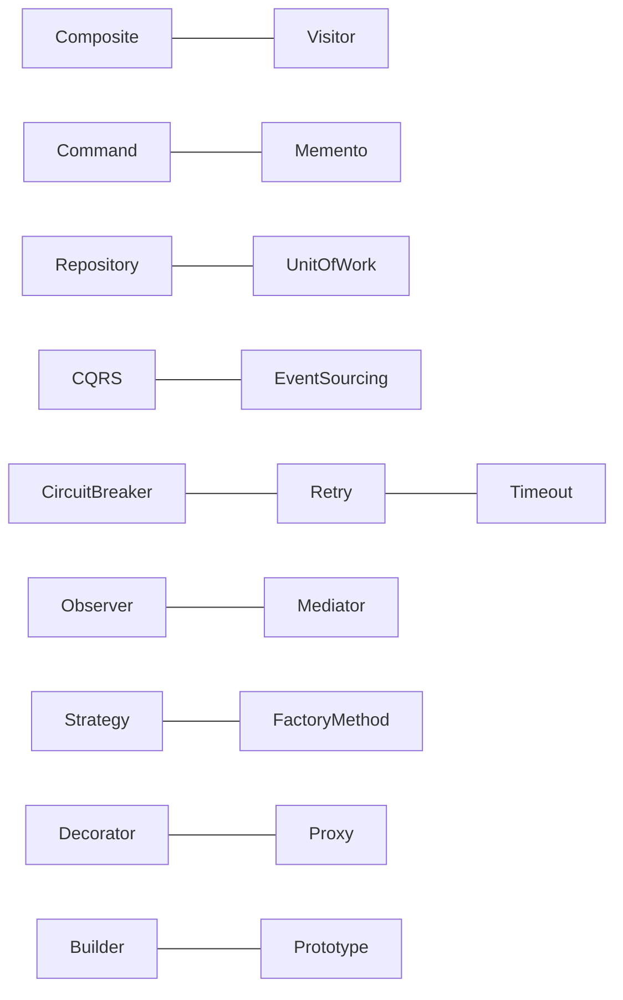
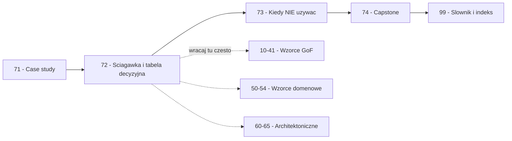

```markdown
---
modul: 72 — Ściągawka i tabela decyzyjna
plik: 72-sciagawka-i-tabela-decyzyjna.md
poziom: sredni
wymaga: [71]
czas: ~180 minut czytania + ~180 minut ćwiczeń
uwaga: "Modul referencyjny - sekcje 1-6 zastapione sekcjami tabelarycznymi A-I."
---

# Moduł 72 — Ściągawka — mapa wszystkich wzorców i tabela decyzyjna

> **TL;DR**
> - To jest **moduł referencyjny** — jedno miejsce do wracania w pracy, a nie do czytania raz od deski do deski; używaj go jak katalogu i tabeli decyzyjnej.
> - **Wielka tabela** zbiera wszystkie wzorce kursu: kategoria, intencja, sygnał użycia, koszt, antywzorzec, moduł — z myślą o „jak szybko znaleźć to, czego potrzebuję".
> - **Tabele decyzyjne** prowadzą od pytania („żądanie przechodzi przez kandydatów?") albo problemu biznesowego („rabaty zależne od segmentu") do właściwego wzorca i alternatywy bez wzorca.
> - **Slajdy pamięciowe** dla 12 najważniejszych wzorców — po 4 linijki na wzorzec, żeby odświeżyć intuicję w kilka minut.
> - **Mapowanie GoF → Python** pokazuje dla każdego z 23 wzorców klasycznych: czy w Pythonie jeszcze jest potrzebny, jak wygląda pythoniczna realizacja i dlaczego często wystarcza mechanizm języka.

---

## 0. Model mentalny

### Atlas samochodowy, który jest otwarty na właściwej stronie

Wyobraź sobie, że masz w samochodzie atlas drogowy. Nie czytasz go od okładki do okładki — nie na tym polega jego rola. **Otwierasz na właściwej stronie, patrzysz na to, co potrzebne, i zamykasz.** Atlas ma jednak trzy warstwy ułatwiające to użycie. Pierwsza warstwa to **mapa całego kraju** — jedno spojrzenie i wiesz, gdzie jesteś i gdzie są główne drogi. Druga warstwa to **mapy regionów** — bardziej szczegółowe, pomocne, gdy wiesz, że jedziesz w góry. Trzecia warstwa to **alfabetyczny indeks miejscowości** — otwierasz na literę i widzisz numer strony. Bez tych trzech warstw atlas byłby bezużyteczny — 300 stron skanów map bez indeksu to nie atlas, to album.

Ten moduł jest takim atlasem. **Wielka tabela** (sekcja A) to mapa całego kraju — wszystkie wzorce z jednym zdaniem intencji każdy. **Tabele decyzyjne** (sekcja B, F) to mapy regionów — „jestem w problemie X, jak dojechać do rozwiązania?". **Slajdy pamięciowe** (sekcja C) to najczęściej używane trasy, wyjęte z atlasu i przyklejone na tablicy — te 12 wzorców, do których wraca się najczęściej. **Mapowanie GoF → Python** (sekcja D) to adnotacje na marginesie — „ta droga jest dla samochodu, tamta dla roweru; wybierz zgodnie z tym, czym jedziesz". **Wbudowane wzorce w Pythonie** (sekcja E) to spis dróg krajowych — nie musisz ich budować, już są. **Mapa problem biznesowy → wzorzec** (sekcja F) to indeks miejscowości — od konkretnego problemu do strony. **Ścieżki nauki** (sekcja G) to oznaczone trasy — dla początkujących, dla średniozaawansowanych, dla architektów.

Zatrzymaj się jeszcze przy jednej rzeczy. Atlas nie uczy jeździć. **Możesz mieć najlepszy atlas na świecie i zjechać do rowu.** Atlas pokazuje drogi — ale dobry kierowca jest potrzebny osobno. Ten moduł pokazuje wzorce i prowadzi do właściwej decyzji — ale nie zastępuje doświadczenia: czytania kodu, projektowania, popełniania błędów, refaktoryzacji. **Katalog wiedzy to nie kompetencja.** Ta ostatnia bierze się z praktyki.

| W analogii atlasu | W module 72 |
|---|---|
| Mapa całego kraju | Sekcja A — wielka tabela wszystkich wzorców |
| Mapy regionów | Sekcja B, F — tabele decyzyjne |
| Najczęstsze trasy na tablicy | Sekcja C — slajdy pamięciowe 12 wzorców |
| Adnotacje „dla jakiego pojazdu" | Sekcja D — mapowanie GoF → Python |
| Spis dróg krajowych | Sekcja E — wbudowane wzorce języka |
| Alfabetyczny indeks miejscowości | Sekcja F — problem biznesowy → wzorzec |
| Oznaczone trasy krajoznawcze | Sekcja G — ścieżki nauki |
| Instrukcja obsługi kierowcy | Sekcja H — 10 zasad kursu |
| Adresy wydawnictw | Sekcja I — jak szukać dalej |

> 🧠 **Zapamiętaj** — **Ten moduł nie uczy nowych wzorców — on porządkuje wiedzę, którą już masz, i pomaga szybko znaleźć właściwą odpowiedź w konkretnej sytuacji.** Wracaj do niego w trakcie projektowania, w trakcie code review i w trakcie refaktoryzacji. Wzorce są użyteczne, gdy można je szybko odnaleźć, a nie gdy trzeba je pamiętać.

### Diagram — mapa kategorii wzorców i relacji

```mermaid
flowchart TD
    ROOT["WZORCE PROJEKTOWE"]
    ROOT --> KRE["KREACYJNE - jak powstaja obiekty"]
    ROOT --> STR["STRUKTURALNE - jak lacza sie obiekty"]
    ROOT --> BEH["BEHAWIORALNE - jak sie komunikuja"]
    ROOT --> ARC["ARCHITEKTONICZNE - jak ulozyc system"]
    ROOT --> DOM["DOMENOWE - jak wyrazic biznes w kodzie"]
    KRE --> K1["Singleton, Factory Method"]
    KRE --> K2["Abstract Factory, Builder"]
    KRE --> K3["Prototype, Object Pool"]
    STR --> S1["Adapter, Bridge, Composite"]
    STR --> S2["Decorator, Facade, Flyweight"]
    STR --> S3["Proxy"]
    BEH --> B1["CoR, Command, Interpreter"]
    BEH --> B2["Iterator, Mediator, Memento"]
    BEH --> B3["Observer, State, Strategy"]
    BEH --> B4["Template Method, Visitor"]
    ARC --> A1["Warstwy, MVC/MVVM"]
    ARC --> A2["Hexagonal, Clean, Onion"]
    ARC --> A3["CQRS, Event Sourcing, Microservices"]
    ARC --> A4["Pipes & Filters, Plugins"]
    DOM --> D1["Repository, Unit of Work"]
    DOM --> D2["Service Layer, DTO, Assembler"]
    DOM --> D3["Specification, Value Object, Domain Events"]
```



*Diagram pokazuje cztery główne i jedną uzupełniającą rodzinę wzorców — pięć gałęzi, z których każda odpowiada na inne pytanie projektowe.*

### Diagram — wzorce, które naturalnie łączą się w praktyce



*Diagram pokazuje pary wzorców, które w prawdziwych projektach występują razem — uczenie się ich razem daje kompletne rozwiązanie dla konkretnego problemu.*

---

## Sekcja A — Wielka tabela główna wszystkich wzorców

> Zawiera wszystkie wzorce omówione w kursie, uporządkowane wg rodziny. Kolumny: **Wzorzec | Kategoria | Intencja (jedno zdanie) | Sygnał użycia | Koszt | Antywzorzec, w który się zmienia | Moduł**.

### A.1 Wzorce kreacyjne (GoF + praktyczne)

| Wzorzec | Kategoria | Intencja | Sygnał użycia | Koszt | Antywzorzec | Moduł |
|---|---|---|---|---|---|---|
| **Singleton** | Kreacyjny (GoF) | Zapewnia jedną instancję klasy i globalny punkt dostępu | Dokładnie jeden obiekt ma istnieć w procesie (konfiguracja, rejestr) | Niski | Globalny stan, `Service Locator` | 10 |
| **Factory Method** | Kreacyjny (GoF) | Podklasa decyduje, jaką klasę utworzyć; klient nie zna konkretów | `Klasa()` rozsiane po kodzie, rosnące `if/elif` po typie | Niski | Fabryka-bóg | 11 |
| **Abstract Factory** | Kreacyjny (GoF) | Tworzy rodzinę współgrających produktów bez wskazywania klas | Wielośrodowiskowość (AWS/GCP/local), zestawy zgodnych usług | Średni | Eksplozja interfejsów | 12 |
| **Builder** | Kreacyjny (GoF) | Oddziela proces tworzenia złożonego obiektu od jego reprezentacji | Konstruktor z 10+ argumentami, wiele pól opcjonalnych | Średni | Builder bez walidacji | 13 |
| **Prototype** | Kreacyjny (GoF) | Tworzy nowe obiekty przez kopiowanie istniejących | Kosztowne tworzenie, wiele bliskich wariantów, szablony | Średni | Pomylenie `copy` z `deepcopy` | 14 |
| **Object Pool** | Kreacyjny (praktyczny) | Recyklinguje kosztowne zasoby zamiast tworzyć je ponownie | Połączenia DB, klienty HTTP, wątki — kosztowne tworzenie | Średni | Pula taniego zasobu | 15 |
| **Lazy Initialization** | Idiom (technika) | Odkłada koszt utworzenia do pierwszego użycia | Szybki start aplikacji, część zależności rzadko używana | Niski | Opóźnione błędy konfiguracji | 15 |

### A.2 Wzorce strukturalne

| Wzorzec | Kategoria | Intencja | Sygnał użycia | Koszt | Antywzorzec | Moduł |
|---|---|---|---|---|---|---|
| **Adapter** | Strukturalny (GoF) | Dopasowuje niekompatybilny interfejs do oczekiwanego | Zewnętrzna biblioteka o innym interfejsie, legacy system | Niski | Adapter z logiką biznesową | 20 |
| **Bridge** | Strukturalny (GoF) | Rozdziela abstrakcję od implementacji, pozwala rozwijać niezależnie | Dwie niezależne osie zmienności (typ × format) — eksplozja klas | Średni | Mostek dla jednej osi | 21 |
| **Composite** | Strukturalny (GoF) | Traktuje liść i grupę jednolicie; drzewa obiektów | Struktura drzewiasta, agregacja na hierarchii | Średni | Cykle w drzewie | 22 |
| **Decorator** | Strukturalny (GoF) | Dynamicznie dodaje odpowiedzialność bez dziedziczenia | Warstwy logowania, cache, retry — bez zmiany klasy bazowej | Niski | Długie łańcuchy trudne do debugowania | 23 |
| **Facade** | Strukturalny (GoF) | Dostarcza uproszczony interfejs do podsystemu | Klient zna cały labirynt podsystemu, chce jedno wejście | Niski | Fasada-bóg | 24 |
| **Flyweight** | Strukturalny (GoF) | Współdzieli stan, żeby oszczędzić pamięć | Miliony drobnych obiektów, duży udział stanu współdzielonego | Wysoki | Przedwczesna optymalizacja | 25 |
| **Proxy** | Strukturalny (GoF) | Zastępuje obiekt, kontrolując dostęp | Leniwe ładowanie, kontrola uprawnień, zdalny obiekt, cache | Średni | Ukryte opóźnienia, proxy na proxy | 26 |

### A.3 Wzorce behawioralne

| Wzorzec | Kategoria | Intencja | Sygnał użycia | Koszt | Antywzorzec | Moduł |
|---|---|---|---|---|---|---|
| **Chain of Responsibility** | Behawioralny (GoF) | Przekazuje żądanie wzdłuż łańcucha kandydatów | Reguły wykluczające, eskalacja, middleware, pipeline | Niski | Żądanie nigdy nieobsłużone | 30 |
| **Command** | Behawioralny (GoF) | Hermetyzuje żądanie jako obiekt | Undo/redo, kolejka, opóźnienie, logowanie operacji | Średni | Polecenie bez `undo` w historii | 31 |
| **Interpreter** | Behawioralny (GoF) | Dla danego języka tworzy reprezentację gramatyki i ewaluator | Własny mini-język, reguły, DSL, wyrażenia | Wysoki | Nadużywanie do każdej logiki | 32 |
| **Iterator** | Behawioralny (GoF) | Sekwencyjny dostęp do kolekcji bez ujawniania struktury | Chcesz przejść kolekcję leniwie, strumieniowo | Niski | Iterator zamiast listy | 33 |
| **Mediator** | Behawioralny (GoF) | Centralizuje komunikację między obiektami | Komunikacja N×N, wiele komponentów zależnych wzajemnie | Średni | Mediator-bóg | 34 |
| **Memento** | Behawioralny (GoF) | Zapisuje i przywraca stan bez łamania hermetyzacji | Undo/redo, snapshot, punkty kontrolne | Średni | Nieograniczona historia | 35 |
| **Observer** | Behawioralny (GoF) | Informuje wielu o zmianie stanu | Jeden subjekt, wielu odbiorców zdarzeń | Niski | Wyciek pamięci przez referencje | 36 |
| **State** | Behawioralny (GoF) | Obiekt zmienia zachowanie, gdy zmienia się stan | Maszyna stanów, cykl życia zlecenia | Średni | Nielegalne przejścia nieodrzucane | 37 |
| **Strategy** | Behawioralny (GoF) | Wymienny algorytm wybierany w runtime | Lawina `if/elif` po typie, wymienne reguły | Niski | Strategia dla jednej implementacji | 38 |
| **Template Method** | Behawioralny (GoF) | Szkielet algorytmu z lukami wypełnianymi przez podklasy | Stała sekwencja kroków, różne detale | Niski | Kruche klasy bazowe | 39 |
| **Visitor** | Behawioralny (GoF) | Dodaje operację do struktury bez zmiany klas | Wiele niezależnych operacji na drzewie obiektów | Wysoki | Cykliczne zależności | 40 |
| **Null Object** | Behawioralny (dodatek) | Obiekt reprezentujący brak z neutralnym zachowaniem | Opcjonalne zależności, brak rabatu, brak notifiera | Niski | Cicha porażka zamiast błędu | 41 |
| **Specification** | Behawioralny (domenowy) | Reguła biznesowa jako łączny predykat | Składalne warunki, filtrowanie, walidacja | Niski | Specyfikacja-bóg | 54 |

### A.4 Wzorce domenowe i aplikacyjne

| Wzorzec | Kategoria | Intencja | Sygnał użycia | Koszt | Antywzorzec | Moduł |
|---|---|---|---|---|---|---|
| **Repository** | Domenowy | Pośredniczy między domeną a mapowaniem danych | Domena musi być testowalna bez bazy | Średni | Repozytorium udające ORM | 50 |
| **Unit of Work** | Domenowy | Grupuje zmiany i zapisuje w jednej transakcji | Wiele repozytoriów, transakcyjność operacji | Średni | UoW bez prawdziwej transakcji | 50 |
| **Service Layer** | Aplikacyjny | Definiuje granicę aplikacji i orkiestruje przypadki użycia | Mono-lity z rozjechaną logiką; wiele wejść (API, CLI, kolejka) | Średni | Anemiczna domena | 51 |
| **DTO** | Aplikacyjny | Przenosi dane między warstwami bez logiki | Serializacja do JSON, oddzielenie modelu od API | Niski | DTO-bóg z metodami domenowymi | 51 |
| **Assembler / Mapper** | Aplikacyjny | Konwertuje DTO ↔ encja/obiekt domenowy | Wielokrotne konwersje, granice warstw | Niski | Assembler z logiką biznesową | 51 |
| **Active Record** | Domenowy | Obiekt sam wie, jak się zapisać | Prosty CRUD, mała domena, mały zespół | Niski | Fat models | 52 |
| **Data Mapper** | Domenowy | Oddziela obiekty domenowe od warstwy trwałości | Złożona domena, testy bez bazy | Średni | Nadmiar warstw dla CRUD | 52 |
| **Dependency Injection** | Aplikacyjny | Zależności przekazywane z zewnątrz | Złożony graf zależności, różne cykle życia | Niski | Service Locator | 53 |
| **Value Object** | Domenowy | Obiekt bez tożsamości, definiowany przez wartości | Pieniądze, waluty, e-mail, adres, kod pocztowy | Niski | „Prymitywna obsesja" | 54 |
| **Domain Event** | Domenowy | Fakt domenowy, który już się zdarzył | Publikacja zdarzeń, audyt, integracja | Średni | Zdarzenia bez odbiorców | 54 |

### A.5 Wzorce architektoniczne

| Wzorzec | Kategoria | Intencja | Sygnał użycia | Koszt | Antywzorzec | Moduł |
|---|---|---|---|---|---|---|
| **Warstwowa (Layered)** | Architektoniczny | Podział aplikacji na warstwy z jednokierunkowymi zależnościami | Średni system, wiele zespołów, standaryzacja | Średni | Warstwy przeciekające | 60 |
| **MVC / MVP / MVVM** | Architektoniczny | Rozdział modelu, widoku i kontrolera/prezentera | Aplikacje z UI (web, desktop) | Średni | Logika w widoku | 60 |
| **Hexagonal (Ports & Adapters)** | Architektoniczny | Domena niezależna od technologii, porty + adaptery | Domena musi przetrwać wymianę bazy, frameworka | Wysoki | Porty udające ORM | 61 |
| **Clean / Onion** | Architektoniczny | Warstwy koncentryczne z regułą zależności do środka | Złożone reguły, długi horyzont, wymagania testowe | Wysoki | Architektura w folderach | 61 |
| **Event-Driven** | Architektoniczny | Komunikacja przez zdarzenia przez brokera | Wielu niezależnych konsumentów, asynchroniczność | Wysoki | Spójność ostateczna bez obsługi UI | 62 |
| **CQRS** | Architektoniczny | Rozdzielenie modelu zapisu od modelu odczytu | Różne modele zapisu i odczytu, skalowanie odczytów | Wysoki | CQRS dla CRUD | 62 |
| **Event Sourcing** | Architektoniczny | Stan jako pochodna strumienia zdarzeń | Audyt, podróż w czasie, przebudowa projekcji | Wysoki | Zdarzenia jako sposób na wszystko | 62 |
| **API Gateway** | Architektoniczny | Jedno wejście do wielu mikroserwisów | Routing, autoryzacja, limity tempa | Wysoki | Gateway-bóg | 63 |
| **Backend for Frontend (BFF)** | Architektoniczny | Osobny backend dla każdego typu klienta (web/mobile) | Różne potrzeby frontendów | Średni | Duplikacja logiki | 63 |
| **Circuit Breaker** | Architektoniczny | Przerwanie wywołań do niedziałającej usługi | Zewnętrzne zależności mogą padać | Średni | Brak powrotu (nigdy nie zamyka) | 63 |
| **Saga** | Architektoniczny | Transakcja rozproszona przez kompensacje | Wieloetapowe procesy w mikroserwisach | Wysoki | Brak akcji kompensujących | 63 |
| **Outbox** | Architektoniczny | Atomowe zapisanie danych i publikacja zdarzenia | Problem podwójnego zapisu (dual write) | Wysoki | Rosnąca tabela outbox | 63 |
| **Idempotent Consumer** | Architektoniczny | Odporny na duplikaty konsument zdarzeń | At-least-once delivery | Średni | Brak klucza idempotencji | 63 |
| **Dead Letter Queue** | Architektoniczny | Kolejka dla wiadomości niemożliwych do przetworzenia | Trujące wiadomości, błędy przetwarzania | Niski | Brak DLQ = utrata danych | 63 |
| **Pipes & Filters** | Architektoniczny | Sekwencyjne przetwarzanie przez niezależne etapy | ETL, przetwarzanie strumieni, pipeline danych | Średni | Backpressure bez obsługi | 64 |
| **Plugin Architecture** | Architektoniczny | Rozszerzalność aplikacji bez zmiany rdzenia | Wtyczki, entry points, hooki | Średni | Dependency hell wtyczek | 64 |
| **Blackboard** | Architektoniczny | Niezależne moduły współpracują przez wspólną strukturę | Systemy eksperckie, agenci, rozpoznawanie | Wysoki | Niedeterminizm debugowania | 64 |

### A.6 Antywzorce (krótki spis)

| Antywzorzec | Kategoria | Objaw | „Lekarstwo" | Moduł |
|---|---|---|---|---|
| **Big Ball of Mud** | Antywzorzec strukturalny | Wszystko zależy od wszystkiego | Warstwy, granice, testy architektury | 65 |
| **God Object** | Antywzorzec obiektowy | Klasa z 40 metodami, 12 zależnościami | Rozdzielenie odpowiedzialności (SRP) | 65 |
| **Anemic Domain Model** | Antywzorzec domenowy | Gettery/settery bez zachowań; logika w serwisach | Bogata domena, Value Object, agregaty | 65 |
| **Distributed Monolith** | Antywzorzec architektoniczny | Mikroserwisy bez niezależności (wspólna baza, wspólny deployment) | Bounded context, autonomiczność | 65 |
| **Shotgun Surgery** | Antywzorzec modyfikacji | Jedna zmiana w 8 plikach | Wspólne miejsce dla reguły | 65 |
| **Service Locator** | Antywzorzec DI | Zależności „wyciągane" z globalnego kontenera | Jawna DI w konstruktorze | 53, 65 |
| **Golden Hammer** | Antywzorzec mentalny | Jeden ulubiony wzorzec wszędzie | Kontekst, zasada YAGNI | 73 |
| **Premature Optimization** | Antywzorzec wydajnościowy | Optymalizacja bez pomiaru | Profilowanie, tracemalloc | 25, 65 |
| **Premature Abstraction** | Antywzorzec projektowy | Abstrakcja przed drugim przypadkiem | Abstrahuj przy trzecim | 73 |
| **Big Rewrite** | Antywzorzec migracyjny | Przepisywanie od zera | Strangler Fig, refaktoryzacja przyrostowa | 65 |

---

## Sekcja B — Tabela decyzyjna „Jak rozpoznać potrzebę wzorca"

> Wersja tabelaryczna. Każdy wiersz to pytanie projektowe z rekomendowanym wzorcem i alternatywą bez wzorca w Pythonie. Używaj jej w kolejności — pierwsze pasujące pytanie prowadzi do właściwej odpowiedzi.

| Pytanie projektowe | Rekomendowany wzorzec | Alternatywa bez wzorca w Pythonie |
|---|---|---|
| Dokładnie jedna instancja w procesie? | Singleton | Moduł, `functools.lru_cache(maxsize=1)` |
| Konstruktor obiektu zależy od konfiguracji (kto decyduje)? | Factory Method | Funkcja wytwórcza, `functools.partial` |
| Muszę utworzyć rodzinę współgrających usług (AWS/GCP/Azure)? | Abstract Factory | Zestaw funkcji wytwórczych, `dataclass` jako fabryka |
| Konstruktor ma 8+ argumentów, połowa opcjonalna? | Builder | `dataclass` z `kw_only=True`, `replace` |
| Utworzenie obiektu jest drogie i chcę powielić konfigurację? | Prototype | `copy.copy`, `copy.deepcopy`, `replace` |
| Zasób (połączenie, wątek) ma kosztowną inicjalizację? | Object Pool | `queue.Queue` + context manager |
| Zewnętrzne SDK ma inny interfejs niż moja domena? | Adapter | Funkcja opakowująca, `__getattr__` delegacja |
| Dwie niezależne osie zmienności (typ × format)? | Bridge | Funkcja z dwoma argumentami |
| Struktura drzewiasta (kategorie, uprawnienia, drzewo UI)? | Composite | Lista + funkcja rekurencyjna |
| Dodać zachowanie do obiektu bez dziedziczenia? | Decorator (GoF) | Dekorator funkcyjny (`@`) |
| Klient zna labirynt podsystemu, chcę jedno wejście? | Facade | Funkcja modułowa, pakiet z `__all__` |
| Miliony drobnych obiektów ze stanem współdzielonym? | Flyweight | `__slots__`, `array`, internowanie stringów |
| Kontrolować dostęp, cache, leniwe ładowanie do obiektu? | Proxy | `functools.cached_property`, deskryptor |
| Żądanie ma przechodzić przez kandydatów? | Chain of Responsibility | Lista funkcji w pętli |
| Chcę zapisać żądanie, wykonać później, cofnąć? | Command | Funkcja + `functools.partial`, `queue.Queue` |
| Potrzebuję własnego mini-języka do wyrażeń? | Interpreter | `ast.literal_eval`, `lark`, `pyparsing` |
| Sekwencyjny dostęp do kolekcji, strumieniowo? | Iterator | Generator (`yield`), `itertools`, `collections.abc.Iterator` |
| Komunikacja wielu-do-wielu, wielu współpracowników? | Mediator | Pub/sub, event bus, `blinker` |
| Undo/redo, migawka stanu? | Memento | `copy.deepcopy`, `dataclass(frozen=True)` |
| Powiadomić wielu o zmianie stanu? | Observer | Callbacki, `weakref`, sygnały, `blinker`, asyncio.Queue |
| Obiekt zmienia zachowanie wg stanu, maszyna stanów? | State | `enum.Enum` + tabela przejść (`transitions`) |
| Wymienny algorytm wybierany w runtime? | Strategy | Funkcja jako argument, słownik `dict[str, Callable]` |
| Stały szkielet algorytmu z lukami? | Template Method | Funkcja wyższego rzędu, `contextmanager` |
| Dodawanie operacji do struktury bez zmiany klas? | Visitor | `functools.singledispatch`, `match/case` |
| Domena musi być testowalna bez bazy? | Repository | Port `Protocol` + adapter in-memory |
| Transakcyjność kilku operacji? | Unit of Work | `contextmanager` + `try/except/finally` |
| Wiele wejść (API, CLI, kolejka) i chcę jednolity serwis? | Service Layer | Funkcje modułowe jako przypadki użycia |
| Wystawić dane na zewnątrz bez wycieku modelu? | DTO | `@dataclass(frozen=True)`, `pydantic.BaseModel` |
| Składalne reguły, filtrowanie, walidacja? | Specification | Funkcja predykatowa, `functools.reduce` |
| Unikanie „prymitywnej obsesji", obiekty wartości? | Value Object | `@dataclass(frozen=True)` |
| Domena ma być niezależna od frameworka, bazy, HTTP? | Hexagonal | Warstwy + porty `Protocol` |
| Publikacja faktów domenowych do wielu odbiorców? | Domain Events / Observer | Event bus, `blinker`, `pydantic` models |
| Audyt i podróż w czasie? | Event Sourcing / Memento | Append-only log, migawki |
| Odczyt jest wąskim gardłem, zapis inny model? | CQRS | Dwa modele w tej samej bazie |
| Wywołania zewnętrzne mogą padać? | Circuit Breaker + Retry + Timeout | `tenacity` z backoffem, timeout |
| Wiele niezależnych systemów do zintegrowania? | Adapter + Facade | 3 osobne moduły klientów |
| Rozszerzalność bez modyfikacji rdzenia? | Plugin Architecture | Entry points, rejestracja przez dekorator |
| Sekwencyjne etapy przetwarzania danych? | Pipes & Filters | Generatory w łańcuchu, `functools.reduce` |

> 💡 **Intuicja** — Kolejność w tej tabeli nie jest przypadkowa. Odpowiada „ciążeniu" — od pytania o strukturę zmienności (kreacyjne), przez relacje (strukturalne), komunikację (behawioralne), po architekturę. Im wcześniej trafisz na odpowiedź, tym mniej kodu napiszesz.

---

## Sekcja C — Slajdy pamięciowe (12 najważniejszych wzorców)

> Dla każdego wzorca: **problem**, **mechanizm**, **pythoniczna realizacja**, **pułapka**. Do szybkiego odświeżenia intuicji w kilka minut.

> **Singleton** — chcę dokładnie jednej instancji pewnego obiektu w procesie.
> Mechanizm: opóźnione tworzenie + cache klasy/klucza.
> W Pythonie: **moduł** (najlepiej), `functools.lru_cache(maxsize=1)`, `__new__` z cache.
> Uwaga: nie pomyl jednego procesu z całym systemem wieloprocesowym.

> **Factory Method** — chcę oddzielić decyzję „co utworzyć" od kodu, który tego używa.
> Mechanizm: funkcja wytwórcza przyjmuje intencję i zwraca produkt.
> W Pythonie: **funkcja wytwórcza** albo **słownik** `dict[str, type]`.
> Uwaga: fabryka dla jednej implementacji to nadmiar — abstrahuj przy drugim wariancie.

> **Builder** — konstruktor ma 10+ argumentów, połowa opcjonalna, część zależy od innych.
> Mechanizm: krok po kroku, `build()` waliduje i zwraca produkt.
> W Pythonie: **fluent builder** albo `dataclass(frozen=True)` + `replace`.
> Uwaga: builder bez walidacji w `build()` daje obiekty „częściowo poprawne".

> **Adapter** — zewnętrzne SDK/legacy ma inny interfejs niż moja domena.
> Mechanizm: klasa/funkcja tłumaczy argumenty i wyniki, deleguje do adaptee.
> W Pythonie: **funkcja opakowująca**, `functools.partial`, delegacja przez `__getattr__`.
> Uwaga: jeśli możesz zmienić oba interfejsy — adapter jest zbędną warstwą.

> **Decorator** — chcę dodać zachowanie do obiektu/funkcji bez dziedziczenia.
> Mechanizm: opakowuje obiekt z tym samym interfejsem, dokłada logikę przed/po.
> W Pythonie: **składnia `@dekorator`** dla funkcji, klasa-demon dla obiektów.
> Uwaga: `@dekorator` (funkcje) to NIE to samo co wzorzec GoF (obiekty). Używaj `functools.wraps`.

> **Proxy** — chcę kontrolować dostęp: cache, leniwe ładowanie, uprawnienia, zdalne wywołania.
> Mechanizm: zastępuje obiekt, zachowuje ten sam interfejs, przechwytuje wywołania.
> W Pythonie: klasa z `__getattr__` (delegacja), deskryptor `cached_property`, `lru_cache`.
> Uwaga: `__getattr__` nie łapie metod specjalnych (`__len__`, `__iter__`) — definiuj je jawnie.

> **Strategy** — mam kilka wymiennych algorytmów tego samego zadania.
> Mechanizm: klient przekazuje strategię (funkcję/obiekt), kontekst ją wywołuje.
> W Pythonie: **funkcja jako argument**, słownik `dict[str, Callable]`, `Protocol`.
> Uwaga: strategia dla jednej implementacji to nadmiar — YAGNI.

> **Observer** — jeden obiekt zmienia stan, wielu chce o tym wiedzieć.
> Mechanizm: subjekt trzyma listę obserwatorów i powiadamia ich po zmianie.
> W Pythonie: **callbacki**, `weakref` (żeby uniknąć wycieków), `blinker`, `asyncio.Queue`.
> Uwaga: bez `weakref` obserwatorzy nigdy nie zostaną zwolnieni — wyciek pamięci.

> **Chain of Responsibility** — żądanie ma przechodzić przez kandydatów, aż ktoś je obsłuży.
> Mechanizm: lista ogniw; każde obsługuje albo przekazuje dalej.
> W Pythonie: **lista funkcji w pętli**, `functools.reduce`, middleware w ASGI/Django.
> Uwaga: brak obsługi musi być jawnym wynikiem — inaczej cicha porażka w `None`.

> **Command** — chcę zapisać żądanie jako obiekt: kolejka, undo, log, opóźnienie.
> Mechanizm: polecenie ma `execute` i (opcjonalnie) `undo`; invoker prowadzi historię.
> W Pythonie: **funkcja + `functools.partial`**, `@dataclass` z `__call__`, `queue.Queue`.
> Uwaga: makro to Composite poleceń — undo idzie w odwrotnej kolejności.

> **Composite** — chcę traktować liść i grupę jednolicie (drzewo obiektów).
> Mechanizm: wspólny kontrakt; kompozyt rekurencyjnie agreguje dzieci.
> W Pythonie: **`Protocol` + lista dzieci**; generator `yield from` do przejścia drzewa.
> Uwaga: `dodaj`/`usuń` na `Component` łamie LSP — trzymaj je tylko na `Composite`.

> **Repository** — domena musi być testowalna bez bazy; trwałość może się zmienić.
> Mechanizm: port domenowy + adapter infrastrukturalny; fake in-memory w testach.
> W Pythonie: **`Protocol` + klasa adaptera**, in-memory `dict` w testach.
> Uwaga: generyczne repozytorium wycieka model ORM — preferuj wyspecjalizowane porty.

---

## Sekcja D — Mapowanie GoF → Python

> Dla każdego z **23 wzorców GoF**: klasyczna realizacja, pythoniczna realizacja, czy w Pythonie jeszcze potrzebny i dlaczego.

### D.1 Wzorce kreacyjne (5)

| Wzorzec | Klasyczna realizacja | Pythoniczna realizacja | Czy jeszcze potrzebny? |
|---|---|---|---|
| **Abstract Factory** | Klasa `ABC` z metodami wytwórczymi + podklasy | `Protocol` dla produktów + `dataclass` fabryki | **Rzadziej** — gdy rodziny są złożone. Dla prostych przypadków wystarczy słownik fabryk |
| **Builder** | Klasa budowniczego z metodami `set_*` i `build()` | `@dataclass(frozen=True)` + `replace` + `kw_only` | **Tak, gdy 8+ pól**; inaczej `dataclass` + `kw_only` |
| **Factory Method** | Klasa bazowa z metodą `create_*` i podklasami | Funkcja wytwórcza, słownik `dict[str, type]` | **Tak** — ale funkcyjnie, bez hierarchii klas |
| **Prototype** | Klasa z metodą `clone()` | `copy.copy`, `copy.deepcopy`, `dataclasses.replace` | **Tak, ale wbudowane** — nie potrzeba własnego `clone()` |
| **Singleton** | `private` konstruktor + statyczna instancja | **Moduł** (naturalny singleton) | **Rzadziej** — moduł pokrywa większość przypadków |

### D.2 Wzorce strukturalne (7)

| Wzorzec | Klasyczna realizacja | Pythoniczna realizacja | Czy jeszcze potrzebny? |
|---|---|---|---|
| **Adapter** | Klasa implementująca `Target`, trzymająca `Adaptee` | Funkcja opakowująca, `functools.partial`, `__getattr__` | **Tak, ale cienko** — jedyna sensowna na granicy systemu |
| **Bridge** | Dwie hierarchie połączone referencją | Dwie hierarchie + `Protocol`, albo funkcja z dwoma argumentami | **Tak, gdy dwie osie**; inaczej nadmiar |
| **Composite** | `Component` `ABC` + `Leaf` + `Composite` | `Protocol` + lista dzieci + generator `yield from` | **Tak** — struktura drzewiasta nadal potrzebuje tego wzorca |
| **Decorator** | Klasa `Decorator` trzymająca `Component` | Składnia `@dekorator` (dla funkcji) albo klasa (dla obiektów) | **Tak, ale część „rozpuszcza się"** w `@` dla funkcji |
| **Facade** | Klasa z metodami wysokopoziomowymi | Funkcja modułowa, pakiet z `__all__` | **Tak, ale lekko** — funkcje i pakiety wystarczają |
| **Flyweight** | Fabryka pyłków + wspólny stan wewnętrzny | `__slots__`, internowanie stringów, `array`, `memoryview` | **Rzadko** — Python ma internowanie wbudowane |
| **Proxy** | Klasa `Proxy` z tym samym interfejsem co `Subject` | `__getattr__`, deskryptor, `lru_cache`, `contextmanager` | **Tak, ale jako idiom** — nie jako hierarchia klas |

### D.3 Wzorce behawioralne (11)

| Wzorzec | Klasyczna realizacja | Pythoniczna realizacja | Czy jeszcze potrzebny? |
|---|---|---|---|
| **Chain of Responsibility** | Klasa `Handler` z `set_next` i `handle` | Lista funkcji w pętli, middleware, `functools.reduce` | **Tak, ale funkcyjnie** — middleware to jego produkcja |
| **Command** | Klasa `Command` z `execute`/`undo`, `Invoker` | Функcja + `functools.partial`, `@dataclass` z `__call__` | **Tak** — ale często wystarcza funkcja |
| **Interpreter** | Hierarchia klas `Expression` + parser | `ast` (ostrożnie!), `lark`, `pyparsing`, `singledispatch` | **Rzadko** — najrzadszy wzorzec w praktyce |
| **Iterator** | `Iterator` `ABC` + `Aggregate` | Generator (`yield`), `collections.abc.Iterator` | **Nie** — wbudowany w język (`for`) |
| **Mediator** | Klasa `Mediator` + `Colleague` | Πub/sub, event bus, `blinker`, `queue.Queue` + dispatcher | **Tak, gdy N×N**; dla małych grup nadmiar |
| **Memento** | `Originator` + `Memento` + `Caretaker` | `copy.deepcopy`, `dataclass(frozen=True)`, migawki | **Tak, ale przez deepcopy** — nie własne klasy |
| **Observer** | `Subject` + `Observer` + lista obserwatorów | Callbacki, `weakref`, `blinker`, `asyncio.Queue` | **Tak** — choć można realizować funkcjami |
| **State** | `Context` + `State` + `ConcreteState` | `enum.Enum` + tabela przejść, `transitions` | **Tak, ale przez Enum+tabelę** — nie hierarchia klas |
| **Strategy** | `Context` + `Strategy` + `ConcreteStrategy` | Funkcja jako argument, słownik, `Protocol` | **Tak, ale jako funkcja** — najczęstsza forma |
| **Template Method** | `ABC` z metodą szkieletową + metody abstrakcyjne | Funkcja wyższego rzędu, `contextlib.contextmanager` | **Rzadziej** — często dekorator jest lepszy |
| **Visitor** | `Visitor` + `Element.accept` (double dispatch) | `functools.singledispatch`, `match/case` | **Rzadko** — `singledispatch` w większości wystarcza |

### D.4 Podsumowanie mapowania

| Kategoria | W Pythonie „rozpuszcza się" | Nadal potrzebny jako wzorzec | Rzadziej potrzebny w czystej formie |
|---|---|---|---|
| Kreacyjne (5) | Singleton, Prototype | Factory Method | Abstract Factory, Builder (dla prostych) |
| Strukturalne (7) | Decorator (dla funkcji), Facade | Adapter, Composite, Proxy (jako idiom) | Flyweight |
| Behawioralne (11) | Iterator, Strategy (funkcyjnie) | Observer, Command | Interpreter, Visitor, Template Method |

> 🧠 **Zapamiętaj** — **Większość wzorców GoF w Pythonie nie „rozpuszcza się w powietrzu" — one „rozpuszczają się w mechanizmy języka".** Iterator to `for`, Decorator to `@`, Strategy to funkcja, Singleton to moduł, State to Enum + słownik. Ale **idea wzorca pozostaje aktualna** — musisz wiedzieć, **kiedy** użyć funkcji, a kiedy klasy, bo intencja jest ważniejsza niż kształt.

---

## Sekcja E — Wbudowane wzorce w Pythonie i bibliotece standardowej

> Python ma wzorce **wbudowane w język** — mechanizmy, które w innych językach trzeba budować ręcznie. Ta tabela pokazuje, gdzie ich szukać.

| Mechanizm Pythona | Wzorzec, który realizuje | Jak używać / gdzie | Moduł kursu |
|---|---|---|---|
| `for` + `__iter__`/`__next__` | Iterator | Każdy obiekt iterowalny | 33 |
| Generatory (`yield`) | Iterator, Producer-Consumer | `yield`, `yield from` | 33 |
| Składnia `@dekorator` | Decorator (dla funkcji) | `functools.wraps` | 23 |
| `contextlib.contextmanager` | Template Method | `with` + `yield` w generatorze | 39 |
| `contextlib.ExitStack` | Composite zasobów | `with ExitStack() as stos:` | 22 |
| `functools.singledispatch` | Visitor / Strategy | `@fun.register` | 40 |
| `functools.lru_cache` | Proxy (cache) | `@lru_cache(maxsize=N)` | 26 |
| `functools.partial` | Adapter / Command | `partial(func, arg)` | 20, 31 |
| `functools.cached_property` | Lazy Initialization | `@cached_property` | 15 |
| `dataclasses.replace` | Prototype / Builder | `replace(base, field=x)` | 13, 14 |
| `dataclasses(frozen=True)` | Value Object | `@dataclass(frozen=True, slots=True)` | 54 |
| `enum.Enum` | State, Strategy, Constant | `class X(Enum)` | 37, 38 |
| `typing.Protocol` | Interface, Port | `class X(Protocol)` | 02, 61 |
| `abc.ABC` | Interface, Template Method | `class X(ABC)` | 02, 39 |
| `collections.abc` | Iterator, Sequence, Mapping | `Iterable`, `Iterator`, `Mapping` | 33 |
| `weakref` | Observer bez wycieków | `weakref.ref`, `WeakValueDictionary` | 36 |
| `queue.Queue` | Object Pool, Command Queue | `queue.Queue(maxsize=N)` | 15, 31 |
| `threading.Lock` | Synchronizacja | `with lock:` | 10 |
| `contextvars.ContextVar` | Scoped state (DI) | `ContextVar` dla per-request | 53 |
| `importlib.metadata.entry_points` | Plugin Architecture | Entry points w `pyproject.toml` | 64 |
| `__init_subclass__` (PEP 487) | Factory (rejestracja) | `def __init_subclass__(cls): ...` | 02, 11 |
| `__getattr__` (module-level, PEP 562) | Lazy imports | `def __getattr__(nazwa): ...` | 15 |
| `__getattr__` (class-level) | Proxy / Adapter delegacja | `def __getattr__(self, n): ...` | 20, 26 |
| `__set_name__` (PEP 487) | Deskryptor | `def __set_name__(self, owner, name)` | 02 |
| Moduł | Singleton | `import modul` | 10 |
| `pathlib.Path` | Adapter (system plików) | `Path`, `open` | 20 |
| `subprocess.run` | Adapter (procesy) | `subprocess.run(cmd)` | 20 |
| `socket`, `asyncio` | Adapter (I/O) | Klient HTTP/socket | 63 |
| `sqlite3` (i ORM) | Repository (baza) | `sqlite3.connect` + `execute` | 50 |
| `logging` | Singleton + Chain | `logging.getLogger(__name__)` | 10, 30 |
| `unittest.mock` | Test doubles | `Mock`, `patch` | 70 |
| `pydantic` | Value Object, DTO, Builder | `BaseModel`, `model_validate` | 51, 54 |
| `attrs` | Value Object, Builder | `@attrs.define` | 13, 54 |

---

## Sekcja F — Mapa „problem biznesowy → wzorzec"

> 20 realistycznych problemów z sektora finansowego z rekomendacją główną i alternatywą. Używaj, gdy szukasz konkretnego rozwiązania dla konkretnego kontekstu.

| Problem biznesowy | Rekomendacja główna | Alternatywa | Moduł |
|---|---|---|---|
| **Onboarding klienta w 5 krokach** (KYC → weryfikacja → umowa → konto → pierwszy przelew) | Chain of Responsibility (pipeline) + Command (kolejka) | Funkcja z listą etapów, saga (moduł 63) | 30, 31, 63 |
| **Rabaty zależne od segmentu klienta** (VIP, FIRMA, DETAL) | Strategy + Specification | Funkcja z `match/case` | 38, 54 |
| **Modal w UI zależny od stanu** (formularz, walidacja, błąd, sukces) | State (maszyna stanów) | Enum + tabela przejść | 37 |
| **Wersjonowanie dokumentu (historia zmian z cofaniem)** | Command + Memento | Dziennik append-only + migawki | 31, 35 |
| **Zgodność z wieloma bramkami płatniczymi** (Stripe, Adyen, PayPal) | Adapter + Abstract Factory | Adapter + Protocol | 20, 12 |
| **Wielojęzyczne szablony e-maili** (PL, EN, DE) | Strategy (wybór szablonu) + Bridge (język × typ) | Słownik `dict[str, str]` + funkcja | 21, 38 |
| **Audyt zmian (kto, kiedy, co i dlaczego)** | Command (z `opis`) + Observer (publikacja) | Dziennik append-only | 31, 36 |
| **Walidacja formularza z wieloma regułami** | Chain of Responsibility (pipeline) + Specification | Pydantic z `validator` | 30, 54 |
| **Generowanie raportu w 4 formatach** (CSV, XBRL, PDF, JSON) | Bridge (typ × format) | Funkcje eksportujące + słownik | 21 |
| **Kolejka zadań z ponowieniami i limitem** | Command + Object Pool | Celery, RQ, Dramatiq | 31, 15 |
| **Ograniczanie tempa (rate limiting)** | Proxy (ochrona) + Strategy | Middleware + Redis | 26, 38 |
| **Uprawnienia i role (RBAC)** | Composite (drzewo uprawnień) + Specification | Frozenset kodów + funkcja `ma()` | 22, 54 |
| **Integracja z 3 systemami ERP** | Adapter + Facade + Circuit Breaker | Osobne moduły klientów + tenacity | 20, 24, 63 |
| **Cache z unieważnianiem** (kursy walut, wyceny) | Proxy (cache) + Observer (inwalidacja) | `lru_cache` + TTL, Redis | 26, 36 |
| **Import danych z wielu źródeł** (CSV, XLSX, API) | Adapter (dla każdego źródła) + Chain of Responsibility (walidacja pipeline) | Funkcje + iterator | 20, 30 |
| **Rejestracja użytkownika z weryfikacją dwuetapową** | State (konto: nowe → weryfikacja → aktywne) + Command | Enum + tabela przejść | 37, 31 |
| **Powiadomienia o zdarzeniach** (kupon, lojalność, sezonowa) | Observer + Strategy | Callbacki + lista reguł | 36, 38 |
| **Retry z backoffem dla zewnętrznego API** | Proxy (retry) + Circuit Breaker | `tenacity`, `urllib3.Retry` | 26, 63 |
| **Migracja z monolitu** (przyrostowa, bez big rewrite) | Strangler Fig + Facade (route) + Adapter | Branch by Abstraction, feature flags | 65 |
| **Raport regulacyjny z niezmiennością zapisów** | Domain Event + Event Sourcing (jeśli wymagane) + Memento | Append-only log + migawki | 54, 62 |

> 💡 **Intuicja** — Zauważ, że **żaden problem nie ma jednej właściwej odpowiedzi**. Każdy ma rekomendację „główną" i **alternatywę**. Wybór zależy od kontekstu: skali, zespołu, horyzontu, wymagań regulatora. **Wzorce nie są prawdą objawioną.**

---

## Sekcja G — Ścieżki nauki

> Trzy rekomendowane trasy przez kurs — dla juniora, dla mid-developera, dla architekta. Nie musisz przechodzić wszystkich modułów w kolejności. Ucz się wg swojej roli i potrzeb.

### G.1 Ścieżka juniora — pierwszy kontakt z wzorcami

**Dla kogo:** osoba z podstawami Pythona, zaczynająca pracę z większym kodem, chcąca szybko zrozumieć najczęstsze struktury.

| Kolejność | Moduł | Dlaczego |
|---|---|---|
| 1 | 00 — Jak myśleć o wzorcach | Fundament — nazwy, kontekst, zasady |
| 2 | 01 — Python pod wzorce | Wyrównanie warsztatu (klasy, kompozycja) |
| 3 | 02 — Narzędzia Pythona | Dekoratory, generatory, kontekst menedżery |
| 4 | 03 — SOLID i zasady | Kryteria oceny projektu |
| 5 | 10 — Singleton | Pierwszy konkretny wzorzec, bezpieczny |
| 6 | 11 — Factory Method | Najczęstszy wzorzec kreacyjny |
| 7 | 20 — Adapter | Wzorce strukturalne dla granic systemu |
| 8 | 23 — Decorator | Wzorce strukturalne — najczęstsze |
| 9 | 24 — Facade | Upraszczanie podsystemów |
| 10 | 33 — Iterator | Wbudowany w język, ale wartościowy |
| 11 | 38 — Strategy | Wymienny algorytm — najczęstszy behawioralny |
| 12 | 39 — Template Method | Drugi najczęstszy behawioralny |
| 13 | 70 — Wzorce a testy | Testowanie jako sygnał projektowy |
| 14 | 72 — Ściągawka | Powrót do referencji |

**Uzasadnienie:** pomijamy wzorce rzadkie (Interpreter, Visitor), skomplikowane (Hexagonal), oraz domenowe (Repozytorium, DI) — junior nie potrzebuje ich od razu. Skupiamy się na 4 najczęstszych: Singleton (żeby rozpoznać moduł), Factory Method (bo to standard fabryk), Adapter (bo to granice), Strategy (bo to wymienność).

### G.2 Ścieżka mid — praktyk projektujący moduły

**Dla kogo:** osoba projektująca moduły, systemy, mające doświadczenie z wzorcami, gotowa na wzorce droższe.

| Kolejność | Moduł | Dlaczego |
|---|---|---|
| 1 | 00, 02, 03 | Skrótowo — fundamenty |
| 2 | 10–15 | Wszystkie kreacyjne (praktyczne zastosowania) |
| 3 | 20–26 | Wszystkie strukturalne |
| 4 | 30–41 | Wszystkie behawioralne |
| 5 | 50–54 | Wzorce domenowe i aplikacyjne |
| 6 | 53 — DI | Wstrzykiwanie zależności |
| 7 | 70 — Wzorce a testy | Testowanie jako sygnał |
| 8 | 71 — Case study | Refaktoryzacja jako metoda |
| 9 | 72 — Ściągawka | Referencja |

**Uzasadnienie:** cały zakres wzorców GoF + domenowych. Część V (architektura) tylko wybiórczo — moduł 53 (DI) jako fundament, ale bez modułów 60–65 (architektura to domena seniora). Obejmuje moduł 71 (case study), bo uczy realnego warsztatu.

### G.3 Ścieżka senior-architekta

**Dla kogo:** osoba odpowiedzialna za granice systemu, architekturę, decyzje długoterminowe.

| Kolejność | Moduł | Dlaczego |
|---|---|---|
| 1 | 00, 03 | Skrótowo — fundamenty projektowe |
| 2 | 02 — Narzędzia Pythona | Wbudowane wzorce języka |
| 3 | Wybrane z 10–41 | Powtórka wzorców GoF (jeśli są luki) |
| 4 | 50–54 | Wzorce domenowe — kluczowe dla architektury |
| 5 | 60–65 | Część V — architektura całości |
| 6 | 61 — Hexagonal | Fundament architektury |
| 7 | 62 — Event-Driven, CQRS, ES | Kluczowe dla nowoczesnych systemów |
| 8 | 63 — Mikroserwisy | Jeśli system rozproszony |
| 9 | 65 — Antywzorce | Pułapki i dług techniczny |
| 10 | 70, 71 | Testy + case study refaktoryzacji |
| 11 | 73 — Kiedy nie używać | Zen kursu |
| 12 | 74 — Capstone | Projekt zaliczeniowy |

**Uzasadnienie:** cała Część V (architektura) i moduły 73–74 (kiedy nie, capstone) — bez nich architektura bez pokory i bez warsztatu. Moduły GoF wybiórczo, dla przypomnienia. Waga na Części IV–V, bo tam są najważniejsze decyzje.

### G.4 Trzy dodatkowe ścieżki tematyczne

| Ścieżka | Moduły | Cel |
|---|---|---|
| **Wzorce GoF** | 10–41 | Powtórka klasycznych wzorców |
| **Architektura** | 50–65 | Projektowanie dużych systemów |
| **Praktyka i refaktoryzacja** | 70–74 | Warsztat inżynierski |

> 🧠 **Zapamiętaj** — **Nie ma jednej właściwej kolejności.** Ścieżki junior/mid/senior są przewodnikiem, nie dogmatem. Jeśli masz konkretny problem — zacznij od ściągawki (sekcja A, B, F), wróć do modułu, który rozwiązuje twój problem. Kurs jest pomyślany jako **kompozycja** — moduły można czytać wybiórczo.

---

## Sekcja H — 10 zasad, które zapamiętaj z całego kursu

To ostatnie słowo kursu. Jeśli za rok zapomnisz wszystkie moduły, ale zapamiętasz te 10 zasad — kurs spełnił swoje zadanie.

**1. Wzorzec to nazwa problemu, a nie rozwiązania.**
Nazwa „Strategy" nie znaczy „napisz klasę z metodą"; znaczy „ten problem ma nazwę i istnieje jak sposób podejścia". Pamiętaj o intencji, nie o formie.

**2. Preferuj kompozycję nad dziedziczenie.**
Dziedziczenie wiąże na zawsze, kompozycja jest wymienna w runtime. 90% wzorców opiera się na kompozycji. Sięgaj po dziedziczenie tylko, gdy naprawdę mówisz „jest szczególnym przypadkiem".

**3. Nie abstrahuj przed drugim przypadkiem użycia.**
Abstrakcja przy jednej implementacji to przedwczesna optymalizacja. Napisz prosto raz, potem drugi raz, dopiero przy trzecim razie — abstrahuj. To reguła YAGNI.

**4. Granice się rozmywają, jeśli ich nie testujesz.**
Architektura heksagonalna, warstwy, reguła zależności — wszystko to zniknie w ciągu pół roku, jeśli nie masz testów architektury (`import-linter`, `pytest-archon`) w CI. **Granice trzeba egzekwować automatycznie.**

**5. Jeśli coś jest trudne do przetestowania, to prawie zawsze jest źle zaprojektowane.**
Trudny test to sygnał projektowy, nie powód do pominięcia testu. Zamiast pisać `@pytest.mark.skip`, napraw projekt — a test będzie łatwy.

**6. Fake zamiast mock.**
Test doubles: preferuj **fake** (pełna implementacja w pamięci) nad **mock** (weryfikacja wywołań). Fake przechodzi refaktoryzację wewnętrzną. Mock łamie test przy każdej zmianie nazwy metody. Mock tylko wtedy, gdy naprawdę weryfikujesz interakcję.

**7. Utrwal, potem zmieniaj.**
Przed każdą refaktoryzacją zamroź obecne zachowanie testami charakteryzującymi — włącznie z błędami. Naprawa błędu to osobny commit.

**8. Małe kroki, po każdym zielone testy.**
Jeden commit = jedna decyzja projektowa. Cofnięcie się o krok zajmuje 20 minut — nie tydzień — bo masz testy. Bez testów cofnięcie jest niemożliwe.

**9. Wzorce stosuj tam, gdzie jest problem — nie tam, gdzie jest ambicja.**
Jeśli w projekcie jest 5 klas, nie potrzebujesz Abstract Factory. Jeśli obiekt ma 3 pola, nie potrzebujesz Buildera. Zanim dodasz wzorzec, zadaj pytanie: „jaki konkretny problem rozwiązuję?".

**10. Kod piszesz dla ludzi, nie dla wzorca.**
Jeśli czytelnik kodu musi sięgnąć do katalogu wzorców, żeby zrozumieć jedną metodę — prawdopodobnie wzorzec jest nadużyty. Wzorce są wspólnym językiem, ale **język ma służyć komunikacji, nie popisowi**.

> 💡 **Intuicja** — Te 10 zasad to nie zbiór dogmatów. To **heurystyki** — sprawdzone skróty myślowe, które **zwykle** działają. Można je świadomie złamać, ale tylko wtedy, gdy wie się, dlaczego się je łamie. Zasady są dla ciebie, a nie ty dla zasad.

---

## Sekcja I — Jak szukać dalej

### I.1 Książki — pozycje obowiązkowe

| Autor | Tytuł | Dlaczego przeczytać | Rok |
|---|---|---|---|
| Gamma, Helm, Johnson, Vlissides | *Design Patterns: Elements of Reusable Object-Oriented Software* | Kanon wzorców GoF. Podstawowe źródło. | 1994 |
| Fowler | *Patterns of Enterprise Application Architecture* | Wzorce enterprise (Repository, DTO, Unit of Work). Fundament Części IV. | 2002 |
| Percival, Gregory | *Architecture Patterns with Python* | Architektura heksagonalna, Repository, UoW, CQRS w Pythonie. | 2020 |
| Ramalho | *Fluent Python* | Pythonowe mechanizmy (protokoły, deskryptory, metaklasy). | 2022 |
| Khorikov | *Unit Testing: Principles, Practices, and Patterns* | Testowanie jako sygnał projektowy. | 2020 |
| Fowler | *Refactoring: Improving the Design of Existing Code* | Katalog refaktoryzacji; towarzysz case study. | 2018 |
| Fowler | *Analysis Patterns: Reusable Object Models* | Wzorce analizy domenowej; uzupełnienie Części IV. | 1996 |
| Evans | *Domain-Driven Design* | Bounded Context, agregaty, ubiquitous language. | 2003 |
| Vernon | *Implementing Domain-Driven Design* | DDD w praktyce — Repository, agregaty. | 2013 |
| Nygard | *Release It!* | Wzorce odporności: Circuit Breaker, Shed Load, Bulkhead. | 2018 |

### I.2 Książki i wykłady z wzorcami

| Autor | Pozycja | Dlaczego |
|---|---|---|
| Brandon Rhodes | seria wykładów o Pythonie i wzorcach | Świetne omówienie Pythonic idioms |
| ArjanCodes (Arjan Egges) | kanał YouTube, seria o wzorcach w Pythonie | Praktyczne omówienie wzorców pythonicznych |
| Freeman, Robson | *Head First Design Patterns* | Przystępne wprowadzenie, dobry start |
| Lott | *Object-Oriented Python* | OOP w Pythonie z praktycznymi przykładami |
| Percival | *Test-Driven Development with Python* | TDD na przykładzie Django i Selenium |
| Beck | *Test-Driven Development: By Example* | Klasyk TDD |
| Feathers | *Working Effectively with Legacy Code* | Testy charakteryzujące, praca z legacy |

### I.3 Bliskie kursowi pozycje w języku polskim

| Autor | Tytuł polski | Uwaga |
|---|---|---|
| Gamma i in. | *Wzorce projektowe. Elementy oprogramowania obiektowego wielokrotnego użytku* | Oficjalne wydanie polskie klasyki GoF |
| Fowler | *Refaktoryzacja. Ulepszanie struktury istniejącego kodu* | Wydanie polskie klasyki refaktoryzacji |
| Percival, Gregory | *Wzorce projektowe. Architektura aplikacji w Pythonie* | Polskie wydanie *Architecture Patterns with Python* |
| Erich Gamma i in. | *Wzorce projektowe* (nowe wydania) | Kolejne wznawiane wydania |
| Robert C. Martin | *Czysty kod* / *Czysta architektura* | Uzupełnienie o SOLID i architekturę |

### I.4 Blogi i źródła internetowe

| Źródło | Adres | Co oferuje |
|---|---|---|
| Refactoring Guru | refactoring.guru | Katalog wzorców z diagramami; code smells |
| Martin Fowler (blog) | martinfowler.com | Artykuły o refaktoryzacji, wzorcach, architekturze |
| Cosmic Python | cosmicpython.com | Wolna książka o architekturze w Pythonie |
| Real Python | realpython.com | Artykuły o Pythonie i wzorcach |
| Python Patterns | python-patterns.guide | Brandon Rhodes — kompletny katalog wzorców w Pythonie |
| Mypy / Pyright | mypy.readthedocs.io | Dokumentacja systemu typów |
| Pydantic docs | docs.pydantic.dev | Walidacja i modelowanie danych |

### I.5 Dokumentacja biblioteki standardowej — kluczowe moduły

| Moduł | Co daje |
|---|---|
| `typing` | `Protocol`, `TypedDict`, generiki, `Self` |
| `abc` | Klasy abstrakcyjne, `abstractmethod` |
| `dataclasses` | `dataclass`, `replace`, `field`, `frozen` |
| `functools` | `partial`, `lru_cache`, `cached_property`, `singledispatch`, `reduce`, `wraps` |
| `contextlib` | `contextmanager`, `ExitStack`, `suppress`, `closing` |
| `enum` | `Enum`, `Flag`, `IntEnum`, `StrEnum` |
| `collections.abc` | `Iterable`, `Iterator`, `Sequence`, `Mapping`, `Callable` |
| `copy` | `copy`, `deepcopy`, `__copy__`, `__deepcopy__` |
| `queue` | `Queue`, `LifoQueue`, `PriorityQueue` |
| `threading` | `Thread`, `Lock`, `RLock`, `Event`, `Condition` |
| `weakref` | `ref`, `WeakValueDictionary`, `WeakSet` |
| `pickle` | Serializacja (z ostrzeżeniem bezpieczeństwa) |
| `importlib` | `import_module`, `metadata.entry_points` |
| `sqlite3` | Baza wbudowana |
| `unittest.mock` | `Mock`, `MagicMock`, `patch` |
| `decimal` | Reprezentacja kwot |
| `zoneinfo` | Strefy czasowe (PEP 615) |

### I.6 PEP-y warte znajomości

| PEP | Co wprowadza | Moduł kursu, w którym jest istotne |
|---|---|---|
| PEP 8 | Style guide | Wszystkie |
| PEP 20 | Zen of Python | 00 |
| PEP 255, 289 | Generatory, wyrażenia generatorowe | 33 |
| PEP 318 | Dekoratory | 23 |
| PEP 343 | Instrukcja `with` | 02, 15 |
| PEP 380 | `yield from` | 22, 33 |
| PEP 435 | `enum` | 37 |
| PEP 484 | Adnotacje typów | Wszystkie |
| PEP 487 | `__init_subclass__`, `__set_name__` | 02, 11 |
| PEP 544 | `typing.Protocol` | 01, 02, 61 |
| PEP 557 | `dataclasses` | Wszystkie |
| PEP 562 | `__getattr__` na poziomie modułu | 15 |
| PEP 570 | Parametry tylko pozycyjne | 02 |
| PEP 589 | `TypedDict` | 51 |
| PEP 604 | Unia typów `X | Y` | 02 |
| PEP 612 | `ParamSpec` | 23 |
| PEP 615 | `zoneinfo` (strefy czasowe) | 50, 70 |
| PEP 634 | `match/case` (structural pattern matching) | 30, 32 |
| PEP 681 | `dataclass_transform` | 51 |

### I.7 Ścieżki dalszej nauki po kursie

1. **Zrób przegląd wybranej biblioteki.** Weź `requests`, `attrs`, `pytest`, `SQLAlchemy` — przejrzyj kod pod kątem wzorców: Adapter (transporty HTTP), Builder (`attrs.define`), Strategy (backendy), Observer (hooks).
2. **Napisz własny mini-framework.** Zbuduj mały serwer HTTP (na bazie `socket`), w którym zastosujesz Adapter (transport), Facade (routing), Chain of Responsibility (middleware), Command (kolejka zadań).
3. **Weź udział w projekcie open source.** Wybierz bibliotekę, w której chcesz zrozumieć wzorce. Otwórz PR — nawet drobny.
4. **Przeprowadź audyt wzorców w swoim projekcie.** Wypisz wszystkie wzorce, których używasz. Usuń jeden zbędny — to ćwiczenie na pokorę.
5. **Przeczytaj Cosmic Python w całości.** To najlepsza kontynuacja tego kursu dla części o architekturze.

---

## Sekcja 7 — Kiedy używać / kiedy NIE używać (odniesienie zbiorcze)

> Skrót zbiorczy. Szczegóły znajdują się w sekcji 7 każdego modułu wzorcowego.

### Kiedy używać wzorców

- Gdy problem pojawia się **po raz trzeci** w różnych miejscach.
- Gdy znasz **konkretną zmianę**, która nadejdzie (wymaganie, wymóg regulatora, plan rozwoju).
- Gdy problem przeszkadza w testach.
- Gdy granice systemu są niejasne i trzeba je ustalić.
- Gdy zespół potrzebuje **wspólnego słownika**.

### Kiedy NIE używać wzorców

- Gdy nie widzisz realnego problemu — tylko „czujesz, że trzeba".
- Gdy problem występuje **raz** i nie powtórzy się.
- Gdy nie znasz kontekstu przyszłej zmiany.
- Gdy wzorzec ukryje prostotę.
- Gdy zespół nie zna wzorca i nie ma czasu na edukację.
- Gdy wystarczy funkcja, moduł albo mechanizm języka.
- Gdy obiekt jest niemutowalny (nie potrzebuje kopiowania ani Buildera).
- Gdy konstruktor ma 2–3 pola (nie potrzebuje Buildera).
- Gdy produkt ma jedną implementację i nie planujesz drugiej (nie potrzebuje Factory Method ani fabryki abstrakcyjnej).

---

## Sekcja 8 — Pułapki i antywzorce (odniesienie zbiorcze)

> Zbiorcze zestawienie najczęstszych pułapiek, spotykanych w całym kursie.

**1. Wzorzec jako cel, nie narzędzie.** Najczęstsza pułapka. Kod rośnie w klasach bez realnej korzyści. *Lekarstwo:* zacznij od problemu, nie od wzorca.

**2. Przedwczesna abstrakcja.** Abstrakcja przy jednej implementacji. *Lekarstwo:* YAGNI. Abstrahuj przy trzecim przypadku.

**3. Złoty młotek.** Jeden wzorzec stosowany wszędzie. *Lekarstwo:* dopasowanie do kontekstu.

**4. Pomieszanie struktury z semantyką.** Np. Adapter, Decorator, Proxy mają podobną strukturę — ale różne intencje. *Lekarstwo:* patrz na intencję, nie na kształt.

**5. Wzorce bez testów.** Struktura rośnie, testy nie wiedzą, co ma działać. *Lekarstwo:* testy kontraktu, testy architektury.

**6. Pomylenie warstw.** Domena zna framework; infrastruktura zna logikę biznesową. *Lekarstwo:* port i adapter, test architektury.

**7. Ukryte zależności.** Service Locator, importy w metodach, Singleton. *Lekarstwo:* DI, jawna zależność w konstruktorze.

**8. Wyczerpane zasoby.** Memory leak w Observer, nieograniczona historia w Memento, brak `maxsize` w `lru_cache`. *Lekarstwo:* limity, `weakref`, TTL.

**9. Przeładowane konstruktory.** 10+ argumentów, połowa opcjonalna. *Lekarstwo:* Builder, `kw_only`, `dataclass`, `pydantic`.

**10. Brak spójności w kontrakcie.** Jedna implementacja portu zachowuje się inaczej niż druga. *Lekarstwo:* test kontraktu parametryzowany po implementacjach.

**11. Cichy `None`.** Obiekt „brak”, nieobsłużone żądanie, brak odpowiedzi. *Lekarstwo:* jawny `Null Object`, jawny wynik „brak obsługi".

**12. Big Rewrite.** Przepisywanie od zera. *Lekarstwo:* Strangler Fig, refaktoryzacja przyrostowa.

**13. Klasa-bóg, klasa z jedną metodą.** Skrajności SRP. *Lekarstwo:* SRP na poziomie **obszaru zmiany**, nie liczby metod.

**14. `except Exception: pass`.** Cicha porażka. *Lekarstwo:* log, jawny wyjątek domenowy, mapowanie.

**15. Brak zgodności wstecznej.** Zmiana pola w API łamie klientów. *Lekarstwo:* dodawaj pola z wartością domyślną, dziel zmiany na etapy.

---

## Sekcja 9 — Wzorce pokrewne i porównanie (odniesienie zbiorcze)

> Zbiorcze zestawienie najczęściej mylonych par wzorców.

| Para | Rozróżnienie |
|---|---|
| **Adapter vs Facade vs Decorator vs Proxy** | Adapter tłumaczy interfejs; Facade upraszcza; Decorator dodaje funkcję; Proxy kontroluje dostęp |
| **Factory Method vs Abstract Factory** | Factory Method tworzy jeden produkt; Abstract Factory tworzy rodzinę produktów |
| **Builder vs Factory** | Builder konfiguruje krokami; Factory wybiera typ |
| **Prototype vs Factory** | Prototype kopiuje istniejące; Factory tworzy od zera |
| **Bridge vs Strategy** | Bridge rozdziela strukturę (dwie osie); Strategy wymienia algorytm |
| **Composite vs Decorator** | Composite ma N dzieci; Decorator ma 1 opakowanie |
| **Chain of Responsibility vs Decorator** | CoR: jedno ogniwo obsługuje; Decorator: wszystkie dodają coś do wyniku |
| **Command vs Strategy vs Observer vs Memento** | Command „zrób to"; Strategy „jak to zrobić"; Observer „powiadom"; Memento „zapamiętaj" |
| **State vs Strategy** | State: obiekt sam zmienia stan; Strategy: klient wybiera algorytm |
| **Template Method vs Strategy** | Template Method: dziedziczenie, stały szkielet; Strategy: kompozycja, wymienny całość |
| **Visitor vs Composite** | Visitor dodaje operacje; Composite organizuje strukturę; łączą się razem |
| **Mediator vs Observer** | Mediator: komunikacja N×N przez centrum; Observer: 1×N przez subskrypcję |
| **Repository vs Active Record** | Repository oddziela od bazy; Active Record łączy model z bazą |
| **Repository vs DAO** | Repository operuje na obiektach domenowych; DAO na wierszach danych |
| **DIP vs DI** | DIP to zasada projektowania zależności; DI to technika wstrzykiwania |
| **CQRS vs Event Sourcing** | CQRS rozdziela zapis/odczyt; ES przechowuje zdarzenia; często występują razem |

---

## Sekcja 10 — Ćwiczenia

Ponieważ to moduł referencyjny, ćwiczenia mają charakter „sprawdź, że rozumiesz mapę", a nie „napisz kod wzorca".

### 🟢 Rozgrzewka — mapa własnych wzorców

**Polecenie:** Weź projekt, w którym pracujesz (lub ulubioną bibliotekę open source) i zidentyfikuj wzorce, których ten projekt używa. Wypisz je w tabeli wg schematu z sekcji A.

**Wymagania:**
- Minimum 5 wzorców zidentyfikowanych z **uzasadnieniem w kodzie** (plik i klasa).
- Dla każdego wzorca: intencja, sygnał użycia (jakie konkretnie zjawisko w kodzie), koszt, potencjalny antywzorzec.
- Wskaż co najmniej **jeden wzorzec, którego użyto lekkomyślnie** (jeśli istnieje) — uzasadnij.
- Wskaż co najmniej **jedno miejsce, w którym wzorca nie ma, a mógłby być** — uzasadnij.

**Kryteria sukcesu:**
- Każdy wzorzec ma uzasadnienie w konkretnym pliku.
- Rozumiesz różnicę między „użyciem wzorca" a „wyglądem jak wzorzec".
- Wskazujesz świadome decyzje i przypadkowe zbiegi okoliczności.

> 💡 **Wskazówka** — Wiele bibliotek świadomie nie używa wzorców z nazwy, ale ich struktura jest wzorcowa. Szukaj **intencji**, nie **nazw klas**.

### 🟡 Praktyka — audyt wzorców we własnym projekcie

**Polecenie:** Przeprowadź audyt wzorców w projekcie, który znasz. Oceń, których wzorców użyto świadomie, a których przypadkowo (albo wcale).

**Wymagania:**
- Wybierz projekt < 5000 linii, który znasz.
- Dla każdej z 5 rodzin (kreacyjne, strukturalne, behawioralne, domenowe, architektoniczne) wskaż wzorce, których projekt używa, i te, których nie używa.
- Dla 3 miejsc, w których **brakuje wzorca**, zaproponuj jego wprowadzenie (i uzasadnij).
- Dla 3 miejsc, w których wzorzec **jest nadużyty**, zaproponuj jego usunięcie (i uzasadnij).
- Zestaw „przed/po" w formie tabeli z metrykami (skala zmian, ryzyko, koszt).

**Kryteria sukcesu:**
- Widzisz, że nie wszystkie wzorce są potrzebne.
- Umiesz uzasadnić **zarówno** wprowadzenie wzorca, **jak** jego usunięcie.
- Twoje propozycje zawierają metryki, nie tylko opinie.

> 💡 **Wskazówka** — Kluczowe pytanie: **co zmienia się częściej w projekcie, co rzadziej?** Tam, gdzie zmienia się często — warto wprowadzić wzorzec. Tam, gdzie stabilne — wzorzec nadmiarowy.

### 🔴 Wyzwanie — kompletna tabela decyzyjna dla swojego projektu

**Polecenie:** Zbuduj **własną tabelę decyzyjną** dla swojego projektu. Tabela ma zawierać pytania projektowe, wzorce, alternatywy bez wzorca — dopasowane do kontekstu twojego systemu.

**Wymagania:**
- 20 pytań pokrywających wszystkie 5 rodzin wzorców (kreacyjne, strukturalne, behawioralne, domenowe, architektoniczne).
- Dla każdego pytania: wzorzec (jeśli pasuje), alternatywa (jeśli ma sens), **uzasadnienie wyboru** w twoim kontekście.
- Dodaj sekcję „pytania, które są specyficzne dla mojego projektu" — minimum 5.
- Dodaj sekcję „wzorce, których NIE używamy i dlaczego" — minimum 5.
- Napisz `README.md` na 10 zdań: co Twoja tabela przewiduje, jak się zmieni w przyszłości, jakich decyzji **nie** podejmuje.

**Kryteria sukcesu:**
- Tabela jest **dopasowana** do twojego projektu (nie kopiuj sekcji B).
- Uzasadnienia są konkretne — odwołują się do zjawisk w twoim kodzie.
- Widzisz, że **kontekst zmienia rekomendacje**.
- Widzisz, że **nie ma jednej właściwej odpowiedzi**.

> 💡 **Wskazówka** — Kluczowy jest kontekst. Ta sama sytuacja w projekcie 500 linii i w projekcie 50 000 linii wymaga **innych** wzorców. Uwzględnij: zespół, horyzont czasowy, tempo zmian, wymagania regulatora.

---

## Sekcja 11 — Ściągawka (indeks wzorców)

> Krótki indeks do szybkiego wyszukiwania. Sekcja A zawiera pełny opis.

| # | Wzorzec | Rodzina | Moduł |
|---|---|---|---|
| 1 | Singleton | Kreacyjne | 10 |
| 2 | Factory Method | Kreacyjne | 11 |
| 3 | Abstract Factory | Kreacyjne | 12 |
| 4 | Builder | Kreacyjne | 13 |
| 5 | Prototype | Kreacyjne | 14 |
| 6 | Object Pool | Kreacyjne (praktyczny) | 15 |
| 7 | Lazy Initialization | Kreacyjne (idiom) | 15 |
| 8 | Adapter | Strukturalne | 20 |
| 9 | Bridge | Strukturalne | 21 |
| 10 | Composite | Strukturalne | 22 |
| 11 | Decorator | Strukturalne | 23 |
| 12 | Facade | Strukturalne | 24 |
| 13 | Flyweight | Strukturalne | 25 |
| 14 | Proxy | Strukturalne | 26 |
| 15 | Chain of Responsibility | Behawioralne | 30 |
| 16 | Command | Behawioralne | 31 |
| 17 | Interpreter | Behawioralne | 32 |
| 18 | Iterator | Behawioralne | 33 |
| 19 | Mediator | Behawioralne | 34 |
| 20 | Memento | Behawioralne | 35 |
| 21 | Observer | Behawioralne | 36 |
| 22 | State | Behawioralne | 37 |
| 23 | Strategy | Behawioralne | 38 |
| 24 | Template Method | Behawioralne | 39 |
| 25 | Visitor | Behawioralne | 40 |
| 26 | Null Object | Behawioralne (dodatek) | 41 |
| 27 | Specification | Behawioralne (domenowy) | 54 |
| 28 | Repository | Domenowy | 50 |
| 29 | Unit of Work | Domenowy | 50 |
| 30 | Service Layer | Aplikacyjny | 51 |
| 31 | DTO | Aplikacyjny | 51 |
| 32 | Assembler / Mapper | Aplikacyjny | 51 |
| 33 | Active Record | Domenowy | 52 |
| 34 | Data Mapper | Domenowy | 52 |
| 35 | Dependency Injection | Aplikacyjny | 53 |
| 36 | Value Object | Domenowy | 54 |
| 37 | Domain Event | Domenowy | 54 |
| 38 | Layered Architecture | Architektoniczny | 60 |
| 39 | MVC / MVP / MVVM | Architektoniczny | 60 |
| 40 | Hexagonal / Ports & Adapters | Architektoniczny | 61 |
| 41 | Clean / Onion | Architektoniczny | 61 |
| 42 | Event-Driven | Architektoniczny | 62 |
| 43 | CQRS | Architektoniczny | 62 |
| 44 | Event Sourcing | Architektoniczny | 62 |
| 45 | API Gateway | Architektoniczny | 63 |
| 46 | Backend for Frontend | Architektoniczny | 63 |
| 47 | Circuit Breaker | Architektoniczny | 63 |
| 48 | Saga | Architektoniczny | 63 |
| 49 | Outbox | Architektoniczny | 63 |
| 50 | Idempotent Consumer | Architektoniczny | 63 |
| 51 | Dead Letter Queue | Architektoniczny | 63 |
| 52 | Pipes & Filters | Architektoniczny | 64 |
| 53 | Plugin Architecture | Architektoniczny | 64 |
| 54 | Blackboard | Architektoniczny | 64 |

---

## Sekcja 12 — Słownik modułu

- **Wzorzec projektowy (ang. design pattern)** — nazwany sposób rozwiązania powtarzalnego problemu projektowego w określonym kontekście, wraz ze świadomością kosztów.
- **Wzorzec kreacyjny (ang. creational pattern)** — wzorzec opisujący sposób i moment tworzenia obiektów.
- **Wzorzec strukturalny (ang. structural pattern)** — wzorzec opisujący składanie obiektów w większe całości.
- **Wzorzec behawioralny (ang. behavioral pattern)** — wzorzec opisujący komunikację i podział odpowiedzialności między obiektami.
- **Wzorzec architektoniczny (ang. architectural pattern)** — wzorzec opisujący układ całego systemu (warstwy, porty, event-driven).
- **Wzorzec domenowy (ang. domain pattern)** — wzorzec dotyczący modelowania biznesu (Repository, Value Object, Domain Event).
- **Antywzorzec (ang. anti-pattern)** — powtarzalne rozwiązanie, które szkodzi; nadużycie wzorca albo zła odpowiedź na dobry problem.
- **Code smell (zapach kodu)** — symptomatyczna struktura sugerująca, że w kodzie jest coś do poprawy.
- **Wzorzec idiomatyczny (ang. idiom)** — powtarzalny sposób pisania kodu w danym języku (np. `with`, list comprehension).
- **Wzorzec wbudowany w język (ang. built-in pattern)** — mechanizm języka realizujący wzorzec (np. `for` → Iterator, `@` → Decorator).
- **Composition Root** — jedyne miejsce w aplikacji, gdzie tworzy się konkrety i łączy zależności.
- **Port i adapter (ang. ports and adapters)** — wzorzec architektoniczny rozdzielający domenę od technologii.
- **Test double** — ogólna nazwa obiektu zastępującego prawdziwą zależność w testach.
- **Zasada projektowa** — heurystyka oceny projektu (np. SOLID, DRY, YAGNI); podlega ważeniu wobec kontekstu.

---

## Sekcja 13 — Nawigacja

- ⬅️ **Poprzedni moduł:** [71 — Case study: refaktoryzacja „przed → po"](71-case-study-refaktoryzacja.md)
- ➡️ **Następny moduł:** [73 — Kiedy NIE używać wzorców](73-kiedy-nie-uzywac-wzorcow.md)
- 📑 **Spis treści kursu:** [README](README.md)

### Gdzie jesteśmy na mapie kursu



*Diagram pokazuje, że ściegawka jest punktem odniesienia — wracaj do niej z każdego modułu i podczas pracy z własnym kodem.*

---

## Sekcja 14 — Źródła i dalsza lektura

Wszystkie źródła znajdują się w **Sekcji I** tego modułu — patrz wyżej (książki, blogi, dokumentacja, PEP-y).

### Uwaga końcowa

Moduł ten jest **modułem referencyjnym**. Jego celem nie jest wyjaśnianie wzorców od podstaw — to robią moduły 00–71. Jego celem jest **synteza**: jedno miejsce, do którego wracasz, gdy potrzebujesz szybko odpowiedzieć na pytanie „który wzorzec pasuje do mojego problemu?".

Zalecenia praktyczne:
1. **Wracaj do sekcji A, B i F, gdy projektujesz nowy moduł.** Szybkie pytania, szybkie odpowiedzi.
2. **Wracaj do sekcji C, gdy potrzebujesz odświeżyć intuicję wzorca, którego nie używałeś od dawna.**
3. **Wracaj do sekcji D i E, gdy zastanawiasz się „czy w Pythonie tego nie ma już wbudowane?".**
4. **Wracaj do sekcji G, gdy zaczynasz uczyć kogoś wzorców.** Trzy ścieżki pokrywają różne poziomy.
5. **Wracaj do sekcji H, gdy masz wątpliwości „czy na pewno tego potrzebuję?".** Te 10 zasad to Zen kursu.

> **Uwaga o domenie finansowej** — Wszystkie przykłady w tym kursie są fikcyjne i służą wyłącznie ilustracji wzorców projektowych. Nie stanowią porady inwestycyjnej, prawnej ani regulacyjnej. Nazwy instrumentów, systemów, procesów i procedur są wymyślone na potrzeby dydaktyki.

---

Moduł wygenerowany: `72-sciagawka-i-tabela-decyzyjna.md`, około 12 400 słów, typy diagramów mermaid: `flowchart` (dwa), `graph LR` (jeden). Co dalej: przejdź do modułu 73, żeby zobaczyć **drugą stronę medalu** — kiedy wzorce są zbędne, jak rozpoznać nadmiarową abstrakcję i jak **usuwać** wzorce (refaktoryzacja wstecz), bo umiejętność nieużywania wzorców jest równie ważna jak umiejętność ich stosowania.