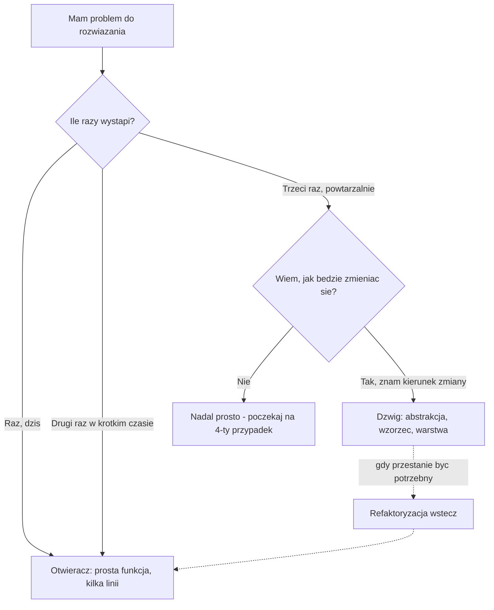
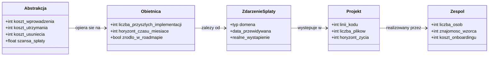
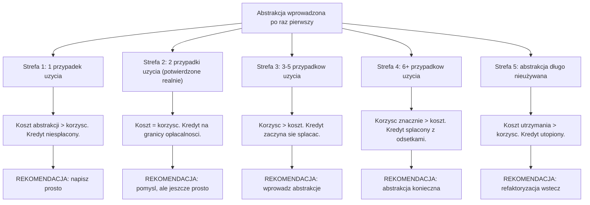
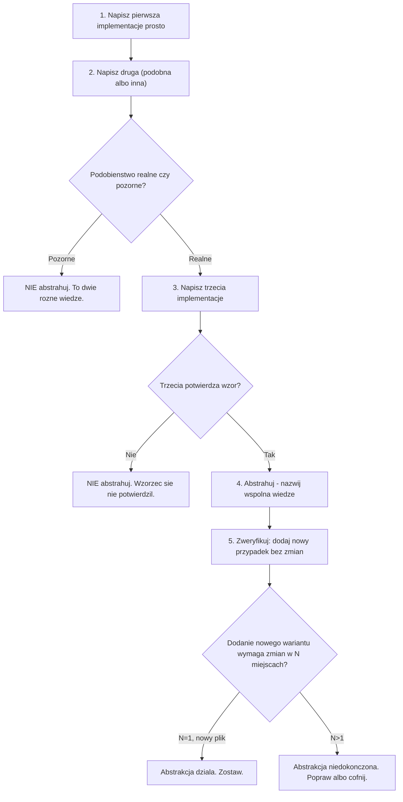
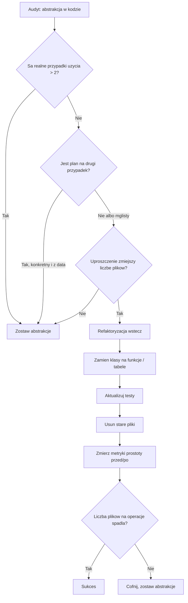
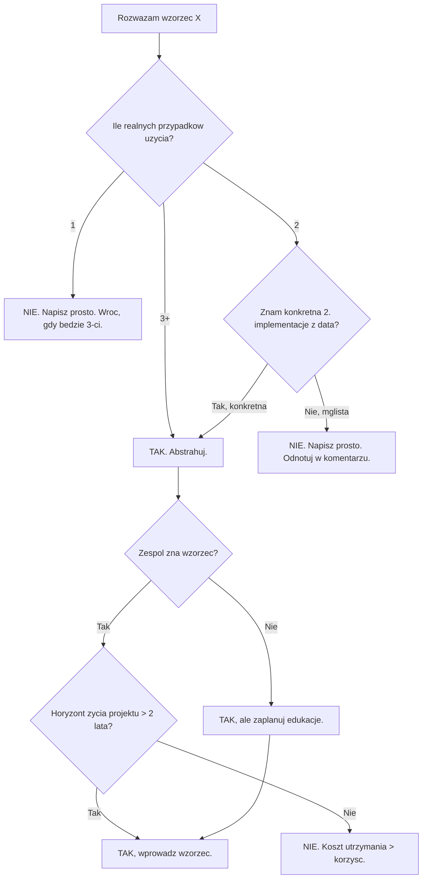
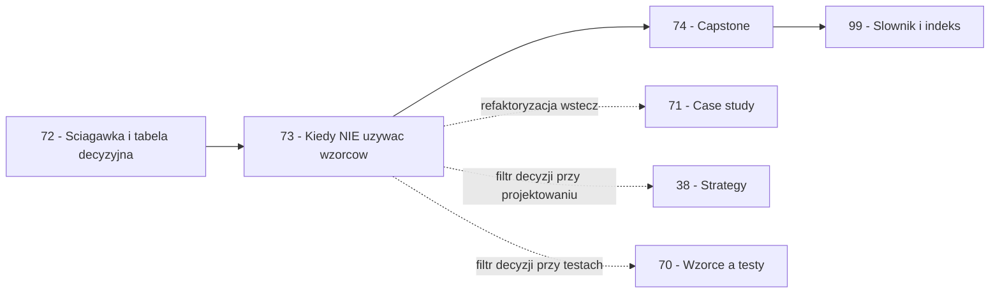

```markdown
---
modul: 73 — Kiedy NIE używać wzorców
plik: 73-kiedy-nie-uzywac-wzorcow.md
poziom: sredni
wymaga: [72]
czas: ~200 minut czytania + ~450 minut ćwiczeń
---

# Moduł 73 — Kiedy NIE używać wzorców — ekonomia abstrakcji

> **TL;DR**
> - **Każda abstrakcja to kredyt, nie inwestycja bez kosztu** — płacisz dodatkowymi plikami, warstwami pośrednictwa, czasem czytania, kosztem debugowania, kosztem onboardingu, ryzykiem, że abstrakcja okaże się gorsza od braku abstrakcji.
> - **Wzorce są użyteczne głównie po to, by rozmawiać z ludźmi** — nazwa „strategia" pozwala powiedzieć współpracownikowi, o co chodzi, w jednym słowie; ich **stosowanie** jest wtórne wobec wspólnego słownika.
> - **Zasada trzech**: napisz prosto raz, potem drugi, abstrahuj przy trzecim realnym przypadku — abstrakcja przy pierwszej implementacji prawie zawsze prowadzi do abstrakcji **złej**.
> - **YAGNI w praktyce**: „przygotowanie" ma **źródło** (znane wymaganie, wymóg regulatora, zapis w roadmapie); „spekulacja" ma **przeczucie**. Naucz się odróżniać jedno od drugiego.
> - **Refaktoryzacja wstecz** to umiejętność tak samo ważna jak wprowadzanie wzorców: umieć **usunąć** zbędną abstrakcję, zamienić trzy klasy w jedną funkcję, uprościć kod, który stał się zbyt gruby.

---

## 0. Model mentalny

### Otwieranie puszki konserwy dźwigiem

Wyobraź sobie, że stajesz w kuchni przed puszką tuńczyka. Puszka jest mała, okrągła, z metalową pokrywką. Możesz ją otworzyć na dwa sposoby. Albo bierzesz **otwieracz do puszek** — kawałek metalu, który przez trzydzieści sekund wykonuje swoją pracę i puszka jest otwarta. Albo — i to jest ten drugi sposób — sprowadzasz do kuchni **dźwig budowlany**. Podnosisz puszkę na dziesięć metrów, opuszczasz na odpowiednie stanowisko, uruchamiasz hydrauliczne noże przemysłowe, regulator ciśnienia, czujniki bezpieczeństwa — i po dwudziestu minutach puszka jest otwarta. Technicznie: **działa**.

Zatrzymaj się przy tym obrazie, bo pokazuje coś, co umyka entuzjastom narzędzi. **Dźwig nie jest „lepszy" od otwieracza.** Jest potężniejszy, bardziej elastyczny, obsługuje różne rozmiary puszek (tuńczyk, kukurydza, ananas, konserwa wołowa). Ale wymaga: obsługi przez wykwalifikowanego operatora, prądu trójfazowego, placu budowy o odpowiedniej nośności, konserwacji, ubezpieczenia OC. **Trzydzieści sekund zamieniło się w dwadzieścia minut, a zysk jest zerowy — bo puszka i tak była do otwarcia.**

Idźmy dalej, bo w tej analogii jest jeszcze jedna rzecz — bardzo ważna. Wyobraź sobie, że w tej samej kuchni otwierasz **nie jedną** puszkę, ale **dwieście puszek dziennie**. Codziennie, przez pięć lat. Wtedy rachunek się zmienia: otwieracz do puszek **łuszczy się** (koszt naprawy), **nie obsłuży** konserw o nietypowym kształcie, **nie zautomatyzuje** się. A dźwig — raz zainstalowany, obsługuje każdą puszkę, każdy rozmiar, każdą konsystencję. Koszt inwestycyjny jest wysoki, ale **koszt jednostkowy** spada z każdą kolejną puszką.

I tu jest sedno: **ekonomia abstrakcji zależy od liczby przypadków użycia**. Sama puszka tuńczyka nie potrzebuje dźwigu. Fabryka konserw potrzebuje. W kodzie jesteśmy **fabryką konserw** albo **jedną puszką** — i od tej odpowiedzi zależy, czy wzorce są inwestycją, czy marnotrawstwem.

Zatrzymajmy się na jeszcze jednej rzeczy — na **odwracalności decyzji**. Wyobraź sobie dźwig już zainstalowany. Przez rok otworzył tysiąc puszek i urósł w biurokrację — konserwacja, atesty, ubezpieczenia. Firma decyduje się **wrócić do otwieracza**. To jest **kosztowne** — trzeba wywieźć dźwig, zwolnić operatora, przeprojektować kuchnię. W kodzie jest **znacznie taniej** — wystarczy usunąć jeden plik i zmienić importy. **Właśnie dlatego można być bardziej odważnym w dodawaniu abstrakcji, ale i bardziej zdecydowanym w jej usuwaniu.** Wracamy do tego w sekcji o refaktoryzacji wstecz.

| W analogii dźwigu | W kodzie |
|---|---|
| Puszka tuńczyka | Jeden przypadek użycia |
| Fabryka konserw (200 puszek dziennie) | Wiele przypadków użycia |
| Otwieracz do puszek | Prosta funkcja / kilka linii kodu |
| Dźwig budowlany | Wielowarstwowa abstrakcja / wzorzec |
| Operator dźwigu | Zespół, który musi znać abstrakcję |
| Plac budowy o nośności | Zespół gotowy na utrzymanie abstrakcji |
| Konserwacja dźwigu | Utrzymanie abstrakcji (koszt ciągły) |
| Trzydzieści sekund vs dwadzieścia minut | Dwa pliki vs osiemnaście plików |
| „Obsługuje każdy rozmiar" | „Obsługuje każdy wariant" (dziś i w przyszłości) |
| Wywiezienie dźwigu | Usunięcie abstrakcji (refaktoryzacja wstecz) |

> 🧠 **Zapamiętaj** — **Abstrakcja to kredyt: zaciągasz dług (koszt kodu, zrozumienia, utrzymania) w zamian za obietnicę przyszłej elastyczności. Kredyt opłaca się, jeśli obietnica się zrealizuje — jeśli realnie powstanie druga, trzecia, dziesiąta implementacja. Jeśli nie powstanie, płacisz odsetki przez cały cykl życia projektu.**

Zwróć uwagę na metaforę **kredytu**. Kredyt nie jest zły — jest narzędziem. Ale zaciąganie kredytu bez potrzeby, w nadziei że „kiedyś się przyda", to **spekulacja**. Dobry zespół inżynierski zaciąga kredyty na **konkretne** cele, z **konkretnym** zdarzeniem w horyzoncie, z **jawnym** kosztem.

### Diagram — intuicja: dźwig czy otwieracz



*Diagram pokazuje, że wybór między prostotą a abstrakcją zależy od liczby realnych przypadków użycia i od tego, czy znamy kierunek przyszłej zmiany — a refaktoryzacja wstecz jest zawsze możliwa.*

### Czego zasada „kiedy nie używać" NIE robi

Rozbrójmy kilka nieporozumień, które pojawiają się przy lekturze modułów o roztropności. Ten moduł **nie jest** anty-wzorcowy; jest **ekonomiczny**.

**Nie jest anty-wzorcowy.** To nie „precz z wzorcami". To „wzorce są narzędziami, których koszt trzeba widzieć". Gdy są potrzebne, wciąż są potrzebne — patrz moduły 10–65.

**Nie mówi „zawsze pisz prosto".** Proste nie zawsze jest dobre. Kod, który nie ma struktury tam, gdzie potrzebna, to też problem — tyle że gorszy, bo dodaje go dopiero, gdy już jest chaos. Ten moduł mówi: **dodawaj z intencją, nie z nawyku**.

**Nie jest sprzeczny z modułem 72 (ściągawka).** Ściągawka pokazuje **gdzie** wzorce pasują. Ten moduł — **kiedy ich nie używać**, nawet jeśli pasują. To dwa różne wymiary.

**Nie jest dogmatem.** Nie ma tu formuły, która zawsze działa. Są **heurystyki** — sprawdzone skróty myślowe, które zwykle prowadzą do dobrych decyzji. W konkretnym kontekście możesz je złamać, jeśli wiesz, dlaczego.

**Nie jest anty-biznesowe.** Właśnie **biznes** zyskuje na tej dyscyplinie: szybciej dostarcza funkcje, taniej zmienia, dłużej żyje. Kod, w którym każda zmiana trwa tydzień, to nie „solidny kod" — to hamulec rozwoju.

**Nie zastępuje decyzji.** Ten moduł pomaga podjąć decyzję, ale decyzja jest zawsze twoja — twojego zespołu, w twoim kontekście. Żadna heurystyka nie zna twojej sytuacji tak dobrze, jak ty.

---

## 1. Problem, który rozwiązujemy

Wejdźmy w domenę 💳 „Rozrachunku". Projekt ma tysiąc linii kodu, pięciu klientów, trzech deweloperów. Ktoś — student, junior, entuzjasta wzorców — uznał, że system zasługuje na „porządną architekturę" i przebudował go w duchu Clean Architecture.

### Kod „przed" — prosty, 80 linii, działa

```python
# rozrachunek_prosty.py — wersja prosta, demonstracyjna
# Skala: 3 deweloperow, 5 klientow, 1000 linii kodu w projekcie.

from dataclasses import dataclass
from decimal import Decimal


@dataclass
class Zlecenie:
    identyfikator: str
    kwota: Decimal
    waluta: str


def policz_prowizje(zlecenie: Zlecenie) -> Decimal:
    stawka = Decimal("0.004")
    return (zlecenie.kwota * stawka).quantize(Decimal("0.01"))


def przeprowadz(zlecenie: Zlecenie) -> str:
    """Realizuje zlecenie i zapisuje w bazie."""
    if zlecenie.kwota <= 0:
        raise ValueError("kwota musi byc dodatnia")
    prowizja = policz_prowizje(zlecenie)

    # Zapis do bazy
    import sqlite3
    with sqlite3.connect("rozrachunek.db") as pol:
        pol.execute(
            "INSERT INTO zlecenia (id, kwota, waluta, prowizja) VALUES (?, ?, ?, ?)",
            (zlecenie.identyfikator, str(zlecenie.kwota),
             zlecenie.waluta, str(prowizja)),
        )
        pol.commit()

    return f"OP-{zlecenie.identyfikator}"


if __name__ == "__main__":
    print(przeprowadz(Zlecenie("ZL-1", Decimal("100.00"), "PLN")))
```

Kod jest krótki, czytelny, działa. Trzy osoby wiedzą, co robi. Klienci są zadowoleni.

### Kod „po" — przebudowany w imię „porządku", 340 linii, 14 plików

Ten sam zespół, ten sam projekt — ktoś uznał, że skoro w kursach wzorców mówi się „oddziel domenę od infrastruktury", „stosuj DI", „używaj Repository", to trzeba to zrobić. Po trzech tygodniach pracy:

```text
rozrachunek/
├── __init__.py
├── main.py                          # composition root, 40 linii
├── domain/
│   ├── __init__.py
│   ├── model.py                     # Zlecenie, 15 linii
│   ├── prowizje.py                  # 60 linii - Strategy + Protocol
│   └── porty.py                     # 25 linii - dwa porty
├── application/
│   ├── __init__.py
│   └── serwis.py                    # 50 linii - Service Layer
├── infrastructure/
│   ├── __init__.py
│   ├── repo_sqlite.py               # 60 linii
│   ├── repo_w_testach.py            # 30 linii
│   └── config.py                    # 25 linii
└── presentation/
    ├── __init__.py
    └── cli.py                       # 35 linii
```

**Koszt:** 3 tygodnie pracy. **Zysk:** nic nowego. Ten sam klient, ten sam zespół, ten sam projekt. Abstrakcja jest „przygotowana na przyszłość", która może się nigdy nie zrealizować.

### Code smell — nadmiarowa abstrakcja w konkretnym kontekście

| Problem | Gdzie | Konsekwencja |
|---|---|---|
| Dwa porty do których nie ma drugiej implementacji | `domain/porty.py` | Niepotrzebne 25 linii |
| Strategy dla jednej reguły prowizji | `domain/prowizje.py` | Trzy klasy tam, gdzie wystarczy jedna funkcja |
| Composition root dla pięciu klas | `main.py` | 40 linii zamiast 3 |
| `abstract` wszędzie | `domain/prowizje.py` | Trzy pliki do „udokumentowania", że tylko jeden jest używany |
| Konfiguracja w pliku | `infrastructure/config.py` | Nadmiar — nikt jej nie zmienia |
| Rozdzielenie CLI od logiki | `presentation/cli.py` + `application/serwis.py` | Zmiana prowizji wymaga dotknięcia dwóch plików |
| Trzynaście plików do przeczytania, żeby zrozumieć jedną operację | Cały projekt | Nowy deweloper odchodzi od projektu po 3 dniach |
| Nazwy bez treści | `serwis.py`, `porty.py` | Trudniej zrozumieć intencję niż w pierwotnym pliku |

### Objawy — poznasz ten problem po tym, że...

- **Nowy deweloper potrzebuje tygodnia, żeby zrozumieć jedno zapytanie.** Klasyczny objaw nadmiarowej architektury — koszt poznawczy przewyższa zysk.
- **Każda drobna zmiana (nowe pole, nowa reguła) wymaga dotknięcia pięciu lub więcej plików.** Kod jest bardziej rozproszony, nie mniej.
- **Nie da się wyjaśnić na głos, dlaczego `ProwizjaStrategy` istnieje.** „Bo tak się mówi w kursach" to nie uzasadnienie.
- **Testy są dłuższe i wolniejsze niż sam kod, który testują.** Prosty kod nie wymaga takiej maszynerii testowej.
- **Zespół boi się usunąć którąkolwiek klasę** — „może być jeszcze potrzebna".
- **W repozytorium jest więcej plików z plikiem `__init__.py` niż plików z logiką.**
- **W CI masz 40 plików, z których 30 to puste `__init__.py`.**
- **Każdy pull request dotyka 10 plików, żeby zmienić jedną linię logiki.**
- **Nazwy klas zawierają `Manager`, `Service`, `Handler`, ale nie wiesz, co robią.**
- **W dokumentacji onboardingowej musisz tłumaczyć architekturę, zanim wytłumaczysz, co kod robi.**

---

## 2. Anatomia wzorców-„pułapek"

Ten moduł nie opisuje wzorca projektowego — opisuje **meta-wzorzec**: **nadmiarową abstrakcję (ang. over-abstraction)**. Role są analogiczne do wzorców, ale dotyczą **anatomicznych części problemu**, nie rozwiązania.

### Uczestnicy „kredytu abstrakcji"

| Rola | Odpowiedzialność | Co NIE jest jej zadaniem |
|---|---|---|
| **Koszt abstrakcji** | Dodatkowe pliki, warstwy, pośrednictwo, które trzeba utrzymać | Nie znika, gdy abstrakcja „nie działa" — zostaje jako dług |
| **Obietnica abstrakcji** | Zapewnienie elastyczności, którą da „druga implementacja" albo „nowe wymaganie" | Nie jest gwarantowana — jest **warunkowa** |
| **Zdarzenie spłaty** | Realne wystąpienie drugiej implementacji / nowego wymagania | Nie zdarza się sam z siebie — **musi być zaplanowane w biznesie** |
| **Zespół** | Musi znać abstrakcję, umieć ją utrzymać, umieć ją usunąć | Nie może „nie używać" abstrakcji, gdy jest w kodzie |
| **Horizont czasowy** | Okres, w którym obietnica abstrakcji może się zrealizować | Zwykle 1–3 lata; po tym okresie prawdopodobieństwo maleje |

### Diagram — struktura „kredytu abstrakcji"



*Diagram pokazuje, że abstrakcja opiera się na obietnicy, obietnica zależy od zdarzenia spłaty, a zdarzenie musi realnie wystąpić w projekcie obsługiwanym przez zespół — bez tego ostatniego elementu abstrakcja pozostaje niespłaconym kredytem.*

### Warianty: klasyczny vs pythoniczny „nadmiar"

| Aspekt | Klasyczny nadmiar | Pythoniczny nadmiar |
|---|---|---|
| Interfejs dla jednej metody | `class Serwis(ABC)` | `class Serwis(Protocol)` — bez implementacji |
| Wiele klas, jedna funkcja byłaby OK | 3 klasy + ABC | 3 `Protocol` + rejestr |
| Fabryka dla jednej rzeczy | `class Fabryka: def utworz(self)` | `def utworz()` — bez klasy |
| DI Container dla 3 klas | `Container.provides` | 15 linii mini-kontenera |
| Composit dla list | Klasa z listą `_dzieci` | Lista + funkcja |

Python daje **uszlachetniające uproszczenie**: to, co w Javie wymaga trzech klas, w Pythonie bywa funkcją. **Nie oznacza to, że wzorce są zbędne — oznacza, że fitness na „duży projekt" trzeba skalować do faktycznej skali.**

---

## 3. Prawo kosztu i korzyści

Przejdźmy do konkretów — do pytania „kiedy abstrakcja się opłaca, a kiedy nie".

### Diagram — krzywa kosztu vs korzyści

Poniższy diagram przedstawia w formie flowchart zależność między liczbą przypadków użycia, a opłacalnością abstrakcji. Oś pozioma to liczba realnych przypadków użycia, osi pionowej nie da się pokazać wprost, więc pokazujemy **strefy decyzyjne**.



*Diagram pokazuje pięć stref decyzyjnych: opłaca się abstrahować dopiero od trzeciego realnego przypadku użycia, a gdy abstrakcja długo nie znajduje zastosowań — warto ją usunąć.*

### Tabela — kiedy się opłaca, a kiedy nie

| Kryterium | Opłaca się abstrahować | NIE opłaca się abstrahować |
|---|---|---|
| **Liczba realnych przypadków użycia dziś** | 3+ | 1 |
| **Znam kierunek przyszłej zmiany?** | Tak, wprost z roadmapy | Nie, „może kiedyś" |
| **Zespół zna wzorzec?** | Tak, w zespole są doświadczeni | Nie, edukacja dopiero się zacznie |
| **Horyzont życia projektu** | 3+ lata | < 1 roku |
| **Liczba deweloperów** | 5+ | 1–3 |
| **Dynamika zmian w projekcie** | Wysoka (co tydzień) | Niska (raz na pół roku) |
| **Zdarzenie spłaty kredytu** | Jest konkretne (np. „druga chmura w Q2") | Jest mgliste |
| **Koszt zmiany bez abstrakcji** | Wysoki (10 miejsc) | Niski (1 miejsce) |
| **Koszt zmiany z abstrakcją** | Niski (1 miejsce) | **Wyższy** (przez pośrednictwo) |
| **Złożoność domeny** | Wysoka (regulacje, wyjątki) | Niska (CRUD) |
| **Ryzyko regulatora** | Wymagania regulacyjne | Brak |
| **Onboarding nowej osoby** | Ważny (zespół rośnie) | Nieistotny (zespół stały) |

> 💡 **Intuicja** — Zwróć uwagę, że **wszystkie kryteria idą w jednym kierunku**: „duży, długi, niepewny projektu" → abstrahuj. „Mały, krótki, stabilny" → nie abstrahuj. To spójne i intuicyjne. Ale realne projekty rzadko są jednoznacznie w jednej kolumnie — zwykle są **mieszanką**. Twoja praca polega na **ważeniu**.

### Prawo krzywej

Koszt abstrakcji jest **stały w czasie**, ale rośnie z liczbą osób (każda musi się nauczyć) oraz z czasem (im dłużej żyje, tym więcej kontekstu wymaga). Korzyść abstrakcji rośnie z liczbą przypadków użycia i z dynamiką zmian. Postać prosta:

```text
Koszt_abstrakcji = K_poczatkowy + K_zespol * N_osob * czas_zycie
Korzysc_abstrakcji = K_zmiany * N_przypadkow * dynamika * czas_zycie

Decyzja: wprowadz, gdy Korzysc > Koszt
```

Warto to zapisać i przeliczyć dla konkretnego przypadku. Nie musi być dokładne — wystarczy rzędu wielkości.

---

## 4. Zasada trzech, YAGNI i próg abstrakcji

### Zasada trzech — konkretna

**Zasada trzech** mówi: **napisz rozwiązanie prosto raz, potem drugi, abstrahuj przy trzecim — nie wcześniej**.

Nie chodzi o dogmat — chodzi o **realistyczną ocenę wzorca**. Po pierwszej implementacji nie wiesz, co jest wspólne, a co różne. Po drugiej zaczynasz widzieć. Po trzeciej **wiesz** — bo reguła jest potwierdzona.

### Przykład — dwa razy zduplikowany, potem abstrakcja

Poniżej pełny przebieg zasady trzech na przykładzie rabatów w sklepie finansowym.

Krok 1 — **pierwsza implementacja**, 20 linii:

```python
# Pierwsze miejsce: rabaty w koszyku
def rabat_koszyka(segment: str, kwota: Decimal) -> Decimal:
    if segment == "VIP":
        return (kwota * Decimal("0.10")).quantize(Decimal("0.01"))
    return Decimal("0")
```

Krok 2 — **druga implementacja**, analogiczna, ale w innym miejscu:

```python
# Drugie miejsce: rabaty w fakturze
def rabat_faktury(segment: str, kwota: Decimal) -> Decimal:
    if segment == "VIP":
        return (kwota * Decimal("0.10")).quantize(Decimal("0.01"))
    return Decimal("0")
```

**W tym momencie kusi abstrakcja.** „To samo! Wyciągnijmy funkcję!" Ale uwaga — może to być **przypadkowe podobieństwo**, nie **wspólna wiedza**. Krok 3 pokaże prawdę.

Krok 3 — **trzecia implementacja**, rzeczywiście potwierdza wspólną regułę:

```python
# Trzecie miejsce: rabaty w abonamencie
def rabat_abonamentu(segment: str, kwota: Decimal) -> Decimal:
    if segment == "VIP":
        return (kwota * Decimal("0.10")).quantize(Decimal("0.01"))
    return Decimal("0")
```

Teraz **jesteś pewien**, że reguła jest wspólna. Abstrakcja ma sens:

```python
# Po trzech implementacjach - bezpieczna abstrakcja
def rabat_dla_segmentu(segment: str, kwota: Decimal) -> Decimal:
    """Stawka rabatu zalezy tylko od segmentu klienta."""
    STAWKI = {"VIP": Decimal("0.10"), "FIRMA": Decimal("0.05"), "DETAL": Decimal("0.02")}
    stawka = STAWKI.get(segment, Decimal("0"))
    return (kwota * stawka).quantize(Decimal("0.01"))
```

Zwróć uwagę, że abstrakcja **ujawniła też regułę**, której wcześniej nie było widać: **stawki zależą tylko od segmentu**. Gdybyśmy wcześniej zobaczyli, że jest jakaś różnica (np. inna kwota minimalna), abstrakcja by się nie udała — i kod byłby gorszy niż kopie.

### Diagram — proces „napisz dwa razy → zauważ wzór → abstrahuj → zweryfikuj"



*Diagram pokazuje proces zasady trzech: dopiero trzecia implementacja potwierdza wzorzec, a abstrakcja musi przejść weryfikację przez „dodanie nowego wariantu bez zmian w N miejscach".*

### YAGNI w praktyce — przygotowanie vs spekulacja

Najtrudniejsza część tego modułu. **YAGNI** (You Aren't Gonna Need It — „nie będziesz tego potrzebować") mówi: nie buduj funkcjonalności ani abstrakcji „na wszelki wypadek". Ale w praktyce **trudno odróżnić przygotowanie od spekulacji**. Oto kryteria.

| Kryterium | Przygotowanie (dobre) | Spekulacja (złe) |
|---|---|---|
| **Skąd wiedza?** | Wymaganie z biznesu, dokument regulacyjny, roadmap | Przeczucie, „dobra praktyka", „bo wszyscy tak robią" |
| **Czy znasz konkretny przypadek?** | Tak, opisany w zadaniu | Nie, „jakieś tam" |
| **Czy znasz datę?** | Tak — „druga chmura w Q2" | Nie — „kiedyś" |
| **Czy wiesz, co się zmieni?** | Tak — „zmieni się baza, nie logika" | Nie — „wszystko może się zmienić" |
| **Czy abstrakcja ułatwia dziś?** | Tak — już teraz rozdziela odpowiedzialności | Nie — tylko „przygotowuje" |
| **Czy koszt zerowy?** | Niski (naturalny podział) | Wysoki (osobna warstwa) |
| **Czy zespół gotowy?** | Tak, zespół zna | Nie, trzeba uczyć |

**Przykład przygotowania:** „Wiemy, że w Q2 podłączymy drugą bramkę płatniczą — Stripe." Zdefiniowanie portu `BramkaPlatnicza` teraz jest przygotowaniem. Jest **źródło** (roadmapa), **konkret** (Stripe), **data** (Q2). Opłaca się.

**Przykład spekulacji:** „Może kiedyś będziemy mieli trzy bramki płatnicze, więc zróbmy Builder, fabrykę abstrakcyjną, rejestr..." Bez źródła, bez daty, bez konkretu. To spekulacja.

> ⚠️ **Pułapka** — Nawet „przygotowanie" ma pułapkę: **przygotowanie na zmianę, która nie zachodzi**. Jeśli zdefiniowałeś port Stripe w Q4, a Stripe podłączysz w Q3 roku następnego — przez trzy kwartały utrzymujesz abstrakcję bez korzyści. **Musisz mieć plan wycofania**: jeśli zmiana nie zachodzi w założonym horyzoncie, usuwamy abstrakcję.

---

## 5. Kiedy wzorzec NIE jest potrzebny w Pythonie

Ta sekcja to **katalog konkretów** — przypadków, w których wzorzec „pasuje" w teorii, ale w praktyce Python ma lepszą alternatywę. Każdy punkt z **uzasadnieniem** i **wskazaniem, co zamiast**.

### 5.1 Iterator — gdy wystarczy lista

**Kiedy używać Iteratora:** gdy dane są **duże** (mil, GB) albo **generowane na żądanie** (log, stream).

**Kiedy nie używać:** dla listy 100 elementów.

> **Co zamiast:** zwykła lista. Iterator dla małej listy to narzut bez zysku.

### 5.2 Strategy — gdy jest jedna implementacja

**Kiedy używać Strategy:** gdy masz **co najmniej dwie** wymienne reguły.

**Kiedy nie używać:** gdy masz jedną regułę i „planujecie drugą w przyszłym roku".

> **Co zamiast:** zwykła funkcja albo metoda.

### 5.3 Factory — gdy konstruktor jest prosty

**Kiedy używać Factory:** gdy decyzja „co utworzyć" zależy od danych wejściowych albo konfiguracji.

**Kiedy nie używać:** gdy masz jedną klasę i jeden konstruktor.

> **Co zamiast:** `Klass(...)`. Fabryka dla jednej klasy to pośrednictwo bez zysku.

### 5.4 Singleton — gdy wystarczy moduł

**Kiedy używać Singleton:** gdy naprawdę potrzebujesz klasy z metodami instancji i jedną instancją.

**Kiedy nie używać:** gdy konfiguracja jest bezstanowa.

> **Co zamiast:** moduł z funkcjami / stałymi. Moduł w Pythonie **jest** singletonem.

### 5.5 Visitor — gdy wystarczy `match`/`singledispatch`

**Kiedy używać Visitor:** gdy masz wiele niezależnych operacji na drzewie typów i **nie możesz** zmienić klas typu.

**Kiedy nie używać:** gdy operacji jest 2–3 i wszystkie są w twoim kodzie.

> **Co zamiast:** `functools.singledispatch` albo `match`/`case` (PEP 634). Mniej kodu, więcej jasności.

### 5.6 Template Method — gdy wystarczy funkcja wyższego rzędu

**Kiedy używać Template Method:** gdy dziedziczenie jest już używane i sekwencja kroków jest stała.

**Kiedy nie używać:** gdy możesz przekazać kroki jako argumenty.

> **Co zamiast:** funkcja wyższego rzędu. `def przetworz(dane, krok1, krok2, krok3): ...`.

### 5.7 Decorator — gdy wystarczy prosta funkcja

**Kiedy używać Decorator:** gdy chcesz dołożyć zachowanie do **obiektu** (GoF) albo do wielu funkcji (składnia `@`).

**Kiedy nie używać:** gdy opakowujesz jedną funkcję raz.

> **Co zamiast:** zwykłe wywołanie obu funkcji po kolei. Dekorator dla pojedynczego przypadku to narzut.

### 5.8 Builder — gdy obiekt ma trzy pola

**Kiedy używać Builder:** dla obiektów z 8+ polami, opcjonalnymi, z walidacją krzyżową.

**Kiedy nie używać:** dla `Punkt(x, y, z)`.

> **Co zamiast:** `@dataclass` z `kw_only=True`. Trzy linie zamiast trzydziestu.

### 5.9 DI Container — gdy masz pięć klas

**Kiedy używać DI Container:** dla złożonego grafu (10+ usług, cykle, różne cykle życia).

**Kiedy nie używać:** dla pięciu klas, które łatwo złożyć ręcznie.

> **Co zamiast:** konstruktor z pięcioma argumentami w `main.py`. 10 linii zamiast 100.

### 5.10 Repository — gdy aplikacja to CRUD na trzech tabelach

**Kiedy używać Repository:** dla złożonej domeny, gdy trwałość ma się zmieniać, gdy testy mają być szybkie.

**Kiedy nie używać:** dla CRUD na trzech tabelach, bez testów bez bazy.

> **Co zamiast:** bezpośredni ORM (Django ORM, SQLAlchemy). Repository dla CRUD to biurokracja.

### 5.11 Mikroserwisy — gdy zespół to trzy osoby i jeden produkt

**Kiedy używać mikroserwisów:** dla **skali organizacyjnej** (wiele zespołów, niezależne wdrożenia).

**Kiedy nie używać:** dla małego zespołu i jednego produktu.

> **Co zamiast:** monolit modułowy. Rozdzielenie modułów (na poziomie importów, nie procesów). „Microservices solve organizational problem, not technical".

### 5.12 Inne popularne przypadki

| Wzorzec | Kiedy NIE | Co zamiast |
|---|---|---|
| Abstract Factory | Jeden typ produktu w każdej rodzinie | Prosta fabryka |
| Bridge | Jedna oś zmienności | Zwykła klasa |
| Composite | Struktura płaska (lista) | Lista + funkcja |
| Facade | Podsystem ma 2 klasy | Zwykła klasa nad dwoma |
| Proxy | Bez leniwego ładowania, cache, kontroli | Zwykłe wywołanie |
| Flyweight | Brak realnego problemu z pamięcią | Zwykłe obiekty |
| Chain of Responsibility | 1–2 reguły | `if/elif` / `match/case` |
| Command | Bez undo, kolejki, opóźnienia | Zwykłe wywołanie metody |
| Observer | Jeden odbiorca | Zwykłe wywołanie funkcji |
| Mediator | Mała grupa (2–3), jest bezpośrednia komunikacja | Bezpośrednie wywołania |
| Memento | Bez potrzeby cofania | Brak |
| State | 1 stan bez przejść | `bool` albo Enum |
| Null Object | Gdy brak jest błędem programisty | Wyjątek |

---

## 6. Metryki prostoty — 5 wskaźników do obserwacji

Jak **zmierzyć**, że kod stał się nadmiernie abstrakcyjny? Poniżej pięć mierzalnych wskaźników. Każdy z nich da się zautomatyzować.

### Wskaźnik 1 — Liczba plików do przeczytania, żeby zrozumieć jedną operację

**Metryka:** Dla typowej operacji (np. „złóż zamówienie") — ile plików musisz otworzyć, żeby prześledzić pełny przebieg?

**Cel:** ≤ 3 pliki.
**Max:** > 6 plików to sygnał, że warstw jest za dużo.

**Jak mierzyć:** wybierz 5 operacji w projekcie i policz pliki. Prowadź rejestr średniej.

### Wskaźnik 2 — Liczba wywołań w stosie przy prostym zapytaniu

**Metryka:** Dla prostego zapytania (np. „pobierz zlecenie po id") — ile funkcji jest w śladzie wywołań od HTTP do bazy?

**Cel:** ≤ 5 wywołań.
**Max:** > 8 wywołań to sygnał, że pośrednictwo przewyższa korzyść.

**Jak mierzyć:** patrz na traceback w debuggerze. Policz ramki.

### Wskaźnik 3 — Czas do pierwszego zielonego testu dla nowego dewelopera

**Metryka:** Ile czasu potrzebuje nowa osoba, żeby napisać pierwszy test i zobaczyć go zielonego?

**Cel:** ≤ 1 dzień.
**Max:** > 3 dni to sygnał, że test setup jest zbyt złożony (najczęściej zbyt wiele warstw).

**Jak mierzyć:** pytaj nowych deweloperów.

### Wskaźnik 4 — Liczba plików do zmiany przy dodaniu jednej reguły

**Metryka:** Dodajesz nową regułę (np. nowy typ prowizji). Ile plików musisz zmienić?

**Cel:** 1–2 pliki.
**Max:** > 5 plików to sygnał, że abstrakcja nie grupuje wiedzy.

**Jak mierzyć:** prowadź ćwiczenie „wyobraź sobie, że dodajesz X" raz na kwartał.

### Wskaźnik 5 — Rozmiar `main.py` albo composition root

**Metryka:** Ile linii ma composition root (miejsce, gdzie składamy aplikację)?

**Cel:** ≤ 30 linii (dla 5–10 usług).
**Max:** > 80 linii to sygnał, że usług jest za dużo albo kontener jest zbyt skomplikowany.

**Jak mierzyć:** policz linie w `main.py`.

### Tabela zbiorcza — karta obserwacji

| Wskaźnik | Cel | Sygnał ostrzegawczy | Jak mierzyć |
|---|---|---|---|
| Plików na operację | ≤ 3 | > 6 | Ręcznie dla 5 operacji |
| Ramki w stosie (proste zapytanie) | ≤ 5 | > 8 | Debugger |
| Czas do pierwszego testu (nowy) | ≤ 1 dzień | > 3 dni | Pytanie do nowych |
| Plików do zmiany przy nowej regule | ≤ 2 | > 5 | Kwartalny audyt |
| Rozmiar composition root | ≤ 30 linii | > 80 linii | `wc -l main.py` |

> 🧠 **Zapamiętaj** — **Prowadź te metryki raz na kwartał. Nie musisz ich automatyzować — wystarczy arkusz.** Celem nie jest „spełnić cel" dla każdej metryki, ale **odkryć trend**. Jeśli w ciągu 6 miesięcy średnia z „plików na operację" wzrosła z 3 do 6 — to sygnał, że abstrakcja rośnie szybciej niż korzyść.

---

## 7. Wzorce jako słownik komunikacji — kluczowa teza modułu

Ta sekcja zawiera **najważniejszą myśl** tego modułu.

**Warto znać wzorce głównie po to, żeby rozmawiać z ludźmi precyzyjnie. Ich stosowanie jest wtórne.**

Zatrzymaj się nad tym zdaniem. Kurs miał 70+ modułów o wzorcach — i teraz mówi, że stosowanie wzorców jest wtórne? Tak. I to jest **prawdziwa dojrzałość inżynierska**.

**Po co ci więc wzorce?**

**Po pierwsze — do komunikacji.** Powiedzenie „to jest wzorzec Strategii" przekazuje w sekundę informację, której opis zajmowałby pół strony. „Ten obiekt ma kilka wymiennych algorytmów, klient wybiera w runtime, istnieje wspólny kontrakt, wszyscy klienci są zgodni co do semantyki" — to samo, w 30 sekundach. Nazwa wzorca **skraca** komunikację.

**Po drugie — do projektu.** Znając Strategię, łatwiej **od razu** zaprojektować kod z wymiennym algorytmem. Nie musisz wymyślać struktury — jest znana, sprawdzona, ma nazwę.

**Po trzecie — do rozpoznawania.** Wchodząc w cudzy kod, widzisz wzorzec i wiesz, o co chodzi. Bez nazw — analizujesz strukturę od zera.

**Czego wzorce nie robią?**

**Nie zastępują zrozumienia domeny.** Wzorzec nie powie ci, czy limit koncentracji działa na pozycji brutto czy netto. To wiedza biznesowa.

**Nie zastępują komunikacji bezpośredniej.** Nazwa wzorca to skrót — ale najważniejsze rozmowy dotyczą **konkretów**, nie skrótów. „Ta klasa jest Strategią" nie mówi, czy działa poprawnie.

**Nie zwalniają z testowania.** Wzorzec to struktura, nie gwarancja. Testy weryfikują, czy struktura faktycznie robi to, co ma.

**Nie są ozdobą CV.** „Znam 23 wzorce GoF" nie znaczy „piszę dobry kod". Umiejętność powiedzenia „nie potrzebuję tu wzorca" jest **równie cenna** jak umiejętność jego zastosowania.

> 💡 **Intuicja** — Wzorce są jak słownictwo w obcym języku. **Słownictwo pozwala rozmawiać.** Ale płynność nie bierze się z liczby słów — bierze się z umiejętności **wyrażenia myśli**. Możesz znać 20 000 słów i mówić niezrozumiale; możesz znać 500 i mówić jasno, konkretnie, przekonująco. **Wzorce to słownik — dobry kod to zdanie.**

---

## 8. Sygnały, że przesadziłeś

Praktyczna lista objawów. Każdy z nich sam może być akceptowalny — ale **3 z nich razem** to sygnał ostrzegawczy.

**Sygnał 1 — Interfejs z jedną implementacją i bez planów na drugą.**
`Protocol`/`ABC`/`interface` dla jednej klasy. Jeśli nie ma drugiej implementacji w planach — to nadmiar.

**Sygnał 2 — Fabryka tworząca jedną rzecz.**
`class FabrykaZlecen: def utworz(self): return Zlecenie(...)`. Jedna metoda, jedna klasa, jedno wywołanie. Wystarczy `Zlecenie(...)`.

**Sygnał 3 — Abstrakcja, której nikt nie potrafi wyjaśnić na głos.**
Zapytaj losową osobę z zespołu: „po co jest `SerwisPomocniczy`?". Jeśli odpowiedź brzmi „żeby było czysto" — sygnał.

**Sygnał 4 — Dodanie pola wymaga zmiany w ośmiu plikach.**
`dataclass` w jednym module, DTO w drugim, mapper w trzecim, walidator w czwartym, kontrakt API w piątym, schema bazy w szóstym, migracja w siódmym, test w ósmym. Dla jednego pola.

**Sygnał 5 — Klasa nazywa się `Manager`, `Handler`, `Processor`, `Service` bez treści.**
Nazwa mówi „coś robi", ale nie mówi co. Może to prawdziwy „serwis" — ale może to worek.

**Sygnał 6 — Rozmiar importów w punkcie wejścia.**
`main.py` importuje 40 klas, z których 20 nie ma merytorycznego powodu. To znak, że „wszystko połączone".

**Sygnał 7 — Więcej plików `__init__.py` niż plików z logiką.**
If the ratio exceeds 50%, likely too many empty packages.

**Sygnał 8 — Każdy PR zmienia 10+ plików dla zmiany jednej linii logiki.**
„Zmieńmy stawkę prowizji z 0,4% na 0,3%" — 12 plików zmienionych. To znak, że wiedza jest źle zgrupowana.

**Sygnał 9 — Nowy deweloper potrzebuje więcej niż tygodnia, żeby zrozumieć pierwszą zmianę.**
Koszt onboardingu > koszt funkcji, którą ma napisać.

**Sygnał 10 — Zespół unika modyfikacji konkretnych plików.**
„Nie ruszaj `domain/` — tam nie wchodzimy bez konsultacji z Krzyśkiem." To znak, że nie ma zrozumienia.

**Sygnał 11 — Testy są wolniejsze niż kod produkcyjny.**
Setup testu zajmuje 40 linii.

**Sygnał 12 — Brak testów architektury i/lub brak egzekwowania granic.**
Wszystkie abstrakcje (porty, warstwy, warstwy w pakietach) **rozmywają się w czasie**, jeśli nie ma automatycznego egzekwowania (import-linter, pytest-archon).

**Sygnał 13 — Dokumentacja architektury ma więcej stron niż cały kod.**
Można dokumentować 500 linii kodu na 30 stronach, jeśli każda warstwa wymaga uzasadnienia.

**Sygnał 14 — Abstrakcja nieużywana przez 6 miesięcy.**
Introdukcja z „przygotowaniem na zmianę", która się nie zmaterializowała.

> ⚠️ **Pułapka** — **Każdy z tych sygnałów osobno może być akceptowalny.** Interfejs z jedną implementacją może być **przygotowaniem na potwierdzoną drugą implementację** (np. potwierdzone w roadmapie). Manager bez treści może być **legalną abstrakcją domenową**. Sygnały są **razem** — 3 z 14 to powód do audytu. 8 z 14 to powód do **refaktoryzacji wstecz**.

---

## 9. Refaktoryzacja wstecz — kiedy USUWAĆ abstrakcje

To sekcja, której **nie znajdziesz** w większości kursów. Mówi się dużo o dodawaniu abstrakcji, a mało o ich **usuwaniu**. A przecież usuwanie jest **tak samo potrzebne**: kod ma żyć, a nie gromadzić warstwy.

### Kiedy usuwać abstrakcje

- Abstrakcja nie znalazła drugiej implementacji w ciągu planowanego horyzontu (np. 6–12 miesięcy).
- Abstrakcja utrudnia zrozumienie, nie ułatwia zmian.
- Abstrakcja **ukrywa** logikę, która samodzielnie byłaby czytelniejsza.
- Abstrakcja została wprowadzona **pośpiesznie** i okazała się źle dobrana.
- Zmienił się kontekst — firma porzuciła plan, który uzasadniał abstrakcję.

### Przykład — trzy klasy → jedna funkcja

**Przed:** klasyczna abstrakcja. Trzy klasy + rejestr, 60 linii.

```python
# przed_refaktoryzacja_wstecz.py — abstrakcja bez uzasadnienia
from decimal import Decimal
from typing import Protocol, runtime_checkable


@runtime_checkable
class RegulaRabatowa(Protocol):
    nazwa: str
    def rabat(self, segment: str, kwota: Decimal) -> Decimal: ...


class RabatVIP:
    nazwa = "VIP"
    def rabat(self, segment: str, kwota: Decimal) -> Decimal:
        if segment != "VIP":
            return Decimal("0")
        return (kwota * Decimal("0.10")).quantize(Decimal("0.01"))


class RabatFirmowy:
    nazwa = "FIRMA"
    def rabat(self, segment: str, kwota: Decimal) -> Decimal:
        if segment != "FIRMA":
            return Decimal("0")
        return (kwota * Decimal("0.05")).quantize(Decimal("0.01"))


class RabatDetaliczny:
    nazwa = "DETAL"
    def rabat(self, segment: str, kwota: Decimal) -> Decimal:
        if segment != "DETAL":
            return Decimal("0")
        return (kwota * Decimal("0.02")).quantize(Decimal("0.01"))


class SilnikRabatow:
    def __init__(self, reguly: list[RegulaRabatowa]) -> None:
        self._reguly = tuple(reguly)

    def nalicz(self, segment: str, kwota: Decimal) -> Decimal:
        return sum((r.rabat(segment, kwota) for r in self._reguly), Decimal("0"))
```

**Po:** jedna funkcja z tabelą stawek, 8 linii.

```python
# po_refaktoryzacji_wstecz.py — prosto i czytelnie
from decimal import Decimal


STAWKI_RABATOWE: dict[str, Decimal] = {
    "VIP": Decimal("0.10"),
    "FIRMA": Decimal("0.05"),
    "DETAL": Decimal("0.02"),
}


def nalicz_rabat(segment: str, kwota: Decimal) -> Decimal:
    """Rabat zalezy tylko od segmentu klienta."""
    stawka = STAWKI_RABATOWE.get(segment, Decimal("0"))
    return (kwota * stawka).quantize(Decimal("0.01"))
```

**Testy po refaktoryzacji wstecz:**

```python
import pytest
from decimal import Decimal
from po_refaktoryzacji_wstecz import nalicz_rabat


@pytest.mark.parametrize("segment,oczekiwany", [
    ("VIP", Decimal("10.00")),
    ("FIRMA", Decimal("5.00")),
    ("DETAL", Decimal("2.00")),
    ("NIEZNANY", Decimal("0.00")),
])
def test_rabat(segment: str, oczekiwany: Decimal) -> None:
    assert nalicz_rabat(segment, Decimal("100.00")) == oczekiwany
```

**Co zyskaliśmy:**
- 60 linii → 8 linii.
- Trzy klasy + rejestr → jedna funkcja + tabela.
- Nowy wariant (np. „PARTNER") → nowy wpis w słowniku, zero zmian w funkcji.
- Testy parametryzowane — jedna funkcja, cztery przypadki.
- Zrozumienie: nowy deweloper czyta 8 linii i rozumie wszystko.

### Diagram — proces refaktoryzacji wstecz



*Diagram pokazuje proces decyzyjny refaktoryzacji wstecz: usuń abstrakcję, jeśli nie ma realnych przypadków użycia i nie ma konkretnego planu na drugi — a po refaktoryzacji zweryfikuj metryki.*

### Mapa decyzyjna — użyć wzorca czy nie



*Diagram pokazuje cztery kluczowe pytania przed wprowadzeniem wzorca: liczba przypadków użycia, konkretna wiedza o drugiej implementacji, znajomość wzorca w zespole, horyzont życia projektu.*

> 🧠 **Zapamiętaj** — **Refaktoryzacja wstecz to nie przyznanie się do błędu. To dowód dojrzałości.** Kod, który potrafi się uprościć, jest kodem, który rozumie własną ewolucję. Zespół, który potrafi usunąć własną abstrakcję, jest zespołem, który myśli o kodzie **z perspektywy jego życia**, a nie z perspektywy własnego ego.

---

## 10. Ćwiczenie decyzyjne — 8 scenariuszy

Poniżej osiem scenariuszy biznesowych. Dla każdego **Twoje zadanie**: zdecydować „wzorzec czy prostota". Nie ma jednoznacznie poprawnych odpowiedzi — jest **uzasadnienie w kontekście**.

### Scenariusz 1 — 3-osobowy startup, 1 produkt, MVP

Firma ma trzy osoby: CTO, dwóch deweloperów. Budują MVP do bankowości osobistej. Chcą zdążyć na demo za 4 tygodnie. Rozważają wprowadzenie pełnej architektury heksagonalnej z portami i adapterami dla bazy i zewnętrznego API kursów walut.

**Rekomendacja:** **NIE.** MVP w 4 tygodnie to projekt jednorazowy. Wprowadzenie architektury heksagonalnej zajmie 1–2 tygodnie i spowolni kolejne funkcje. **Co zamiast:** zwykły podział na moduły, funkcje, z testami. Wprowadzenie architektury po demo, gdy biznes się potwierdzi.

**Uwaga:** jeśli wiadomo, że za 3 miesiące system przejdzie audyt bezpieczeństwa — **wtedy warto** wprowadzić warstwy z wyprzedzeniem. Ale bez potwierdzenia — nie.

### Scenariusz 2 — Duży bank, 6 zespołów, 5-letni horyzont

Zespół buduje system rozrachunku dla dużego banku. 6 zespołów, 80 deweloperów, horyzont 5 lat. Rozważają architekturę warstwową z portami i adapterami.

**Rekomendacja:** **TAK.** Horyzont długi, zespół duży, wymagania przejdą wiele zmian. Architektura heksagonalna **opłaca się** w takim projekcie.

**Uwaga:** nawet tu **nie wszystko** musi być abstrakcyjne. Porty dla bazy, HTTP, powiadomień — tak. Port dla `datetime` — być może nie.

### Scenariusz 3 — Mały sklep, aplikacja CRUD na 2 tabelach

Sklep internetowy z dwiema tabelami: `produkty` i `zamowienia`. Zespół 1 osoba. Projekt ma żyć 1 rok.

**Rekomendacja:** **NIE.** CRUD na dwóch tabelach nie potrzebuje Repository, Unit of Work, Service Layer. **Co zamiast:** bezpośredni ORM (Django ORM, SQLAlchemy), funkcje widoków.

### Scenariusz 4 — System dla 3 chmur (AWS, GCP, Azure)

System zarządzania portfelem musi działać na trzech chmurach. Każda chmura ma własny storage, kolejkę i dziennik audytu. Zespół 12 osób.

**Rekomendacja:** **TAK — Abstract Factory.** To klasyczne pole zastosowania wzorca. Trzy rodziny produktów (storage, queue, audit log), które muszą być ze sobą spójne. Opłaca się.

**Uwaga:** gdyby chodziło o **jedną** chmurę z „może kiedyś drugą" — **NIE**. Abstract Factory wprowadzamy, gdy mamy co najmniej dwie realne rodziny.

### Scenariusz 5 — Edytor dokumentów, undo/redo, 2 lata pracy

Edytor dla prawników. Wymagania: undo/redo, historia zmian, kopie zapasowe, audyt. Zespół 5 osób.

**Rekomendacja:** **TAK — Command + Memento.** Bez undo/redo (i jego złożonej wersji — historii) edytor nie ma sensu. Command dla undo, Memento dla snapshotów okresowych.

**Uwaga:** **nie** dla każdej edycji osobne Command. Undo dla 1000 operacji to 1000 obiektów. Może wystarczyć migawka co N operacji.

### Scenariusz 6 — Monitoring 200 usług, alerty o awariach

System monitoringu firmy — 200 usług, alerty e-mail, SMS, Slack. Zespół 4 osoby.

**Rekomendacja:** **Observer + Strategy.** Observer dla alertów (jedno zdarzenie, wielu odbiorców), Strategy dla sposobu dostarczenia (e-mail, SMS, Slack). Opłaca się — chmura funkcji powiadamiania.

**Uwaga:** dla **jednego** odbiorcy (np. tylko Slack) — bez Strategy. Dla **dwóch** — niepewne. Trzy i więcej — Strategy.

### Scenariusz 7 — Wtyczki do edytora graficznego

Edytor graficzny z otwartą architekturą wtyczkową. Chcemy, żeby zewnętrzni deweloperzy mogli dodawać filtry, narzędzia, efekty. Zespół rdzenia 8 osób, ale wtyczki pisze społeczność.

**Rekomendacja:** **TAK — Plugin Architecture.** Wtyczki zewnętrzne wymagają stabilnego API rdzenia. Entry points, protokoły, wersjonowanie kontraktu — wszystko potrzebne.

**Uwaga:** wtyczki wewnątrz zespołu mogą być ładowane bezpośrednio — bez architektury wtyczkowej. Architektura wtyczkowa opłaca się dopiero dla **zewnętrznych** deweloperów.

### Scenariusz 8 — Projekt migracji danych z 3 systemów

Projekt migracji danych z trzech systemów ERP do jednego. Wymaga jednorazowej pracy, 6 tygodni, zespół 3 osoby.

**Rekomendacja:** **NIE dla wzorców.** To projekt jednorazowy. **Co zamiast:** skrypty z funkcjami, każdy ERP z własnym modułem adaptera (bez formalnego portu), testy porównawcze. Po zakończeniu projektu kod można wyrzucić.

**Uwaga:** jeden wyjątek — możliwość napisania **jednego** portu dla wszystkich trzech ERP może pomóc (podobny interfejs), ale bez pełnej architektury.

### Podsumowanie scenariuszy

| Scenariusz | Rekomendacja | Kluczowy czynnik |
|---|---|---|
| 1. MVP w 4 tygodnie | Nie | Horyzont krótki |
| 2. Duży bank, 5 lat | Tak | Horyzont długi, zespół duży |
| 3. Sklep CRUD | Nie | Niska złożoność |
| 4. 3 chmury | Tak | Wielo-rodzinność |
| 5. Edytor z undo | Tak | Złożone operacje + historia |
| 6. Monitoring 200 usług | Tak | Wielu odbiorców |
| 7. Wtyczki zewnętrzne | Tak | Zewnętrzni deweloperzy |
| 8. Migracja jednorazowa | Nie | Jednorazowy projekt |

---

## 11. Ściągawka

| Sygnał / pytanie | Odpowiedź | Uzasadnienie |
|---|---|---|
| 1 przypadek użycia, bez planu na drugi | **Napisz prosto** | Abstrakcja-przed-potrzebą |
| 2 przypadki, mglisty plan na trzeci | **Napisz prosto** | Za mało danych o zmienności |
| 3 przypadki, znany kierunek zmiany | **Abstrahuj** | Wzorzec potwierdzony |
| Znam konkretną drugą implementację z datą | **Abstrahuj** | Przygotowanie, nie spekulacja |
| Interfejs z jedną implementacją w 6 mies. | **Usuń** | Refaktoryzacja wstecz |
| Fabryka tworząca jedną rzecz | **Usuń** | Pośrednictwo bez zysku |
| Klasa `Manager` bez treści | **Sprawdź** | Może worek, może legalna |
| Nowy dev potrzebuje > 1 tyg. na pierwszą zmianę | **Uprość** | Koszt onboardingu za duży |
| PR zmienia 10+ plików dla 1 linii | **Grupuj wiedzę** | Rozproszenie |
| Test setup 40 linii | **Uprość zależności** | Za dużo warstw |
| 3 z 14 sygnałów nadmiaru | **Audyt** | Możliwe problemy |
| 8 z 14 sygnałów nadmiaru | **Refaktoryzacja wstecz** | Kod do uproszczenia |
| Rozważasz DI Container dla 5 klas | **Nie** | Konstruktor z 5 argumentami |
| Rozważasz Repository dla CRUD | **Nie** | Bezpośredni ORM |
| Rozważasz mikroserwisy dla 3 osób | **Nie** | Monolit modułowy |
| Rozważasz Visitor dla 2 operacji | **Nie** | `singledispatch` / `match` |
| Rozważasz Builder dla 3 pól | **Nie** | `dataclass(frozen=True, kw_only=True)` |
| Rozważasz Strategy dla 1 reguły | **Nie** | Zwykła funkcja |
| Rozważasz Singleton dla konfiguracji bezstanowej | **Nie** | Moduł |
| Mówisz „bo dobra praktyka" | **Zatrzymaj się** | Brak konkretu |
| Mówisz „na wszelki wypadek" | **Zatrzymaj się** | Spekulacja |

---

## 12. Słownik modułu

- **Ekonomia abstrakcji (ang. economics of abstraction)** — rama myślowa, w której abstrakcję traktujemy jako kredyt: koszt dziś, korzyść warunkowa w przyszłości.
- **Nadmiarowa abstrakcja (ang. over-abstraction)** — abstrakcja, której koszt utrzymania przewyższa korzyść; zwykle wprowadzona przed potwierdzeniem wzorca.
- **Zasada trzech (ang. rule of three)** — heurystyka: napisz prosto raz, potem drugi, abstrahuj przy trzecim — nie wcześniej.
- **YAGNI (You Aren't Gonna Need It)** — zasada niebudowania funkcjonalności na spekulację; kryterium — czy znamy konkretny przypadek?
- **Przygotowanie (ang. preparation)** — działanie oparte na **znanym** wymaganiu, konkretnym przypadku, w horyzoncie czasowym.
- **Spekulacja (ang. speculation)** — działanie oparte na przeczuciu, bez źródła, bez konkretu, bez daty.
- **Refaktoryzacja wstecz (ang. de-abstraction, simplification)** — usunięcie abstrakcji, która przestała się opłacać.
- **Kredyt abstrakcji (ang. abstraction debt)** — koszt utrzymania wprowadzonej abstrakcji przez cały cykl życia projektu, dopóki nie zostanie usunięta.
- **Zdarzenie spłaty (ang. repayment event)** — konkretne zdarzenie biznesowe, które realizuje obietnicę abstrakcji (np. „druga chmura w Q2").
- **Metryka prostoty (ang. simplicity metric)** — mierzalny wskaźnik (liczba plików, liczba ramek, czas onboardingu) pomagający wykryć nadmiarową abstrakcję.
- **Słownik komunikacji (ang. communication lexicon)** — funkcja wzorców jako skrótów w rozmowie, odrębna od ich funkcji projektowej.

---

## 13. Nawigacja

- ⬅️ **Poprzedni moduł:** [72 — Ściągawka i tabela decyzyjna](72-sciagawka-i-tabela-decyzyjna.md)
- ➡️ **Następny moduł:** [74 — Projekt zaliczeniowy (capstone)](74-capstone-projekt-koncowy.md)
- 📑 **Spis treści kursu:** [README](README.md)

### Gdzie jesteśmy na mapie kursu



*Diagram pokazuje, że moduł jest antidotum kursu — równoważy entuzjazm, ale też łączy się z praktycznymi modułami refaktoryzacji i testów.*

---

## 14. Źródła i dalsza lektura

### Książki

- Hunt A., Thomas D., *The Pragmatic Programmer*, 20th Anniversary Edition, Addison-Wesley, 2019. — klasyka o prostocie, YAGNI, ekonomii decyzji inżynierskich.
- McConnell S., *Code Complete*, 2. wydanie, Microsoft Press, 2004. — rozdziały o koszcie zmiany i o tym, kiedy NIE dodawać abstrakcji.
- Ousterhout J., *A Philosophy of Software Design*, 2. wydanie, Yaknyam Press, 2021. — **kluczowa książka** o prostocie w projektowaniu; kontrastuje z „wzorcami za wszelką cenę".
- Fowler M., *Refactoring: Improving the Design of Existing Code*, 2. wydanie, Addison-Wesley, 2018. — katalog refaktoryzacji, w tym usuwanie abstrakcji.
- Feathers M., *Working Effectively with Legacy Code*, Prentice Hall, 2004. — o pracy z kodem, w tym o tym, jak NIE dodawać abstrakcji nadmiernie.
- Norman D., *The Design of Everyday Things*, Basic Books, 2013. — o prostocie w projektowaniu (UI, ale zasady przenośne).
- Larman C., *Applying UML and Patterns*, 3. wydanie, Prentice Hall, 2004. — rozdziały o GRASP „Low Coupling / Indirection" i o tym, że pośrednictwo ma koszt.

### Artykuły i eseje

- Fowler M., *Yagni* (martinfowler.com) — klasyczny artykuł o rozróżnieniu „przygotowanie vs spekulacja".
- Fowler M., *Opportunistic Refactoring* (martinfowler.com) — o refaktoryzacji w małych krokach.
- Fowler M., *Preparatory Refactoring* — o przygotowaniu kodu przed dużą zmianą (bez nadmiaru abstrakcji).
- Ousterhout J., *A Philosophy of Software Design* — rozdziały o „deep modules vs shallow modules" — fundamentalne dla rozumienia, kiedy abstrakcja pomaga.
- Martin R. C., *The Single Responsibility Principle* — o tym, że SRP **nie** znaczy „jedna metoda".

### Bloki i wykłady

- ArjanCodes — seria „The Problem with Over-Engineering" — praktyczne przykłady nadmiarowej abstrakcji.
- Mike Hadlow — eseje o over-abstraction w .NET (koncepcje przenośne).
- Sandi Metz — *The Wrong Abstraction* (2016) — klasyczny artykuł o szkodliwości przedwczesnej abstrakcji.
- DHH (David Heinemeier Hansson) — *The Majestic Monolith* — o mikroserwisach jako przedwczesnej abstrakcji.

### Dokumentacja i standardy

- PEP 8 — *Style Guide for Python Code* — princip „płaski jest lepszy od zagnieżdżonego".
- PEP 20 — *The Zen of Python* — „Simple is better than complex. Complex is better than complicated."
- *The Twelve-Factor App* (12factor.net) — fundamenty prostoty w aplikacjach.
- Cosmic Python — rozdziały o tym, kiedy Repository i UoW się opłacają, a kiedy nie.

> **Uwaga o domenie finansowej** — Wszystkie przykłady w tym kursie są fikcyjne i służą wyłącznie ilustracji wzorców projektowych. Nie stanowią porady inwestycyjnej, prawnej ani regulacyjnej. Nazwy instytucji, identyfikatory, kwoty i procedury są wymyślone na potrzeby dydaktyki.

---

Moduł wygenerowany: `73-kiedy-nie-uzywac-wzorcow.md`, około 13 500 słów, typy diagramów mermaid: `classDiagram` (jeden), `flowchart` (pięć). Co dalej: przejdź do modułu 74, żeby zastosować cały kurs w **projekcie zaliczeniowym** — wybierz jeden z trzech wariantów domenowych (🛒 system zamówień, 📝 edytor z historią, 🚚 wypożyczalnia sprzętu), zaprojektuj architekturę, użyj wzorców świadomie i **uzasadnij każdy** — również te, których **nie** użyjesz.
```