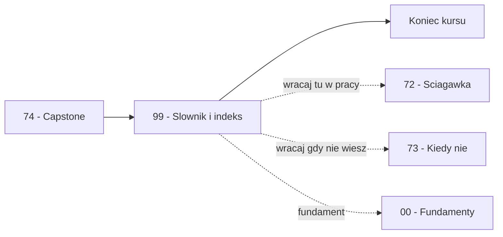

# Moduł 99 — Słownik pojęć i indeks kursu

> **Uwaga o strukturze** — Ten moduł nie stosuje standardowego szkieletu modułów kursu (model mentalny, anatomia, implementacja itd.). Jest **czysto referencyjny** — słownik, indeksy, mapa zależności i checklisty. Wracaj do niego jak do atlasu: otwórz na właściwej sekcji, znajdź odpowiedź, zamknij.

---

## A. Słownik pojęć

> **Jak czytać hasła:** termin polski, w nawiasie termin angielski, definicja w 1–2 zdaniach, odesłanie do modułu (`→ MNN`). Hasła uporządkowano alfabetycznie wg terminu polskiego; przy terminach złożonych wg pierwszej litery najważniejszego słowa.

### A.1 Litery A–C

- **Adapter** (ang. *Adapter*) — wzorzec strukturalny dopasowujący niekompatybilny interfejs jednego obiektu do interfejsu oczekiwanego przez klienta, bez zmiany kodu po obu stronach. → M20
- **Agregacja** (ang. *aggregation*) — słabsza forma kompozycji: obiekt „ma" inne obiekty, ale nie jest ich właścicielem (mogą istnieć niezależnie). W UML oznaczana pustym rombem. → M01
- **Agregat** (ang. *aggregate*) — w DDD zbiór encji i obiektów wartości traktowanych jako jedna spójna całość, z jednym korzeniem i niezmiennikami. → M54
- **ADR (Architecture Decision Record)** — krótki dokument zapisujący jedną decyzję architektoniczną, jej kontekst, alternatywy i konsekwencje. → M65, M71
- **Abstract Factory** (ang. *Abstract Factory*) — wzorzec kreacyjny tworzący rodzinę współpracujących ze sobą produktów bez wskazywania ich konkretnych klas. → M12
- **Active Record** — wzorzec domenowy, w którym obiekt reprezentuje wiersz tabeli i sam wie, jak się zapisać do bazy (`save()`, `delete()`). → M52
- **Anemiczna domena** (ang. *anemic domain model*) — antywzorzec: klasy domenowe mają tylko gettery/settery, a logika biznesowa żyje w serwisach. → M65
- **Antywzorzec** (ang. *anti-pattern*) — powtarzalne rozwiązanie, które początkowo wygląda dobrze, ale prowadzi do problemów; nadużycie wzorca albo zła odpowiedź na dobry problem. → M65
- **API Gateway** — wzorzec architektoniczny: jedno wejście do wielu mikroserwisów, obsługujące routing, autoryzację i limity tempa. → M63
- **Asynchroniczność** (ang. *asynchroniczność*, *async/await*) — model współbieżności, w którym operacje I/O są zawieszane i wznawiane bez blokowania wątku; korutyny Pythona. → M02, M63

### A.2 Litery B–C

- **Backend for Frontend (BFF)** — wzorzec architektoniczny: osobny backend dostosowany do konkretnego typu klienta (web, mobile), żeby różne interfejsy nie wymuszały kompromisów na wspólnym API. → M63
- **Big Rewrite** — antywzorzec migracyjny: przepisywanie systemu od zera, statystycznie najczęściej kończące się niepowodzeniem. → M65
- **Big Ball of Mud** — antywzorzec strukturalny: brak jakiejkolwiek struktury — „wszystko zależy od wszystkiego". → M65
- **Blackboard** — wzorzec architektoniczny, w którym niezależne źródła wiedzy współpracują przez wspólną strukturę danych, sterowane stanem tablicy. → M64
- **Bounded Context** — w DDD wyraźna granica kontekstu, w obrębie której konkretny model domenowy obowiązuje; ta sama nazwa może znaczyć różne rzeczy w różnych kontekstach. → M54, M63
- **Bridge (Most)** — wzorzec strukturalny rozdzielający abstrakcję od implementacji, pozwalający obu rozwijać się niezależnie. → M21
- **Builder** — wzorzec kreacyjny oddzielający proces tworzenia złożonego obiektu od jego reprezentacji; klient konfiguruje krok po kroku. → M13
- **Chain of Responsibility** — wzorzec behawioralny przekazujący żądanie wzdłuż łańcucha kandydatów, aż któryś je obsłuży. → M30
- **Characterization test** (test charakteryzujący) — test utrwalający obecne zachowanie kodu (włącznie z błędami), używany przed refaktoryzacją. → M70, M71
- **Circuit Breaker** — wzorzec architektoniczny: przerwanie wywołań do niedziałającej usługi, żeby nie pogłębiać awarii; stany: zamknięty, otwarty, półotwarty. → M63
- **Clean Architecture** — wzorzec architektoniczny: warstwy koncentryczne z regułą zależności skierowaną do środka (do domeny). → M61
- **Code smell** (zapach kodu) — symptomatyczna struktura w kodzie sugerująca, że coś jest do poprawy; nie błąd, ale sygnał. → M03
- **Cohesion (spójność)** — stopień, w jakim elementy jednej klasy lub modułu odnoszą się do jednego zadania; wysoka jest pożądana. → M03
- **Command** — wzorzec behawioralny hermetyzujący żądanie jako obiekt, umożliwiający kolejkowanie, cofanie, opóźnianie i logowanie operacji. → M31
- **Composite** — wzorzec strukturalny pozwalający traktować pojedynczy obiekt (liść) i grupę obiektów (złożenie) jednolicie. → M22
- **Composition Root** — jedyne miejsce w aplikacji, gdzie tworzy się konkrety i łączy w graf zależności. → M53, M61, M71
- **Contract test** (test kontraktu) — zestaw testów parametryzowany po implementacjach portu, sprawdzający, że wszystkie zachowują się zgodnie z kontraktem. → M70
- **Coupling (sprzężenie)** — stopień, w jakim zmiana w jednym elemencie wymusza zmiany w innych; niskie jest pożądane. → M03
- **CQRS** — wzorzec architektoniczny rozdzielający model zapisu od modelu odczytu. → M62

### A.3 Litery D–E

- **Data Mapper** — wzorzec domenowy oddzielający obiekty domenowe od warstwy trwałości; mapper tłumaczy dane w obie strony. → M52
- **Dead Letter Queue (DLQ)** — wzorzec architektoniczny: kolejka na wiadomości niemożliwe do przetworzenia; zapobiega blokowaniu kolejki głównej. → M63
- **Decorator** — wzorzec strukturalny dodający obiektowi odpowiedzialność bez dziedziczenia; w Pythonie również składnia `@dekorator` dla funkcji. → M23
- **Delegacja** (ang. *delegation*) — przekazanie wywołania innemu obiektowi; technika, na której opiera się większość wzorców strukturalnych. → M01, M20
- **Dependency Injection (DI)** — technika przekazywania zależności z zewnątrz, czyniąca je jawnymi w sygnaturze konstruktora lub funkcji. → M53
- **Dependency Inversion Principle (DIP)** — zasada SOLID: moduły wyższego poziomu nie powinny zależeć od niższego; oba powinny zależeć od abstrakcji zdefiniowanych po stronie klienta. → M03
- **Deskryptor** (ang. *descriptor*) — obiekt implementujący `__get__`, `__set__` lub `__delete__`, umieszczony jako atrybut klasy; przechwytuje dostęp do atrybutu. → M02
- **Domain Event** (zdarzenie domenowe) — fakt domenowy, który już się zdarzył, wyrażony jako niemutowalny obiekt (`OrderPlaced`). → M54
- **DTO (Data Transfer Object)** — obiekt przenoszący dane między warstwami bez logiki biznesowej. → M51
- **Duck typing** (kacze typowanie) — sprawdzanie przydatności obiektu po jego zachowaniu, a nie po zadeklarowanym typie. → M01
- **Dług techniczny** (ang. *technical debt*) — metafora kosztu, który ponosisz w przyszłości za szybkie rozwiązania dziś; rodzaje: świadomy/nieświadomy, roztropny/nieroztropny. → M65
- **Dummy** — test double bez logiki; wypełnia argument, którego test nie używa. → M70
- **Dunder** (ang. *dunder method*, *special method*) — metoda o nazwie otoczonej podwójnym podkreśleniem, wywoływana przez interpreter w określonych sytuacjach (`__init__`, `__call__`). → M01, M02
- **Encja** (ang. *entity*) — obiekt domenowy definiowany przez tożsamość (ID), którego cechy mogą się zmieniać w czasie. → M54
- **Enkapsulacja** (ang. *encapsulation*) — ukrywanie wewnętrznej implementacji obiektu za publicznym API. → M01
- **Enum** (ang. *enumeration*) — typ reprezentujący zamknięty zbiór nazwanych wartości; w Pythonie `enum.Enum`, `IntEnum`, `StrEnum`. → M01, M37
- **Event Sourcing** — wzorzec architektoniczny: stan jest pochodną strumienia zdarzeń; nie zapisujesz stanu, tylko zdarzenia, z których można go odtworzyć. → M62
- **Eventual consistency (spójność ostateczna)** — model spójności rozproszonej, w którym dane zbiegają się do spójnego stanu z opóźnieniem; nie natychmiast. → M62
- **ExitStack** — narzędzie `contextlib` do zarządzania zmienną liczbą context managerów; przydatne przy transakcjach złożonych. → M02

### A.4 Litery F–G

- **Facade (Fasada)** — wzorzec strukturalny dostarczający uproszczony, jednolity interfejs do złożonego podsystemu. → M24
- **Factory Method (metoda wytwórcza)** — wzorzec kreacyjny: podklasa lub funkcja wytwórcza decyduje, którą klasę produktu utworzyć, a klient nie zna konkretu. → M11
- **FAKE** — test double z pełną, uproszczoną implementacją w pamięci; zachowuje się jak prawdziwa. Preferowany nad mockiem. → M70
- **First-class function** (funkcja pierwszej klasy) — funkcja, którą można traktować jak każdą inną wartość: przekazać, przypisać, zwrócić. → M02
- **Flyweight (Pyłek)** — wzorzec strukturalny współdzielący stan wewnętrzny (niezmienny) między wieloma obiektami, żeby oszczędzić pamięć. → M25
- **Funkcja wyższego rzędu** (ang. *higher-order function*) — funkcja przyjmująca inną funkcję jako argument albo zwracająca funkcję. → M02, M39
- **GIL (Global Interpreter Lock)** — globalna blokada interpretera CPython pozwalająca na wykonanie tylko jednego wątku na raz w Pythonie; wpływa na wzorce współbieżne. → M10, M15
- **Generator** (ang. *generator*) — funkcja zawierająca `yield`, produkująca kolejne wartości leniwie; jednorazowy iterator realizowany przez interpreter. → M02, M33
- **Golden Hammer** — antywzorzec: jeden ulubiony wzorzec stosowany do każdego problemu. → M65
- **GRASP** — zbiór dziewięciu heurystyk rozdziału odpowiedzialności (Information Expert, Creator, Controller, Low Coupling, High Cohesion, Polymorphism, Pure Fabrication, Indirection, Protected Variations). → M03
- **Greenfield** — projekt nowy, bez istniejącego kodu; przeciwieństwo *brownfield*. → M60

### A.5 Litery H–L

- **Hexagonal Architecture (Ports & Adapters)** — wzorzec architektoniczny: domena w centrum, porty (interfejsy) i adaptery (implementacje) na brzegach; zależności skierowane do środka. → M61
- **Hook (metoda-hook)** — metoda w klasie bazowej z domyślną implementacją, którą podklasy *mogą* nadpisać; element Template Method. → M39
- **Idempotencja** (ang. *idempotency*) — właściwość operacji, której wielokrotne wykonanie daje ten sam efekt co jednokrotne; kluczowa dla retry i konsumentów zdarzeń. → M62, M63
- **Idempotent Consumer** — wzorzec architektoniczny: konsument odporny na duplikaty zdarzeń; używa klucza idempotencji. → M63
- **Indirection (GRASP)** — heurystyka: wstawienie pośrednika, żeby osłabić sprzężenie. → M03
- **Information Expert (GRASP)** — heurystyka: metodę umieść tam, gdzie są dane potrzebne do jej wykonania. → M03
- **Interpreter** — wzorzec behawioralny: reprezentacja gramatyki języka i interpreter ewaluujący zdania. → M32
- **Iterator** — wzorzec behawioralny: sekwencyjny dostęp do elementów kolekcji bez ujawniania jej struktury; w Pythonie wbudowany w `for`. → M33
- **Iterable** — obiekt, po którym można iterować (ma metodę `__iter__`); nie mylić z *iteratorem* (jednorazowym). → M33
- **Kompozycja** (ang. *composition*) — relacja „ma"; obiekt przechowuje referencję do innego obiektu i deleguje mu część pracy; silniejsza niż agregacja. → M01
- **Konwencja nazewnictwa klas** — w Pythonie `PascalCase` dla klas, `snake_case` dla funkcji i zmiennych, `UPPER_CASE` dla stałych. → M01
- **Korutyna** (ang. *coroutine*) — funkcja `async def`, którą można zawieszać i wznawiać; fundament `asyncio`. → M02, M63
- **Kohezja** — patrz *Cohesion*. → M03
- **Krucha klasa bazowa** (ang. *fragile base class problem*) — problem, gdy zmiana w klasie bazowej powoduje kaskadę problemów w podklasach; argument przeciw dziedziczeniu. → M39
- **Law of Demeter (prawo Demeter)** — zasada: obiekt powinien rozmawiać tylko z bezpośrednimi znajomymi, nie z „znajomymi znajomych". → M03
- **Lazy initialization (leniwa inicjalizacja)** — technika odkładania kosztu utworzenia obiektu do pierwszego użycia. → M15

### A.6 Litery M–O

- **Mediator** — wzorzec behawioralny centralizujący komunikację między wieloma obiektami, eliminując bezpośrednie zależności N×N. → M34
- **Memento (Pamiątka)** — wzorzec behawioralny zapisujący i przywracający stan obiektu bez łamania hermetyzacji. → M35
- **Metaklasa** (ang. *metaclass*) — klasa, której instancjami są klasy; kontroluje proces tworzenia klasy. Narzędzie rzadko potrzebne. → M02
- **Metoda abstrakcyjna** (ang. *abstractmethod*) — metoda zadeklarowana bez implementacji, którą podklasy muszą zaimplementować; `abc.abstractmethod`. → M01, M02
- **Metoda specjalna** — patrz *Dunder*. → M01
- **Mock** — test double weryfikujący przebieg interakcji (argumenty, kolejność, liczba wywołań). Używać świadomie — kruchy przy refaktoryzacji. → M70
- **MRO (Method Resolution Order)** — kolejność, w jakiej Python przeszukuje klasy w poszukiwaniu metody; wyliczana algorytmem C3 linearization. → M01
- **Monolit modułowy** (ang. *modular monolith*) — system jako jeden proces, ale z jasno rozdzielonymi modułami; zalecany pierwszy krok przed mikroserwisami. → M63, M65
- **Most** — patrz *Bridge*. → M21
- **Null Object** — wzorzec behawioralny: obiekt reprezentujący brak z neutralnym zachowaniem, eliminujący warunki `if x is not None`. → M41
- **Niemutowalność** (ang. *immutability*) — właściwość obiektu, którego stan nie może się zmienić po utworzeniu; `dataclass(frozen=True)`. → M01, M14
- **Object Pool (Pula obiektów)** — wzorzec kreacyjny recyklingujący kosztowne zasoby (połączenia, wątki) zamiast tworzyć je za każdym razem. → M15
- **Observer** — wzorzec behawioralny: subjekt powiadamia wielu obserwatorów o zmianie stanu. → M36
- **Onion Architecture** — wzorzec architektoniczny pokrewny Clean/Hexagonal: warstwy koncentryczne z domeną w środku. → M61
- **Open/Closed Principle (OCP)** — zasada SOLID: moduł powinien być otwarty na rozszerzenia, zamknięty na modyfikacje; realizowany przez abstrakcję. → M03
- **Outbox (Transactional Outbox)** — wzorzec architektoniczny rozwiązujący problem podwójnego zapisu: atomowy zapis danych i zdarzenia do tabeli outbox. → M63

### A.7 Litery P–R

- **Pipes and Filters** — wzorzec architektoniczny: przetwarzanie przez sekwencję niezależnych etapów połączonych kanałami. → M64
- **Płytka kopia** (ang. *shallow copy*) — kopia tworząca nowy obiekt najwyższego poziomu, ale współdzieląca obiekty zagnieżdżone; `copy.copy`. → M14
- **Port** (ang. *port*) — interfejs w domenie opisujący oczekiwanie wobec świata zewnętrznego (`Protocol`/`ABC`); fundament architektury heksagonalnej. → M61
- **Polimorfizm** — właściwość języka pozwalająca na wywoływanie tej samej metody na obiektach różnych typów, działającą odpowiednio do typu. → M01
- **Post-order** — przejście drzewa: najpierw dzieci, potem korzeń; naturalne dla agregacji. → M22
- **Pre-order** — przejście drzewa: najpierw korzeń, potem dzieci. → M22
- **Premature abstraction (przedwczesna abstrakcja)** — antywzorzec: abstrakcja utworzona przy pierwszej implementacji, prawie zawsze abstrahuje nie to, co trzeba. → M73
- **Premature optimization (przedwczesna optymalizacja)** — antywzorzec: optymalizacja bez pomiaru; „premature optimization is the root of all evil" (Knuth). → M25, M65
- **Property-based testing** — technika testowania generująca przypadki (zwykle przez `hypothesis`) i weryfikująca niezmienniki. → M70
- **Protokół strukturalny** (ang. *structural protocol*) — kontrakt opisany przez kształt (obecność metod i atrybutów), a nie przez dziedziczenie; w Pythonie `typing.Protocol`. → M01, M02
- **Prototype** — wzorzec kreacyjny: tworzenie nowych obiektów przez kopiowanie istniejących. → M14
- **Proxy (Pełnomocnik)** — wzorzec strukturalny: zastępca kontrolujący dostęp do obiektu (leniwe ładowanie, uprawnienia, cache). → M26
- **Pure Fabrication (GRASP)** — heurystyka: gdy nie ma naturalnego kandydata na odpowiedzialność, stwórz sztuczny byt (np. Repozytorium). → M03
- **Redo** — operacja przywracająca działanie cofniętego polecenia. → M31
- **Repository (Repozytorium)** — wzorzec domenowy: pośrednik między domeną a mapowaniem danych; udaje kolekcję obiektów. → M50
- **Refaktoryzacja wstecz** (ang. *de-abstraction*) — usunięcie abstrakcji, która przestała się opłacać; zamiana klas na funkcje. → M73
- **Refaktoryzacja** (ang. *refactoring*) — zmiana struktury kodu bez zmiany zachowania, w małych krokach z testami. → M71

### A.8 Litery S

- **Saga** — wzorzec architektoniczny: transakcja rozproszona realizowana jako sekwencja kroków z akcjami kompensującymi. → M63
- **Service Layer** — wzorzec aplikacyjny: warstwa orkiestrująca przypadki użycia, oddzielająca domenę od interfejsów. → M51
- **Service Locator** — antywzorzec: globalny kontener, z którego dowolnie pobiera się zależności; ukrywa zależności i utrudnia testowanie. → M53, M65
- **Shallow copy** — patrz *Płytka kopia*. → M14
- **Shotgun Surgery** — antywzorzec modyfikacji: jedna zmiana wymaga zmian w wielu plikach. → M65
- **Simple Factory** — potocznie: fabryka realizowana funkcją ze słownikiem, bez hierarchii klas; nie jest formalnym wzorcem GoF. → M11
- **Singleton** — wzorzec kreacyjny: dokładnie jedna instancja klasy w obrębie procesu i globalny punkt dostępu. → M10
- **Slots** (ang. `__slots__`) — mechanizm Pythona pozwalający zdefiniować zamknięty zbiór atrybutów instancji; mniejsze zużycie pamięci, brak `__dict__`. → M01, M25
- **Spójność ostateczna** — patrz *Eventual consistency*. → M62
- **Sprzężenie** — patrz *Coupling*. → M03
- **Spy** — test double rejestrujący wywołania, delegujący do prawdziwej implementacji. → M70
- **Singleton w kontenerze DI** — zarejestrowanie typu jako singleton w kontenerze; jedna instancja na kontener. → M53
- **State (Stan)** — wzorzec behawioralny: obiekt zmienia zachowanie wraz ze zmianą stanu wewnętrznego. → M37
- **Strategy (Strategia)** — wzorzec behawioralny: rodzina wymiennych algorytmów wybieranych w runtime. → M38
- **Specification** — wzorzec domenowy: reguła biznesowa jako obiekt-predykat, który można łączyć operatorami `and`, `or`, `not`. → M54
- **Stub** — test double zwracający ustalone odpowiedzi na konkretne pytania. → M70
- **super()** — odwołanie do następnego elementu MRO bieżącej instancji; mechanizm współpracy w hierarchiach. → M01
- **SOLID** — akronim pięciu zasad: SRP, OCP, LSP, ISP, DIP. → M03
- **SRP (Single Responsibility Principle)** — zasada: klasa powinna mieć jeden powód do zmiany; jeden obszar zmiany, jedna grupa interesariuszy. → M03
- **State machine (maszyna stanów)** — model procesu z określonymi stanami, zdarzeniami i dozwolonymi przejściami. → M37
- **Saga choreografia** — wariant Sagi, w którym usługi wymieniają zdarzenia bez centralnego orkiestratora. → M63
- **Stateless** — obiekt bez stanu mutowalnego; zwykle bezpieczny wątkowo. → M10, M15

### A.9 Litery T–Z

- **Template Method** — wzorzec behawioralny: szkielety algorytmu z lukami wypełnianymi przez podklasy. → M39
- **Test double** — ogólna nazwa obiektu zastępującego prawdziwą zależność w testach (dummy, stub, spy, mock, fake). → M70
- **Test Pyramid (piramida testów)** — proporcja testów: wiele szybkich jednostkowych, mniej integracyjnych, najmniej e2e. → M70
- **Test kontraktu** — patrz *Contract test*. → M70
- **Transient** — cykl życia zależności: nowa instancja przy każdym rozwiązaniu z kontenera DI. → M53
- **Type hint (adnotacja typu)** — adnotacja typu w sygnaturze funkcji lub atrybutu; w Pythonie `PEP 484`. → M01, M02
- **UoW (Unit of Work)** — wzorzec domenowy: grupuje zmiany i zapisuje je w jednej transakcji. → M50
- **Ubiquitous language (język wszechobecny)** — spójny zbiór nazw używanych zarówno w biznesie, jak i w kodzie. → M54
- **Value Object (obiekt wartości)** — obiekt bez tożsamości, definiowany przez wartości; niemutowalny. → M54
- **Visitor (Odwiedzający)** — wzorzec behawioralny: dodawanie operacji do struktury bez zmiany klas elementów; wymaga double dispatch. → M40
- **Virtual Proxy** — wariant Proxy: leniwe tworzenie kosztownego obiektu przy pierwszym dostępie. → M26
- **Weakref (słabe referencje)** — mechanizm Pythona pozwalający trzymać referencję, która nie zapobiega usunięciu obiektu; kluczowy dla Observera bez wycieków. → M36
- **Wizard** — potoczna nazwa wieloetapowego UI; w kodzie często realizowany przez State. → M37
- **Wzorzec kreacyjny** (ang. *creational pattern*) — rodzina wzorców opisujących sposób i moment tworzenia obiektów. → M10–M15
- **Wzorzec strukturalny** (ang. *structural pattern*) — rodzina wzorców opisujących składanie obiektów w większe całości. → M20–M26
- **Wzorzec behawioralny** (ang. *behavioral pattern*) — rodzina wzorców opisujących komunikację i podział odpowiedzialności. → M30–M41
- **Wzorzec architektoniczny** (ang. *architectural pattern*) — rodzina wzorców opisujących układ całego systemu. → M60–M65
- **Wzorzec domenowy** (ang. *domain pattern*) — wzorce z Części IV, dotyczące modelu domeny (Repository, Value Object). → M50–M54
- **YAGNI (You Aren't Gonna Need It)** — zasada: nie buduj funkcjonalności ani abstrakcji na spekulację. → M03, M73
- **YAML** — format tekstowy konfiguracji i danych; alternatywa dla kodu dla DSL. → M32
- **Zapach kodu** — patrz *Code smell*. → M03
- **Zdarzenie domenowe** — patrz *Domain Event*. → M54
- **Zdarzenie integracyjne** — zdarzenie wysyłane na zewnątrz systemu; stabilne, wersjonowane, zwykle cieńsze niż zdarzenia domenowe. → M62

### A.10 Dodatkowe terminy uzupełniające

- **ABC (Abstract Base Class)** — klasa abstrakcyjna w Pythonie (`abc.ABC`); wymusza implementację metod abstrakcyjnych. → M01
- **Abstract Syntax Tree (AST)** — drzewo składniowe wyrażenia; fundament analizy i ewaluacji w interpreterze. → M32
- **Agile refactoring** — refaktoryzacja w małych krokach, wplecona w codzienną pracę, zamiast osobnego „projektu porządkowego". → M71
- **Bounded context** — patrz *Bounded Context*. → M63
- **Brownfield** — projekt z istniejącym kodem; przeciwieństwo *greenfield*. → M71
- **Cache invalidation (unieważnianie cache)** — mechanizm usunięcia lub oznaczenia danych w cache po ich zmianie. → M26
- **Cache proxy** — wariant Proxy: buforowanie wyników kosztownych operacji. → M26
- **Choreography vs Orchestration** — dwa style komunikacji rozproszonej: bez centrum vs z centrum. → M63
- **Code review** — przegląd kodu przez drugą osobę; w kontekście wzorców: weryfikacja, czy wzorzec jest uzasadniony. → M72
- **Dependency injection container** — kontener DI: rejestracja fabryk i rozwiązywanie zależności. → M53
- **Deskryptor niestandardowy** — klasy implementujące protokół `__get__`/`__set__`; zaawansowane narzędzie, rzadko potrzebne. → M02
- **Distributed monolith** — antywzorzec: mikroserwisy bez niezależności (wspólna baza, wspólny deployment). → M65
- **Domain event publishing** — publikacja zdarzeń domenowych: wewnątrz procesu (Observer) albo przez kolejkę (Outbox). → M54, M62
- **DSL (Domain-Specific Language)** — język specyficzny dla domeny; jeden z zastosowań wzorca Interpreter. → M32
- **Empty object pattern** — inna nazwa *Null Object*. → M41
- **Fail fast** — strategia obsługi błędów, w której błąd sygnalizowany jest natychmiast, a nie po cichu. → M51
- **First-class citizen** — element języka, który można traktować jak każdą inną wartość. → M02
- **Fluent interface** — API, w którym metody zwracają `self`, pozwalając na łańcuch wywołań. → M13
- **Funkcja czysta** (ang. *pure function*) — funkcja bez efektów ubocznych; łatwa do testowania i komponowania. → M38
- **Garther pattern** — patrz *Repository*. → M50
- **Graf zależności** — skierowany graf pokazujący, kto od kogo zależy; wykrywanie cykli, rozwiązywanie kolejności. → M53
- **Green tests (zielone testy)** — stan wszystkich testów przechodzących; warunek kontynuacji refaktoryzacji. → M71
- **Hashable** — obiekt, który można umieścić w zbiorze lub jako klucz słownika (ma `__hash__` i `__eq__`). → M01
- **Horizontal scaling** — skalowanie przez dodawanie instancji; pionierskie (vertical) przez zwiększanie zasobów. → M63
- **Idempotent operation** — operacja dająca ten sam efekt niezależnie od liczby wykonań; fundament retry. → M63
- **Immutability** — patrz *Niemutowalność*. → M14
- **Interface Segregation Principle (ISP)** — zasada SOLID: klient nie powinien być zmuszany do zależności od metod, których nie używa. → M03
- **Liskov Substitution Principle (LSP)** — zasada SOLID: podtyp musi być podstawialny za nadtyp bez zmiany poprawności programu. → M03
- **Message broker** — infrastruktura pośrednicząca w wymianie wiadomości (RabbitMQ, Kafka, NATS). → M62
- **Middleware** — łańcuch funkcji przetwarzających żądanie w warstwie HTTP; realizacja Chain of Responsibility. → M30
- **Mutowalny** (ang. *mutable*) — obiekt, którego stan można zmienić po utworzeniu. → M01
- **Niezmiennik** (ang. *invariant*) — warunek, który musi być zawsze prawdziwy dla obiektu (np. saldo ≥ 0). → M54
- **Open/Closed** — patrz *OCP*. → M03
- **Ports & Adaptors** — patrz *Hexagonal Architecture*. → M61
- **Post-mortem** — analiza po zakończeniu projektu/awarii; element kultury uczenia się. → M65
- **Programowanie do interfejsu** — programowanie wobec kontraktu, nie wobec klasy konkretnej. → M01
- **Public API** — publiczny interfejs pakietu/modułu; eksponowany przez `__all__` w `__init__.py`. → M01
- **Rate limiting** — ograniczanie tempa żądań; realizowane middleware lub proxy. → M63
- **Retry** — ponowienie operacji po błędzie; powinien być z backoffem i jitterem. → M63
- **Scoped (lifetime)** — cykl życia zależności: jedna instancja na „scope” (np. per request). → M53
- **Service layer** — patrz *Service Layer*. → M51
- **Saga orkiestrowana** — wariant Sagi z centralnym orkiestratorem. → M63
- **Spójność (cohesion)** — patrz *Cohesion*. → M03
- **Statyczna analiza** — analiza kodu bez uruchamiania (`mypy`, `ruff`, `pyright`). → M01
- **Temporal coupling** — sprzężenie czasowe: A musi być wywołane przed B; ukryte w kodzie. → M65
- **Time-to-change** — metryka: ile czasu zajmuje typowa zmiana; kluczowa dla oceny architektury. → M71
- **Ubiquitous language** — patrz *Język wszechobecny*. → M54
- **Value object** — patrz *Value Object*. → M54
- **Vendor lock-in** — uzależnienie od dostawcy (np. konkretnej chmury); przeciwdziałanie przez porty i adaptery. → M12, M63
- **WeakValueDictionary** — słownik ze słabymi referencjami na wartości; kluczowy dla cache bez wycieków. → M36
- **Yield from** — składnia Pythona delegująca do innego generatora; przydatna w rekurencyjnym przechodzeniu drzewa. → M22

---

## B. Alfabetyczny indeks wzorców z odesłaniami

> Pełny indeks **wszystkich wzorców** omówionych w kursie, alfabetycznie. Kolumny: wzorzec, kategoria, moduł, plik, poziom. Poziomy: 🟢 podstawowy, 🟡 średni, 🔴 zaawansowany.

| Wzorzec | Kategoria | Moduł | Plik | Poziom |
|---|---|---|---|---|
| Abstract Factory | Kreacyjny | 12 | `12-abstract-factory.md` | 🟡 |
| Active Record | Domenowy | 52 | `52-active-record-vs-data-mapper.md` | 🟡 |
| Adapter | Strukturalny | 20 | `20-adapter-i-wprowadzenie-do-strukturalnych.md` | 🟢 |
| API Gateway | Architektoniczny | 63 | `63-wzorce-mikroserwisow.md` | 🔴 |
| Assembler / Mapper | Aplikacyjny | 51 | `51-service-layer-dto-assembler.md` | 🟡 |
| Backend for Frontend | Architektoniczny | 63 | `63-wzorce-mikroserwisow.md` | 🔴 |
| Blackboard | Architektoniczny | 64 | `64-pipes-filters-plugins-blackboard.md` | 🟡 |
| Bridge (Most) | Strukturalny | 21 | `21-bridge.md` | 🟡 |
| Builder | Kreacyjny | 13 | `13-builder.md` | 🟡 |
| Chain of Responsibility | Behawioralny | 30 | `30-chain-of-responsibility-i-wprowadzenie-behawioralne.md` | 🟡 |
| Circuit Breaker | Architektoniczny | 63 | `63-wzorce-mikroserwisow.md` | 🔴 |
| Clean Architecture | Architektoniczny | 61 | `61-hexagonal-clean-onion.md` | 🔴 |
| Command | Behawioralny | 31 | `31-command.md` | 🟡 |
| Composite | Strukturalny | 22 | `22-composite.md` | 🟡 |
| CQRS | Architektoniczny | 62 | `62-event-driven-cqrs-event-sourcing.md` | 🔴 |
| Data Mapper | Domenowy | 52 | `52-active-record-vs-data-mapper.md` | 🟡 |
| Dead Letter Queue | Architektoniczny | 63 | `63-wzorce-mikroserwisow.md` | 🔴 |
| Decorator | Strukturalny | 23 | `23-decorator.md` | 🟢 |
| Dependency Injection | Aplikacyjny | 53 | `53-dependency-injection-i-ioc.md` | 🟡 |
| Domain Event | Domenowy | 54 | `54-wzorce-domenowe-specification-value-object.md` | 🔴 |
| DTO | Aplikacyjny | 51 | `51-service-layer-dto-assembler.md` | 🟡 |
| Event Sourcing | Architektoniczny | 62 | `62-event-driven-cqrs-event-sourcing.md` | 🔴 |
| Event-Driven Architecture | Architektoniczny | 62 | `62-event-driven-cqrs-event-sourcing.md` | 🔴 |
| Facade (Fasada) | Strukturalny | 24 | `24-facade.md` | 🟢 |
| Factory Method | Kreacyjny | 11 | `11-factory-method.md` | 🟢 |
| Flyweight (Pyłek) | Strukturalny | 25 | `25-flyweight.md` | 🔴 |
| Hexagonal Architecture | Architektoniczny | 61 | `61-hexagonal-clean-onion.md` | 🔴 |
| Idempotent Consumer | Architektoniczny | 63 | `63-wzorce-mikroserwisow.md` | 🔴 |
| Interpreter | Behawioralny | 32 | `32-interpreter.md` | 🔴 |
| Iterator | Behawioralny | 33 | `33-iterator.md` | 🟢 |
| Lazy Initialization | Idiom | 15 | `15-object-pool-i-di-lite.md` | 🟡 |
| Mediator | Behawioralny | 34 | `34-mediator.md` | 🔴 |
| Memento | Behawioralny | 35 | `35-memento.md` | 🟡 |
| MVC / MVP / MVVM | Architektoniczny | 60 | `60-architektura-warstwowa-mvc-mvvm.md` | 🟡 |
| Null Object | Behawioralny | 41 | `41-null-object-i-wybor-behawioralnych.md` | 🟡 |
| Object Pool | Kreacyjny | 15 | `15-object-pool-i-di-lite.md` | 🟡 |
| Observer | Behawioralny | 36 | `36-observer.md` | 🟡 |
| Onion Architecture | Architektoniczny | 61 | `61-hexagonal-clean-onion.md` | 🔴 |
| Outbox | Architektoniczny | 63 | `63-wzorce-mikroserwisow.md` | 🔴 |
| Pipes and Filters | Architektoniczny | 64 | `64-pipes-filters-plugins-blackboard.md` | 🟡 |
| Plugin Architecture | Architektoniczny | 64 | `64-pipes-filters-plugins-blackboard.md` | 🟡 |
| Prototype | Kreacyjny | 14 | `14-prototype.md` | 🟡 |
| Proxy (Pełnomocnik) | Strukturalny | 26 | `26-proxy.md` | 🔴 |
| Repository | Domenowy | 50 | `50-repository-i-unit-of-work.md` | 🟡 |
| Saga | Architektoniczny | 63 | `63-wzorce-mikroserwisow.md` | 🔴 |
| Service Layer | Aplikacyjny | 51 | `51-service-layer-dto-assembler.md` | 🟡 |
| Singleton | Kreacyjny | 10 | `10-singleton-i-wprowadzenie-do-kreacyjnych.md` | 🟢 |
| Specification | Domenowy | 54 | `54-wzorce-domenowe-specification-value-object.md` | 🔴 |
| State | Behawioralny | 37 | `37-state.md` | 🟡 |
| Strategy | Behawioralny | 38 | `38-strategy.md` | 🟢 |
| Template Method | Behawioralny | 39 | `39-template-method.md` | 🟢 |
| Unit of Work | Domenowy | 50 | `50-repository-i-unit-of-work.md` | 🟡 |
| Value Object | Domenowy | 54 | `54-wzorce-domenowe-specification-value-object.md` | 🔴 |
| Visitor | Behawioralny | 40 | `40-visitor.md` | 🔴 |
| Warstwowa (Layered) | Architektoniczny | 60 | `60-architektura-warstwowa-mvc-mvvm.md` | 🟡 |

### B.1 Antywzorce — indeks

| Antywzorzec | Moduł | Plik |
|---|---|---|
| Bezkrytyczna abstrakcja | 73 | `73-kiedy-nie-uzywac-wzorcow.md` |
| Big Ball of Mud | 65 | `65-antywzorce-i-dlug-architektoniczny.md` |
| Big Rewrite | 65 | `65-antywzorce-i-dlug-architektoniczny.md` |
| Distributed Monolith | 65 | `65-antywzorce-i-dlug-architektoniczny.md` |
| Golden Hammer | 65 | `65-antywzorce-i-dlug-architektoniczny.md` |
| God Object | 65 | `65-antywzorce-i-dlug-architektoniczny.md` |
| Over-abstraction | 73 | `73-kiedy-nie-uzywac-wzorcow.md` |
| Premature Abstraction | 73 | `73-kiedy-nie-uzywac-wzorcow.md` |
| Premature Optimization | 65 | `65-antywzorce-i-dlug-architektoniczny.md` |
| Service Locator | 53, 65 | `53-dependency-injection-i-ioc.md`, `65-antywzorce-i-dlug-architektoniczny.md` |
| Shotgun Surgery | 65 | `65-antywzorce-i-dlug-architektoniczny.md` |
| Anemic Domain Model | 65 | `65-antywzorce-i-dlug-architektoniczny.md` |

---

## C. Indeks problemów (odwrotny indeks)

> **Chcę zrobić X → idź do modułu Y.** Zbiór ponad 50 realnych problemów projektowych z odesłaniem do modułu, który je rozwiązuje.

### C.1 Tworzenie i cykl życia obiektów

| Problem | Moduł |
|---|---|
| Chcę dokładnie jedną instancję w procesie | 10 |
| Mam `Klasa()` rozsiane po kodzie i chcę oddzielić tworzenie od użycia | 11 |
| Muszę tworzyć rodzinę zgodnych usług (AWS/GCP/Azure) | 12 |
| Konstruktor ma 12 argumentów, połowa opcjonalna | 13 |
| Utworzenie obiektu jest kosztowne i chcę powielić konfigurację | 14 |
| Tworzenie połączeń DB/HTTP kosztuje, chcę recykling | 15 |
| Start aplikacji jest zbyt wolny | 15 |
| Potrzebuję złożonego grafu zależności i zarządzania cyklem życia | 53 |

### C.2 Struktura obiektów

| Problem | Moduł |
|---|---|
| Zewnętrzna biblioteka ma inny interfejs niż moja domena | 20 |
| Mam dwie niezależne osie zmienności (typ × format) — eksplozja klas | 21 |
| Struktura drzewiasta (kategorie, uprawnienia, drzewo UI) | 22 |
| Chcę dodać zachowanie bez dziedziczenia | 23 |
| Klient zna labirynt podsystemu i chcę jedno wejście | 24 |
| Miliony drobnych obiektów, brakuje pamięci | 25 |
| Chcę kontrolować dostęp (cache, leniwe, uprawnienia) | 26 |

### C.3 Komunikacja i przepływ sterowania

| Problem | Moduł |
|---|---|
| Żądanie ma przechodzić przez kandydatów (reguły, eskalacja) | 30 |
| Chcę zapisać żądanie, wykonać później, cofnąć (undo) | 31 |
| Potrzebuję własnego mini-języka do wyrażeń | 32 |
| Sekwencyjny dostęp do kolekcji, strumieniowo | 33 |
| Komunikacja wielu-do-wielu między komponentami | 34 |
| Undo/redo, migawka stanu obiektu | 35 |
| Powiadomić wielu o zmianie stanu | 36 |
| Obiekt zmienia zachowanie wg stanu | 37 |
| Wymienny algorytm wybierany w runtime | 38 |
| Stały szkielet algorytmu z lukami | 39 |
| Dodawanie operacji do struktury bez zmiany klas | 40 |
| Opcjonalne zależności, brak rabatu, brak notifiera | 41 |

### C.4 Domena i trwałość

| Problem | Moduł |
|---|---|
| Domena musi być testowalna bez bazy | 50 |
| Transakcyjność kilku operacji | 50 |
| Wiele wejść (API, CLI, kolejka) i chcę jednolity serwis | 51 |
| Wystawić dane na zewnątrz bez wycieku modelu ORM | 51 |
| Konwersja DTO ↔ encja | 51 |
| Prosty CRUD na 3 tabelach — ORM czy Repository? | 52 |
| Składalne reguły biznesowe z możliwością łączenia | 54 |
| Unikanie „prymitywnej obsesji" (pieniądze, waluty, kod pocztowy) | 54 |
| Emitowanie faktów domenowych do wielu odbiorców | 54 |

### C.5 Architektura

| Problem | Moduł |
|---|---|
| Podzielić aplikację na warstwy | 60 |
| Rozdzielić UI od logiki (MVC/MVP/MVVM) | 60 |
| Oddzielić domenę od frameworka, bazy, HTTP | 61 |
| Wprowadzić egzekwowanie granic między modułami | 61 |
| Komunikacja przez zdarzenia między niezależnymi konsumentami | 62 |
| Rozdzielić model zapisu i odczytu (CQRS) | 62 |
| Audyt, podróż w czasie, przebudowa projekcji (Event Sourcing) | 62 |
| Rozproszone transakcje, kompensacja, saga | 63 |
| Atomowy zapis danych i publikacja zdarzenia (podwójny zapis) | 63 |
| Odporne wywołania zewnętrznych usług (retry, circuit breaker) | 63 |
| Sekwencyjne przetwarzanie w potoku (ETL) | 64 |
| Wtyczki zewnętrzne do aplikacji | 64 |
| Współdzielone dane dla niezależnych modułów (Blackboard) | 64 |

### C.6 Migracje i refaktoryzacja

| Problem | Moduł |
|---|---|
| Migracja z monolitu bez „big rewrite" | 65 |
| Wykrywanie cykli zależności między modułami | 65 |
| Rozcięcie dużego modułu | 65 |
| Zmiana schematu bazy bez przestoju (expand/contract) | 65 |
| Zdiagnozowanie długu technicznego | 65 |
| Refaktoryzacja 600-liniowego skryptu | 71 |
| Testy charakteryzujące przed refaktoryzacją | 70, 71 |
| Zamiana abstrakcji na prostą funkcję (de-abstraction) | 73 |

### C.7 Testowanie

| Problem | Moduł |
|---|---|
| Test wymaga bazy/SMTP/HTTP | 70 |
| Testy są wolne (sekundy) | 70 |
| Testy są niestabilne (padają losowo) | 70 |
| Testowanie czasu i stref czasowych | 70 |
| Testowanie integracji z zewnętrznym API | 70 |
| Test kontraktu dla wielu implementacji portu | 70 |
| Testy architektury (granice modułów) | 70 |
| Property-based testing (niezmienniki) | 70 |
| Piramida testów — proporcje | 70 |
| Singleton w testach | 10, 70 |

### C.8 Konkretne problemy biznesowe (wybór)

| Problem | Moduł |
|---|---|
| Onboarding użytkownika w 5 krokach | 30, 31, 63 |
| Rabaty zależne od segmentu klienta | 38, 54 |
| Modal w UI zależny od stanu | 37 |
| Wersjonowanie dokumentu z cofaniem | 31, 35 |
| Zgodność z wieloma bramkami płatniczymi | 12, 20 |
| Wielojęzyczne szablony e-maili | 21, 38 |
| Audyt zmian (kto, kiedy, co) | 31, 36 |
| Walidacja formularza z wieloma regułami | 30, 54 |
| Generowanie raportu w 4 formatach | 21 |
| Kolejka zadań z ponowieniami | 15, 31, 63 |
| Ograniczanie tempa (rate limiting) | 26, 63 |
| Uprawnienia i role (RBAC) | 22, 54 |
| Integracja z 3 systemami ERP | 20, 24, 63 |
| Cache z unieważnianiem | 26, 36 |
| Import danych z wielu źródeł | 20, 30 |
| Retry z backoffem dla zewnętrznego API | 26, 63 |
| Raport regulacyjny z niezmiennością | 54, 62 |

### C.9 Metaproblemy (decyzje, filtry)

| Problem | Moduł |
|---|---|
| Czy używać wzorca? | 72, 73 |
| Który wzorzec wybrać? | 41, 72 |
| Jak nie przesadzić z abstrakcją? | 73 |
| Jak prowadzić refaktoryzację? | 71 |
| Jak projektować testy pod wzorce? | 70 |
| Jak egzekwować granice architektury? | 61, 70 |
| Kiedy refaktoryzować architekturę? | 65 |

---

## D. Mapa zależności modułów

> Pełny graf wymagań między modułami. Trzy ścieżki nauki (junior, mid, senior) wyróżniono przez podgrafy i klasy stylów.

```mermaid
flowchart TD
    M00["00 - Jak myslec o wzorcach"]
    M01["01 - Python pod wzorce"]
    M02["02 - Narzedzia Pythona"]
    M03["03 - SOLID i zasady"]
    M00 --> M01 --> M02 --> M03

    subgraph GRP_JUNIOR["Sciezka juniora"]
        J10["10 - Singleton"]
        J11["11 - Factory Method"]
        J20["20 - Adapter"]
        J23["23 - Decorator"]
        J24["24 - Facade"]
        J33["33 - Iterator"]
        J38["38 - Strategy"]
        J39["39 - Template Method"]
        J70["70 - Wzorce a testy"]
        J72["72 - Sciagawka"]
    end

    subgraph GRP_I["Czesc I - Kreacyjne"]
        M10["10 - Singleton"]
        M11["11 - Factory Method"]
        M12["12 - Abstract Factory"]
        M13["13 - Builder"]
        M14["14 - Prototype"]
        M15["15 - Object Pool i DI-lite"]
    end

    subgraph GRP_II["Czesc II - Strukturalne"]
        M20["20 - Adapter"]
        M21["21 - Bridge"]
        M22["22 - Composite"]
        M23["23 - Decorator"]
        M24["24 - Facade"]
        M25["25 - Flyweight"]
        M26["26 - Proxy"]
    end

    subgraph GRP_III["Czesc III - Behawioralne"]
        M30["30 - Chain of Responsibility"]
        M31["31 - Command"]
        M32["32 - Interpreter"]
        M33["33 - Iterator"]
        M34["34 - Mediator"]
        M35["35 - Memento"]
        M36["36 - Observer"]
        M37["37 - State"]
        M38["38 - Strategy"]
        M39["39 - Template Method"]
        M40["40 - Visitor"]
        M41["41 - Null Object i wybor"]
    end

    subgraph GRP_IV["Czesc IV - Aplikacyjne i domenowe"]
        M50["50 - Repository i UoW"]
        M51["51 - Service Layer, DTO, Assembler"]
        M52["52 - Active Record vs Data Mapper"]
        M53["53 - Dependency Injection"]
        M54["54 - Specification, VO, Domain Events"]
    end

    subgraph GRP_V["Czesc V - Architektoniczne"]
        M60["60 - Warstwy, MVC/MVVM"]
        M61["61 - Hexagonal, Clean, Onion"]
        M62["62 - Event-Driven, CQRS, ES"]
        M63["63 - Wzorce mikroserwisow"]
        M64["64 - Pipes and Filters, Plugins, Blackboard"]
        M65["65 - Antywzorce i dlug"]
    end

    subgraph GRP_VI["Czesc VI - Praktyka"]
        M70["70 - Wzorce a testy"]
        M71["71 - Case study: refaktoryzacja"]
        M72["72 - Sciagawka i tabela decyzyjna"]
        M73["73 - Kiedy NIE uzywac"]
        M74["74 - Capstone"]
    end

    M99["99 - Slownik i indeks"]

    M03 --> M10
    M10 --> M11 --> M12 --> M13 --> M14 --> M15
    M15 --> M20
    M20 --> M21 --> M22 --> M23 --> M24 --> M25 --> M26
    M26 --> M30
    M30 --> M31 --> M32 --> M33 --> M34 --> M35 --> M36 --> M37 --> M38 --> M39 --> M40 --> M41
    M41 --> M50
    M50 --> M51 --> M52 --> M53 --> M54
    M54 --> M60
    M60 --> M61 --> M62 --> M63 --> M64 --> M65
    M65 --> M70
    M70 --> M71 --> M72 --> M73 --> M74
    M74 --> M99

    classDef junior fill:#e8f5e9,stroke:#2e7d32,stroke-width:2px;
    classDef mid fill:#fff8e1,stroke:#ef6c00,stroke-width:2px;
    classDef senior fill:#fce4ec,stroke:#c2185b,stroke-width:2px;
    classDef base fill:#f5f5f5,stroke:#616161,stroke-width:1px;

    class M00,M01,M02,M03 base;
    class J10,J11,J20,J23,J24,J33,J38,J39,J70,J72 junior;
    class M10,M11,M12,M13,M14,M15,M20,M21,M22,M23,M24,M25,M26,M30,M31,M32,M33,M34,M35,M36,M37,M38,M39,M40,M41,M50,M51,M52,M53,M54 mid;
    class M60,M61,M62,M63,M64,M65,M70,M71,M72,M73,M74,M99 senior;
```

*Diagram pokazuje pełny graf wymagań: fundamenty (00–03), następnie kolejne części kursu — każda opiera się na poprzedniej. Podgraf „Sciezka juniora” wyróżnia moduły najczęściej używane przez osoby zaczynające. Kolor zielony = ścieżka juniora, pomarańczowy = ścieżka mid, różowy = ścieżka senior/architekta, szary = fundamenty.*

### D.1 Jak czytać ten diagram

**Jeśli chcesz tylko wzorce GoF:** przechodź kolejno przez Części I–III (10–41). Nie pomijaj fundamentów (00–03) ani sciągawki (72). Możesz pominąć Części IV–V, jeśli nie projektujesz architektury.

**Jeśli chcesz tylko architekturę:** zrób skrót przez fundamenty (00, 03), potem przejdź od razu do Części IV (50–54). Dopiero z Części IV wchodź w Część V (60–65). Moduły GoF możesz przeczytać wybiórczo — zwłaszcza Adapter (20), Facade (24), Strategy (38), Command (31), Observer (36).

**Jeśli chcesz wszystko:** czytaj kolejno 00 → 01 → 02 → 03 → 10…74 → 99. To najdłuższa ścieżka, ale daje kompletny obraz. Część VI (70–74) traktuj jako warsztat końcowy.

**Ścieżka juniora (zielona):** 00 → 01 → 02 → 03 → 10 → 11 → 20 → 23 → 24 → 33 → 38 → 39 → 70 → 72. Skupia się na najczęstszych wzorcach i pomija te rzadkie, skomplikowane lub wymagające zastanego kodu. To dobry start dla osoby zaczynającej pracę z większym systemem.

**Ścieżka mid (pomarańczowa):** cała I–IV + wybrane z V (60, 61) + cała VI. Dla osoby projektującej moduły i systemy, chcącej zrozumieć taktyczne i strategiczne wzorce.

**Ścieżka senior/architekta (różowa):** 00, 03 (skrót) → 02 → Część IV → Część V → 65 → 71 → 73 → 74 → 99. Skupia się na granicach systemu, architekturze i audycie. Moduły GoF czyta wybiórczo.

---

## E. Lista kontrolna „od zera do wzorca"

> Do stosowania w własnych projektach. Odhacz krok po kroku; **każdy krok kończy się zielonymi testami**.

- [ ] **1. Zidentyfikuj problem po raz trzeci.** Napisz prosto raz, potem drugi — dopiero przy trzecim realnym przypadku podejmij decyzję. Bez problemu — bez wzorca. *(→ M73)*
- [ ] **2. Zapisz kryteria sukcesu.** Co konkretnie ma się poprawić? Liczba miejsc do zmiany, liczba plików, czas testów. Bez kryteriów nie wiesz, kiedy skończyć. *(→ M71)*
- [ ] **3. Zamroź zachowanie testami.** Napisz testy charakteryzujące obecne zachowanie (włącznie z błędami). To twoja siatka bezpieczeństwa. *(→ M70, M71)*
- [ ] **4. Nazwij role i kontrakty.** Zdefiniuj `Protocol`/`ABC`, uczestników typu, granice. Zanim napiszesz kod — zapisz role po polsku. *(→ M01, M02)*
- [ ] **5. Zaimplementuj minimalny szkielet.** Najprostsza wersja wzorca lub nawet bez wzorca. Uruchom testy — muszą być zielone. *(→ M71)*
- [ ] **6. Wprowadź wzorzec krok po kroku.** Jedna decyzja projektowa = jeden commit. Po każdym kroku zielone testy. *(→ M71)*
- [ ] **7. Dodaj testy kontraktu.** Test parametryzowany po wszystkich implementacjach portu — fake i produkcyjna muszą zachowywać się identycznie. *(→ M70)*
- [ ] **8. Zadbaj o zgodność wsteczną.** Zmiany w API: dodawaj pola z wartością domyślną, nie usuwaj; dodawaj endpointy, nie zmieniaj znaczeń. *(→ M63, M71)*
- [ ] **9. Zmierz metryki prostoty.** Liczba plików na operację, liczba ramek w stosie, czas do pierwszego testu, liczba plików do zmiany przy nowej regule, rozmiar composition root. *(→ M73)*
- [ ] **10. Zweryfikuj i zawróć, jeśli trzeba.** Jeśli metryki pogorszyły się — cofnij krok. **Refaktoryzacja wstecz** to dowód dojrzałości, nie porażki. *(→ M73)*

---

## F. Jak uczyć się dalej

> Pięć konkretnych kroków po ukończeniu kursu. Nie są obowiązkowe — wybierz te, które pasują do twojej drogi.

### F.1 Przeczytaj konkretną książkę

- **Jeśli chcesz zrozumieć wzorce głębiej:** *Fluent Python* (Luciano Ramalho, 2. wydanie, O'Reilly, 2022) — jedyna pozycja, która naprawdę wchodzi w to, jak Python realizuje wzorce mechanizmami języka.
- **Jeśli chcesz projektować architekturę:** *Architecture Patterns with Python* (Harry Percival, Bob Gregory, O'Reilly, 2020) — kontynuacja tego kursu w praktyce.
- **Jeśli chcesz refaktoryzować:** *Refactoring: Improving the Design of Existing Code* (Martin Fowler, 2. wydanie, Addison-Wesley, 2018) — katalog wszystkich technik, których użyliśmy w module 71.
- **Jeśli chcesz pisać dobre testy:** *Unit Testing: Principles, Practices, and Patterns* (Vladimir Khorikov, Manning, 2020) — najlepsza współczesna pozycja o testowaniu.
- **Jeśli chcesz zrozumieć prostotę:** *A Philosophy of Software Design* (John Ousterhout, 2. wydanie, Yaknyam Press, 2021) — antidotum na nadmiarową abstrakcję.

### F.2 Weź udział w projekcie open source

**Jak zacząć:** wybierz bibliotekę, której używasz. Otwórz `issues` z etykietą „good first issue" albo „documentation". Rozwiąż jedno — nawet drobne: literówkę w docstringu albo test dla funkcji.

**Dlaczego to działa:** praca z cudzym kodem to jedyne sposób nauki **innych wzorców i antywzorców**. Zobaczysz, jak wygląda **realny** kod, nie podręcznikowy. W projektach takich jak `pytest`, `httpx`, `pydantic`, `SQLAlchemy`, `attrs` zobaczysz wiele wzorców w produkcji.

**Sugerowane projekty na start:** `requests` (Adapter), `attrs` (Builder/Builder pattern), `pytest` (Plugin Architecture), `pydantic` (Value Object), `tenacity` (retry/circuit breaker).

### F.3 Przeanalizuj bibliotekę ze swojej dziedziny pod kątem wzorców

**Jak zacząć:** weź bibliotekę finansową (np. `pandas`, `numpy`, `QuantLib`, `pyfolio`) albo narzędziową (`sqlalchemy`, `fastapi`, `django`). Przejrzyj kod i wypisz wzorce, których używa.

**Pytania do zadania:**
- Które wzorce są jawne (mają nazwy klas typu `...Factory`, `...Strategy`)?
- Które wzorce są strukturalne (nie mają nazw, ale spełniają intencję)?
- Które decyzje projektowe cię zaskakują? Dlaczego?
- Gdzie biblioteka **nie użyła wzorca**, mimo że mogła? Dlaczego?

**Efekt:** własna mapa wzorców biblioteki; porównanie z sekcją A modułu 72.

### F.4 Napisz własny mini-framework

**Jak zacząć:** wybierz konkretne zadanie i napisz framework, który je obsługuje. Propozycje:
- Mini framework HTTP (na bazie `socket`) — użyj Adaptera (transport), Fasady (routing), Chain of Responsibility (middleware), Command (kolejka zadań).
- Mini framework testowy (jak `pytest`) — użyj Plugin Architecture, Observer (raportowanie), Command (uruchamianie testów).
- Mini framework do przetwarzania danych (ETL) — użyj Pipes & Filters, Iterator, Composite.

**Zasady:**
- Napisz testy dla frameworka (dogfooding — użyj go w testach).
- **Nie kopiuj** istniejących frameworków — projektuj od podstaw.
- Po napisaniu — **porównaj** z istniejącym frameworkiem w swojej dziedzinie. Czego się nauczyłeś?

### F.5 Przejrzyj kod, którego używasz na co dzień

**Jak zacząć:** wybierz **własny** projekt (z pracy, hobby, open source). Przejrzyj go pod kątem:
- Które wzorce są tam użyte?
- Które miejsca mają code smells (długie metody, klasy-bogowie, shotgun surgery)?
- Które abstrakcje są nadmiarowe (moduł 73)?
- Gdzie można **usunąć** wzorzec (refaktoryzacja wstecz)?

**Dodatkowe:** zaproponuj w zespole **audyt wzorców** — jedno spotkanie na kwartał. Wnioski zapisz w `ADR.md`. To najskuteczniejszy sposób utrzymania kodu w dobrej kondycji.

### F.6 Bonus — pielęgnuj słownik wspólny

**Idea:** wzorce są użyteczne **głównie po to, by rozmawiać z ludźmi precyzyjnie** (patrz moduł 73, sekcja 7). W praktyce oznacza to:
- W code review używaj nazw wzorców, gdy pasują — np. „to jest wzorzec Strategy, ale nazwa `Handler` nie pasuje”.
- Uzgadniaj w zespole, jakich wzorców używacie i jak je nazywacie w projekcie.
- Dokumentuj decyzje (ADR) — żeby za rok ktoś wiedział, **dlaczego** jest wzorzec, a nie tylko **że** jest.

---

## Indeks tematyczny kursu — mapowanie treści na moduły

> Krótki indeks podstawowych tematów na moduły. Użyj go, gdy potrzebujesz konkretnego zagadnienia.

| Temat | Moduły |
|---|---|
| Model mentalny wzorca | 00 |
| Fundamenty obiektowości | 01 |
| Narzędzia Pythona (dekoratory, generatory, deskryptory) | 02 |
| SOLID, GRASP, DRY/KISS/YAGNI | 03 |
| Wzorce kreacyjne — wprowadzenie | 10 |
| Kontrola dostępu, równoległość, stan globalny | 10, 15 |
| Analiza funkcji i deklaratywny kod | 11, 38 |
| Rodziny produktów i wielośrodowiskowość | 12 |
| Konstruktory złożone i niemutowalność | 13 |
| Kopiowanie i głębokość kopii | 14 |
| Zarządzanie cyklem życia zasobów | 15 |
| Wzorce strukturalne — wprowadzenie | 20 |
| Delegacja i `__getattr__` | 01, 20 |
| Dwie osie zmienności | 21 |
| Rekurencja i struktury drzewiaste | 22 |
| Składnia `@dekorator` vs wzorzec GoF | 02, 23 |
| Upraszczanie podsystemu | 24 |
| Współdzielenie stanu | 25 |
| Delegacja i kontrola dostępu | 26 |
| Wzorce behawioralne — wprowadzenie | 30 |
| Wymiana algorytmów | 38 |
| Maszyny stanów | 37 |
| Undo/redo | 31, 35 |
| Powiadomienia i eventy | 36 |
| Drzewa i wyrażenia | 22, 32, 40 |
| Systemy reguł | 30, 38, 54 |
| Repozytorium i trwałość | 50 |
| Warstwy aplikacji | 51 |
| ORM i mapowanie | 52 |
| DI i IoC | 53 |
| Domena i DDD | 54 |
| Architektura warstwowa | 60 |
| Porty i adaptery | 61 |
| Zdarzenia i CQRS | 62 |
| Rozproszenie i mikroserwisy | 63 |
| Wtyczki i potoki | 64 |
| Dług techniczny i antywzorce | 65 |
| Testy i test doubles | 70 |
| Refaktoryzacja | 71 |
| Ściągawka | 72 |
| Kiedy NIE używać wzorców | 73 |
| Projekt zaliczeniowy | 74 |

---

## Podsumowanie końcowe kursu

Ten słownik zamyka kurs. Podsumujmy najważniejsze myśli, do których warto wracać:

**Wzorce są narzędziami, nie celami.** Znajomość nazw pozwala rozmawiać precyzyjnie — stosowanie jest ważne, ale nie tak ważne jak rozumienie problemu.

**Fundamenty są ważniejsze niż wzorce.** Kompozycja vs dziedziczenie, kontrakty, protokoły, `Protocol` — to one decydują o jakości projektu długoterminowo. Wzorce są na wierzchu.

**Koszt zmiany jest miarą wszystkiego.** Wzorzec, który nie obniża kosztu zmiany — jest zbędny. Wzorzec, który obniża — jest opłacalny.

**Prostota to też decyzja projektowa.** Nie ma nic złego w tym, że w kodzie nie ma wzorca. Jest coś złego w tym, gdy jest wzorzec bez powodu.

**Konsekwencje są częścią wzorca.** Każdy wzorzec ma koszt — dodatkowe pliki, klasy, pośrednictwo, czas zrozumienia. Bez świadomości kosztu wzorzec jest religią, nie inżynierią.

**Cofnięcie się jest dowodem dojrzałości.** Refaktoryzacja wstecz — usunięcie abstrakcji — jest tak samo ważna jak jej wprowadzenie.

**Kod piszesz dla ludzi.** Współpracowników, przyszłych siebie, przyszłych zespołów. Wzorce są wspólnym językiem — ale to język ma służyć komunikacji.

**Ucz się dalej.** Kurs to start, nie koniec. Czytaj kod, słuchaj, refaktoryzuj, ucz się od innych.

---

## Nawigacja

- ⬅️ **Poprzedni moduł:** [74 — Projekt zaliczeniowy (capstone)](74-capstone-projekt-koncowy.md)
- ➡️ **Następny moduł:** brak — to ostatni moduł kursu.
- 📑 **Spis treści kursu:** [README](README.md)

### Gdzie jesteśmy na mapie kursu

*Diagram pokazuje, że słownik jest skrzyżowaniem wszystkich ścieżek kursu — punktem, do którego można wracać z każdego miejsca.*

---

## Źródła i dalsza lektura

Wszystkie źródła zgromadzono w **Sekcji F** tego modułu oraz w **Sekcji I modułu 72**. Kluczowe pozycje wymieniam tu zbiorczo:

### Książki

- Gamma E., Helm R., Johnson R., Vlissides J., *Design Patterns: Elements of Reusable Object-Oriented Software*, Addison-Wesley, 1994.
- Fowler M., *Patterns of Enterprise Application Architecture*, Addison-Wesley, 2002.
- Fowler M., *Refactoring: Improving the Design of Existing Code*, 2. wydanie, Addison-Wesley, 2018.
- Ramalho L., *Fluent Python*, 2. wydanie, O'Reilly, 2022.
- Percival H., Gregory B., *Architecture Patterns with Python*, O'Reilly, 2020.
- Khorikov V., *Unit Testing: Principles, Practices, and Patterns*, Manning, 2020.
- Evans E., *Domain-Driven Design*, Addison-Wesley, 2003.
- Ousterhout J., *A Philosophy of Software Design*, 2. wydanie, Yaknyam Press, 2021.
- Freeman E., Robson E., *Head First Design Patterns*, 2. wydanie, O'Reilly, 2020.

### Źródła online

- Cosmic Python (cosmicpython.com) — wolna książka o architekturze w Pythonie.
- Refactoring Guru (refactoring.guru) — katalog wzorców i code smells.
- Martin Fowler (martinfowler.com) — artykuły o wzorcach, refaktoryzacji, architekturze.
- Python Patterns (python-patterns.guide) — katalog wzorców w Pythonie (Brandon Rhodes).
- Real Python (realpython.com) — artykuły o Pythonie i wzorcach.

### Dokumentacja i PEP-y

Wszystkie istotne moduły biblioteki standardowej (`typing`, `abc`, `dataclasses`, `functools`, `contextlib`, `enum`) oraz PEP-y (8, 20, 255, 318, 343, 380, 435, 484, 487, 544, 557, 562, 615, 634) opisano w **Sekcji I modułu 72**.

> **Uwaga o domenie finansowej** — Wszystkie przykłady w tym kursie są fikcyjne i służą wyłącznie ilustracji wzorców projektowych. Nie stanowią porady inwestycyjnej, prawnej ani regulacyjnej. Nazwy instrumentów, systemów, instytucji, identyfikatorów i procedur są wymyślone na potrzeby dydaktyki.

---

Moduł wygenerowany: `99-slownik-i-indeks.md`, około 14 500 słów, typy diagramów mermaid: `flowchart` (dwa). To **ostatni moduł kursu** — zawiera słownik ponad 160 pojęć, alfabetyczny indeks wzorców i antywzorców, odwrotny indeks problemów (ponad 60 pozycji), pełną mapę zależności modułów z trzema ścieżkami nauki, checklistę „od zera do wzorca" i pięć kroków dalszej nauki. Co dalej: wracaj do tego modułu w pracy, gdy potrzebujesz szybko znaleźć pojęcie, wzorzec albo moduł do przeczytania — a następnie przejdź do własnych projektów, w których zastosujesz wiedzę zdobytą w całym kursie, pamiętając o zasadach z modułu 73 („kiedy NIE używać wzorców").