# Wzorce projektowe w Pythonie — kurs od podstaw do architektury

Kompleksowy kurs o wzorcach projektowych w Pythonie — od pierwszych pytań „czym właściwie jest wzorzec?" aż po architekturę całych systemów i decyzje o tym, kiedy wzorców **nie** używać. Kurs łączy sztywną wiedzę inżynierską (GoF, wzorce domenowe, architektoniczne) z podejściem dydaktycznym, w którym każdy moduł zaczyna się od **modelu mentalnego** — analogii, rysunku, intuicji — i dopiero potem przechodzi do kodu. Wszystkie przykłady pochodzą z sektora finansowego (portfele, ryzyko, rozrachunek, sprawozdawczość, bankowość kliencka, alerty), żeby czytelnik rozpoznawał ten sam świat po kilkunastu modułach. Przewodnia teza kursu brzmi: **wzorzec to narzędzie, nie cel** — dlatego każdy moduł zawiera sekcję „kiedy NIE używać", a dwa moduły (72 i 73) są w całości poświęcone decyzjom o niestosowaniu wzorców.

---

## Dla kogo

Kurs jest napisany dla **dwóch grup jednocześnie** i stara się, żeby obie mogły z niego wynieść wartość bez kompromisu.

**1. Osoba z podstawową wiedzą o Pythonie.** Znasz zmienne, pętle, funkcje, listy, słowniki, klasy, importy i obsługę wyjątków. Nie znasz wzorców projektowych lub znasz je tylko ze słyszenia. Chcesz zrozumieć, co to właściwie jest, po co to istnieje i kiedy się to stosuje — bez kopiowania kodu z odpowiedzi Stack Overflow.

**2. Laik / osoba nietechniczna.** Chcesz zrozumieć, o czym mówią programiści, gdy rozmawiają o architekturze, „dobrych praktykach" i wzorcach. Być może jesteś product ownerem, analitykiem biznesowym, menadżerem albo po prostu ciekawym człowiekiem. Nie musisz pisać kodu — wystarczy, że chcesz zrozumieć ideę.

**Dwie ścieżki czytania:**

- **Ścieżka A (techniczna)** — czytaj wszystkie moduły po kolei, uruchamiaj przykłady, rozwiązuj ćwiczenia. Zalecane, jeśli chcesz realnie stosować wzorce.
- **Ścieżka B (konceptualna)** — czytaj sekcje „Model mentalny" (0), „Kiedy używać / kiedy NIE używać" (7) i „Ściągawka" (11) w wybranych modułach. Możesz całkowicie pomijać kod. Zalecane dla laików i dla osób, które chcą doradzać, nie implementować.

---

## Jak czytać ten kurs

### Oznaczenia poziomu

Każdy moduł ma w nagłówku oznaczenie poziomu, które mówi o przewidywanym tempie i wymaganiach. Oznaczenia są po to, żebyś mógł świadomie wybierać, a nie po to, żeby czegokolwiek zabraniać.

- 🟢 **Poziom podstawowy** — moduły, które powinien przeczytać każdy, niezależnie od doświadczenia. Nie wymagają wiedzy o wzorcach, tylko podstaw Pythona. Tempo jest spokojne, przykłady krótkie.
- 🟡 **Poziom średni** — moduły zakładające, że rozumiesz wcześniejsze koncepcje i umiesz czytać diagramy. Wciąż tłumaczymy wszystko, ale szybciej.
- 🔴 **Poziom zaawansowany** — moduły o wzorcach rzadkich, kosztownych lub takich, które łatwo stosować źle albo wcale nie należy. Wymagają dyscypliny myślenia i zrozumienia kontekstu. W tych modułach często pojawia się uczciwe zdanie: „w większości projektów tego nie potrzebujesz".

### Struktura każdego modułu (BLOK B)

Moduły wzorcowe mają jednolity szkielet, który sam jest narzędziem dydaktycznym. Kolejność sekcji nie jest przypadkowa — zawsze zaczynamy od intuicji, potem pokazujemy problem, dopiero na końcu kod i konsekwencje.

1. **Frontmatter** — metadane modułu (poziom, wymagane moduły, czas).
2. **TL;DR** — pięć punktów, każdy jedno zdanie. Do szybkiego przeglądu.
3. **Model mentalny (sekcja 0)** — rozpisana analogia z życia codziennego, tabela mapowania analogii na kod, jednozdaniowa definicja wzorca, diagram poglądowy i sekcja „czego wzorzec NIE robi".
4. **Problem (sekcja 1)** — kod „przed" (naiwny, działający, ale pachnący problemem), opis code smell i lista objawów, po których rozpoznasz ten problem.
5. **Anatomia (sekcja 2)** — uczestnicy wzorca (role), diagram UML i warianty realizacji (klasyczny vs pythoniczny).
6. **Implementacja krok po kroku (sekcja 3)** — numerowane kroki od minimalnego szkieletu do wersji finalnej.
7. **Wersje pythoniczne (sekcja 4)** — jak ten wzorzec realizuje się w Pythonie — `Protocol`, `dataclass`, dekoratory, generatory, `functools`.
8. **Przykład z życia (sekcja 5)** — pełny, uruchamialny kod z uniwersum finansowego + testy `pytest`.
9. **Dynamika (sekcja 6)** — diagram sekwencji pokazujący przebieg w czasie, omówiony krok po kroku.
10. **Kiedy używać / kiedy NIE używać (sekcja 7)** — dwie osobne listy, obowiązkowe.
11. **Pułapki i antywzorce (sekcja 8)** — minimum cztery konkretne pułapki z konsekwencjami.
12. **Wzorce pokrewne (sekcja 9)** — porównanie z co najmniej dwoma innymi wzorcami (tabela).
13. **Ćwiczenia (sekcja 10)** — dokładnie trzy: 🟢 rozgrzewka, 🟡 praktyka, 🔴 wyzwanie.
14. **Ściągawka (sekcja 11)** — tabela „problem → wzorzec → rozwiązanie w Pythonie".
15. **Słownik modułu (sekcja 12)** — 5–10 pojęć z jednozdaniowymi definicjami.
16. **Nawigacja (sekcja 13)** — linki do poprzedniego i następnego modułu.
17. **Źródła (sekcja 14)** — książki, dokumentacja, materiały online.

### Konwencje kursu

- **Analogia najpierw, kod potem.** Każdy moduł otwiera się analogią z życia codziennego rozłożoną na czynniki pierwsze. Dopiero gdy rozumiesz intuicję, wchodzimy w kod.
- **Diagramy mermaid.** Każdy moduł zawiera minimum dwa diagramy (jeden strukturalny, jeden dynamiczny). Wszystkie diagramy są w formacie `mermaid` i renderują się m.in. w GitHubie, Obsidianie i VS Code.
- **Sekcja „Kiedy NIE używać".** Obowiązkowa w każdym module. Wzorzec bez świadomości kosztu to religia, nie inżynieria.
- **Ćwiczenia na trzech poziomach.** 🟢 rozgrzewka (dla każdego), 🟡 praktyka (dla ambitnych), 🔴 wyzwanie (dla doświadczonych).
- **Konsekwencje.** Każdy moduł pokazuje **koszt wprowadzenia wzorca** — liczbę plików, klas, pośrednictwa.
- **Język polski z terminami angielskimi.** Każdy termin podajemy w formie „polski termin (ang. *english term*)" przy pierwszym użyciu.

### Reguły czytania, które warto przyjąć

1. **Sekcja „Model mentalny" (0) jest obowiązkowa.** Jeśli po jej przeczytaniu nie potrafisz wyjaśnić wzorca komuś innemu w dwóch zdaniach, wróć do niej.
2. **Sekcja „Kiedy NIE używać" (7) jest równie ważna jak „Kiedy używać".** Czytaj obie razem.
3. **Przepisuj przykłady, nie kopiuj.** Pisanie kodu z palca to jedyny sposób, w jaki diagram zamienia się w zrozumienie.
4. **Po każdej Części zrób przerwę.** Części I, II i III to razem około dwudziestu wzorców. Nie da się ich przeczytać w jeden weekend bez przytłoczenia.
5. **Wracaj do modułu 72.** Ściągawka jest zaprojektowana jako narzędzie do pracy, nie do jednorazowego czytania.

---

## Spis treści

### Część 0 — Fundamenty i sposób myślenia

| Nr | Moduł | Temat | Poziom | Wymaga |
|---|---|---|---|---|
| 00 | [Jak myśleć o wzorcach](00-jak-myslec-o-wzorcach.md) | Czym jest wzorzec, kategorie, anatomia, UML | 🟢 | — |
| 01 | [Python pod wzorce](01-python-podstawy-pod-wzorce.md) | Klasy, kompozycja, dziedziczenie, protokoły | 🟢 | 00 |
| 02 | [Narzędzia Pythona](02-pythonowe-narzedzia-dekoratory-protocol.md) | Dekoratory, generatory, context managery, deskryptory | 🟡 | 01 |
| 03 | [SOLID i zasady projektowania](03-solid-grasp-zasady-projektowania.md) | SOLID, GRASP, DRY/KISS/YAGNI, code smells | 🟡 | 02 |

### Część I — Wzorce kreacyjne

| Nr | Moduł | Temat | Poziom | Wymaga |
|---|---|---|---|---|
| 10 | [Singleton i wprowadzenie do kreacyjnych](10-singleton-i-wprowadzenie-do-kreacyjnych.md) | Singleton, Borg, moduł jako singleton | 🟢 | 03 |
| 11 | [Factory Method](11-factory-method.md) | Metoda wytwórcza, tablice decyzyjne, rejestry | 🟢 | 10 |
| 12 | [Abstract Factory](12-abstract-factory.md) | Fabryka rodzin produktów, spójność rodziny | 🟡 | 11 |
| 13 | [Builder](13-builder.md) | Budowanie krok po kroku, fluent interface | 🟡 | 12 |
| 14 | [Prototype](14-prototype.md) | Kopiowanie, płytka vs głęboka kopia, rejestr | 🟡 | 13 |
| 15 | [Object Pool, lazy init, DI-lite](15-object-pool-i-di-lite.md) | Pula obiektów, leniwa inicjalizacja, mini-kontener DI | 🟡 | 14 |

### Część II — Wzorce strukturalne

| Nr | Moduł | Temat | Poziom | Wymaga |
|---|---|---|---|---|
| 20 | [Adapter i wprowadzenie do strukturalnych](20-adapter-i-wprowadzenie-do-strukturalnych.md) | Adapter, dopasowanie interfejsów | 🟢 | 15 |
| 21 | [Bridge](21-bridge.md) | Rozdzielenie abstrakcji od implementacji | 🟡 | 20 |
| 22 | [Composite](22-composite.md) | Drzewa obiektów, liść i gałąź jednolicie | 🟡 | 21 |
| 23 | [Decorator](23-decorator.md) | Dodawanie zachowań bez dziedziczenia; składnia `@` | 🟢 | 22 |
| 24 | [Facade](24-facade.md) | Upraszczanie złożonego podsystemu | 🟢 | 23 |
| 25 | [Flyweight](25-flyweight.md) | Współdzielenie stanu, optymalizacja pamięci | 🔴 | 24 |
| 26 | [Proxy](26-proxy.md) | Pełnomocnik: leniwe ładowanie, cache, uprawnienia | 🔴 | 25 |

### Część III — Wzorce behawioralne

| Nr | Moduł | Temat | Poziom | Wymaga |
|---|---|---|---|---|
| 30 | [Chain of Responsibility + wprowadzenie](30-chain-of-responsibility-i-wprowadzenie-behawioralne.md) | Łańcuch zobowiązań, pipeline, middleware | 🟡 | 26 |
| 31 | [Command](31-command.md) | Żądanie jako obiekt, undo/redo, kolejka | 🟡 | 30 |
| 32 | [Interpreter](32-interpreter.md) | Mini-języki, gramatyka, ewaluacja wyrażeń | 🔴 | 31 |
| 33 | [Iterator](33-iterator.md) | Protokół iteracji, generatory, `itertools` | 🟢 | 32 |
| 34 | [Mediator](34-mediator.md) | Komunikacja wielu-do-wielu przez centrum | 🔴 | 33 |
| 35 | [Memento](35-memento.md) | Migawki stanu, cofanie bez łamania hermetyzacji | 🟡 | 34 |
| 36 | [Observer](36-observer.md) | Powiadamianie wielu, sygnały, pub/sub | 🟡 | 35 |
| 37 | [State](37-state.md) | Maszyny stanów, Enum + tabela przejść | 🟡 | 36 |
| 38 | [Strategy](38-strategy.md) | Wymienne algorytmy, wybór w runtime | 🟢 | 37 |
| 39 | [Template Method](39-template-method.md) | Szkielet algorytmu z lukami | 🟢 | 38 |
| 40 | [Visitor](40-visitor.md) | Operacje na strukturze bez zmiany klas | 🔴 | 39 |
| 41 | [Null Object + wybór behawioralnych](41-null-object-i-wybor-behawioralnych.md) | Null Object, porównanie i wybór | 🟡 | 40 |

### Część IV — Wzorce aplikacyjne i domenowe

| Nr | Moduł | Temat | Poziom | Wymaga |
|---|---|---|---|---|
| 50 | [Repository i Unit of Work](50-repository-i-unit-of-work.md) | Trwałość za portem, transakcje | 🟡 | 41 |
| 51 | [Service Layer, DTO, Assembler](51-service-layer-dto-assembler.md) | Warstwa aplikacji i granice systemu | 🟡 | 50 |
| 52 | [Active Record vs Data Mapper](52-active-record-vs-data-mapper.md) | Dwie filozofie trwałości | 🟡 | 51 |
| 53 | [Dependency Injection i IoC](53-dependency-injection-i-ioc.md) | Wstrzykiwanie zależności bez frameworka | 🟡 | 52 |
| 54 | [Specification, Value Object, Domain Events](54-wzorce-domenowe-specification-value-object.md) | Wzorce domenowe, DDD w praktyce | 🔴 | 53 |

### Część V — Wzorce architektoniczne

| Nr | Moduł | Temat | Poziom | Wymaga |
|---|---|---|---|---|
| 60 | [Warstwy, MVC/MVP/MVVM](60-architektura-warstwowa-mvc-mvvm.md) | Architektura warstwowa, wzorce prezentacji | 🟡 | 54 |
| 61 | [Hexagonal, Clean, Onion](61-hexagonal-clean-onion.md) | Porty i adaptery, reguła zależności | 🔴 | 60 |
| 62 | [Event-Driven, CQRS, Event Sourcing](62-event-driven-cqrs-event-sourcing.md) | Zdarzenia, podział zapis/odczyt, dziennik zdarzeń | 🔴 | 61 |
| 63 | [Wzorce mikroserwisów](63-wzorce-mikroserwisow.md) | API Gateway, Circuit Breaker, Saga, Outbox | 🔴 | 62 |
| 64 | [Pipes & Filters, Plugins, Blackboard](64-pipes-filters-plugins-blackboard.md) | Potoki, wtyczki, architektura rozszerzalna | 🟡 | 63 |
| 65 | [Antywzorce i dług architektoniczny](65-antywzorce-i-dlug-architektoniczny.md) | Antywzorce, Strangler Fig, ewolucja systemu | 🔴 | 64 |

### Część VI — Praktyka

| Nr | Moduł | Temat | Poziom | Wymaga |
|---|---|---|---|---|
| 70 | [Wzorce a testy](70-wzorce-a-testy.md) | Test doubles, testy kontraktu, piramida testów | 🟡 | 65 |
| 71 | [Case study: refaktoryzacja](71-case-study-refaktoryzacja.md) | Od 600-liniowego skryptu do architektury | 🔴 | 70 |
| 72 | [Ściągawka i tabela decyzyjna](72-sciagawka-i-tabela-decyzyjna.md) | Mapa wszystkich wzorców, tabele decyzyjne | 🟡 | 71 |
| 73 | [Kiedy NIE używać wzorców](73-kiedy-nie-uzywac-wzorcow.md) | Ekonomia abstrakcji, refaktoryzacja wstecz | 🟡 | 72 |
| 74 | [Projekt zaliczeniowy (capstone)](74-capstone-projekt-koncowy.md) | Zbuduj system z użyciem wzorców | 🔴 | 73 |

### Dodatek

| Nr | Moduł | Temat | Poziom | Wymaga |
|---|---|---|---|---|
| 99 | [Słownik pojęć i indeks](99-slownik-i-indeks.md) | 160+ haseł, indeksy, mapa zależności, checklisty | 🟢 | wszystkie |

---

## Struktura kursu

```mermaid
flowchart TD
    M00["00 - Jak myslec o wzorcach"] --> M01["01 - Python pod wzorce"]
    M01 --> M02["02 - Narzedzia Pythona"]
    M02 --> M03["03 - SOLID i zasady"]

    M03 --> C1["CZESC I - Kreacyjne"]
    C1 --> M10["10 - Singleton + wprowadzenie"]
    M10 --> M11["11 - Factory Method"]
    M11 --> M12["12 - Abstract Factory"]
    M12 --> M13["13 - Builder"]
    M13 --> M14["14 - Prototype"]
    M14 --> M15["15 - Object Pool + DI-lite"]

    M15 --> C2["CZESC II - Strukturalne"]
    C2 --> M20["20 - Adapter + wprowadzenie"]
    M20 --> M21["21 - Bridge"]
    M21 --> M22["22 - Composite"]
    M22 --> M23["23 - Decorator"]
    M23 --> M24["24 - Facade"]
    M24 --> M25["25 - Flyweight"]
    M25 --> M26["26 - Proxy"]

    M26 --> C3["CZESC III - Behawioralne"]
    C3 --> M30["30 - CoR + wprowadzenie"]
    M30 --> M31["31 - Command"]
    M31 --> M32["32 - Interpreter"]
    M32 --> M33["33 - Iterator"]
    M33 --> M34["34 - Mediator"]
    M34 --> M35["35 - Memento"]
    M35 --> M36["36 - Observer"]
    M36 --> M37["37 - State"]
    M37 --> M38["38 - Strategy"]
    M38 --> M39["39 - Template Method"]
    M39 --> M40["40 - Visitor"]
    M40 --> M41["41 - Null Object + wybor"]

    M41 --> C4["CZESC IV - Aplikacyjne i domenowe"]
    C4 --> M50["50 - Repository + UoW"]
    M50 --> M51["51 - Service Layer, DTO"]
    M51 --> M52["52 - Active Record vs Data Mapper"]
    M52 --> M53["53 - Dependency Injection"]
    M53 --> M54["54 - Specification, VO, Domain Events"]

    M54 --> C5["CZESC V - Architektoniczne"]
    C5 --> M60["60 - Warstwy, MVC/MVVM"]
    M60 --> M61["61 - Hexagonal, Clean, Onion"]
    M61 --> M62["62 - Event-Driven, CQRS, ES"]
    M62 --> M63["63 - Wzorce mikroserwisow"]
    M63 --> M64["64 - Pipes and Filters, Plugins"]
    M64 --> M65["65 - Antywzorce i dlug"]

    M65 --> C6["CZESC VI - Praktyka"]
    C6 --> M70["70 - Wzorce a testy"]
    M70 --> M71["71 - Case study: refaktoryzacja"]
    M71 --> M72["72 - Sciagawka i tabela decyzyjna"]
    M72 --> M73["73 - Kiedy NIE uzywac"]
    M73 --> M74["74 - Capstone"]
    M74 --> M99["99 - Slownik i indeks"]
```



*Diagram pokazuje pełny graf zależności kursu — fundamenty (00–03) są warunkiem wszystkich pozostałych części, a każda kolejna część opiera się na poprzedniej. Moduł 99 jest dodatkiem referencyjnym, do którego można wracać z dowolnego miejsca.*

---

## Trzy ścieżki nauki

Nie musisz czytać wszystkich modułów po kolei. Kurs jest pomyślany jako **kompozycja** — poniżej trzy rekomendowane trasy dla różnych poziomów doświadczenia.

### Ścieżka juniora — pierwszy kontakt z wzorcami

**Dla kogo:** osoba z podstawami Pythona, zaczynająca pracę z większym kodem, chcąca szybko zrozumieć najczęstsze struktury projektowe i nauczyć się je rozpoznawać.

```
00 → 01 → 02 → 03 → 10 → 11 → 20 → 23 → 24 → 33 → 38 → 39 → 70 → 72
```

**Dlaczego ta kolejność:** cztery moduły fundamentów (00–03) dają model mentalny i warsztat. Moduł 10 wprowadza pierwszą rodzinę wzorców, moduł 11 — najczęstszy wzorzec kreacyjny. Z Części II wybieramy Adapter (granice systemu), Decorator i Facade (najczęstsze strukturalne). Z Części III — Iterator (wbudowany w język), Strategy i Template Method (najczęstsze behawioralne). Moduł 70 pokazuje testowanie jako sygnał projektowy, a 72 to ściągawka. Pomijamy wzorce rzadkie (Interpreter, Visitor, Flyweight), skomplikowane (Hexagonal) i domenowe (Repository, DI) — junior nie potrzebuje ich od razu.

### Ścieżka mid — praktyk projektujący moduły

**Dla kogo:** osoba projektująca moduły i systemy, mająca doświadczenie z wzorcami, gotowa na wzorce kosztowniejsze i na projektowanie architektury.

```
00 → 02 → 03 → 10–15 → 20–26 → 30–41 → 50–54 → 53 → 70 → 71 → 72
```

**Dlaczego ta kolejność:** skrótowe powtórzenie fundamentów, potem cała Część I (kreacyjne), Część II (strukturalne) i Część III (behawioralne) w całości. Następnie Część IV (wzorce domenowe i aplikacyjne) — kluczowa dla projektowania modułów. Moduł 53 (DI) jest wyróżniony, bo jest fundamentem testowalności. Na koniec warsztat: moduł 70 (testy), 71 (case study), 72 (ściągawka). Część V czytana wybiórczo — dobra znajomość architektury to domena seniora.

### Ścieżka senior-architekta

**Dla kogo:** osoba odpowiedzialna za granice systemu, architekturę, decyzje długoterminowe, pracę z dużymi zespołami i długim horyzontem projektu.

```
00 → 03 → 02 → 50 → 51 → 52 → 53 → 54 → 60 → 61 → 62 → 63 → 64 → 65 → 70 → 71 → 73 → 74 → 99
```

**Dlaczego ta kolejność:** minimum fundamentów (00 — model mentalny wzorca, 03 — zasady i kryteria decyzji), potem skrót przez narzędzia Pythona (02). Następnie **cała Część IV** (wzorce domenowe i aplikacyjne) — to one decydują o architekturze systemu. Dalej **cała Część V** (architektoniczne) z modułem 61 (hexagonal) i 62 (event-driven / CQRS / Event Sourcing) jako filarami nowoczesnych systemów. Moduł 65 (antywzorce) jest kluczowy — uczy rozpoznawania problemów długoterminowych. Na koniec praktyka: 70 (testy), 71 (refaktoryzacja), **73 (kiedy NIE używać wzorców)** — to moduł obowiązkowy dla architekta — i 74 (capstone). Moduł 99 jest referencją. Wzorce GoF czytane wybiórczo, dla przypomnienia.

### Dodatkowe ścieżki tematyczne

Jeśli interesuje cię konkretny obszar, można czytać moduły selektywnie:

- **Tylko wzorce GoF:** Części I, II, III (10–41) + 72 (ściągawka).
- **Tylko architektura:** Część IV (50–54) + Część V (60–65) + 61.
- **Tylko praktyka i refaktoryzacja:** 70 → 71 → 72 → 73 → 74.

---

## Słowniczek skrótów

Kurs używa skrótów, które są powszechne w branży, ale nie zawsze oczywiste dla osób zaczynających. Oto ich rozwinięcia — w kolejności alfabetycznej.

| Skrót | Rozwinięcie | Krótkie wyjaśnienie |
|---|---|---|
| **ADR** | *Architecture Decision Record* | Krótki dokument zapisujący jedną decyzję architektoniczną, jej kontekst, alternatywy i konsekwencje. → M65, M71 |
| **ABC** | *Abstract Base Class* | Klasa abstrakcyjna w Pythonie (`abc.ABC`); wymusza implementację metod abstrakcyjnych. → M01, M02 |
| **CQRS** | *Command Query Responsibility Segregation* | Rozdzielenie modelu zapisu od modelu odczytu. → M62 |
| **DDD** | *Domain-Driven Design* | Podejście do projektowania oprogramowania, w którym domena biznesowa jest w centrum; związane z pojęciami jak agregat, value object, ubiquitous language. → M54 |
| **DI** | *Dependency Injection* | Wstrzykiwanie zależności — technika przekazywania zależności z zewnątrz. → M53 |
| **DIP** | *Dependency Inversion Principle* | Jedna z zasad SOLID: moduły wyższego poziomu nie powinny zależeć od niższego; oba powinny zależeć od abstrakcji. → M03 |
| **DLQ** | *Dead Letter Queue* | Kolejka dla wiadomości niemożliwych do przetworzenia. → M63 |
| **DTO** | *Data Transfer Object* | Obiekt przenoszący dane między warstwami bez logiki biznesowej. → M51 |
| **GoF** | *Gang of Four* | Czterech autorów klasycznej książki *Design Patterns* (1994): Gamma, Helm, Johnson, Vlissides. W kursie oznacza katalog 23 wzorców z tej książki. → M00 |
| **GRASP** | *General Responsibility Assignment Software Patterns* | Zbiór dziewięciu heurystyk rozdziału odpowiedzialności (Larman). → M03 |
| **IoC** | *Inversion of Control* | Odwrócenie sterowania: to nie ty wołasz framework, ale framework woła twój kod. → M53 |
| **ISP** | *Interface Segregation Principle* | Zasada SOLID: klient nie powinien być zmuszany do zależności od metod, których nie używa. → M03 |
| **LSP** | *Liskov Substitution Principle* | Zasada SOLID: podtyp musi być podstawialny za nadtyp bez zmiany poprawności programu. → M03 |
| **MRO** | *Method Resolution Order* | Kolejność przeszukiwania klas przez Pythona w poszukiwaniu metody. → M01 |
| **OCP** | *Open/Closed Principle* | Zasada SOLID: moduł otwarty na rozszerzenia, zamknięty na modyfikacje. → M03 |
| **SOLID** | *(akronim pięciu zasad)* | SRP, OCP, LSP, ISP, DIP. Zestaw kryteriów oceny projektu obiektowego. → M03 |
| **SRP** | *Single Responsibility Principle* | Zasada SOLID: klasa powinna mieć jeden powód do zmiany. → M03 |
| **UoW** | *Unit of Work* | Wzorzec domenowy: grupuje zmiany i zapisuje je w jednej transakcji. → M50 |
| **UML** | *Unified Modeling Language* | Standardowy język diagramów w inżynierii oprogramowania. W kursie używamy podzbioru UML i diagramów mermaid. → M00 |
| **VO** | *Value Object* | Obiekt bez tożsamości, definiowany przez wartości (np. Money, Email). → M54 |

---

## Jak korzystać z kodów i przykładów

### Środowisko

- **Python 3.12+** — kurs używa składni i funkcji dostępnych w Pythonie 3.12 (m.in. `type X = ...` dla aliasów typów, `PEP 701` dla f-stringów, nowsze wersje `typing`).
- **PEP 8** — wszystkie przykłady stosują konwencje stylu: `snake_case` dla funkcji i zmiennych, `PascalCase` dla klas, `UPPER_CASE` dla stałych.
- **Adnotacje typów (type hints)** — wszędzie tam, gdzie to czytelne. Kurs zakłada, że czytelnik wie, jak wyglądają adnotacje; jeśli nie — moduł 01 i 02 wyrównają wiedzę.

### Zależności zewnętrzne

**Większość przykładów nie wymaga żadnych bibliotek zewnętrznych** — używamy tylko biblioteki standardowej Pythona (`copy`, `enum`, `dataclasses`, `functools`, `queue`, `threading`, `weakref`, `sqlite3`, `contextlib`, `abc`, `typing`). To pozwala uruchomić każdy przykład bez `pip install`.

**Biblioteki zewnętrzne pojawiają się dopiero w modułach o architekturze i praktyce** — i tylko tam, gdzie są realistyczne. Wtedy ich wymagania są opisane w treści modułu:

- `pytest` — w modułach 70, 71, w przykładach testów.
- `pydantic` — w modułach 51, 54 (DTO, Value Object), 13 (jako alternatywa dla Buildera).
- `attrs` — w modułach 13, 14, 54 (jako alternatywa dla `dataclasses`).
- `fastapi` — w modułach 51, 71 (jako przykład frameworka do API).
- `redis-py` — w module 26 (jako rzeczywisty backend cache).
- `freezegun` / `time-machine` — w module 70 (manipulacja czasem w testach).
- `responses` / `respx` / `httpx` — w module 70 (mockowanie HTTP).
- `hypothesis` — w module 70 (property-based testing).
- `import-linter` / `pytest-archon` — w modułach 61, 70 (testy architektury).
- `lark` / `pyparsing` — w module 32 (jako rekomendowane narzędzia do parserów).

Wszystkie moduły o wzorcach GoF (00–41) i wszystkie moduły o wzorcach domenowych i architektonicznych działają **bez dodatkowych bibliotek**.

### Jak uruchamiać przykłady

Każdy przykład w kursie jest **kompletny i uruchamialny**. Struktura:

```python
# sciezka/do/pliku.py
"""Docstring po polsku opisujacy przyklad."""

from standard_library import cos
# ... importy

class KlasaPrzykladu:
    """Klasa z docstringiem po polsku."""
    # ...

if __name__ == "__main__":
    # Demonstracja - uruchomienie tego pliku bezposrednio
    przyklad = KlasaPrzykladu()
    print(przyklad.wynik())
```

**Aby uruchomić:** zapisz kod do pliku `.py` i uruchom `python plik.py`. **Aby uruchomić testy:** zapisz testy do pliku `test_*.py` i uruchom `pytest test_plik.py -v`.

### Konwencje kodu w kursie

- **Kwoty pieniężne** — zawsze `decimal.Decimal` z jawną walutą, nigdy `float`. To istotne dla domeny finansowej i pokazuje praktykę produkcyjną.
- **Daty i czas** — zawsze z jawną strefą czasową (`zoneinfo.ZoneInfo`, `datetime.now(timezone.utc)`).
- **Dane osobowe** — wyłącznie fikcyjne, oznaczone w komentarzach jako „dane testowe".
- **Brak sekretów w kodzie** — przykładowe klucze API są jawnie fałszywe i oznaczone jako `sk_test_fake`.

### Uwaga o domenie finansowej

Wszystkie przykłady w kursie są **fikcyjne** i służą wyłącznie ilustracji wzorców projektowych. **Nie stanowią porady inwestycyjnej, prawnej ani regulacyjnej.** Nazwy instytucji, instrumentów, limitów, identyfikatorów i procedur są wymyślone na potrzeby dydaktyki. Wzmianki o rzeczywistych regulacjach czy formatach (XBRL, IBAN, BIC) są użyte wyłącznie jako realistyczne tło techniczne.

### Testowanie przykładów

Kurs propaguje **podejście test-first do nauki**: gdy piszesz kod z przykładu, postaraj się najpierw napisać test, który sprawdza, co ten kod ma robić. Moduł 70 (Wzorce a testy) tłumaczy, jak robić to dobrze — z fake'ami zamiast mockami, testami kontraktu i property-based testingiem.
